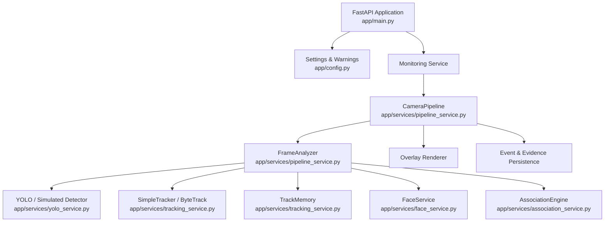
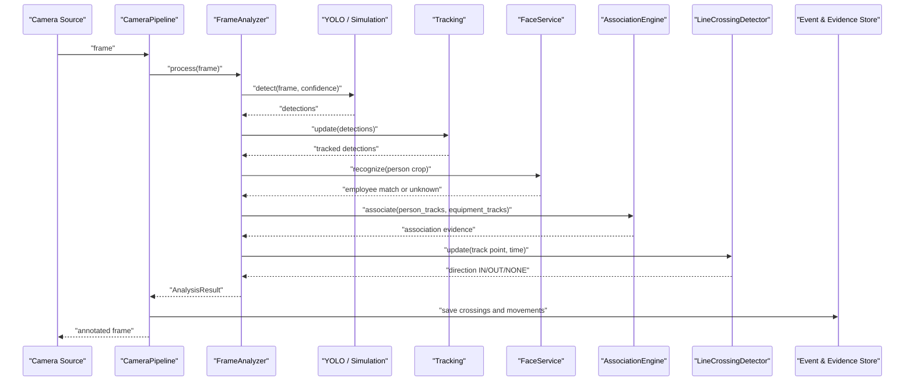
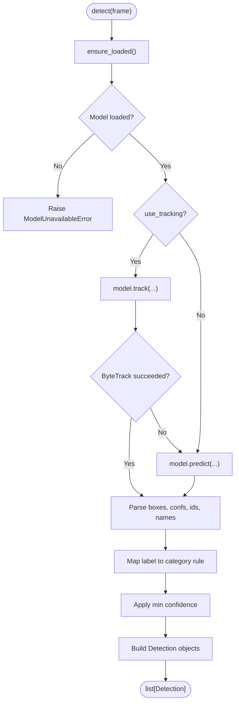
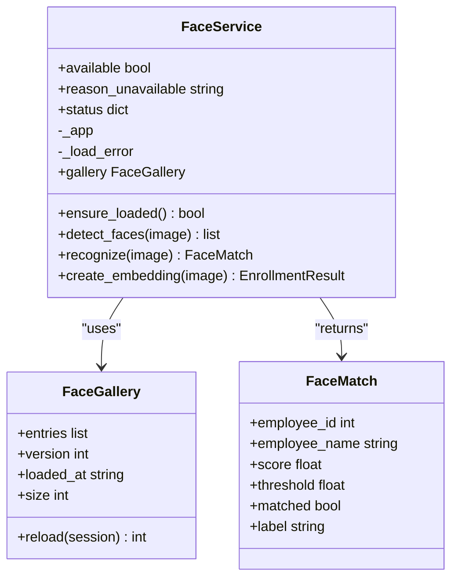
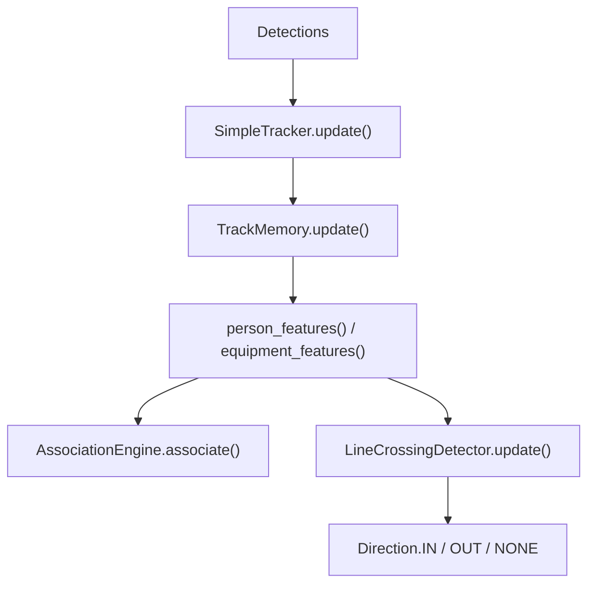
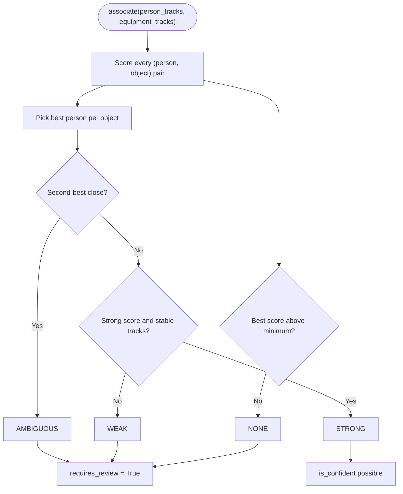
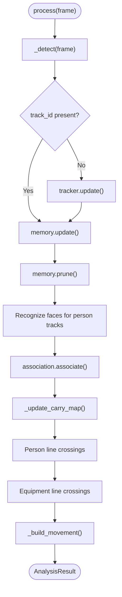
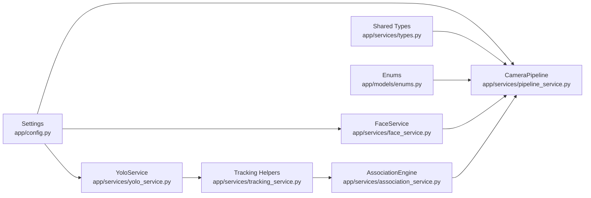

# AI Detection Pipeline

<cite>
**Referenced Files in This Document**
- [README.md](file://README.md)
- [main.py](file://app/main.py)
- [pipeline_service.py](file://app/services/pipeline_service.py)
- [yolo_service.py](file://app/services/yolo_service.py)
- [face_service.py](file://app/services/face_service.py)
- [tracking_service.py](file://app/services/tracking_service.py)
- [association_service.py](file://app/services/association_service.py)
- [types.py](file://app/services/types.py)
- [enums.py](file://app/models/enums.py)
- [config.py](file://app/config.py)
- [requirements-ai.txt](file://requirements-ai.txt)
</cite>

## Table of Contents
1. [Introduction](#introduction)
2. [Project Structure](#project-structure)
3. [Core Components](#core-components)
4. [Architecture Overview](#architecture-overview)
5. [Detailed Component Analysis](#detailed-component-analysis)
6. [Dependency Analysis](#dependency-analysis)
7. [Performance Considerations](#performance-considerations)
8. [Troubleshooting Guide](#troubleshooting-guide)
9. [Conclusion](#conclusion)

## Introduction
This document describes the AI detection pipeline that turns camera frames into auditable movement events. A frame enters through a camera source, passes through object detection and multi-object tracking, is associated with people, optionally recognized by face embedding, evaluated against a virtual line, and finally persisted as pending inventory or person events. The system intentionally avoids guessing: uncertain associations are marked for human review rather than silently trusted.

The pipeline is designed to work even when AI components are unavailable. If Ultralytics YOLO or InsightFace cannot be loaded, the application still starts, reports the missing capability, and continues operating without fabricating detections or identities.

## Project Structure
The AI pipeline lives under `app/services`, coordinated by a per-camera pipeline worker. High-level entry points include the FastAPI application lifecycle and configuration loading.

**Diagram sources**
- [main.py:25-40](file://app/main.py#L25-L40)
- [pipeline_service.py:390-487](file://app/services/pipeline_service.py#L390-L487)
- [yolo_service.py:55-154](file://app/services/yolo_service.py#L55-L154)
- [face_service.py:173-234](file://app/services/face_service.py#L173-L234)
- [tracking_service.py:29-85](file://app/services/tracking_service.py#L29-L85)
- [association_service.py:106-198](file://app/services/association_service.py#L106-L198)

**Section sources**
- [main.py:25-129](file://app/main.py#L25-L129)
- [config.py:62-156](file://app/config.py#L62-L156)
- [pipeline_service.py:1-43](file://app/services/pipeline_service.py#L1-L43)

## Core Components
The pipeline has two layers:

- **Per-frame reasoning layer**: Pure, synchronous logic that converts one frame into tracks, crossings, and movement candidates. It does not touch threads or the database directly.
- **Per-camera threading layer**: One worker thread per camera that pulls frames, runs the analyzer, publishes annotated frames for live view, and persists events.

Key responsibilities:

| Component | Responsibility |
|---|---|
| `YoloService` | Loads Ultralytics model once, maps labels to business categories, runs detection and optional ByteTrack, falls back gracefully if unavailable. |
| `FaceService` | Loads InsightFace once, extracts embeddings, matches against enrolled employee templates, returns unknown when thresholds or margins are not satisfied. |
| `SimpleTracker` | Lightweight IoU-based tracker used when ByteTrack is unavailable; keeps temporary track IDs stable across frames. |
| `TrackMemory` | Per-camera state for track age, velocity, identity binding, crossing history, and face recognition cadence. |
| `LineCrossingDetector` | Detects IN/OUT crossings using signed distance, hysteresis, cooldown, and minimum track length. |
| `AssociationEngine` | Scores person-equipment pairs using carry overlap, proximity, temporal stability, and direction agreement; outputs quality levels and review flags. |
| `FrameAnalyzer` | Orchestrates detection, tracking, identity, association, line crossing, and movement candidate creation. |
| `CameraPipeline` | Runs the analyzer per frame, annotates frames, saves evidence, and creates pending events. |

**Section sources**
- [pipeline_service.py:47-80](file://app/services/pipeline_service.py#L47-L80)
- [yolo_service.py:55-154](file://app/services/yolo_service.py#L55-L154)
- [face_service.py:173-234](file://app/services/face_service.py#L173-L234)
- [tracking_service.py:29-85](file://app/services/tracking_service.py#L29-L85)
- [tracking_service.py:125-205](file://app/services/tracking_service.py#L125-L205)
- [tracking_service.py:210-279](file://app/services/tracking_service.py#L210-L279)
- [association_service.py:106-198](file://app/services/association_service.py#L106-L198)

## Architecture Overview
The high-level flow is:

1. Camera source provides frames (RTSP, USB, file, or simulation).
2. `CameraPipeline` drains frames from the capture worker.
3. `FrameAnalyzer.process` runs detection, tracking, identity, association, and line crossing.
4. Annotated frames are published for MJPEG live view.
5. Person crossings become person events.
6. Equipment crossings become equipment movement candidates, always pending until reviewed.
7. Evidence JPEGs are saved alongside event metadata.

**Diagram sources**
- [pipeline_service.py:218-321](file://app/services/pipeline_service.py#L218-L321)
- [pipeline_service.py:462-487](file://app/services/pipeline_service.py#L462-L487)
- [yolo_service.py:166-236](file://app/services/yolo_service.py#L166-L236)
- [face_service.py:261-274](file://app/services/face_service.py#L261-L274)
- [association_service.py:131-198](file://app/services/association_service.py#L131-L198)
- [tracking_service.py:245-274](file://app/services/tracking_service.py#L245-L274)

## Detailed Component Analysis

### YOLO Object Detection and Category Mapping
`YoloService` is a lazily loaded, thread-safe wrapper around Ultralytics YOLO. It:

- Attempts to import Ultralytics at module load time.
- Tries the configured custom model path first, then a fallback model.
- Tracks whether it is using the fallback model.
- Raises a clear error when inference is requested but no model/runtime is available.
- Converts raw model classes to business categories using configured label mappings.
- Optionally uses ByteTrack via `model.track`; if ByteTrack fails, it falls back to `model.predict`.

**Diagram sources**
- [yolo_service.py:166-236](file://app/services/yolo_service.py#L166-L236)
- [yolo_service.py:115-154](file://app/services/yolo_service.py#L115-L154)

**Section sources**
- [yolo_service.py:1-7](file://app/services/yolo_service.py#L1-L7)
- [yolo_service.py:55-154](file://app/services/yolo_service.py#L55-L154)
- [yolo_service.py:166-242](file://app/services/yolo_service.py#L166-L242)
- [yolo_service.py:245-272](file://app/services/yolo_service.py#L245-L272)

### InsightFace Recognition and Gallery Matching
`FaceService` wraps InsightFace and ONNX Runtime. It:

- Lazily loads the InsightFace app once per process.
- Supports CPU and GPU providers through environment configuration.
- Builds an in-memory gallery of active employee embeddings.
- Recognizes the largest face in a cropped image.
- Uses cosine similarity with a threshold and margin to avoid guessing between similar employees.
- Returns “Noma'lum shaxs” when the best score is below threshold or too close to the runner-up.

**Diagram sources**
- [face_service.py:173-234](file://app/services/face_service.py#L173-L234)
- [face_service.py:132-170](file://app/services/face_service.py#L132-L170)
- [face_service.py:48-60](file://app/services/face_service.py#L48-L60)

**Section sources**
- [face_service.py:1-11](file://app/services/face_service.py#L1-L11)
- [face_service.py:86-130](file://app/services/face_service.py#L86-L130)
- [face_service.py:132-170](file://app/services/face_service.py#L132-L170)
- [face_service.py:173-274](file://app/services/face_service.py#L173-L274)

### Multi-Object Tracking and Line Crossing
The tracking layer supports two modes:

- **ByteTrack mode**: When Ultralytics is available, `YoloService.detect` calls `model.track` with persistence, producing stable track IDs.
- **Fallback mode**: `SimpleTracker` assigns temporary IDs using greedy IoU matching when ByteTrack is unavailable.

`TrackMemory` maintains short-lived state per track, including velocity, frames seen, last face attempt, and crossing history. `LineCrossingDetector` detects IN/OUT crossings with hysteresis, cooldown, and minimum track length.

**Diagram sources**
- [tracking_service.py:29-85](file://app/services/tracking_service.py#L29-L85)
- [tracking_service.py:125-205](file://app/services/tracking_service.py#L125-L205)
- [tracking_service.py:210-279](file://app/services/tracking_service.py#L210-L279)

**Section sources**
- [tracking_service.py:1-13](file://app/services/tracking_service.py#L1-L13)
- [tracking_service.py:29-85](file://app/services/tracking_service.py#L29-L85)
- [tracking_service.py:125-205](file://app/services/tracking_service.py#L125-L205)
- [tracking_service.py:210-279](file://app/services/tracking_service.py#L210-L279)

### Association Scoring and Review Logic
The association engine combines four signals:

| Signal | Weight | Meaning |
|---|---:|---|
| Carry overlap | 0.50 | Object center inside expanded person box or overlapping side area. |
| Proximity | 0.25 | Center distance relative to person size. |
| Temporal stability | 0.15 | Both tracks have been visible for enough frames. |
| Direction agreement | 0.10 | Normalized velocities point roughly the same way. |

Quality levels:

| Quality | Condition | Review Required? |
|---|---|---|
| STRONG | Score meets strong threshold and tracks are stable. | No |
| WEAK | Lower score or short tracks. | Yes |
| AMBIGUOUS | Another person explains the object nearly as well. | Yes |
| NONE | No confident association found. | Depends on context |

**Diagram sources**
- [association_service.py:112-129](file://app/services/association_service.py#L112-L129)
- [association_service.py:131-198](file://app/services/association_service.py#L131-L198)

**Section sources**
- [association_service.py:1-15](file://app/services/association_service.py#L1-L15)
- [association_service.py:29-57](file://app/services/association_service.py#L29-L57)
- [association_service.py:106-198](file://app/services/association_service.py#L106-L198)

### Frame Processing Orchestration
`FrameAnalyzer.process` is the central per-frame routine. It:

1. Calls detection; catches errors and continues with empty detections.
2. Assigns track IDs if missing.
3. Updates `TrackMemory` and prunes stale states.
4. Recognizes faces for person tracks based on a configurable interval.
5. Associates persons with equipment.
6. Detects person crossings and equipment crossings separately.
7. Builds movement candidates only when equipment crosses and carries evidence.
8. Applies cooldown and carry-map logic to avoid duplicate or stale movement events.

**Diagram sources**
- [pipeline_service.py:218-321](file://app/services/pipeline_service.py#L218-L321)
- [pipeline_service.py:151-216](file://app/services/pipeline_service.py#L151-L216)

**Section sources**
- [pipeline_service.py:103-149](file://app/services/pipeline_service.py#L103-L149)
- [pipeline_service.py:218-321](file://app/services/pipeline_service.py#L218-L321)
- [pipeline_service.py:328-387](file://app/services/pipeline_service.py#L328-L387)

### Camera Pipeline Threading and Persistence
`CameraPipeline` runs one daemon thread per camera. Its loop:

- Drains frames from the camera worker.
- Runs `FrameAnalyzer.process`.
- Renders overlay annotations.
- Publishes annotated frames for live view.
- Persists crossings and movements inside a database session.
- Catches exceptions defensively so a single bad frame does not kill the camera pipeline.

Persistence distinguishes between:

- **Person crossings**: Auto status if an employee is known; pending if unknown.
- **Equipment movements**: Always pending, with association quality, reasons, and review flags stored in event extra fields.

**Section sources**
- [pipeline_service.py:390-487](file://app/services/pipeline_service.py#L390-L487)
- [pipeline_service.py:489-586](file://app/services/pipeline_service.py#L489-L586)

### Data Models and Shared Types
Shared value objects keep detection, tracking, and association code decoupled from SQLAlchemy models and UI rendering.

| Type | Purpose |
|---|---|
| `BBox` | Bounding box geometry, IOU, expansion, center, and containment helpers. |
| `Detection` | One detector output with label, category, confidence, and optional track ID. |
| `TrackFeature` | Aggregated track view used by association scoring. |
| `EventType` | Enumerated event types such as person entered/exited and equipment brought in/taken out. |
| `VerificationStatus` | AUTO, PENDING, CONFIRMED, REJECTED. |
| `Direction` | IN, OUT, NONE. |
| `AssociationQuality` | STRONG, WEAK, AMBIGUOUS, NONE. |

**Section sources**
- [types.py:10-138](file://app/services/types.py#L10-L138)
- [enums.py:27-59](file://app/models/enums.py#L27-L59)
- [enums.py:76-103](file://app/models/enums.py#L76-L103)
- [enums.py:178-183](file://app/models/enums.py#L178-L183)

## Dependency Analysis
The pipeline depends on configuration, shared types, and external AI libraries.

**Diagram sources**
- [config.py:62-156](file://app/config.py#L62-L156)
- [pipeline_service.py:28-42](file://app/services/pipeline_service.py#L28-L42)
- [yolo_service.py:18-19](file://app/services/yolo_service.py#L18-L19)
- [face_service.py:23-24](file://app/services/face_service.py#L23-L24)
- [tracking_service.py:22-23](file://app/services/tracking_service.py#L22-L23)
- [association_service.py:23-24](file://app/services/association_service.py#L23-L24)

**Section sources**
- [config.py:62-156](file://app/config.py#L62-L156)
- [pipeline_service.py:28-42](file://app/services/pipeline_service.py#L28-L42)
- [yolo_service.py:18-19](file://app/services/yolo_service.py#L18-L19)
- [face_service.py:23-24](file://app/services/face_service.py#L23-L24)
- [tracking_service.py:22-23](file://app/services/tracking_service.py#L22-L23)
- [association_service.py:23-24](file://app/services/association_service.py#L23-L24)

## Performance Considerations
The system exposes several knobs for balancing accuracy, latency, and resource usage:

| Area | Configuration | Impact |
|---|---|---|
| YOLO device | `YOLO_DEVICE` | CPU vs CUDA; GPU improves FPS but requires compatible hardware and runtime. |
| YOLO image size | `YOLO_IMAGE_SIZE` | Smaller images reduce compute cost but may lower detection accuracy. |
| YOLO confidence | `YOLO_CONFIDENCE` | Higher thresholds reduce false positives but may miss small or distant objects. |
| Face providers | `FACE_PROVIDERS` | `CPUExecutionProvider` is default; `CUDAExecutionProvider` can accelerate InsightFace. |
| Face recognition interval | `FACE_RECOGNITION_INTERVAL` | Fewer face recognitions reduce CPU/GPU load; identity updates happen less frequently. |
| Processing FPS | `PROCESSING_FPS` | Controls how aggressively frames are consumed and analyzed. |
| Processing resolution | `PROCESSING_WIDTH`, `PROCESSING_HEIGHT` | Lower resolution reduces memory and compute pressure. |
| Event cooldown | `EVENT_COOLDOWN_SECONDS` | Prevents rapid duplicate events for the same track or object. |

Infrastructure guidance:

- **CPU-only systems**: Expect higher CPU utilization; consider lowering `PROCESSING_FPS`, increasing `FACE_RECOGNITION_INTERVAL`, and reducing `YOLO_IMAGE_SIZE`.
- **GPU systems**: Use CUDA-enabled runtimes where supported; verify provider configuration for both YOLO and InsightFace.
- **Memory**: Keep processing resolution reasonable; prune track memory regularly; evidence retention should be tuned to disk capacity.
- **Scalability**: Each camera runs its own pipeline thread; adding cameras increases CPU/GPU/memory demand proportionally.

**Section sources**
- [config.py:177-222](file://app/config.py#L177-L222)
- [README.md:37-47](file://README.md#L37-L47)
- [README.md:516-530](file://README.md#L516-L530)

## Troubleshooting Guide
Common operational issues and their relationship to the pipeline:

| Symptom | Likely Cause | Pipeline Behavior | Recommended Action |
|---|---|---|---|
| YOLO model not found | Custom model path missing | System warns; fallback model may be used if available. | Place trained model at configured path or adjust settings. |
| Face recognition unavailable | InsightFace or ONNX runtime missing | Face service reports unavailable; pipeline continues without identity. | Install AI requirements; rebuild InsightFace if needed. |
| ByteTrack fails | Missing tracker files or incompatible environment | YOLO falls back to prediction without persistent IDs. | Verify Ultralytics installation and tracker configuration. |
| Too many unknown persons | Threshold too strict or gallery empty | Face matching returns unknown; events stay pending. | Calibrate threshold/margin; refresh face gallery. |
| False equipment associations | Overly loose proximity or carry thresholds | Association quality may be WEAK or AMBIGUOUS. | Tune association parameters and review ambiguous cases. |
| Duplicate movement events | Cooldown too low or carry map not expiring | Movement log prevents repeated logging within cooldown window. | Adjust cooldown and carry staleness settings. |
| Low FPS | CPU inference or high resolution | Pipeline logs processing errors defensively but keeps running. | Reduce FPS, image size, or move to GPU. |

Error handling patterns:

- **Model availability checks**: Both YOLO and Face services expose `available` and `reason_unavailable` instead of failing loudly.
- **Graceful degradation**: Missing AI components do not crash the server; they disable advanced features while preserving core functionality.
- **Defensive exception handling**: Frame processing and persistence catch exceptions so one bad frame does not stop the camera pipeline.
- **Pending-by-default policy**: Uncertain events remain pending until an operator confirms or rejects them.

**Section sources**
- [yolo_service.py:78-103](file://app/services/yolo_service.py#L78-L103)
- [face_service.py:184-204](file://app/services/face_service.py#L184-L204)
- [pipeline_service.py:221-227](file://app/services/pipeline_service.py#L221-L227)
- [pipeline_service.py:483-487](file://app/services/pipeline_service.py#L483-L487)
- [pipeline_service.py:498-507](file://app/services/pipeline_service.py#L498-L507)
- [README.md:516-530](file://README.md#L516-L530)

## Conclusion
The AI detection pipeline separates concerns cleanly: detection, tracking, identity, association, line crossing, and persistence each have focused responsibilities. Ultralytics YOLO provides object detection and optional ByteTrack tracking, while InsightFace with ONNX Runtime supplies face recognition. The hybrid approach combines computer vision outputs with business rules, ensuring that uncertain results are surfaced for human review rather than automatically trusted.

For production deployments, tune device selection, image size, confidence thresholds, and recognition intervals according to available CPU/GPU resources. Keep evidence retention, cooldown windows, and association parameters calibrated to your camera geometry and operational expectations. Most importantly, treat automated outputs as candidates: the pipeline’s strongest design choice is making uncertainty explicit and audit-ready.