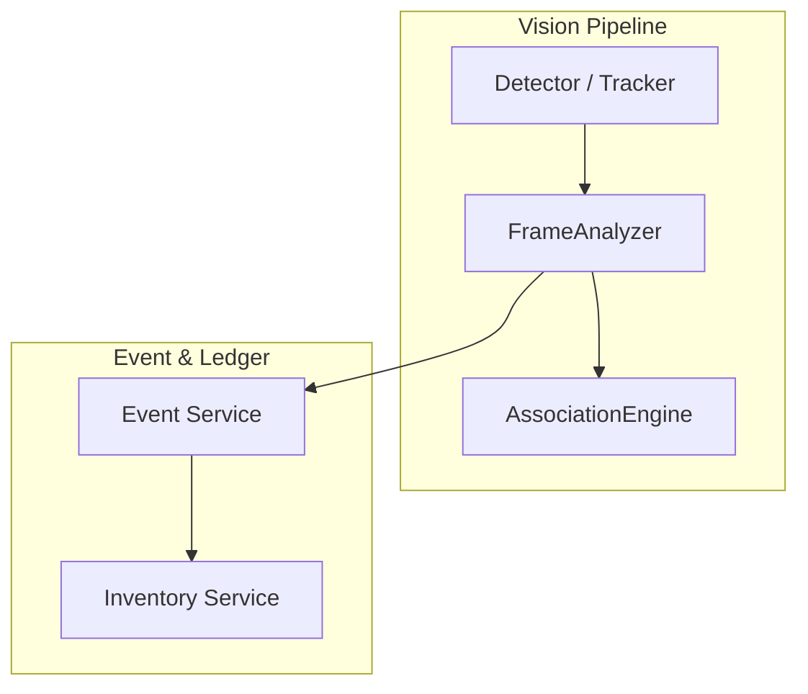
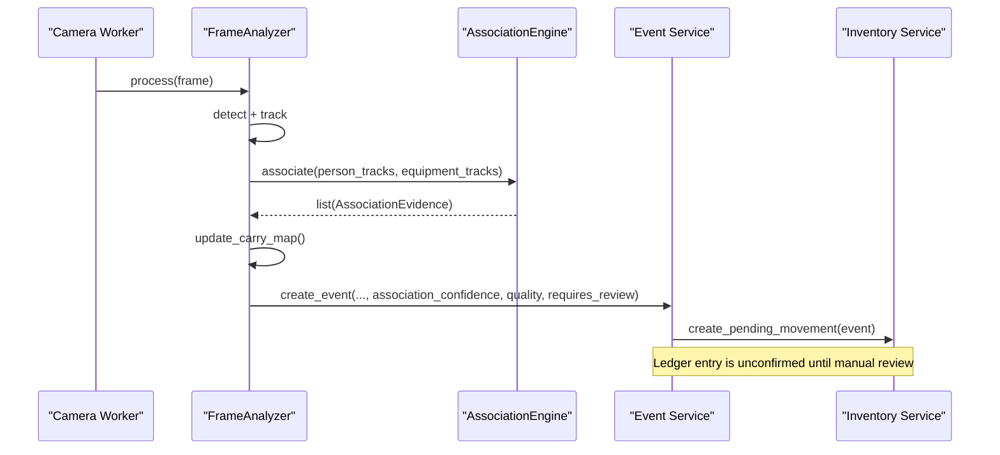
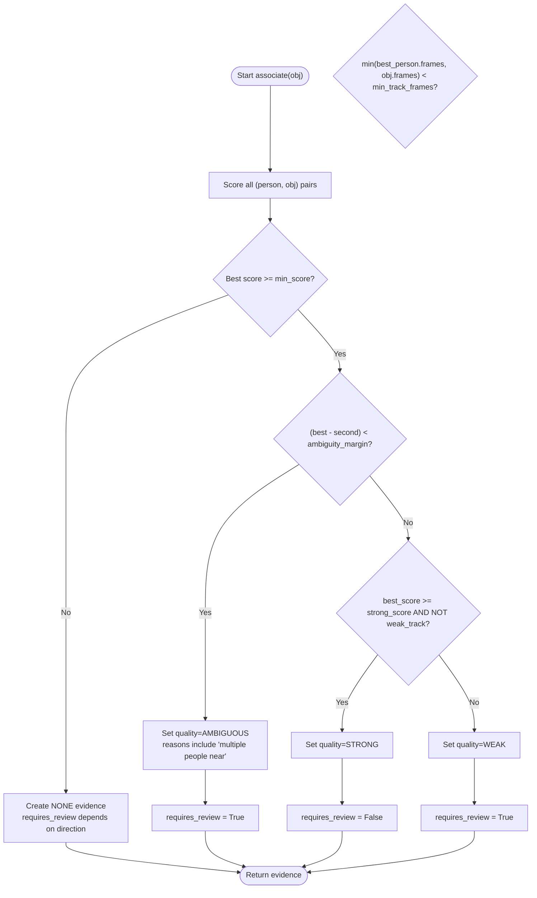
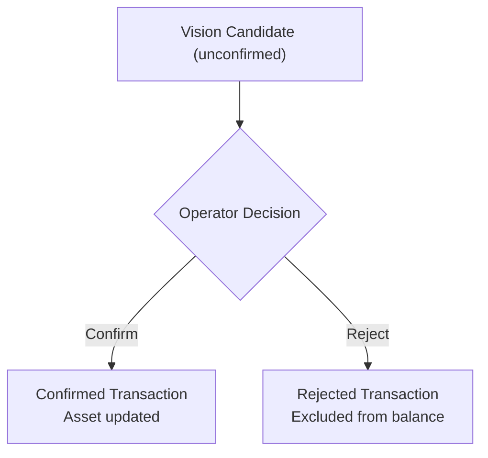
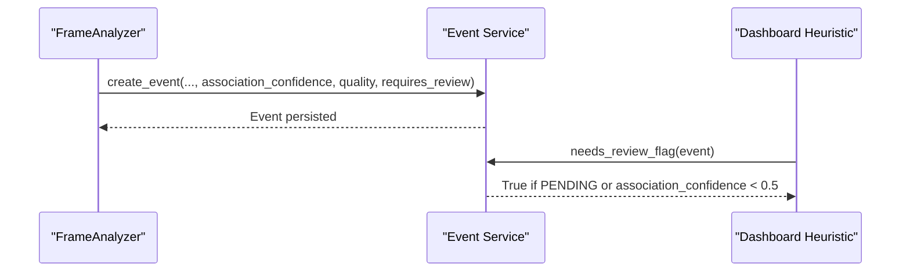
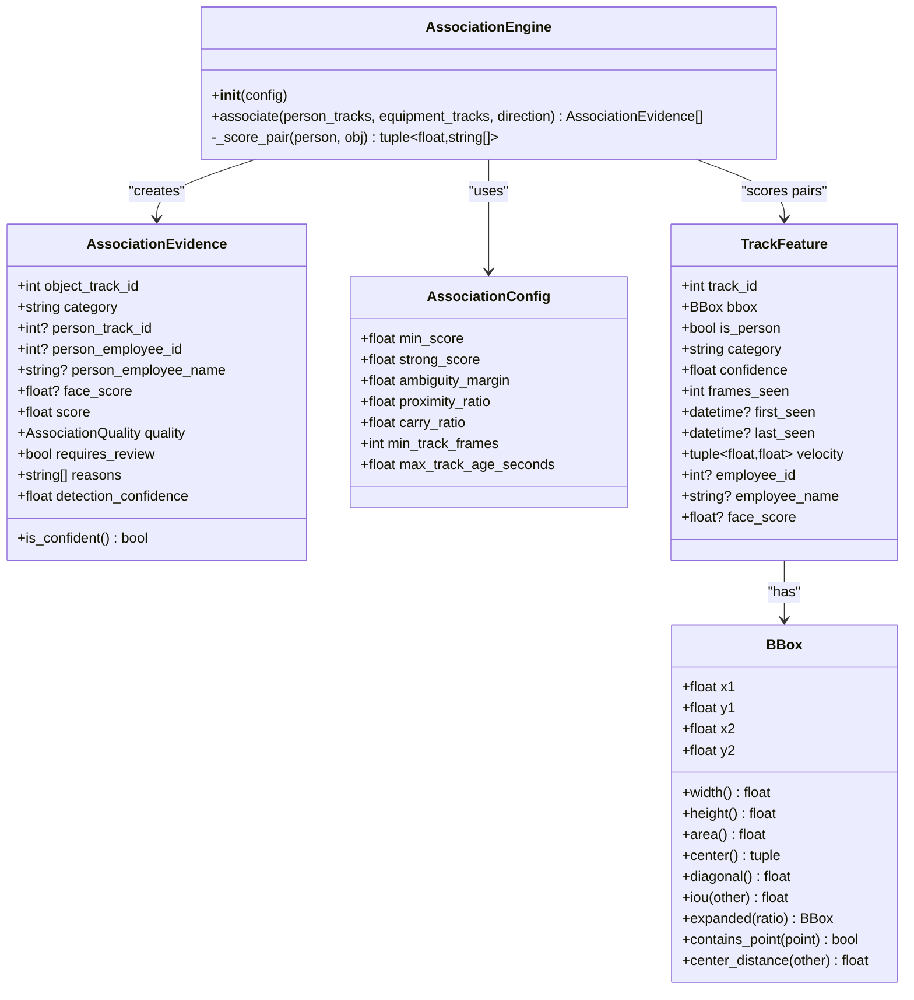

# Association Scoring

<cite>
**Referenced Files in This Document**
- [association_service.py](file://app/services/association_service.py)
- [pipeline_service.py](file://app/services/pipeline_service.py)
- [event_service.py](file://app/services/event_service.py)
- [inventory_service.py](file://app/services/inventory_service.py)
- [types.py](file://app/services/types.py)
- [enums.py](file://app/models/enums.py)
- [equipment.py](file://app/models/equipment.py)
- [test_association.py](file://tests/test_association.py)
</cite>

## Table of Contents
1. [Introduction](#introduction)
2. [Project Structure](#project-structure)
3. [Core Components](#core-components)
4. [Architecture Overview](#architecture-overview)
5. [Detailed Component Analysis](#detailed-component-analysis)
6. [Dependency Analysis](#dependency-analysis)
7. [Performance Considerations](#performance-considerations)
8. [Troubleshooting Guide](#troubleshooting-guide)
9. [Conclusion](#conclusion)
10. [Appendices](#appendices)

## Introduction
This document explains the association scoring service that determines which person carried which object during inventory events. It covers spatial proximity analysis, temporal correlation, directional agreement, confidence scoring, ambiguity handling, threshold configuration, manual override capabilities, and how association scores influence event confidence and review workflows. The goal is to make the system’s behavior transparent so operators can tune parameters, interpret scores, and handle edge cases confidently.

## Project Structure
The association scoring logic lives in a dedicated service and integrates with the camera pipeline, event creation, and inventory ledger:

- Association scoring engine: computes per-pair evidence and quality labels.
- Pipeline service: runs detection/tracking, calls the association engine, and converts results into movement candidates.
- Event service: persists events with association confidence and drives review status.
- Inventory service: creates unconfirmed ledger entries for equipment movements; only confirmed entries affect balances.
- Shared types and enums: bounding boxes, track features, direction, verification status, and association quality.

**Diagram sources**
- [pipeline_service.py:103-149](file://app/services/pipeline_service.py#L103-L149)
- [pipeline_service.py:218-259](file://app/services/pipeline_service.py#L218-L259)
- [pipeline_service.py:544-586](file://app/services/pipeline_service.py#L544-L586)
- [event_service.py:59-147](file://app/services/event_service.py#L59-L147)
- [inventory_service.py:132-156](file://app/services/inventory_service.py#L132-L156)

**Section sources**
- [association_service.py:1-219](file://app/services/association_service.py#L1-L219)
- [pipeline_service.py:103-149](file://app/services/pipeline_service.py#L103-L149)
- [event_service.py:59-147](file://app/services/event_service.py#L59-L147)
- [inventory_service.py:132-156](file://app/services/inventory_service.py#L132-L156)

## Core Components
- AssociationEvidence: represents one scored association between an object track and a person track, including score, quality label, reasons, and whether it requires review.
- AssociationConfig: tunable thresholds for minimum score, strong score, ambiguity margin, spatial ratios, and temporal stability.
- AssociationEngine: scores every (person, object) pair using four signals and classifies quality as STRONG, WEAK, AMBIGUOUS, or NONE.
- TrackFeature and BBox: shared data structures used by tracking and association.
- MovementCandidate: pipeline-level representation carrying association_score, quality, and requires_review into event persistence.
- Event and InventoryTransaction: persisted records where association_confidence influences review heuristics and pending ledger entries are created for equipment movements.

Key responsibilities:
- AssociationEngine: compute weighted score from carry overlap, proximity, temporal stability, and direction agreement; classify quality and set requires_review.
- Pipeline FrameAnalyzer: call association engine, maintain short-term carry map, and convert evidence into movement candidates.
- Event Service: persist events with association_confidence and drive verification workflow.
- Inventory Service: create unconfirmed ledger entries for vision-based movements; confirm/reject via manual review.

**Section sources**
- [association_service.py:29-57](file://app/services/association_service.py#L29-L57)
- [association_service.py:106-198](file://app/services/association_service.py#L106-L198)
- [types.py:10-71](file://app/services/types.py#L10-L71)
- [types.py:100-128](file://app/services/types.py#L100-L128)
- [pipeline_service.py:60-78](file://app/services/pipeline_service.py#L60-L78)
- [event_service.py:59-147](file://app/services/event_service.py#L59-L147)
- [inventory_service.py:132-156](file://app/services/inventory_service.py#L132-L156)

## Architecture Overview
The association scoring pipeline processes each frame through detection and tracking, then associates detected objects with tracked persons. The resulting evidence is converted into movement candidates and persisted as events with association confidence. Inventory ledger entries are created as unconfirmed candidates until an operator confirms them.

**Diagram sources**
- [pipeline_service.py:218-259](file://app/services/pipeline_service.py#L218-L259)
- [pipeline_service.py:370-387](file://app/services/pipeline_service.py#L370-L387)
- [pipeline_service.py:544-586](file://app/services/pipeline_service.py#L544-L586)
- [event_service.py:59-147](file://app/services/event_service.py#L59-L147)
- [inventory_service.py:132-156](file://app/services/inventory_service.py#L132-L156)

## Detailed Component Analysis

### Association Engine and Evidence Model
The association engine evaluates four weak signals for each (person, object) pair:

- Carry overlap: checks if the object center falls inside an expanded person box or computes IoU for partial overlap.
- Proximity: measures normalized distance relative to the person’s size.
- Temporal stability: rewards pairs whose tracks have been stable for multiple frames.
- Direction agreement: compares normalized velocity vectors to see if both move similarly.

These signals are combined with fixed weights:
- Carry: 0.50
- Proximity: 0.25
- Temporal: 0.15
- Direction: 0.10

Quality classification:
- STRONG: best score meets strong threshold and tracks are not too short.
- WEAK: below strong threshold or short tracks.
- AMBIGUOUS: second-best candidate is close enough to the best within the ambiguity margin.
- NONE: no candidate exceeds the minimum score.

requires_review is true for AMBIGUOUS or WEAK qualities, or when tracks are short.

**Diagram sources**
- [association_service.py:112-198](file://app/services/association_service.py#L112-L198)

**Section sources**
- [association_service.py:29-57](file://app/services/association_service.py#L29-L57)
- [association_service.py:59-104](file://app/services/association_service.py#L59-L104)
- [association_service.py:106-198](file://app/services/association_service.py#L106-L198)

### Spatial Proximity Analysis
- Carry overlap uses an expanded person bounding box controlled by carry_ratio. If the object center is inside the expanded box, carry score is maximal; otherwise, IoU provides a graded signal capped at 0.9.
- Proximity score normalizes distance by person diagonal multiplied by proximity_ratio. Distance ratio <= 1 yields full score; ratio >= 2.5 yields zero; intermediate values linearly decay.

Tuning guidance:
- Increase carry_ratio to allow larger “carrying” zones for bulky items.
- Adjust proximity_ratio to relax or tighten acceptable distances relative to person size.

**Section sources**
- [association_service.py:76-96](file://app/services/association_service.py#L76-L96)
- [types.py:10-71](file://app/services/types.py#L10-L71)

### Temporal Correlation
Temporal score rewards sustained co-occurrence of person and object tracks. Frames_seen counts how long each track has existed; the score saturates after three times min_track_frames. Short tracks reduce confidence and trigger review.

Tuning guidance:
- Raise min_track_frames to require longer observation before trusting associations.
- Lower min_track_frames to be more responsive but risk more false positives.

**Section sources**
- [association_service.py:99-104](file://app/services/association_service.py#L99-L104)
- [types.py:100-128](file://app/services/types.py#L100-L128)

### Directional Agreement
Directional agreement compares normalized velocities of person and object tracks. If either velocity is zero, the contribution is neutral. Otherwise, dot product maps to a 0–1 score. Opposite directions penalize the association.

Tuning guidance:
- Direction weight is fixed at 0.10 in the composite score. Changing this would require modifying the engine’s weighting logic.

**Section sources**
- [association_service.py:59-74](file://app/services/association_service.py#L59-L74)

### Confidence Scoring and Quality Labels
Composite score formula:
- score = 0.50*carry + 0.25*proximity + 0.15*temporal + 0.10*direction

Quality mapping:
- STRONG: best_score >= strong_score and not weak_track.
- WEAK: below strong_score or weak_track.
- AMBIGUOUS: best_score - second_score < ambiguity_margin.
- NONE: no candidate above min_score.

requires_review:
- True for AMBIGUOUS or WEAK.
- Also true if best person/object tracks are shorter than min_track_frames.

Interpretation:
- STRONG without requires_review indicates high confidence.
- AMBIGUOUS suggests multiple plausible carriers; dashboard should flag for human review.
- WEAK indicates insufficient evidence; also flagged for review.
- NONE means no person was associated; may still require review if direction context exists.

**Section sources**
- [association_service.py:112-198](file://app/services/association_service.py#L112-L198)
- [enums.py:178-183](file://app/models/enums.py#L178-L183)

### Threshold Configuration
AssociationConfig exposes key thresholds:
- min_score: minimum composite score to consider any association.
- strong_score: threshold for STRONG quality.
- ambiguity_margin: maximum gap between best and second scores to mark AMBIGUOUS.
- proximity_ratio: scaling factor for proximity normalization.
- carry_ratio: expansion factor for carry zone.
- min_track_frames: minimum frames to consider tracks stable.
- max_track_age_seconds: available for age-related logic (not directly used in current scoring).

Example tuning scenarios:
- To reduce false positives in crowded scenes: increase min_score and strong_score; increase ambiguity_margin to widen the ambiguous region.
- To improve detection of side-held objects: increase carry_ratio slightly.
- To tolerate faster motion: adjust proximity_ratio upward.

**Section sources**
- [association_service.py:49-57](file://app/services/association_service.py#L49-L57)

### Manual Override Capabilities
The system writes vision-based movement candidates as unconfirmed ledger entries. Operators can confirm or reject these entries:
- Confirming marks the transaction confirmed and updates asset state and location.
- Rejecting marks the transaction rejected and keeps it out of official balances.

This manual step decouples automated association confidence from business accounting until validated.

**Diagram sources**
- [inventory_service.py:132-156](file://app/services/inventory_service.py#L132-L156)
- [inventory_service.py:165-205](file://app/services/inventory_service.py#L165-L205)

**Section sources**
- [inventory_service.py:132-156](file://app/services/inventory_service.py#L132-L156)
- [inventory_service.py:165-205](file://app/services/inventory_service.py#L165-L205)

### Resolving Ambiguities and Fallback Mechanisms
Ambiguity resolution:
- When two people explain an object almost equally well (score difference below ambiguity_margin), the engine sets quality to AMBIGUOUS and requires_review=True.
- If no candidate exceeds min_score, the engine returns NONE and may set requires_review based on direction context.

Fallback mechanisms:
- Short tracks (< min_track_frames) force requires_review even if score is high.
- The pipeline maintains a short-term carry map to ensure consistent object-person binding across frames; stale bindings are dropped after a time window.

Edge case handling:
- Far-away objects produce NONE associations.
- Opposite-direction motion reduces score and adds explanatory reasons.
- Empty inputs return empty evidence lists or NONE evidence depending on scenario.

**Section sources**
- [association_service.py:131-198](file://app/services/association_service.py#L131-L198)
- [pipeline_service.py:181-209](file://app/services/pipeline_service.py#L181-L209)
- [test_association.py:36-103](file://tests/test_association.py#L36-L103)

### Relationship Between Association Scoring and Event Confidence
Movement candidates carry association_score and quality into event creation:
- association_confidence is stored on the event record.
- VerificationStatus defaults to PENDING for equipment movement events.
- Dashboard heuristics mark events needing review if verification_status is PENDING or association_confidence < 0.5.

Thus, low association confidence increases the likelihood of requiring manual review, while STRONG associations with high scores typically pass through with lower review pressure.

**Diagram sources**
- [pipeline_service.py:544-586](file://app/services/pipeline_service.py#L544-L586)
- [event_service.py:292-298](file://app/services/event_service.py#L292-L298)

**Section sources**
- [pipeline_service.py:544-586](file://app/services/pipeline_service.py#L544-L586)
- [event_service.py:292-298](file://app/services/event_service.py#L292-L298)

## Dependency Analysis
The association scoring module depends on shared geometry and tracking primitives and integrates tightly with the pipeline and event systems.

**Diagram sources**
- [association_service.py:29-57](file://app/services/association_service.py#L29-L57)
- [association_service.py:106-198](file://app/services/association_service.py#L106-L198)
- [types.py:10-71](file://app/services/types.py#L10-L71)
- [types.py:100-128](file://app/services/types.py#L100-L128)

**Section sources**
- [association_service.py:29-57](file://app/services/association_service.py#L29-L57)
- [association_service.py:106-198](file://app/services/association_service.py#L106-L198)
- [types.py:10-71](file://app/services/types.py#L10-L71)
- [types.py:100-128](file://app/services/types.py#L100-L128)

## Performance Considerations
- Pairwise scoring complexity: For N persons and M objects, the engine computes N*M scores per frame. In dense scenes, this can become expensive.
- Temporal scoring relies on frames_seen; frequent pruning of stale tracks helps control memory usage.
- Carry map maintenance in the pipeline ensures only recent associations contribute to movement decisions, reducing noise.
- Detection errors and pipeline exceptions are caught defensively to keep the camera loop running.

Recommendations:
- Tune min_track_frames to balance responsiveness and stability.
- Use appropriate proximity_ratio and carry_ratio to avoid excessive IoU computations for distant objects.
- Monitor frames_processed and detection_errors metrics to identify performance bottlenecks.

[No sources needed since this section provides general guidance]

## Troubleshooting Guide
Common issues and resolutions:
- Too many AMBIGUOUS associations:
  - Increase ambiguity_margin to widen the ambiguous region.
  - Increase strong_score to require higher confidence for STRONG.
  - Check camera calibration and line placement affecting direction signals.
- Frequent NONE associations:
  - Lower min_score cautiously.
  - Increase proximity_ratio to accept larger distances.
  - Ensure tracking is stable; check frames_seen and track lifetimes.
- Excessive requires_review flags:
  - Verify min_track_frames is not too high.
  - Inspect direction signals; opposite motion will penalize associations.
- Inventory discrepancies:
  - Confirm that vision candidates remain unconfirmed until reviewed.
  - Use confirm/reject flows to correct misassociations.

Operational checks:
- Inspect event association_confidence and quality fields.
- Review notes attached to events for reasons provided by the association engine.
- Validate that inventory transactions reflect manual confirmations.

**Section sources**
- [association_service.py:112-198](file://app/services/association_service.py#L112-L198)
- [pipeline_service.py:544-586](file://app/services/pipeline_service.py#L544-L586)
- [inventory_service.py:165-205](file://app/services/inventory_service.py#L165-L205)

## Conclusion
The association scoring service combines spatial, temporal, and directional signals to determine likely person-object associations during inventory events. Its design emphasizes transparency: scores, quality labels, and reasons are exposed to support manual review. Thresholds in AssociationConfig allow fine-tuning for different environments. Low-confidence associations are routed to review workflows, while STRONG associations minimize operational overhead. The integration with event persistence and inventory ledger ensures that automated detections do not automatically alter official balances until validated by operators.

[No sources needed since this section summarizes without analyzing specific files]

## Appendices

### Example Tuning Scenarios
- Crowded entrance with frequent side-by-side walking:
  - Increase ambiguity_margin to capture more ambiguous cases.
  - Increase strong_score to demand clearer evidence.
  - Keep min_track_frames moderate to avoid delaying decisions.
- Outdoor scene with fast motion:
  - Increase proximity_ratio to accommodate larger distances.
  - Ensure direction signals are meaningful; otherwise, rely more on carry/proximity.
- Bulky objects held at sides:
  - Slightly increase carry_ratio to expand the carrying zone.
  - Monitor IoU-based carry scores to ensure they reflect realistic holding patterns.

[No sources needed since this section provides general guidance]

### Interpreting Association Scores
- Score near 1.0 with STRONG quality: high confidence; usually no review required.
- Score around 0.5–0.7 with WEAK quality: insufficient evidence; review recommended.
- AMBIGUOUS quality: multiple plausible carriers; always review.
- NONE quality: no person associated; may require review if direction context implies movement.

**Section sources**
- [association_service.py:112-198](file://app/services/association_service.py#L112-L198)

### Edge Cases in Complex Scenarios
- Multiple objects near one person: independent scoring per object; each gets its own evidence.
- Person and object moving in opposite directions: direction penalty reduces score; reasons indicate mismatch.
- Very short tracks: requires_review forced regardless of score.
- Empty inputs: engine returns empty evidence list or NONE evidence appropriately.

**Section sources**
- [test_association.py:83-103](file://tests/test_association.py#L83-L103)
- [association_service.py:131-198](file://app/services/association_service.py#L131-L198)