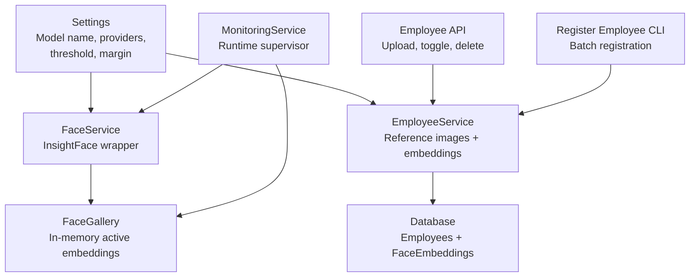
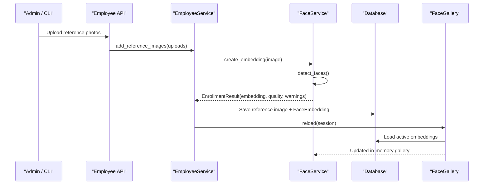
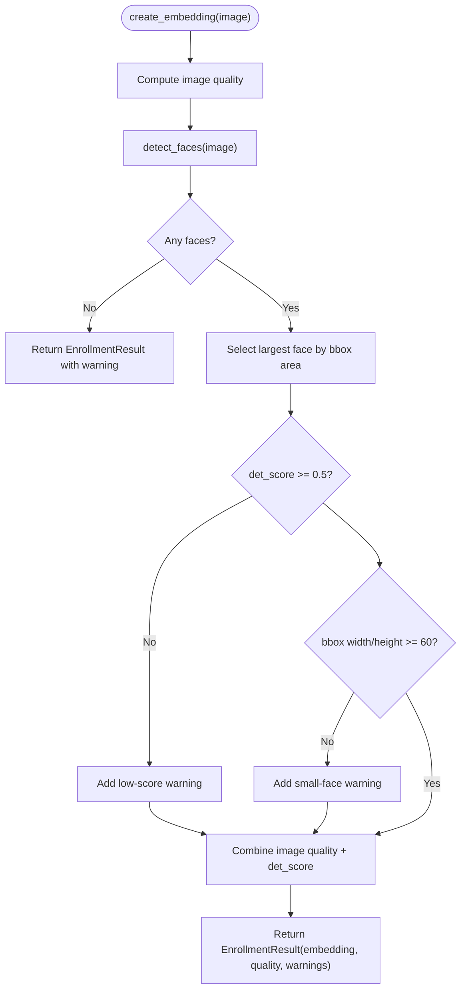
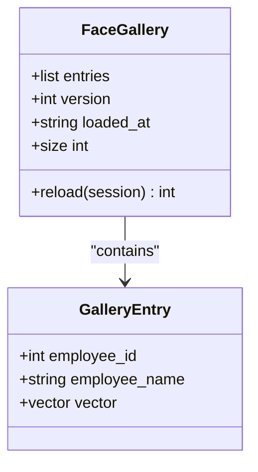
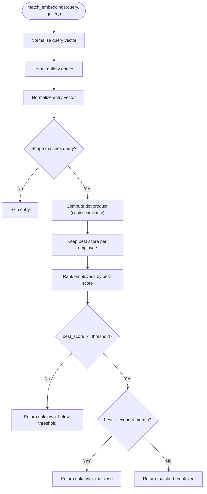
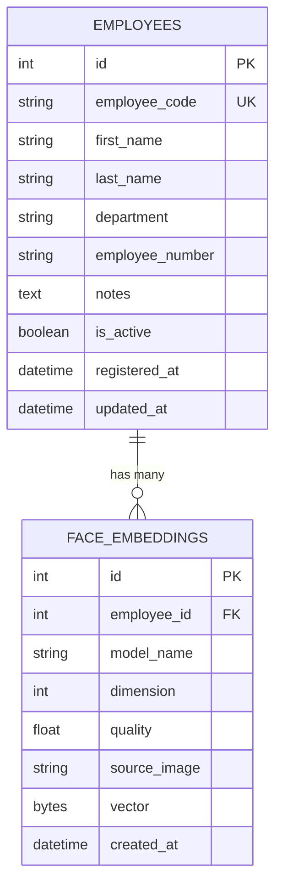
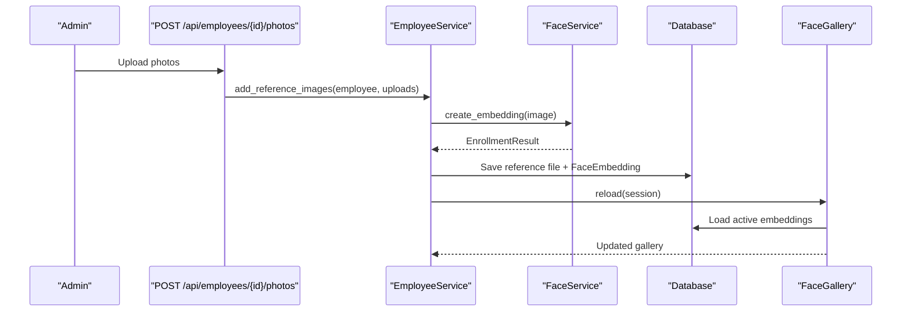
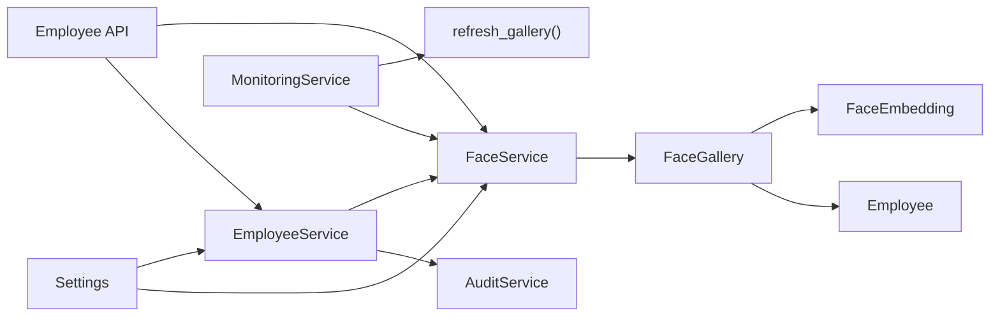

# Face Recognition Service

<cite>
**Referenced Files in This Document**
- [README.md](file://README.md)
- [face_service.py](file://app/services/face_service.py)
- [employee.py](file://app/models/employee.py)
- [employees.py](file://app/api/employees.py)
- [register_employee.py](file://scripts/register_employee.py)
- [employee_service.py](file://app/services/employee_service.py)
- [monitoring_service.py](file://app/services/monitoring_service.py)
- [config.py](file://app/config.py)
- [test_face_matching.py](file://tests/test_face_matching.py)
</cite>

## Table of Contents
1. [Introduction](#introduction)
2. [Project Structure](#project-structure)
3. [Core Components](#core-components)
4. [Architecture Overview](#architecture-overview)
5. [Detailed Component Analysis](#detailed-component-analysis)
6. [Dependency Analysis](#dependency-analysis)
7. [Performance Considerations](#performance-considerations)
8. [Troubleshooting Guide](#troubleshooting-guide)
9. [Security and Privacy](#security-and-privacy)
10. [Operational Examples](#operational-examples)
11. [Conclusion](#conclusion)

## Introduction
This document explains the face recognition service that integrates InsightFace for person identification. It covers face embedding extraction, gallery management, matching logic, template storage, employee registration workflows, confidence scoring, threshold configuration, anti-spoofing considerations, security and privacy, and performance optimization for large galleries.

The system is part of a local AI CCTV application where camera streams are processed to detect people and equipment, recognize faces against an enrolled gallery, and produce auditable movement and inventory events.

**Section sources**
- [README.md:20-33](file://README.md#L20-L33)
- [README.md:245-283](file://README.md#L245-L283)

## Project Structure
The face recognition functionality spans several layers:

- Configuration defines model names, providers, thresholds, margins, detection size, and recognition interval.
- The face service wraps InsightFace, handles model loading, face detection, embedding creation, and matching.
- Employee models store biometric templates as normalized float32 vectors.
- Employee services manage reference photos, embeddings, and gallery refresh.
- API endpoints expose employee management and restricted photo access.
- A CLI script provides the same registration workflow outside the web UI.
- Monitoring coordinates runtime lifecycle and triggers gallery reloads.

**Diagram sources**
- [config.py:85-90](file://app/config.py#L85-L90)
- [face_service.py:173-204](file://app/services/face_service.py#L173-L204)
- [employee_service.py:112-180](file://app/services/employee_service.py#L112-L180)
- [employees.py:150-185](file://app/api/employees.py#L150-L185)
- [register_employee.py:78-101](file://scripts/register_employee.py#L78-L101)
- [monitoring_service.py:68-76](file://app/services/monitoring_service.py#L68-L76)

**Section sources**
- [config.py:62-118](file://app/config.py#L62-L118)
- [face_service.py:1-11](file://app/services/face_service.py#L1-L11)
- [employee.py:1-5](file://app/models/employee.py#L1-L5)

## Core Components
- **FaceService**: Wraps InsightFace, ensures model availability, detects faces, extracts embeddings, recognizes the largest face, and creates enrollment templates with quality warnings.
- **FaceGallery**: In-memory snapshot of active employee embeddings loaded from the database; refreshed on demand.
- **match_embeddings**: Pure cosine similarity matcher with threshold and margin checks; returns unknown when below threshold or when top candidates are too close.
- **EmployeeService**: Creates employees, validates uploads, decodes images, generates embeddings, stores reference photos and normalized vectors, deletes references, and refreshes the gallery.
- **Employee Model**: Stores personal data and multiple `FaceEmbedding` rows per employee. Embeddings are stored as normalized float32 blobs.
- **Employee API**: Web endpoints for listing, creating, updating, toggling, uploading photos, deleting photos, and deleting employees.
- **Register Employee CLI**: Command-line tool mirroring the web registration flow.
- **MonitoringService**: Runtime supervisor that starts cameras, pipelines, and refreshes the face gallery after changes.

**Section sources**
- [face_service.py:41-129](file://app/services/face_service.py#L41-L129)
- [face_service.py:132-170](file://app/services/face_service.py#L132-L170)
- [face_service.py:173-294](file://app/services/face_service.py#L173-L294)
- [employee.py:20-82](file://app/models/employee.py#L20-L82)
- [employee_service.py:34-75](file://app/services/employee_service.py#L34-L75)
- [employee_service.py:112-180](file://app/services/employee_service.py#L112-L180)
- [employees.py:25-94](file://app/api/employees.py#L25-L94)
- [employees.py:150-185](file://app/api/employees.py#L150-L185)
- [register_employee.py:78-101](file://scripts/register_employee.py#L78-L101)
- [monitoring_service.py:68-76](file://app/services/monitoring_service.py#L68-L76)

## Architecture Overview
The face recognition pipeline connects configuration, InsightFace inference, gallery management, and employee data:

**Diagram sources**
- [employees.py:150-185](file://app/api/employees.py#L150-L185)
- [employee_service.py:112-180](file://app/services/employee_service.py#L112-L180)
- [face_service.py:276-294](file://app/services/face_service.py#L276-L294)
- [face_service.py:140-166](file://app/services/face_service.py#L140-L166)

## Detailed Component Analysis

### InsightFace Integration and Face Embedding Extraction
- Model loading is lazy and thread-safe; once loaded, the InsightFace app instance is reused across frames.
- Detection uses the configured provider list (CPU or CUDA) and detection size.
- Detected faces include bounding boxes, detection scores, and normalized embeddings.
- Recognition selects the largest face in the input image and applies a minimum detection score filter before matching.
- Enrollment computes a combined quality score using image quality metrics and detection confidence, returning warnings for multi-face images, low detection scores, or small face sizes.

**Diagram sources**
- [face_service.py:276-294](file://app/services/face_service.py#L276-L294)

**Section sources**
- [face_service.py:206-234](file://app/services/face_service.py#L206-L234)
- [face_service.py:237-259](file://app/services/face_service.py#L237-L259)
- [face_service.py:261-274](file://app/services/face_service.py#L261-L274)
- [face_service.py:276-294](file://app/services/face_service.py#L276-L294)

### Gallery Management
- The gallery loads only active employees and their embeddings into memory.
- Each row becomes a `GalleryEntry` with employee ID, full name, and vector.
- Reload increments version and logs the number of embeddings loaded.
- The monitoring service calls refresh to update the gallery after employee changes.

**Diagram sources**
- [face_service.py:132-170](file://app/services/face_service.py#L132-L170)

**Section sources**
- [face_service.py:132-170](file://app/services/face_service.py#L132-L170)
- [monitoring_service.py:68-76](file://app/services/monitoring_service.py#L68-L76)

### Matching Algorithms and Confidence Scoring
- Similarity is computed as cosine similarity between L2-normalized query and gallery vectors.
- For each employee, the best reference photo score is kept.
- A match requires:
  - Best score above the configured threshold.
  - Clear gap between best and second-best scores greater than the configured margin.
- If either condition fails, the result is labeled as unknown with a reason string.
- Tests verify confident matches, unknown persons below threshold, uncertain cases due to similar employees, best-reference selection, empty gallery handling, and dimension mismatch behavior.

**Diagram sources**
- [face_service.py:86-129](file://app/services/face_service.py#L86-L129)
- [test_face_matching.py:16-86](file://tests/test_face_matching.py#L16-L86)

**Section sources**
- [face_service.py:81-129](file://app/services/face_service.py#L81-L129)
- [test_face_matching.py:16-86](file://tests/test_face_matching.py#L16-L86)

### Face Template Storage System
- Biometric templates are stored as normalized float32 byte blobs in the database.
- Each `FaceEmbedding` records model name, dimension, quality, source image path, and timestamp.
- Helper methods normalize vectors before storage and provide array conversion.
- Reference images are saved under `data/employees/<employee_code>/reference_*.jpg`.
- Access to reference photos is restricted to operators and validated against known embedding paths.

**Diagram sources**
- [employee.py:20-82](file://app/models/employee.py#L20-L82)

**Section sources**
- [employee.py:20-82](file://app/models/employee.py#L20-L82)
- [employee_service.py:98-110](file://app/services/employee_service.py#L98-L110)
- [employees.py:239-261](file://app/api/employees.py#L239-L261)

### Employee Registration Workflow
- Web flow: Admin lists employees, creates an employee record, then uploads reference photos. The service validates uploads, decodes images, generates embeddings, saves reference files, persists embeddings, audits the action, and refreshes the gallery.
- CLI flow: Same services are used; it can list employees, register new ones, and add photos to existing employees.

**Diagram sources**
- [employees.py:150-185](file://app/api/employees.py#L150-L185)
- [employee_service.py:112-180](file://app/services/employee_service.py#L112-L180)
- [face_service.py:276-294](file://app/services/face_service.py#L276-L294)

**Section sources**
- [employees.py:61-94](file://app/api/employees.py#L61-L94)
- [employees.py:150-185](file://app/api/employees.py#L150-L185)
- [register_employee.py:78-101](file://scripts/register_employee.py#L78-L101)
- [employee_service.py:112-180](file://app/services/employee_service.py#L112-L180)

### Anti-Spoofing Measures
- The current implementation does not include dedicated liveness or anti-spoofing checks.
- Anti-spoofing relies on:
  - Detection confidence filtering during recognition (`det_score < 0.4` treated as low quality).
  - Enrollment quality warnings for low detection scores and small face sizes.
  - Manual review workflows for ambiguous or uncertain matches.
- To strengthen anti-spoofing, consider adding liveness detection, multi-angle enrollment requirements, and explicit spoof indicators in the enrollment result.

**Section sources**
- [face_service.py:261-274](file://app/services/face_service.py#L261-L274)
- [face_service.py:276-294](file://app/services/face_service.py#L276-L294)

## Dependency Analysis
Key dependencies and relationships:

- `FaceService` depends on `Settings`, `BBox`, and `image_quality`.
- `FaceGallery` queries `Employee` and `FaceEmbedding` via SQLAlchemy.
- `EmployeeService` depends on `Settings`, `AuditService`, `FaceService`, and image utilities.
- `MonitoringService` owns `FaceService`, `YoloService`, and `GoogleSheetsService`, and refreshes the gallery.
- `Employee API` depends on `EmployeeService`, `FaceService`, and `MonitoringService`.

**Diagram sources**
- [face_service.py:21-26](file://app/services/face_service.py#L21-L26)
- [face_service.py:140-166](file://app/services/face_service.py#L140-L166)
- [employee_service.py:13-18](file://app/services/employee_service.py#L13-L18)
- [monitoring_service.py:42-50](file://app/services/monitoring_service.py#L42-L50)
- [employees.py:13-19](file://app/api/employees.py#L13-L19)

**Section sources**
- [face_service.py:21-26](file://app/services/face_service.py#L21-L26)
- [employee_service.py:13-18](file://app/services/employee_service.py#L13-L18)
- [monitoring_service.py:42-50](file://app/services/monitoring_service.py#L42-L50)
- [employees.py:13-19](file://app/api/employees.py#L13-L19)

## Performance Considerations
- Model reuse: InsightFace app is initialized once and reused; avoid per-frame initialization.
- Provider selection: Use CUDA provider for GPU acceleration if available; otherwise CPU provider is used.
- Detection size: Adjust `FACE_DETECTION_SIZE` to balance accuracy and speed.
- Recognition interval: Increase `FACE_RECOGNITION_INTERVAL` to reduce per-frame recognition cost.
- Processing FPS and image size: Tune `PROCESSING_FPS`, `PROCESSING_WIDTH`, `PROCESSING_HEIGHT` to reduce load.
- Gallery size: Large galleries increase matching time; ensure only active employees are enrolled and remove obsolete templates.
- Evidence retention: Configure `EVIDENCE_RETENTION_DAYS` to control disk usage.

[No sources needed since this section provides general guidance]

## Troubleshooting Guide
Common issues and resolutions:

- Face recognition unavailable:
  - Cause: InsightFace or ONNX Runtime not installed, or model download failed.
  - Resolution: Install AI requirements, verify model path, refresh gallery.
- Low detection quality:
  - Cause: Poor lighting, occlusion, small face, or low detection score.
  - Resolution: Re-capture better reference images; adjust thresholds.
- Unknown person results:
  - Cause: Below threshold or two employees too similar.
  - Resolution: Calibrate `FACE_SIMILARITY_THRESHOLD` and `FACE_MATCH_MARGIN`; add more diverse reference images.
- Gallery not updated:
  - Cause: Changes not reflected in memory.
  - Resolution: Trigger gallery refresh via monitoring service or settings page.

**Section sources**
- [README.md:516-530](file://README.md#L516-L530)
- [face_service.py:206-234](file://app/services/face_service.py#L206-L234)
- [face_service.py:261-274](file://app/services/face_service.py#L261-L274)
- [monitoring_service.py:68-76](file://app/services/monitoring_service.py#L68-L76)

## Security and Privacy
- Biometric data storage:
  - Embeddings are stored as normalized float32 blobs in the database, never exposed via HTTP APIs.
  - Reference images are stored under a protected directory and accessed only through authenticated endpoints.
- Access control:
  - Employee management requires admin privileges.
  - Photo access requires operator or admin role and validates path traversal.
- Audit trail:
  - Employee creation, updates, activation/deactivation, reference addition, and deletion are recorded.
- Data retention:
  - Deleting an employee removes biometric templates and reference photos; historical events remain but may lose association depending on foreign key constraints.
- Environment secrets:
  - Secret keys and database URLs are not editable via the settings UI.
  - Production should use HTTPS and restrict network exposure.

**Section sources**
- [employee.py:1-5](file://app/models/employee.py#L1-L5)
- [employees.py:239-261](file://app/api/employees.py#L239-L261)
- [employee_service.py:199-229](file://app/services/employee_service.py#L199-L229)
- [config.py:140-156](file://app/config.py#L140-L156)
- [README.md:625-637](file://README.md#L625-L637)

## Operational Examples

### Register a New Employee
- Web:
  - Navigate to `/employees`, create an employee with name, department, and optional code.
  - Upload at least two clear reference photos.
  - The system generates embeddings, saves reference images, and refreshes the gallery.
- CLI:
  - Run the register script with first name, last name, department, and photo paths.
  - Alternatively, add photos later using the `--add-photos` option.

**Section sources**
- [employees.py:61-94](file://app/api/employees.py#L61-L94)
- [employees.py:150-185](file://app/api/employees.py#L150-L185)
- [register_employee.py:78-101](file://scripts/register_employee.py#L78-L101)

### Update Face Templates
- Add reference photos to an existing employee via the web endpoint or CLI.
- The service validates uploads, generates embeddings, stores reference files, persists embeddings, audits the change, and refreshes the gallery.
- Delete outdated reference photos to improve matching clarity.

**Section sources**
- [employees.py:150-185](file://app/api/employees.py#L150-L185)
- [employee_service.py:112-180](file://app/services/employee_service.py#L112-L180)

### Query Face Matches
- During live processing, the pipeline crops the upper body region around detected persons, runs face detection, selects the largest face, filters low-quality detections, and matches against the gallery.
- Results include employee ID, name, score, threshold, matched flag, and reason.
- Unknown persons are labeled consistently and can be reviewed manually.

**Section sources**
- [face_service.py:261-274](file://app/services/face_service.py#L261-L274)
- [face_service.py:325-334](file://app/services/face_service.py#L325-L334)

## Conclusion
The face recognition service provides a robust integration of InsightFace for person identification within a local AI CCTV system. It emphasizes safe biometric storage, configurable confidence thresholds, clear matching logic, and operational controls for gallery management. While anti-spoofing is not explicitly implemented, the system’s quality checks, manual review workflows, and strict access controls support secure and compliant operation. Operators should calibrate thresholds based on real camera conditions, maintain high-quality reference images, and monitor performance through FPS, detection size, and recognition interval settings.

[No sources needed since this section summarizes without analyzing specific files]