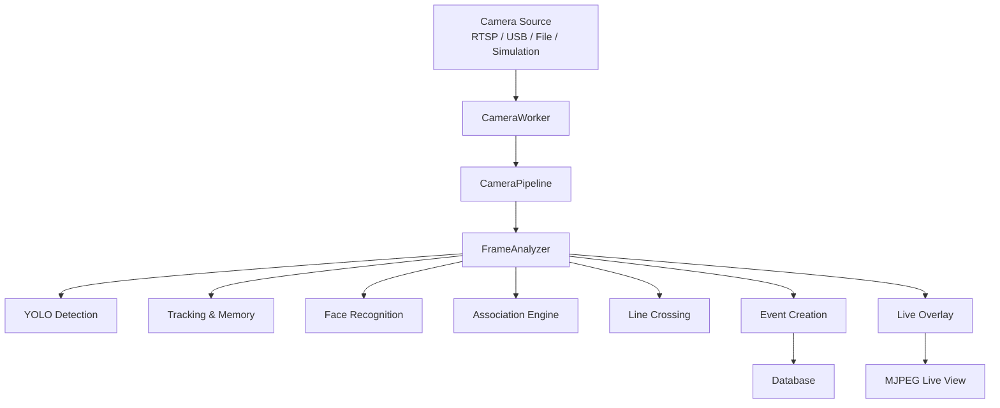
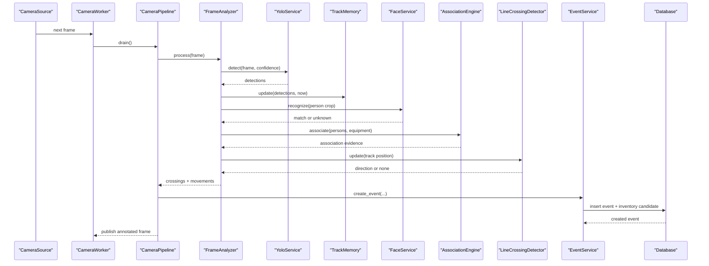
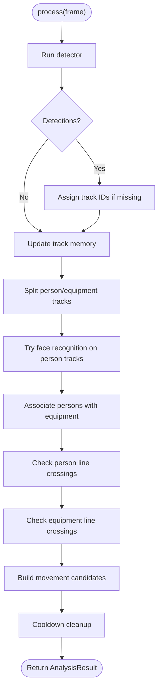
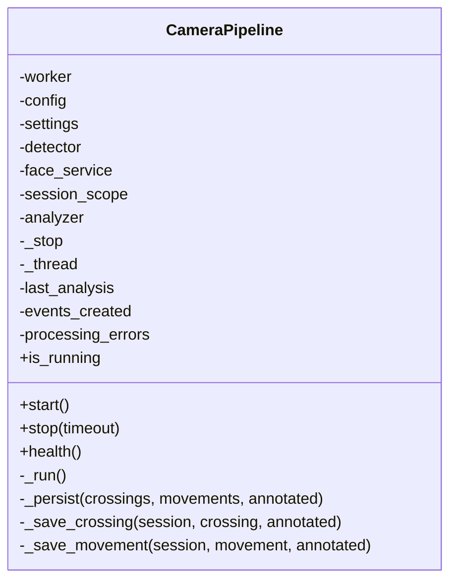
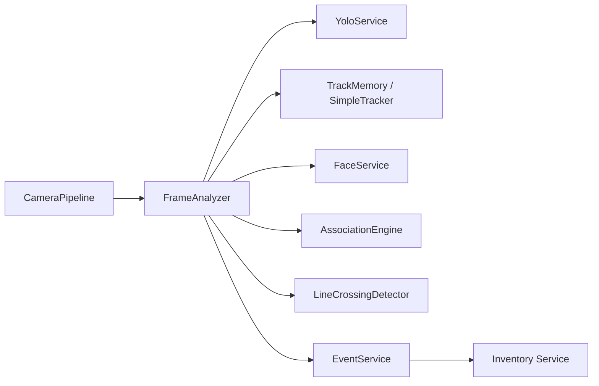

# Frame Processing Pipeline

<cite>
**Referenced Files in This Document**
- [pipeline_service.py](file://app/services/pipeline_service.py)
- [yolo_service.py](file://app/services/yolo_service.py)
- [face_service.py](file://app/services/face_service.py)
- [tracking_service.py](file://app/services/tracking_service.py)
- [association_service.py](file://app/services/association_service.py)
- [event_service.py](file://app/services/event_service.py)
- [config.py](file://app/config.py)
- [README.md](file://README.md)
</cite>

## Table of Contents
1. [Introduction](#introduction)
2. [Project Structure](#project-structure)
3. [Core Components](#core-components)
4. [Architecture Overview](#architecture-overview)
5. [Detailed Component Analysis](#detailed-component-analysis)
6. [Dependency Analysis](#dependency-analysis)
7. [Performance Considerations](#performance-considerations)
8. [Troubleshooting Guide](#troubleshooting-guide)
9. [Conclusion](#conclusion)
10. [Appendices](#appendices)

## Introduction
This document explains the frame processing pipeline that turns raw camera frames into verified movement and entry/exit events. The system coordinates AI detection, face recognition, multi-object tracking, person-to-equipment association, line-crossing logic, and event persistence. It is designed for real-time streaming with graceful degradation when AI models are unavailable, while keeping uncertain results in a review queue rather than automatically changing inventory state.

The pipeline follows this main flow:
- Frame acquisition from a camera source
- YOLO-based object and person detection
- Face recognition to attach employee identity where possible
- Multi-object tracking across frames
- Association scoring between people and equipment
- Line crossing detection for entrance/exit
- Event creation with deduplication, evidence capture, and pending review status

## Project Structure
The frame processing pipeline lives under `app/services`. The most important files are:
- `pipeline_service.py`: per-camera orchestration and threading
- `yolo_service.py`: Ultralytics YOLO wrapper
- `face_service.py`: InsightFace face detection and recognition
- `tracking_service.py`: fallback tracker, track memory, and line crossing detector
- `association_service.py`: person-to-equipment association engine
- `event_service.py`: event creation, deduplication, and review workflow
- `config.py`: environment-driven settings used by all services
- `README.md`: operational guidance, configuration keys, and troubleshooting

**Diagram sources**
- [pipeline_service.py:390-487](file://app/services/pipeline_service.py#L390-L487)
- [yolo_service.py:166-236](file://app/services/yolo_service.py#L166-L236)
- [face_service.py:261-274](file://app/services/face_service.py#L261-L274)
- [tracking_service.py:29-85](file://app/services/tracking_service.py#L29-L85)
- [association_service.py:131-198](file://app/services/association_service.py#L131-L198)
- [event_service.py:59-147](file://app/services/event_service.py#L59-L147)

**Section sources**
- [README.md:1-34](file://README.md#L1-L34)
- [README.md:202-243](file://README.md#L202-L243)

## Core Components
The pipeline has two layers:
- `FrameAnalyzer`: pure, synchronous per-frame reasoning. It runs detection, tracking, identity assignment, association, and crossing logic without threads or database access.
- `CameraPipeline`: one worker thread per camera. It pulls frames from the capture layer, runs the analyzer, publishes annotated frames for live view, and persists events.

Key responsibilities:
- Ingest frames safely even when detection fails
- Maintain temporary track IDs and short-lived state
- Recognize faces only when useful and available
- Score associations explicitly and mark ambiguous cases for review
- Generate entry/exit and equipment movement events
- Persist evidence images and keep the camera loop resilient

**Section sources**
- [pipeline_service.py:1-14](file://app/services/pipeline_service.py#L1-L14)
- [pipeline_service.py:103-149](file://app/services/pipeline_service.py#L103-L149)
- [pipeline_service.py:390-432](file://app/services/pipeline_service.py#L390-L432)

## Architecture Overview
The end-to-end sequence for each processed frame is:

**Diagram sources**
- [pipeline_service.py:218-321](file://app/services/pipeline_service.py#L218-L321)
- [pipeline_service.py:462-487](file://app/services/pipeline_service.py#L462-L487)
- [yolo_service.py:166-236](file://app/services/yolo_service.py#L166-L236)
- [tracking_service.py:135-165](file://app/services/tracking_service.py#L135-L165)
- [face_service.py:261-274](file://app/services/face_service.py#L261-L274)
- [association_service.py:131-198](file://app/services/association_service.py#L131-L198)
- [event_service.py:59-147](file://app/services/event_service.py#L59-L147)

## Detailed Component Analysis

### FrameAnalyzer
`FrameAnalyzer` is the core reasoning step for one camera. It:
- Calls detection through an injected detector; in simulation mode it uses ground truth instead of YOLO
- Assigns track IDs if not provided by the detector
- Updates `TrackMemory`, prunes old tracks, and separates person vs equipment states
- Runs face recognition on person tracks at intervals controlled by settings
- Associates persons with equipment using spatial, temporal, and directional signals
- Detects line crossings for both people and equipment
- Builds movement candidates with scores, quality levels, and reasons
- Tracks cooldowns so repeated crossings do not spam events

Important data structures:
- `PersonCrossing`: represents a person crossing the virtual line
- `MovementCandidate`: represents an equipment movement with association details
- `AnalysisResult`: returns tracks, crossings, movements, and notes

Error handling:
- Detection exceptions increment error counters and return empty detections
- Face recognition exceptions are logged and ignored for that track
- Movement building validates object presence and confidence before creating candidates

**Diagram sources**
- [pipeline_service.py:218-321](file://app/services/pipeline_service.py#L218-L321)
- [pipeline_service.py:328-387](file://app/services/pipeline_service.py#L328-L387)

**Section sources**
- [pipeline_service.py:103-149](file://app/services/pipeline_service.py#L103-L149)
- [pipeline_service.py:151-216](file://app/services/pipeline_service.py#L151-L216)
- [pipeline_service.py:218-321](file://app/services/pipeline_service.py#L218-L321)
- [pipeline_service.py:323-387](file://app/services/pipeline_service.py#L323-L387)

### CameraPipeline
`CameraPipeline` manages one camera’s processing thread:
- Starts a daemon thread named after the camera code
- Drains frames from `CameraWorker`
- Runs `FrameAnalyzer.process`
- Publishes annotated frames for MJPEG live view
- Persists crossings and movements as events
- Tracks health metrics such as frames processed, events created, and errors

Lifecycle:
- `start()` launches the thread
- `stop(timeout)` sets a stop event and joins the thread
- `health()` returns runtime diagnostics
- `_run()` is the main loop with defensive exception handling

Persistence:
- `_persist()` wraps database writes in a session scope
- `_save_crossing()` creates person entry/exit events
- `_save_movement()` creates equipment movement events with association metadata

**Diagram sources**
- [pipeline_service.py:390-487](file://app/services/pipeline_service.py#L390-L487)
- [pipeline_service.py:490-585](file://app/services/pipeline_service.py#L490-L585)

**Section sources**
- [pipeline_service.py:390-487](file://app/services/pipeline_service.py#L390-L487)
- [pipeline_service.py:490-585](file://app/services/pipeline_service.py#L490-L585)

### YOLO Detection Service
`YoloService` wraps Ultralytics YOLO:
- Loads the model once per process
- Supports fallback models when the configured path is missing
- Exposes `available` and `reason_unavailable` for graceful degradation
- Converts model outputs into `Detection` objects with category mapping
- Optionally uses ByteTrack for persistent track IDs
- Tracks inference count and last inference time for monitoring

Configuration integration:
- Uses `yolo_model_path`, `yolo_fallback_model`, `yolo_confidence`, `yolo_image_size`, `yolo_device`, and `yolo_tracker`

Error handling:
- Raises `ModelUnavailableError` when inference is requested but no model/runtime is available
- Logs load failures and falls back to general-purpose model when configured

**Section sources**
- [yolo_service.py:1-7](file://app/services/yolo_service.py#L1-L7)
- [yolo_service.py:55-103](file://app/services/yolo_service.py#L55-L103)
- [yolo_service.py:115-154](file://app/services/yolo_service.py#L115-L154)
- [yolo_service.py:166-236](file://app/services/yolo_service.py#L166-L236)
- [yolo_service.py:245-272](file://app/services/yolo_service.py#L245-L272)

### Face Recognition Service
`FaceService` wraps InsightFace and ONNX Runtime:
- Loads the face analysis app once and reuses it
- Maintains an in-memory gallery of enrolled employee embeddings
- Recognizes the largest face in a cropped person image
- Compares embeddings using cosine similarity with threshold and margin checks
- Returns `Noma'lum shaxs` when matches are below threshold or ambiguous

Key behaviors:
- `ensure_loaded()` initializes providers and context
- `recognize()` performs detection, quality filtering, and matching
- `create_embedding()` supports enrollment with quality warnings
- `FaceGallery.reload()` loads active employees and their vectors from the database

**Section sources**
- [face_service.py:1-11](file://app/services/face_service.py#L1-L11)
- [face_service.py:86-129](file://app/services/face_service.py#L86-L129)
- [face_service.py:132-170](file://app/services/face_service.py#L132-L170)
- [face_service.py:173-234](file://app/services/face_service.py#L173-L234)
- [face_service.py:237-294](file://app/services/face_service.py#L237-L294)
- [face_service.py:301-341](file://app/services/face_service.py#L301-L341)

### Tracking and Line Crossing
`tracking_service.py` provides:
- `SimpleTracker`: greedy IoU-based tracker used when ByteTrack is unavailable
- `TrackMemory`: per-camera state for track age, velocity, identity bindings, and face recognition scheduling
- `LineCrossingDetector`: geometry-based crossing detection with hysteresis, cooldown, and optional flip

Design notes:
- Track IDs are temporary and never become permanent identities
- Track memory prunes stale tracks and exposes person/equipment features
- Line crossing uses signed distance, side history, minimum track frames, and cooldown seconds

**Section sources**
- [tracking_service.py:1-13](file://app/services/tracking_service.py#L1-L13)
- [tracking_service.py:29-85](file://app/services/tracking_service.py#L29-L85)
- [tracking_service.py:91-205](file://app/services/tracking_service.py#L91-L205)
- [tracking_service.py:210-285](file://app/services/tracking_service.py#L210-L285)

### Association Engine
`AssociationEngine` scores every person-equipment pair using four weak signals:
- Carry overlap: object center inside expanded person box
- Proximity: center distance relative to person size
- Temporal overlap: both tracks stable for several frames
- Direction agreement: similar motion direction

Quality levels:
- `STRONG`: high score and sufficient track stability
- `WEAK`: lower score or short track
- `AMBIGUOUS`: multiple people explain the object similarly
- `NONE`: no confident association

The engine also records reasons and flags cases requiring human review.

**Section sources**
- [association_service.py:1-15](file://app/services/association_service.py#L1-L15)
- [association_service.py:29-57](file://app/services/association_service.py#L29-L57)
- [association_service.py:59-104](file://app/services/association_service.py#L59-L104)
- [association_service.py:106-198](file://app/services/association_service.py#L106-L198)
- [association_service.py:201-219](file://app/services/association_service.py#L201-L219)

### Event Service
`event_service.py` handles:
- Stable dedupe key generation based on event type, camera, cooldown bucket, and track IDs
- Event insertion with nested transactions
- Automatic creation of pending inventory movement candidates for equipment events
- Review workflow: confirm or reject pending events
- Queries, dashboard stats, and pending sync helpers

Deduplication strategy:
- Pre-check via dedupe key
- Database unique constraint for concurrent workers
- Cooldown window prevents rapid duplicate events

Review workflow:
- Only `CONFIRMED` or `REJECTED` decisions are accepted
- Confirming updates inventory; rejecting marks the row as rejected
- Audit logging and Sheets sync status reset on review

**Section sources**
- [event_service.py:1-29](file://app/services/event_service.py#L1-L29)
- [event_service.py:32-56](file://app/services/event_service.py#L32-L56)
- [event_service.py:59-147](file://app/services/event_service.py#L59-L147)
- [event_service.py:150-211](file://app/services/event_service.py#L150-L211)
- [event_service.py:217-329](file://app/services/event_service.py#L217-L329)

## Dependency Analysis
The pipeline components have clear separation of concerns:
- `CameraPipeline` depends on `CameraWorker`, `FrameAnalyzer`, overlay, evidence service, and event service
- `FrameAnalyzer` depends on detection, tracking, face recognition, association, and line crossing
- `YoloService` and `FaceService` are independent AI wrappers with status and lifecycle methods
- `EventService` depends on database models and inventory audit flows

**Diagram sources**
- [pipeline_service.py:390-487](file://app/services/pipeline_service.py#L390-L487)
- [yolo_service.py:166-236](file://app/services/yolo_service.py#L166-L236)
- [tracking_service.py:135-165](file://app/services/tracking_service.py#L135-L165)
- [face_service.py:261-274](file://app/services/face_service.py#L261-L274)
- [association_service.py:131-198](file://app/services/association_service.py#L131-L198)
- [event_service.py:59-147](file://app/services/event_service.py#L59-L147)

**Section sources**
- [pipeline_service.py:1-44](file://app/services/pipeline_service.py#L1-L44)
- [event_service.py:1-29](file://app/services/event_service.py#L1-L29)

## Performance Considerations
The pipeline includes several performance controls:
- Model loading is lazy and cached per process
- Face recognition is throttled per track using `face_recognition_interval`
- Track memory prunes stale tracks after a configurable age
- YOLO inference can fall back from tracking to prediction if ByteTrack fails
- Evidence JPEG quality and retention are configurable
- Processing FPS, width, height, and max frame queue are environment-controlled

Tuning recommendations:
- Reduce `PROCESSING_FPS` and `YOLO_IMAGE_SIZE` on CPU-only systems
- Increase `FACE_RECOGNITION_INTERVAL` when face recognition is a bottleneck
- Use GPU providers for face recognition when available
- Adjust `EVENT_COOLDOWN_SECONDS` to reduce duplicate events during crowded crossings
- Enable simulation mode for testing without real cameras

Batch processing:
- The current design processes frames sequentially per camera thread
- For higher throughput, consider running multiple camera pipelines concurrently, one per camera, while sharing model instances

Real-time streaming considerations:
- Annotated frames are published for MJPEG live view
- Errors in the pipeline loop are caught defensively to keep the camera alive
- Health endpoints expose frames processed, events created, and error counts

**Section sources**
- [yolo_service.py:115-154](file://app/services/yolo_service.py#L115-L154)
- [yolo_service.py:166-236](file://app/services/yolo_service.py#L166-L236)
- [face_service.py:173-234](file://app/services/face_service.py#L173-L234)
- [tracking_service.py:167-171](file://app/services/tracking_service.py#L167-L171)
- [pipeline_service.py:462-487](file://app/services/pipeline_service.py#L462-L487)
- [config.py:190-210](file://app/config.py#L190-L210)

## Troubleshooting Guide
Common issues and resolutions:
- YOLO model not found: configure `YOLO_MODEL_PATH`; fallback model `YOLO_FALLBACK_MODEL` is used automatically
- Face recognition unavailable: install AI dependencies and verify provider configuration
- Camera offline: check RTSP URL, credentials, codec, and network; use test scripts to validate
- Low FPS or high CPU usage: lower FPS, image size, or increase recognition interval; enable GPU
- Duplicate events: adjust `EVENT_COOLDOWN_SECONDS` and verify dedupe keys
- Sheets sync failed: verify service account, spreadsheet ID, and permissions

Operational tips:
- Monitor `/healthz` and pipeline health metrics
- Check logs for model load errors, detection errors, and pipeline exceptions
- Use simulation mode to validate pipeline behavior without hardware
- Review pending events and association reasons before confirming inventory changes

**Section sources**
- [README.md:516-530](file://README.md#L516-L530)
- [pipeline_service.py:450-459](file://app/services/pipeline_service.py#L450-L459)
- [pipeline_service.py:483-487](file://app/services/pipeline_service.py#L483-L487)
- [yolo_service.py:78-103](file://app/services/yolo_service.py#L78-L103)
- [face_service.py:184-204](file://app/services/face_service.py#L184-L204)

## Conclusion
The frame processing pipeline provides a robust, modular architecture for real-time video analytics. It separates detection, tracking, identity, association, crossing logic, and event persistence while maintaining resilience against model unavailability and transient errors. By exposing explicit association quality and pending review states, it ensures that automated decisions do not silently alter inventory records. Operators can tune performance, customize behavior through configuration, and rely on evidence-backed events for auditing and reporting.

## Appendices

### Configuration Options Relevant to the Pipeline
- `YOLO_MODEL_PATH`, `YOLO_FALLBACK_MODEL`, `YOLO_CONFIDENCE`, `YOLO_IMAGE_SIZE`, `YOLO_DEVICE`, `YOLO_TRACKER`
- `FACE_MODEL_NAME`, `FACE_SIMILARITY_THRESHOLD`, `FACE_MATCH_MARGIN`, `FACE_PROVIDERS`, `FACE_DETECTION_SIZE`, `FACE_RECOGNITION_INTERVAL`
- `PROCESSING_FPS`, `PROCESSING_WIDTH`, `PROCESSING_HEIGHT`, `MAX_FRAME_QUEUE`
- `SIMULATION_MODE`
- `EVENT_COOLDOWN_SECONDS`
- `EVIDENCE_ENABLED`, `EVIDENCE_RETENTION_DAYS`, `EVIDENCE_JPEG_QUALITY`

**Section sources**
- [config.py:78-118](file://app/config.py#L78-L118)
- [config.py:177-222](file://app/config.py#L177-L222)
- [README.md:138-169](file://README.md#L138-L169)

### Customizing the Pipeline for Different Use Cases
- Equipment-focused facility: prioritize YOLO categories and association thresholds; reduce face recognition frequency
- High-security entrance: tighten face similarity threshold and margin; require manual review for unknown persons
- Low-resource deployment: disable evidence saving, lower FPS and image size, increase recognition interval
- Simulation and training: enable simulation mode and use synthetic ground truth for validation

**Section sources**
- [pipeline_service.py:81-100](file://app/services/pipeline_service.py#L81-L100)
- [pipeline_service.py:415-426](file://app/services/pipeline_service.py#L415-L426)
- [README.md:225-227](file://README.md#L225-L227)