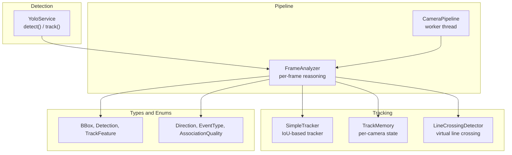
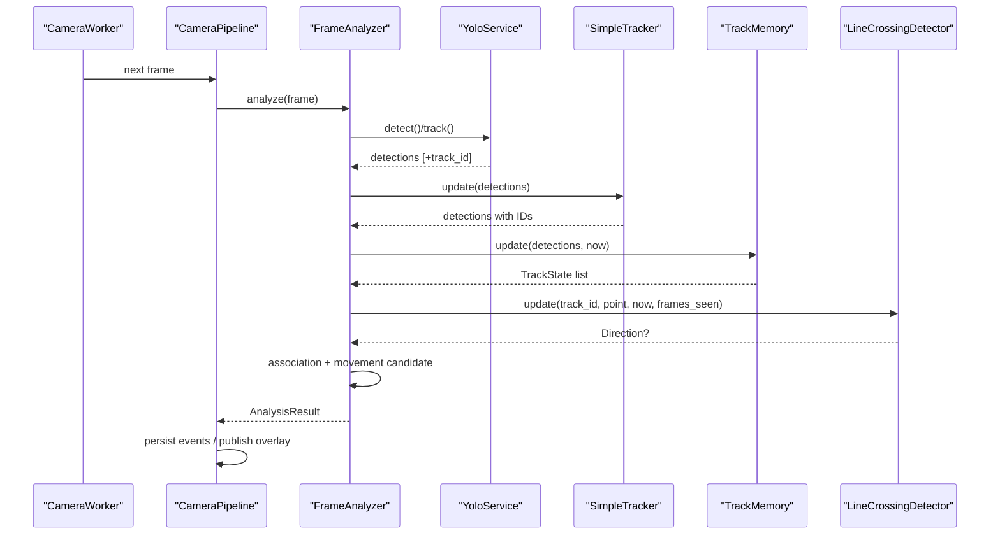
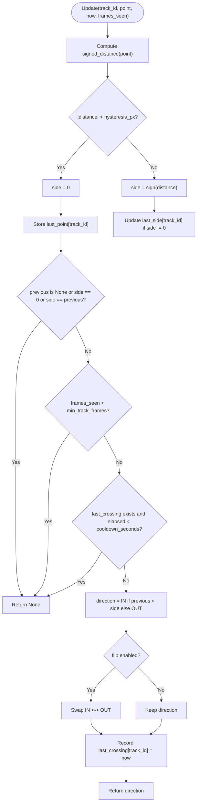
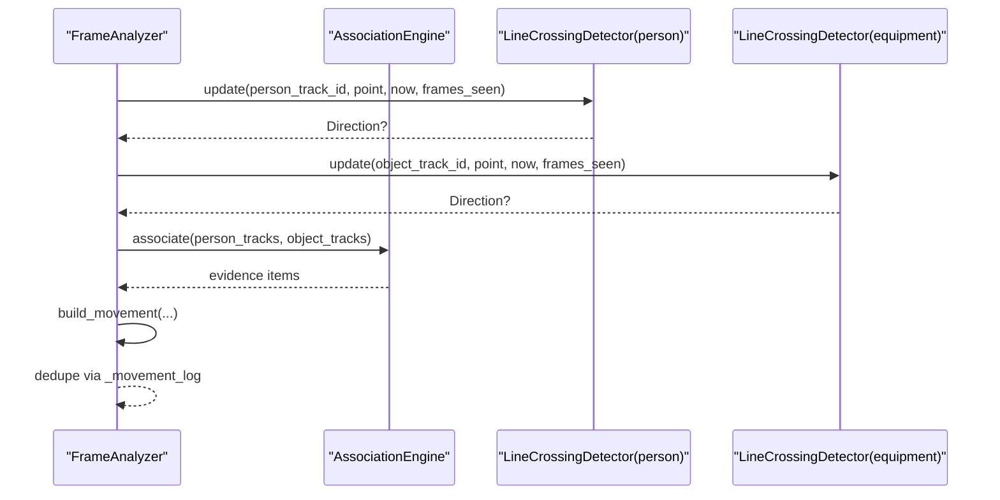
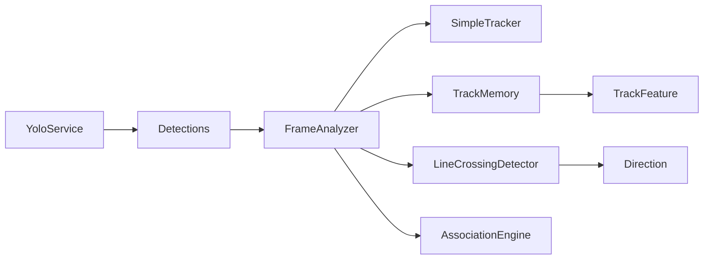

# Object Tracking System

<cite>
**Referenced Files in This Document**
- [tracking_service.py](file://app/services/tracking_service.py)
- [pipeline_service.py](file://app/services/pipeline_service.py)
- [yolo_service.py](file://app/services/yolo_service.py)
- [types.py](file://app/services/types.py)
- [enums.py](file://app/models/enums.py)
- [test_tracking.py](file://tests/test_tracking.py)
- [README.md](file://README.md)
</cite>

## Table of Contents
1. [Introduction](#introduction)
2. [Project Structure](#project-structure)
3. [Core Components](#core-components)
4. [Architecture Overview](#architecture-overview)
5. [Detailed Component Analysis](#detailed-component-analysis)
6. [Dependency Analysis](#dependency-analysis)
7. [Performance Considerations](#performance-considerations)
8. [Troubleshooting Guide](#troubleshooting-guide)
9. [Conclusion](#conclusion)
10. [Appendices](#appendices)

## Introduction
This document explains the object tracking system used by the application, focusing on multi-object tracking, virtual line crossing detection, direction determination, movement analysis, and operational parameters. The system integrates a production-grade detector with optional ByteTrack-based identity persistence and provides a robust fallback tracker for environments where advanced tracking is unavailable. It also includes per-camera state management, velocity estimation, cooldown-based deduplication, and geometry-driven entrance/exit logic.

The tracking layer is designed to be:
- Modular: detection, tracking, association, and movement analysis are separated into services.
- Configurable: cooldowns, hysteresis, flip behavior, minimum track age, and face recognition intervals can be tuned.
- Resilient: when ByteTrack is unavailable, a greedy IoU tracker maintains continuity for tests and CPU-only scenarios.
- Observable: tracks expose features such as velocity, confidence, timestamps, and optional employee associations.

## Project Structure
The tracking-related code lives primarily under `app/services`, with shared types and enums under `app/services` and `app/models`. The pipeline orchestrates detection, tracking, association, and movement events per camera. Tests validate core behaviors.

**Diagram sources**
- [yolo_service.py:170-236](file://app/services/yolo_service.py#L170-L236)
- [pipeline_service.py:103-149](file://app/services/pipeline_service.py#L103-L149)
- [tracking_service.py:29-85](file://app/services/tracking_service.py#L29-L85)
- [tracking_service.py:125-204](file://app/services/tracking_service.py#L125-L204)
- [tracking_service.py:210-279](file://app/services/tracking_service.py#L210-L279)
- [types.py:10-138](file://app/services/types.py#L10-L138)
- [enums.py:92-103](file://app/models/enums.py#L92-L103)

**Section sources**
- [tracking_service.py:1-13](file://app/services/tracking_service.py#L1-L13)
- [pipeline_service.py:1-14](file://app/services/pipeline_service.py#L1-L14)
- [yolo_service.py:170-236](file://app/services/yolo_service.py#L170-L236)
- [types.py:10-138](file://app/services/types.py#L10-L138)
- [enums.py:92-103](file://app/models/enums.py#L92-L103)

## Core Components
- SimpleTracker: A dependency-free greedy IoU tracker that assigns temporary IDs when ByteTrack is not available. It supports an IoU threshold and maximum track age.
- TrackMemory: Per-camera memory storing track states, including bounding boxes, velocities, timestamps, frames seen, optional employee bindings, and crossings.
- LineCrossingDetector: Geometry-based detector that determines IN/OUT crossings across a virtual line with hysteresis, cooldown, flip support, and minimum track frame requirements.
- FrameAnalyzer: Orchestrates detection, tracking, face recognition attempts, association, and movement candidate generation per frame.
- YoloService: Wraps Ultralytics inference; when enabled, it uses model.track() with ByteTrack and falls back to predict() if tracking fails.

Key responsibilities:
- Maintain stable temporary IDs across frames (ByteTrack or SimpleTracker).
- Compute motion features (velocity) and prune stale tracks.
- Detect line crossings with debouncing and direction semantics.
- Associate people with carried objects and generate movement candidates.

**Section sources**
- [tracking_service.py:29-85](file://app/services/tracking_service.py#L29-L85)
- [tracking_service.py:125-204](file://app/services/tracking_service.py#L125-L204)
- [tracking_service.py:210-279](file://app/services/tracking_service.py#L210-L279)
- [pipeline_service.py:103-149](file://app/services/pipeline_service.py#L103-L149)
- [yolo_service.py:170-236](file://app/services/yolo_service.py#L170-L236)

## Architecture Overview
The tracking architecture follows a layered design:
- Detection Layer: YoloService runs detection and optionally ByteTrack-based tracking.
- Tracking Layer: SimpleTracker provides fallback ID assignment; TrackMemory aggregates temporal state.
- Reasoning Layer: FrameAnalyzer performs per-frame decisions, including line crossing and association.
- Pipeline Layer: CameraPipeline coordinates worker threads, persists events, and publishes annotated frames.

**Diagram sources**
- [pipeline_service.py:103-149](file://app/services/pipeline_service.py#L103-L149)
- [yolo_service.py:170-236](file://app/services/yolo_service.py#L170-L236)
- [tracking_service.py:29-85](file://app/services/tracking_service.py#L29-L85)
- [tracking_service.py:125-204](file://app/services/tracking_service.py#L125-L204)
- [tracking_service.py:210-279](file://app/services/tracking_service.py#L210-L279)

## Detailed Component Analysis

### Multi-Object Tracking: ByteTrack Integration and Fallback
- ByteTrack integration:
  - YoloService calls model.track() with persist=True and a configured tracker. If successful, detections include stable track IDs.
  - On failure, it logs a warning and falls back to model.predict(), returning detections without track IDs.
- Fallback tracker:
  - SimpleTracker implements greedy IoU matching between detections and existing tracks.
  - Tracks are pruned when their age exceeds max_age.
  - Person/equipment categories are kept separate during association.

Track lifecycle:
- Initialization:
  - When ByteTrack is active, IDs come from the detector output.
  - Otherwise, SimpleTracker assigns new IDs to unmatched detections.
- Maintenance:
  - TrackMemory updates bounding boxes, confidence, category, timestamps, and velocity estimates.
  - Velocity is computed using an exponential smoothing factor over center deltas.
- Termination:
  - SimpleTracker removes tracks older than max_age.
  - TrackMemory.prune() removes states whose last_seen exceeds max_age_seconds.

Parameters:
- SimpleTracker.iou_threshold: Controls IoU matching sensitivity.
- SimpleTracker.max_age: Maximum number of frames a track can survive without matches.
- TrackMemory.frame_index: Global frame counter used for face recognition interval checks.
- TrackMemory.max_age_seconds: Pruning threshold for stale track states.

Edge cases:
- Occlusions:
  - Short occlusions are tolerated via max_age and TrackMemory’s continuous state until pruning.
  - After re-appearance, SimpleTracker may assign a new ID if the previous track expired.
- Track switching:
  - Category separation prevents mixing person and equipment tracks.
  - Cooldown and min_track_frames reduce false crossings during rapid reappearances.

**Section sources**
- [yolo_service.py:170-236](file://app/services/yolo_service.py#L170-L236)
- [tracking_service.py:29-85](file://app/services/tracking_service.py#L29-L85)
- [tracking_service.py:125-204](file://app/services/tracking_service.py#L125-L204)
- [test_tracking.py:26-47](file://tests/test_tracking.py#L26-L47)

### Virtual Line Crossing Detection and Direction Determination
LineCrossingDetector computes signed distance from a point to a directed line segment and classifies sides with hysteresis.

Algorithm highlights:
- Signed distance:
  - Uses cross product to determine which side of the line a point lies.
  - Returns zero within a hysteresis band to avoid jitter.
- Side classification:
  - Positive side vs negative side, with a neutral zone near the line.
- Direction semantics:
  - Negative-to-positive transition is Direction.IN.
  - Positive-to-negative transition is Direction.OUT.
  - flip=True swaps IN/OUT for camera-specific orientation.
- Debounce and stability:
  - cooldown_seconds prevents repeated crossings too quickly.
  - min_track_frames requires a minimum number of frames before reporting a crossing.
  - Frames inside the hysteresis band do not trigger direction changes.

Configuration examples:
- Horizontal line at y=360 from x=0 to x=1280.
- cooldown_seconds set to 0 for immediate testing; typically use settings.event_cooldown_seconds.
- hysteresis_px set to small values (e.g., 1–10) depending on noise levels.
- flip=True when the camera view reverses expected directions.

Interpreting results:
- None indicates no crossing detected (first sample, noise, cooldown, or insufficient track age).
- Direction.IN means entering the defined region relative to the line.
- Direction.OUT means exiting the defined region relative to the line.

**Diagram sources**
- [tracking_service.py:210-279](file://app/services/tracking_service.py#L210-L279)

**Section sources**
- [tracking_service.py:210-279](file://app/services/tracking_service.py#L210-L279)
- [test_tracking.py:76-114](file://tests/test_tracking.py#L76-L114)

### Movement Analysis and Association
FrameAnalyzer combines tracking outputs with association logic to produce movement candidates:
- Person and equipment lines:
  - Separate LineCrossingDetector instances for persons and equipment, with different min_track_frames.
- Association:
  - AssociationEngine correlates person tracks with object tracks based on proximity and temporal consistency.
  - Evidence buckets accumulate counts per object-person pair; stale entries are pruned.
- Movement candidates:
  - For each object crossing, FrameAnalyzer builds MovementCandidate with quality, scores, and reasons.
  - Deduplication uses _movement_log and cleanup thresholds to prevent repeated events.

Outputs:
- AnalysisResult contains tracks, crossings, movements, and notes.
- Crossings include person track info and direction.
- Movements include object track info, associated person info, and evidence.

**Diagram sources**
- [pipeline_service.py:103-149](file://app/services/pipeline_service.py#L103-L149)
- [pipeline_service.py:181-211](file://app/services/pipeline_service.py#L181-L211)
- [pipeline_service.py:299-335](file://app/services/pipeline_service.py#L299-L335)

**Section sources**
- [pipeline_service.py:103-149](file://app/services/pipeline_service.py#L103-L149)
- [pipeline_service.py:181-211](file://app/services/pipeline_service.py#L181-L211)
- [pipeline_service.py:299-335](file://app/services/pipeline_service.py#L299-L335)

### Tracking Parameters and Configuration
Key parameters and their roles:
- SimpleTracker:
  - iou_threshold: IoU threshold for matching detections to tracks.
  - max_age: Maximum frames a track survives without matches.
- TrackMemory:
  - frame_counter_start: Initial frame index.
  - max_age_seconds: Pruning threshold for stale track states.
  - face_recognition_interval: Interval between face recognition attempts per track.
- LineCrossingDetector:
  - cooldown_seconds: Minimum time between repeated crossings for the same track.
  - hysteresis_px: Distance band around the line considered neutral.
  - flip: Swaps IN/OUT direction semantics.
  - min_track_frames: Minimum frames seen before allowing a crossing report.
- FrameAnalyzer:
  - event_cooldown_seconds: Used for both person and equipment line detectors.
  - min_carry_frames: Minimum frames required to consider a person carrying an object.
  - stale_seconds: Time after which carry evidence is considered stale.

Examples:
- Configure a horizontal virtual line and set cooldown to settings.event_cooldown_seconds.
- Use flip=True when the camera view reverses expected directions.
- Increase hysteresis_px to reduce noise-induced crossings.
- Set min_track_frames higher for equipment to require more stable tracking before reporting crossings.

**Section sources**
- [tracking_service.py:29-85](file://app/services/tracking_service.py#L29-L85)
- [tracking_service.py:125-204](file://app/services/tracking_service.py#L125-L204)
- [tracking_service.py:210-279](file://app/services/tracking_service.py#L210-L279)
- [pipeline_service.py:103-149](file://app/services/pipeline_service.py#L103-L149)

### Data Models and Types
Shared data structures:
- BBox: Bounding box with geometric utilities (area, center, diagonal, IOU, expansion, containment).
- Detection: Single detection with bbox, confidence, label, category, is_person flag, and optional track_id.
- TrackFeature: Aggregated view of a track used by association and overlays, including timestamps, velocity, and optional employee info.
- Direction: Enum with IN, OUT, NONE and localized labels.

These types ensure consistent interfaces across detection, tracking, and analysis layers.

**Section sources**
- [types.py:10-138](file://app/services/types.py#L10-L138)
- [enums.py:92-103](file://app/models/enums.py#L92-L103)

## Dependency Analysis
The tracking system has clear boundaries:
- YoloService depends on Ultralytics and optionally ByteTrack; it returns Detections with optional track IDs.
- FrameAnalyzer depends on SimpleTracker, TrackMemory, LineCrossingDetector, and AssociationEngine.
- TrackMemory depends on types.Detection and types.TrackFeature.
- LineCrossingDetector depends on models.enums.Direction.

**Diagram sources**
- [yolo_service.py:170-236](file://app/services/yolo_service.py#L170-L236)
- [pipeline_service.py:103-149](file://app/services/pipeline_service.py#L103-L149)
- [tracking_service.py:125-204](file://app/services/tracking_service.py#L125-L204)
- [tracking_service.py:210-279](file://app/services/tracking_service.py#L210-L279)
- [types.py:10-138](file://app/services/types.py#L10-L138)
- [enums.py:92-103](file://app/models/enums.py#L92-L103)

**Section sources**
- [yolo_service.py:170-236](file://app/services/yolo_service.py#L170-L236)
- [pipeline_service.py:103-149](file://app/services/pipeline_service.py#L103-L149)
- [tracking_service.py:125-204](file://app/services/tracking_service.py#L125-L204)
- [tracking_service.py:210-279](file://app/services/tracking_service.py#L210-L279)
- [types.py:10-138](file://app/services/types.py#L10-L138)
- [enums.py:92-103](file://app/models/enums.py#L92-L103)

## Performance Considerations
High-frame-rate processing:
- Reduce PROCESSING_FPS to 5–8 for CPU inference to avoid bottlenecks.
- Lower YOLO image size (e.g., YOLO_IMAGE_SIZE=480) to speed up inference.
- Increase FACE_RECOGNITION_INTERVAL to reduce expensive face recognition calls.
- Prefer GPU acceleration when available; otherwise, rely on simplified tracking paths.

Memory management for long-running tracks:
- Use TrackMemory.prune() with appropriate max_age_seconds to release stale states.
- SimpleTracker.max_age controls how long temporary IDs persist without matches.
- FrameAnalyzer._cleanup_log() prunes movement logs beyond a cutoff derived from event_cooldown_seconds.

Optimization opportunities:
- Tune hysteresis_px to balance noise rejection and responsiveness.
- Adjust min_track_frames to reduce false positives for equipment crossings.
- Use cooldown_seconds to prevent rapid repeated events.
- Ensure association evidence buckets are pruned regularly to avoid memory growth.

[No sources needed since this section provides general guidance]

## Troubleshooting Guide
Common issues and resolutions:
- Model unavailable:
  - Ensure custom model path exists; otherwise, demo model is used.
- Face recognition unavailable:
  - Install AI dependencies and refresh gallery; check logs for errors.
- Camera offline:
  - Validate RTSP source, credentials, network, and codec; test with scripts/test_camera.py.
- Repeated connection failures:
  - Backoff increases; verify source availability and retry.
- Port conflicts:
  - Change port or terminate conflicting processes.
- Database locked:
  - Run single server instance; keep CLI transactions short.
- Sheets sync failures:
  - Verify service account permissions and spreadsheet sharing; check status flags.
- HTTPS cookie issues:
  - Use HTTPS or development mode for local testing.
- Low FPS or high CPU usage:
  - Lower processing FPS, reduce image size, increase face recognition interval, or enable GPU.

**Section sources**
- [README.md:516-530](file://README.md#L516-L530)

## Conclusion
The object tracking system combines robust detection with flexible tracking strategies. ByteTrack provides stable identities when available; otherwise, SimpleTracker ensures continuity for testing and CPU-only environments. TrackMemory maintains temporal state and velocity, while LineCrossingDetector offers precise, configurable entrance/exit detection with hysteresis and cooldown. FrameAnalyzer ties these components together to produce meaningful movement events, with association logic linking people and carried objects. Proper parameter tuning and performance optimizations ensure reliable operation under high-load conditions.

[No sources needed since this section summarizes without analyzing specific files]

## Appendices

### Example: Configuring Virtual Lines
- Define a horizontal line from (0, 360) to (1280, 360).
- Set cooldown_seconds to settings.event_cooldown_seconds.
- Use flip=True if the camera view reverses expected directions.
- Adjust hysteresis_px to handle noise (e.g., 1–10 pixels).
- Set min_track_frames appropriately for equipment (e.g., 3) versus persons.

**Section sources**
- [pipeline_service.py:122-141](file://app/services/pipeline_service.py#L122-L141)
- [tracking_service.py:210-279](file://app/services/tracking_service.py#L210-L279)

### Interpreting Tracking Results
- Track IDs are temporary and camera-scoped; they do not become permanent identities.
- TrackFeature exposes velocity, confidence, timestamps, and optional employee info.
- Direction.IN and Direction.OUT indicate crossing semantics relative to the configured line.
- MovementCandidates include association quality and reasons for review.

**Section sources**
- [tracking_service.py:1-13](file://app/services/tracking_service.py#L1-L13)
- [types.py:100-138](file://app/services/types.py#L100-L138)
- [enums.py:92-103](file://app/models/enums.py#L92-L103)
- [pipeline_service.py:57-78](file://app/services/pipeline_service.py#L57-L78)

### Handling Edge Cases
- Occlusions:
  - Tolerated via max_age and TrackMemory state until pruning.
  - Reappearance may result in new IDs if previous tracks expire.
- Track switching:
  - Category separation prevents mixing person and equipment.
  - Cooldown and min_track_frames reduce false crossings during rapid reappearances.
- Noise and jitter:
  - Hysteresis band avoids spurious crossings near the line.
  - Cooldown prevents repeated events in quick succession.

**Section sources**
- [tracking_service.py:29-85](file://app/services/tracking_service.py#L29-L85)
- [tracking_service.py:125-204](file://app/services/tracking_service.py#L125-L204)
- [tracking_service.py:210-279](file://app/services/tracking_service.py#L210-L279)
- [test_tracking.py:26-47](file://tests/test_tracking.py#L26-L47)