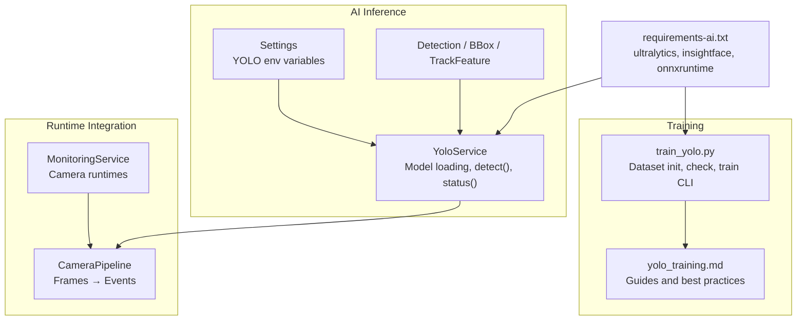
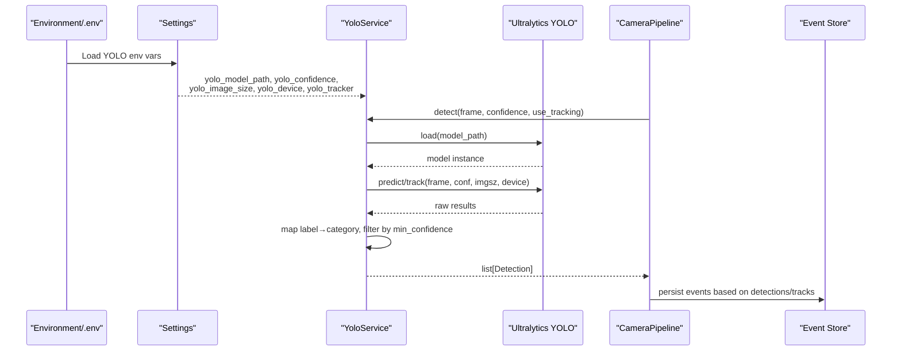
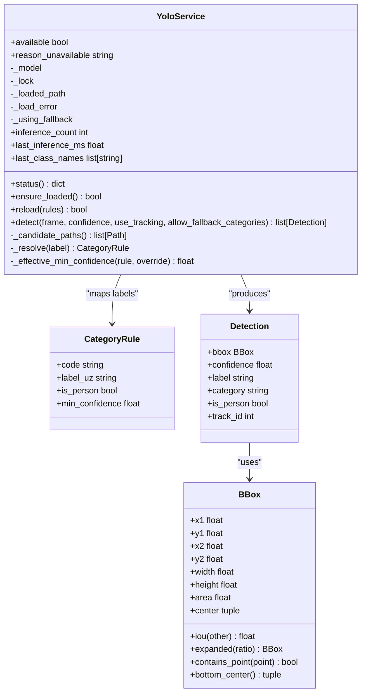
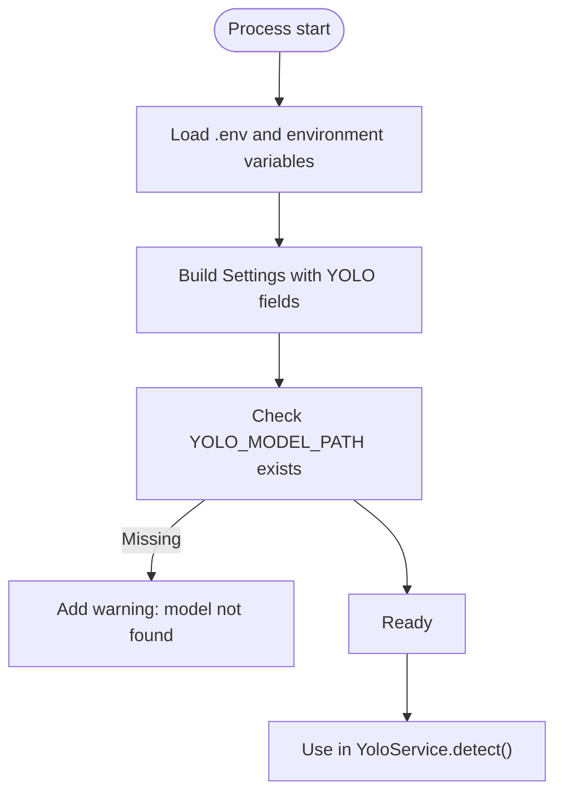
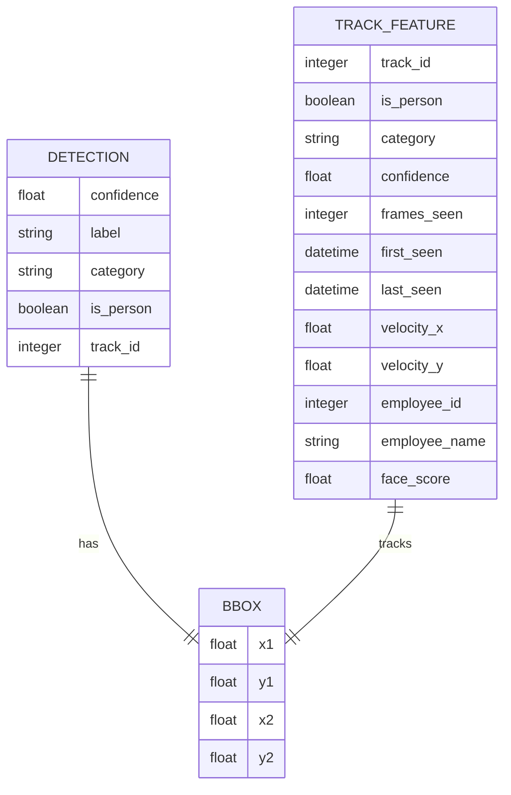
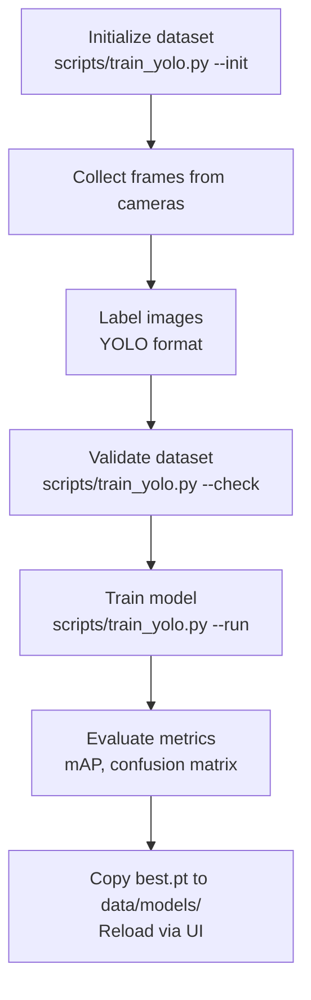
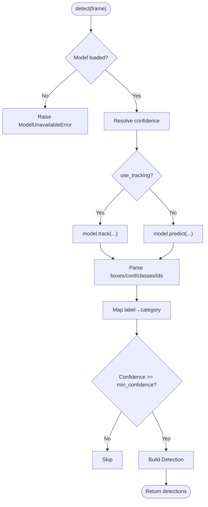
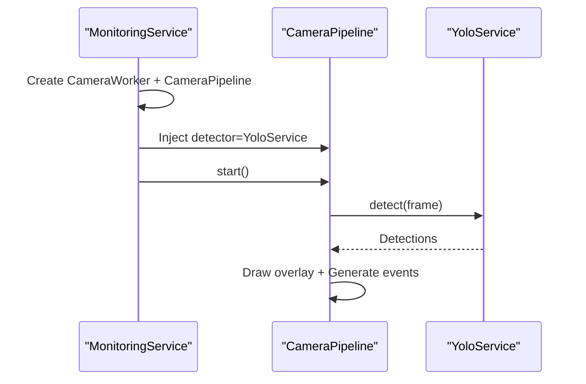
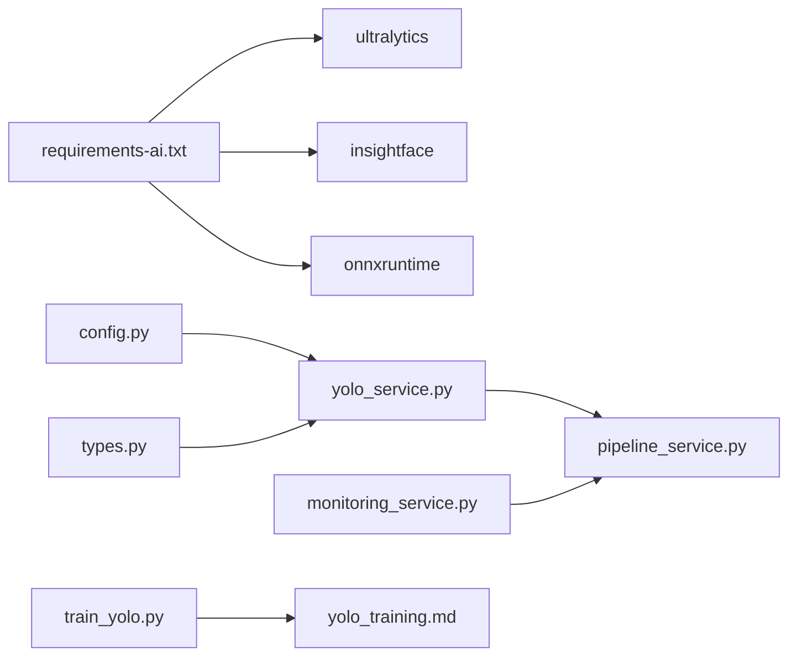

# YOLO Object Detection

<cite>
**Referenced Files in This Document**   
- [yolo_service.py](file://app/services/yolo_service.py)
- [config.py](file://app/config.py)
- [types.py](file://app/services/types.py)
- [train_yolo.py](file://scripts/train_yolo.py)
- [yolo_training.md](file://docs/yolo_training.md)
- [requirements-ai.txt](file://requirements-ai.txt)
- [monitoring_service.py](file://app/services/monitoring_service.py)
- [pipeline_service.py](file://app/services/pipeline_service.py)
</cite>

## Table of Contents
1. [Introduction](#introduction)
2. [Project Structure](#project-structure)
3. [Core Components](#core-components)
4. [Architecture Overview](#architecture-overview)
5. [Detailed Component Analysis](#detailed-component-analysis)
6. [Dependency Analysis](#dependency-analysis)
7. [Performance Considerations](#performance-considerations)
8. [Troubleshooting Guide](#troubleshooting-guide)
9. [Conclusion](#conclusion)
10. [Appendices](#appendices)

## Introduction
This document explains the YOLO object detection service used for equipment and person detection in the system. It covers how Ultralytics YOLO is integrated, how models are loaded and configured, how inference runs with optional tracking, how results are mapped to business categories, and how custom-trained models are trained and deployed. It also documents supported model formats, detection parameters such as confidence thresholds and tracker selection, performance optimization techniques including GPU acceleration, and common operational issues like false positives and accuracy tuning.

The YOLO integration is designed to be robust: if the custom model or Ultralytics runtime is unavailable, the service reports its status clearly and can fall back to a general COCO-based model when configured.

## Project Structure
The YOLO-related code spans several modules:

- Service layer: `app/services/yolo_service.py` implements the detector wrapper, model lifecycle, inference, category mapping, and singleton access.
- Configuration: `app/config.py` defines environment-driven settings for model path, fallback model, confidence, image size, device, and tracker.
- Shared types: `app/services/types.py` defines bounding boxes, detections, tracks, and frame results consumed by downstream services.
- Training tooling: `scripts/train_yolo.py` initializes datasets, validates dataset structure, and invokes Ultralytics training.
- Documentation: `docs/yolo_training.md` provides end-to-end guidance for collecting data, labeling, splitting, training, evaluating, deploying, and troubleshooting custom models.
- Runtime integration: `app/services/monitoring_service.py` and `app/services/pipeline_service.py` wire the YOLO service into camera pipelines that produce live overlays and events.
- Dependencies: `requirements-ai.txt` lists optional AI dependencies, including Ultralytics and ONNX runtimes.

**Diagram sources**
- [yolo_service.py:55-272](file://app/services/yolo_service.py#L55-L272)
- [config.py:78-93](file://app/config.py#L78-L93)
- [types.py:10-138](file://app/services/types.py#L10-L138)
- [train_yolo.py:1-274](file://scripts/train_yolo.py#L1-L274)
- [yolo_training.md:1-270](file://docs/yolo_training.md#L1-L270)
- [requirements-ai.txt:1-21](file://requirements-ai.txt#L1-L21)
- [monitoring_service.py:130-161](file://app/services/monitoring_service.py#L130-L161)
- [pipeline_service.py:390-399](file://app/services/pipeline_service.py#L390-L399)

**Section sources**
- [yolo_service.py:1-272](file://app/services/yolo_service.py#L1-L272)
- [config.py:1-244](file://app/config.py#L1-L244)
- [types.py:1-138](file://app/services/types.py#L1-L138)
- [train_yolo.py:1-274](file://scripts/train_yolo.py#L1-L274)
- [yolo_training.md:1-270](file://docs/yolo_training.md#L1-L270)
- [requirements-ai.txt:1-21](file://requirements-ai.txt#L1-L21)
- [monitoring_service.py:130-161](file://app/services/monitoring_service.py#L130-L161)
- [pipeline_service.py:390-399](file://app/services/pipeline_service.py#L390-L399)

## Core Components
- YoloService: Thread-safe, lazily loaded detector wrapping Ultralytics YOLO. It loads the model once per process, supports fallback models, maps raw labels to business categories, applies confidence filtering, and returns structured detections with optional track IDs.
- Settings (Settings): Environment-driven configuration for YOLO model path, fallback model, confidence threshold, image size, device, and tracker.
- Detection types: Bounding box, detection, track feature, and frame result structures used across detection, tracking, and event association.
- Training script: Dataset initialization, validation, and Ultralytics training invocation with automatic copying of the best model into the deployment directory.
- Monitoring and pipeline: Camera monitoring constructs runtimes and pipelines; the pipeline consumes YOLO detections to draw overlays and generate movement events.

Key responsibilities:
- Model availability and status reporting.
- Safe concurrent model loading and reloading.
- Inference with optional ByteTrack tracking.
- Label-to-category resolution and per-class minimum confidence.
- Structured output for downstream processing.

**Section sources**
- [yolo_service.py:55-272](file://app/services/yolo_service.py#L55-L272)
- [config.py:78-93](file://app/config.py#L78-L93)
- [types.py:10-138](file://app/services/types.py#L10-L138)
- [train_yolo.py:111-269](file://scripts/train_yolo.py#L111-L269)
- [monitoring_service.py:130-161](file://app/services/monitoring_service.py#L130-L161)
- [pipeline_service.py:390-399](file://app/services/pipeline_service.py#L390-L399)

## Architecture Overview
At runtime, the application reads YOLO settings from environment variables. The YoloService singleton is created once and reused across camera pipelines. Each camera pipeline processes frames through the detector, optionally using tracking, and converts raw Ultralytics outputs into standardized Detection objects. These detections feed into tracking, association, and event generation logic.

**Diagram sources**
- [config.py:188-193](file://app/config.py#L188-L193)
- [yolo_service.py:115-236](file://app/services/yolo_service.py#L115-L236)
- [pipeline_service.py:390-399](file://app/services/pipeline_service.py#L390-L399)

## Detailed Component Analysis

### YoloService: Model Lifecycle and Inference
YoloService encapsulates:
- Lazy model loading with thread safety.
- Candidate path resolution: primary custom model path, then fallback model.
- Status reporting: availability, reason for unavailability, current device, image size, confidence, class names, and inference metrics.
- Detection pipeline:
  - Resolve effective confidence from override or settings.
  - Call Ultralytics `track` when enabled; otherwise `predict`.
  - Convert raw boxes, confidences, classes, and optional track IDs into `Detection` objects.
  - Map raw labels to business categories via rules; apply per-class minimum confidence.
  - Return filtered detections.

**Diagram sources**
- [yolo_service.py:32-52](file://app/services/yolo_service.py#L32-L52)
- [yolo_service.py:55-242](file://app/services/yolo_service.py#L55-L242)
- [types.py:10-97](file://app/services/types.py#L10-L97)

Key behaviors:
- Fallback behavior: If the configured custom model path does not exist or fails to load, the service tries the fallback model configured in settings.
- Tracking: When `use_tracking=True`, it attempts ByteTrack; if tracker files are missing or fail, it falls back to plain detection.
- Confidence filtering: Uses global confidence plus per-class minimum confidence from category rules.
- Class names: Extracted from the loaded model’s `names` attribute and exposed in status.

**Section sources**
- [yolo_service.py:55-242](file://app/services/yolo_service.py#L55-L242)

### Settings and Configuration
YOLO configuration is driven by environment variables:
- `YOLO_MODEL_PATH`: Path to the custom trained model (e.g., `data/models/equipment_best.pt`).
- `YOLO_FALLBACK_MODEL`: General model name or path (default `yolov8s.pt`).
- `YOLO_CONFIDENCE`: Global confidence threshold (default `0.35`).
- `YOLO_IMAGE_SIZE`: Input image size for inference (default `640`).
- `YOLO_DEVICE`: Device selector (`cpu` or GPU index).
- `YOLO_TRACKER`: Tracker configuration file (default `bytetrack.yaml`).

These values are parsed into `Settings` and consumed by `YoloService.detect()` and status reporting.

**Diagram sources**
- [config.py:188-193](file://app/config.py#L188-L193)
- [config.py:149-150](file://app/config.py#L149-L150)

**Section sources**
- [config.py:78-93](file://app/config.py#L78-L93)
- [config.py:188-193](file://app/config.py#L188-L193)
- [config.py:149-150](file://app/config.py#L149-L150)

### Detection Data Model
Detections produced by YoloService are standardized:
- `BBox`: Geometry utilities including area, center, IoU, expansion, containment, and bottom-center helpers.
- `Detection`: Encapsulates bounding box, confidence, label, category, person flag, and optional track ID.
- `TrackFeature` and `FrameResult`: Used downstream for tracking and visualization.

**Diagram sources**
- [types.py:10-138](file://app/services/types.py#L10-L138)

**Section sources**
- [types.py:10-138](file://app/services/types.py#L10-L138)

### Training Workflow and Custom Model Deployment
The training workflow is documented and scripted:
- Initialize dataset structure and `data.yaml`.
- Collect frames from production cameras.
- Label images in YOLO format.
- Validate dataset structure and counts.
- Train with Ultralytics, optionally on GPU.
- Evaluate metrics and confusion matrix.
- Copy best model to deployment location and reload via UI.

**Diagram sources**
- [train_yolo.py:111-269](file://scripts/train_yolo.py#L111-L269)
- [yolo_training.md:110-223](file://docs/yolo_training.md#L110-L223)

Supported model formats:
- Ultralytics `.pt` weights (custom trained or pretrained).
- Fallback to general COCO models (e.g., `yolov8s.pt`) when custom model is unavailable.

Training parameters:
- `--model`: Base model (e.g., `yolov8s.pt`, `yolov8m.pt`).
- `--epochs`: Typical range 60–120; early stopping via patience.
- `--imgsz`: 640 default; larger sizes for small objects.
- `--batch`: Adjust based on GPU memory.
- `--device`: `0` for GPU, `cpu` for CPU.
- `--name`: Run name for versioning.

Deployment steps:
- Place `best.pt` at `data/models/equipment_best.pt`.
- Configure `.env` with `YOLO_MODEL_PATH`, `YOLO_CONFIDENCE`, `YOLO_IMAGE_SIZE`, `YOLO_DEVICE`.
- Reload model via settings UI.
- Align category `yolo_labels` with model class names.
- Restart cameras and verify overlay.

**Section sources**
- [train_yolo.py:1-274](file://scripts/train_yolo.py#L1-L274)
- [yolo_training.md:1-270](file://docs/yolo_training.md#L1-L270)

### Inference Flow and Result Processing
The detection flow includes:
- Ensure model is loaded; raise error if unavailable.
- Determine effective confidence threshold.
- Attempt tracking; fallback to prediction if tracker fails.
- Parse raw results: boxes, confidences, classes, optional track IDs.
- Map labels to categories; skip unknown labels unless fallback allowed.
- Apply per-class minimum confidence.
- Construct `Detection` objects and return them.

**Diagram sources**
- [yolo_service.py:166-236](file://app/services/yolo_service.py#L166-L236)

**Section sources**
- [yolo_service.py:166-236](file://app/services/yolo_service.py#L166-L236)

### Runtime Integration with Cameras
The monitoring service creates camera runtimes and pipelines. The pipeline receives the YOLO detector and uses detections to produce live overlays and events.

**Diagram sources**
- [monitoring_service.py:130-161](file://app/services/monitoring_service.py#L130-L161)
- [pipeline_service.py:390-399](file://app/services/pipeline_service.py#L390-L399)

**Section sources**
- [monitoring_service.py:130-161](file://app/services/monitoring_service.py#L130-L161)
- [pipeline_service.py:390-399](file://app/services/pipeline_service.py#L390-L399)

## Dependency Analysis
External dependencies:
- Ultralytics YOLO: Provides model loading, training, and inference APIs.
- InsightFace and ONNX runtimes: Optional AI dependencies for face recognition; not required for YOLO-only operation but included in the AI requirements file.

Internal coupling:
- `YoloService` depends on `Settings` for configuration and `Detection`/`BBox` types for output.
- `MonitoringService` and `CameraPipeline` depend on `YoloService` for detection.
- Training script depends on Ultralytics CLI/API and writes artifacts consumed by deployment.

**Diagram sources**
- [requirements-ai.txt:1-21](file://requirements-ai.txt#L1-L21)
- [config.py:188-193](file://app/config.py#L188-L193)
- [yolo_service.py:55-272](file://app/services/yolo_service.py#L55-L272)
- [types.py:10-138](file://app/services/types.py#L10-L138)
- [pipeline_service.py:390-399](file://app/services/pipeline_service.py#L390-L399)
- [monitoring_service.py:130-161](file://app/services/monitoring_service.py#L130-L161)
- [train_yolo.py:1-274](file://scripts/train_yolo.py#L1-L274)
- [yolo_training.md:1-270](file://docs/yolo_training.md#L1-L270)

**Section sources**
- [requirements-ai.txt:1-21](file://requirements-ai.txt#L1-L21)
- [config.py:188-193](file://app/config.py#L188-L193)
- [yolo_service.py:55-272](file://app/services/yolo_service.py#L55-L272)
- [types.py:10-138](file://app/services/types.py#L10-L138)
- [pipeline_service.py:390-399](file://app/services/pipeline_service.py#L390-L399)
- [monitoring_service.py:130-161](file://app/services/monitoring_service.py#L130-L161)
- [train_yolo.py:1-274](file://scripts/train_yolo.py#L1-L274)
- [yolo_training.md:1-270](file://docs/yolo_training.md#L1-L270)

## Performance Considerations
- GPU acceleration: Set `YOLO_DEVICE=0` (or appropriate GPU index) to enable CUDA-backed inference. For CPU-only environments, keep `YOLO_DEVICE=cpu`.
- Image size: Increase `YOLO_IMAGE_SIZE` for small objects (e.g., mouse, keyboard), but expect higher compute cost.
- Batch size during training: Tune `--batch` according to GPU memory; reduce if out-of-memory errors occur.
- Tracker overhead: ByteTrack adds tracking stability but increases latency; disable tracking when only detection is needed.
- Model size: Smaller models (e.g., `yolov8n.pt`) are faster; larger models (e.g., `yolov8m.pt`) improve accuracy at the cost of speed.
- Warm-up and caching: The service loads the model once per process; avoid frequent reloads.

Operational tips:
- Monitor `last_inference_ms` and `inference_count` in `YoloService.status()` to detect slowdowns.
- Use fallback model only for demonstration; production should deploy a custom model tuned to your cameras and lighting conditions.

[No sources needed since this section provides general guidance]

## Troubleshooting Guide
Common issues and resolutions:
- False positives:
  - Cause: Background frames missing, low confidence threshold.
  - Resolution: Add background frames to dataset; increase `YOLO_CONFIDENCE`; tune per-class `min_confidence`.
- Missed small objects:
  - Cause: Low image size or insufficient training data for small items.
  - Resolution: Increase `YOLO_IMAGE_SIZE`; collect more labeled examples; consider larger model.
- Poor real-world metrics despite high mAP:
  - Cause: Validation split too similar to training set.
  - Resolution: Split by time/scenes; ensure diverse conditions.
- CUDA out of memory:
  - Cause: Large batch or image size.
  - Resolution: Reduce `--batch`, lower `--imgsz`, or use smaller model.
- Model not found:
  - Cause: Incorrect `YOLO_MODEL_PATH`.
  - Resolution: Verify path; ensure `best.pt` copied to `data/models/equipment_best.pt`; reload via UI.
- Tracker failures:
  - Cause: Missing tracker config files.
  - Resolution: Install ByteTrack assets or disable tracking; service will fallback to detection.

Validation and diagnostics:
- Use `scripts/train_yolo.py --check` to validate dataset structure and counts.
- Inspect `confusion_matrix.png` and `val_batch*.jpg` to identify misclassifications and box quality.
- Review logs for model loading warnings and fallback usage.

**Section sources**
- [yolo_training.md:243-255](file://docs/yolo_training.md#L243-L255)
- [train_yolo.py:130-180](file://scripts/train_yolo.py#L130-L180)
- [yolo_service.py:115-145](file://app/services/yolo_service.py#L115-L145)

## Conclusion
The YOLO object detection service integrates Ultralytics YOLO to provide robust equipment and person detection within camera pipelines. It supports lazy model loading, fallback models, configurable inference parameters, and structured detection outputs. Custom models can be trained using the provided scripts and documentation, evaluated with standard metrics, and deployed seamlessly into production. Operators can tune confidence thresholds, image sizes, devices, and trackers to balance accuracy and performance. The service’s clear status reporting and fallback mechanisms help maintain reliability even when custom models or dependencies are unavailable.

[No sources needed since this section summarizes without analyzing specific files]

## Appendices

### Supported YOLO Model Formats
- Ultralytics `.pt` weights (custom-trained or pretrained).
- Fallback to general COCO models (e.g., `yolov8s.pt`) when configured.

**Section sources**
- [yolo_service.py:106-145](file://app/services/yolo_service.py#L106-L145)
- [config.py:188-193](file://app/config.py#L188-L193)

### Detection Parameters Reference
- Confidence threshold: `YOLO_CONFIDENCE` (global); per-class overrides via category rules.
- Image size: `YOLO_IMAGE_SIZE`.
- Device: `YOLO_DEVICE`.
- Tracker: `YOLO_TRACKER` (ByteTrack YAML).
- Model path: `YOLO_MODEL_PATH`.
- Fallback model: `YOLO_FALLBACK_MODEL`.

**Section sources**
- [config.py:188-193](file://app/config.py#L188-L193)
- [yolo_service.py:178-195](file://app/services/yolo_service.py#L178-L195)

### Example Scenarios
- Office equipment detection:
  - Use custom model `equipment_best.pt`.
  - Set `YOLO_CONFIDENCE=0.35`, `YOLO_IMAGE_SIZE=640`, `YOLO_DEVICE=0`.
  - Align category `yolo_labels` with model class names.
- Small object emphasis:
  - Increase `YOLO_IMAGE_SIZE=960` or `1280`.
  - Use larger model (`yolov8m.pt`) and more training data for small items.
- CPU-only deployment:
  - Set `YOLO_DEVICE=cpu`.
  - Lower `YOLO_IMAGE_SIZE` and disable tracking if latency is critical.

**Section sources**
- [yolo_training.md:205-223](file://docs/yolo_training.md#L205-L223)
- [yolo_service.py:178-200](file://app/services/yolo_service.py#L178-L200)