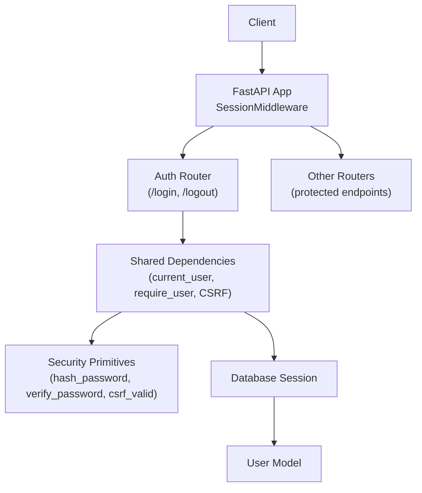
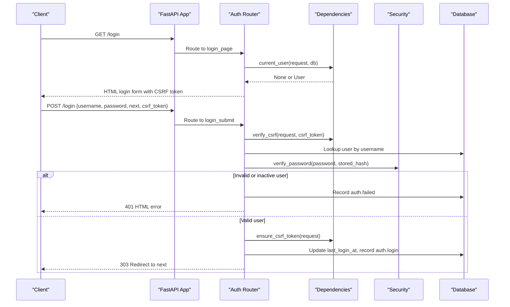
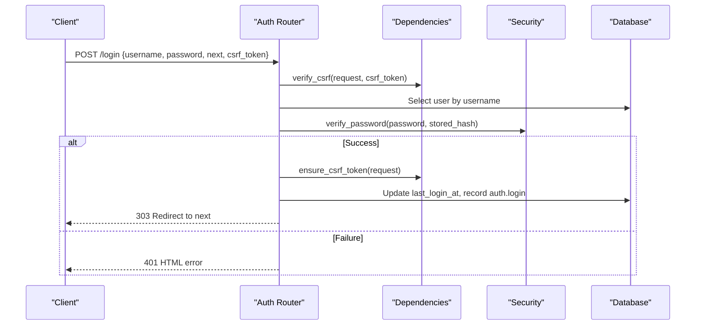
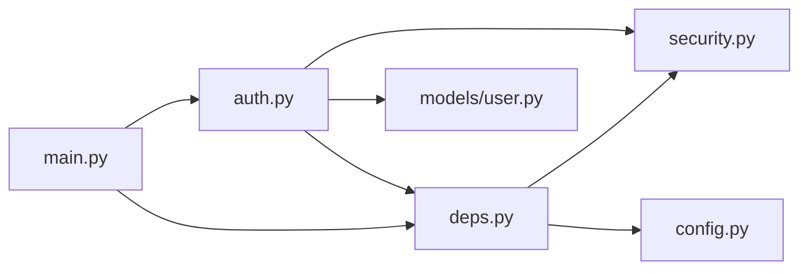

# Authentication API

<cite>
**Referenced Files in This Document**
- [app/main.py](file://app/main.py)
- [app/api/auth.py](file://app/api/auth.py)
- [app/api/deps.py](file://app/api/deps.py)
- [app/utils/security.py](file://app/utils/security.py)
- [app/models/user.py](file://app/models/user.py)
- [app/config.py](file://app/config.py)
</cite>

## Table of Contents
1. [Introduction](#introduction)
2. [Project Structure](#project-structure)
3. [Core Components](#core-components)
4. [Architecture Overview](#architecture-overview)
5. [Detailed Component Analysis](#detailed-component-analysis)
6. [Dependency Analysis](#dependency-analysis)
7. [Performance Considerations](#performance-considerations)
8. [Troubleshooting Guide](#troubleshooting-guide)
9. [Conclusion](#conclusion)

## Introduction
This document describes the authentication API for the application, including login, logout, session handling, CSRF protection, password security, and dependency injection patterns used to protect other endpoints. It also explains how authenticated user context is made available across the application.

The authentication system is built on FastAPI and Starlette SessionMiddleware. Sessions are stored in signed cookies, CSRF tokens are generated per session, and passwords are hashed with PBKDF2-HMAC-SHA256. Brute-force protection is implemented as an in-process guard keyed by username and client host.

## Project Structure
Authentication-related code is primarily located under:
- `app/api/auth.py`: Login, logout, and user administration endpoints.
- `app/api/deps.py`: Shared dependencies for sessions, CSRF, rendering, and authorization helpers.
- `app/utils/security.py`: Password hashing, CSRF token generation/validation, and safe redirect utilities.
- `app/models/user.py`: User model and audit log model.
- `app/main.py`: Application bootstrap, middleware registration, and global exception handlers.
- `app/config.py`: Settings such as secret key, session lifetime, and environment configuration.

**Diagram sources**
- [app/main.py:44-68](file://app/main.py#L44-L68)
- [app/api/auth.py:30-31](file://app/api/auth.py#L30-L31)
- [app/api/deps.py:93-119](file://app/api/deps.py#L93-L119)
- [app/utils/security.py:25-55](file://app/utils/security.py#L25-L55)
- [app/models/user.py:19-43](file://app/models/user.py#L19-L43)

**Section sources**
- [app/main.py:44-68](file://app/main.py#L44-L68)
- [app/api/auth.py:30-31](file://app/api/auth.py#L30-L31)
- [app/api/deps.py:93-119](file://app/api/deps.py#L93-L119)
- [app/utils/security.py:25-55](file://app/utils/security.py#L25-L55)
- [app/models/user.py:19-43](file://app/models/user.py#L19-L43)

## Core Components
- Authentication router: Provides GET `/login` (form page), POST `/login` (credential submission), and POST `/logout`.
- Shared dependencies: Provide current user resolution, role-based guards, CSRF validation, and template rendering helpers.
- Security primitives: Implement password hashing and verification, CSRF token generation/validation, and safe next URL handling.
- User model: Defines user attributes, roles, active status, and last login timestamp.
- Application bootstrap: Registers SessionMiddleware, mounts routers, and defines global exception handlers.

Key responsibilities:
- POST `/login`: Validates CSRF, enforces brute-force limits, authenticates credentials, updates session, issues CSRF token, records audit event, and redirects.
- POST `/logout`: Validates CSRF and clears the session; always redirects to `/login`.
- Dependency injection: `current_user`, `require_user`, `require_admin`, and `require_operator` provide authenticated context and authorization checks.

**Section sources**
- [app/api/auth.py:58-121](file://app/api/auth.py#L58-L121)
- [app/api/deps.py:75-119](file://app/api/deps.py#L75-L119)
- [app/utils/security.py:25-55](file://app/utils/security.py#L25-L55)
- [app/models/user.py:19-43](file://app/models/user.py#L19-L43)
- [app/main.py:55-68](file://app/main.py#L55-L68)

## Architecture Overview
The authentication flow uses signed cookie sessions managed by Starlette’s SessionMiddleware. On successful login, the server stores the user ID and role in the session and ensures a CSRF token exists. Subsequent requests carry the session cookie; protected endpoints use dependency functions to resolve the current user and enforce roles.

**Diagram sources**
- [app/api/auth.py:58-114](file://app/api/auth.py#L58-L114)
- [app/api/deps.py:75-101](file://app/api/deps.py#L75-L101)
- [app/utils/security.py:33-45](file://app/utils/security.py#L33-L45)

## Detailed Component Analysis

### Login Endpoint
- Method and path: `POST /login`
- Request body: Form-encoded fields:
  - `username`: Required string. Normalized to lowercase and trimmed.
  - `password`: Required string.
  - `next`: Optional string; default "/". Sanitized to same-site relative paths only.
  - `csrf_token`: Optional string; validated against the session token.
- Response behavior:
  - Successful authentication: Clears old session, sets session keys for user ID and role, ensures CSRF token, updates last login time, records audit event, and redirects (303) to the sanitized target.
  - Invalid credentials or inactive user: Records failed attempt, increments brute-force counter, records audit event, returns 401 HTML error with message.
  - Brute-force blocked: Returns 429 HTML error after too many attempts within the window.

CSRF protection:
- The endpoint calls CSRF verification before processing credentials. If invalid, a 400 Bad Request is raised.

Brute-force protection:
- In-memory guard tracks failed attempts per username and client host within a fixed time window. When exceeded, further attempts are blocked temporarily.

Session handling:
- On success, the session is cleared to mitigate fixation attacks, then populated with user ID and role. A new CSRF token is ensured for the authenticated session.

Audit logging:
- Successful login and failed attempts are recorded via the audit service.

Error responses:
- 401 Unauthorized: Invalid credentials or inactive user.
- 429 Too Many Requests: Brute-force limit reached.
- 400 Bad Request: CSRF validation failure.

Example flows:
- Successful login:
  - Client submits valid username/password with a valid CSRF token.
  - Server validates CSRF, verifies credentials, updates session, and redirects to the target URL.
- Invalid credentials:
  - Server responds with 401 and an error message.
- Brute-force blocked:
  - Server responds with 429 and instructs retry after a delay.

**Section sources**
- [app/api/auth.py:65-114](file://app/api/auth.py#L65-L114)
- [app/api/deps.py:87-90](file://app/api/deps.py#L87-L90)
- [app/utils/security.py:58-67](file://app/utils/security.py#L58-L67)

### Logout Endpoint
- Method and path: `POST /logout`
- Request body: Form-encoded field:
  - `csrf_token`: Optional string; validated if present.
- Behavior:
  - If CSRF token is valid, the session is cleared.
  - Always redirects to `/login` with 303.

Security notes:
- Clearing the session removes user ID and role from the cookie, effectively ending the authenticated session.

**Section sources**
- [app/api/auth.py:117-121](file://app/api/auth.py#L117-L121)

### Current User Endpoint
There is no dedicated `/api/me` endpoint in the authentication module. Instead, the application exposes dependency functions that return the current authenticated user for use in other endpoints:
- `deps.current_user(request, db)`: Returns the current `User` object or `None`.
- `deps.require_user(request, db)`: Returns the current `User` or raises `AuthRequired`.
- `deps.require_admin(request, db)` and `deps.require_operator(request, db)`: Enforce role requirements.

Protected endpoints typically call these dependencies to access the authenticated user context. For example, pages and reports modules use `require_user` to gate access.

If you need a dedicated current-user endpoint, it can be implemented by calling `require_user` and returning serialized user data.

**Section sources**
- [app/api/deps.py:93-119](file://app/api/deps.py#L93-L119)
- [app/api/pages.py:27](file://app/api/pages.py#L27)
- [app/api/reports.py:45](file://app/api/reports.py#L45)

### Authentication Middleware and Session Management
- SessionMiddleware is registered during app creation with:
  - Secret key from settings (`APP_SECRET_KEY`).
  - Cookie name: `cctv_session`.
  - Max age: `SESSION_MAX_AGE_SECONDS` (default 12 hours).
  - SameSite: `lax`.
  - HTTPS-only: Enabled in production.

Session keys:
- `user_id`: Stores the authenticated user’s primary key.
- `role`: Stores the user’s role string.
- `csrf_token`: Stores the CSRF token for request validation.
- `notice`: Stores flash messages for UI feedback.

Session expiration:
- Expired sessions are rejected by the browser and not sent to the server.
- `current_user` cleans up stale session entries when the user is missing or inactive.

**Section sources**
- [app/main.py:55-62](file://app/main.py#L55-L62)
- [app/utils/security.py:19-22](file://app/utils/security.py#L19-L22)
- [app/api/deps.py:93-101](file://app/api/deps.py#L93-L101)
- [app/config.py:177-187](file://app/config.py#L177-L187)

### CSRF Protection Mechanisms
- Token generation:
  - `new_csrf_token()` creates a secure random token.
  - `get_csrf_token()` retrieves or creates a token in the session.
- Validation:
  - `csrf_valid()` compares the submitted token with the session token using constant-time comparison.
  - `verify_csrf()` raises HTTP 400 if validation fails.
- Usage:
  - Login and logout endpoints validate CSRF tokens.
  - Rendering helper injects CSRF token into templates for forms.

Security properties:
- Tokens are cryptographically random and compared in constant time to prevent timing attacks.
- Open redirect prevention is enforced via `safe_next_url()`.

**Section sources**
- [app/utils/security.py:48-55](file://app/utils/security.py#L48-L55)
- [app/utils/security.py:58-67](file://app/utils/security.py#L58-L67)
- [app/api/deps.py:75-90](file://app/api/deps.py#L75-L90)

### Password Security Practices
- Hashing algorithm: PBKDF2-HMAC-SHA256 with 260,000 iterations and a 16-byte salt.
- Storage format: Algorithm identifier, iteration count, salt, and digest concatenated with `$`.
- Verification: Parses stored hash and recomputes digest; uses constant-time comparison.
- Input validation: Empty passwords raise errors during hashing.

Recommendations:
- Ensure minimum password length enforcement at the API layer (already applied in user creation/change endpoints).
- Consider migrating to a more modern library (e.g., Argon2) if future-proofing is required.

**Section sources**
- [app/utils/security.py:15-45](file://app/utils/security.py#L15-L45)
- [app/api/auth.py:152-158](file://app/api/auth.py#L152-L158)

### Error Responses and Status Codes
- 400 Bad Request: CSRF validation failure.
- 401 Unauthorized: Invalid credentials or inactive user.
- 403 Forbidden: Insufficient role (handled globally via `Forbidden` exception).
- 422 Unprocessable Entity: Request validation errors (handled globally).
- 429 Too Many Requests: Brute-force protection triggered.
- 500 Internal Server Error: Unexpected exceptions (global handler).

Global exception handlers:
- `AuthRequired`: Redirects to `/login?next=<path>`.
- `Forbidden`: Renders error page with message.
- `HTTPException`: JSON response for `/api/*` routes; otherwise renders error page.
- `RequestValidationError`: JSON response with validation errors.
- Generic exception handler: Logs and returns safe messages.

**Section sources**
- [app/main.py:71-114](file://app/main.py#L71-L114)
- [app/api/deps.py:35-48](file://app/api/deps.py#L35-L48)

### Example Authentication Flows

#### Successful Authentication Flow

**Diagram sources**
- [app/api/auth.py:65-114](file://app/api/auth.py#L65-L114)
- [app/api/deps.py:87-101](file://app/api/deps.py#L87-L101)
- [app/utils/security.py:33-45](file://app/utils/security.py#L33-L45)

#### Invalid Credentials Flow
- Client submits incorrect password or inactive user.
- Server increments brute-force counter, records audit event, and returns 401 HTML error.

**Section sources**
- [app/api/auth.py:90-100](file://app/api/auth.py#L90-L100)

#### Session Expiration Handling
- Expired session cookie is not sent by the browser.
- `current_user` returns `None`, causing protected endpoints to redirect to login.

**Section sources**
- [app/api/deps.py:93-101](file://app/api/deps.py#L93-L101)

## Dependency Analysis
The authentication subsystem depends on:
- FastAPI and Starlette for routing, middleware, and templating.
- SQLAlchemy for database access and ORM models.
- Configuration module for environment-driven settings.
- Audit service for recording authentication events.

**Diagram sources**
- [app/api/auth.py:15-28](file://app/api/auth.py#L15-L28)
- [app/api/deps.py:15-27](file://app/api/deps.py#L15-L27)
- [app/main.py:15-19](file://app/main.py#L15-L19)

**Section sources**
- [app/api/auth.py:15-28](file://app/api/auth.py#L15-L28)
- [app/api/deps.py:15-27](file://app/api/deps.py#L15-L27)
- [app/main.py:15-19](file://app/main.py#L15-L19)

## Performance Considerations
- Password hashing uses PBKDF2 with 260,000 iterations, which is CPU-intensive but provides strong security. Expect higher latency on login operations proportional to hardware performance.
- Brute-force guard is in-memory and process-scoped; in multi-worker deployments, consider a distributed rate limiter (e.g., Redis-backed) for consistent protection.
- Session storage is cookie-based; keep session payloads small to avoid excessive bandwidth usage.

[No sources needed since this section provides general guidance]

## Troubleshooting Guide
Common issues and resolutions:
- CSRF token errors:
  - Ensure forms include the CSRF token injected by the rendering helper.
  - Check that the session cookie is present and not expired.
- Persistent login failures:
  - Verify username normalization and case-insensitive lookup.
  - Confirm password hashing and verification logic matches stored hashes.
- Session not persisting:
  - Validate `APP_SECRET_KEY` is set and non-default in production.
  - Ensure `SESSION_MAX_AGE_SECONDS` is configured appropriately.
- Role-based access denied:
  - Confirm user role values match expected enums.
  - Use `require_admin` or `require_operator` where appropriate.

Relevant handlers and utilities:
- Global exception handlers for authentication and forbidden access.
- CSRF validation and token generation utilities.
- Safe redirect function to prevent open redirects.

**Section sources**
- [app/main.py:71-114](file://app/main.py#L71-L114)
- [app/api/deps.py:75-90](file://app/api/deps.py#L75-L90)
- [app/utils/security.py:58-67](file://app/utils/security.py#L58-L67)

## Conclusion
The authentication API provides secure login/logout flows with robust CSRF protection, signed cookie sessions, and strong password hashing. Dependency injection functions enable consistent authentication and authorization across the application. Brute-force protection adds defense-in-depth for credential guessing. For enhanced security and scalability, consider adopting a distributed rate limiter and modern password hashing libraries in future iterations.

[No sources needed since this section summarizes without analyzing specific files]