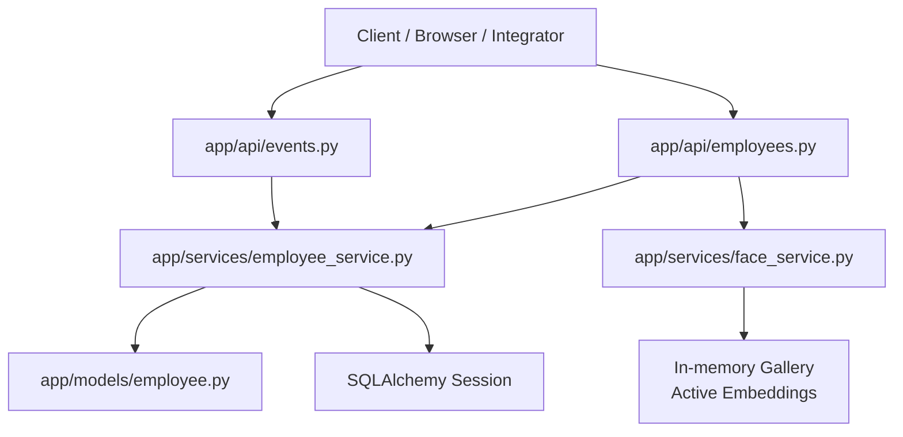
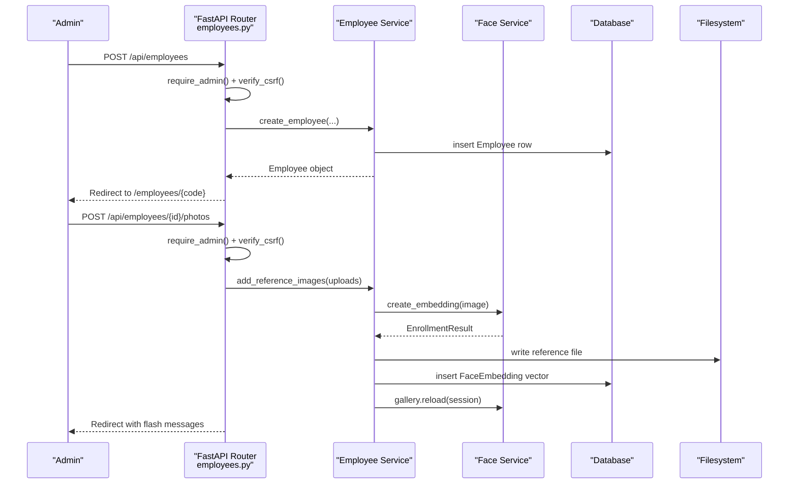
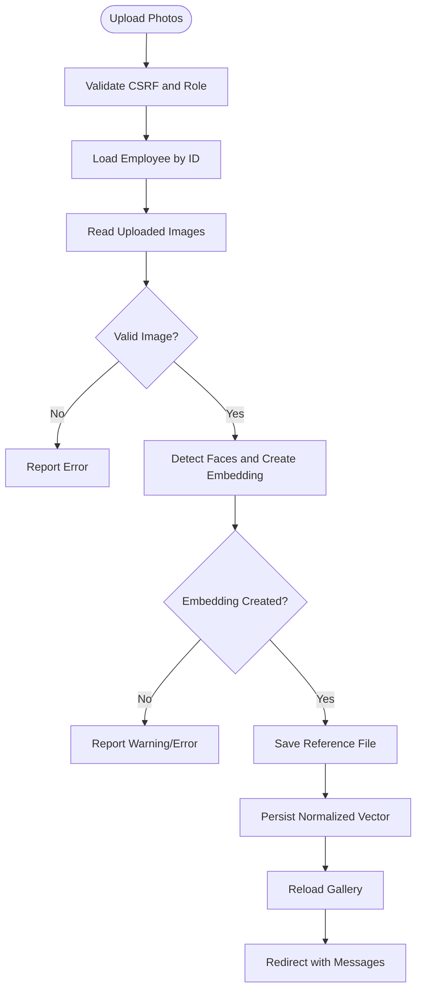
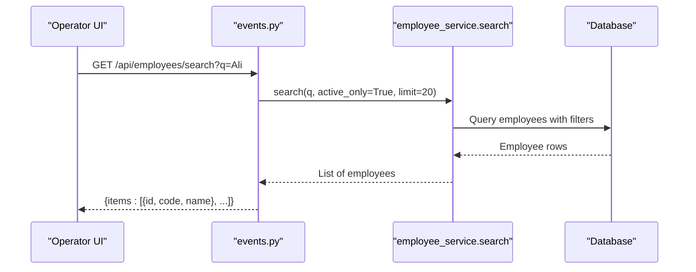
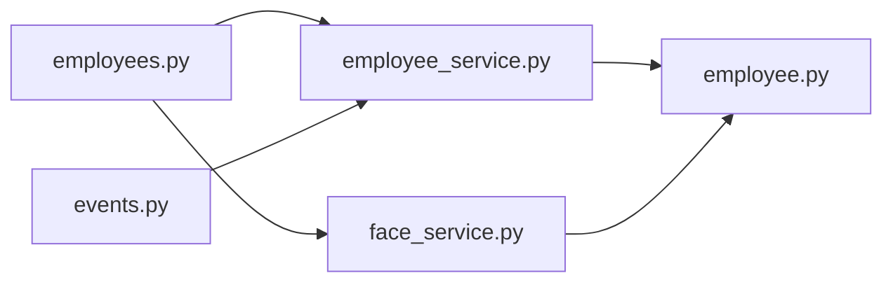
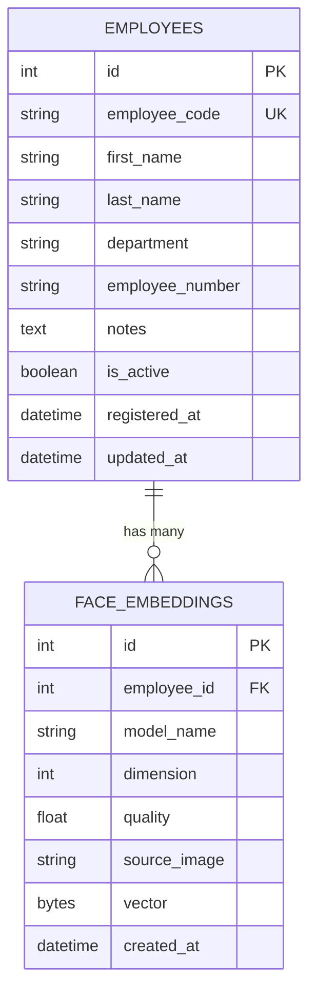

# Employees API

<cite>
**Referenced Files in This Document**
- [employees.py](file://app/api/employees.py)
- [events.py](file://app/api/events.py)
- [employee_service.py](file://app/services/employee_service.py)
- [face_service.py](file://app/services/face_service.py)
- [employee.py](file://app/models/employee.py)
- [deps.py](file://app/api/deps.py)
- [register_employee.py](file://scripts/register_employee.py)
- [README.md](file://README.md)
</cite>

## Table of Contents
1. [Introduction](#introduction)
2. [Project Structure](#project-structure)
3. [Core Components](#core-components)
4. [Architecture Overview](#architecture-overview)
5. [Detailed Component Analysis](#detailed-component-analysis)
6. [Dependency Analysis](#dependency-analysis)
7. [Performance Considerations](#performance-considerations)
8. [Troubleshooting Guide](#troubleshooting-guide)
9. [Conclusion](#conclusion)
10. [Appendices](#appendices)

## Introduction
This document describes the employee management API surface for registering, updating, searching, and removing employees, as well as uploading face reference photos, managing biometric templates, and using the employee search endpoint used by recognition workflows. It also explains how gallery operations and event association fit into the system.

The implementation is a FastAPI application with:
- HTML pages for admin UI flows.
- JSON endpoints for operator-facing search.
- Service layer functions for business logic.
- SQLAlchemy models for employees and face embeddings.
- A face recognition service that loads InsightFace models and maintains an in-memory gallery of active employee embeddings.

Security notes from the project include session-based authentication, CSRF protection for mutating endpoints, role checks (admin/operator), and restricted access to employee reference photos.

**Section sources**
- [README.md:173-199](file://README.md#L173-L199)
- [README.md:245-283](file://README.md#L245-L283)
- [README.md:425-437](file://README.md#L425-L437)

## Project Structure
The employee-related functionality spans several modules:

**Diagram sources**
- [employees.py:25-261](file://app/api/employees.py#L25-L261)
- [events.py:177-181](file://app/api/events.py#L177-L181)
- [employee_service.py:34-287](file://app/services/employee_service.py#L34-L287)
- [face_service.py:132-170](file://app/services/face_service.py#L132-L170)
- [employee.py:20-82](file://app/models/employee.py#L20-L82)

**Section sources**
- [employees.py:1-261](file://app/api/employees.py#L1-L261)
- [events.py:177-181](file://app/api/events.py#L177-L181)
- [employee_service.py:1-287](file://app/services/employee_service.py#L1-L287)
- [face_service.py:1-341](file://app/services/face_service.py#L1-L341)
- [employee.py:1-82](file://app/models/employee.py#L1-L82)

## Core Components
- Employee model: stores identity fields, activity status, timestamps, and has a one-to-many relationship with face embeddings.
- Face embedding model: stores normalized float32 vectors as binary blobs, along with metadata such as source image path, quality score, model name, and dimension.
- Employee service: provides CRUD helpers, reference photo storage, embedding creation, deletion, activation toggling, search, and audit logging.
- Face service: wraps InsightFace detection/recognition, builds an in-memory gallery of active employee embeddings, and performs cosine similarity matching with threshold and margin controls.
- API routers: expose HTML pages and JSON endpoints; enforce roles and CSRF where required.

Key responsibilities:
- Registration and updates are form-based and redirect back to the employee detail page.
- Photo upload validates images, creates embeddings, persists both files and database rows, and refreshes the gallery.
- Search endpoints return lightweight employee summaries suitable for UI auto-complete or integration queries.
- Restricted photo access ensures only known, referenced files under the correct employee directory can be served.

**Section sources**
- [employee.py:20-82](file://app/models/employee.py#L20-L82)
- [employee_service.py:34-287](file://app/services/employee_service.py#L34-L287)
- [face_service.py:86-170](file://app/services/face_service.py#L86-L170)
- [employees.py:61-261](file://app/api/employees.py#L61-L261)

## Architecture Overview
The employee workflow combines web forms, services, and AI components:

**Diagram sources**
- [employees.py:61-94](file://app/api/employees.py#L61-L94)
- [employees.py:150-185](file://app/api/employees.py#L150-L185)
- [employee_service.py:112-180](file://app/services/employee_service.py#L112-L180)
- [face_service.py:276-294](file://app/services/face_service.py#L276-L294)

## Detailed Component Analysis

### Employee Registration
- Endpoint: `POST /api/employees`
- Role: admin
- CSRF: required
- Form fields:
  - `first_name` (required)
  - `last_name` (required)
  - `department` (optional)
  - `employee_number` (optional)
  - `employee_code` (optional; if omitted, server generates next code)
  - `notes` (optional)
  - `csrf_token` (required for mutation)
- Behavior:
  - Validates names length and uniqueness of employee code.
  - Creates employee record and records audit entry.
  - Commits transaction and redirects to the employee detail page with a success message.

Response behavior:
- Success: HTTP 303 redirect to `/employees/{employee_code}`.
- Validation error: Flash message and redirect back to `/employees`.

Example registration workflow:
1. Admin submits the registration form with required fields.
2. Server validates CSRF and role.
3. Employee is created and committed.
4. Admin is redirected to the employee detail page to upload reference photos.

**Section sources**
- [employees.py:61-94](file://app/api/employees.py#L61-L94)
- [employee_service.py:34-75](file://app/services/employee_service.py#L34-L75)

### Employee Update
- Endpoint: `POST /api/employees/{employee_id}/update`
- Role: admin
- CSRF: required
- Form fields:
  - `first_name`, `last_name`, `department`, `employee_number`, `notes`
  - `csrf_token`
- Behavior:
  - Loads employee by primary key.
  - Updates allowed fields with sanitization and truncation.
  - Records audit entry and commits.

Response behavior:
- Success: Redirect to employee detail page.
- Not found: Flash error and redirect to `/employees`.

Note: There is no generic `PUT /api/employees/{id}` endpoint in this codebase; updates are performed via the dedicated update endpoint above.

**Section sources**
- [employees.py:97-127](file://app/api/employees.py#L97-L127)
- [employee_service.py:78-95](file://app/services/employee_service.py#L78-L95)

### Employee Activation Toggle
- Endpoint: `POST /api/employees/{employee_id}/toggle`
- Role: admin
- CSRF: required
- Behavior:
  - Toggles `is_active`.
  - Refreshes gallery so inactive employees are removed from recognition.
  - Records audit entry.

Use case:
- Temporarily disable an employee without deleting their biometric data.

**Section sources**
- [employees.py:130-147](file://app/api/employees.py#L130-L147)
- [employee_service.py:232-244](file://app/services/employee_service.py#L232-L244)
- [face_service.py:140-166](file://app/services/face_service.py#L140-L166)

### Employee Removal
- Endpoint: `POST /api/employees/{employee_id}/delete`
- Role: admin
- CSRF: required
- Additional field:
  - `confirm_code`: must match the employee’s code (case-insensitive) to prevent accidental deletion.
- Behavior:
  - Deletes employee row and associated embeddings.
  - Removes the employee folder containing reference photos.
  - Records audit entry indicating biometric data was deleted.

Response behavior:
- Success: Redirect to `/employees`.
- Mismatched confirmation code: Flash error and redirect to employee detail.

**Section sources**
- [employees.py:211-233](file://app/api/employees.py#L211-L233)
- [employee_service.py:199-229](file://app/services/employee_service.py#L199-L229)

### Face Template Upload and Management
- Upload endpoint: `POST /api/employees/{employee_id}/photos`
- Delete single template endpoint: `POST /api/employees/{employee_id}/photos/{embedding_id}/delete`
- Role: admin
- CSRF: required
- Upload behavior:
  - Accepts multiple image files.
  - Validates each file and decodes it.
  - Uses face service to detect faces and generate embeddings.
  - Stores reference images under `settings.employees_dir/<employee_code>/reference_NN.ext`.
  - Persists normalized float32 vectors in the database.
  - Reloads the in-memory gallery so recognition sees new templates immediately.
  - Returns stored count, errors, and warnings through flash messages.

Delete behavior:
- Removes the corresponding file and embedding row.
- Refreshes gallery.

Restricted photo access:
- Endpoint: `GET /api/employees/{code}/photos/{filename}`
- Role: operator or admin
- Security:
  - Requires operator-level access.
  - Resolves the target path safely within the employee directory.
  - Only serves files that are actually referenced by a stored embedding.
  - Returns 403 for path traversal attempts and 404 when the file is unknown or missing.

**Diagram sources**
- [employees.py:150-185](file://app/api/employees.py#L150-L185)
- [employee_service.py:112-180](file://app/services/employee_service.py#L112-L180)
- [face_service.py:276-294](file://app/services/face_service.py#L276-L294)

**Section sources**
- [employees.py:150-208](file://app/api/employees.py#L150-L208)
- [employees.py:239-261](file://app/api/employees.py#L239-L261)
- [employee_service.py:112-196](file://app/services/employee_service.py#L112-L196)
- [face_service.py:276-294](file://app/services/face_service.py#L276-L294)

### Employee Search and Biometric Matching
- Search endpoint: `GET /api/employees/search`
- Role: operator or admin
- Query parameters:
  - `q`: text filter applied to first name, last name, employee code, department, and employee number.
  - The service applies `active_only=True` and limits results to 20.
- Response:
  - JSON array of `{id, code, name}` items.

Biometric matching:
- Recognition is not exposed as a direct public API endpoint in the analyzed code. Instead, the face service matches query embeddings against the active gallery using cosine similarity with configurable threshold and margin.
- Unknown persons are labeled distinctly rather than guessed.
- The gallery includes only active employees and is reloaded after template changes.

**Diagram sources**
- [events.py:177-181](file://app/api/events.py#L177-L181)
- [employee_service.py:247-268](file://app/services/employee_service.py#L247-L268)

**Section sources**
- [events.py:177-181](file://app/api/events.py#L177-L181)
- [employee_service.py:247-268](file://app/services/employee_service.py#L247-L268)
- [face_service.py:86-129](file://app/services/face_service.py#L86-L129)
- [face_service.py:140-166](file://app/services/face_service.py#L140-L166)

### Gallery Operations
- Gallery reload:
  - Triggered automatically after adding or deleting reference images.
  - Loads active employees and their embeddings into memory.
- Status information:
  - Face service exposes availability, configured model, providers, thresholds, and current gallery size/load time.

Operational implications:
- Inactive employees are excluded from recognition.
- After bulk enrollment, the gallery should be refreshed to reflect new templates.

**Section sources**
- [face_service.py:132-170](file://app/services/face_service.py#L132-L170)
- [face_service.py:194-204](file://app/services/face_service.py#L194-L204)
- [employee_service.py:168-180](file://app/services/employee_service.py#L168-L180)

### Event Association Context
While there is no dedicated “search by face” endpoint in the analyzed routes, events carry biometric context such as face match score and association confidence. The README documents a JSON events API that does not include biometric data in responses, while evidence images are protected and accessible only to authorized roles.

Integration guidance:
- Use `/api/employees/search` to resolve candidate employees during review workflows.
- Use evidence endpoints to retrieve supporting images for manual verification.

**Section sources**
- [README.md:425-437](file://README.md#L425-L437)

## Dependency Analysis
The following diagram shows how API endpoints depend on services and models:

**Diagram sources**
- [employees.py:1-261](file://app/api/employees.py#L1-L261)
- [events.py:177-181](file://app/api/events.py#L177-L181)
- [employee_service.py:1-287](file://app/services/employee_service.py#L1-L287)
- [face_service.py:1-341](file://app/services/face_service.py#L1-L341)
- [employee.py:1-82](file://app/models/employee.py#L1-L82)

Coupling and cohesion:
- API layer is thin: it handles requests, authorization, CSRF, and redirects.
- Business logic is centralized in the employee service.
- Face service encapsulates AI model lifecycle and matching logic.
- Models define persistence schema and simple helpers.

Potential circular dependencies:
- Face service imports models lazily inside gallery reload to avoid import-time cycles.

External dependencies:
- InsightFace and ONNX Runtime are optional; the service reports unavailability gracefully.
- Database is SQLite by default but models are portable.

**Section sources**
- [face_service.py:29-35](file://app/services/face_service.py#L29-L35)
- [face_service.py:140-166](file://app/services/face_service.py#L140-L166)
- [README.md:97-116](file://README.md#L97-L116)

## Performance Considerations
- Face model loading is cached per process; avoid reloading per request.
- Gallery reload occurs after template changes; batch uploads reduce reload frequency.
- Recognition uses cosine similarity over normalized vectors; performance scales with gallery size.
- Threshold and margin settings affect false positives/negatives and should be calibrated for your environment.
- CPU inference may be slow; GPU support is available via ONNX Runtime CUDA provider.

Recommendations:
- Keep reference photos clear and frontal; aim for 3–5 high-quality images per employee.
- Tune `FACE_SIMILARITY_THRESHOLD` and `FACE_MATCH_MARGIN` based on real camera conditions.
- Monitor gallery size and load times; consider limiting active employees if necessary.

[No sources needed since this section provides general guidance]

## Troubleshooting Guide
Common issues and resolutions:
- Face recognition unavailable:
  - Install AI requirements and ensure InsightFace model downloads successfully.
  - Check face service status and reason for unavailability.
- No faces detected in uploaded photos:
  - Ensure adequate lighting, frontal pose, and minimum face size.
  - Review warnings returned during upload.
- Path traversal or 403 on photo access:
  - Verify operator/admin role and that the requested file is a known reference.
- Deletion fails due to permission errors:
  - Check filesystem permissions for the employee directory.
- Slow recognition:
  - Reduce processing FPS, lower image sizes, or enable GPU providers.

**Section sources**
- [README.md:516-530](file://README.md#L516-L530)
- [employees.py:239-261](file://app/api/employees.py#L239-L261)
- [employee_service.py:183-196](file://app/services/employee_service.py#L183-L196)
- [face_service.py:184-204](file://app/services/face_service.py#L184-L204)

## Conclusion
The employee management API provides secure, role-gated endpoints for creating, updating, activating, and deleting employees, along with robust face template upload and management. Employee search returns lightweight results suitable for UI integrations, while biometric matching is handled internally by the face service using an in-memory gallery of active embeddings. For production use, calibrate face thresholds, protect sensitive directories, and monitor gallery health.

[No sources needed since this section summarizes without analyzing specific files]

## Appendices

### API Summary Table

| Method | Endpoint | Role | CSRF | Purpose | Notes |
| --- | --- | --- | --- | --- | --- |
| POST | `/api/employees` | Admin | Yes | Register employee | Redirects to detail page |
| POST | `/api/employees/{employee_id}/update` | Admin | Yes | Update employee fields | Redirects to detail page |
| POST | `/api/employees/{employee_id}/toggle` | Admin | Yes | Activate/deactivate employee | Refreshes gallery |
| POST | `/api/employees/{employee_id}/photos` | Admin | Yes | Upload reference photos | Creates embeddings, refreshes gallery |
| POST | `/api/employees/{employee_id}/photos/{embedding_id}/delete` | Admin | Yes | Delete one template | Removes file and vector |
| POST | `/api/employees/{employee_id}/delete` | Admin | Yes | Remove employee and biometrics | Requires confirmation code |
| GET | `/api/employees/{code}/photos/{filename}` | Operator/Admin | No | Serve known reference photo | Path-safe, 403/404 handling |
| GET | `/api/employees/search` | Operator/Admin | No | Search active employees | Returns id, code, name |

**Section sources**
- [employees.py:61-261](file://app/api/employees.py#L61-L261)
- [events.py:177-181](file://app/api/events.py#L177-L181)

### Data Models

**Diagram sources**
- [employee.py:20-82](file://app/models/employee.py#L20-L82)

### Example Workflows

- Employee registration via web:
  - Submit `POST /api/employees` with required fields and CSRF token.
  - Redirect to employee detail page.
  - Upload at least two clear reference photos.

- Employee registration via CLI:
  - Use the provided script to list employees, register a new employee, or add photos later.

- Face template upload:
  - Upload multiple images; system validates, detects faces, and stores embeddings.
  - Gallery reloads automatically.

- Search query format:
  - `GET /api/employees/search?q=<text>` returns up to 20 active employees.

**Section sources**
- [employees.py:61-94](file://app/api/employees.py#L61-L94)
- [employees.py:150-185](file://app/api/employees.py#L150-L185)
- [events.py:177-181](file://app/api/events.py#L177-L181)
- [register_employee.py:1-132](file://scripts/register_employee.py#L1-L132)