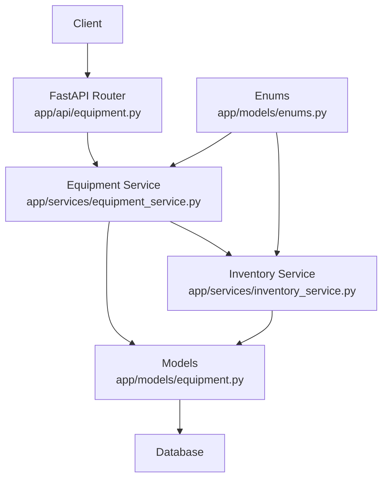
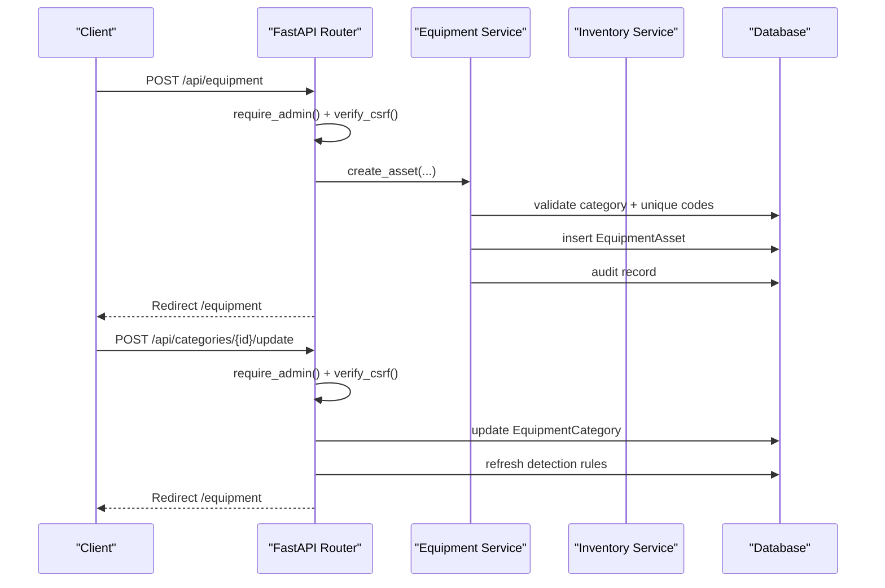
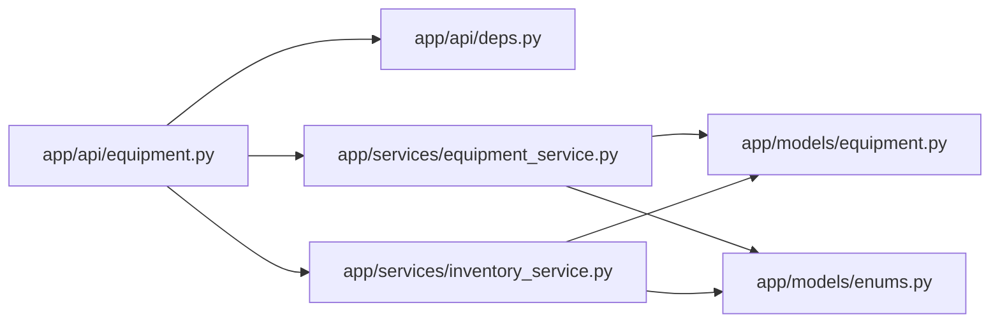

# Equipment API

<cite>
**Referenced Files in This Document**
- [equipment.py](file://app/api/equipment.py)
- [equipment_service.py](file://app/services/equipment_service.py)
- [inventory_service.py](file://app/services/inventory_service.py)
- [equipment.py](file://app/models/equipment.py)
- [enums.py](file://app/models/enums.py)
- [README.md](file://README.md)
</cite>

## Table of Contents
1. [Introduction](#introduction)
2. [Project Structure](#project-structure)
3. [Core Components](#core-components)
4. [Architecture Overview](#architecture-overview)
5. [Detailed Component Analysis](#detailed-component-analysis)
6. [Dependency Analysis](#dependency-analysis)
7. [Performance Considerations](#performance-considerations)
8. [Troubleshooting Guide](#troubleshooting-guide)
9. [Conclusion](#conclusion)
10. [Appendices](#appendices)

## Introduction
This document provides comprehensive API documentation for equipment management endpoints. It covers equipment asset registration, updates, category management, search and filtering, inventory integration, and operational workflows such as receiving, removing, returning, transferring, correcting, and setting initial stock. The system is a local on-premise solution that records equipment movements through an append-only ledger, supports vision-based movement candidates, and integrates with Google Sheets for reporting.

The documented endpoints are implemented as FastAPI routes backed by SQLAlchemy models and services. Authentication and authorization are enforced through role checks, and all mutating operations require CSRF validation.

## Project Structure
Equipment-related functionality lives under:
- `app/api/equipment.py`: HTTP endpoints for the equipment UI and form-based operations.
- `app/services/equipment_service.py`: Business logic for categories, assets, search, and manual inventory operations.
- `app/services/inventory_service.py`: Append-only inventory ledger, balances, pending movements, and event confirmation/rejection.
- `app/models/equipment.py`: Database models for equipment categories and individual assets.
- `app/models/enums.py`: Shared enumerations for roles, statuses, transaction types, directions, and more.
- `README.md`: System overview, installation, security model, inventory rules, and operational guidance.

**Diagram sources**
- [equipment.py:1-273](file://app/api/equipment.py#L1-L273)
- [equipment_service.py:1-349](file://app/services/equipment_service.py#L1-L349)
- [inventory_service.py:1-347](file://app/services/inventory_service.py#L1-L347)
- [equipment.py:1-74](file://app/models/equipment.py#L1-L74)
- [enums.py:1-183](file://app/models/enums.py#L1-L183)

**Section sources**
- [equipment.py:1-273](file://app/api/equipment.py#L1-L273)
- [equipment_service.py:1-349](file://app/services/equipment_service.py#L1-L349)
- [inventory_service.py:1-347](file://app/services/inventory_service.py#L1-L347)
- [equipment.py:1-74](file://app/models/equipment.py#L1-L74)
- [enums.py:1-183](file://app/models/enums.py#L1-L183)
- [README.md:1-637](file://README.md#L1-L637)

## Core Components
- Equipment Asset: Represents a specific physical unit with attributes like asset code, brand, model, serial number, asset tag, location, status, photo path, notes, and timestamps.
- Equipment Category: Maps business categories to detection labels used by the YOLO model, including flags for person detection, activity, minimum confidence, sort order, and notes.
- Inventory Ledger: An append-only record of transactions (initial stock, received, removed, returned, transfer, correction), supporting pending vision candidates and operator confirmation.
- Search and Filtering: Supports querying by text across multiple fields, filtering by category and status, and counting assets per category.

Key responsibilities:
- Endpoints handle request parsing, authentication, CSRF verification, and redirect-based feedback.
- Services enforce validation, uniqueness constraints, audit logging, and inventory rules.
- Models define schema, relationships, and helper properties.

**Section sources**
- [equipment.py:42-74](file://app/models/equipment.py#L42-L74)
- [equipment.py:16-40](file://app/models/equipment.py#L16-L40)
- [inventory_service.py:1-347](file://app/services/inventory_service.py#L1-L347)
- [equipment_service.py:142-175](file://app/services/equipment_service.py#L142-L175)

## Architecture Overview
The equipment management flow combines HTTP endpoints, service-layer logic, and database persistence. Categories organize assets; assets can be individually tracked and linked to inventory transactions. Vision events create pending inventory movements that require operator confirmation before affecting official balances.

**Diagram sources**
- [equipment.py:58-94](file://app/api/equipment.py#L58-L94)
- [equipment.py:140-177](file://app/api/equipment.py#L140-L177)
- [equipment_service.py:59-111](file://app/services/equipment_service.py#L59-L111)

## Detailed Component Analysis

### GET /equipment (HTML page with search and filters)
Purpose:
- Renders the equipment management page for administrators.
- Supports search by query string across asset code, brand, model, serial number, and location.
- Filters by category and status.
- Provides counts per category and suggested next asset codes.

Request parameters:
- q: Free-text search term.
- category: Category code filter.
- status: Status filter using enum values.

Response:
- HTML page rendered with assets, categories, counts, statuses, and next codes.

Security:
- Requires administrator role.

Search behavior:
- Case-insensitive partial matching across multiple fields.
- Category lookup by code; only valid categories apply.
- Status must match one of the defined enum values.

**Section sources**
- [equipment.py:25-55](file://app/api/equipment.py#L25-L55)
- [equipment_service.py:142-168](file://app/services/equipment_service.py#L142-L168)
- [enums.py:133-148](file://app/models/enums.py#L133-L148)

### POST /api/equipment (Create new asset)
Purpose:
- Registers a new equipment asset with optional custom asset code.
- Validates category existence and prevents adding items to person categories.
- Enforces uniqueness of asset code and serial number.
- Records audit entry.

Request body (form-encoded):
- category_code: Required.
- asset_code: Optional; auto-generated if omitted.
- brand: Optional, trimmed and limited length.
- model: Optional, trimmed and limited length.
- serial_number: Optional; must be unique.
- asset_tag: Optional.
- location: Optional, trimmed and limited length.
- status: Defaults to IN_STOCK.
- notes: Optional.
- csrf_token: Required for CSRF protection.

Response:
- Redirects to /equipment with flash message on success or error.

Validation and errors:
- Missing or invalid category raises ValueError and redirects with error.
- Duplicate asset code or serial number raises ValueError and redirects with error.
- Person category cannot be used for equipment.

Audit:
- Creates an audit record for asset creation.

**Section sources**
- [equipment.py:58-94](file://app/api/equipment.py#L58-L94)
- [equipment_service.py:59-111](file://app/services/equipment_service.py#L59-L111)

### POST /api/equipment/{asset_id}/update (Update asset)
Purpose:
- Updates selected fields of an existing asset.
- Allows changing category and status with validation.
- Updates timestamp and records audit entry.

Request body (form-encoded):
- brand, model, serial_number, asset_tag, location, status, category_code, notes.
- csrf_token: Required.

Response:
- Redirects to /equipment with flash message on success or error.

Validation and errors:
- If asset not found, redirects with error.
- Invalid category or status raises ValueError and redirects with error.

Audit:
- Creates an audit record for asset update.

**Section sources**
- [equipment.py:97-137](file://app/api/equipment.py#L97-L137)
- [equipment_service.py:114-139](file://app/services/equipment_service.py#L114-L139)

### POST /api/categories/{category_id}/update (Update category)
Purpose:
- Updates category label, YOLO labels, minimum confidence, and active flag.
- Validates at least one YOLO label and confidence range.
- Refreshes detection rules after update.

Request body (form-encoded):
- label_uz: Required.
- yolo_labels: Comma-separated list of labels.
- min_confidence: Optional float between 0 and 1.
- is_active: Optional boolean flag.
- csrf_token: Required.

Response:
- Redirects to /equipment with flash message on success or error.

Validation and errors:
- Missing category redirects with error.
- Empty YOLO labels list redirects with error.
- Invalid confidence value redirects with error.

Detection integration:
- Triggers monitoring service to refresh detection rules.

**Section sources**
- [equipment.py:140-177](file://app/api/equipment.py#L140-L177)

### Manual Inventory Operations
Purpose:
- Provide operators with tools to manage inventory levels and track movements.
- Support receive, remove, return, transfer, initial stock, and correction operations.
- Integrate with the append-only ledger and optionally update asset status/location.

Endpoints:
- GET /inventory: Renders inventory page with balances and filtered transactions.
- POST /api/inventory/operation: Executes inventory operation based on operation type.

Request parameters (POST /api/inventory/operation):
- operation: One of receive, remove, return, transfer, initial, correct.
- category_code: Required.
- quantity: Optional integer; defaults to 1.
- delta: Required for correction operation.
- location: Optional.
- reason: Optional.
- csrf_token: Required.

Responses:
- Redirects to /inventory with flash messages.

Behavior:
- Receive: Adds positive quantity, confirms transaction, may set asset status to IN_STOCK and update location.
- Remove: Subtracts quantity, confirms transaction, may set asset status to IN_USE and update location.
- Return: Adds positive quantity, confirms transaction, may set asset status to IN_STOCK and update location.
- Transfer: Moves location without changing count; requires destination location.
- Initial: Sets initial stock; admin-only.
- Correction: Applies signed delta with required reason.

Ledger rules:
- Append-only; corrections are new entries.
- Official balances include only confirmed entries.
- Pending vision candidates do not affect balances until confirmed.

**Section sources**
- [equipment.py:183-272](file://app/api/equipment.py#L183-L272)
- [equipment_service.py:181-318](file://app/services/equipment_service.py#L181-L318)
- [inventory_service.py:66-127](file://app/services/inventory_service.py#L66-L127)
- [inventory_service.py:215-273](file://app/services/inventory_service.py#L215-L273)

### Equipment Metadata Structure
Fields for EquipmentAsset:
- id: Primary key.
- asset_code: Unique identifier.
- category_id: Foreign key to EquipmentCategory.
- brand: Brand name.
- model: Model name.
- serial_number: Unique serial number.
- asset_tag: Optional tag.
- location: Current location.
- status: Enum value from EquipmentStatus.
- photo_path: Path to asset photo.
- notes: Additional notes.
- registered_at: Registration timestamp.
- updated_at: Last update timestamp.

Fields for EquipmentCategory:
- id: Primary key.
- code: Unique category code.
- label_uz: Display label.
- yolo_labels: List of detection labels.
- is_person: Flag for person category.
- is_active: Active flag.
- min_confidence: Minimum confidence threshold.
- sort_order: Sorting order.
- notes: Notes.

Relationships:
- EquipmentCategory has many EquipmentAssets.
- EquipmentAsset belongs to EquipmentCategory.

**Section sources**
- [equipment.py:16-74](file://app/models/equipment.py#L16-L74)

### Image Handling for Asset Photos
- Assets support a photo_path field for storing image file paths.
- Evidence images are stored separately under data/evidence/YYYY-MM-DD/.
- Evidence access is restricted via a dedicated endpoint and requires operator/admin roles.
- Evidence retention is configurable and managed by a janitor thread.

Note:
- The equipment endpoints do not directly accept image uploads; photo_path is typically set elsewhere or manually.
- Evidence handling is separate from asset photos.

**Section sources**
- [equipment.py:58-59](file://app/models/equipment.py#L58-L59)
- [README.md:430-438](file://README.md#L430-L438)

### Integration with Inventory Tracking Systems
- The system maintains an append-only ledger of inventory transactions.
- Vision events create pending movements that require operator confirmation.
- Balances are computed from confirmed transactions plus pending adjustments.
- Google Sheets integration mirrors reports and summaries.

Operational flows:
- Manual operations write confirmed transactions immediately.
- Vision-based movements write unconfirmed candidates.
- Operator review confirms or rejects candidates, updating balances accordingly.

**Section sources**
- [inventory_service.py:1-347](file://app/services/inventory_service.py#L1-L347)
- [README.md:286-313](file://README.md#L286-L313)
- [README.md:316-343](file://README.md#L316-L343)
- [README.md:368-413](file://README.md#L368-L413)

### Examples

#### Equipment Registration
- Use POST /api/equipment with category_code and optional asset_code.
- Ensure category exists and is not a person category.
- Avoid duplicate asset_code and serial_number.

Example steps:
1. Select a valid category code.
2. Optionally provide a custom asset_code; otherwise, it will be generated.
3. Fill brand, model, serial_number, location, status, and notes as needed.
4. Submit with CSRF token.

Expected outcome:
- Asset created, audit recorded, redirect to /equipment with success message.

**Section sources**
- [equipment.py:58-94](file://app/api/equipment.py#L58-L94)
- [equipment_service.py:59-111](file://app/services/equipment_service.py#L59-L111)

#### Category Assignment
- Update asset category via POST /api/equipment/{asset_id}/update with category_code.
- Validate category exists and is not a person category.

Expected outcome:
- Asset category updated, audit recorded, redirect to /equipment.

**Section sources**
- [equipment.py:97-137](file://app/api/equipment.py#L97-L137)
- [equipment_service.py:114-139](file://app/services/equipment_service.py#L114-L139)

#### Bulk Operations
- The current endpoints are form-based and designed for single operations.
- For bulk operations, repeat POST /api/inventory/operation calls with appropriate operation types and quantities.
- Use receive, remove, return, transfer, initial, and correction operations as needed.

Note:
- There is no dedicated bulk endpoint; automation should loop over individual requests.

**Section sources**
- [equipment.py:216-272](file://app/api/equipment.py#L216-L272)
- [equipment_service.py:181-318](file://app/services/equipment_service.py#L181-L318)

## Dependency Analysis
The equipment module depends on:
- FastAPI router for HTTP endpoints.
- Dependencies for authentication, CSRF, rendering, and database sessions.
- Equipment service for business logic.
- Inventory service for ledger operations.
- Models for data structures.
- Enums for shared constants.

**Diagram sources**
- [equipment.py:1-273](file://app/api/equipment.py#L1-L273)
- [equipment_service.py:1-349](file://app/services/equipment_service.py#L1-L349)
- [inventory_service.py:1-347](file://app/services/inventory_service.py#L1-L347)
- [equipment.py:1-74](file://app/models/equipment.py#L1-L74)
- [enums.py:1-183](file://app/models/enums.py#L1-L183)

**Section sources**
- [equipment.py:1-273](file://app/api/equipment.py#L1-L273)
- [equipment_service.py:1-349](file://app/services/equipment_service.py#L1-L349)
- [inventory_service.py:1-347](file://app/services/inventory_service.py#L1-L347)
- [equipment.py:1-74](file://app/models/equipment.py#L1-L74)
- [enums.py:1-183](file://app/models/enums.py#L1-L183)

## Performance Considerations
- Search queries use SQL LIKE with ilike for case-insensitive matching; consider indexing frequently searched fields if performance degrades.
- Limiting results to 300 assets helps prevent large payloads.
- Inventory balances compute aggregates over transactions; ensure database indexes on category_code and is_confirmed for efficient queries.
- Vision candidate processing writes unconfirmed rows; confirmations are batched during operator review.

[No sources needed since this section provides general guidance]

## Troubleshooting Guide
Common issues and resolutions:
- Missing category: Ensure category_code exists and is not a person category.
- Duplicate asset code or serial number: Choose a different code or clear the duplicate.
- Invalid status: Use one of the defined EquipmentStatus values.
- Confidence out of range: Set min_confidence between 0 and 1.
- Pending inventory discrepancies: Review pending movements and confirm or reject them.
- Evidence access denied: Ensure operator/admin role and use the evidence endpoint.

**Section sources**
- [equipment.py:75-94](file://app/api/equipment.py#L75-L94)
- [equipment.py:118-137](file://app/api/equipment.py#L118-L137)
- [equipment.py:151-177](file://app/api/equipment.py#L151-L177)
- [inventory_service.py:165-205](file://app/services/inventory_service.py#L165-L205)
- [README.md:430-438](file://README.md#L430-L438)

## Conclusion
The Equipment API provides robust CRUD-like operations for managing equipment assets and categories, integrated with an append-only inventory ledger and vision-based movement tracking. Administrators can register and update assets, assign categories, and configure detection mappings. Operators can perform inventory operations and review pending movements. The system emphasizes auditability, validation, and clear separation between manual and automated processes.

[No sources needed since this section summarizes without analyzing specific files]

## Appendices

### EquipmentStatus Values
- IN_STOCK: Item is in stock.
- IN_USE: Item is in use.
- MAINTENANCE: Item is under maintenance.
- LOST: Item is lost.
- RETIRED: Item is retired.

**Section sources**
- [enums.py:133-148](file://app/models/enums.py#L133-L148)

### TransactionType Values
- INITIAL: Initial stock entry.
- RECEIVED: Received item.
- REMOVED: Removed item.
- RETURNED: Returned item.
- TRANSFER: Internal transfer.
- CORRECTION: Manual correction.

**Section sources**
- [enums.py:113-130](file://app/models/enums.py#L113-L130)