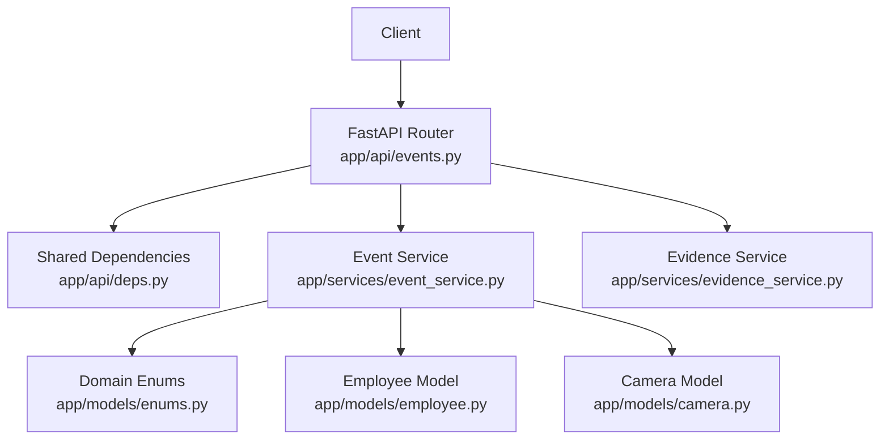
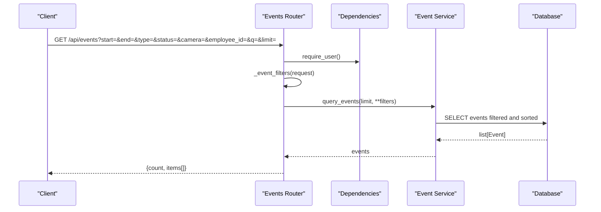
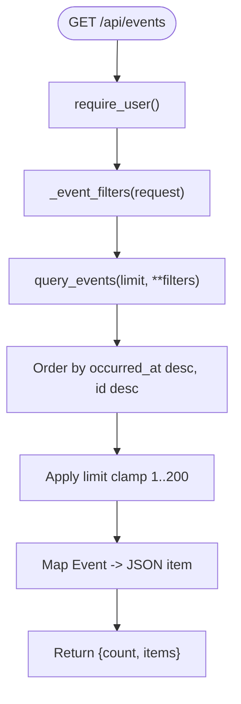
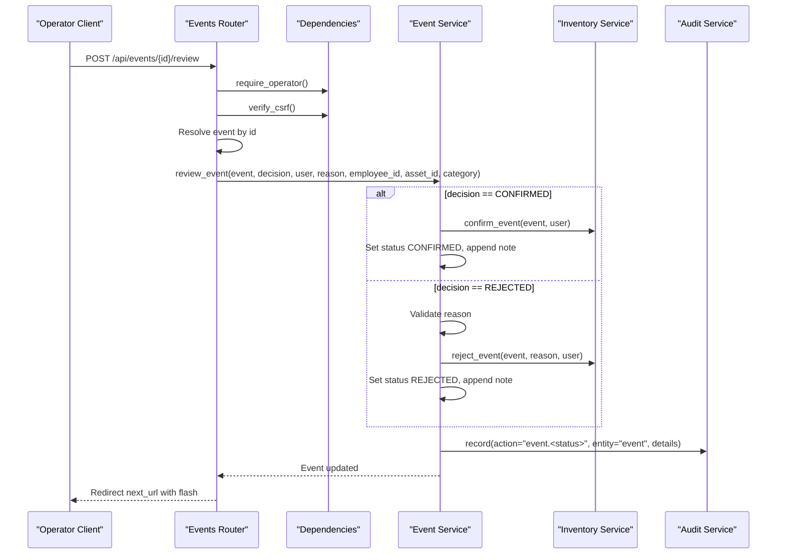
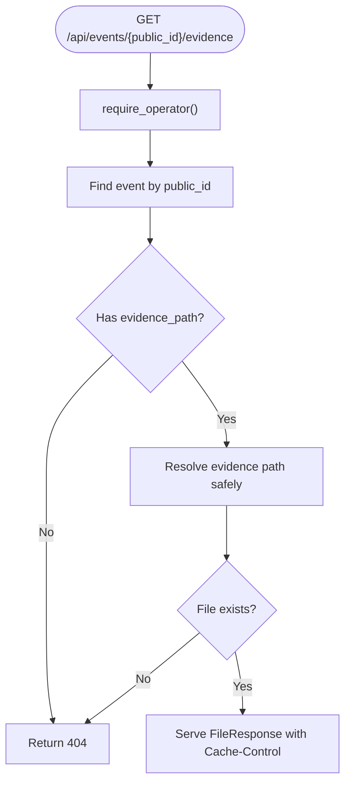
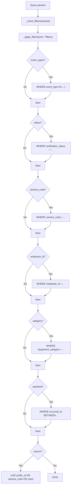
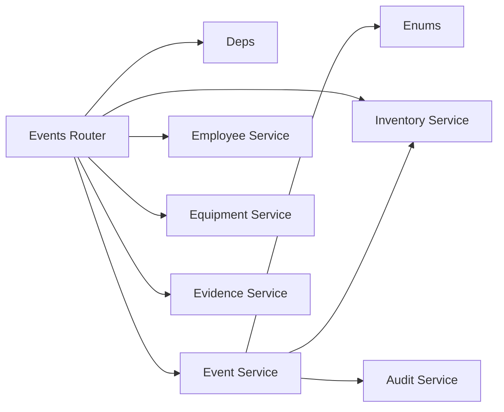

# Events API

<cite>
**Referenced Files in This Document**
- [events.py](file://app/api/events.py)
- [event_service.py](file://app/services/event_service.py)
- [enums.py](file://app/models/enums.py)
- [deps.py](file://app/api/deps.py)
- [evidence_service.py](file://app/services/evidence_service.py)
- [employee.py](file://app/models/employee.py)
- [camera.py](file://app/models/camera.py)
- [test_events.py](file://tests/test_events.py)
</cite>

## Table of Contents
1. [Introduction](#introduction)
2. [Project Structure](#project-structure)
3. [Core Components](#core-components)
4. [Architecture Overview](#architecture-overview)
5. [Detailed Component Analysis](#detailed-component-analysis)
6. [Dependency Analysis](#dependency-analysis)
7. [Performance Considerations](#performance-considerations)
8. [Troubleshooting Guide](#troubleshooting-guide)
9. [Conclusion](#conclusion)

## Introduction
This document describes the event management API surface implemented by the application. It focuses on:
- Event retrieval through a JSON endpoint with filtering, pagination, and sorting behavior.
- The operator review workflow for confirming or rejecting pending events.
- Evidence image access for associated stills.
- Filtering capabilities by event type, verification status, camera, employee, equipment category, time range, and search text.
- Aggregation and statistics endpoints used by dashboards and reports.
- Pagination, sorting, and advanced query parameters supported by the implementation.

The documentation is derived from the FastAPI router, event service, shared dependencies, models, evidence service, and tests.

## Project Structure
The event-related functionality is primarily implemented in:
- `app/api/events.py`: HTTP routes for movement pages, review page, event review action, evidence access, event listing, and helper search endpoints.
- `app/services/event_service.py`: Event creation, deduplication, review logic, queries, counts, dashboard aggregation, and sync helpers.
- `app/models/enums.py`: Shared enumerations for event types, verification status, direction, sync status, and other domain values.
- `app/api/deps.py`: Authentication, authorization, CSRF validation, rendering helpers, date parsing, and form utilities.
- `app/services/evidence_service.py`: Evidence file storage, path resolution, and retention cleanup.
- `app/models/employee.py` and `app/models/camera.py`: Domain models referenced by event data and UI context.
- `tests/test_events.py`: Tests validating deduplication, review workflow, counts, and dashboard stats.

**Diagram sources**
- [events.py:91-174](file://app/api/events.py#L91-L174)
- [event_service.py:150-329](file://app/services/event_service.py#L150-L329)
- [deps.py:87-123](file://app/api/deps.py#L87-L123)
- [evidence_service.py:19-43](file://app/services/evidence_service.py#L19-L43)
- [enums.py:27-110](file://app/models/enums.py#L27-L110)

**Section sources**
- [events.py:1-193](file://app/api/events.py#L1-L193)
- [event_service.py:1-329](file://app/services/event_service.py#L1-L329)
- [deps.py:1-214](file://app/api/deps.py#L1-L214)
- [evidence_service.py:1-66](file://app/services/evidence_service.py#L1-L66)
- [enums.py:1-183](file://app/models/enums.py#L1-L183)
- [employee.py:20-47](file://app/models/employee.py#L20-L47)
- [camera.py:16-96](file://app/models/camera.py#L16-L96)
- [test_events.py:15-236](file://tests/test_events.py#L15-L236)

## Core Components
- Event listing endpoint:
  - GET `/api/events` returns a minimal read-only JSON payload without biometric data.
  - Supports filters: start/end dates, camera code, verification status, event type(s), equipment category, employee ID, and free-text search.
  - Pagination is controlled by `limit`, capped at 200 and clamped to at least 1.
  - Sorting is fixed: newest first by occurrence time, then by primary key descending.
- Review workflow:
  - POST `/api/events/{event_id}/review` accepts operator decisions (CONFIRMED or REJECTED).
  - Requires authentication, operator role, and CSRF token.
  - Validates optional integer fields for employee and asset IDs.
  - Updates verification status, notes, audit trail, and inventory side effects.
- Evidence access:
  - GET `/api/events/{public_id}/evidence` serves the associated still image if present.
  - Requires operator role and validates path safety.
  - Returns 404 when no evidence exists or file is missing; returns 403 on invalid path.
- Helper search endpoints:
  - GET `/api/employees/search` and GET `/api/assets/search` support operator-driven lookup for dropdowns.

**Section sources**
- [events.py:91-174](file://app/api/events.py#L91-L174)
- [event_service.py:217-279](file://app/services/event_service.py#L217-L279)
- [deps.py:104-123](file://app/api/deps.py#L104-L123)

## Architecture Overview
The event API follows a layered design:
- HTTP layer (`app/api/events.py`) parses request parameters, enforces roles, and delegates to services.
- Service layer (`app/services/event_service.py`) implements business rules: deduplication, review transitions, filtering, counting, and aggregation.
- Shared dependencies (`app/api/deps.py`) provide authentication, authorization, CSRF checks, date parsing, and rendering utilities.
- Evidence service (`app/services/evidence_service.py`) handles secure file path resolution and retention.
- Models and enums define domain constraints and shared constants.

**Diagram sources**
- [events.py:149-174](file://app/api/events.py#L149-L174)
- [event_service.py:253-262](file://app/services/event_service.py#L253-L262)
- [deps.py:104-108](file://app/api/deps.py#L104-L108)

## Detailed Component Analysis

### Event Retrieval Endpoint: GET /api/events
- Purpose: Minimal read-only JSON export for integrations, excluding sensitive biometric data.
- Authentication: Requires an authenticated user.
- Query Parameters:
  - `start`: Start date (yyyy-mm-dd) inclusive.
  - `end`: End date (yyyy-mm-dd) inclusive.
  - `type`: Single event type string.
  - `status`: Verification status string.
  - `camera`: Camera code string.
  - `employee_id`: Numeric employee identifier.
  - `category`: Equipment category code.
  - `q`: Free-text search across public ID, camera code, and notes.
  - `limit`: Number of items returned (1–200).
- Response Fields:
  - `count`: Number of items returned.
  - `items[]`: Each item includes:
    - `event_id`: Public event identifier.
    - `type`: Event type string.
    - `occurred_at_utc`: ISO timestamp in UTC.
    - `camera`: Camera code.
    - `employee_code`: Employee code if associated.
    - `equipment_category`: Category code if set.
    - `asset_code`: Asset code if associated.
    - `direction`: Direction enum value.
    - `verification_status`: Verification status enum value.
    - `detection_confidence`: Detection confidence if available.
    - `face_match_score`: Face match score if available.
    - `association_confidence`: Association confidence if available.
- Sorting: By `occurred_at` descending, then by internal id descending.
- Pagination: Controlled via `limit`; offset is applied internally based on page parameter only in HTML route, not in JSON route.

**Diagram sources**
- [events.py:149-174](file://app/api/events.py#L149-L174)
- [event_service.py:253-262](file://app/services/event_service.py#L253-L262)

**Section sources**
- [events.py:149-174](file://app/api/events.py#L149-L174)
- [event_service.py:217-262](file://app/services/event_service.py#L217-L262)
- [deps.py:163-177](file://app/api/deps.py#L163-L177)

### Event Review Workflow: POST /api/events/{event_id}/review
- Purpose: Operator confirms or rejects a pending event, optionally associating an employee and asset, and recording a reason.
- Authentication & Authorization:
  - Requires operator role (admin or operator).
  - Requires CSRF token validation.
- Request Form Fields:
  - `decision`: Required; must be CONFIRMED or REJECTED.
  - `reason`: Optional but required for rejection.
  - `employee_id`: Optional numeric employee ID.
  - `asset_id`: Optional numeric asset ID.
  - `category_code`: Optional equipment category code.
  - `next_url`: Redirect target after processing.
  - `csrf_token`: CSRF token from session.
- Behavior:
  - Resolves event by primary key.
  - Validates optional integers.
  - Applies employee/asset/category updates.
  - On CONFIRMED:
    - Invokes inventory confirmation.
    - Sets verification status to CONFIRMED.
    - Appends confirmation note.
  - On REJECTED:
    - Requires non-empty reason.
    - Invokes inventory rejection.
    - Sets verification status to REJECTED.
    - Appends rejection note.
  - Records audit entry and marks sheets sync status as pending.
  - Commits transaction and redirects with flash message.

**Diagram sources**
- [events.py:91-131](file://app/api/events.py#L91-L131)
- [event_service.py:150-211](file://app/services/event_service.py#L150-L211)
- [deps.py:87-90](file://app/api/deps.py#L87-L90)

**Section sources**
- [events.py:91-131](file://app/api/events.py#L91-L131)
- [event_service.py:150-211](file://app/services/event_service.py#L150-L211)
- [test_events.py:125-203](file://tests/test_events.py#L125-L203)

### Evidence Image Access: GET /api/events/{public_id}/evidence
- Purpose: Retrieve the evidence still associated with an event.
- Authentication & Authorization: Requires operator role.
- Behavior:
  - Looks up event by public ID.
  - Checks presence of `evidence_path`.
  - Resolves file path securely using evidence service.
  - Returns 404 if no evidence or file missing.
  - Returns 403 if path resolution fails (invalid or unsafe path).
  - Serves file with private cache headers.

**Diagram sources**
- [events.py:134-146](file://app/api/events.py#L134-L146)
- [evidence_service.py:41-43](file://app/services/evidence_service.py#L41-L43)

**Section sources**
- [events.py:134-146](file://app/api/events.py#L134-L146)
- [evidence_service.py:41-43](file://app/services/evidence_service.py#L41-L43)

### Event Filtering Capabilities
Supported filters are parsed from query parameters and applied to SQL queries:
- Event type filter: `type` maps to a single-element list passed to service.
- Status filter: `status` matches verification status string.
- Camera filter: `camera` matches camera code.
- Employee association: `employee_id` filters by employee foreign key.
- Equipment category: `category` filters by equipment category code.
- Time range: `start` and `end` parse yyyy-mm-dd into UTC boundaries.
- Search text: `q` performs case-insensitive substring matching across public ID, camera code, and notes.

Note: Confidence thresholds are not exposed as explicit query parameters in the current API. Confidence fields are included in responses but not filtered server-side.

**Diagram sources**
- [events.py:24-37](file://app/api/events.py#L24-L37)
- [event_service.py:217-250](file://app/services/event_service.py#L217-L250)
- [deps.py:163-177](file://app/api/deps.py#L163-L177)

**Section sources**
- [events.py:24-37](file://app/api/events.py#L24-L37)
- [event_service.py:217-250](file://app/services/event_service.py#L217-L250)
- [deps.py:163-177](file://app/api/deps.py#L163-L177)

### Event Statistics and Aggregation
Dashboard statistics are computed per day and include:
- Entries: person entered and unknown person entered counts.
- Exits: person exited and unknown person exited counts.
- Unknown persons detected count.
- Equipment brought in/out counts.
- Pending reviews count.
- Camera disconnect/reconnect counts.

These aggregations rely on the same filter mechanism and are used by dashboard/reporting components.

**Section sources**
- [event_service.py:304-324](file://app/services/event_service.py#L304-L324)
- [test_events.py:205-224](file://tests/test_events.py#L205-L224)

### Pagination, Sorting, and Advanced Query Parameters
- Pagination:
  - JSON endpoint uses `limit` only; offset is not exposed.
  - HTML movements page supports page number and per-page size (40), computing total pages from count.
- Sorting:
  - Fixed ordering by `occurred_at` descending, then by internal id descending.
- Advanced parameters:
  - Date range parsing supports local timezone-aware boundaries.
  - Search supports multi-field fuzzy matching.
  - Role-based access controls apply to all protected endpoints.

**Section sources**
- [events.py:40-69](file://app/api/events.py#L40-L69)
- [event_service.py:253-262](file://app/services/event_service.py#L253-L262)
- [deps.py:163-177](file://app/api/deps.py#L163-L177)

## Dependency Analysis
Key relationships:
- Router depends on:
  - `deps.require_user`, `deps.require_operator`, `deps.verify_csrf`, `deps.evidence_file`.
  - `event_service.query_events`, `event_service.count_events`, `event_service.review_event`, `event_service.pending_reviews`, `event_service.count_pending`.
  - `employee_service.search`, `equipment_service.categories`, `inventory_service.balances`.
- Event service depends on:
  - Enums for event types, verification status, direction, sync status.
  - Inventory service for ledger updates on confirm/reject.
  - Audit service for recording operator actions.
  - Time utilities for cooldown buckets and day bounds.

**Diagram sources**
- [events.py:13-18](file://app/api/events.py#L13-L18)
- [event_service.py:14-25](file://app/services/event_service.py#L14-L25)
- [deps.py:104-123](file://app/api/deps.py#L104-L123)

**Section sources**
- [events.py:13-18](file://app/api/events.py#L13-L18)
- [event_service.py:14-25](file://app/services/event_service.py#L14-L25)
- [deps.py:104-123](file://app/api/deps.py#L104-L123)

## Performance Considerations
- Query efficiency:
  - Filters are applied directly in SQL via SQLAlchemy where clauses.
  - Count queries use aggregate functions to avoid loading full result sets.
- Limits:
  - JSON endpoint caps results at 200 to prevent large payloads.
  - HTML movements page uses a fixed per-page size of 40.
- Deduplication:
  - Cooldown-based dedupe keys reduce redundant events within short intervals.
- Evidence retention:
  - Background cleanup removes expired stills based on configured retention days.

Recommendations:
- Add explicit confidence threshold filters if downstream consumers need to pre-filter low-confidence detections.
- Introduce cursor-based pagination for large datasets beyond simple limit/offset.
- Index frequently filtered columns (e.g., occurred_at, verification_status, camera_code) if not already indexed.

[No sources needed since this section provides general guidance]

## Troubleshooting Guide
Common issues and resolutions:
- CSRF errors on review submission:
  - Ensure the CSRF token is present and valid in the session.
  - Verify that the client sends the token in the expected form field.
- Validation errors on review:
  - Rejection requires a non-empty reason.
  - Employee and asset IDs must be valid integers.
- Missing evidence images:
  - Check whether the event has an associated evidence path.
  - Confirm that the file still exists and has not been purged by retention cleanup.
- Unauthorized access:
  - Event listing requires authentication.
  - Evidence access and review require operator role.

Operational checks:
- Inspect flash messages and redirect targets after review operations.
- Verify audit entries for operator actions.
- Confirm inventory balances update correctly on confirm/reject.

**Section sources**
- [deps.py:87-90](file://app/api/deps.py#L87-L90)
- [events.py:111-131](file://app/api/events.py#L111-L131)
- [event_service.py:150-211](file://app/services/event_service.py#L150-L211)
- [test_events.py:150-203](file://tests/test_events.py#L150-L203)

## Conclusion
The Events API provides a focused interface for retrieving events, reviewing them through an operator workflow, and accessing associated evidence images. Filtering is robust across event type, status, camera, employee, category, and time range, while sorting is deterministic and performance-conscious. Although confidence thresholds are not currently filterable, they are exposed in responses for client-side decisions. The architecture cleanly separates HTTP concerns, business logic, and data persistence, enabling maintainability and clear troubleshooting paths.

[No sources needed since this section summarizes without analyzing specific files]