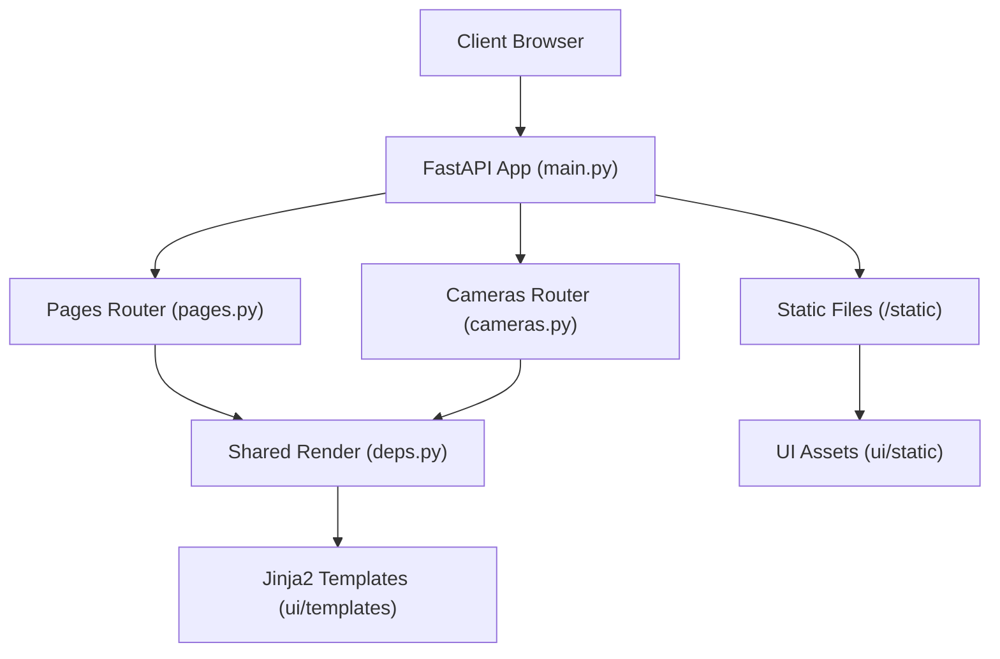
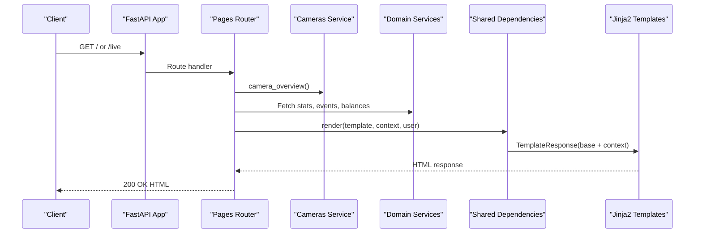
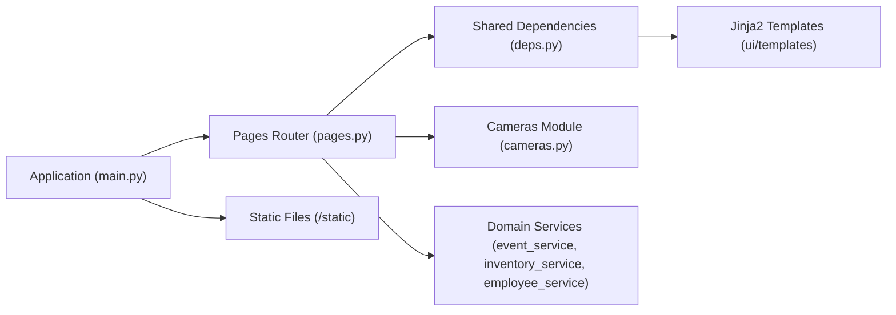

# Pages API

<cite>
**Referenced Files in This Document**
- [pages.py](file://app/api/pages.py)
- [deps.py](file://app/api/deps.py)
- [main.py](file://app/main.py)
- [cameras.py](file://app/api/cameras.py)
- [base.html](file://app/ui/templates/base.html)
- [dashboard.html](file://app/ui/templates/dashboard.html)
- [live.html](file://app/ui/templates/live.html)
- [error.html](file://app/ui/templates/error.html)
</cite>

## Table of Contents
1. [Introduction](#introduction)
2. [Project Structure](#project-structure)
3. [Core Components](#core-components)
4. [Architecture Overview](#architecture-overview)
5. [Detailed Component Analysis](#detailed-component-analysis)
6. [Dependency Analysis](#dependency-analysis)
7. [Performance Considerations](#performance-considerations)
8. [Troubleshooting Guide](#troubleshooting-guide)
9. [Conclusion](#conclusion)
10. [Appendices](#appendices)

## Introduction
This document describes the page content management endpoints for serving dynamic pages, rendering templates, and managing static resources. It focuses on:
- Page routing for dashboard and live camera views
- Template rendering with shared context variables
- Static asset delivery
- Data fetching patterns used by page handlers
- Error handling for HTML and API routes
- Guidance for extending the system with caching, versioning, A/B testing, personalization, partial updates, and client-side integration

The implementation uses FastAPI routers, Jinja2 templates, session-based authentication, and a centralized dependency layer for rendering and security utilities.

## Project Structure
The page-related functionality is implemented under the HTTP layer and UI assets:
- `app/api/pages.py` defines page routes for the dashboard and live view
- `app/api/deps.py` provides shared dependencies including template rendering, CSRF, user resolution, and global template globals
- `app/main.py` mounts static files, includes routers, and configures error handling
- `app/ui/templates/` contains Jinja2 templates such as `base.html`, `dashboard.html`, `live.html`, and `error.html`
- `app/ui/static/` serves CSS and JavaScript assets via FastAPI’s static file mount

**Diagram sources**
- [main.py:64-68](file://app/main.py#L64-L68)
- [pages.py:22-79](file://app/api/pages.py#L22-L79)
- [deps.py:51-72](file://app/api/deps.py#L51-L72)
- [deps.py:136-160](file://app/api/deps.py#L136-L160)

**Section sources**
- [main.py:44-68](file://app/main.py#L44-L68)
- [pages.py:1-79](file://app/api/pages.py#L1-L79)
- [deps.py:31-72](file://app/api/deps.py#L31-L72)

## Core Components
- Pages router: Provides HTML responses for dashboard and live camera views, gathering data from services and cameras, then rendering templates with a rich context.
- Shared dependencies: Centralizes template setup, CSRF token handling, user resolution, role checks, flash messages, and a unified render helper that injects base context into every page.
- Application entry point: Mounts static files, includes all routers, and configures exception handlers to return JSON for `/api/` paths and HTML error pages otherwise.

Key responsibilities:
- Page routing and data aggregation
- Template variable injection through a standardized render function
- Static resource serving
- Consistent error handling across HTML and API routes

**Section sources**
- [pages.py:25-79](file://app/api/pages.py#L25-L79)
- [deps.py:51-72](file://app/api/deps.py#L51-L72)
- [deps.py:136-160](file://app/api/deps.py#L136-L160)
- [main.py:64-68](file://app/main.py#L64-L68)
- [main.py:70-114](file://app/main.py#L70-L114)

## Architecture Overview
The page content flow combines route handlers, service calls, and template rendering:

**Diagram sources**
- [pages.py:25-79](file://app/api/pages.py#L25-L79)
- [deps.py:136-160](file://app/api/deps.py#L136-L160)

## Detailed Component Analysis

### Pages Router Endpoints
The pages router exposes two primary HTML endpoints:
- Dashboard page
- Live camera view page

#### GET / — Dashboard
- Purpose: Serve the main dashboard page with aggregated camera status, event statistics, inventory balances, recent events, employee counts, and monitoring service statuses.
- Authentication: Requires an authenticated user; unauthenticated requests are redirected to login.
- Data sources:
  - Camera overview from the cameras module
  - Event statistics and recent events from event service
  - Inventory balances and issues from inventory service
  - Employee count from employee service
  - Monitoring service statuses for YOLO, face recognition, and Google Sheets sync
- Rendering: Uses the shared render helper to inject a comprehensive context into `dashboard.html`.

Expected response:
- Status code: 200
- Content type: HTML
- Body: Rendered dashboard page with injected variables

Template variables commonly available in this endpoint:
- cameras, total_cameras, online_cameras
- stats, pending_total, balances, issues
- recent_events, employees
- yolo, face, sheets, monitor_started, pending_sync

Security notes:
- User is resolved via shared dependency; missing user triggers redirect to login.

**Section sources**
- [pages.py:25-56](file://app/api/pages.py#L25-L56)
- [deps.py:104-108](file://app/api/deps.py#L104-L108)

#### GET /live — Live View
- Purpose: Serve the live camera view page, optionally filtered by a selected camera code.
- Query parameters:
  - camera: Optional camera code to select a specific camera stream
- Behavior:
  - Loads camera list and overview rows
  - Selects default camera if none provided
  - Retrieves recent events for the selected camera
- Rendering: Uses the shared render helper to inject camera-related context into `live.html`.

Expected response:
- Status code: 200
- Content type: HTML
- Body: Rendered live view page with injected variables

Template variables commonly available in this endpoint:
- cameras, rows, selected_code, selected_row, recent_events

**Section sources**
- [pages.py:59-79](file://app/api/pages.py#L59-L79)

### Shared Rendering and Context Injection
The shared dependency layer centralizes template configuration and rendering:
- Template directory: Configured to load templates from `app/ui/templates`
- Global filters and globals: Adds formatting filters and domain enums/constants to templates
- Base context injection: Every rendered page receives common variables such as request, user, csrf_token, notices, app_name, settings, timezone, current date/time, and role flags
- Flash messages: Notices stored in the session are consumed and passed to templates

Common base context variables:
- request, user, csrf_token, notices
- app_name, settings, workplace_tz, today, now
- is_admin, is_operator

Template globals:
- EventType, VerificationStatus, Direction, Role, TransactionType, EquipmentStatus, SyncStatus
- today function

Rendering helper:
- Accepts template name, optional context dict, optional user, and status code
- Merges base context with page-specific context and returns an HTML response

**Section sources**
- [deps.py:51-72](file://app/api/deps.py#L51-L72)
- [deps.py:136-160](file://app/api/deps.py#L136-L160)

### Static Resource Management
Static assets are served under `/static`:
- Directory: `app/ui/static`
- Mount path: `/static`
- Typical assets: CSS and JavaScript files referenced by templates

Integration points:
- Templates reference `/static/app.css`
- The application mounts static files only when the directory exists

**Section sources**
- [main.py:64-66](file://app/main.py#L64-L66)
- [base.html:8](file://app/ui/templates/base.html#L8)

### Error Handling for Pages
Global exception handlers ensure consistent error responses:
- Auth required: Redirects to login with next URL preserved
- Forbidden: Renders `error.html` with a permission message
- HTTP exceptions: For `/api/` routes, returns JSON; for HTML routes, renders `error.html`
- Validation errors: Returns JSON with validation details
- Unhandled exceptions: Logs and returns appropriate JSON or HTML error page

Error page template:
- `error.html` displays title and message and provides navigation links

**Section sources**
- [main.py:70-114](file://app/main.py#L70-L114)
- [error.html:1-19](file://app/ui/templates/error.html#L1-L19)

## Dependency Analysis
The following diagram shows how page endpoints depend on shared components and services:

**Diagram sources**
- [pages.py:13-19](file://app/api/pages.py#L13-L19)
- [deps.py:51-72](file://app/api/deps.py#L51-L72)
- [main.py:64-68](file://app/main.py#L64-L68)

**Section sources**
- [pages.py:13-19](file://app/api/pages.py#L13-L19)
- [deps.py:51-72](file://app/api/deps.py#L51-L72)
- [main.py:64-68](file://app/main.py#L64-L68)

## Performance Considerations
Current implementation does not include explicit server-side caching for page content. Recommendations:
- Cache expensive queries (camera overview, event stats, inventory balances) using in-memory caches or Redis with short TTLs
- Use conditional responses (ETag/Last-Modified) for static assets
- Paginate large datasets (e.g., recent events) to reduce payload size
- Precompute derived values (online camera counts) during background tasks where feasible
- Avoid repeated database calls within a single request by consolidating data retrieval

[No sources needed since this section provides general guidance]

## Troubleshooting Guide
Common issues and resolutions:
- Missing user: Ensure sessions are configured and the user is logged in; unauthenticated access redirects to login
- CSRF errors: Verify CSRF tokens are present and valid; use the shared helpers to obtain and verify tokens
- Static assets not loading: Confirm `/static` is mounted and the directory exists
- Template variables missing: Check the render call and ensure the template expects the provided keys
- Permission denied: Verify user roles; admin-only pages require admin privileges

Relevant areas to inspect:
- Session middleware configuration
- CSRF token generation and validation
- Static file mounting
- Template globals and base context

**Section sources**
- [main.py:55-62](file://app/main.py#L55-L62)
- [deps.py:75-90](file://app/api/deps.py#L75-L90)
- [deps.py:136-160](file://app/api/deps.py#L136-L160)

## Conclusion
The Pages API provides robust HTML endpoints for dashboard and live camera views, leveraging a centralized rendering layer for consistent template context and security. Static assets are served efficiently, and error handling ensures clear feedback for both API and HTML routes. To extend functionality, consider adding caching, versioning, A/B testing, personalization, and partial update mechanisms while maintaining the established patterns for authentication, CSRF protection, and template rendering.

[No sources needed since this section summarizes without analyzing specific files]

## Appendices

### API Endpoint Summary
- GET /
  - Description: Dashboard page with aggregated metrics and monitoring statuses
  - Authentication: Required
  - Response: HTML page with injected context variables
- GET /live
  - Description: Live camera view page with optional camera selection
  - Query parameter: camera (optional)
  - Authentication: Required
  - Response: HTML page with camera-related context variables

**Section sources**
- [pages.py:25-79](file://app/api/pages.py#L25-L79)

### Template Variable Reference
Base context variables injected by the shared render helper:
- request, user, csrf_token, notices
- app_name, settings, workplace_tz, today, now
- is_admin, is_operator

Page-specific variables:
- Dashboard: cameras, total_cameras, online_cameras, stats, pending_total, balances, issues, recent_events, employees, yolo, face, sheets, monitor_started, pending_sync
- Live view: cameras, rows, selected_code, selected_row, recent_events

**Section sources**
- [deps.py:136-160](file://app/api/deps.py#L136-L160)
- [pages.py:36-56](file://app/api/pages.py#L36-L56)
- [pages.py:67-78](file://app/api/pages.py#L67-L78)

### Client-Side Integration Approaches
- Initial page loads: Request HTML pages directly; rely on server-rendered content
- Partial updates: Use AJAX/Fetch to call existing API endpoints (e.g., camera snapshots, status, events) and update DOM elements dynamically
- Asset references: Include `/static/app.css` and any additional JS/CSS files in templates or via script tags
- Security: Respect CSRF tokens provided in the base context when submitting forms via client-side scripts

[No sources needed since this section provides general guidance]

### Extensibility Guidelines
- Caching strategies: Add cache layers around expensive queries and aggregate data
- Content versioning: Introduce version headers or query parameters to manage template and asset versions
- A/B testing: Implement feature flags and route-level variations based on user segments
- Personalization: Extend base context with user preferences and segment-specific variables
- Partial updates: Expose lightweight JSON endpoints for incremental UI updates

[No sources needed since this section provides general guidance]