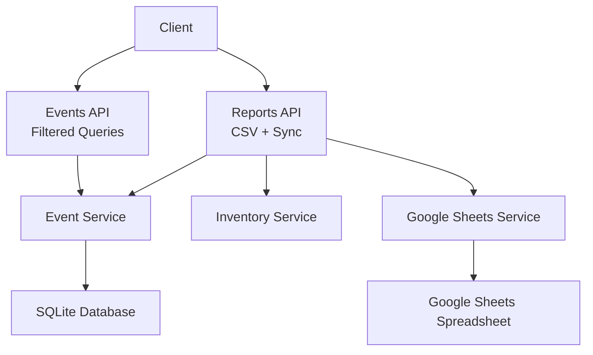
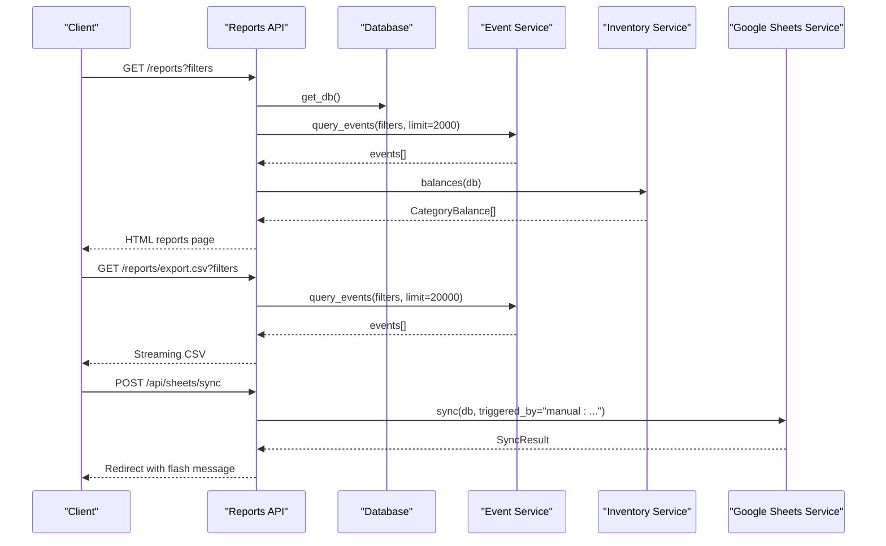
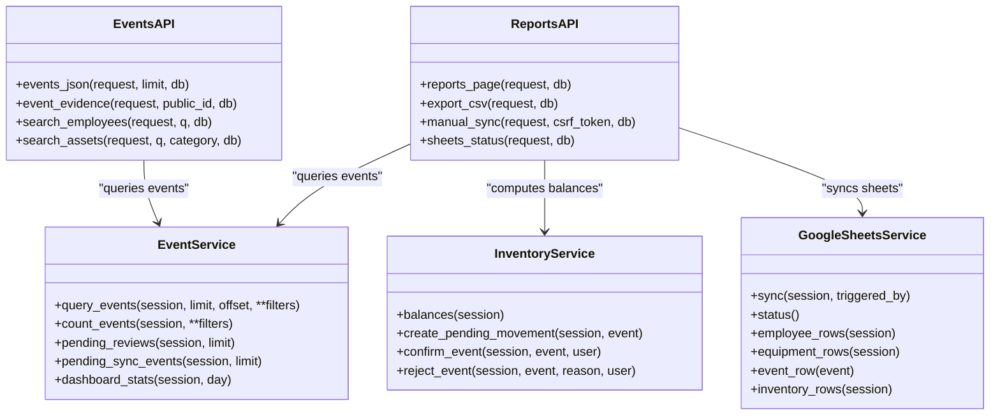

# Reports API

<cite>
**Referenced Files in This Document**
- [reports.py](file://app/api/reports.py)
- [events.py](file://app/api/events.py)
- [google_sheets_service.py](file://app/services/google_sheets_service.py)
- [event_service.py](file://app/services/event_service.py)
- [inventory_service.py](file://app/services/inventory_service.py)
- [enums.py](file://app/models/enums.py)
- [ledger.py](file://app/models/ledger.py)
- [employee.py](file://app/models/employee.py)
- [equipment.py](file://app/models/equipment.py)
- [camera.py](file://app/models/camera.py)
- [deps.py](file://app/api/deps.py)
</cite>

## Table of Contents
1. [Introduction](#introduction)
2. [Project Structure](#project-structure)
3. [Core Components](#core-components)
4. [Architecture Overview](#architecture-overview)
5. [Detailed Component Analysis](#detailed-component-analysis)
6. [Dependency Analysis](#dependency-analysis)
7. [Performance Considerations](#performance-considerations)
8. [Troubleshooting Guide](#troubleshooting-guide)
9. [Conclusion](#conclusion)

## Introduction
This document describes the reporting and analytics capabilities exposed by the application. It covers:
- Report generation endpoints, including CSV export with filtering.
- Filtered event queries for movement history and integrations.
- Statistical summaries used by the reports page and dashboard.
- Google Sheets integration endpoints for synchronization status and manual sync.
- Filtering capabilities by date range, event type, camera/location, employee, category, and free-text search.
- Export format specifications, data transformation rules, and batch processing behavior.
- Examples of request patterns and expected response structures.

The system treats Google Sheets as a reporting mirror. Events are first committed to the local database; unsynchronized events remain pending and are retried with exponential backoff. The Event ID column is used for idempotency so that one event is never appended twice even if a previous run failed halfway.

## Project Structure
The reporting and analytics functionality spans FastAPI route handlers, services, models, and shared dependencies:
- `app/api/reports.py` defines report pages, CSV export, and Google Sheets sync/status endpoints.
- `app/api/events.py` defines filtered event queries and evidence access.
- `app/services/google_sheets_service.py` implements Google Sheets push operations, retry logic, and background scheduling.
- `app/services/event_service.py` provides event querying, aggregation, and dashboard statistics.
- `app/services/inventory_service.py` computes inventory balances and discrepancies used by reports and sheets.
- Models define core entities such as Event, Employee, EquipmentAsset, Camera, and enums for types and statuses.
- Shared dependencies handle authentication, CSRF, rendering, and parameter parsing.

**Diagram sources**
- [reports.py:43-177](file://app/api/reports.py#L43-L177)
- [events.py:149-174](file://app/api/events.py#L149-L174)
- [google_sheets_service.py:234-359](file://app/services/google_sheets_service.py#L234-L359)
- [event_service.py:253-329](file://app/services/event_service.py#L253-L329)

**Section sources**
- [reports.py:1-177](file://app/api/reports.py#L1-L177)
- [events.py:1-193](file://app/api/events.py#L1-L193)
- [google_sheets_service.py:1-414](file://app/services/google_sheets_service.py#L1-L414)
- [event_service.py:1-329](file://app/services/event_service.py#L1-L329)

## Core Components
- Reports endpoints:
  - HTML reports page with aggregated counts by event type, equipment category, employee, and verification status.
  - CSV export endpoint streaming filtered events with localized headers and UTF-8 BOM for Excel compatibility.
  - Manual Google Sheets sync endpoint requiring operator role and CSRF validation.
  - Google Sheets status endpoint returning configuration, last run result, pending events count, and last log entry.
- Events endpoints:
  - JSON API for minimal read-only event data with filtering and pagination support.
  - Evidence retrieval endpoint for operators.
- Services:
  - Event service provides query filters, counts, pending reviews, pending sync events, and dashboard stats.
  - Inventory service computes category balances, pending movements, and discrepancy metrics.
  - Google Sheets service handles connection, worksheet management, upserts, append-only event rows, and retry/backoff.

**Section sources**
- [reports.py:43-177](file://app/api/reports.py#L43-L177)
- [events.py:149-193](file://app/api/events.py#L149-L193)
- [event_service.py:217-329](file://app/services/event_service.py#L217-L329)
- [inventory_service.py:215-273](file://app/services/inventory_service.py#L215-L273)
- [google_sheets_service.py:82-145](file://app/services/google_sheets_service.py#L82-L145)

## Architecture Overview
The reporting architecture separates concerns between HTTP endpoints, business logic, and external integrations:
- HTTP layer validates roles, parses filters, and returns responses (HTML or JSON).
- Business layer applies filters, aggregates statistics, and manages review workflows.
- Integration layer pushes data to Google Sheets with idempotent keys and retry logic.

**Diagram sources**
- [reports.py:43-160](file://app/api/reports.py#L43-L160)
- [event_service.py:253-262](file://app/services/event_service.py#L253-L262)
- [inventory_service.py:215-273](file://app/services/inventory_service.py#L215-L273)
- [google_sheets_service.py:234-296](file://app/services/google_sheets_service.py#L234-L296)

## Detailed Component Analysis

### Reports Endpoints
- GET `/reports`
  - Purpose: Render the reports page with aggregated statistics and recent events.
  - Authentication: Requires user role.
  - Filters: Date range (`start`, `end`), camera code (`camera`), category (`category`), status (`status`), event type (`type`), employee ID (`employee_id`).
  - Aggregations: Counts by event type, equipment category, employee name, verification status; balances from inventory service; list of cameras, employees, event types, and statuses.
  - Response: HTML template with context variables.

- GET `/reports/export.csv`
  - Purpose: Stream a CSV file of filtered events.
  - Authentication: Requires user role.
  - Filters: Same as reports page.
  - Transformation: Localized header names, local time formatting, confidence values formatted to three decimals, notes newline normalization, UTF-8 BOM prepended for Excel.
  - Response: Streaming CSV with filename based on today’s date.

- POST `/api/sheets/sync`
  - Purpose: Trigger manual synchronization of Employees, Equipment, MovementEvents, and InventorySummary sheets.
  - Authentication: Requires operator role and valid CSRF token.
  - Behavior: Calls Google Sheets service sync method, records results, flashes summary, redirects to reports page.

- GET `/api/sheets/status`
  - Purpose: Return current Google Sheets configuration, last run metadata, pending events count, and last sync log.
  - Authentication: Requires user role.
  - Response: JSON object with enabled/configured flags, spreadsheet ID, service account path, last run timestamp, last result summary, interval seconds, pending events count, and last log details.

Filtering implementation:
- Date range parsing uses `safe_range` to convert `yyyy-mm-dd` inputs into UTC datetimes.
- Query parameters map to event service filters: start/end, camera_code, category, status, event_types, employee_id.

Export format specification:
- Columns include public ID, local timestamp, event type, camera code, employee code/name, equipment category, asset code, direction, verification status, detection confidence, face match score, association confidence, and notes.
- Confidence fields are formatted to three decimal places when present; missing values become empty strings.
- Notes have newlines replaced with spaces.

Batch processing options:
- CSV export uses a higher limit (20000) compared to the reports page (2000).
- Google Sheets sync batches table updates and appends events in chunks limited by service methods.

Example requests:
- Reports page: `GET /reports?start=2024-01-01&end=2024-01-31&type=EQUIPMENT_BROUGHT_IN&camera=CAM-01&status=PENDING&employee_id=123&category=MONITOR`
- CSV export: `GET /reports/export.csv?start=2024-01-01&end=2024-01-31&type=EQUIPMENT_TAKEN_OUT&camera=CAM-02`
- Manual sync: `POST /api/sheets/sync` with form field `csrf_token`.
- Status: `GET /api/sheets/status`

**Section sources**
- [reports.py:28-40](file://app/api/reports.py#L28-L40)
- [reports.py:43-91](file://app/api/reports.py#L43-L91)
- [reports.py:94-146](file://app/api/reports.py#L94-L146)
- [reports.py:149-177](file://app/api/reports.py#L149-L177)
- [deps.py:163-177](file://app/api/deps.py#L163-L177)

### Events API
- GET `/api/events`
  - Purpose: Minimal read-only JSON API for integrations without biometric data.
  - Authentication: Requires user role.
  - Filters: Same as reports page plus free-text search (`q`) matching public ID, camera code, or notes.
  - Pagination: `limit` parameter capped at 200 minimum 1.
  - Response: JSON object with `count` and `items` array containing event fields like event ID, type, occurred_at_utc, camera, employee_code, equipment_category, asset_code, direction, verification_status, and confidence scores.

- GET `/api/events/{public_id}/evidence`
  - Purpose: Retrieve evidence image for an event.
  - Authentication: Requires operator role.
  - Response: File response with private cache headers; returns 404 if not found or 403 if unauthorized.

- GET `/api/employees/search`
  - Purpose: Search active employees for UI components.
  - Authentication: Requires operator role.
  - Response: JSON object with items containing id, code, and full name.

- GET `/api/assets/search`
  - Purpose: Search assets by query and optional category.
  - Authentication: Requires operator role.
  - Response: JSON object with items containing id, code, and category code.

Example requests:
- Events JSON: `GET /api/events?start=2024-01-01&end=2024-01-31&type=PERSON_ENTERED&camera=CAM-01&status=CONFIRMED&q=monitor`
- Evidence: `GET /api/events/EVT-ABC123DEF/evidence`
- Employee search: `GET /api/employees/search?q=ali`
- Asset search: `GET /api/assets/search?q=MON-001&category=MONITOR`

**Section sources**
- [events.py:24-37](file://app/api/events.py#L24-L37)
- [events.py:149-174](file://app/api/events.py#L149-L174)
- [events.py:177-193](file://app/api/events.py#L177-L193)

### Google Sheets Integration
- Manual sync endpoint triggers the Google Sheets service to synchronize four worksheets:
  - Employees: Upsert by Employee ID.
  - Equipment: Upsert by Asset ID.
  - MovementEvents: Append-only by Event ID for idempotency.
  - InventorySummary: Replace body with computed balances.

- Status endpoint returns:
  - Configuration flags and identifiers.
  - Last run timestamp and summary.
  - Pending events count.
  - Last sync log details.

Retry and conflict resolution:
- Exponential backoff retries network/API failures.
- Upsert logic compares existing rows by primary key (Employee ID or Asset ID) and updates changed rows; new rows are appended.
- Event rows use Event ID to avoid duplicates; already-present IDs are marked SYNCED without appending.

Background scheduler:
- Runs periodically in a daemon thread, invoking sync with `triggered_by="scheduler"`.
- Respects configuration intervals and keeps the loop alive despite exceptions.

Configuration requirements:
- Google Sheets must be enabled and configured with spreadsheet ID and service account file.
- If unavailable, sync logs record failure and marks pending events as FAILED.

Example requests:
- Manual sync: `POST /api/sheets/sync` with CSRF token.
- Status: `GET /api/sheets/status`

**Section sources**
- [google_sheets_service.py:34-61](file://app/services/google_sheets_service.py#L34-L61)
- [google_sheets_service.py:148-161](file://app/services/google_sheets_service.py#L148-L161)
- [google_sheets_service.py:307-338](file://app/services/google_sheets_service.py#L307-L338)
- [google_sheets_service.py:340-359](file://app/services/google_sheets_service.py#L340-L359)
- [google_sheets_service.py:362-396](file://app/services/google_sheets_service.py#L362-L396)
- [reports.py:149-177](file://app/api/reports.py#L149-L177)

### Dashboard Metrics and Statistical Summaries
- Reports page aggregates:
  - Counts by event type using EventType labels.
  - Counts by equipment category using category labels.
  - Top employees by event count.
  - Counts by verification status using VerificationStatus labels.
  - Inventory balances and categories.
  - Distinct camera codes.
  - Pending sync events count.

- Dashboard statistics function:
  - Computes daily entries/exits, unknown persons, equipment in/out, pending reviews, and camera events.
  - Uses day bounds in UTC for consistent aggregation.

Data transformation rules:
- Labels are resolved via enum mappings; unknown codes fall back to raw values.
- Confidence fields are formatted for display.
- Notes are normalized for CSV export.

Example usage:
- Reports page renders aggregated data for UI components.
- Integrations can consume `/api/events` for minimal event data.

**Section sources**
- [reports.py:43-91](file://app/api/reports.py#L43-L91)
- [event_service.py:304-324](file://app/services/event_service.py#L304-L324)
- [enums.py:27-59](file://app/models/enums.py#L27-L59)
- [enums.py:76-89](file://app/models/enums.py#L76-L89)

## Dependency Analysis
The following diagram shows how components depend on each other:

**Diagram sources**
- [reports.py:43-177](file://app/api/reports.py#L43-L177)
- [events.py:149-193](file://app/api/events.py#L149-L193)
- [event_service.py:253-329](file://app/services/event_service.py#L253-L329)
- [inventory_service.py:132-205](file://app/services/inventory_service.py#L132-L205)
- [google_sheets_service.py:164-231](file://app/services/google_sheets_service.py#L164-L231)

Coupling and cohesion:
- Reports API depends on multiple services but remains focused on orchestration and response formatting.
- Event Service encapsulates filtering and aggregation logic, improving cohesion.
- Google Sheets Service abstracts external integration details, reducing coupling with HTTP layer.

Potential circular dependencies:
- No direct circular imports observed among analyzed modules.
- Dependencies flow from API layer to services to models.

External dependencies:
- Google Sheets integration relies on gspread and Google OAuth credentials.
- Database interactions use SQLAlchemy ORM.

Interface contracts:
- Filters passed to event service follow a consistent dictionary structure.
- SyncResult provides a standardized summary for UI feedback.

**Section sources**
- [reports.py:1-177](file://app/api/reports.py#L1-L177)
- [events.py:1-193](file://app/api/events.py#L1-L193)
- [event_service.py:1-329](file://app/services/event_service.py#L1-L329)
- [inventory_service.py:1-347](file://app/services/inventory_service.py#L1-L347)
- [google_sheets_service.py:1-414](file://app/services/google_sheets_service.py#L1-L414)

## Performance Considerations
- CSV export streams large datasets to minimize memory usage.
- Limits are applied to prevent excessive database queries (2000 for reports page, 20000 for CSV export, 200 for JSON API).
- Google Sheets sync uses batching and retry with exponential backoff to handle network failures gracefully.
- Background scheduler runs independently to avoid blocking API requests.
- Indexes on frequently filtered columns (occurred_at, event_type, camera_code, verification_status) improve query performance.

[No sources needed since this section provides general guidance]

## Troubleshooting Guide
Common issues and resolutions:
- Authentication errors: Ensure the user is logged in and has the required role (user vs operator).
- CSRF validation failures: Include a valid CSRF token in POST requests to `/api/sheets/sync`.
- Google Sheets unavailable: Check configuration flags and service account file; verify network connectivity and permissions.
- Duplicate events in CSV: Verify filter parameters and ensure dedupe keys are correctly generated.
- Missing evidence files: Confirm evidence paths exist and user has operator privileges.

Error handling strategies:
- AuthRequired and Forbidden exceptions redirect or raise appropriate HTTP errors.
- SheetsUnavailable wraps import and API/network failures with clear messages.
- IntegrityError handling prevents duplicate event insertion and logs concurrent suppression.

Debugging tips:
- Inspect SyncLog entries for last sync status and messages.
- Use `/api/sheets/status` to check pending events and last run results.
- Validate filter parameters using the same parsing logic as the reports page.

**Section sources**
- [deps.py:35-48](file://app/api/deps.py#L35-L48)
- [deps.py:87-90](file://app/api/deps.py#L87-L90)
- [google_sheets_service.py:78-129](file://app/services/google_sheets_service.py#L78-L129)
- [event_service.py:127-138](file://app/services/event_service.py#L127-L138)

## Conclusion
The Reports API provides comprehensive reporting and analytics capabilities through well-defined endpoints for CSV export, filtered event queries, statistical summaries, and Google Sheets synchronization. The architecture emphasizes separation of concerns, robust error handling, and efficient data processing. By leveraging enums for consistent labeling, services for business logic, and secure authentication mechanisms, the system delivers reliable reporting tools suitable for both UI components and external integrations.

[No sources needed since this section summarizes without analyzing specific files]