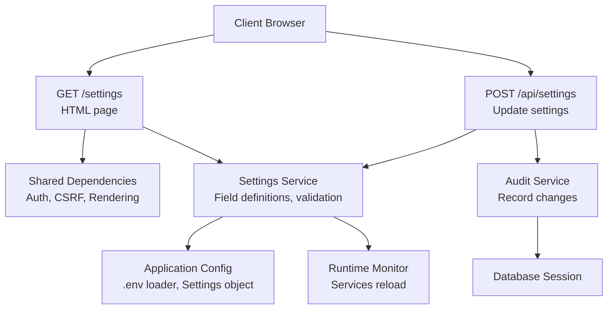
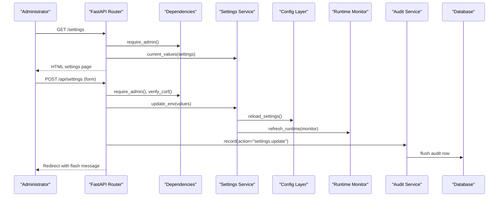
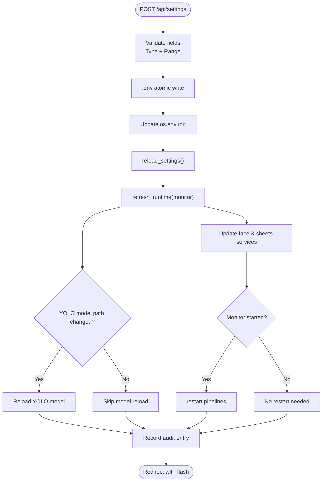
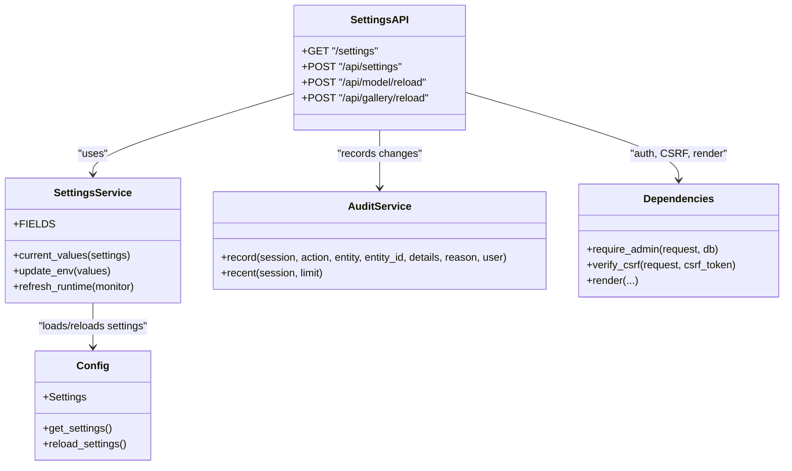

# Settings API

<cite>
**Referenced Files in This Document**
- [app/api/settings.py](file://app/api/settings.py)
- [app/services/settings_service.py](file://app/services/settings_service.py)
- [app/config.py](file://app/config.py)
- [app/api/deps.py](file://app/api/deps.py)
- [app/services/audit_service.py](file://app/services/audit_service.py)
- [app/models/user.py](file://app/models/user.py)
</cite>

## Table of Contents
1. [Introduction](#introduction)
2. [Project Structure](#project-structure)
3. [Core Components](#core-components)
4. [Architecture Overview](#architecture-overview)
5. [Detailed Component Analysis](#detailed-component-analysis)
6. [Dependency Analysis](#dependency-analysis)
7. [Performance Considerations](#performance-considerations)
8. [Troubleshooting Guide](#troubleshooting-guide)
9. [Conclusion](#conclusion)

## Introduction
This document describes the system settings management endpoints and runtime configuration behavior. It covers how current settings are retrieved, how parameters are updated without restarting the service, which settings are editable, validation rules, default values, audit logging, sensitive value handling, and permission-based access control.

The implementation is a FastAPI application with:
- A web-based settings page for administrators.
- A POST endpoint to update environment-backed settings.
- Runtime refresh logic that updates long-lived services such as detection models, face recognition, and Google Sheets integration.

## Project Structure
The settings feature spans API routes, a settings service, application configuration, shared dependencies, and audit logging.

**Diagram sources**
- [app/api/settings.py:23-87](file://app/api/settings.py#L23-L87)
- [app/services/settings_service.py:23-177](file://app/services/settings_service.py#L23-L177)
- [app/config.py:18-244](file://app/config.py#L18-L244)
- [app/api/deps.py:75-160](file://app/api/deps.py#L75-L160)
- [app/services/audit_service.py:13-45](file://app/services/audit_service.py#L13-L45)

**Section sources**
- [app/api/settings.py:1-115](file://app/api/settings.py#L1-L115)
- [app/services/settings_service.py:1-177](file://app/services/settings_service.py#L1-L177)
- [app/config.py:1-244](file://app/config.py#L1-L244)
- [app/api/deps.py:1-214](file://app/api/deps.py#L1-L214)
- [app/services/audit_service.py:1-45](file://app/services/audit_service.py#L1-L45)

## Core Components
- Settings API route: exposes the settings HTML page and the settings update endpoint.
- Settings service: defines editable fields, validates input, persists changes to `.env`, updates process environment, reloads cached settings, and refreshes runtime services.
- Application config: loads environment variables from `.env` and OS environment into an immutable `Settings` object; provides defaults and warnings.
- Shared dependencies: authentication, authorization, CSRF protection, rendering helpers, and flash messages.
- Audit service: records administrator actions including settings updates.

Key responsibilities:
- Retrieval: The settings page reads current effective values via the settings service and displays them grouped by category.
- Update: The update endpoint accepts form data, validates against field definitions, writes to `.env`, updates process environment, reloads settings, and refreshes running services.
- Security: Only administrators can access or modify settings; CSRF is enforced on write operations.
- Sensitive values: Certain secrets are intentionally not editable through the UI.

**Section sources**
- [app/api/settings.py:23-87](file://app/api/settings.py#L23-L87)
- [app/services/settings_service.py:23-177](file://app/services/settings_service.py#L23-L177)
- [app/config.py:62-156](file://app/config.py#L62-L156)
- [app/api/deps.py:118-160](file://app/api/deps.py#L118-L160)
- [app/services/audit_service.py:13-45](file://app/services/audit_service.py#L13-L45)

## Architecture Overview
The settings architecture follows a layered approach:
- Presentation layer: FastAPI routes render HTML and handle form submissions.
- Service layer: Settings service encapsulates validation, persistence, and runtime refresh.
- Configuration layer: Centralized loading of environment variables into typed settings.
- Cross-cutting concerns: Authentication, authorization, CSRF, audit logging, and database sessions.

**Diagram sources**
- [app/api/settings.py:23-87](file://app/api/settings.py#L23-L87)
- [app/services/settings_service.py:120-177](file://app/services/settings_service.py#L120-L177)
- [app/config.py:225-234](file://app/config.py#L225-L234)
- [app/services/audit_service.py:13-45](file://app/services/audit_service.py#L13-L45)

## Detailed Component Analysis

### Settings Endpoints

#### GET /settings
- Purpose: Render the administrator settings page with grouped fields, current values, warnings, and monitoring status.
- Authorization: Requires admin role.
- Behavior:
  - Loads current settings and groups editable fields by category.
  - Displays runtime status for YOLO, face recognition, and Google Sheets.
  - Shows recent audit entries and sync logs.
  - Provides the path to the `.env` file for reference.

Response: HTML page with pre-populated form fields based on current effective values.

**Section sources**
- [app/api/settings.py:23-51](file://app/api/settings.py#L23-L51)
- [app/services/settings_service.py:58-81](file://app/services/settings_service.py#L58-L81)
- [app/config.py:140-156](file://app/config.py#L140-L156)

#### POST /api/settings
- Purpose: Update system parameters from the settings page.
- Authorization: Requires admin role and valid CSRF token.
- Input: Form-encoded key-value pairs corresponding to whitelisted fields.
- Validation:
  - Field whitelist enforced by settings service.
  - Type normalization and range checks per field definition.
  - Empty required numeric fields raise validation errors.
- Persistence:
  - Changes are written atomically to `.env`.
  - Process environment variables are updated immediately.
  - Cached settings are reloaded.
- Runtime refresh:
  - Detection model path changes trigger model reload.
  - Face and Google Sheets services receive new settings.
  - If the monitor is running, pipelines are restarted.
- Audit logging:
  - On successful change, an audit entry is recorded with changed keys.
- Response: Redirect back to the settings page with flash messages indicating success or no changes.

Error handling:
- Validation errors are caught and surfaced as flash messages.
- CSRF failures raise HTTP 400.

**Section sources**
- [app/api/settings.py:54-87](file://app/api/settings.py#L54-L87)
- [app/services/settings_service.py:90-157](file://app/services/settings_service.py#L90-L157)
- [app/api/deps.py:87-90](file://app/api/deps.py#L87-L90)

#### Related Endpoints
- POST /api/model/reload: Reloads the YOLO detection model and gallery; records audit entry.
- POST /api/gallery/reload: Refreshes the face gallery; returns count of templates.

These endpoints also require admin authorization and CSRF verification.

**Section sources**
- [app/api/settings.py:90-115](file://app/api/settings.py#L90-L115)

### Editable Settings Categories and Fields
Editable fields are defined in the settings service and grouped by category. Examples include:

- Detection (AI model configuration):
  - Model path, confidence threshold, image size.
- Camera (performance tuning):
  - FPS, frame width/height, reconnect interval, simulation mode.
- Face recognition:
  - Similarity threshold, match margin, recognition interval.
- Events:
  - Cooldown seconds, evidence enablement, retention days.
- Google Sheets:
  - Enable flag, spreadsheet ID, service account file path, sync interval.

Defaults and constraints:
- Defaults are provided by the application config when environment variables are absent.
- Range constraints are enforced during update (minimum/maximum).
- Boolean fields accept common truthy/falsy strings.

Sensitive settings handling:
- Secrets such as APP_SECRET_KEY, DATABASE_URL, and bootstrap password are intentionally not editable from the UI.
- Warnings surface insecure defaults (e.g., default secret key or bootstrap password).

**Section sources**
- [app/services/settings_service.py:34-53](file://app/services/settings_service.py#L34-L53)
- [app/config.py:177-222](file://app/config.py#L177-L222)
- [app/config.py:140-156](file://app/config.py#L140-L156)
- [app/services/settings_service.py:5-7](file://app/services/settings_service.py#L5-L7)

### Runtime Configuration Without Restart
When settings are updated:
- `.env` is rewritten atomically using a temporary file and replace operation.
- Process environment variables are updated directly so downstream code sees new values.
- Cached settings are cleared and reloaded.
- Long-lived services receive updated settings; detection model may be reloaded if its path changes.
- If the monitoring pipeline is active, it is restarted to apply camera and processing changes.

**Diagram sources**
- [app/services/settings_service.py:120-177](file://app/services/settings_service.py#L120-L177)

**Section sources**
- [app/services/settings_service.py:120-177](file://app/services/settings_service.py#L120-L177)

### Permission-Based Access Control
- All settings endpoints require admin role.
- CSRF tokens are validated on write endpoints to prevent cross-site request forgery.
- Flash messages provide user feedback after redirects.

Access control flow:
- Admin check ensures the authenticated user has the ADMIN role.
- CSRF verification raises HTTP 400 on invalid or missing tokens.

**Section sources**
- [app/api/deps.py:118-119](file://app/api/deps.py#L118-L119)
- [app/api/deps.py:87-90](file://app/api/deps.py#L87-L90)
- [app/api/settings.py:54-57](file://app/api/settings.py#L54-L57)

### Audit Logging
- Settings updates are recorded with action "settings.update", entity "settings", entity_id "env", and details containing changed keys.
- Audit entries include timestamp, user information, and optional reason.
- Recent audit entries are displayed on the settings page.

Audit schema highlights:
- Occurred at timestamp.
- User ID and username.
- Action, entity, entity_id.
- Details JSON payload.
- Optional reason text.

**Section sources**
- [app/api/settings.py:73-83](file://app/api/settings.py#L73-L83)
- [app/services/audit_service.py:13-45](file://app/services/audit_service.py#L13-L45)
- [app/models/user.py:46-61](file://app/models/user.py#L46-L61)

### Rollback Capabilities
- There is no built-in rollback endpoint for settings.
- Since changes are persisted to `.env`, operators can manually revert values or restore a previous backup of `.env`.
- For immediate runtime effect, ensure the process environment variables are corrected and settings are reloaded.

Operational guidance:
- Keep backups of `.env` before bulk updates.
- Use version control for `.env` where appropriate.
- After manual edits, reload settings by restarting the service or invoking a reload mechanism if available.

[No sources needed since this section provides general operational guidance]

### Sensitive Settings Handling and Encryption
- Sensitive values like APP_SECRET_KEY, DATABASE_URL, and bootstrap password are not editable via the settings UI.
- The settings service explicitly excludes these secrets from the editable field list.
- Warnings alert operators about insecure defaults in production.

Recommendations:
- Store secrets outside `.env` in secure vaults or platform secret managers.
- Rotate secrets regularly and avoid hardcoding defaults in production.
- Restrict filesystem access to `.env` and secrets directories.

**Section sources**
- [app/services/settings_service.py:5-7](file://app/services/settings_service.py#L5-L7)
- [app/config.py:140-156](file://app/config.py#L140-L156)

### Default Value Management
- Defaults are defined in the application config builder for each setting.
- Missing or empty environment variables fall back to these defaults.
- Some defaults are clamped to safe ranges (e.g., minimum FPS, maximum JPEG quality).

Examples:
- YOLO confidence default.
- Face similarity threshold default.
- Evidence retention days default.
- Google Sheets sync interval default.

**Section sources**
- [app/config.py:177-222](file://app/config.py#L177-L222)

### Common Configuration Scenarios

- Adjust AI model confidence:
  - Update YOLO_CONFIDENCE within allowed range.
  - Runtime refresh applies new thresholds to detection.

- Tune camera performance:
  - Change PROCESSING_FPS, PROCESSING_WIDTH, PROCESSING_HEIGHT.
  - Ensure values remain within supported ranges.

- Modify face recognition sensitivity:
  - Adjust FACE_SIMILARITY_THRESHOLD and FACE_MATCH_MARGIN.
  - Observe impact on matching accuracy.

- Toggle evidence capture:
  - Enable/disable EVIDENCE_ENABLED.
  - Configure retention period via EVIDENCE_RETENTION_DAYS.

- Configure Google Sheets integration:
  - Set GOOGLE_SHEETS_ENABLED, GOOGLE_SPREADSHEET_ID, and service account file path.
  - Adjust sync interval.

Bulk updates:
- Submit multiple fields in one POST request; only whitelisted fields are processed.
- Validation errors abort the entire update; fix all issues before retrying.

Validation error responses:
- Validation errors are returned as flash messages after redirect to the settings page.
- CSRF errors return HTTP 400 with a detail message.

**Section sources**
- [app/services/settings_service.py:34-53](file://app/services/settings_service.py#L34-L53)
- [app/services/settings_service.py:90-117](file://app/services/settings_service.py#L90-L117)
- [app/api/settings.py:67-71](file://app/api/settings.py#L67-L71)
- [app/api/deps.py:87-90](file://app/api/deps.py#L87-L90)

## Dependency Analysis
The settings subsystem depends on several components:

**Diagram sources**
- [app/api/settings.py:23-115](file://app/api/settings.py#L23-L115)
- [app/services/settings_service.py:23-177](file://app/services/settings_service.py#L23-L177)
- [app/config.py:225-234](file://app/config.py#L225-L234)
- [app/services/audit_service.py:13-45](file://app/services/audit_service.py#L13-L45)
- [app/api/deps.py:118-160](file://app/api/deps.py#L118-L160)

**Section sources**
- [app/api/settings.py:23-115](file://app/api/settings.py#L23-L115)
- [app/services/settings_service.py:23-177](file://app/services/settings_service.py#L23-L177)
- [app/config.py:225-234](file://app/config.py#L225-L234)
- [app/services/audit_service.py:13-45](file://app/services/audit_service.py#L13-L45)
- [app/api/deps.py:118-160](file://app/api/deps.py#L118-L160)

## Performance Considerations
- Avoid frequent large bulk updates; each update triggers file I/O and potential service restarts.
- Prefer batching related changes in a single request.
- Be cautious with model path changes; reloading models can be expensive.
- Tune camera FPS and resolution to balance throughput and resource usage.
- Use simulation mode for development to reduce camera load.

[No sources needed since this section provides general guidance]

## Troubleshooting Guide
Common issues and resolutions:
- CSRF token errors:
  - Ensure the form includes the CSRF token and the session is valid.
  - Check browser cookie settings and server session configuration.
- Validation errors:
  - Numeric fields must be within specified ranges and non-empty where required.
  - Boolean fields accept standard truthy/falsy strings.
- Settings not applied:
  - Verify that the monitor is running; otherwise, some runtime refresh steps may be skipped.
  - Confirm that the `.env` file was updated and process environment variables reflect changes.
- Sensitive settings not editable:
  - Secrets are intentionally excluded from the UI; configure them outside the settings page.
- Insecure defaults:
  - Address warnings about default secret keys or bootstrap passwords.

**Section sources**
- [app/api/deps.py:87-90](file://app/api/deps.py#L87-L90)
- [app/services/settings_service.py:90-117](file://app/services/settings_service.py#L90-L117)
- [app/services/settings_service.py:160-177](file://app/services/settings_service.py#L160-L177)
- [app/config.py:140-156](file://app/config.py#L140-L156)

## Conclusion
The settings API provides a secure, audited, and runtime-friendly way to manage system parameters. Administrators can adjust AI model configuration, performance tuning, event handling, and integrations without restarting the service. Validation ensures safe values, while sensitive secrets remain protected outside the UI. Audit logging supports accountability, and operational best practices should be followed for backups and secret management.

[No sources needed since this section summarizes without analyzing specific files]