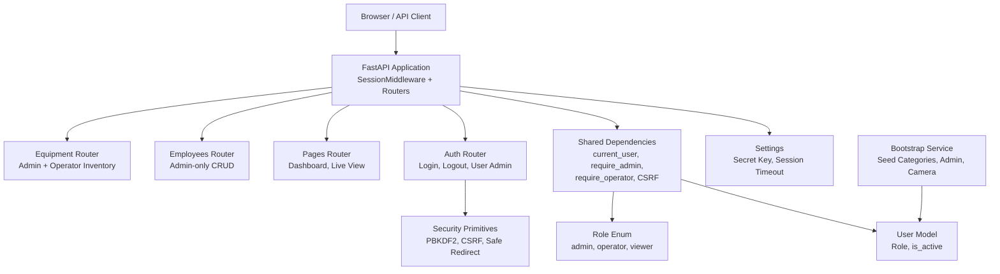
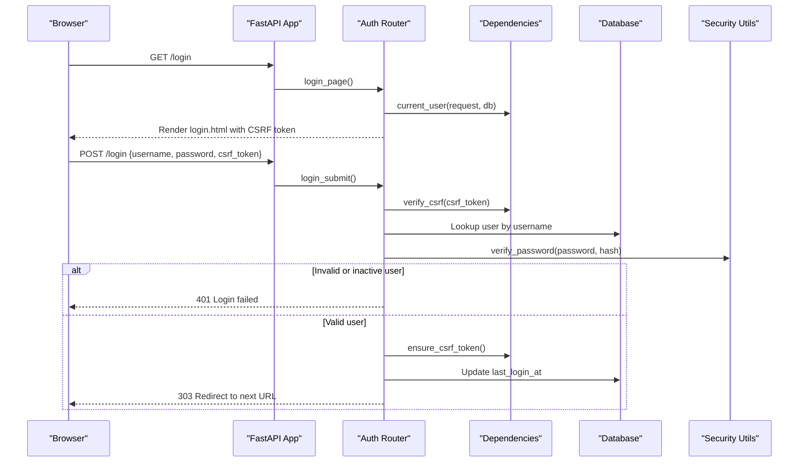
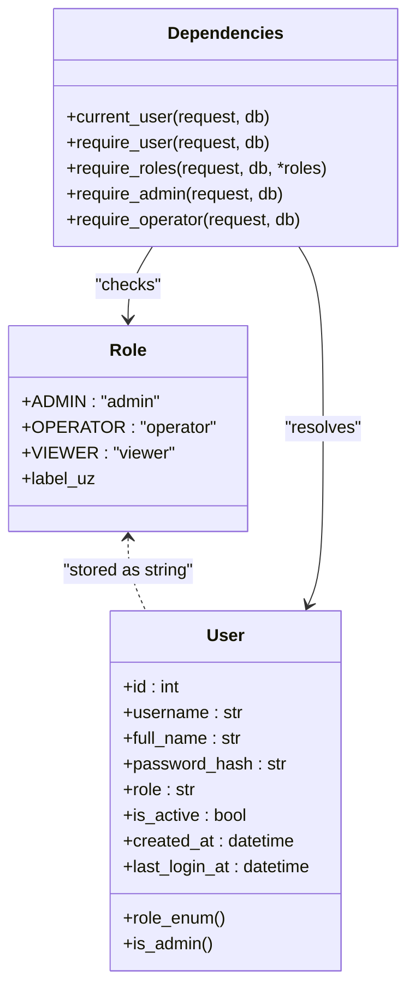
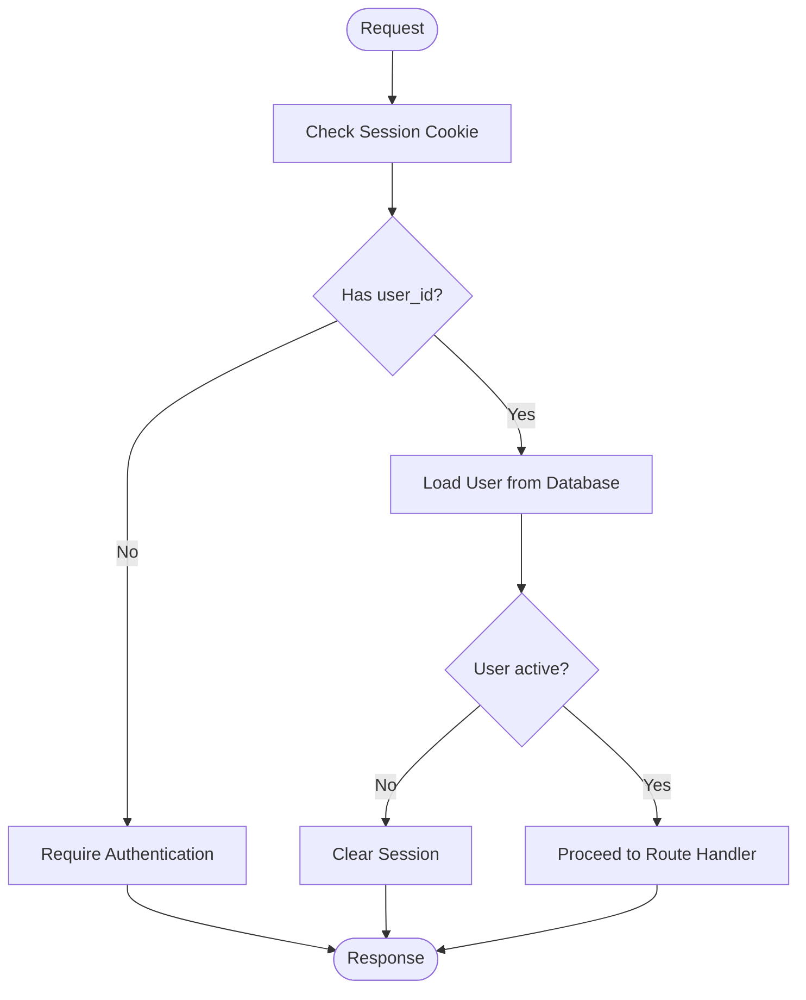
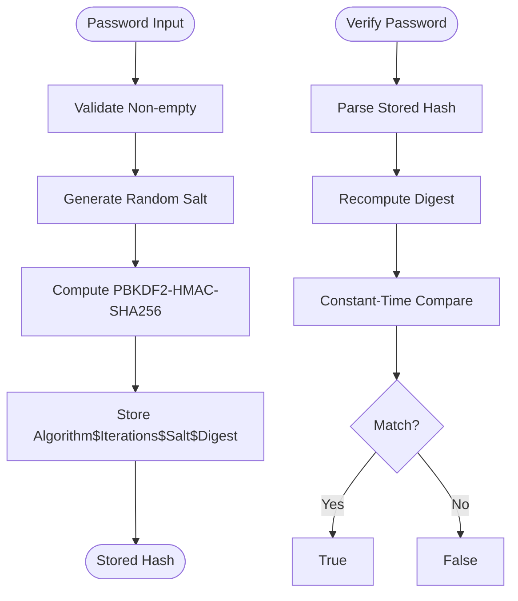
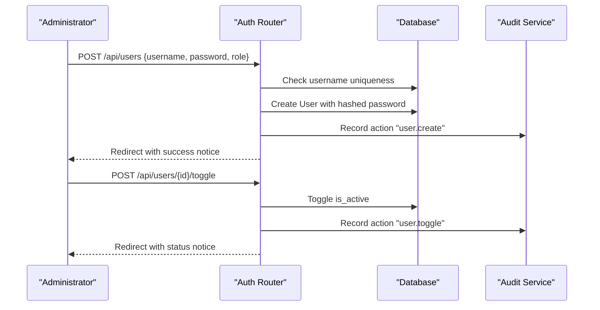
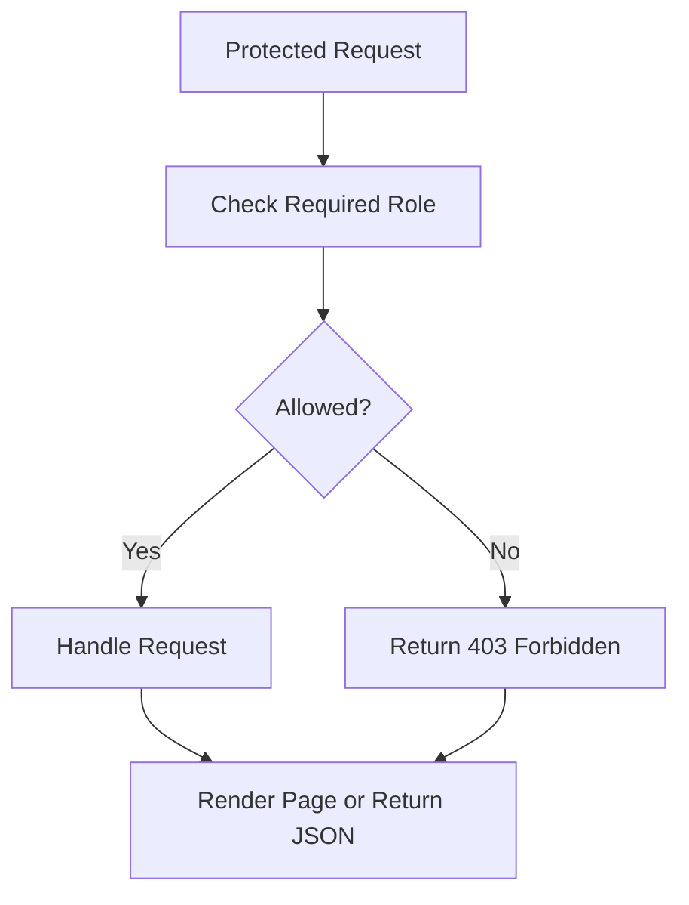
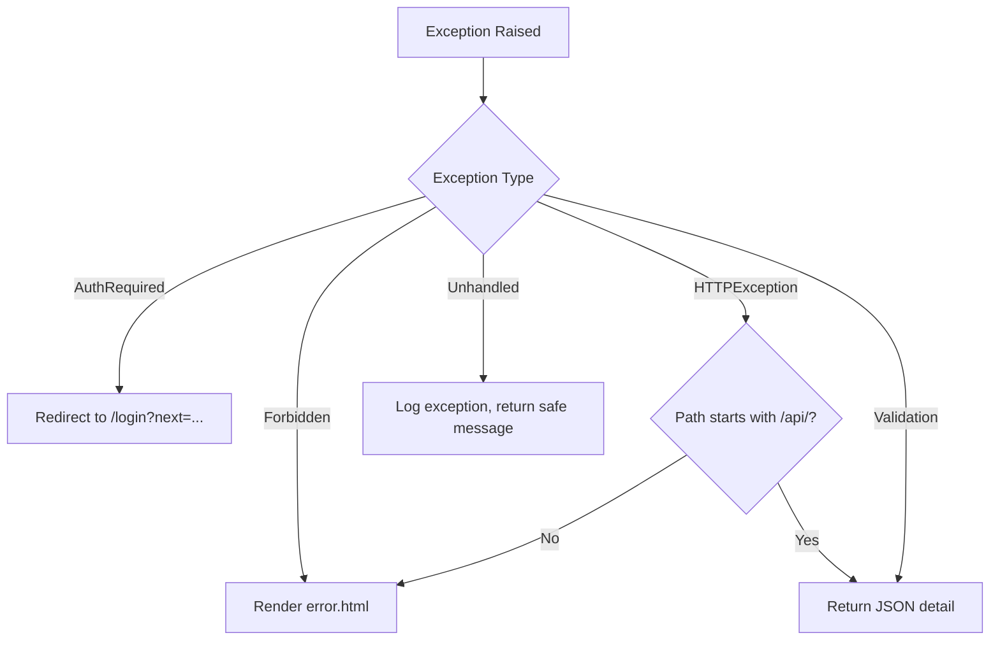
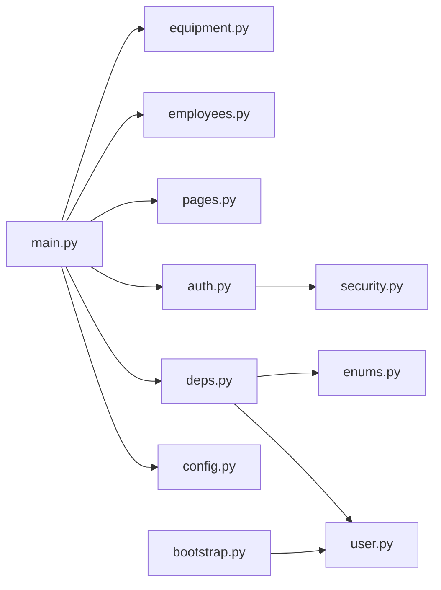

# Authentication & Authorization

<cite>
**Referenced Files in This Document**
- [main.py](file://app/main.py)
- [config.py](file://app/config.py)
- [deps.py](file://app/api/deps.py)
- [auth.py](file://app/api/auth.py)
- [pages.py](file://app/api/pages.py)
- [employees.py](file://app/api/employees.py)
- [equipment.py](file://app/api/equipment.py)
- [user.py](file://app/models/user.py)
- [enums.py](file://app/models/enums.py)
- [security.py](file://app/utils/security.py)
- [bootstrap.py](file://app/services/bootstrap.py)
- [README.md](file://README.md)
</cite>

## Table of Contents
1. [Introduction](#introduction)
2. [Project Structure](#project-structure)
3. [Core Components](#core-components)
4. [Architecture Overview](#architecture-overview)
5. [Detailed Component Analysis](#detailed-component-analysis)
6. [Dependency Analysis](#dependency-analysis)
7. [Performance Considerations](#performance-considerations)
8. [Troubleshooting Guide](#troubleshooting-guide)
9. [Conclusion](#conclusion)
10. [Appendices](#appendices)

## Introduction
This document explains the user authentication and authorization system for the application, focusing on:
- Role-based access control with three roles: administrator, operator, and viewer.
- Session management using signed cookie sessions, CSRF protection, and session timeout configuration.
- Password security using PBKDF2 hashing, bootstrap admin account creation, and user lifecycle management.
- Protected routes, permission checks in API dependencies, and security middleware.
- Examples of role-specific page access, API endpoint protection, and production security best practices including HTTPS requirements and secret key management.

The system is built on FastAPI with Starlette’s `SessionMiddleware`, Jinja2 templates for HTML pages, and SQLAlchemy models for users and audit logs. Security primitives such as password hashing, CSRF token generation/validation, and safe redirect handling are centralized under a dedicated security utility module.

## Project Structure
Authentication and authorization span several layers:
- Application entry point configures session middleware and global error handlers.
- Configuration loads secrets and session settings from environment variables.
- Shared dependency functions provide current-user resolution, role checks, CSRF validation, and template rendering context.
- Auth router implements login, logout, brute-force guard, and user administration endpoints.
- Domain routers protect pages and APIs by requiring authenticated users or specific roles.
- Models define the user entity, role enum, and audit log.
- Bootstrap service creates initial reference data and an admin user when the database is empty.

**Diagram sources**
- [main.py:44-68](file://app/main.py#L44-L68)
- [config.py:62-77](file://app/config.py#L62-L77)
- [deps.py:93-124](file://app/api/deps.py#L93-L124)
- [auth.py:58-121](file://app/api/auth.py#L58-L121)
- [pages.py:25-78](file://app/api/pages.py#L25-L78)
- [employees.py:25-58](file://app/api/employees.py#L25-L58)
- [equipment.py:25-55](file://app/api/equipment.py#L25-L55)
- [user.py:19-43](file://app/models/user.py#L19-L43)
- [enums.py:13-25](file://app/models/enums.py#L13-L25)
- [security.py:15-55](file://app/utils/security.py#L15-L55)
- [bootstrap.py:61-77](file://app/services/bootstrap.py#L61-L77)

**Section sources**
- [main.py:44-68](file://app/main.py#L44-L68)
- [config.py:62-77](file://app/config.py#L62-L77)
- [deps.py:93-124](file://app/api/deps.py#L93-L124)
- [auth.py:58-121](file://app/api/auth.py#L58-L121)
- [pages.py:25-78](file://app/api/pages.py#L25-L78)
- [employees.py:25-58](file://app/api/employees.py#L25-L58)
- [equipment.py:25-55](file://app/api/equipment.py#L25-L55)
- [user.py:19-43](file://app/models/user.py#L19-L43)
- [enums.py:13-25](file://app/models/enums.py#L13-L25)
- [security.py:15-55](file://app/utils/security.py#L15-L55)
- [bootstrap.py:61-77](file://app/services/bootstrap.py#L61-L77)

## Core Components
- Role-based access control (RBAC):
  - Roles are defined as string enums: administrator, operator, viewer.
  - Dependency functions enforce minimum required roles per route:
    - `require_user`: any authenticated user.
    - `require_admin`: administrator only.
    - `require_operator`: administrator or operator.
- Session management:
  - Signed cookie sessions via Starlette’s `SessionMiddleware`.
  - Session keys include user ID, CSRF token, notices, and role.
  - Session max age is configurable; in production, cookies are HTTPS-only.
- CSRF protection:
  - Tokens generated per session and validated on mutating requests.
  - Missing or invalid tokens return a bad request response.
- Password security:
  - PBKDF2-HMAC-SHA256 hashing with configurable iterations and salt.
  - Constant-time comparison to prevent timing attacks.
- Bootstrap admin:
  - When no users exist, an admin account is created from environment settings.
  - Warning is logged to encourage changing default credentials.

**Section sources**
- [enums.py:13-25](file://app/models/enums.py#L13-L25)
- [deps.py:93-124](file://app/api/deps.py#L93-L124)
- [main.py:55-62](file://app/main.py#L55-L62)
- [security.py:15-55](file://app/utils/security.py#L15-L55)
- [bootstrap.py:61-77](file://app/services/bootstrap.py#L61-L77)

## Architecture Overview
The authentication flow begins at the login page, validates CSRF, verifies credentials against stored hashes, clears and reissues session data, and redirects to the target URL. Authorization is enforced at each protected route through dependency functions that check the current user’s role.

**Diagram sources**
- [auth.py:58-114](file://app/api/auth.py#L58-L114)
- [deps.py:75-90](file://app/api/deps.py#L75-L90)
- [security.py:33-45](file://app/utils/security.py#L33-L45)

## Detailed Component Analysis

### RBAC Implementation
Roles are modeled as string enums and checked via dependency functions:
- Administrator: full access to all pages and administrative APIs.
- Operator: review operations, inventory operations, and read-only access to sensitive resources like evidence photos.
- Viewer: read-only access to dashboards, live views, movements, inventory, and reports.

**Diagram sources**
- [enums.py:13-25](file://app/models/enums.py#L13-L25)
- [user.py:19-43](file://app/models/user.py#L19-L43)
- [deps.py:93-124](file://app/api/deps.py#L93-L124)

**Section sources**
- [enums.py:13-25](file://app/models/enums.py#L13-L25)
- [user.py:19-43](file://app/models/user.py#L19-L43)
- [deps.py:93-124](file://app/api/deps.py#L93-L124)

### Session Management
- Cookie-based sessions:
  - The application uses `SessionMiddleware` with a secret key from configuration.
  - Session cookie name is `cctv_session`, with configurable max age.
  - In production (`APP_ENV=production`), cookies are HTTPS-only.
- CSRF protection:
  - Each session stores a CSRF token; mutating endpoints validate it.
  - Templates receive a CSRF token via render context.
- Session timeout:
  - Controlled by `SESSION_MAX_AGE_SECONDS`; default is 12 hours.
  - On successful login, the old session is cleared and a new CSRF token issued to mitigate fixation.

**Diagram sources**
- [main.py:55-62](file://app/main.py#L55-L62)
- [deps.py:93-101](file://app/api/deps.py#L93-L101)
- [auth.py:102-108](file://app/api/auth.py#L102-L108)

**Section sources**
- [main.py:55-62](file://app/main.py#L55-L62)
- [deps.py:75-90](file://app/api/deps.py#L75-L90)
- [auth.py:102-108](file://app/api/auth.py#L102-L108)
- [config.py:177-187](file://app/config.py#L177-L187)

### Password Security
- Hashing:
  - PBKDF2-HMAC-SHA256 with 260,000 iterations and random salt.
  - Stored format includes algorithm, iterations, salt, and digest.
- Verification:
  - Parses stored hash and recomputes digest; uses constant-time comparison.
- Bootstrap admin:
  - If no users exist, an admin is created with hashed password from environment settings.
  - Warning logged to prompt changing default password.

**Diagram sources**
- [security.py:25-45](file://app/utils/security.py#L25-L45)
- [bootstrap.py:61-77](file://app/services/bootstrap.py#L61-L77)

**Section sources**
- [security.py:25-45](file://app/utils/security.py#L25-L45)
- [bootstrap.py:61-77](file://app/services/bootstrap.py#L61-L77)

### User Lifecycle Management
- Creation:
  - Administrators can create users with username, full name, password, and role.
  - Username uniqueness and minimum length constraints enforced.
  - Audit log records user creation.
- Password changes:
  - Users can change their own password; administrators can change any user’s password.
  - Minimum password length enforced.
- Activation toggle:
  - Administrators can activate or deactivate users.
  - Self-deactivation is prevented.
- Audit trail:
  - All user-related actions are recorded in the audit log.

**Diagram sources**
- [auth.py:127-166](file://app/api/auth.py#L127-L166)
- [auth.py:195-217](file://app/api/auth.py#L195-L217)

**Section sources**
- [auth.py:127-166](file://app/api/auth.py#L127-L166)
- [auth.py:169-192](file://app/api/auth.py#L169-L192)
- [auth.py:195-217](file://app/api/auth.py#L195-L217)

### Protected Routes and Permission Checks
- Dashboard and live view:
  - Require any authenticated user.
- Employee management:
  - Admin-only pages and APIs for creating, updating, toggling, uploading photos, and deleting employees.
- Equipment management:
  - Admin-only pages and APIs for asset CRUD and category updates.
  - Inventory operations require operator or admin; initial stock requires admin explicitly.
- Evidence photo access:
  - Restricted to operator or admin; path traversal protection applied.

**Diagram sources**
- [pages.py:25-78](file://app/api/pages.py#L25-L78)
- [employees.py:25-58](file://app/api/employees.py#L25-L58)
- [equipment.py:25-55](file://app/api/equipment.py#L25-L55)
- [equipment.py:208-260](file://app/api/equipment.py#L208-L260)
- [employees.py:239-261](file://app/api/employees.py#L239-L261)

**Section sources**
- [pages.py:25-78](file://app/api/pages.py#L25-L78)
- [employees.py:25-58](file://app/api/employees.py#L25-L58)
- [equipment.py:25-55](file://app/api/equipment.py#L25-L55)
- [equipment.py:208-260](file://app/api/equipment.py#L208-L260)
- [employees.py:239-261](file://app/api/employees.py#L239-L261)

### Security Middleware and Error Handling
- Global exception handlers:
  - `AuthRequired` redirects to login with next URL preserved.
  - `Forbidden` renders an error page without exposing internals.
  - HTTP exceptions return JSON for `/api/` paths and HTML error pages otherwise.
  - Validation errors return structured JSON responses.
  - Unhandled exceptions log details and return safe messages.

**Diagram sources**
- [main.py:71-114](file://app/main.py#L71-L114)

**Section sources**
- [main.py:71-114](file://app/main.py#L71-L114)

## Dependency Analysis
The authentication and authorization system has clear separation of concerns:
- `main.py` wires up middleware and routers.
- `config.py` provides immutable settings loaded from environment variables.
- `deps.py` centralizes shared logic for user resolution, role checks, CSRF, and rendering.
- `auth.py` handles authentication flows and user administration.
- Domain routers (`pages.py`, `employees.py`, `equipment.py`) enforce permissions.
- `user.py` and `enums.py` define core data structures.
- `security.py` encapsulates cryptographic and safety utilities.
- `bootstrap.py` ensures initial data and admin user.

**Diagram sources**
- [main.py:44-68](file://app/main.py#L44-L68)
- [config.py:177-228](file://app/config.py#L177-L228)
- [deps.py:93-124](file://app/api/deps.py#L93-L124)
- [auth.py:58-121](file://app/api/auth.py#L58-L121)
- [pages.py:25-78](file://app/api/pages.py#L25-L78)
- [employees.py:25-58](file://app/api/employees.py#L25-L58)
- [equipment.py:25-55](file://app/api/equipment.py#L25-L55)
- [user.py:19-43](file://app/models/user.py#L19-L43)
- [enums.py:13-25](file://app/models/enums.py#L13-L25)
- [security.py:15-55](file://app/utils/security.py#L15-L55)
- [bootstrap.py:61-77](file://app/services/bootstrap.py#L61-L77)

**Section sources**
- [main.py:44-68](file://app/main.py#L44-L68)
- [config.py:177-228](file://app/config.py#L177-L228)
- [deps.py:93-124](file://app/api/deps.py#L93-L124)
- [auth.py:58-121](file://app/api/auth.py#L58-L121)
- [pages.py:25-78](file://app/api/pages.py#L25-L78)
- [employees.py:25-58](file://app/api/employees.py#L25-L58)
- [equipment.py:25-55](file://app/api/equipment.py#L25-L55)
- [user.py:19-43](file://app/models/user.py#L19-L43)
- [enums.py:13-25](file://app/models/enums.py#L13-L25)
- [security.py:15-55](file://app/utils/security.py#L15-L55)
- [bootstrap.py:61-77](file://app/services/bootstrap.py#L61-L77)

## Performance Considerations
- Password hashing uses PBKDF2 with 260,000 iterations; this adds CPU cost during login and user creation but improves resistance to brute-force attacks.
- Session storage is in-memory per process due to cookie-based sessions; consider scaling implications if multiple workers are used.
- CSRF token generation and validation are lightweight and use constant-time comparisons.
- Brute-force guard tracks attempts per username and client host in memory; this is simple but may not scale across processes without external state.

[No sources needed since this section provides general guidance]

## Troubleshooting Guide
Common issues and resolutions:
- Login fails in production:
  - Ensure HTTPS is enabled; session cookies are HTTPS-only in production mode.
- CSRF token missing or invalid:
  - Verify forms include the CSRF token field and that the token matches the session.
- Default bootstrap admin password warning:
  - Change the bootstrap admin password immediately after first login.
- Secret key not changed:
  - Generate a strong random secret key and set `APP_SECRET_KEY`.
- Unauthorized access to admin pages:
  - Confirm the user has the administrator role; operators cannot access admin-only routes.

**Section sources**
- [README.md:625-637](file://README.md#L625-L637)
- [config.py:140-156](file://app/config.py#L140-L156)
- [main.py:55-62](file://app/main.py#L55-L62)
- [deps.py:87-90](file://app/api/deps.py#L87-L90)

## Conclusion
The authentication and authorization system provides robust role-based access control, secure session management, and strong password hashing. It enforces CSRF protection, supports bootstrap admin creation, and offers comprehensive user lifecycle management. Protected routes and dependency-based permission checks ensure that only authorized users can perform sensitive operations. For production deployments, strict adherence to HTTPS, secret key management, and environment configuration is essential to maintain security.

[No sources needed since this section summarizes without analyzing specific files]

## Appendices

### Role-Specific Page Access Examples
- Administrator:
  - Full access to `/employees`, `/equipment`, `/settings`, and all inventory operations including initial stock.
- Operator:
  - Access to `/review`, `/inventory` operations (excluding initial stock), and evidence photo access.
- Viewer:
  - Read-only access to `/`, `/live`, `/movements`, `/inventory`, and `/reports`.

**Section sources**
- [README.md:173-199](file://README.md#L173-L199)

### API Endpoint Protection Examples
- `/api/employees`: Requires administrator.
- `/api/inventory/operation`: Requires operator or administrator; initial stock requires administrator explicitly.
- `/api/employees/{code}/photos/{filename}`: Requires operator or administrator with path traversal protection.

**Section sources**
- [employees.py:61-94](file://app/api/employees.py#L61-L94)
- [equipment.py:208-260](file://app/api/equipment.py#L208-L260)
- [employees.py:239-261](file://app/api/employees.py#L239-L261)

### Production Security Best Practices
- Set `APP_ENV=production` to enable HTTPS-only session cookies.
- Generate and configure a strong `APP_SECRET_KEY`.
- Change the bootstrap admin password immediately after first login.
- Restrict server exposure to internal networks or use VPN/proxy with authentication.
- Back up `.env`, `secrets/`, and `data/` directories securely.

**Section sources**
- [README.md:625-637](file://README.md#L625-L637)
- [config.py:177-187](file://app/config.py#L177-L187)