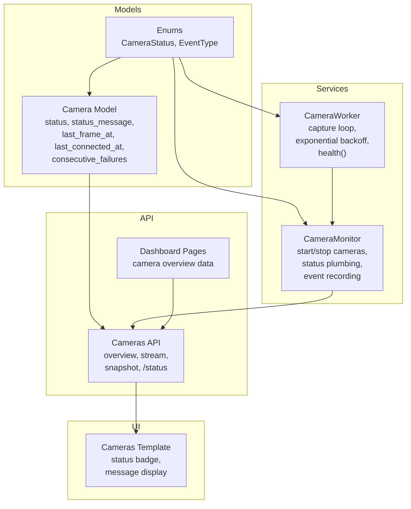
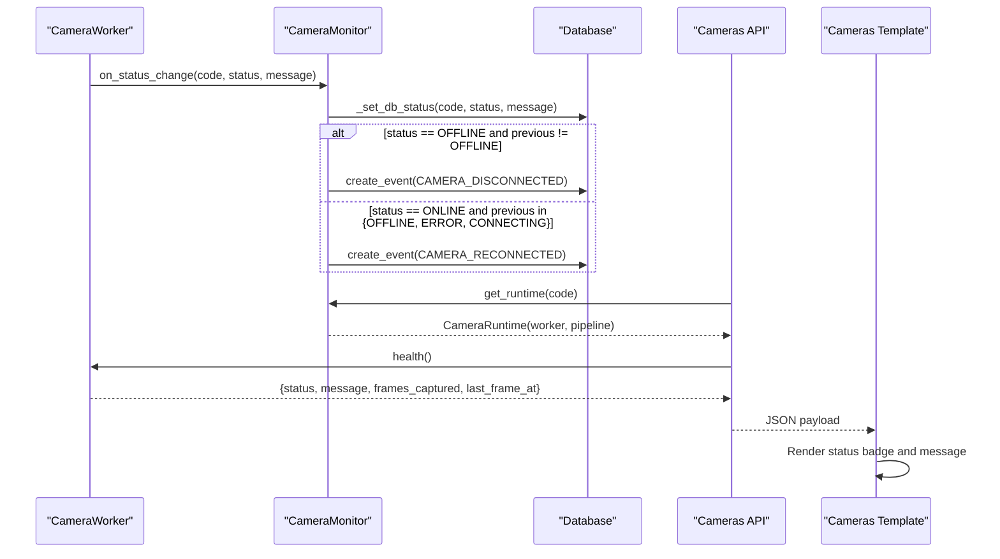
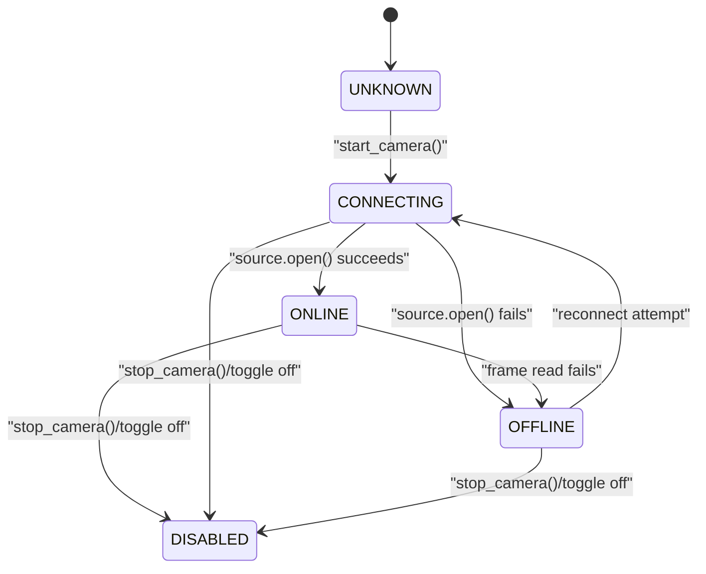
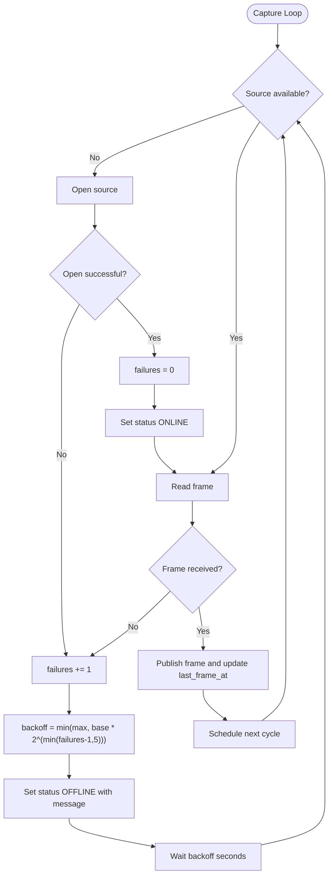
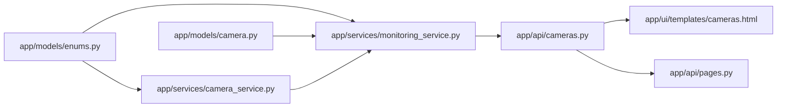

# Connection Monitoring & Status Management

<cite>
**Referenced Files in This Document**
- [enums.py](file://app/models/enums.py)
- [camera.py](file://app/models/camera.py)
- [camera_service.py](file://app/services/camera_service.py)
- [monitoring_service.py](file://app/services/monitoring_service.py)
- [cameras.py](file://app/api/cameras.py)
- [pages.py](file://app/api/pages.py)
- [cameras.html](file://app/ui/templates/cameras.html)
</cite>

## Table of Contents
1. [Introduction](#introduction)
2. [Project Structure](#project-structure)
3. [Core Components](#core-components)
4. [Architecture Overview](#architecture-overview)
5. [Detailed Component Analysis](#detailed-component-analysis)
6. [Dependency Analysis](#dependency-analysis)
7. [Performance Considerations](#performance-considerations)
8. [Troubleshooting Guide](#troubleshooting-guide)
9. [Conclusion](#conclusion)
10. [Appendices](#appendices)

## Introduction
This document explains how camera connection monitoring and status management work in the application. It covers the `CameraStatus` enum, state transitions, exponential backoff reconnection logic, consecutive failure tracking, automatic disconnection/reconnection events, and the runtime fields used for monitoring. It also documents the monitoring dashboard integration, alerting through event records, and practical troubleshooting guidance. Finally, it provides examples of status monitoring APIs and automated recovery procedures.

## Project Structure
The camera monitoring system spans models, services, API endpoints, and UI templates:

- Models define shared enums and the persistent camera record with status fields.
- The camera worker owns capture threads, frame processing, and health reporting.
- The monitoring service supervises workers, persists status changes, and emits connection events.
- API endpoints expose live streams, snapshots, and per-camera status.
- Templates render the cameras dashboard and status badges.

**Diagram sources**
- [enums.py:151-168](file://app/models/enums.py#L151-L168)
- [camera.py:38-42](file://app/models/camera.py#L38-L42)
- [camera_service.py:226-447](file://app/services/camera_service.py#L226-L447)
- [monitoring_service.py:39-216](file://app/services/monitoring_service.py#L39-L216)
- [cameras.py:28-47](file://app/api/cameras.py#L28-L47)
- [cameras.html:46-52](file://app/ui/templates/cameras.html#L46-L52)

**Section sources**
- [enums.py:151-168](file://app/models/enums.py#L151-L168)
- [camera.py:38-42](file://app/models/camera.py#L38-L42)
- [camera_service.py:226-447](file://app/services/camera_service.py#L226-L447)
- [monitoring_service.py:39-216](file://app/services/monitoring_service.py#L39-L216)
- [cameras.py:28-47](file://app/api/cameras.py#L28-L47)
- [cameras.html:46-52](file://app/ui/templates/cameras.html#L46-L52)

## Core Components
- `CameraStatus`: Enumerates camera states including `UNKNOWN`, `CONNECTING`, `ONLINE`, `OFFLINE`, plus `ERROR` and `DISABLED`.
- `CameraWorker`: Owns a capture thread, manages source lifecycle, implements exponential backoff on failures, updates runtime health, and reports status changes.
- `CameraMonitor`: Supervises all camera runtimes, persists status to the database, tracks consecutive failures, and emits `CAMERA_DISCONNECTED` and `CAMERA_RECONNECTED` events.
- Camera API: Provides `/api/cameras/{code}/status`, MJPEG stream, snapshot, and an overview merging DB rows with live runtime state.
- UI: Renders status badges and messages from the runtime or persisted values.

Key responsibilities:
- State machine: Transitions between `UNKNOWN`, `CONNECTING`, `ONLINE`, `OFFLINE`, `ERROR`, `DISABLED`.
- Reconnection strategy: Exponential backoff capped by configuration.
- Failure tracking: Incremental counter reset on successful connection.
- Event generation: Automatic disconnect/reconnect events recorded when status transitions occur.
- Monitoring exposure: Health and status APIs for dashboards and automation.

**Section sources**
- [enums.py:151-168](file://app/models/enums.py#L151-L168)
- [camera_service.py:226-447](file://app/services/camera_service.py#L226-L447)
- [monitoring_service.py:128-216](file://app/services/monitoring_service.py#L128-L216)
- [cameras.py:28-47](file://app/api/cameras.py#L28-L47)
- [cameras.py:290-328](file://app/api/cameras.py#L290-L328)

## Architecture Overview
The monitoring architecture connects the worker’s capture loop to the supervisor and persistence layer.

**Diagram sources**
- [camera_service.py:273-284](file://app/services/camera_service.py#L273-L284)
- [monitoring_service.py:171-216](file://app/services/monitoring_service.py#L171-L216)
- [cameras.py:312-328](file://app/api/cameras.py#L312-L328)
- [cameras.html:46-52](file://app/ui/templates/cameras.html#L46-L52)

## Detailed Component Analysis

### CameraStatus Enum and States
`CameraStatus` defines the canonical states:
- `UNKNOWN`: Initial or unknown state before connection attempts.
- `CONNECTING`: Attempting to open the source.
- `ONLINE`: Source is open and frames are being read successfully.
- `OFFLINE`: Failed to open source or failed to read frames; reconnection scheduled.
- `ERROR`: Error state used by persistence logic to increment failures.
- `DISABLED`: Camera stopped or disabled by administrator.

Transitions:
- Startup: `UNKNOWN` → `CONNECTING` (when starting a camera).
- Successful open: `CONNECTING` → `ONLINE`.
- Read failure or open failure: `ONLINE` or `CONNECTING` → `OFFLINE`.
- Stop/disable: Any running state → `DISABLED`.
- Error handling: `OFFLINE` or `ERROR` increments consecutive failures.

**Diagram sources**
- [monitoring_service.py:128-162](file://app/services/monitoring_service.py#L128-L162)
- [camera_service.py:347-411](file://app/services/camera_service.py#L347-L411)

**Section sources**
- [enums.py:151-168](file://app/models/enums.py#L151-L168)
- [monitoring_service.py:128-162](file://app/services/monitoring_service.py#L128-L162)
- [camera_service.py:347-411](file://app/services/camera_service.py#L347-L411)

### Exponential Backoff Reconnection Strategy
The worker uses exponential backoff when opening the source or reading frames:
- Base interval: `settings.camera_reconnect_interval`.
- Backoff formula: `base * 2^(min(failures - 1, 5))`.
- Cap: `settings.camera_max_retry_interval`.
- On success: reset `failures` to zero and transition to `ONLINE`.
- On repeated failures: set status to `OFFLINE` with a message indicating retry count and next delay.

**Diagram sources**
- [camera_service.py:365-427](file://app/services/camera_service.py#L365-L427)

**Section sources**
- [camera_service.py:365-427](file://app/services/camera_service.py#L365-L427)

### Consecutive Failure Tracking
Consecutive failures are tracked at two levels:
- Runtime level: Local `failures` counter inside `CameraWorker._run()` controls backoff timing.
- Persistence level: `Camera.consecutive_failures` is incremented when status becomes `OFFLINE` or `ERROR`, and reset to zero when status becomes `ONLINE`.

Behavior:
- Every time the worker sets `OFFLINE` or `ERROR`, the monitor increments `consecutive_failures`.
- When the worker sets `ONLINE`, the monitor resets `consecutive_failures` to zero and updates `last_connected_at` and `last_frame_at`.

**Section sources**
- [camera_service.py:365-427](file://app/services/camera_service.py#L365-L427)
- [monitoring_service.py:184-201](file://app/services/monitoring_service.py#L184-L201)
- [camera.py:38-42](file://app/models/camera.py#L38-L42)

### Automatic Disconnection/Reconnection Events
When status transitions cross certain boundaries, the monitor records events:
- Disconnect event: `CAMERA_DISCONNECTED` when transitioning to `OFFLINE` from any non-OFFLINE state.
- Reconnect event: `CAMERA_RECONNECTED` when transitioning to `ONLINE` from `OFFLINE`, `ERROR`, or `CONNECTING`.

These events are persisted via the event service with auto verification and notes containing the status message.

**Section sources**
- [monitoring_service.py:171-216](file://app/services/monitoring_service.py#L171-L216)
- [enums.py:27-59](file://app/models/enums.py#L27-L59)

### Status Fields and Health Exposure
Runtime health includes:
- `code`, `name`, `status`, `message`
- `frames_captured`, `frames_dropped`
- `last_frame_at`

Persistence fields updated by the monitor:
- `status`: Current status string.
- `status_message`: Human-readable message (capped length).
- `last_frame_at`: Updated on successful frame read and on online transition.
- `last_connected_at`: Updated on online transition.
- `consecutive_failures`: Incremented on offline/error transitions; reset on online.

The API endpoint `/api/cameras/{code}/status` returns runtime health plus localized status label and formatted local timestamp for `last_frame_at`.

**Section sources**
- [camera_service.py:438-447](file://app/services/camera_service.py#L438-L447)
- [monitoring_service.py:184-201](file://app/services/monitoring_service.py#L184-L201)
- [cameras.py:312-328](file://app/api/cameras.py#L312-L328)
- [camera.py:38-42](file://app/models/camera.py#L38-L42)

### Monitoring Dashboards Integration
The cameras overview merges database rows with live runtime state:
- For each camera row, it fetches runtime info via the monitor.
- If runtime exists, it uses worker status, message, frame counters, and last frame timestamp.
- If no runtime exists, it falls back to persisted camera status and message.

The dashboard page aggregates counts and recent events, using the same overview helper.

**Section sources**
- [cameras.py:28-47](file://app/api/cameras.py#L28-L47)
- [pages.py:25-41](file://app/api/pages.py#L25-L41)

### Alerting Mechanisms
Alerting is implemented through event records:
- `CAMERA_DISCONNECTED` and `CAMERA_RECONNECTED` events are created automatically during status transitions.
- These events can be consumed by external systems or displayed in dashboards and audit logs.

Operational recommendations:
- Monitor event tables for frequent disconnects.
- Use `consecutive_failures` thresholds to trigger external alerts (e.g., email, webhook).
- Correlate event timestamps with network outages or RTSP server issues.

**Section sources**
- [monitoring_service.py:171-216](file://app/services/monitoring_service.py#L171-L216)
- [enums.py:27-59](file://app/models/enums.py#L27-L59)

### Troubleshooting Connectivity Issues
Common scenarios and diagnostics:
- Persistent `OFFLINE` with increasing `consecutive_failures`:
  - Check RTSP URL, credentials, network reachability, and firewall rules.
  - Inspect status messages for retry counts and backoff intervals.
- Frequent reconnects:
  - Review `camera_reconnect_interval` and `camera_max_retry_interval` settings.
  - Validate camera hardware stability and stream availability.
- No frames but status remains `ONLINE`:
  - Investigate decoder/backend errors and buffer settings.
  - Confirm that frame reads return valid frames and timestamps update.
- Disabled cameras:
  - Ensure `is_enabled` is true and status is not forced to `DISABLED`.

Operational steps:
- Query `/api/cameras/{code}/status` for real-time health.
- Inspect event records for disconnect/reconnect patterns.
- Use the cameras template to view status badges and messages.

**Section sources**
- [camera_service.py:365-427](file://app/services/camera_service.py#L365-L427)
- [monitoring_service.py:184-201](file://app/services/monitoring_service.py#L184-L201)
- [cameras.py:312-328](file://app/api/cameras.py#L312-L328)
- [cameras.html:46-52](file://app/ui/templates/cameras.html#L46-L52)

## Dependency Analysis
The following diagram shows key dependencies among components involved in connection monitoring:

**Diagram sources**
- [enums.py:151-168](file://app/models/enums.py#L151-L168)
- [camera.py:38-42](file://app/models/camera.py#L38-L42)
- [camera_service.py:226-447](file://app/services/camera_service.py#L226-L447)
- [monitoring_service.py:39-216](file://app/services/monitoring_service.py#L39-L216)
- [cameras.py:28-47](file://app/api/cameras.py#L28-L47)
- [cameras.py:290-328](file://app/api/cameras.py#L290-L328)
- [cameras.html:46-52](file://app/ui/templates/cameras.html#L46-L52)
- [pages.py:25-41](file://app/api/pages.py#L25-L41)

**Section sources**
- [enums.py:151-168](file://app/models/enums.py#L151-L168)
- [camera.py:38-42](file://app/models/camera.py#L38-L42)
- [camera_service.py:226-447](file://app/services/camera_service.py#L226-L447)
- [monitoring_service.py:39-216](file://app/services/monitoring_service.py#L39-L216)
- [cameras.py:28-47](file://app/api/cameras.py#L28-L47)
- [cameras.py:290-328](file://app/api/cameras.py#L290-L328)
- [cameras.html:46-52](file://app/ui/templates/cameras.html#L46-L52)
- [pages.py:25-41](file://app/api/pages.py#L25-L41)

## Performance Considerations
- Bounded frame queue: Prevents memory growth under slow inference consumers; oldest frames are dropped to keep latency low.
- Exponential backoff: Reduces pressure on unstable sources while still attempting recovery.
- Thread isolation: Each camera runs in its own worker thread; pipeline decouples inference from capture.
- Status updates: Minimal logging and callback invocation; exceptions in callbacks are caught to avoid killing the worker.
- Database writes: Status persistence is wrapped in try/except blocks to avoid blocking the monitoring loop.

Recommendations:
- Tune `processing_fps`, `camera_reconnect_interval`, and `camera_max_retry_interval` based on environment reliability.
- Monitor frame drop rates (`frames_dropped`) to detect processing bottlenecks.
- Use simulation mode for testing without real camera dependencies.

[No sources needed since this section provides general guidance]

## Troubleshooting Guide
Step-by-step approach:
1. Check runtime status:
   - Call `/api/cameras/{code}/status`.
   - Inspect `status`, `message`, `frames_captured`, `frames_dropped`, and `last_frame_at`.
2. Review events:
   - Look for `CAMERA_DISCONNECTED` and `CAMERA_RECONNECTED` events.
   - Correlate timestamps with known network or camera outages.
3. Inspect persistence fields:
   - Verify `consecutive_failures` trend.
   - Confirm `last_connected_at` and `last_frame_at` are updating when expected.
4. Validate configuration:
   - Ensure `is_enabled` is true.
   - Confirm source type and source value are correct.
5. Adjust backoff parameters:
   - Increase `camera_reconnect_interval` if network is flaky.
   - Lower `camera_max_retry_interval` cap if rapid retries are desired.

Operational tips:
- Use the cameras template to visually inspect status badges and messages.
- Automate recovery by toggling cameras or restarting the monitor after sustained failures.
- Integrate external alerting based on event frequency and `consecutive_failures` thresholds.

**Section sources**
- [cameras.py:312-328](file://app/api/cameras.py#L312-L328)
- [monitoring_service.py:171-216](file://app/services/monitoring_service.py#L171-L216)
- [camera_service.py:365-427](file://app/services/camera_service.py#L365-L427)
- [cameras.html:46-52](file://app/ui/templates/cameras.html#L46-L52)

## Conclusion
The camera connection monitoring system combines a robust worker loop with a central supervisor to manage state transitions, exponential backoff reconnections, and failure tracking. Status changes are persisted and exposed via APIs, enabling dashboards and automated recovery procedures. Event-based alerting provides visibility into connectivity issues, while the UI offers immediate feedback through status badges and messages. Proper tuning of backoff parameters and proactive monitoring of events and failure counters will improve operational resilience.

[No sources needed since this section summarizes without analyzing specific files]

## Appendices

### Status Monitoring API Examples
- Get per-camera status:
  - Endpoint: `GET /api/cameras/{code}/status`
  - Response includes: `code`, `name`, `status`, `status_label`, `message`, `frames_captured`, `frames_dropped`, `last_frame_at`, and optional pipeline health.
- Live stream:
  - Endpoint: `GET /api/cameras/{code}/stream`
  - Returns MJPEG stream with placeholder frames when no frame is available.
- Snapshot:
  - Endpoint: `GET /api/cameras/{code}/snapshot`
  - Returns latest annotated JPEG or placeholder image.

**Section sources**
- [cameras.py:290-328](file://app/api/cameras.py#L290-L328)

### Automated Recovery Procedures
- Restart camera:
  - Toggle camera enabled flag via `/api/cameras/{camera_id}/toggle`.
  - Or call `/api/cameras/{camera_id}/update` to refresh configuration and restart.
- Reload all cameras:
  - Use monitor reload method to stop existing runtimes and start fresh ones.
- External automation:
  - Poll `/api/cameras/{code}/status` and trigger recovery actions when `consecutive_failures` exceeds threshold.
  - Watch event stream for `CAMERA_DISCONNECTED` and initiate remediation workflows.

**Section sources**
- [cameras.py:157-215](file://app/api/cameras.py#L157-L215)
- [cameras.py:218-246](file://app/api/cameras.py#L218-L246)
- [monitoring_service.py:164-168](file://app/services/monitoring_service.py#L164-L168)