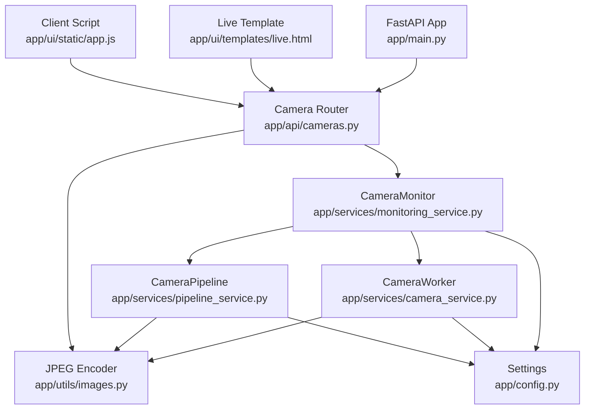
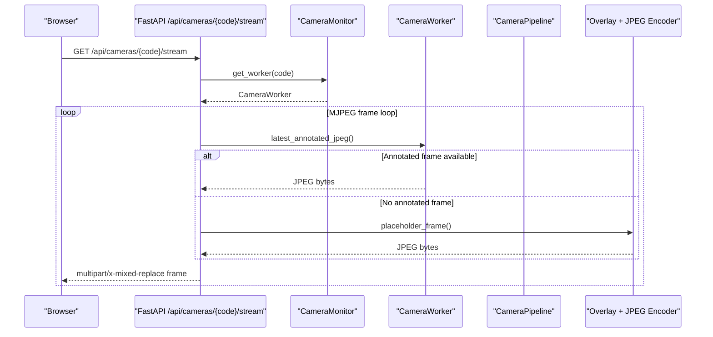
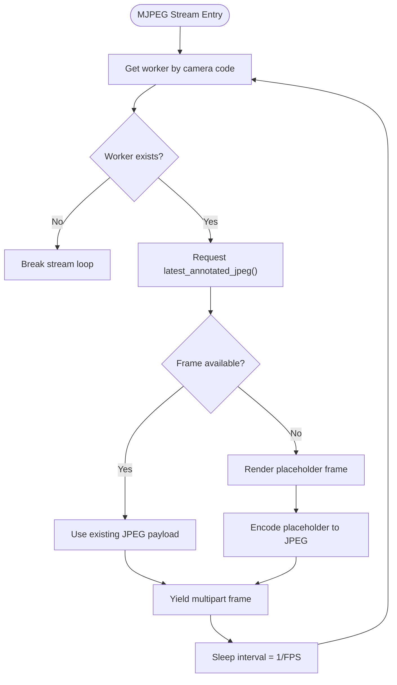
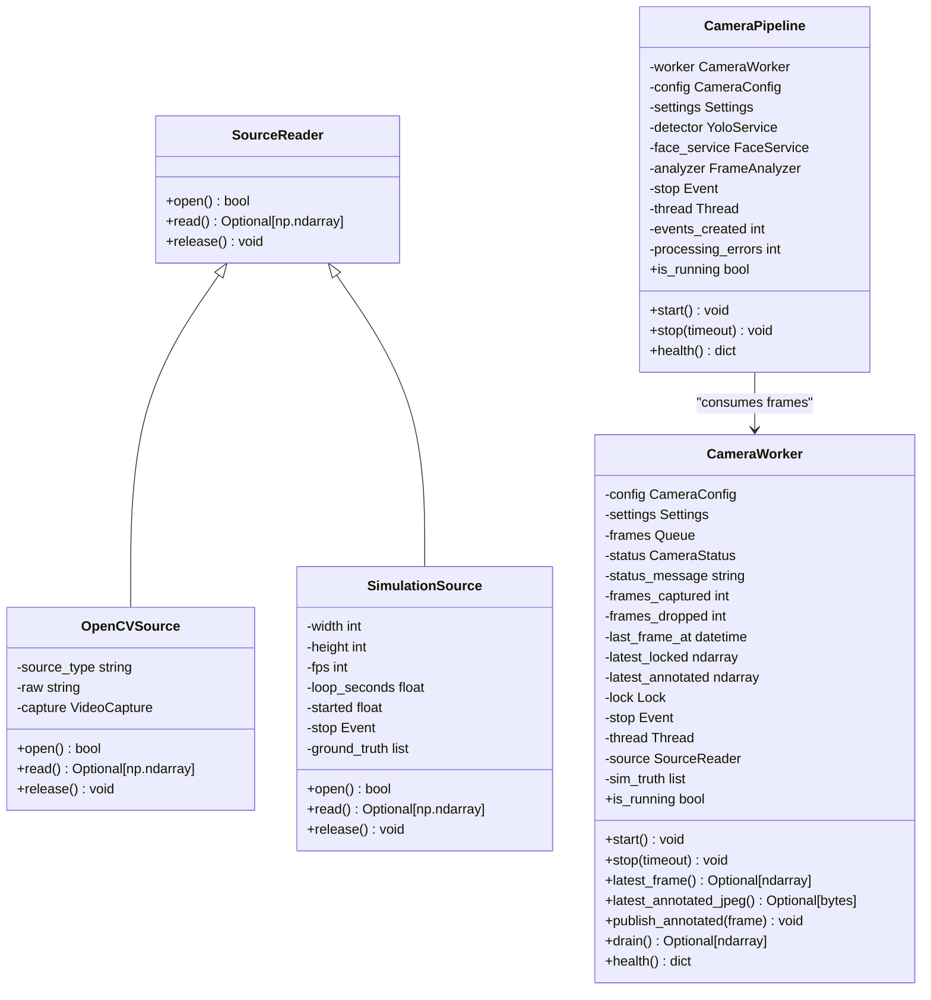
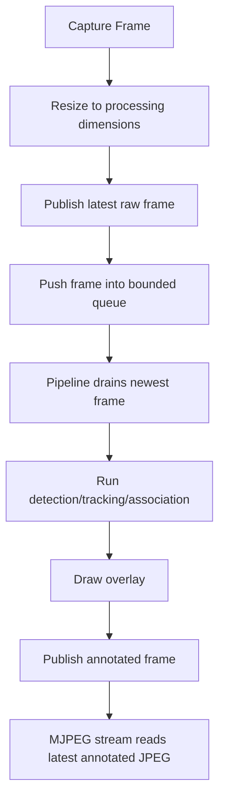
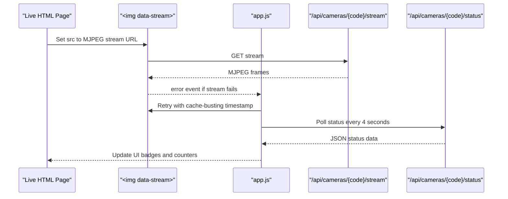
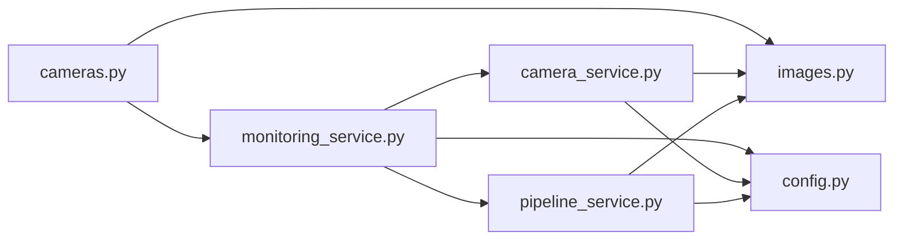

# Live Streaming & MJPEG

<cite>
**Referenced Files in This Document**
- [main.py](file://app/main.py)
- [cameras.py](file://app/api/cameras.py)
- [camera_service.py](file://app/services/camera_service.py)
- [monitoring_service.py](file://app/services/monitoring_service.py)
- [pipeline_service.py](file://app/services/pipeline_service.py)
- [images.py](file://app/utils/images.py)
- [config.py](file://app/config.py)
- [live.html](file://app/ui/templates/live.html)
- [app.js](file://app/ui/static/app.js)
</cite>

## Table of Contents
1. [Introduction](#introduction)
2. [Project Structure](#project-structure)
3. [Core Components](#core-components)
4. [Architecture Overview](#architecture-overview)
5. [Detailed Component Analysis](#detailed-component-analysis)
6. [Stream Access and Client Integration](#stream-access-and-client-integration)
7. [Dependency Analysis](#dependency-analysis)
8. [Performance Considerations](#performance-considerations)
9. [Troubleshooting Guide](#troubleshooting-guide)
10. [Conclusion](#conclusion)

## Introduction
This document explains the live streaming and MJPEG implementation used to display real-time camera feeds with annotated detections. It covers how frames are captured, processed through an inference pipeline, encoded into JPEG images, and streamed to browsers as an MJPEG multipart stream. It also documents the stream endpoints, client-side integration, performance characteristics, and troubleshooting guidance for latency, frame drops, and connection issues.

The system is built around:
- A FastAPI application that mounts routers and exposes API endpoints.
- A monitoring service that owns per-camera workers and pipelines.
- A camera worker thread that captures frames from RTSP, USB, file, or simulation sources.
- A pipeline thread that runs detection, tracking, identity association, line crossing logic, and overlay drawing.
- An MJPEG endpoint that repeatedly reads the latest annotated frame and streams it to clients.

## Project Structure
The live streaming capability spans several modules:

**Diagram sources**
- [main.py:44-68](file://app/main.py#L44-L68)
- [cameras.py:25-336](file://app/api/cameras.py#L25-L336)
- [monitoring_service.py:39-152](file://app/services/monitoring_service.py#L39-L152)
- [camera_service.py:226-448](file://app/services/camera_service.py#L226-L448)
- [pipeline_service.py:390-487](file://app/services/pipeline_service.py#L390-L487)
- [images.py:24-28](file://app/utils/images.py#L24-L28)
- [config.py:62-104](file://app/config.py#L62-L104)
- [live.html:35-37](file://app/ui/templates/live.html#L35-L37)
- [app.js:73-81](file://app/ui/static/app.js#L73-L81)

**Section sources**
- [main.py:44-68](file://app/main.py#L44-L68)
- [cameras.py:1-25](file://app/api/cameras.py#L1-L25)

## Core Components
- **FastAPI entry point**: Creates the app, mounts static files, includes routers, configures session middleware, and registers exception handlers. The `/healthz` endpoint reports whether monitoring is running and how many cameras are active.
- **Camera router**: Provides camera configuration endpoints and the live MJPEG stream endpoint at `/api/cameras/{code}/stream`. It also exposes snapshot and status endpoints.
- **Monitoring service**: Owns all camera runtimes, starts/stops workers and pipelines, persists status transitions, and provides runtime accessors used by the stream endpoint.
- **Camera worker**: Runs one capture thread per camera, manages source readers (RTSP/USB/file/simulation), resizes frames, maintains a bounded frame queue, publishes the latest raw and annotated frames, and tracks health metrics.
- **Pipeline service**: Runs one analysis thread per camera, drains frames, runs detection/tracking/association, draws overlays, publishes annotated frames for MJPEG, and persists movement events.
- **Image utilities**: Encodes OpenCV frames to JPEG bytes using configurable quality.
- **Configuration**: Supplies processing FPS, resolution, queue size, evidence JPEG quality, and other runtime parameters.
- **Live page and client script**: Renders the selected camera stream via an `` tag pointing to the MJPEG endpoint and refreshes status cards periodically.

**Section sources**
- [main.py:44-128](file://app/main.py#L44-L128)
- [cameras.py:25-367](file://app/api/cameras.py#L25-L367)
- [monitoring_service.py:39-282](file://app/services/monitoring_service.py#L39-L282)
- [camera_service.py:226-448](file://app/services/camera_service.py#L226-L448)
- [pipeline_service.py:390-586](file://app/services/pipeline_service.py#L390-L586)
- [images.py:24-28](file://app/utils/images.py#L24-L28)
- [config.py:62-104](file://app/config.py#L62-L104)
- [live.html:35-37](file://app/ui/templates/live.html#L35-L37)
- [app.js:73-115](file://app/ui/static/app.js#L73-L115)

## Architecture Overview
The MJPEG stream architecture connects browser clients to camera workers through FastAPI streaming responses.

**Diagram sources**
- [cameras.py:313-336](file://app/api/cameras.py#L313-L336)
- [monitoring_service.py:235-241](file://app/services/monitoring_service.py#L235-L241)
- [camera_service.py:290-304](file://app/services/camera_service.py#L290-L304)
- [pipeline_service.py:473-481](file://app/services/pipeline_service.py#L473-L481)
- [images.py:24-28](file://app/utils/images.py#L24-L28)

## Detailed Component Analysis

### MJPEG Stream Endpoint
The MJPEG endpoint returns a `StreamingResponse` with media type `multipart/x-mixed-replace; boundary=frame`. For each iteration:
- It retrieves the worker for the requested camera code.
- It requests the latest annotated JPEG payload.
- If no annotated frame is available, it renders a placeholder image and encodes it to JPEG.
- It yields a multipart frame with headers including `Content-Type: image/jpeg` and `Content-Length`.
- It sleeps according to the configured interval derived from the default FPS value.

**Diagram sources**
- [cameras.py:313-336](file://app/api/cameras.py#L313-L336)

**Section sources**
- [cameras.py:313-336](file://app/api/cameras.py#L313-L336)

### Frame Capture and Encoding Pipeline
The capture pipeline decouples reading frames from inference to avoid network I/O stalls affecting model processing.

- **SourceReader abstraction**: Defines open/read/release methods.
- **OpenCVSource**: Wraps `cv2.VideoCapture`, supports RTSP/USB/file sources, sets buffer size to minimize backlog, and handles read failures gracefully.
- **SimulationSource**: Generates synthetic frames for offline demos, exposing ground truth boxes for deterministic testing.
- **build_source**: Chooses SimulationSource when simulation mode is enabled or the camera source type is simulation; otherwise uses OpenCVSource.
- **CameraWorker**: Owns the capture thread, resizes frames to configured processing dimensions, pushes frames into a bounded queue, publishes the latest raw frame, and updates health counters.
- **CameraPipeline**: Drains frames, runs detection/tracking/association, draws overlays, publishes annotated frames, and persists events.

**Diagram sources**
- [camera_service.py:69-220](file://app/services/camera_service.py#L69-L220)
- [camera_service.py:226-448](file://app/services/camera_service.py#L226-L448)
- [pipeline_service.py:390-487](file://app/services/pipeline_service.py#L390-L487)

**Section sources**
- [camera_service.py:69-220](file://app/services/camera_service.py#L69-L220)
- [camera_service.py:226-448](file://app/services/camera_service.py#L226-L448)
- [pipeline_service.py:390-487](file://app/services/pipeline_service.py#L390-L487)

### Real-Time Streaming Optimization
Key optimizations implemented:
- **Bounded frame queue**: Prevents memory growth under slow inference by dropping older frames and keeping the newest.
- **Frame skipping**: The drain method pops the newest frame while discarding older ones, reducing latency.
- **Decoupled capture and inference**: Network read errors do not stall the inference thread; reconnection backoff is exponential with a maximum cap.
- **Processing resize**: Frames are resized to configured processing width/height before inference to reduce compute load.
- **JPEG encoding quality**: Evidence and placeholder frames use configurable JPEG quality; MJPEG stream uses fixed quality values for consistency.
- **Placeholder frames**: When no annotated frame is available, a placeholder image is rendered and encoded to keep the stream alive.

**Diagram sources**
- [camera_service.py:317-336](file://app/services/camera_service.py#L317-L336)
- [camera_service.py:429-436](file://app/services/camera_service.py#L429-L436)
- [pipeline_service.py:462-487](file://app/services/pipeline_service.py#L462-L487)
- [cameras.py:313-336](file://app/api/cameras.py#L313-L336)

**Section sources**
- [camera_service.py:317-336](file://app/services/camera_service.py#L317-L336)
- [camera_service.py:429-436](file://app/services/camera_service.py#L429-L436)
- [pipeline_service.py:462-487](file://app/services/pipeline_service.py#L462-L487)
- [cameras.py:313-336](file://app/api/cameras.py#L313-L336)

## Stream Access and Client Integration

### Stream Access URLs
- **MJPEG stream**: `GET /api/cameras/{code}/stream`
  - Returns `multipart/x-mixed-replace; boundary=frame`.
  - Requires user authentication via session middleware.
  - Sets `Cache-Control: no-store` and `X-Accel-Buffering: no` to prevent proxy buffering.
- **Snapshot**: `GET /api/cameras/{code}/snapshot`
  - Returns a single JPEG image.
  - Uses `Cache-Control: no-store`.
- **Status**: `GET /api/cameras/{code}/status`
  - Returns JSON with camera health, frame counts, last frame timestamp, and pipeline metrics.

**Section sources**
- [cameras.py:328-367](file://app/api/cameras.py#L328-L367)

### Query Parameters for Resolution and Quality Control
- The MJPEG stream endpoint does not accept query parameters for resolution or quality control.
- Resolution and frame rate are controlled globally by settings:
  - `PROCESSING_FPS`: Controls the capture/inference frame rate.
  - `PROCESSING_WIDTH` and `PROCESSING_HEIGHT`: Control frame resizing before inference.
  - `EVIDENCE_JPEG_QUALITY`: Controls JPEG quality for evidence snapshots.
  - MJPEG stream uses fixed JPEG quality values internally; there is no dynamic per-stream quality parameter.

**Section sources**
- [config.py:190-210](file://app/config.py#L190-L210)
- [camera_service.py:429-436](file://app/services/camera_service.py#L429-L436)
- [cameras.py:313-336](file://app/api/cameras.py#L313-L336)

### Client-Side Streaming Integration
- **HTML5 video integration**: The live template uses an `` tag whose `src` points to the MJPEG stream URL. Browsers natively render MJPEG streams inside `` elements.
- **JavaScript streaming client**: The client script attaches error handling to `[data-stream]` elements. On error, it retries after a delay by appending a timestamp query parameter to bust caches.
- **Status polling**: The client periodically fetches `/api/cameras/{code}/status` to update UI badges, frame counts, dropped frame counts, and tracked object counts.

**Diagram sources**
- [live.html:35-37](file://app/ui/templates/live.html#L35-L37)
- [app.js:73-115](file://app/ui/static/app.js#L73-L115)
- [cameras.py:328-367](file://app/api/cameras.py#L328-L367)

**Section sources**
- [live.html:35-37](file://app/ui/templates/live.html#L35-L37)
- [app.js:73-115](file://app/ui/static/app.js#L73-L115)
- [cameras.py:328-367](file://app/api/cameras.py#L328-L367)

## Dependency Analysis
The streaming subsystem has clear dependencies:

**Diagram sources**
- [cameras.py:14-22](file://app/api/cameras.py#L14-L22)
- [monitoring_service.py:17-25](file://app/services/monitoring_service.py#L17-L25)
- [camera_service.py:24-27](file://app/services/camera_service.py#L24-L27)
- [pipeline_service.py:28-42](file://app/services/pipeline_service.py#L28-L42)
- [images.py:1-10](file://app/utils/images.py#L1-L10)
- [config.py:177-222](file://app/config.py#L177-L222)

**Section sources**
- [cameras.py:14-22](file://app/api/cameras.py#L14-L22)
- [monitoring_service.py:17-25](file://app/services/monitoring_service.py#L17-L25)
- [camera_service.py:24-27](file://app/services/camera_service.py#L24-L27)
- [pipeline_service.py:28-42](file://app/services/pipeline_service.py#L28-L42)
- [images.py:1-10](file://app/utils/images.py#L1-L10)
- [config.py:177-222](file://app/config.py#L177-L222)

## Performance Considerations
- **Bandwidth usage**:
  - MJPEG streams send a new JPEG image per frame. Bandwidth scales with frame size and frame rate.
  - Reducing `PROCESSING_WIDTH` and `PROCESSING_HEIGHT` lowers bandwidth and CPU usage.
  - JPEG quality affects file size; evidence snapshots use configurable quality, while MJPEG stream uses fixed internal quality values.
- **Concurrent stream limits**:
  - Each MJPEG request holds a streaming response and repeatedly calls `latest_annotated_jpeg()` on the worker.
  - Multiple clients viewing the same camera share the same worker’s latest frame, but each client still incurs network overhead.
  - Limit concurrent viewers per camera based on server capacity and network bandwidth.
- **Memory management**:
  - Bounded frame queue prevents unbounded memory growth under slow inference.
  - Placeholder frames ensure the stream remains alive even when no annotated frame is available.
  - Evidence retention is managed by a janitor thread purging expired evidence files.
- **Latency**:
  - Frame skipping and draining the newest frame reduce latency.
  - Reconnection backoff avoids tight loops during camera disconnects.
  - Processing FPS controls capture cadence; higher FPS increases CPU and bandwidth.
- **CPU usage**:
  - Detection and tracking run per frame; heavy models can increase CPU load.
  - Simulation mode reduces CPU pressure by bypassing real detectors.

**Section sources**
- [camera_service.py:317-336](file://app/services/camera_service.py#L317-L336)
- [camera_service.py:429-436](file://app/services/camera_service.py#L429-L436)
- [monitoring_service.py:218-232](file://app/services/monitoring_service.py#L218-L232)
- [config.py:190-210](file://app/config.py#L190-L210)
- [cameras.py:313-336](file://app/api/cameras.py#L313-L336)

## Troubleshooting Guide
Common streaming issues and resolutions:

- **Stream not loading**:
  - Verify the camera code is valid and the worker exists.
  - Check authentication; the stream requires a logged-in user.
  - Inspect browser console for network errors; the client script retries with a timestamp after three seconds.
- **Latency spikes**:
  - Reduce `PROCESSING_FPS` to lower CPU and bandwidth load.
  - Lower `PROCESSING_WIDTH` and `PROCESSING_HEIGHT` to reduce frame size.
  - Check for high `frames_dropped` counts indicating processing backlog.
- **Frame drops**:
  - High `frames_dropped` indicates the bounded queue is full due to slow inference.
  - Optimize detector performance or reduce frame rate.
  - Ensure camera source is stable; frequent reconnects cause drops.
- **Black or placeholder frames**:
  - Indicates no annotated frame is available yet.
  - Wait for the pipeline to publish annotated frames.
  - Check camera status via `/api/cameras/{code}/status`.
- **High bandwidth usage**:
  - Reduce processing resolution and frame rate.
  - Limit concurrent viewers per camera.
  - Use CDN or reverse proxy with appropriate caching policies for non-stream assets.

**Section sources**
- [cameras.py:313-367](file://app/api/cameras.py#L313-L367)
- [camera_service.py:317-336](file://app/services/camera_service.py#L317-L336)
- [app.js:73-115](file://app/ui/static/app.js#L73-L115)
- [config.py:190-210](file://app/config.py#L190-L210)

## Conclusion
The live streaming and MJPEG implementation provides a robust, real-time camera feed with annotated detections. It balances performance through bounded queues, frame skipping, and configurable processing parameters. Clients integrate seamlessly via HTML5 `` tags and JavaScript retry logic. Operators should tune processing FPS, resolution, and JPEG quality to match their bandwidth and CPU constraints, monitor frame drop rates, and limit concurrent viewers to maintain low latency and stable streaming.