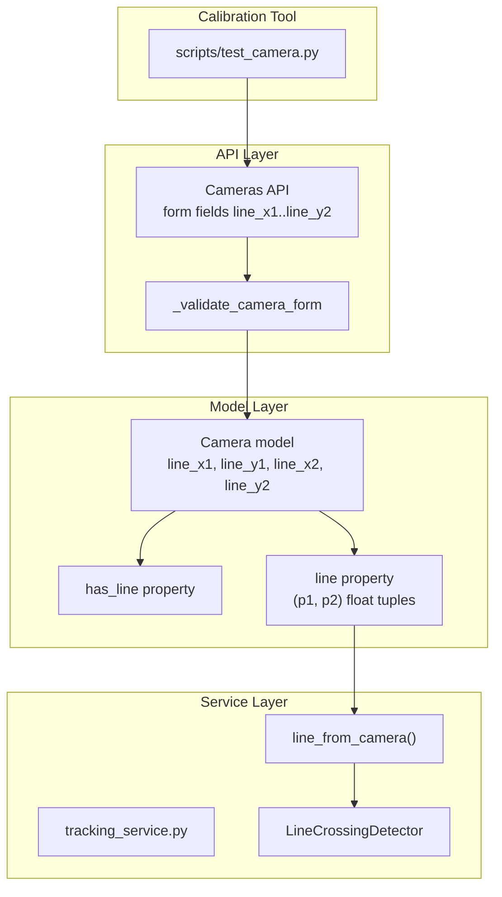
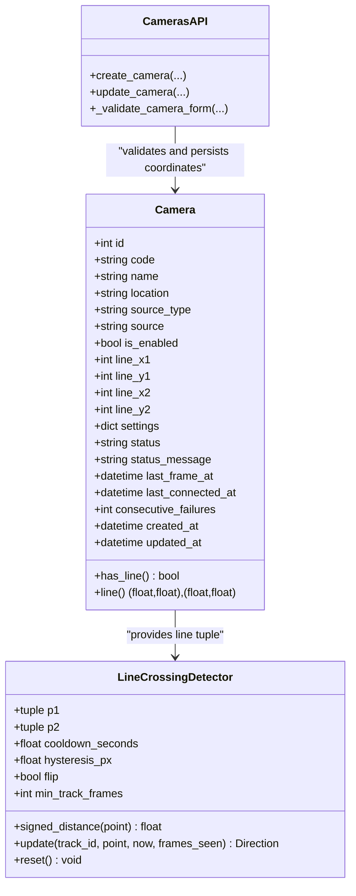
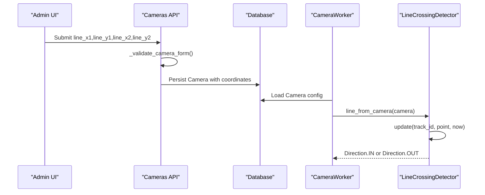
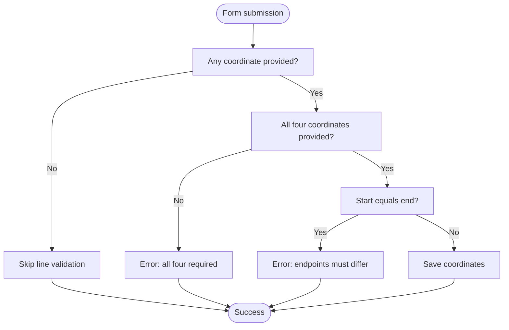
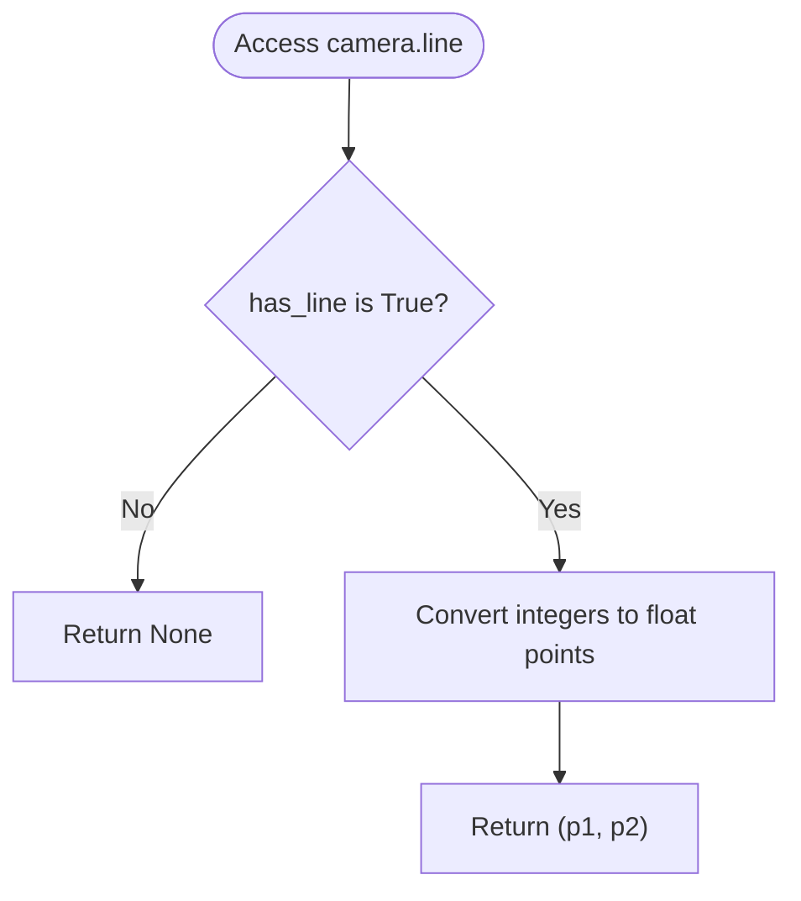
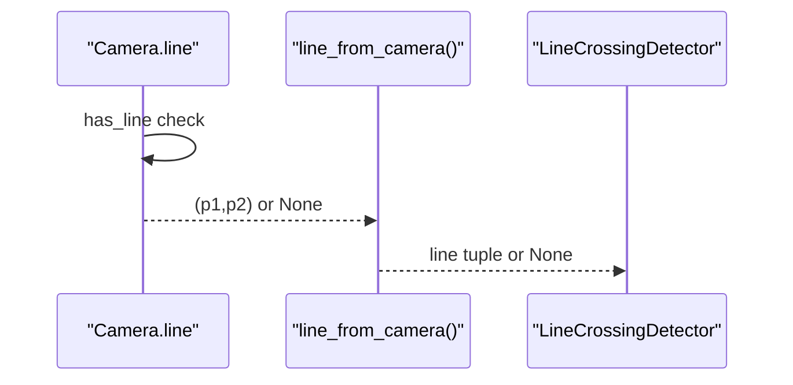
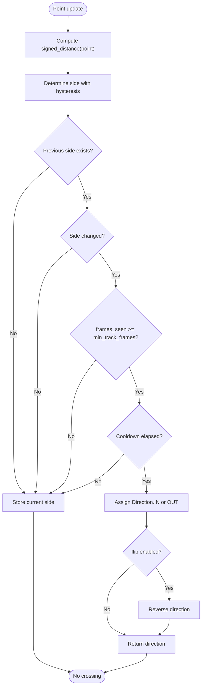
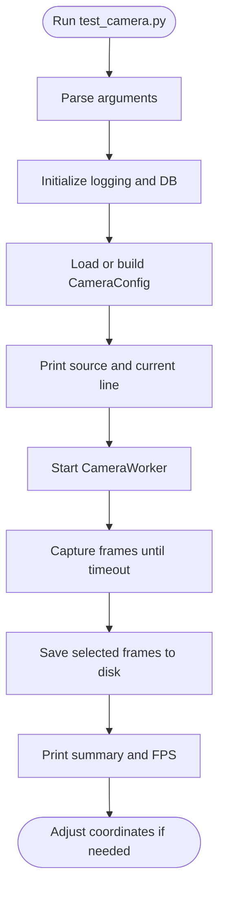
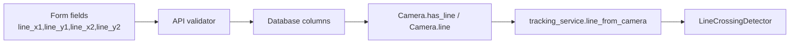

# Virtual Line Configuration

<cite>
**Referenced Files in This Document**
- [camera.py](file://app/models/camera.py)
- [tracking_service.py](file://app/services/tracking_service.py)
- [cameras.py](file://app/api/cameras.py)
- [test_camera.py](file://scripts/test_camera.py)
- [test_tracking.py](file://tests/test_tracking.py)
</cite>

## Table of Contents
1. [Introduction](#introduction)
2. [Project Structure](#project-structure)
3. [Core Components](#core-components)
4. [Architecture Overview](#architecture-overview)
5. [Detailed Component Analysis](#detailed-component-analysis)
6. [Dependency Analysis](#dependency-analysis)
7. [Performance Considerations](#performance-considerations)
8. [Troubleshooting Guide](#troubleshooting-guide)
9. [Conclusion](#conclusion)
10. [Appendices](#appendices)

## Introduction
This document explains how virtual lines are configured and used for movement detection in the system. A virtual line is a geometric boundary drawn in source-frame pixel coordinates that separates “in” and “out” sides. When a tracked object crosses this line, the system reports an entrance or exit event. The documentation covers:

- Coordinate system: source-frame pixel coordinates.
- Line definition: four integer coordinates `line_x1`, `line_y1`, `line_x2`, `line_y2`.
- Perpendicular positioning relative to expected movement direction.
- Validation through the `has_line` property and tuple conversion via the `line` property.
- Calibration workflow using the `scripts/test_camera.py` script.
- Guidelines for optimal line placement, common mistakes, and troubleshooting.
- Visual examples of correct line orientation for different camera angles and movement scenarios.

## Project Structure
Virtual line configuration spans several layers:

- Model layer stores the four coordinate fields and exposes validation and conversion helpers.
- API layer accepts form inputs for the four coordinates and validates them before saving.
- Service layer consumes the converted line tuple and performs crossing detection with hysteresis, cooldown, and optional flip behavior.
- Test script helps capture frames so you can visually calibrate the line against the live camera feed.

**Diagram sources**
- [camera.py:30-58](file://app/models/camera.py#L30-L58)
- [cameras.py:50-79](file://app/api/cameras.py#L50-L79)
- [cameras.py:88-154](file://app/api/cameras.py#L88-L154)
- [cameras.py:157-215](file://app/api/cameras.py#L157-L215)
- [tracking_service.py:210-285](file://app/services/tracking_service.py#L210-L285)
- [test_camera.py:58-133](file://scripts/test_camera.py#L58-L133)

**Section sources**
- [camera.py:30-58](file://app/models/camera.py#L30-L58)
- [cameras.py:50-79](file://app/api/cameras.py#L50-L79)
- [tracking_service.py:210-285](file://app/services/tracking_service.py#L210-L285)
- [test_camera.py:58-133](file://scripts/test_camera.py#L58-L133)

## Core Components
The virtual line feature is implemented across three main components:

- Camera model:
  - Stores four nullable integer coordinates.
  - Provides `has_line` to validate completeness.
  - Provides `line` to convert stored integers into a normalized tuple of two float points.

- Tracking service:
  - Converts camera data into a line tuple through `line_from_camera`.
  - Uses `LineCrossingDetector` to compute signed distance, side transitions, cooldown, hysteresis, and optional flip.

- API:
  - Accepts `line_x1`, `line_y1`, `line_x2`, `line_y2` as form fields.
  - Validates that either all four are provided or none; rejects identical endpoints.

**Diagram sources**
- [camera.py:16-58](file://app/models/camera.py#L16-L58)
- [tracking_service.py:210-285](file://app/services/tracking_service.py#L210-L285)
- [cameras.py:50-79](file://app/api/cameras.py#L50-L79)
- [cameras.py:88-154](file://app/api/cameras.py#L88-L154)
- [cameras.py:157-215](file://app/api/cameras.py#L157-L215)

**Section sources**
- [camera.py:30-58](file://app/models/camera.py#L30-L58)
- [tracking_service.py:210-285](file://app/services/tracking_service.py#L210-L285)
- [cameras.py:50-79](file://app/api/cameras.py#L50-L79)

## Architecture Overview
The virtual line pipeline connects user input, persistence, runtime detection, and calibration tools.

**Diagram sources**
- [cameras.py:88-154](file://app/api/cameras.py#L88-L154)
- [cameras.py:157-215](file://app/api/cameras.py#L157-L215)
- [tracking_service.py:282-285](file://app/services/tracking_service.py#L282-L285)
- [tracking_service.py:245-274](file://app/services/tracking_service.py#L245-L274)

## Detailed Component Analysis

### Coordinate System and Line Definition
- Coordinates are in source-frame pixel coordinates.
- A line is defined by four integer fields:
  - `line_x1`, `line_y1`: start point.
  - `line_x2`, `line_y2`: end point.
- These values are stored in the database and exposed via the API as form fields.

Validation rules:
- If any of the four coordinates is provided, all four must be provided.
- Start and end points cannot be identical.

Conversion:
- `has_line` returns true only when all four coordinates are present.
- `line` converts the four integers into a tuple of two float points `(p1, p2)`.

**Diagram sources**
- [cameras.py:50-79](file://app/api/cameras.py#L50-L79)

**Section sources**
- [camera.py:30-58](file://app/models/camera.py#L30-L58)
- [cameras.py:50-79](file://app/api/cameras.py#L50-L79)

### has_line Property Validation
The `has_line` property ensures that the virtual line is fully configured before it is used by the tracking pipeline. It checks that none of the four coordinate fields are null.

Usage:
- `line_from_camera` uses `has_line` to decide whether to return a valid line tuple or `None`.
- If `has_line` is false, no line crossing detection occurs for that camera.

**Diagram sources**
- [camera.py:47-58](file://app/models/camera.py#L47-L58)
- [tracking_service.py:282-285](file://app/services/tracking_service.py#L282-L285)

**Section sources**
- [camera.py:47-58](file://app/models/camera.py#L47-L58)
- [tracking_service.py:282-285](file://app/services/tracking_service.py#L282-L285)

### Line Tuple Conversion Methods
The `line` property transforms stored integer coordinates into a normalized tuple of two float points suitable for geometric calculations.

Key behaviors:
- Returns `None` if `has_line` is false.
- Returns `(float(x1), float(y1)), (float(x2), float(y2))` otherwise.

This conversion is consumed by `line_from_camera`, which then feeds `LineCrossingDetector`.

**Diagram sources**
- [camera.py:51-58](file://app/models/camera.py#L51-L58)
- [tracking_service.py:282-285](file://app/services/tracking_service.py#L282-L285)

**Section sources**
- [camera.py:51-58](file://app/models/camera.py#L51-L58)
- [tracking_service.py:282-285](file://app/services/tracking_service.py#L282-L285)

### Movement Detection Logic
`LineCrossingDetector` computes the signed distance from a tracked point to the line and determines crossings based on side transitions.

Core concepts:
- Signed distance formula uses vector cross product semantics.
- Hysteresis band avoids noise near the line.
- Cooldown prevents repeated crossings too quickly.
- Minimum track frames requirement reduces false positives for short-lived tracks.
- Flip option reverses IN/OUT direction when needed.

**Diagram sources**
- [tracking_service.py:237-274](file://app/services/tracking_service.py#L237-L274)

**Section sources**
- [tracking_service.py:210-285](file://app/services/tracking_service.py#L210-L285)
- [test_tracking.py:76-113](file://tests/test_tracking.py#L76-L113)

### Calibration Procedure Using test_camera.py
Use `scripts/test_camera.py` to open a camera source, capture frames, and visualize the current line configuration.

Workflow:
- Run the script with a camera code or direct source parameters.
- Inspect saved frames to determine correct pixel coordinates for the virtual line.
- Update the camera’s line coordinates through the API/UI.
- Re-run the script to verify the new line orientation.

Important notes:
- The script prints the current line configuration if set.
- It saves sample frames to a debug folder for visual calibration.
- It reports FPS, frame counts, and connection status.

**Diagram sources**
- [test_camera.py:58-133](file://scripts/test_camera.py#L58-L133)

**Section sources**
- [test_camera.py:58-133](file://scripts/test_camera.py#L58-L133)

## Dependency Analysis
Virtual line functionality depends on:

- Database persistence of four coordinate fields.
- API validation ensuring complete and non-degenerate lines.
- Model properties providing safe access to line geometry.
- Tracking service consuming the line tuple and applying crossing logic.

**Diagram sources**
- [cameras.py:97-100](file://app/api/cameras.py#L97-L100)
- [cameras.py:166-169](file://app/api/cameras.py#L166-L169)
- [camera.py:30-58](file://app/models/camera.py#L30-L58)
- [tracking_service.py:282-285](file://app/services/tracking_service.py#L282-L285)

**Section sources**
- [cameras.py:97-100](file://app/api/cameras.py#L97-L100)
- [cameras.py:166-169](file://app/api/cameras.py#L166-L169)
- [camera.py:30-58](file://app/models/camera.py#L30-L58)
- [tracking_service.py:282-285](file://app/services/tracking_service.py#L282-L285)

## Performance Considerations
- Hysteresis reduces false crossings due to small tracking jitter.
- Cooldown prevents rapid repeated events for the same track.
- Minimum track frames filters out transient detections.
- Keep the line length reasonable; extremely short lines may increase sensitivity to noise.
- Avoid placing the line parallel to the dominant movement direction; perpendicular alignment improves reliability.

[No sources needed since this section provides general guidance]

## Troubleshooting Guide
Common issues and resolutions:

- No crossings detected:
  - Verify `has_line` is true by confirming all four coordinates are set.
  - Ensure the line is not degenerate (start and end points differ).
  - Confirm the tracked point actually crosses the line in the expected direction.

- Incorrect IN/OUT direction:
  - Use the `flip` setting to reverse direction semantics if the camera view implies opposite flow.
  - Validate line orientation relative to expected movement.

- Too many false positives:
  - Increase hysteresis to ignore small oscillations near the line.
  - Increase cooldown to avoid repeated triggers.
  - Raise minimum track frames to require more stable tracking.

- Calibration difficulties:
  - Use `scripts/test_camera.py` to capture frames and visually align the line.
  - Adjust coordinates incrementally and re-test.

**Section sources**
- [camera.py:47-58](file://app/models/camera.py#L47-L58)
- [cameras.py:50-79](file://app/api/cameras.py#L50-L79)
- [tracking_service.py:210-285](file://app/services/tracking_service.py#L210-L285)
- [test_camera.py:58-133](file://scripts/test_camera.py#L58-L133)

## Conclusion
Virtual line configuration is a straightforward yet powerful mechanism for detecting movement across a defined boundary. By storing four pixel coordinates, validating their completeness, converting them into normalized float tuples, and applying robust crossing detection with hysteresis, cooldown, and flip support, the system reliably distinguishes entrance and exit events. Proper calibration using the test script and careful line placement significantly improve accuracy and reduce false positives.

[No sources needed since this section summarizes without analyzing specific files]

## Appendices

### Optimal Line Placement Guidelines
- Place the line perpendicular to the expected movement direction.
- Position the line where people consistently pass through the field of view.
- Avoid occlusions and areas with frequent background motion.
- For top-down cameras, place the line across the primary walkway.
- For angled cameras, ensure the line intersects the projected path of movement.

[No sources needed since this section provides general guidance]

### Common Positioning Mistakes
- Setting only some of the four coordinates.
- Using identical start and end points.
- Aligning the line parallel to movement direction.
- Placing the line too close to edges where tracking is unstable.
- Ignoring camera perspective changes over time.

[No sources needed since this section provides general guidance]

### Visual Examples of Correct Line Orientation
- Horizontal line across a hallway viewed head-on:
  - Expected movement crosses vertically; line runs horizontally.
- Diagonal line across a corridor viewed at an angle:
  - Line should intersect the projected path of movement.
- Vertical line for a side-view camera:
  - Movement crosses horizontally; line runs vertically.

[No sources needed since this diagram shows conceptual workflow, not actual code structure]