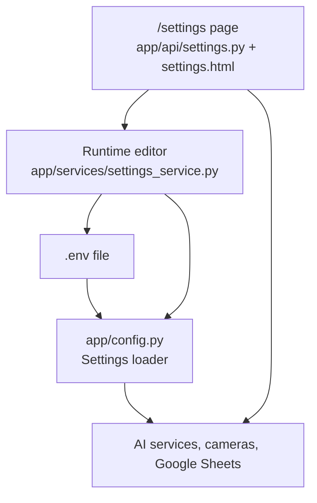
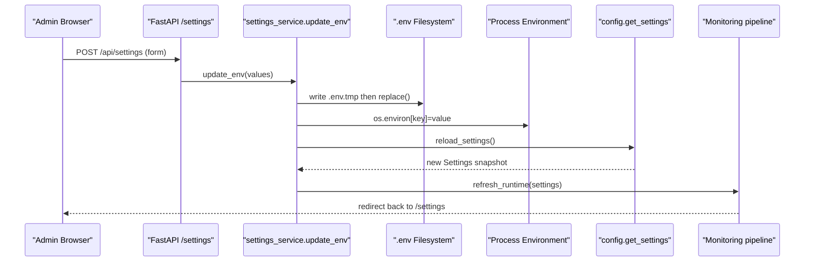
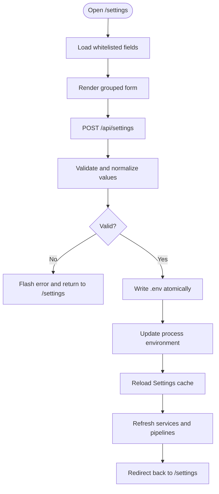
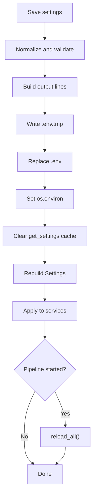
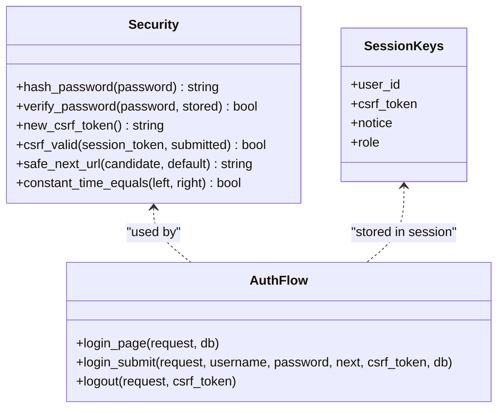
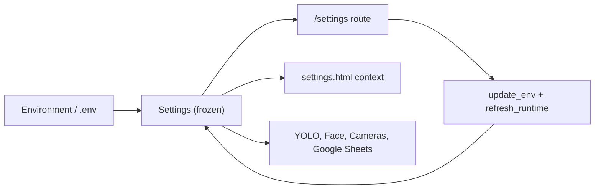

# Configuration Management

<cite>
**Referenced Files in This Document**
- [config.py](file://app/config.py)
- [settings_service.py](file://app/services/settings_service.py)
- [settings.py](file://app/api/settings.py)
- [deps.py](file://app/api/deps.py)
- [security.py](file://app/utils/security.py)
- [auth.py](file://app/api/auth.py)
- [settings.html](file://app/ui/templates/settings.html)
</cite>

## Table of Contents
1. [Introduction](#introduction)
2. [Project Structure](#project-structure)
3. [Core Components](#core-components)
4. [Architecture Overview](#architecture-overview)
5. [Detailed Component Analysis](#detailed-component-analysis)
6. [Dependency Analysis](#dependency-analysis)
7. [Performance Considerations](#performance-considerations)
8. [Troubleshooting Guide](#troubleshooting-guide)
9. [Conclusion](#conclusion)
10. [Appendices](#appendices)

## Introduction
This document explains how the face-date system manages configuration, including environment variables, runtime settings, and security parameters. It covers:
- All supported `.env` keys used by the application.
- The web-based settings interface at `/settings`, including which values can be edited at runtime.
- Atomic file writing and automatic reload behavior.
- Security configuration for sessions, CSRF protection, password hashing, and production mode requirements.
- Performance tuning for AI inference, camera processing, and memory usage.
- Sensitive configuration values that cannot be edited through the UI.
- Common configuration scenarios.

## Project Structure
Configuration is centralized in a single immutable `Settings` object loaded from environment variables or a local `.env` file. Runtime editing is exposed through an admin-only page that writes to `.env`, updates process environment variables, reloads settings, and restarts long-running pipelines.

**Diagram sources**
- [config.py:18-243](file://app/config.py#L18-L243)
- [settings.py:23-115](file://app/api/settings.py#L23-L115)
- [settings_service.py:34-177](file://app/services/settings_service.py#L34-L177)
- [settings.html:66-116](file://app/ui/templates/settings.html#L66-L116)

**Section sources**
- [config.py:1-243](file://app/config.py#L1-L243)
- [settings_service.py:1-177](file://app/services/settings_service.py#L1-L177)
- [settings.py:1-115](file://app/api/settings.py#L1-L115)
- [settings.html:1-242](file://app/ui/templates/settings.html#L1-L242)

## Core Components
- **Environment loading**: The application loads `.env` once at import time and reads all configuration from environment variables. A cached `get_settings()` returns a frozen snapshot of configuration.
- **Immutable settings**: `Settings` is a frozen dataclass with typed fields, defaults, path resolution, directory creation helpers, and warnings for misconfiguration.
- **Runtime editing**: A whitelisted subset of `.env` keys can be edited via the `/settings` page. Values are validated, written atomically to `.env`, applied to the running process, and used to reload services.
- **Security primitives**: Password hashing uses PBKDF2-HMAC-SHA256; CSRF tokens are generated per session and verified on state-changing requests; session data is stored in signed cookies.

**Section sources**
- [config.py:22-60](file://app/config.py#L22-L60)
- [config.py:62-156](file://app/config.py#L62-L156)
- [config.py:159-243](file://app/config.py#L159-L243)
- [settings_service.py:23-55](file://app/services/settings_service.py#L23-L55)
- [settings_service.py:120-177](file://app/services/settings_service.py#L120-L177)
- [security.py:15-71](file://app/utils/security.py#L15-L71)

## Architecture Overview
The configuration architecture combines static environment-driven initialization with controlled runtime mutation.

**Diagram sources**
- [settings.py:54-87](file://app/api/settings.py#L54-L87)
- [settings_service.py:120-177](file://app/services/settings_service.py#L120-L177)
- [config.py:225-234](file://app/config.py#L225-L234)

## Detailed Component Analysis

### Environment Variables and Settings Schema
All configuration is read from environment variables. Defaults are provided so the application runs out-of-the-box, but secrets should be overridden in `.env` or the host environment.

| Category | Variable | Type | Default | Description |
|---|---|---|---|---|
| Application | `APP_ENV` | string | `development` | Environment name; `prod` or `production` enables production checks. |
| Application | `APP_HOST` | string | `127.0.0.1` | Host bound by the server. |
| Application | `APP_PORT` | integer | `8000` | Port bound by the server. |
| Application | `APP_TIMEZONE` | string | `Asia/Tashkent` | Workplace timezone used across the UI and logs. |
| Database | `DATABASE_URL` | string | `sqlite:///./data/inventory.db` | SQLAlchemy database connection URL. |
| Secrets | `APP_SECRET_KEY` | string | development-only default | Secret key used for signing sessions and CSRF-related cookie operations. |
| Session | `SESSION_MAX_AGE_SECONDS` | integer | `43200` | Maximum session lifetime in seconds. |
| Bootstrap | `BOOTSTRAP_ADMIN_USERNAME` | string | `admin` | Initial administrator username. |
| Bootstrap | `BOOTSTRAP_ADMIN_PASSWORD` | string | default value | Initial administrator password; must be changed before production. |
| Bootstrap | `BOOTSTRAP_ADMIN_FULLNAME` | string | localized label | Initial administrator full name. |
| YOLO detection | `YOLO_MODEL_PATH` | path | `data/models/equipment_best.pt` | Path to the primary YOLO model file. |
| YOLO detection | `YOLO_FALLBACK_MODEL` | string | `yolov8s.pt` | Fallback model name when the configured model is unavailable. |
| YOLO detection | `YOLO_CONFIDENCE` | float | `0.35` | Minimum confidence threshold for detections. |
| YOLO detection | `YOLO_IMAGE_SIZE` | integer | `640` | Inference image size in pixels. |
| YOLO detection | `YOLO_DEVICE` | string | `cpu` | Device selector for inference. |
| YOLO detection | `YOLO_TRACKER` | string | `bytetrack.yaml` | Tracking configuration file. |
| Face recognition | `FACE_MODEL_NAME` | string | `buffalo_l` | InsightFace model identifier. |
| Face recognition | `FACE_SIMILARITY_THRESHOLD` | float | `0.45` | Similarity threshold for matching faces. |
| Face recognition | `FACE_MATCH_MARGIN` | float | `0.05` | Margin used when distinguishing two similar employees. |
| Face recognition | `FACE_PROVIDERS` | comma-separated list | `CPUExecutionProvider` | Execution providers for face models. |
| Face recognition | `FACE_DETECTION_SIZE` | string | `640x640` | Detection input size in `widthxheight` format. |
| Face recognition | `FACE_RECOGNITION_INTERVAL` | integer | `10` | Frames between face recognition attempts. |
| Camera processing | `CAMERA_RECONNECT_INTERVAL` | integer | `5` | Seconds between camera reconnection attempts. |
| Camera processing | `CAMERA_MAX_RETRY_INTERVAL` | integer | `60` | Maximum retry interval for camera connections. |
| Camera processing | `PROCESSING_FPS` | integer | `10` | Target frames per second for processing. |
| Camera processing | `PROCESSING_WIDTH` | integer | `1280` | Processing frame width. |
| Camera processing | `PROCESSING_HEIGHT` | integer | `720` | Processing frame height. |
| Camera processing | `MAX_FRAME_QUEUE` | integer | `4` | Maximum queued frames to prevent memory growth. |
| Simulation | `SIMULATION_MODE` | boolean | `false` | Enables simulated camera input instead of real devices. |
| Events | `EVENT_COOLDOWN_SECONDS` | integer | `20` | Minimum seconds between repeated events for the same entity. |
| Evidence | `EVIDENCE_ENABLED` | boolean | `true` | Whether evidence images are captured and retained. |
| Evidence | `EVIDENCE_RETENTION_DAYS` | integer | `30` | Number of days evidence files are kept. |
| Evidence | `EVIDENCE_JPEG_QUALITY` | integer | `85` | JPEG quality for evidence images, clamped between 40 and 100. |
| Google Sheets | `GOOGLE_SHEETS_ENABLED` | boolean | `false` | Enable Google Sheets integration. |
| Google Sheets | `GOOGLE_SPREADSHEET_ID` | string | empty | Spreadsheet ID for synchronization. |
| Google Sheets | `GOOGLE_SERVICE_ACCOUNT_FILE` | path | none | Path to Google service account JSON file. |
| Google Sheets | `GOOGLE_SHEETS_SYNC_INTERVAL_SECONDS` | integer | `120` | Sync interval in seconds. |
| Google Sheets | `GOOGLE_SHEETS_MAX_RETRIES` | integer | `4` | Maximum retries for Google Sheets operations. |
| Logging | `LOG_LEVEL` | string | `INFO` | Logging level; normalized to uppercase. |
| Logging | `LOG_DIR` | path | `logs` | Directory where log files are written. |
| Data directories | `DATA_DIR` | path | `data` | Root data directory. |

Notes:
- Boolean values accept `1`, `true`, `yes`, or `on`.
- Integer and float values are parsed safely; invalid values fall back to defaults.
- Paths are resolved relative to the project root unless absolute.
- Several values are clamped or bounded internally to prevent unsafe configurations.

**Section sources**
- [config.py:22-60](file://app/config.py#L22-L60)
- [config.py:62-119](file://app/config.py#L62-L119)
- [config.py:159-222](file://app/config.py#L159-L222)
- [config.py:120-156](file://app/config.py#L120-L156)

### Web-Based Settings Interface (`/settings`)
The `/settings` page is protected by admin authentication and provides:
- Model status for YOLO, InsightFace, and Google Sheets.
- Buttons to reload the YOLO model and refresh the face gallery.
- A grouped form for editable runtime settings.
- Warnings about missing models, default secrets, or incomplete Google Sheets configuration.
- User management, audit log, and system information.

Editable groups include:
- Detection: YOLO model path, confidence, image size.
- Camera: FPS, width, height, reconnect interval, simulation mode.
- Face: similarity threshold, match margin, recognition interval.
- Events: cooldown, evidence enablement, retention days.
- Google Sheets: enabled flag, spreadsheet ID, service account file, sync interval.

Values submitted through the form are validated against a whitelist and type constraints before being persisted.

**Diagram sources**
- [settings.py:23-87](file://app/api/settings.py#L23-L87)
- [settings_service.py:34-117](file://app/services/settings_service.py#L34-L117)
- [settings_service.py:120-177](file://app/services/settings_service.py#L120-L177)
- [settings.html:66-116](file://app/ui/templates/settings.html#L66-L116)

**Section sources**
- [settings.py:23-115](file://app/api/settings.py#L23-L115)
- [settings_service.py:34-177](file://app/services/settings_service.py#L34-L177)
- [settings.html:1-242](file://app/ui/templates/settings.html#L1-L242)

### Atomic File Writing and Automatic Reload
When settings are saved:
1. Only whitelisted keys are accepted.
2. Values are normalized according to their declared type and range.
3. Changes are written to a temporary `.env.tmp` file.
4. The temporary file replaces the original `.env` atomically.
5. Process environment variables are updated immediately.
6. The settings cache is cleared and rebuilt.
7. Long-lived services receive the new settings snapshot.
8. If the monitoring pipeline is running, it reloads camera streams and related components.

**Diagram sources**
- [settings_service.py:120-177](file://app/services/settings_service.py#L120-L177)
- [config.py:225-234](file://app/config.py#L225-L234)

**Section sources**
- [settings_service.py:120-177](file://app/services/settings_service.py#L120-L177)
- [config.py:225-234](file://app/config.py#L225-L234)

### Security Parameters
The system implements several security controls:

- **Session management**:
  - Sessions are stored in signed cookies managed by Starlette’s session middleware.
  - Session keys include user ID, role, CSRF token, and notices.
  - `SESSION_MAX_AGE_SECONDS` controls session lifetime.
  - On successful login, the session is cleared and a new CSRF token is issued to reduce fixation risk.

- **CSRF protection**:
  - CSRF tokens are generated securely and stored in the session.
  - State-changing endpoints require a CSRF token from the form.
  - Invalid or missing tokens result in a bad request response.

- **Password hashing**:
  - Passwords are hashed using PBKDF2-HMAC-SHA256 with a fixed iteration count and random salt.
  - Verification uses constant-time comparison to avoid timing attacks.
  - Empty passwords are rejected during hashing.

- **Production mode requirements**:
  - `APP_ENV` set to `prod` or `production` triggers additional warnings.
  - The bootstrap admin password default is flagged if unchanged.
  - Missing YOLO model paths and Google Sheets configuration issues are reported.
  - Operators should ensure HTTPS termination is handled by a reverse proxy or deployment platform when running in production.

**Diagram sources**
- [security.py:15-71](file://app/utils/security.py#L15-L71)
- [auth.py:58-121](file://app/api/auth.py#L58-L121)
- [deps.py:75-108](file://app/api/deps.py#L75-L108)

**Section sources**
- [security.py:1-71](file://app/utils/security.py#L1-L71)
- [auth.py:33-121](file://app/api/auth.py#L33-L121)
- [deps.py:75-108](file://app/api/deps.py#L75-L108)

### Sensitive Configuration Values Not Editable Through the UI
The following sensitive values cannot be edited via the `/settings` page:
- `APP_SECRET_KEY`
- `DATABASE_URL`
- `BOOTSTRAP_ADMIN_PASSWORD`

These must be set directly in `.env` or the host environment. Attempting to edit them through the UI is blocked by the field whitelist.

**Section sources**
- [settings_service.py:1-7](file://app/services/settings_service.py#L1-L7)
- [settings_service.py:34-53](file://app/services/settings_service.py#L34-L53)

### Common Configuration Scenarios

#### Development Setup
- Use SQLite database with default `DATABASE_URL`.
- Keep `APP_ENV=development`.
- Leave `APP_SECRET_KEY` as default only for local testing.
- Disable Google Sheets unless needed.
- Use CPU device for YOLO and face models.

#### Production Setup
- Set `APP_ENV=production`.
- Generate a strong `APP_SECRET_KEY`.
- Change the bootstrap admin password before first use.
- Configure a secure external database URL.
- Ensure HTTPS termination is handled by your deployment stack.
- Set appropriate `LOG_LEVEL` and `LOG_DIR`.
- Provide valid `YOLO_MODEL_PATH` and optional fallback model.
- Configure Google Sheets credentials only if required.

#### High-Face-Detection Accuracy
- Increase `FACE_SIMILARITY_THRESHOLD` slightly to reduce false positives.
- Tune `FACE_MATCH_MARGIN` to better separate similar employees.
- Adjust `FACE_RECOGNITION_INTERVAL` to balance accuracy and performance.
- Ensure sufficient gallery embeddings are loaded.

#### Camera Performance Tuning
- Lower `PROCESSING_FPS` to reduce CPU/GPU load.
- Reduce `PROCESSING_WIDTH` and `PROCESSING_HEIGHT` for faster inference.
- Increase `MAX_FRAME_QUEUE` cautiously to avoid memory pressure.
- Tune `CAMERA_RECONNECT_INTERVAL` and `CAMERA_MAX_RETRY_INTERVAL` for unstable cameras.

#### Event Noise Reduction
- Increase `EVENT_COOLDOWN_SECONDS` to suppress repeated events.
- Disable evidence capture if storage is constrained.
- Reduce `EVIDENCE_RETENTION_DAYS` to limit disk usage.

#### Google Sheets Integration
- Enable `GOOGLE_SHEETS_ENABLED=true`.
- Set `GOOGLE_SPREADSHEET_ID`.
- Place the service account JSON file at the configured path.
- Adjust sync interval based on expected change frequency.

**Section sources**
- [config.py:159-222](file://app/config.py#L159-L222)
- [settings_service.py:34-53](file://app/services/settings_service.py#L34-L53)

## Dependency Analysis
Configuration dependencies flow from environment variables into a single settings object, which is consumed by API routes, services, and templates.

**Diagram sources**
- [config.py:159-243](file://app/config.py#L159-L243)
- [settings.py:23-87](file://app/api/settings.py#L23-L87)
- [settings_service.py:120-177](file://app/services/settings_service.py#L120-L177)

**Section sources**
- [config.py:159-243](file://app/config.py#L159-L243)
- [settings.py:23-87](file://app/api/settings.py#L23-L87)
- [settings_service.py:120-177](file://app/services/settings_service.py#L120-L177)

## Performance Considerations
- **AI inference**:
  - `YOLO_CONFIDENCE`: Higher thresholds reduce false positives but may miss weak detections.
  - `YOLO_IMAGE_SIZE`: Larger images increase accuracy but cost more compute.
  - `YOLO_DEVICE`: Use GPU-capable devices when available; otherwise, CPU is safe.
  - `FACE_MODEL_NAME` and `FACE_PROVIDERS`: Choose providers suitable for your hardware.
  - `FACE_RECOGNITION_INTERVAL`: Increasing this reduces recognition overhead.

- **Camera processing**:
  - `PROCESSING_FPS`: Lower FPS reduces CPU/GPU usage significantly.
  - `PROCESSING_WIDTH` and `PROCESSING_HEIGHT`: Smaller resolutions improve throughput.
  - `MAX_FRAME_QUEUE`: Prevents unbounded memory growth under slow consumers.
  - `CAMERA_RECONNECT_INTERVAL` and `CAMERA_MAX_RETRY_INTERVAL`: Balance recovery speed with resource usage.

- **Memory and storage**:
  - `EVIDENCE_ENABLED=false` disables evidence capture to save disk space.
  - `EVIDENCE_RETENTION_DAYS` limits evidence accumulation.
  - `EVIDENCE_JPEG_QUALITY` balances image quality and file size.

- **Logging**:
  - `LOG_LEVEL` can be raised to `WARNING` or `ERROR` in production to reduce I/O.
  - `LOG_DIR` should point to a dedicated volume with rotation policies.

[No sources needed since this section provides general guidance]

## Troubleshooting Guide
Common issues and resolutions:

- **Missing YOLO model**:
  - Symptom: Warning about missing model path.
  - Resolution: Set `YOLO_MODEL_PATH` to a valid model file or configure `YOLO_FALLBACK_MODEL`.

- **Default secret still in use**:
  - Symptom: Warning about unchanged `APP_SECRET_KEY`.
  - Resolution: Set a strong secret in `.env` or the host environment.

- **Bootstrap admin password unchanged**:
  - Symptom: Warning about default bootstrap password in production.
  - Resolution: Change the initial admin password after first login.

- **Google Sheets not configured**:
  - Symptom: Warning about missing spreadsheet ID or service account file.
  - Resolution: Set `GOOGLE_SPREADSHEET_ID` and provide a valid `GOOGLE_SERVICE_ACCOUNT_FILE`.

- **CSRF errors on settings save**:
  - Symptom: Bad request when saving settings.
  - Resolution: Ensure the CSRF token is included in the form submission.

- **Settings not applied**:
  - Symptom: Changes visible in `.env` but not reflected in runtime.
  - Resolution: Confirm the process restarted or that `refresh_runtime` was invoked after saving.

**Section sources**
- [config.py:140-156](file://app/config.py#L140-L156)
- [settings.py:54-87](file://app/api/settings.py#L54-L87)
- [deps.py:87-90](file://app/api/deps.py#L87-L90)

## Conclusion
The face-date system centralizes configuration in environment variables while allowing safe, audited runtime edits for non-sensitive parameters. The `/settings` interface provides a controlled way to tune detection, camera, face recognition, event handling, and Google Sheets behavior without restarting the process manually. Security is enforced through signed sessions, CSRF validation, strong password hashing, and production-mode warnings. For optimal performance, adjust AI inference sizes, FPS, and evidence retention according to hardware capacity and operational needs.

[No sources needed since this section summarizes without analyzing specific files]

## Appendices

### Runtime Settings Field Reference
The following table lists every field exposed by the `/settings` page, including type, group, and allowed ranges.

| Key | Label | Kind | Group | Range |
|---|---|---|---|---|
| `YOLO_MODEL_PATH` | YOLO model file | string | detection | Any filesystem path |
| `YOLO_CONFIDENCE` | Detection confidence threshold | float | detection | 0.05 to 0.95 |
| `YOLO_IMAGE_SIZE` | Inference size in pixels | integer | detection | 320 to 1280 |
| `PROCESSING_FPS` | Camera FPS | integer | camera | 1 to 30 |
| `PROCESSING_WIDTH` | Frame width | integer | camera | 320 to 3840 |
| `PROCESSING_HEIGHT` | Frame height | integer | camera | 240 to 2160 |
| `CAMERA_RECONNECT_INTERVAL` | Reconnect interval in seconds | integer | camera | 1 to 300 |
| `SIMULATION_MODE` | Simulation mode | boolean | camera | true/false |
| `FACE_SIMILARITY_THRESHOLD` | Face similarity threshold | float | face | 0.1 to 0.95 |
| `FACE_MATCH_MARGIN` | Face margin | float | face | 0.0 to 0.5 |
| `FACE_RECOGNITION_INTERVAL` | Recognition interval in frames | integer | face | 1 to 120 |
| `EVENT_COOLDOWN_SECONDS` | Event cooldown in seconds | integer | events | 1 to 3600 |
| `EVIDENCE_ENABLED` | Save evidence images | boolean | events | true/false |
| `EVIDENCE_RETENTION_DAYS` | Evidence retention in days | integer | events | 1 to 3650 |
| `GOOGLE_SHEETS_ENABLED` | Google Sheets enabled | boolean | sheets | true/false |
| `GOOGLE_SPREADSHEET_ID` | Spreadsheet ID | string | sheets | Any ID |
| `GOOGLE_SERVICE_ACCOUNT_FILE` | Service account JSON path | string | sheets | Any path |
| `GOOGLE_SHEETS_SYNC_INTERVAL_SECONDS` | Sync interval in seconds | integer | sheets | 15 to 86400 |

**Section sources**
- [settings_service.py:34-53](file://app/services/settings_service.py#L34-L53)
- [settings_service.py:58-81](file://app/services/settings_service.py#L58-L81)