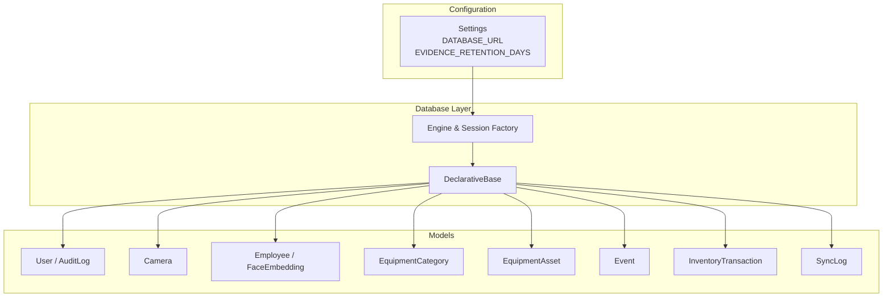
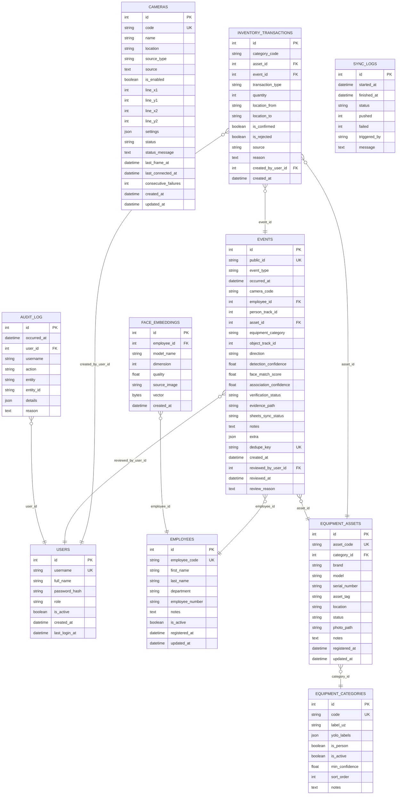
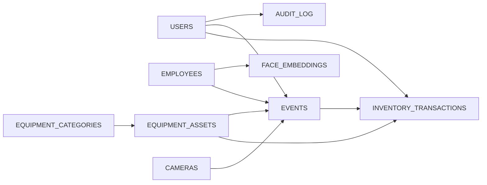

# Database Schema Design

<cite>
**Referenced Files in This Document**
- [database.py](file://app/database.py)
- [config.py](file://app/config.py)
- [models/__init__.py](file://app/models/__init__.py)
- [enums.py](file://app/models/enums.py)
- [user.py](file://app/models/user.py)
- [camera.py](file://app/models/camera.py)
- [employee.py](file://app/models/employee.py)
- [equipment.py](file://app/models/equipment.py)
- [ledger.py](file://app/models/ledger.py)
- [evidence_service.py](file://app/services/evidence_service.py)
</cite>

## Table of Contents
1. [Introduction](#introduction)
2. [Project Structure](#project-structure)
3. [Core Components](#core-components)
4. [Architecture Overview](#architecture-overview)
5. [Detailed Component Analysis](#detailed-component-analysis)
6. [Dependency Analysis](#dependency-analysis)
7. [Performance Considerations](#performance-considerations)
8. [Troubleshooting Guide](#troubleshooting-guide)
9. [Conclusion](#conclusion)
10. [Appendices](#appendices)

## Introduction
This document describes the complete database schema design for the system, including entity relationships, table structures, constraints, indexes, and data types. It explains the append-only inventory ledger pattern used to calculate balances from transaction history, documents enum definitions for event types, transaction types, camera statuses, and user roles, and outlines data lifecycle considerations such as evidence retention and audit trail maintenance. It also covers migration and portability considerations for a future PostgreSQL migration.

## Project Structure
The database layer is implemented with SQLAlchemy declarative models under app/models, with a shared Base class and engine/session configuration in app/database.py. Configuration, including the database URL and evidence retention settings, is centralized in app/config.py. The models package aggregates all entities and enums for consistent imports.

**Diagram sources**
- [database.py:23-25](file://app/database.py#L23-L25)
- [config.py:62-118](file://app/config.py#L62-L118)
- [models/__init__.py:6-22](file://app/models/__init__.py#L6-L22)

**Section sources**
- [database.py:1-141](file://app/database.py#L1-L141)
- [config.py:1-244](file://app/config.py#L1-L244)
- [models/__init__.py:1-46](file://app/models/__init__.py#L1-L46)

## Core Components
The core data model consists of the following entities:
- User and AuditLog for authentication, authorization, and administrative audit trails.
- Camera for video source configuration and runtime status.
- Employee and FaceEmbedding for personnel registry and biometric templates.
- EquipmentCategory and EquipmentAsset for equipment classification and asset tracking.
- Event for observable facts (person or equipment movements, camera connectivity).
- InventoryTransaction for an append-only ledger that drives category-level balances.
- SyncLog for external synchronization attempts.

Key characteristics:
- All tables use integer surrogate primary keys.
- Many-to-one relationships are modeled via foreign keys.
- Enums are stored as strings with application-side validation.
- JSON columns store flexible metadata where appropriate.
- Timestamps are timezone-aware UTC datetimes.

**Section sources**
- [user.py:19-61](file://app/models/user.py#L19-L61)
- [camera.py:16-96](file://app/models/camera.py#L16-L96)
- [employee.py:20-82](file://app/models/employee.py#L20-L82)
- [equipment.py:16-74](file://app/models/equipment.py#L16-L74)
- [ledger.py:21-173](file://app/models/ledger.py#L21-L173)

## Architecture Overview
The database supports both operational data (users, cameras, employees, equipment) and analytical/audit data (events, inventory transactions, sync logs). Relationships ensure referential integrity between operational entities and their associated events and ledger entries.

**Diagram sources**
- [user.py:19-61](file://app/models/user.py#L19-L61)
- [camera.py:16-96](file://app/models/camera.py#L16-L96)
- [employee.py:20-82](file://app/models/employee.py#L20-L82)
- [equipment.py:16-74](file://app/models/equipment.py#L16-L74)
- [ledger.py:21-173](file://app/models/ledger.py#L21-L173)

## Detailed Component Analysis

### Users and Audit Trail
- User
  - Primary key: users.id
  - Unique index: users.username
  - Role stored as a string constrained by application enums; includes helper properties for safe fallback to least privilege.
  - Timezone-aware timestamps for account creation and last login.
- AuditLog
  - Primary key: audit_log.id
  - Optional foreign key to users.id with SET NULL on delete to preserve historical records when users are removed.
  - Index on occurred_at for time-based queries.
  - JSON details column for flexible audit payload.

Indexes and constraints:
- users.username unique index
- audit_log.occurred_at index
- audit_log.user_id foreign key references users.id with ON DELETE SET NULL

Data types:
- Integers for IDs and counts
- Strings for identifiers and short text
- Text for longer descriptions
- Boolean for flags
- DateTime(timezone=True) for timestamps
- JSON for structured metadata

**Section sources**
- [user.py:19-61](file://app/models/user.py#L19-L61)

### Cameras
- Camera
  - Primary key: cameras.id
  - Unique index: cameras.code
  - Status stored as a string constrained by CameraStatus enum; includes helper methods for safe fallback and masked credentials.
  - Virtual entrance/exit line coordinates stored as nullable integers.
  - Settings stored as JSON.
  - Timezone-aware timestamps for creation and updates.

Indexes and constraints:
- cameras.code unique index
- cameras.status index

Data types:
- String codes and names
- Integer coordinates and counters
- Float confidence overrides derived from settings
- JSON for arbitrary camera settings
- DateTime(timezone=True) for timestamps

**Section sources**
- [camera.py:16-96](file://app/models/camera.py#L16-L96)

### Employees and Face Embeddings
- Employee
  - Primary key: employees.id
  - Unique index: employees.employee_code
  - Active flag and registration/update timestamps.
- FaceEmbedding
  - Primary key: face_embeddings.id
  - Foreign key: face_embeddings.employee_id references employees.id with CASCADE delete.
  - Vector stored as LargeBinary (float32 blob), normalized at write time.
  - Index on employee_id for efficient retrieval.

Indexes and constraints:
- employees.employee_code unique index
- face_embeddings.employee_id index
- face_embeddings.employee_id foreign key with ON DELETE CASCADE

Data types:
- Strings for identifiers and metadata
- Float for quality scores
- LargeBinary for embedding vectors
- DateTime(timezone=True) for timestamps

**Section sources**
- [employee.py:20-82](file://app/models/employee.py#L20-L82)

### Equipment Categories and Assets
- EquipmentCategory
  - Primary key: equipment_categories.id
  - Unique index: equipment_categories.code
  - JSON field yolo_labels maps model output labels to business categories.
  - Flags and thresholds for filtering detections.
- EquipmentAsset
  - Primary key: equipment_assets.id
  - Unique index: equipment_assets.asset_code
  - Foreign key: equipment_assets.category_id references equipment_categories.id with RESTRICT delete.
  - Index on category_id and serial_number for lookups.
  - Status stored as a string constrained by EquipmentStatus enum.

Indexes and constraints:
- equipment_categories.code unique index
- equipment_assets.asset_code unique index
- equipment_assets.category_id index
- equipment_assets.serial_number index
- equipment_assets.category_id foreign key with ON DELETE RESTRICT

Data types:
- Strings for codes, brands, models, locations
- JSON for label mappings
- Float for minimum confidence threshold
- DateTime(timezone=True) for registration and update timestamps

**Section sources**
- [equipment.py:16-74](file://app/models/equipment.py#L16-L74)

### Events
- Event
  - Primary key: events.id
  - Unique index: events.public_id
  - Unique constraint: events.dedupe_key prevents duplicate ingestion.
  - Foreign keys:
    - employee_id references employees.id with SET NULL
    - asset_id references equipment_assets.id with SET NULL
    - reviewed_by_user_id references users.id with SET NULL
  - Indexes on event_type, occurred_at, camera_code, employee_id, equipment_category, verification_status, sheets_sync_status.
  - Evidence path stored as a relative file path; actual images are stored on disk.
  - Extra metadata stored as JSON.

Indexes and constraints:
- events.public_id unique index
- events.dedupe_key unique constraint
- events.event_type index
- events.occurred_at index
- events.camera_code index
- events.employee_id index
- events.equipment_category index
- events.verification_status index
- events.sheets_sync_status index
- Foreign keys with SET NULL behavior for soft unlinking

Data types:
- Strings for codes, types, directions, statuses
- Floats for confidence and match scores
- Text for notes and reasons
- JSON for extra fields
- DateTime(timezone=True) for timestamps

**Section sources**
- [ledger.py:21-112](file://app/models/ledger.py#L21-L112)

### Inventory Ledger (Append-Only Journal)
- InventoryTransaction
  - Primary key: inventory_transactions.id
  - Category-scoped ledger rows with signed quantity deltas.
  - Foreign keys:
    - asset_id references equipment_assets.id with SET NULL
    - event_id references events.id with SET NULL
    - created_by_user_id references users.id with SET NULL
  - Indexes on category_code, asset_id, event_id, is_confirmed, is_rejected, created_at.
  - Only rows with is_confirmed=True and a ledger-affecting transaction type contribute to official balances.
  - Rejected rows remain in the ledger for audit trail but do not affect pending movement calculations.

Balance calculation logic:
- Official balance per category = SUM(quantity) over rows where:
  - is_confirmed = True
  - transaction_type is one of the ledger-affecting types (INITIAL, RECEIVED, REMOVED, RETURNED, TRANSFER, CORRECTION)
  - is_rejected = False
- Vision candidates are inserted unconfirmed until an operator confirms them; they do not alter the official balance until confirmed.

Indexes and constraints:
- inventory_transactions.category_code index
- inventory_transactions.asset_id index
- inventory_transactions.event_id index
- inventory_transactions.is_confirmed index
- inventory_transactions.is_rejected index
- inventory_transactions.created_at index
- Foreign keys with SET NULL behavior

Data types:
- Strings for category_code, transaction_type, source
- Integer for quantity and user IDs
- Text for reasons
- Boolean for confirmation and rejection flags
- DateTime(timezone=True) for created_at

**Section sources**
- [ledger.py:114-157](file://app/models/ledger.py#L114-L157)

### Sync Logs
- SyncLog
  - Primary key: sync_logs.id
  - Tracks synchronization attempts with start/finish times, status, counts of pushed/failed items, trigger source, and messages.
  - Index on started_at for monitoring and reporting.

Indexes and constraints:
- sync_logs.started_at index

Data types:
- DateTime(timezone=True) for timestamps
- String for status and trigger source
- Integer for counts
- Text for messages

**Section sources**
- [ledger.py:160-173](file://app/models/ledger.py#L160-L173)

## Dependency Analysis
The dependency graph shows how operational entities relate to events and ledger entries, ensuring traceability from raw observations to financial-like inventory balances.

**Diagram sources**
- [user.py:19-61](file://app/models/user.py#L19-L61)
- [camera.py:16-96](file://app/models/camera.py#L16-L96)
- [employee.py:20-82](file://app/models/employee.py#L20-L82)
- [equipment.py:16-74](file://app/models/equipment.py#L16-L74)
- [ledger.py:21-173](file://app/models/ledger.py#L21-L173)

**Section sources**
- [models/__init__.py:6-22](file://app/models/__init__.py#L6-L22)

## Performance Considerations
Indexing strategy:
- High-cardinality identifiers (codes, public_id, dedupe_key) are unique indexed to prevent duplicates and accelerate lookups.
- Frequent filter columns (event_type, verification_status, sheets_sync_status, camera_code, category_code) are indexed to optimize dashboard queries and reports.
- Timestamps (occurred_at, created_at, started_at) are indexed to support time-range queries and archival operations.
- Foreign keys (employee_id, asset_id, category_id) are indexed to improve join performance.

Query patterns:
- Event timeline queries benefit from occurred_at indexing.
- Inventory balance calculations should aggregate only confirmed, non-rejected rows to avoid scanning rejected candidates.
- Evidence file access uses relative paths resolved against a configured directory, minimizing database size while maintaining traceability.

Storage considerations:
- Face embeddings are stored as binary blobs; normalization occurs at write time to reduce downstream computation.
- JSON columns provide flexibility without schema changes but may impact query performance if heavily filtered; prefer targeted fields where possible.

[No sources needed since this section provides general guidance]

## Troubleshooting Guide
Common issues and resolutions:
- Duplicate events: Ensure dedupe_key uniqueness; check ingestion pipeline for race conditions.
- Missing evidence files: Verify evidence_dir configuration and permissions; confirm evidence_enabled setting and that save_evidence returned a path.
- Balance discrepancies: Confirm that only confirmed, non-rejected transactions are included in balance calculations; inspect is_confirmed and is_rejected flags.
- Camera status anomalies: Check status and status_message fields; verify source credentials are correctly masked and accessible.
- Audit trail gaps: Confirm that audit_log entries are written for administrative actions; verify user_id foreign key behavior (SET NULL) does not erase context.

Operational checks:
- Validate DATABASE_URL points to the intended backend.
- For SQLite, ensure foreign_keys pragma is enabled and WAL mode is active.
- For PostgreSQL migration, verify that all types and constraints are compatible and adjust any dialect-specific features.

**Section sources**
- [database.py:41-60](file://app/database.py#L41-L60)
- [evidence_service.py:19-65](file://app/services/evidence_service.py#L19-L65)

## Conclusion
The schema implements a robust, auditable system with clear separation between operational data and append-only ledgers. Enum-driven states and timezone-aware timestamps ensure consistency across components. The indexing strategy supports high-throughput event processing and efficient reporting. Evidence retention and audit trail maintenance are configurable and integrated into the application’s lifecycle. The design remains portable to PostgreSQL through standardized SQLAlchemy types and explicit foreign key constraints.

[No sources needed since this section summarizes without analyzing specific files]

## Appendices

### Enum Definitions
- Role: ADMIN, OPERATOR, VIEWER
- EventType: PERSON_ENTERED, PERSON_EXITED, UNKNOWN_PERSON_ENTERED, UNKNOWN_PERSON_EXITED, EQUIPMENT_BROUGHT_IN, EQUIPMENT_TAKEN_OUT, EQUIPMENT_RETURNED, INVENTORY_DISCREPANCY, CAMERA_DISCONNECTED, CAMERA_RECONNECTED, UNKNOWN_PERSON_DETECTED, REQUIRES_REVIEW
- VerificationStatus: AUTO, PENDING, CONFIRMED, REJECTED
- Direction: IN, OUT, NONE
- SyncStatus: PENDING, SYNCED, FAILED, SKIPPED
- TransactionType: INITIAL, RECEIVED, REMOVED, RETURNED, TRANSFER, CORRECTION
- EquipmentStatus: IN_STOCK, IN_USE, MAINTENANCE, LOST, RETIRED
- CameraStatus: UNKNOWN, CONNECTING, ONLINE, OFFLINE, ERROR, DISABLED
- SourceType: RTSP, USB, FILE, SIMULATION
- AssociationQuality: STRONG, WEAK, AMBIGUOUS, NONE

**Section sources**
- [enums.py:8-183](file://app/models/enums.py#L8-L183)

### Data Lifecycle and Retention Policies
- Evidence files:
  - Stored on disk under a configurable evidence directory with day-based subdirectories.
  - Retention period controlled by evidence_retention_days; expired files are purged by a background process.
  - Relative paths are persisted in events.evidence_path for traceability.
- Audit trail:
  - Administrative actions recorded in audit_log; deletions of referenced users set user_id to NULL to preserve context.
- Data archival:
  - No automatic archival of database rows is implemented; consider partitioning or archiving old events and transactions based on occurred_at/created_at.

**Section sources**
- [config.py:100-118](file://app/config.py#L100-L118)
- [evidence_service.py:19-65](file://app/services/evidence_service.py#L19-L65)
- [user.py:46-61](file://app/models/user.py#L46-L61)

### Migration Strategy and Portability
- Engine configuration:
  - Uses SQLAlchemy create_engine with a DATABASE_URL; defaults to SQLite for development.
  - SQLite-specific pragmas enable foreign keys, WAL journaling, synchronous mode, and busy timeout.
- Portability:
  - Models use portable SQLAlchemy types; switching to PostgreSQL requires updating DATABASE_URL and validating constraints/indexes.
  - JSON columns and string enums are broadly supported; verify dialect-specific behaviors for large binary storage and timestamp precision.
- Initialization:
  - init_db creates tables from Base.metadata and seeds reference data via bootstrap_database.
  - Tests can reset the schema using drop_all/create_all on an isolated database URL.

**Section sources**
- [database.py:1-141](file://app/database.py#L1-L141)
- [config.py:177-183](file://app/config.py#L177-L183)