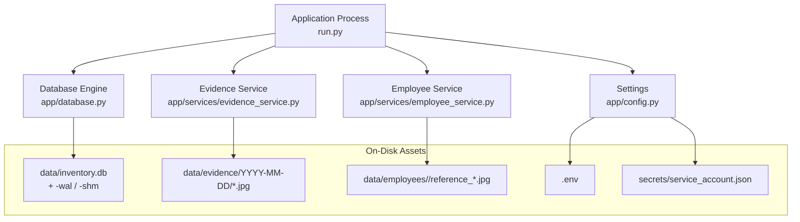
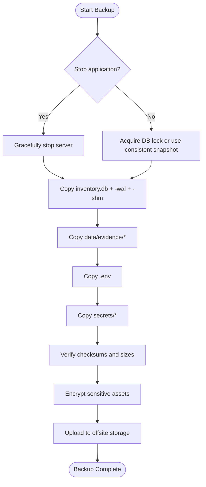
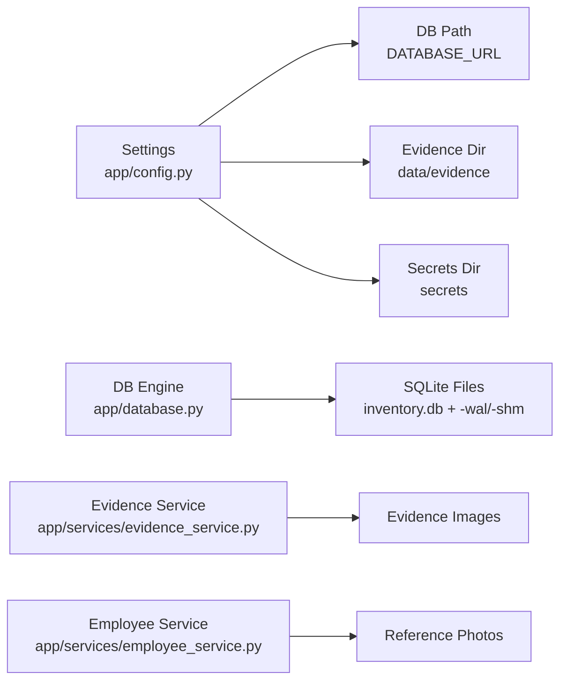

# Backup & Recovery

<cite>
**Referenced Files in This Document**
- [README.md](file://README.md)
- [app/config.py](file://app/config.py)
- [app/database.py](file://app/database.py)
- [app/services/evidence_service.py](file://app/services/evidence_service.py)
- [app/services/employee_service.py](file://app/services/employee_service.py)
- [run.py](file://run.py)
</cite>

## Table of Contents
1. [Introduction](#introduction)
2. [Project Structure](#project-structure)
3. [Core Components](#core-components)
4. [Architecture Overview](#architecture-overview)
5. [Detailed Component Analysis](#detailed-component-analysis)
6. [Dependency Analysis](#dependency-analysis)
7. [Performance Considerations](#performance-considerations)
8. [Troubleshooting Guide](#troubleshooting-guide)
9. [Conclusion](#conclusion)
10. [Appendices](#appendices)

## Introduction
This document defines the backup and recovery procedures for the face-date system. It covers:
- What to back up: SQLite database files, evidence images, configuration, and secrets.
- How to automate backups safely under SQLite WAL mode.
- Disaster recovery steps for database corruption, evidence loss, configuration rollback, and full restoration.
- Verification, retention alignment with EVIDENCE_RETENTION_DAYS, offsite storage, encryption, and compliance considerations for biometric data.

## Project Structure
The system stores operational data locally:
- Database file path is controlled by DATABASE_URL; default points to a SQLite file under the data directory.
- Evidence images are stored under data/evidence/YYYY-MM-DD/.
- Employee reference photos and embeddings are managed under data/employees/<EMP_CODE>.
- Secrets (for example Google service account JSON) are stored under secrets/.
- Application settings are loaded from environment variables and optionally from .env at startup.

**Diagram sources**
- [app/config.py:16-244](file://app/config.py#L16-L244)
- [app/database.py:31-60](file://app/database.py#L31-L60)
- [app/services/evidence_service.py:19-66](file://app/services/evidence_service.py#L19-L66)
- [app/services/employee_service.py:98-110](file://app/services/employee_service.py#L98-L110)
- [run.py:19-39](file://run.py#L19-L39)

**Section sources**
- [README.md:138-170](file://README.md#L138-L170)
- [README.md:430-439](file://README.md#L430-L439)
- [README.md:597-621](file://README.md#L597-L621)

## Core Components
- Settings and paths:
  - DATABASE_URL controls the SQLite file location.
  - EVIDENCE_ENABLED, EVIDENCE_RETENTION_DAYS, EVIDENCE_JPEG_QUALITY control evidence behavior.
  - GOOGLE_SERVICE_ACCOUNT_FILE points to the secrets JSON used by Google Sheets integration.
- Database engine:
  - Uses SQLite with WAL journaling enabled via PRAGMA journal_mode=WAL.
  - Enables foreign keys and sets busy_timeout to reduce locking contention.
- Evidence service:
  - Writes JPEG stills under data/evidence/YYYY-MM-DD/.
  - Purges expired evidence based on EVIDENCE_RETENTION_DAYS.
- Employee service:
  - Stores reference photos under data/employees/<EMP_CODE>/reference_*.jpg.
  - Deletes biometric data when an employee is removed.

**Section sources**
- [app/config.py:62-118](file://app/config.py#L62-L118)
- [app/config.py:177-222](file://app/config.py#L177-L222)
- [app/database.py:41-60](file://app/database.py#L41-L60)
- [app/services/evidence_service.py:19-66](file://app/services/evidence_service.py#L19-L66)
- [app/services/employee_service.py:98-110](file://app/services/employee_service.py#L98-L110)
- [app/services/employee_service.py:199-229](file://app/services/employee_service.py#L199-L229)

## Architecture Overview
Backup scope includes all persistent artifacts that must be preserved together to restore the system to a consistent state:
- SQLite database file and its WAL/SHM siblings.
- Evidence image directories.
- Configuration (.env).
- Secrets (service account JSON).
- Optional logs and models if they are considered part of your operational baseline.

[No sources needed since this diagram shows conceptual workflow, not actual code structure]

## Detailed Component Analysis

### Backup Scope and File Inventory
Back up the following items:
- Database:
  - Primary file: data/inventory.db
  - WAL/SHM files: data/inventory.db-wal, data/inventory.db-shm (if present)
- Evidence:
  - Directory: data/evidence/ (contains YYYY-MM-DD folders with *.jpg)
- Configuration:
  - File: .env
- Secrets:
  - Directory: secrets/ (for example service_account.json)
- Optional:
  - Logs: logs/app.log and rotated logs
  - Models: data/models/ (YOLO model files)

Operational notes:
- The README documents copying these exact locations for Windows.
- The application reads .env at import time and caches settings.
- Evidence retention is governed by EVIDENCE_RETENTION_DAYS.

**Section sources**
- [README.md:497-513](file://README.md#L497-L513)
- [app/config.py:16-244](file://app/config.py#L16-L244)
- [app/services/evidence_service.py:46-66](file://app/services/evidence_service.py#L46-L66)

### Automated Backup Scheduling

#### Windows Task Scheduler
- Create a scheduled task that runs a batch script daily (or more frequently as required).
- The script should:
  - Stop the application process (recommended for consistency).
  - Copy data/inventory.db, data/inventory.db-wal, data/inventory.db-shm.
  - Copy data/evidence/.
  - Copy .env and secrets/.
  - Generate checksums and upload to offsite storage.
- If you cannot stop the application, ensure the backup tool respects SQLite WAL semantics and copies all three files atomically.

#### Linux/macOS cron
- Schedule a cron job to run a shell script that performs the same steps as above.
- Use flock or a PID file to avoid concurrent backups.

File locking considerations:
- The database uses WAL mode. While WAL improves concurrency, a safe backup still requires either:
  - Stopping the application before copying, or
  - Using a consistent snapshot mechanism that captures the main file plus -wal and -shm together.
- Do not copy only the main database file while the application is writing; this can produce inconsistent snapshots.

**Section sources**
- [README.md:497-513](file://README.md#L497-L513)
- [app/database.py:49-60](file://app/database.py#L49-L60)

### Disaster Recovery Procedures

#### Scenario A: Database Corruption
Symptoms:
- “database is locked” errors during normal operation.
- Inability to open the database after disk failure.

Recovery steps:
1. Stop the application.
2. Restore the most recent valid backup of data/inventory.db along with its -wal and -shm files.
3. If only the main file is available, attempt to recover using sqlite3 tools (for example, integrity check and recovery utilities), then restart the application.
4. Validate the restored database by starting the application and checking health endpoints.

Notes:
- The application enables foreign keys and WAL mode automatically.
- Busy timeout is set to reduce transient lock contention.

**Section sources**
- [README.md:516-530](file://README.md#L516-L530)
- [app/database.py:49-60](file://app/database.py#L49-L60)

#### Scenario B: Evidence File Loss
Symptoms:
- Missing stills for events.
- Review UI shows 404 for evidence.

Recovery steps:
1. Stop the application to prevent further writes.
2. Restore data/evidence/ from the latest backup.
3. Restart the application.
4. Confirm evidence availability through the review interface or API.

Retention policy:
- Expired evidence is purged according to EVIDENCE_RETENTION_DAYS. Ensure your backup retention aligns with this setting so you do not retain evidence longer than policy allows.

**Section sources**
- [README.md:430-439](file://README.md#L430-L439)
- [app/services/evidence_service.py:46-66](file://app/services/evidence_service.py#L46-L66)

#### Scenario C: Configuration Rollback
Symptoms:
- Incorrect settings causing unexpected behavior.
- Need to revert to a previous .env.

Recovery steps:
1. Stop the application.
2. Replace .env with the backed-up version.
3. Restart the application so settings are reloaded.

Important:
- The application loads .env at import time and caches settings. A restart is required to apply changes.

**Section sources**
- [app/config.py:225-244](file://app/config.py#L225-L244)
- [run.py:19-39](file://run.py#L19-L39)

#### Scenario D: Secrets Compromise or Loss
Symptoms:
- Google Sheets sync fails due to missing or invalid service account JSON.
- Unauthorized access concerns.

Recovery steps:
1. Stop the application.
2. Rotate the Google service account credentials in Google Cloud Console.
3. Place the new JSON into secrets/service_account.json.
4. Update GOOGLE_SERVICE_ACCOUNT_FILE in .env if the path changed.
5. Restart the application.
6. Revoke old credentials and audit access logs.

**Section sources**
- [README.md:368-414](file://README.md#L368-L414)
- [app/config.py:170-175](file://app/config.py#L170-L175)

#### Scenario E: Full System Recovery
Steps:
1. Stop the application.
2. Restore data/inventory.db (+ -wal, -shm), data/evidence/, .env, and secrets/.
3. If models were customized, restore data/models/.
4. Start the application and verify:
   - Health endpoint responds.
   - Dashboard loads.
   - Evidence images are accessible.
   - Google Sheets sync resumes successfully.

**Section sources**
- [README.md:497-513](file://README.md#L497-L513)
- [app/config.py:129-139](file://app/config.py#L129-L139)

### Backup Verification Procedures
- Checksum verification:
  - Compute SHA-256 for each backed-up file and store manifests securely.
- Size checks:
  - Compare file sizes against known-good baselines.
- Content validation:
  - For the database, run an integrity check using sqlite3 tools.
  - Spot-check evidence directories for expected date folders and sample images.
- Dry-run restore:
  - Periodically perform a test restore in an isolated environment to validate completeness and applicability.

Alignment with retention:
- Ensure backup retention matches EVIDENCE_RETENTION_DAYS to avoid retaining evidence beyond policy.

**Section sources**
- [app/services/evidence_service.py:46-66](file://app/services/evidence_service.py#L46-L66)
- [app/database.py:49-60](file://app/database.py#L49-L60)

### Retention Policies
- Evidence retention:
  - Controlled by EVIDENCE_RETENTION_DAYS.
  - The system purges evidence older than the configured number of days.
- Biometric data retention:
  - When an employee is deleted, their reference photos and embeddings are removed.
- Operational recommendation:
  - Align backup retention with EVIDENCE_RETENTION_DAYS and organizational policy.
  - Maintain separate retention tiers for logs and models if needed.

**Section sources**
- [app/services/evidence_service.py:46-66](file://app/services/evidence_service.py#L46-L66)
- [app/services/employee_service.py:199-229](file://app/services/employee_service.py#L199-L229)

### Testing Recovery Procedures
- Monthly or quarterly drills:
  - Perform a full restore in a staging environment.
  - Validate database integrity and application functionality.
  - Confirm evidence accessibility and correct retention behavior.
  - Test configuration and secrets restoration.
- Record results and update procedures as needed.

[No sources needed since this section provides general guidance]

### Offsite Storage and Encryption
- Offsite storage:
  - Upload encrypted backups to a secure cloud bucket or enterprise backup solution.
  - Use least-privilege IAM policies and audit logging.
- Encryption:
  - Encrypt backups at rest and in transit.
  - Manage encryption keys separately from data backups.
- Compliance:
  - Treat evidence images and biometric templates as sensitive personal data.
  - Apply access controls, encryption, and retention limits per local regulations.
  - Avoid storing secrets in plain text outside the secured secrets directory.

[No sources needed since this section provides general guidance]

## Dependency Analysis
The backup strategy depends on the runtime behavior of these components:
- Settings determine where data, evidence, and secrets are located.
- Database engine configures SQLite with WAL mode and connection pragmas.
- Evidence service writes dated JPEG files and enforces retention.
- Employee service manages biometric reference photos and deletes them upon employee removal.

**Diagram sources**
- [app/config.py:16-244](file://app/config.py#L16-L244)
- [app/database.py:41-60](file://app/database.py#L41-L60)
- [app/services/evidence_service.py:19-66](file://app/services/evidence_service.py#L19-L66)
- [app/services/employee_service.py:98-110](file://app/services/employee_service.py#L98-L110)

**Section sources**
- [app/config.py:16-244](file://app/config.py#L16-L244)
- [app/database.py:41-60](file://app/database.py#L41-L60)
- [app/services/evidence_service.py:19-66](file://app/services/evidence_service.py#L19-L66)
- [app/services/employee_service.py:98-110](file://app/services/employee_service.py#L98-L110)

## Performance Considerations
- Frequent backups may increase I/O load; schedule during low-traffic windows.
- WAL mode reduces write contention but does not eliminate the need for consistent snapshots.
- Compress and encrypt backups asynchronously to minimize impact on live operations.
- Monitor disk space for evidence growth aligned with EVIDENCE_RETENTION_DAYS.

[No sources needed since this section provides general guidance]

## Troubleshooting Guide
Common issues and resolutions:
- Database locked:
  - Occurs when multiple servers access the same SQLite file. Run a single server instance.
- Missing evidence:
  - Check whether evidence is disabled or retention has purged files.
- Google Sheets failures:
  - Verify service account permissions and spreadsheet sharing.
- Login issues in production:
  - Ensure HTTPS is configured; session cookies require HTTPS in production.

**Section sources**
- [README.md:516-530](file://README.md#L516-L530)

## Conclusion
A robust backup and recovery plan for the face-date system must include consistent snapshots of the SQLite database (with WAL/SHM files), evidence images, configuration, and secrets. Automate backups with scheduling tools, enforce retention aligned with EVIDENCE_RETENTION_DAYS, and regularly test restores. Protect sensitive data with encryption and strict access controls, and comply with biometric data handling requirements.

[No sources needed since this section summarizes without analyzing specific files]

## Appendices

### Appendix A: Backup Checklist
- Stop the application or ensure consistent snapshotting.
- Copy data/inventory.db, data/inventory.db-wal, data/inventory.db-shm.
- Copy data/evidence/.
- Copy .env.
- Copy secrets/.
- Generate checksums and upload to offsite storage.
- Verify integrity and perform a dry-run restore periodically.

**Section sources**
- [README.md:497-513](file://README.md#L497-L513)

### Appendix B: Key Configuration Variables
- DATABASE_URL: Location of the SQLite database.
- EVIDENCE_ENABLED: Enable/disable evidence saving.
- EVIDENCE_RETENTION_DAYS: Number of days to retain evidence.
- EVIDENCE_JPEG_QUALITY: JPEG quality for evidence images.
- GOOGLE_SHEETS_ENABLED, GOOGLE_SPREADSHEET_ID, GOOGLE_SERVICE_ACCOUNT_FILE: Google Sheets integration settings.

**Section sources**
- [app/config.py:177-222](file://app/config.py#L177-L222)
- [README.md:138-170](file://README.md#L138-L170)