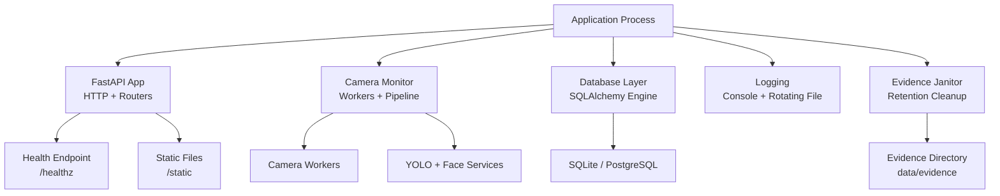
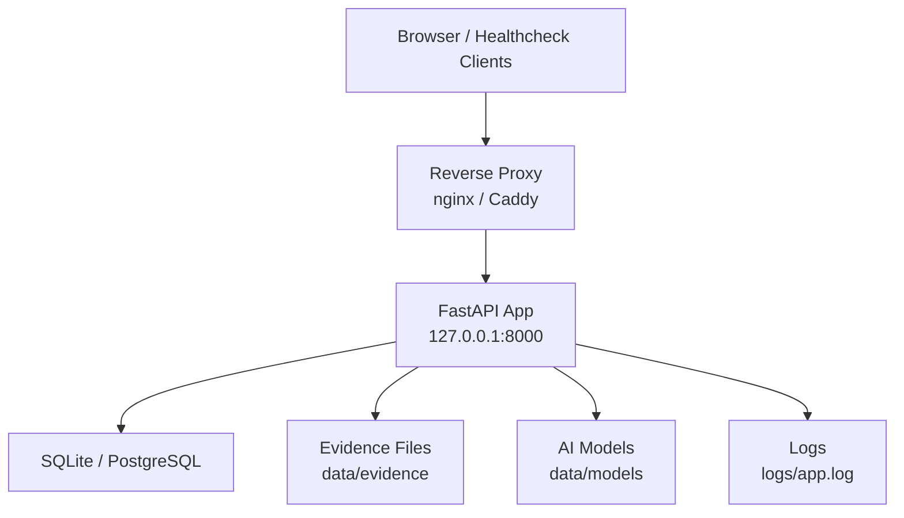
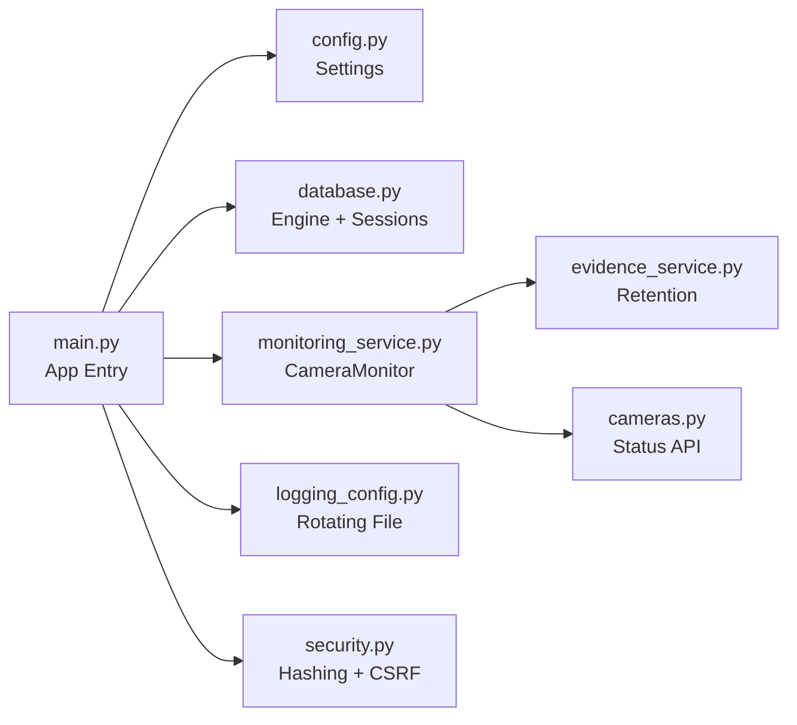
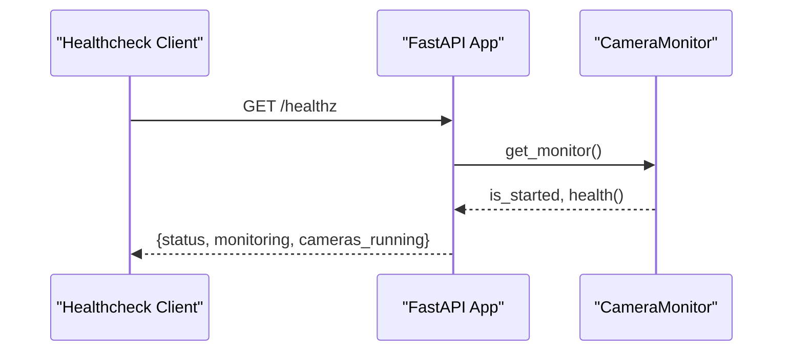
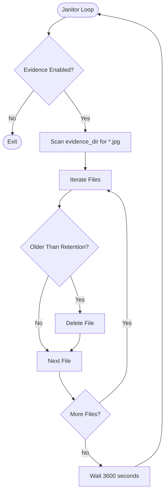

# Deployment & Operations

<cite>
**Referenced Files in This Document**
- [README.md](file://README.md)
- [main.py](file://app/main.py)
- [config.py](file://app/config.py)
- [database.py](file://app/database.py)
- [logging_config.py](file://app/utils/logging_config.py)
- [security.py](file://app/utils/security.py)
- [monitoring_service.py](file://app/services/monitoring_service.py)
- [evidence_service.py](file://app/services/evidence_service.py)
- [cameras.py](file://app/api/cameras.py)
</cite>

## Table of Contents
1. [Introduction](#introduction)
2. [Project Structure](#project-structure)
3. [Core Components](#core-components)
4. [Architecture Overview](#architecture-overview)
5. [Detailed Component Analysis](#detailed-component-analysis)
6. [Dependency Analysis](#dependency-analysis)
7. [Performance Considerations](#performance-considerations)
8. [Troubleshooting Guide](#troubleshooting-guide)
9. [Conclusion](#conclusion)
10. [Appendices](#appendices)

## Introduction
This document provides operational guidance for deploying and maintaining the face-date system in production. It covers reverse proxy setup, HTTPS configuration, security hardening, backup and recovery, monitoring and logging, troubleshooting, disaster recovery, scaling considerations, and maintenance schedules. The application is a local AI CCTV system that recognizes employees by face, detects equipment with YOLO, records crossing events, maintains an append-only inventory journal, and optionally mirrors data to Google Sheets.

The system runs on Python 3.11, uses SQLite by default, supports RTSP/USB/file/simulation camera sources, and exposes a web dashboard plus JSON APIs. Production mode enforces HTTPS-only session cookies and disables the OpenAPI documentation endpoint.

**Section sources**
- [README.md:37-47](file://README.md#L37-L47)
- [README.md:51-95](file://README.md#L51-L95)
- [README.md:138-169](file://README.md#L138-L169)
- [README.md:625-637](file://README.md#L625-L637)

## Project Structure
At runtime, the application loads settings from environment variables or `.env`, initializes logging, creates the database schema, starts the camera monitor, and registers HTTP routers. Key directories include `data` (database, evidence, models), `logs`, and `secrets`.

**Diagram sources**
- [main.py:25-68](file://app/main.py#L25-L68)
- [main.py:116-123](file://app/main.py#L116-L123)
- [monitoring_service.py:39-92](file://app/services/monitoring_service.py#L39-L92)
- [monitoring_service.py:218-232](file://app/services/monitoring_service.py#L218-L232)
- [database.py:41-72](file://app/database.py#L41-L72)
- [logging_config.py:16-47](file://app/utils/logging_config.py#L16-L47)

**Section sources**
- [README.md:597-621](file://README.md#L597-L621)
- [main.py:44-68](file://app/main.py#L44-L68)
- [config.py:114-138](file://app/config.py#L114-L138)

## Core Components
- Application entry point and lifespan: initializes logging, database, and monitoring service; mounts static files; registers routers; defines health endpoint.
- Configuration: immutable settings loaded from environment variables, with warnings for insecure defaults and missing resources.
- Database: SQLAlchemy engine with SQLite pragmas (WAL, foreign keys, busy timeout); portable model definitions allow migration to PostgreSQL.
- Monitoring service: owns camera workers, pipelines, optional Google Sheets scheduler, and evidence janitor thread.
- Logging: structured console and rotating file output with configurable level and directory.
- Security: PBKDF2 password hashing, CSRF tokens, safe redirect validation, and HTTPS-only sessions in production.

**Section sources**
- [main.py:25-68](file://app/main.py#L25-L68)
- [main.py:116-123](file://app/main.py#L116-L123)
- [config.py:62-156](file://app/config.py#L62-L156)
- [database.py:41-72](file://app/database.py#L41-L72)
- [monitoring_service.py:39-92](file://app/services/monitoring_service.py#L39-L92)
- [logging_config.py:16-47](file://app/utils/logging_config.py#L16-L47)
- [security.py:15-55](file://app/utils/security.py#L15-L55)

## Architecture Overview
The production deployment typically places the FastAPI server behind a reverse proxy (nginx or Caddy). The proxy terminates TLS, forwards requests to the app, and can enforce access controls. The app itself binds to a loopback address and serves HTTP internally.

**Diagram sources**
- [main.py:44-68](file://app/main.py#L44-L68)
- [config.py:177-222](file://app/config.py#L177-L222)
- [database.py:41-72](file://app/database.py#L41-L72)

**Section sources**
- [README.md:625-637](file://README.md#L625-L637)
- [main.py:55-62](file://app/main.py#L55-L62)

## Detailed Component Analysis

### Reverse Proxy Setup (nginx and Caddy)
- Bind the application to `127.0.0.1:8000` and expose only the required paths through the proxy.
- Terminate HTTPS at the proxy; set appropriate headers for upstream forwarding.
- Restrict access to admin endpoints and API routes using proxy-level authentication or IP allowlists where possible.
- Disable OpenAPI docs in production; the app already hides `/api/docs` when running in production mode.

Operational notes:
- Ensure the proxy forwards `Host`, `X-Forwarded-Proto`, and related headers so the app knows it is served over HTTPS.
- Keep the internal port non-public; do not open `8000` directly to the internet.

**Section sources**
- [README.md:625-637](file://README.md#L625-L637)
- [main.py:51-52](file://app/main.py#L51-L52)
- [main.py:55-62](file://app/main.py#L55-L62)

### HTTPS Configuration
- In production, session cookies are marked HTTPS-only; without HTTPS, login will fail.
- Use a reverse proxy to terminate TLS and forward traffic to the app.
- Validate certificate management, renewal, and permissions for private keys and certificates.

**Section sources**
- [README.md:142-149](file://README.md#L142-L149)
- [README.md:625-637](file://README.md#L625-L637)
- [main.py:55-62](file://app/main.py#L55-L62)

### Security Hardening Measures
- Change the default secret key and bootstrap credentials immediately after first login.
- Run in production mode to disable OpenAPI docs and enforce HTTPS-only sessions.
- Protect secrets (`secrets/`, `.env`, `data/`) and exclude them from version control.
- Limit network exposure to internal networks; use VPN or authenticated proxy for external access.
- Passwords are hashed with PBKDF2-HMAC-SHA256; CSRF protection is enforced for POST requests.

**Section sources**
- [README.md:625-637](file://README.md#L625-L637)
- [security.py:15-55](file://app/utils/security.py#L15-L55)
- [main.py:51-62](file://app/main.py#L51-L62)

### Backup and Recovery Procedures
Back up the following items regularly:
- SQLite database file: `data/inventory.db`
- Evidence images: `data/evidence`
- Configuration: `.env`
- Secrets: `secrets`

Recommended schedule:
- Daily automated backups to a secure off-host location.
- Verify integrity and test restore procedures periodically.

Recovery steps:
- Stop the application process.
- Restore database, evidence, configuration, and secrets to their original locations.
- Restart the application.

SQLite WAL mode produces additional `-wal` and `-shm` files; stopping the server before backup ensures consistency.

**Section sources**
- [README.md:497-513](file://README.md#L497-L513)
- [database.py:49-58](file://app/database.py#L49-L58)

### Monitoring and Logging Strategies
- Health check endpoint: `/healthz` returns status, monitoring state, and count of running cameras.
- Application logs: structured logging to console and rotating file `logs/app.log`; log level and directory are configurable via environment.
- Camera status and live stream endpoints: `/api/cameras/{code}/status`, `/api/cameras/{code}/stream`, `/api/cameras/{code}/snapshot`.
- System resource monitoring: integrate with host-level tools (CPU, memory, disk) and container orchestrators if applicable.

Operational recommendations:
- Configure external monitoring to poll `/healthz` and alert on failures.
- Rotate and retain logs centrally; avoid writing logs to the same volume as evidence if storage is constrained.
- Track camera online/offline transitions and event counts from the monitoring service snapshot.

**Section sources**
- [main.py:116-123](file://app/main.py#L116-L123)
- [logging_config.py:16-47](file://app/utils/logging_config.py#L16-L47)
- [cameras.py:306-328](file://app/api/cameras.py#L306-L328)
- [monitoring_service.py:254-262](file://app/services/monitoring_service.py#L254-L262)

### Troubleshooting Guides

#### Performance Bottlenecks
Symptoms:
- Low FPS, high CPU usage, slow UI updates.

Actions:
- Reduce processing FPS and image size.
- Increase face recognition interval.
- Consider GPU acceleration for inference if supported.
- Review camera source quality and codec compatibility.

**Section sources**
- [README.md:528-529](file://README.md#L528-L529)
- [config.py:190-210](file://app/config.py#L190-L210)

#### Camera Connectivity Problems
Symptoms:
- Camera shows OFFLINE or repeatedly fails to connect.

Actions:
- Test camera source with provided CLI tool.
- Verify RTSP URL, credentials, network connectivity, and codec support.
- Adjust reconnect intervals and retry limits if needed.

**Section sources**
- [README.md:522-524](file://README.md#L522-L524)
- [monitoring_service.py:171-183](file://app/services/monitoring_service.py#L171-L183)

#### AI Model Loading Failures
Symptoms:
- Warning about missing YOLO model; face recognition unavailable.

Actions:
- Install AI dependencies and ensure model path exists.
- Reload gallery and detection rules from the settings page.
- For GPU, install the correct ONNX Runtime provider and configure providers.

**Section sources**
- [README.md:520-521](file://README.md#L520-L521)
- [config.py:149-156](file://app/config.py#L149-L156)
- [monitoring_service.py:56-76](file://app/services/monitoring_service.py#L56-L76)

#### Database Locking Issues
Symptoms:
- “database is locked” errors.

Actions:
- Ensure only one application process writes to the database.
- Avoid concurrent CLI scripts during heavy operations.
- Confirm SQLite WAL mode and busy timeout are configured.

**Section sources**
- [README.md:525-526](file://README.md#L525-L526)
- [database.py:49-58](file://app/database.py#L49-L58)

### Disaster Recovery Procedures
- Maintain regular backups of database, evidence, configuration, and secrets.
- Test restoration in an isolated environment to validate procedures.
- After restoring, restart the application and verify health endpoint and camera statuses.
- If migrating to PostgreSQL, update `DATABASE_URL` and run migrations; the ORM models are portable.

**Section sources**
- [README.md:497-513](file://README.md#L497-L513)
- [database.py:1-5](file://app/database.py#L1-L5)

### Scaling Considerations for Multi-Camera Setups
- Each enabled camera runs a worker and pipeline; monitor CPU/memory usage accordingly.
- Tune processing parameters (FPS, width, height, recognition interval) to balance accuracy and performance.
- Consider distributing workloads across multiple processes or machines if camera count grows significantly.
- Evaluate moving from SQLite to PostgreSQL under high concurrency or multi-process deployments.

**Section sources**
- [monitoring_service.py:112-152](file://app/services/monitoring_service.py#L112-L152)
- [config.py:190-210](file://app/config.py#L190-L210)
- [README.md:584-591](file://README.md#L584-L591)

### Maintenance Schedules
- Evidence cleanup: automatic janitor thread deletes expired evidence daily based on retention days.
- Model updates: reload YOLO model and refresh detection rules via settings page after placing new model files.
- Gallery refresh: rebuild face templates after adding or updating employee photos.
- Log rotation: ensure log directory has sufficient space; rotate logs externally if needed.

**Section sources**
- [monitoring_service.py:218-232](file://app/services/monitoring_service.py#L218-L232)
- [evidence_service.py:46-65](file://app/services/evidence_service.py#L46-L65)
- [README.md:443-450](file://README.md#L443-L450)

## Dependency Analysis
The application’s runtime depends on several services and components:

**Diagram sources**
- [main.py:15-20](file://app/main.py#L15-L20)
- [monitoring_service.py:17-25](file://app/services/monitoring_service.py#L17-L25)
- [evidence_service.py:46-65](file://app/services/evidence_service.py#L46-L65)
- [cameras.py:312-328](file://app/api/cameras.py#L312-L328)
- [logging_config.py:16-47](file://app/utils/logging_config.py#L16-L47)
- [security.py:15-55](file://app/utils/security.py#L15-L55)

**Section sources**
- [main.py:15-20](file://app/main.py#L15-L20)
- [monitoring_service.py:17-25](file://app/services/monitoring_service.py#L17-L25)

## Performance Considerations
- Reduce `PROCESSING_FPS`, `YOLO_IMAGE_SIZE`, and increase `FACE_RECOGNITION_INTERVAL` to lower CPU load.
- Use GPU acceleration where available; configure appropriate providers.
- Monitor camera throughput and adjust backoff/retry intervals to prevent excessive retries.
- Keep evidence retention reasonable to avoid disk pressure; tune JPEG quality for storage vs. clarity trade-offs.

[No sources needed since this section provides general guidance]

## Troubleshooting Guide
Common issues and resolutions:
- Missing YOLO model: place custom model or rely on fallback; train and deploy as documented.
- Face recognition unavailable: install AI dependencies and ensure model loading succeeds.
- Camera offline: validate source, credentials, network, and codec; use test script.
- Port conflicts: change application port or stop conflicting processes.
- Database locked: single-writer rule; avoid concurrent writers; confirm WAL settings.
- Sheets sync failures: verify service account, spreadsheet ID, and permissions.
- Login failures in production: ensure HTTPS is configured; otherwise sessions are rejected.
- Unexpected errors: inspect `logs/app.log` for tracebacks.

**Section sources**
- [README.md:518-530](file://README.md#L518-L530)

## Conclusion
For reliable production operation, deploy the FastAPI application behind a reverse proxy with HTTPS, harden secrets and access controls, implement robust backups, and monitor health and resource usage. Tune performance parameters for your camera workload, maintain evidence retention policies, and follow the troubleshooting guide to resolve common issues quickly. Plan for disaster recovery and consider scaling strategies as the number of cameras and data volume grow.

[No sources needed since this section summarizes without analyzing specific files]

## Appendices

### Health Check Endpoint Behavior
The `/healthz` endpoint returns a JSON object indicating overall status, whether the monitoring service is started, and how many cameras are currently running. External systems can use this for liveness probes and alerting.

**Diagram sources**
- [main.py:116-123](file://app/main.py#L116-L123)
- [monitoring_service.py:243-252](file://app/services/monitoring_service.py#L243-L252)

### Evidence Retention Flow
The janitor thread periodically scans the evidence directory and removes JPEG files older than the configured retention period. Errors during deletion are logged but do not stop the janitor.

**Diagram sources**
- [monitoring_service.py:218-232](file://app/services/monitoring_service.py#L218-L232)
- [evidence_service.py:46-65](file://app/services/evidence_service.py#L46-L65)