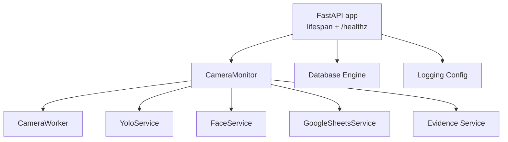
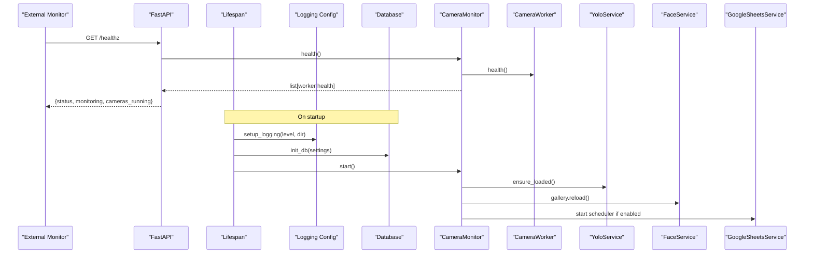
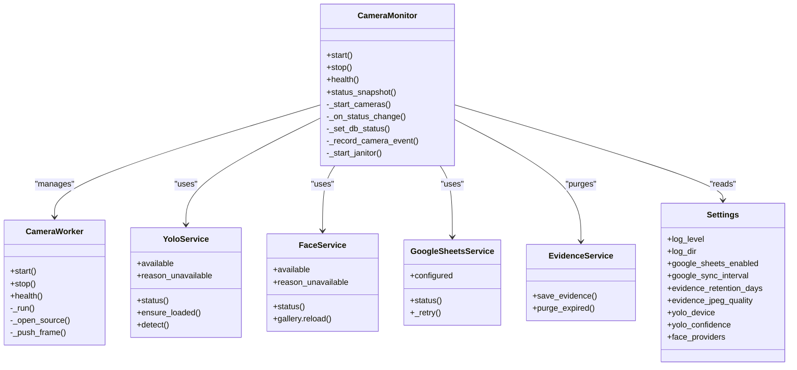

# Monitoring & Logging

<cite>
**Referenced Files in This Document**
- [main.py](file://app/main.py)
- [logging_config.py](file://app/utils/logging_config.py)
- [config.py](file://app/config.py)
- [monitoring_service.py](file://app/services/monitoring_service.py)
- [camera_service.py](file://app/services/camera_service.py)
- [face_service.py](file://app/services/face_service.py)
- [yolo_service.py](file://app/services/yolo_service.py)
- [google_sheets_service.py](file://app/services/google_sheets_service.py)
- [evidence_service.py](file://app/services/evidence_service.py)
- [database.py](file://app/database.py)
</cite>

## Table of Contents
1. [Introduction](#introduction)
2. [Project Structure](#project-structure)
3. [Core Components](#core-components)
4. [Architecture Overview](#architecture-overview)
5. [Detailed Component Analysis](#detailed-component-analysis)
6. [Dependency Analysis](#dependency-analysis)
7. [Performance Considerations](#performance-considerations)
8. [Troubleshooting Guide](#troubleshooting-guide)
9. [Conclusion](#conclusion)
10. [Appendices](#appendices)

## Introduction
This document describes the monitoring and logging capabilities of the face-date system. It explains how application logs are configured, how health endpoints expose runtime status, how camera and AI services are monitored, and how external integrations such as Google Sheets are observed. It also provides guidance for alerting, troubleshooting, and integrating with external monitoring tools like Prometheus, Grafana, or ELK.

## Project Structure
The monitoring and logging features are implemented across a small set of focused modules:
- Application entry point exposes a health endpoint and initializes logging and monitoring.
- Logging configuration defines structured console and rotating file handlers.
- Configuration module centralizes environment-driven settings including log levels and directories.
- Monitoring service orchestrates cameras, AI models, and background sync tasks, exposing health and status snapshots.
- Camera service implements per-camera workers with reconnection logic and frame metrics.
- AI services (YOLO and Face) provide availability checks, model metadata, and inference counters.
- Google Sheets service reports last run results and retry behavior.
- Evidence service manages evidence retention and disk usage growth.
- Database module configures engine, sessions, and SQLite-specific pragmas.

**Diagram sources**
- [main.py:25-41](file://app/main.py#L25-L41)
- [main.py:116-123](file://app/main.py#L116-L123)
- [monitoring_service.py:42-53](file://app/services/monitoring_service.py#L42-L53)
- [monitoring_service.py:243-262](file://app/services/monitoring_service.py#L243-L262)
- [camera_service.py:226-270](file://app/services/camera_service.py#L226-L270)
- [yolo_service.py:55-103](file://app/services/yolo_service.py#L55-L103)
- [face_service.py:173-200](file://app/services/face_service.py#L173-L200)
- [google_sheets_service.py:82-111](file://app/services/google_sheets_service.py#L82-L111)
- [evidence_service.py:46-65](file://app/services/evidence_service.py#L46-L65)
- [database.py:41-72](file://app/database.py#L41-L72)

**Section sources**
- [main.py:25-41](file://app/main.py#L25-L41)
- [main.py:116-123](file://app/main.py#L116-L123)
- [logging_config.py:16-47](file://app/utils/logging_config.py#L16-L47)
- [config.py:111-118](file://app/config.py#L111-L118)
- [monitoring_service.py:42-53](file://app/services/monitoring_service.py#L42-L53)
- [monitoring_service.py:243-262](file://app/services/monitoring_service.py#L243-L262)

## Core Components
- Structured logging setup with console output and rotating file handler.
- Health endpoint returning process-level and camera-running status.
- Camera monitor managing worker threads, pipelines, and background tasks.
- Per-camera worker tracking frames captured/dropped, connection state, and timestamps.
- AI services reporting availability, model paths, device, and inference metrics.
- Google Sheets sync reporting last run result and interval.
- Evidence purging to control disk usage.
- Database engine configuration with SQLite pragmas for concurrency and locking.

**Section sources**
- [logging_config.py:16-47](file://app/utils/logging_config.py#L16-L47)
- [main.py:116-123](file://app/main.py#L116-L123)
- [monitoring_service.py:79-106](file://app/services/monitoring_service.py#L79-L106)
- [camera_service.py:226-270](file://app/services/camera_service.py#L226-L270)
- [yolo_service.py:77-103](file://app/services/yolo_service.py#L77-L103)
- [face_service.py:183-200](file://app/services/face_service.py#L183-L200)
- [google_sheets_service.py:94-111](file://app/services/google_sheets_service.py#L94-L111)
- [evidence_service.py:46-65](file://app/services/evidence_service.py#L46-L65)
- [database.py:41-72](file://app/database.py#L41-L72)

## Architecture Overview
The FastAPI lifespan initializes logging, database, and monitoring. The monitoring service starts camera workers and optional Google Sheets scheduler, while a janitor thread periodically purges expired evidence. The health endpoint aggregates running camera counts and overall monitoring state.

**Diagram sources**
- [main.py:25-41](file://app/main.py#L25-L41)
- [main.py:116-123](file://app/main.py#L116-L123)
- [monitoring_service.py:79-106](file://app/services/monitoring_service.py#L79-L106)
- [monitoring_service.py:243-262](file://app/services/monitoring_service.py#L243-L262)
- [camera_service.py:226-270](file://app/services/camera_service.py#L226-L270)
- [yolo_service.py:115-154](file://app/services/yolo_service.py#L115-L154)
- [face_service.py:140-166](file://app/services/face_service.py#L140-L166)
- [google_sheets_service.py:82-111](file://app/services/google_sheets_service.py#L82-L111)

## Detailed Component Analysis

### Application Logging Configuration
- Log level is configurable via environment variable and applied at process startup.
- Console handler outputs structured lines with timestamp, level, logger name, and message.
- Rotating file handler writes to a single log file with size-based rotation and backup count.
- Noisy third-party loggers are suppressed to WARNING level by default.

Key behaviors:
- Single initialization guard prevents duplicate handlers.
- Directory creation is attempted; errors are logged without crashing.
- Test helper allows resetting configuration.

Operational notes:
- Adjust LOG_LEVEL to DEBUG for diagnostics in non-production environments.
- Ensure LOG_DIR points to a persistent volume for centralized collection.

**Section sources**
- [logging_config.py:16-47](file://app/utils/logging_config.py#L16-L47)
- [config.py:216-217](file://app/config.py#L216-L217)

### Health Check Endpoint (/healthz)
- Returns a JSON object indicating overall status, whether monitoring is started, and the number of running cameras.
- Excluded from OpenAPI schema to avoid exposing internal details.

Recommended use:
- External monitors should poll this endpoint at regular intervals.
- Alert when monitoring is false or cameras_running drops below expected count.

**Section sources**
- [main.py:116-123](file://app/main.py#L116-L123)
- [monitoring_service.py:243-252](file://app/services/monitoring_service.py#L243-L252)

### Camera Status Monitoring
- Each camera runs in its own worker thread with bounded frame queue.
- Connection lifecycle includes CONNECTING, ONLINE, OFFLINE, ERROR, DISABLED states.
- Reconnection uses exponential backoff capped by maximum retry interval.
- Frame metrics include captured and dropped counts, plus last frame timestamp.
- Status changes trigger callbacks that update database records and emit events.

Alerting guidance:
- Trigger alerts on OFFLINE transitions and repeated failures.
- Track consecutive_failures in camera records to detect chronic issues.

**Section sources**
- [camera_service.py:226-270](file://app/services/camera_service.py#L226-L270)
- [camera_service.py:338-427](file://app/services/camera_service.py#L338-L427)
- [camera_service.py:438-447](file://app/services/camera_service.py#L438-L447)
- [monitoring_service.py:171-216](file://app/services/monitoring_service.py#L171-L216)

### AI Model Availability Checks
- YOLO service reports availability, model path, loaded path, fallback usage, device, image size, confidence, inference count, last inference time, and class names.
- Face service reports availability, reason for unavailability, model name, providers, threshold, margin, and gallery embedding count.

Operational notes:
- If YOLO is unavailable, detection cannot proceed; pipeline degrades gracefully.
- If Face service is unavailable, recognition falls back to unknown labels.

**Section sources**
- [yolo_service.py:77-103](file://app/services/yolo_service.py#L77-L103)
- [yolo_service.py:115-154](file://app/services/yolo_service.py#L115-L154)
- [face_service.py:183-200](file://app/services/face_service.py#L183-L200)

### Database Connectivity Monitoring
- Database engine is created once per process with session factory.
- SQLite-specific pragmas enable foreign keys, WAL journal mode, synchronous NORMAL, and busy timeout.
- Session scope ensures transactional commits and rollbacks on exceptions.

Monitoring guidance:
- Use application logs to detect configuration and connection issues.
- For SQLite, monitor disk space and file locks; for PostgreSQL/MySQL, monitor connection pool saturation and query latency.

**Section sources**
- [database.py:41-72](file://app/database.py#L41-L72)
- [database.py:89-100](file://app/database.py#L89-L100)

### Google Sheets Sync Monitoring
- Service exposes enabled/configured flags, spreadsheet ID, service account file path, last run timestamp, last result summary, and sync interval.
- Retry mechanism uses exponential backoff and logs warnings per attempt.
- Unconfigured or missing dependencies raise a specific exception type.

Alerting guidance:
- Alert when configured is false but google_sheets_enabled is true.
- Alert on repeated SheetsUnavailable exceptions or failed syncs.

**Section sources**
- [google_sheets_service.py:82-111](file://app/services/google_sheets_service.py#L82-L111)
- [google_sheets_service.py:147-161](file://app/services/google_sheets_service.py#L147-L161)

### System Resource Monitoring
- CPU usage, memory consumption, and GPU utilization are not exposed by built-in endpoints.
- YOLO service tracks inference_count and last_inference_ms; Face service tracks gallery embeddings.
- Camera workers track frames_captured and frames_dropped.

Recommendations:
- Integrate an OS-level exporter (e.g., node_exporter) for CPU/memory/disk.
- Add GPU metrics via vendor SDKs (NVIDIA DCGM, ROCm SMI) and scrape them into Prometheus.
- Expose custom metrics through a dedicated endpoint or middleware.

**Section sources**
- [yolo_service.py:90-103](file://app/services/yolo_service.py#L90-L103)
- [face_service.py:194-200](file://app/services/face_service.py#L194-L200)
- [camera_service.py:438-447](file://app/services/camera_service.py#L438-L447)

### Evidence Retention and Disk Space
- Evidence stills are saved under a date-based directory structure within the evidence directory.
- A janitor thread periodically removes files older than the configured retention period.
- Errors during deletion are logged as warnings.

Operational guidance:
- Monitor evidence_dir disk usage and set retention appropriately.
- Alert when purge operations fail due to permissions or disk full conditions.

**Section sources**
- [evidence_service.py:19-38](file://app/services/evidence_service.py#L19-L38)
- [evidence_service.py:46-65](file://app/services/evidence_service.py#L46-L65)
- [monitoring_service.py:219-232](file://app/services/monitoring_service.py#L219-L232)

## Dependency Analysis
The monitoring subsystem depends on configuration, database, camera workers, AI services, and external sync services.

**Diagram sources**
- [config.py:62-118](file://app/config.py#L62-L118)
- [monitoring_service.py:42-53](file://app/services/monitoring_service.py#L42-L53)
- [monitoring_service.py:112-168](file://app/services/monitoring_service.py#L112-L168)
- [monitoring_service.py:219-232](file://app/services/monitoring_service.py#L219-L232)
- [camera_service.py:226-270](file://app/services/camera_service.py#L226-L270)
- [yolo_service.py:55-103](file://app/services/yolo_service.py#L55-L103)
- [face_service.py:173-200](file://app/services/face_service.py#L173-L200)
- [google_sheets_service.py:82-111](file://app/services/google_sheets_service.py#L82-L111)
- [evidence_service.py:19-38](file://app/services/evidence_service.py#L19-L38)

**Section sources**
- [monitoring_service.py:42-53](file://app/services/monitoring_service.py#L42-L53)
- [monitoring_service.py:112-168](file://app/services/monitoring_service.py#L112-L168)
- [monitoring_service.py:219-232](file://app/services/monitoring_service.py#L219-L232)
- [camera_service.py:226-270](file://app/services/camera_service.py#L226-L270)
- [yolo_service.py:55-103](file://app/services/yolo_service.py#L55-L103)
- [face_service.py:173-200](file://app/services/face_service.py#L173-L200)
- [google_sheets_service.py:82-111](file://app/services/google_sheets_service.py#L82-L111)
- [evidence_service.py:19-38](file://app/services/evidence_service.py#L19-L38)

## Performance Considerations
- Frame processing throughput is governed by processing_fps, processing_width, processing_height, and max_frame_queue.
- Camera workers drop oldest frames when the queue is full to prevent backlog stalls.
- YOLO inference timing is tracked; consider reducing image size or confidence thresholds for higher FPS.
- Evidence JPEG quality affects storage size and I/O; tune evidence_jpeg_quality based on retention policy.
- Database busy_timeout and WAL mode improve concurrency for SQLite; monitor lock contention under load.

**Section sources**
- [config.py:190-210](file://app/config.py#L190-L210)
- [camera_service.py:317-327](file://app/services/camera_service.py#L317-L327)
- [yolo_service.py:166-200](file://app/services/yolo_service.py#L166-L200)
- [evidence_service.py:19-38](file://app/services/evidence_service.py#L19-L38)
- [database.py:41-72](file://app/database.py#L41-L72)

## Troubleshooting Guide

### Common Error Patterns
- Camera disconnections:
  - Symptoms: OFFLINE status messages, increasing consecutive_failures, event entries for CAMERA_DISCONNECTED.
  - Actions: Verify source URL/path, network connectivity, and camera permissions; check backoff intervals.
- AI model loading failures:
  - Symptoms: YOLO or Face service unavailable with reason strings; fallback model usage for YOLO.
  - Actions: Validate model paths, install optional dependencies, check device/GPU availability.
- Database locking issues:
  - Symptoms: Timeouts or rollback logs; SQLite busy errors.
  - Actions: Increase busy_timeout, reduce concurrent writers, switch to server-backed DB if needed.
- Google Sheets sync failures:
  - Symptoms: SheetsUnavailable exceptions, retry warnings, last_result showing failures.
  - Actions: Confirm service account file exists, spreadsheet ID is correct, scopes are granted.

### Log Analysis Workflow
- Start with log_level set to INFO; switch to DEBUG for deep diagnostics.
- Search for error and warning keywords:
  - "ochilmadi" (camera open failure), "xatolik" (error), "xato" (failure).
  - "model yuklanmadi" (model load failure), "sheets xato" (sheets error).
- Correlate timestamps between camera status changes and event records.

### Performance Bottleneck Detection
- High frames_dropped indicates processing lag; reduce resolution or increase processing resources.
- Elevated last_inference_ms suggests model/device bottleneck; adjust yolo_device and image_size.
- Evidence retention too long can fill disks; shorten retention days or expand storage.

**Section sources**
- [camera_service.py:338-427](file://app/services/camera_service.py#L338-L427)
- [yolo_service.py:115-154](file://app/services/yolo_service.py#L115-L154)
- [face_service.py:183-200](file://app/services/face_service.py#L183-L200)
- [google_sheets_service.py:147-161](file://app/services/google_sheets_service.py#L147-L161)
- [database.py:41-72](file://app/database.py#L41-L72)

## Conclusion
The face-date system provides robust logging, health checks, and runtime monitoring for cameras, AI models, and external sync services. While it does not expose system resource metrics directly, it offers sufficient operational signals to integrate with external monitoring stacks. Operators should configure appropriate log levels, rotate logs centrally, and implement alerting around camera connectivity, AI model availability, database health, and Google Sheets sync outcomes.

## Appendices

### Health Endpoint Response Schema
- Fields:
  - status: string indicating overall health.
  - monitoring: boolean indicating whether the monitoring service is started.
  - cameras_running: integer count of cameras currently running.

**Section sources**
- [main.py:116-123](file://app/main.py#L116-L123)

### Alerting Strategies
- Camera disconnections:
  - Alert on OFFLINE transitions and repeated failures.
  - Threshold: consecutive_failures > N or offline duration > T minutes.
- AI model loading failures:
  - Alert when YOLO or Face service available is false.
  - Include reason_unavailable in alert payload.
- Database locking issues:
  - Alert on repeated timeouts or rollback events.
  - Monitor SQLite file locks or connection pool saturation.
- Google Sheets sync failures:
  - Alert on SheetsUnavailable exceptions or failed last_result summaries.
  - Backoff retries should be visible in logs; alert after max_retries exceeded.

**Section sources**
- [monitoring_service.py:171-216](file://app/services/monitoring_service.py#L171-L216)
- [yolo_service.py:77-103](file://app/services/yolo_service.py#L77-L103)
- [face_service.py:183-200](file://app/services/face_service.py#L183-L200)
- [google_sheets_service.py:147-161](file://app/services/google_sheets_service.py#L147-L161)

### Integration Examples
- Prometheus:
  - Export OS metrics via node_exporter.
  - Add a custom endpoint to expose camera health, AI service status, and evidence retention stats.
  - Scrape and visualize in Grafana dashboards.
- Grafana:
  - Create panels for camera online/offline rates, frames dropped, inference latency, and disk usage.
  - Set up alert rules based on thresholds defined above.
- ELK Stack:
  - Ship logs to Elasticsearch using Filebeat or Fluent Bit.
  - Build Kibana dashboards for error patterns, camera status transitions, and sync failures.

[No sources needed since this section provides general guidance]