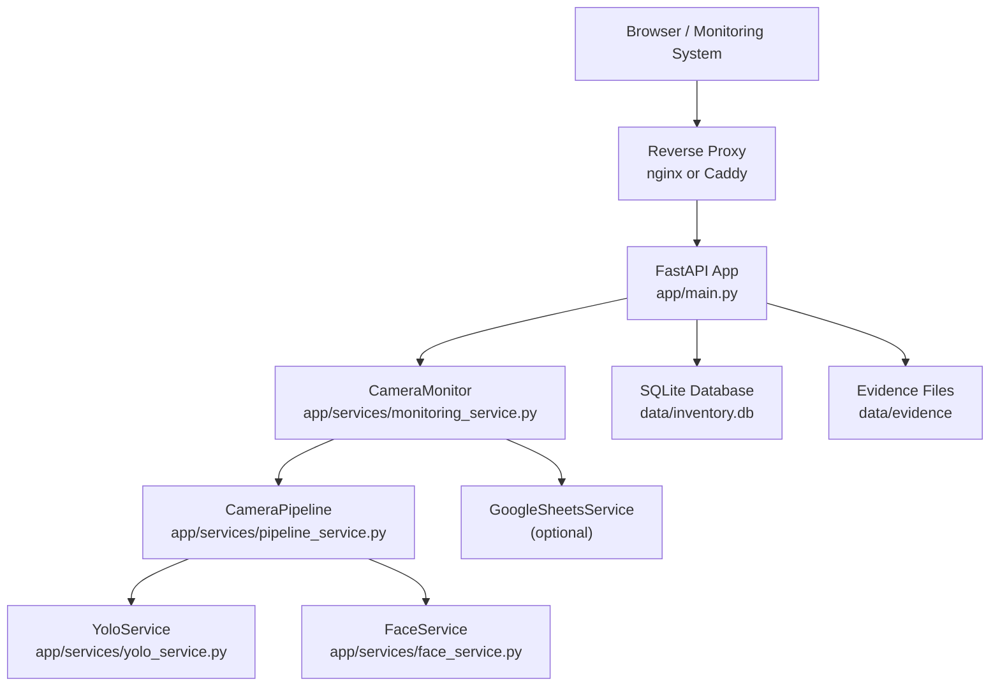
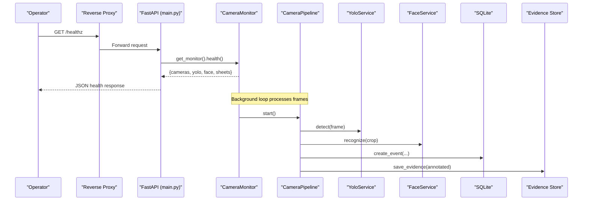
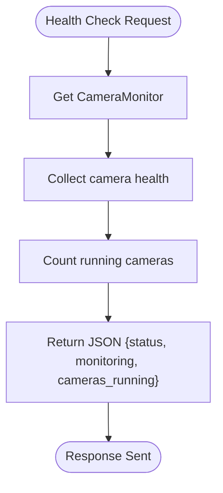
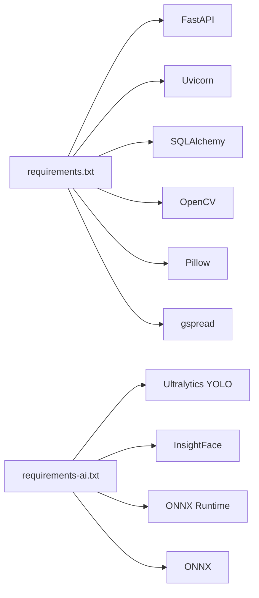

# Production Deployment

<cite>
**Referenced Files in This Document**   
- [README.md](file://README.md)
- [app/config.py](file://app/config.py)
- [app/main.py](file://app/main.py)
- [requirements.txt](file://requirements.txt)
- [requirements-ai.txt](file://requirements-ai.txt)
- [run.sh](file://run.sh)
- [run.bat](file://run.bat)
- [app/services/monitoring_service.py](file://app/services/monitoring_service.py)
- [app/services/pipeline_service.py](file://app/services/pipeline_service.py)
- [app/services/yolo_service.py](file://app/services/yolo_service.py)
- [app/services/face_service.py](file://app/services/face_service.py)
</cite>

## Table of Contents
1. [Introduction](#introduction)
2. [Project Structure](#project-structure)
3. [Core Components](#core-components)
4. [Architecture Overview](#architecture-overview)
5. [Detailed Component Analysis](#detailed-component-analysis)
6. [Dependency Analysis](#dependency-analysis)
7. [Performance Considerations](#performance-considerations)
8. [Troubleshooting Guide](#troubleshooting-guide)
9. [Conclusion](#conclusion)
10. [Appendices](#appendices)

## Introduction
This document provides production deployment guidance for the face-date system, an on-premise AI CCTV application that recognizes employees by face, detects equipment with YOLO, records line-crossing movements, and maintains an append-only inventory journal. It covers environment preparation, Python virtual environment setup, dependency installation including optional AI packages, server configuration, reverse proxy and HTTPS termination, process management, health checks, monitoring integration, performance tuning, multi-camera scaling, resource allocation, and GPU acceleration with CUDA.

The application is built on FastAPI and Uvicorn, uses SQLite by default, supports RTSP/USB/file/simulation camera sources, and exposes a web dashboard plus JSON APIs. The runtime supervisor manages camera workers, inference pipelines, Google Sheets synchronization, and evidence cleanup.

## Project Structure
At a high level, the repository separates application logic into API routers, domain models, services, UI templates/static assets, utilities, scripts, tests, and documentation. Runtime behavior is driven by:
- `app/main.py`: FastAPI application factory, middleware, error handling, and `/healthz`.
- `app/config.py`: Environment-driven settings object with validation and directory creation.
- `app/services/monitoring_service.py`: Camera monitor, worker lifecycle, scheduler, janitor, and status aggregation.
- `app/services/pipeline_service.py`: Per-camera frame pipeline, tracking, association, event persistence, and evidence saving.
- `app/services/yolo_service.py`: Ultralytics YOLO wrapper with lazy loading, fallback model, and detection/tracking.
- `app/services/face_service.py`: InsightFace + ONNX Runtime face detection/recognition with graceful degradation.

**Diagram sources**
- [app/main.py:44-129](file://app/main.py#L44-L129)
- [app/services/monitoring_service.py:39-106](file://app/services/monitoring_service.py#L39-L106)
- [app/services/pipeline_service.py:390-487](file://app/services/pipeline_service.py#L390-L487)
- [app/services/yolo_service.py:55-154](file://app/services/yolo_service.py#L55-L154)
- [app/services/face_service.py:173-234](file://app/services/face_service.py#L173-L234)

**Section sources**
- [README.md:597-621](file://README.md#L597-L621)
- [app/main.py:44-129](file://app/main.py#L44-L129)
- [app/config.py:62-139](file://app/config.py#L62-L139)

## Core Components
- Application entry point and HTTP layer:
  - FastAPI app creation, session middleware, router inclusion, exception handlers, static file mounting, and `/healthz` endpoint.
- Configuration:
  - Immutable `Settings` dataclass loaded from `.env`, providing typed access to host/port, database URL, secret key, YOLO parameters, face recognition thresholds, processing FPS/size, evidence retention, Google Sheets options, logging, and directories.
- Runtime supervisor:
  - Starts/stops camera workers and pipelines, refreshes detection rules and face gallery, optionally starts Google Sheets sync scheduler, runs evidence janitor thread, tracks camera status transitions, and aggregates health metrics.
- Inference services:
  - YOLO service wraps Ultralytics detection/tracking with lazy loading, fallback model support, category mapping, and per-inference metrics.
  - Face service wraps InsightFace + ONNX Runtime, loads providers (CPU/CUDA), normalizes embeddings, matches against enrolled gallery with threshold/margin, and degrades gracefully when unavailable.

Key responsibilities and interactions are defined in the referenced files; this section summarizes their roles without exposing implementation details.

**Section sources**
- [app/main.py:44-129](file://app/main.py#L44-L129)
- [app/config.py:62-244](file://app/config.py#L62-L244)
- [app/services/monitoring_service.py:39-106](file://app/services/monitoring_service.py#L39-L106)
- [app/services/yolo_service.py:55-154](file://app/services/yolo_service.py#L55-L154)
- [app/services/face_service.py:173-234](file://app/services/face_service.py#L173-L234)

## Architecture Overview
The production architecture consists of:
- A reverse proxy terminating TLS and forwarding requests to FastAPI.
- FastAPI serving the dashboard, APIs, and health check.
- A background monitor managing camera workers and pipelines.
- Optional Google Sheets synchronization.
- Local storage for SQLite WAL mode, evidence JPEGs, trained models, logs, and secrets.

**Diagram sources**
- [app/main.py:116-123](file://app/main.py#L116-L123)
- [app/services/monitoring_service.py:243-262](file://app/services/monitoring_service.py#L243-L262)
- [app/services/pipeline_service.py:462-487](file://app/services/pipeline_service.py#L462-L487)
- [app/services/yolo_service.py:166-236](file://app/services/yolo_service.py#L166-L236)
- [app/services/face_service.py:261-274](file://app/services/face_service.py#L261-L274)

## Detailed Component Analysis

### Environment Preparation and Virtual Environment Setup
- Use Python 3.11 (64-bit). The project’s install scripts prefer Python 3.11 and fall back to available Python versions where applicable.
- Create a virtual environment in `.venv`, copy `.env.example` to `.env`, and install core dependencies.
- For real camera inference and face recognition, install optional AI dependencies separately.

Recommended steps:
1. Prepare OS prerequisites:
   - Windows: Visual Studio Build Tools may be required if building certain extensions.
   - Linux/macOS: Ensure Python 3.11 is installed and accessible.
2. Create and activate the virtual environment:
   - Windows: `py -3.11 -m venv .venv`
   - Linux/macOS: `python3.11 -m venv .venv`
3. Install core requirements:
   - `pip install -r requirements.txt`
4. Configure `.env`:
   - Set at least `APP_SECRET_KEY` and `BOOTSTRAP_ADMIN_PASSWORD`.
   - Adjust `APP_HOST`, `APP_PORT`, `DATABASE_URL`, timezone, and other settings as needed.
5. Start the server:
   - Windows: `run.bat`
   - Linux/macOS: `./run.sh`
   - Or directly: `python run.py --host ... --port ...`

For AI features:
- Install AI dependencies: `pip install -r requirements-ai.txt`
- If using CUDA, install `onnxruntime-gpu` and set `FACE_PROVIDERS=CUDAExecutionProvider`.

**Section sources**
- [README.md:37-47](file://README.md#L37-L47)
- [README.md:51-117](file://README.md#L51-L117)
- [run.sh:1-45](file://run.sh#L1-L45)
- [run.bat:1-64](file://run.bat#L1-L64)
- [requirements.txt:1-20](file://requirements.txt#L1-L20)
- [requirements-ai.txt:1-21](file://requirements-ai.txt#L1-L21)

### Server Configuration and Security Hardening
- Application settings are loaded from environment variables via `app/config.py`.
- Production considerations:
  - Set `APP_ENV=production` to enable HTTPS-only session cookies.
  - Change `APP_SECRET_KEY` to a strong random value.
  - Change bootstrap admin credentials immediately after first login.
  - Restrict network exposure to internal networks; use VPN or authenticated proxy for external access.
  - Back up `.env`, `secrets/`, `data/`, and `logs/`; exclude them from version control.
- Directory structure:
  - `data/` contains SQLite database, evidence images, models, and employee templates.
  - `logs/` stores application logs.
  - `secrets/` holds sensitive files such as Google service account JSON.

Configuration keys relevant to production include:
- `APP_ENV`, `APP_HOST`, `APP_PORT`, `APP_TIMEZONE`
- `DATABASE_URL` (default SQLite path)
- `APP_SECRET_KEY`, `SESSION_MAX_AGE_SECONDS`
- `YOLO_MODEL_PATH`, `YOLO_FALLBACK_MODEL`, `YOLO_CONFIDENCE`, `YOLO_IMAGE_SIZE`, `YOLO_DEVICE`
- `FACE_SIMILARITY_THRESHOLD`, `FACE_MATCH_MARGIN`, `FACE_RECOGNITION_INTERVAL`, `FACE_PROVIDERS`
- `PROCESSING_FPS`, `PROCESSING_WIDTH`, `PROCESSING_HEIGHT`
- `EVIDENCE_ENABLED`, `EVIDENCE_RETENTION_DAYS`, `EVIDENCE_JPEG_QUALITY`
- `GOOGLE_SHEETS_ENABLED`, `GOOGLE_SPREADSHEET_ID`, `GOOGLE_SERVICE_ACCOUNT_FILE`, `GOOGLE_SHEETS_SYNC_INTERVAL_SECONDS`
- `LOG_LEVEL`, `LOG_DIR`

**Section sources**
- [app/config.py:62-139](file://app/config.py#L62-L139)
- [app/config.py:159-244](file://app/config.py#L159-L244)
- [README.md:138-170](file://README.md#L138-L170)
- [README.md:625-637](file://README.md#L625-L637)

### Reverse Proxy Setup (nginx/Caddy) and HTTPS Termination
- Run FastAPI behind a reverse proxy to terminate TLS and forward to `http://127.0.0.1:8000` (or configured host/port).
- In production, ensure `APP_ENV=production` so session cookies are sent only over HTTPS.
- nginx example concepts:
  - Listen on port 443 with SSL certificates.
  - Proxy_pass to `http://127.0.0.1:8000`.
  - Set headers like `Host`, `X-Forwarded-Proto`, and `X-Real-IP`.
- Caddy example concepts:
  - Use automatic HTTPS with a domain name.
  - Reverse proxy to `http://127.0.0.1:8000`.

SSL certificate management:
- Use Let’s Encrypt with certbot (nginx) or rely on Caddy’s automatic certificate provisioning.
- Rotate certificates according to organizational policy and automate renewal.

Security hardening:
- Disable FastAPI docs/redoc in production (`/api/docs` is disabled automatically when `is_production`).
- Restrict access to `/settings`, `/employees`, `/equipment`, `/cameras` to authorized users.
- Enforce CSRF protection for POST requests.
- Limit evidence access to operator/admin roles and validate paths to prevent traversal.

**Section sources**
- [app/main.py:44-62](file://app/main.py#L44-L62)
- [app/main.py:116-123](file://app/main.py#L116-L123)
- [README.md:625-637](file://README.md#L625-L637)

### Process Management (systemd/supervisor)
- systemd (Linux):
  - Create a service unit running `python run.py` inside the virtual environment.
  - Set `User`, `WorkingDirectory`, `EnvironmentFile=/path/to/.env`, and restart policies.
  - Enable and start the service; monitor with `journalctl`.
- supervisor (Linux):
  - Define a program entry pointing to the virtual environment Python and `run.py`.
  - Configure autostart, autorestart, and log redirection.
- Windows:
  - Use Task Scheduler to run `run.bat` at startup, or wrap `run.py` in a Windows service using tools like NSSM.
  - Ensure the scheduled task runs under an appropriate user account with filesystem permissions.

Process isolation and resilience:
- Restart on failure; configure maximum restart attempts.
- Redirect stdout/stderr to log files or journald.
- Set memory limits and CPU affinity where supported.

**Section sources**
- [run.sh:1-45](file://run.sh#L1-L45)
- [run.bat:1-64](file://run.bat#L1-L64)
- [app/main.py:44-62](file://app/main.py#L44-L62)

### Health Check Endpoint and Monitoring Integration
- `/healthz` returns a JSON object indicating overall status, whether the monitoring subsystem is started, and how many cameras are running.
- The monitor aggregates health from each camera worker and pipeline, including events created, processing errors, frames processed, and detection errors.
- External systems can poll `/healthz` for liveness probes and integrate with dashboards/alerting.

**Diagram sources**
- [app/main.py:116-123](file://app/main.py#L116-L123)
- [app/services/monitoring_service.py:243-262](file://app/services/monitoring_service.py#L243-L262)

**Section sources**
- [app/main.py:116-123](file://app/main.py#L116-L123)
- [app/services/monitoring_service.py:243-262](file://app/services/monitoring_service.py#L243-L262)

### Performance Tuning Parameters
Production workloads should tune these settings based on observed FPS, CPU/GPU utilization, and accuracy needs:
- `PROCESSING_FPS`: Frames per second for processing; lower values reduce CPU load.
- `YOLO_IMAGE_SIZE`: Model input size; smaller sizes improve speed but may reduce detection accuracy.
- `FACE_RECOGNITION_INTERVAL`: How often face recognition is attempted per track; higher intervals reduce overhead.
- `YOLO_CONFIDENCE`: Detection confidence threshold; adjust to balance false positives/negatives.
- `FACE_SIMILARITY_THRESHOLD` and `FACE_MATCH_MARGIN`: Tune to reduce unknown/false matches while avoiding missed recognitions.
- `EVIDENCE_JPEG_QUALITY` and `EVIDENCE_RETENTION_DAYS`: Control storage usage and retention policy.

Guidelines:
- Start with moderate FPS (e.g., 5–8) and increase gradually.
- Reduce `YOLO_IMAGE_SIZE` if CPU-bound.
- Increase `FACE_RECOGNITION_INTERVAL` if face recognition is a bottleneck.
- Monitor `/healthz` and application logs to assess impact.

**Section sources**
- [app/config.py:190-210](file://app/config.py#L190-L210)
- [README.md:528-529](file://README.md#L528-L529)

### Multi-Camera Scaling Considerations
- Each enabled camera spawns a worker and a pipeline thread managed by `CameraMonitor`.
- Scale horizontally by deploying multiple instances behind a load balancer only if you separate concerns (e.g., one instance per group of cameras) because SQLite is single-writer.
- Resource planning:
  - CPU-bound inference scales linearly with number of cameras and FPS.
  - Memory usage grows with frame buffers, model state, and gallery embeddings.
  - Storage grows with evidence retention and model weights.
- Network:
  - RTSP streams consume bandwidth; consider H.264 sub-streams and stable LAN connections.
- Database:
  - SQLite is suitable for single-server deployments; for large-scale setups, consider PostgreSQL with read replicas and careful write routing.

**Section sources**
- [app/services/monitoring_service.py:112-169](file://app/services/monitoring_service.py#L112-L169)
- [app/services/pipeline_service.py:390-487](file://app/services/pipeline_service.py#L390-L487)
- [README.md:584-591](file://README.md#L584-L591)

### GPU Acceleration with CUDA
- For CUDA acceleration:
  - Install `onnxruntime-gpu` instead of `onnxruntime`.
  - Set `FACE_PROVIDERS=CUDAExecutionProvider`.
  - Optionally set `YOLO_DEVICE=cuda:0` for YOLO inference on GPU.
- Verify availability:
  - Check `/healthz` and monitor status endpoints for YOLO and face service availability.
  - Review logs for provider initialization messages.

**Section sources**
- [requirements-ai.txt:14-15](file://requirements-ai.txt#L14-L15)
- [app/services/face_service.py:216-234](file://app/services/face_service.py#L216-L234)
- [app/services/yolo_service.py:178-200](file://app/services/yolo_service.py#L178-L200)

## Dependency Analysis
The application has two dependency sets:
- Core dependencies (FastAPI, Uvicorn, SQLAlchemy, Jinja2, OpenCV, Pillow, gspread, etc.).
- Optional AI dependencies (Ultralytics YOLO, InsightFace, ONNX Runtime, ONNX).

**Diagram sources**
- [requirements.txt:1-20](file://requirements.txt#L1-L20)
- [requirements-ai.txt:1-21](file://requirements-ai.txt#L1-L21)

**Section sources**
- [requirements.txt:1-20](file://requirements.txt#L1-L20)
- [requirements-ai.txt:1-21](file://requirements-ai.txt#L1-L21)

## Performance Considerations
- CPU vs GPU:
  - CPU inference is slower; reduce FPS and image size to maintain responsiveness.
  - GPU acceleration significantly improves throughput for both YOLO and face recognition.
- Frame queue and processing:
  - `MAX_FRAME_QUEUE` controls buffering; tune to avoid dropping frames under load.
- Evidence storage:
  - Lower JPEG quality reduces disk I/O and storage costs.
  - Shorter retention reduces disk growth.
- Logging:
  - Use appropriate `LOG_LEVEL` to balance observability and overhead.
- Database:
  - SQLite WAL mode improves concurrency; avoid multiple writers.
- Monitoring:
  - Track `/healthz`, camera statuses, and pipeline metrics to detect bottlenecks.

[No sources needed since this section provides general guidance]

## Troubleshooting Guide
Common issues and resolutions:
- Missing YOLO model:
  - Place custom model at `YOLO_MODEL_PATH`; otherwise, fallback model is used with warnings.
- Face recognition unavailable:
  - Install AI dependencies; verify InsightFace and ONNX Runtime; reload gallery.
- Camera offline:
  - Validate RTSP URL, credentials, codec, and network; use test script to capture frames.
- Port conflicts:
  - Change `APP_PORT` or stop conflicting processes.
- Database locked:
  - Ensure single server writer; avoid concurrent writes from multiple processes.
- Google Sheets failures:
  - Verify service account permissions, spreadsheet ID, and connectivity; check sync status.
- Login fails in production:
  - Ensure HTTPS; session cookies are HTTPS-only in production.
- Low FPS/high CPU:
  - Tune `PROCESSING_FPS`, `YOLO_IMAGE_SIZE`, `FACE_RECOGNITION_INTERVAL`; consider GPU.

Operational checks:
- Inspect `logs/app.log` for tracebacks and warnings.
- Use `/healthz` and monitor status endpoints to validate runtime components.
- Validate camera status transitions and event logs for anomalies.

**Section sources**
- [README.md:516-531](file://README.md#L516-L531)
- [app/services/monitoring_service.py:171-216](file://app/services/monitoring_service.py#L171-L216)
- [app/services/pipeline_service.py:462-487](file://app/services/pipeline_service.py#L462-L487)

## Conclusion
Deploying the face-date system in production requires careful environment preparation, secure configuration, reverse proxy setup, process management, and performance tuning. The application’s modular architecture allows graceful degradation when AI components are unavailable, making it robust across different hardware configurations. By following the recommended steps—setting strong secrets, enabling HTTPS, tuning FPS and model sizes, and leveraging GPU acceleration—you can achieve reliable operation across multiple cameras while maintaining security and observability.

[No sources needed since this section summarizes without analyzing specific files]

## Appendices

### Appendix A: Key Configuration Reference
- Application:
  - `APP_ENV`, `APP_HOST`, `APP_PORT`, `APP_TIMEZONE`
  - `DATABASE_URL`, `APP_SECRET_KEY`, `SESSION_MAX_AGE_SECONDS`
- YOLO:
  - `YOLO_MODEL_PATH`, `YOLO_FALLBACK_MODEL`, `YOLO_CONFIDENCE`, `YOLO_IMAGE_SIZE`, `YOLO_DEVICE`, `YOLO_TRACKER`
- Face Recognition:
  - `FACE_MODEL_NAME`, `FACE_SIMILARITY_THRESHOLD`, `FACE_MATCH_MARGIN`, `FACE_PROVIDERS`, `FACE_DETECTION_SIZE`, `FACE_RECOGNITION_INTERVAL`
- Processing:
  - `PROCESSING_FPS`, `PROCESSING_WIDTH`, `PROCESSING_HEIGHT`, `MAX_FRAME_QUEUE`
- Evidence:
  - `EVIDENCE_ENABLED`, `EVIDENCE_RETENTION_DAYS`, `EVIDENCE_JPEG_QUALITY`
- Google Sheets:
  - `GOOGLE_SHEETS_ENABLED`, `GOOGLE_SPREADSHEET_ID`, `GOOGLE_SERVICE_ACCOUNT_FILE`, `GOOGLE_SHEETS_SYNC_INTERVAL_SECONDS`, `GOOGLE_SHEETS_MAX_RETRIES`
- Logging:
  - `LOG_LEVEL`, `LOG_DIR`

**Section sources**
- [app/config.py:159-244](file://app/config.py#L159-L244)
- [README.md:138-170](file://README.md#L138-L170)