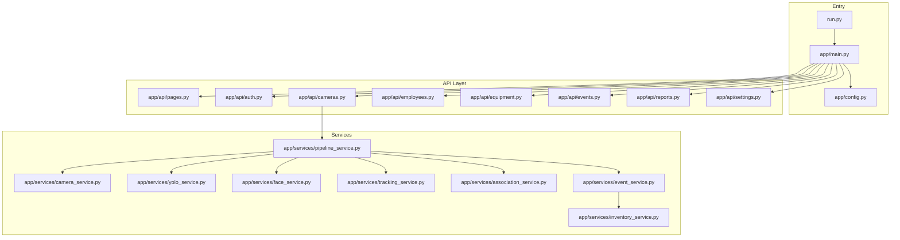
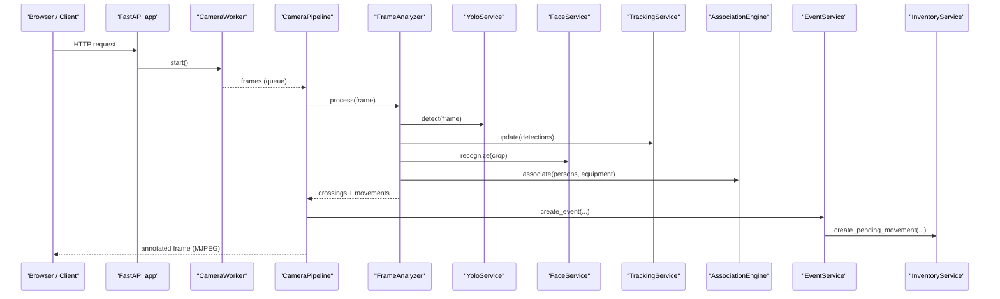
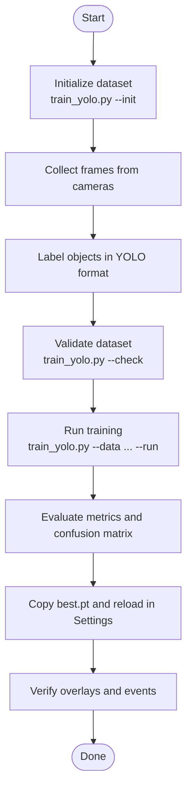
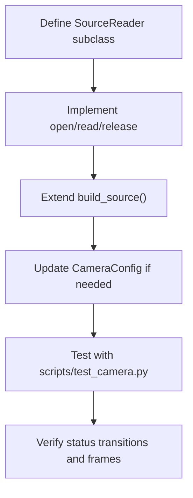
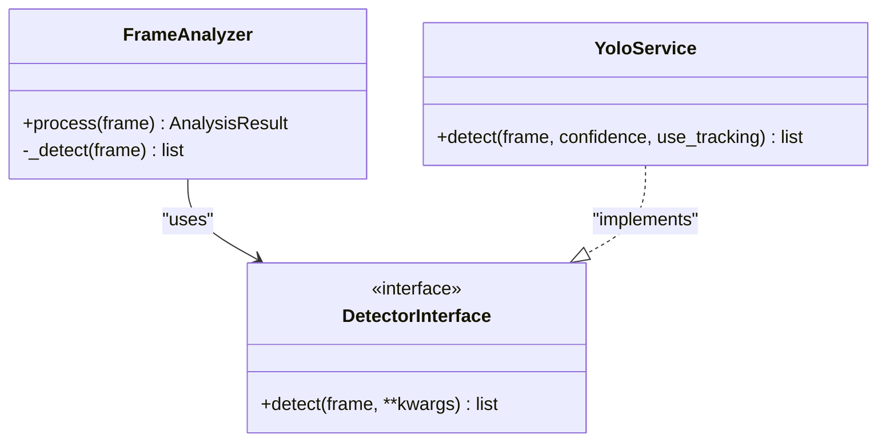
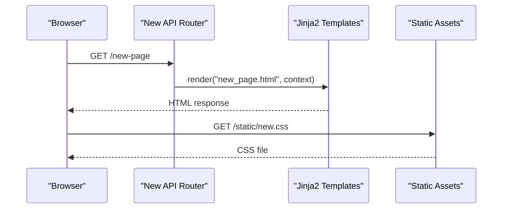
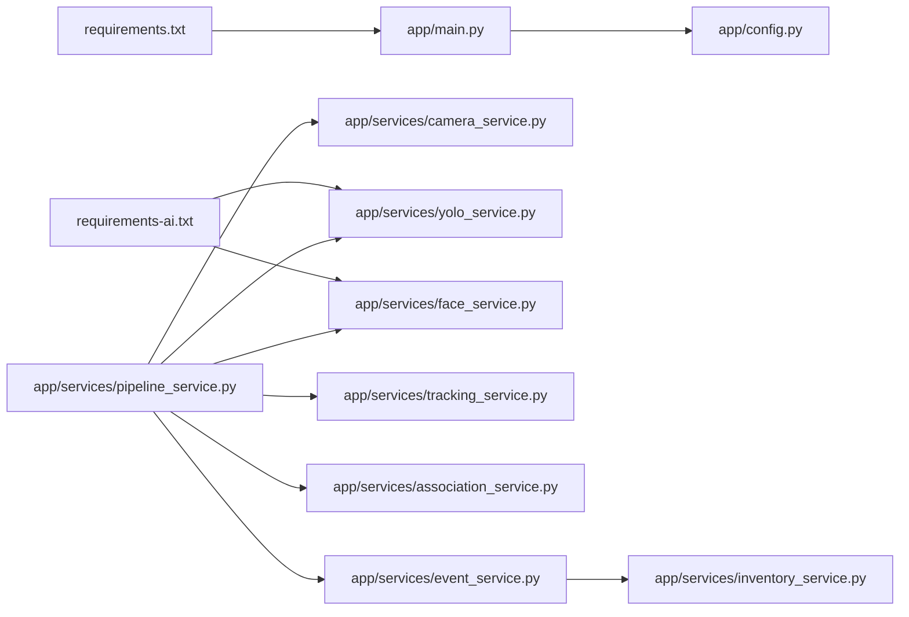
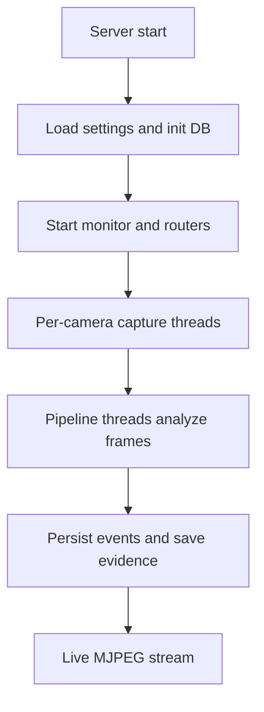

# Development Guide

<cite>
**Referenced Files in This Document**
- [README.md](file://README.md)
- [requirements.txt](file://requirements.txt)
- [requirements-ai.txt](file://requirements-ai.txt)
- [run.py](file://run.py)
- [app/main.py](file://app/main.py)
- [app/config.py](file://app/config.py)
- [app/services/pipeline_service.py](file://app/services/pipeline_service.py)
- [app/services/camera_service.py](file://app/services/camera_service.py)
- [app/services/yolo_service.py](file://app/services/yolo_service.py)
- [app/services/face_service.py](file://app/services/face_service.py)
- [app/services/tracking_service.py](file://app/services/tracking_service.py)
- [app/services/association_service.py](file://app/services/association_service.py)
- [app/services/event_service.py](file://app/services/event_service.py)
- [app/services/inventory_service.py](file://app/services/inventory_service.py)
- [scripts/train_yolo.py](file://scripts/train_yolo.py)
- [docs/yolo_training.md](file://docs/yolo_training.md)
</cite>

## Table of Contents
1. Introduction
2. Project Structure
3. Core Components
4. Architecture Overview
5. Detailed Component Analysis
6. Dependency Analysis
7. Performance Considerations
8. Troubleshooting Guide
9. Conclusion
10. Appendices

## Introduction
This guide helps contributors set up the development environment, understand the layered architecture, debug the system, train a custom YOLO model, and extend functionality such as adding camera sources, detection algorithms, or UI features. The system is a local AI CCTV application that recognizes employees by face, detects equipment with YOLO, tracks movement across a virtual line, records events, maintains an append-only inventory ledger, and optionally syncs reports to Google Sheets.

Key principles:
- Local-first data: SQLite database, evidence images, and logs stay on the machine.
- No automatic assumptions: uncertain cases remain pending until reviewed.
- Full audit trail: every action and inventory movement is recorded.

**Section sources**
- [README.md:1-16](file://README.md#L1-L16)

## Project Structure
The repository follows a layered design:
- Entry point and server configuration
- API routers for pages and endpoints
- Services for business logic (camera capture, inference, tracking, association, events, inventory)
- Models and enums for persistence
- UI templates and static assets
- Scripts for training, registration, testing, and synchronization
- Tests and documentation

**Diagram sources**
- [run.py:19-39](file://run.py#L19-L39)
- [app/main.py:44-68](file://app/main.py#L44-L68)
- [app/config.py:159-222](file://app/config.py#L159-L222)
- [app/services/pipeline_service.py:390-426](file://app/services/pipeline_service.py#L390-L426)
- [app/services/camera_service.py:226-260](file://app/services/camera_service.py#L226-L260)
- [app/services/yolo_service.py:55-75](file://app/services/yolo_service.py#L55-L75)
- [app/services/face_service.py:173-181](file://app/services/face_service.py#L173-L181)
- [app/services/tracking_service.py:29-35](file://app/services/tracking_service.py#L29-L35)
- [app/services/association_service.py:106-110](file://app/services/association_service.py#L106-L110)
- [app/services/event_service.py:59-81](file://app/services/event_service.py#L59-L81)
- [app/services/inventory_service.py:66-112](file://app/services/inventory_service.py#L66-L112)

**Section sources**
- [README.md:597-621](file://README.md#L597-L621)

## Core Components
- Server entrypoint: parses CLI arguments, loads settings, starts Uvicorn, mounts routers, configures sessions and error handlers.
- Configuration: reads `.env`, builds immutable `Settings`, validates directories and warnings.
- Camera pipeline: per-camera worker thread runs frame analysis, persists events, publishes annotated frames.
- Camera capture: RTSP/USB/file/simulation source with exponential backoff reconnection and frame queueing.
- YOLO service: lazy-loaded Ultralytics detector with fallback model and category mapping.
- Face service: InsightFace wrapper with gallery embeddings and threshold/margin matching.
- Tracking: IoU-based tracker, track memory, and line crossing detector with hysteresis and cooldown.
- Association engine: multi-signal scoring to link person and equipment with explicit quality levels.
- Event service: deduplication, review workflow, queries, dashboard stats.
- Inventory service: append-only ledger, pending candidates, balances, and asset side effects.

**Section sources**
- [run.py:19-39](file://run.py#L19-L39)
- [app/main.py:44-129](file://app/main.py#L44-L129)
- [app/config.py:62-156](file://app/config.py#L62-L156)
- [app/services/pipeline_service.py:103-149](file://app/services/pipeline_service.py#L103-L149)
- [app/services/camera_service.py:226-260](file://app/services/camera_service.py#L226-L260)
- [app/services/yolo_service.py:55-103](file://app/services/yolo_service.py#L55-L103)
- [app/services/face_service.py:173-204](file://app/services/face_service.py#L173-L204)
- [app/services/tracking_service.py:29-35](file://app/services/tracking_service.py#L29-L35)
- [app/services/association_service.py:106-130](file://app/services/association_service.py#L106-L130)
- [app/services/event_service.py:59-147](file://app/services/event_service.py#L59-L147)
- [app/services/inventory_service.py:66-112](file://app/services/inventory_service.py#L66-L112)

## Architecture Overview
The runtime consists of:
- A FastAPI app with session middleware and routers.
- Per-camera workers capturing frames and pushing them into queues.
- Pipeline threads analyzing frames: detect, track, recognize, associate, cross lines, persist events.
- Evidence saving and MJPEG streaming for live view.
- Optional Google Sheets sync via scheduler.

**Diagram sources**
- [app/main.py:44-68](file://app/main.py#L44-L68)
- [app/services/camera_service.py:254-260](file://app/services/camera_service.py#L254-L260)
- [app/services/pipeline_service.py:462-487](file://app/services/pipeline_service.py#L462-L487)
- [app/services/pipeline_service.py:218-321](file://app/services/pipeline_service.py#L218-L321)
- [app/services/yolo_service.py:166-236](file://app/services/yolo_service.py#L166-L236)
- [app/services/face_service.py:261-274](file://app/services/face_service.py#L261-L274)
- [app/services/tracking_service.py:135-165](file://app/services/tracking_service.py#L135-L165)
- [app/services/association_service.py:131-198](file://app/services/association_service.py#L131-L198)
- [app/services/event_service.py:59-147](file://app/services/event_service.py#L59-L147)
- [app/services/inventory_service.py:132-156](file://app/services/inventory_service.py#L132-L156)

## Detailed Component Analysis

### Development Environment Setup
- Python version: use Python 3.11 (64-bit).
- Virtual environment:
  - Windows: `py -3.11 -m venv .venv` then install requirements.
  - Linux/macOS: `python3.11 -m venv .venv` then install requirements.
- Core dependencies: `requirements.txt`.
- Optional AI dependencies: `requirements-ai.txt` for YOLO and InsightFace.
- First run: copy `.env.example` to `.env`, set secrets, start server with `run.py`.

IDE tips:
- Set interpreter to `.venv/bin/python` or `.venv\Scripts\python.exe`.
- Configure working directory to repository root so relative paths like `data/models/...` resolve correctly.
- Enable linting and type checking if desired; the codebase uses modern typing patterns.

**Section sources**
- [README.md:37-47](file://README.md#L37-L47)
- [README.md:72-96](file://README.md#L72-L96)
- [README.md:97-116](file://README.md#L97-L116)
- [requirements.txt:1-20](file://requirements.txt#L1-L20)
- [requirements-ai.txt:1-21](file://requirements-ai.txt#L1-L21)
- [run.py:19-39](file://run.py#L19-L39)

### Codebase Architecture and Module Organization
Layered design:
- API layer: routers for pages, authentication, cameras, employees, equipment, events, reports, settings.
- Service layer: camera capture, pipeline, YOLO, face recognition, tracking, association, events, inventory.
- Data layer: SQLAlchemy models and enums.
- UI layer: Jinja2 templates and static assets.

Design patterns:
- Lazy loading for heavy models (YOLO, InsightFace).
- Singleton services with thread-safe initialization.
- Per-camera worker threads decoupling capture from inference.
- Immutable `Settings` snapshot for configuration.

**Section sources**
- [app/main.py:44-68](file://app/main.py#L44-L68)
- [app/config.py:62-156](file://app/config.py#L62-L156)
- [app/services/yolo_service.py:55-103](file://app/services/yolo_service.py#L55-L103)
- [app/services/face_service.py:173-204](file://app/services/face_service.py#L173-L204)
- [app/services/pipeline_service.py:390-426](file://app/services/pipeline_service.py#L390-L426)

### Debugging Techniques
Log analysis:
- Application logs are written to `logs/app.log` based on `LOG_LEVEL` and `LOG_DIR`.
- Errors during detection, pipeline processing, and DB writes are logged with context.

Breakpoint debugging:
- Use your IDE to set breakpoints in:
  - `FrameAnalyzer.process` for per-frame reasoning.
  - `YoloService.detect` for detection results.
  - `FaceService.recognize` for identity matching.
  - `AssociationEngine.associate` for person-equipment linking.
  - `EventService.create_event` for event creation and deduplication.

Performance profiling:
- Monitor FPS and latency via `/healthz` and pipeline health metrics.
- Tune `PROCESSING_FPS`, `YOLO_IMAGE_SIZE`, `FACE_RECOGNITION_INTERVAL`, and device selection (`cpu` vs CUDA).
- Use GPU acceleration where available (`onnxruntime-gpu`, CUDA providers).

**Section sources**
- [app/main.py:104-114](file://app/main.py#L104-L114)
- [app/services/pipeline_service.py:462-487](file://app/services/pipeline_service.py#L462-L487)
- [app/services/yolo_service.py:166-236](file://app/services/yolo_service.py#L166-L236)
- [app/services/face_service.py:261-274](file://app/services/face_service.py#L261-L274)
- [app/services/association_service.py:131-198](file://app/services/association_service.py#L131-L198)
- [app/services/event_service.py:59-147](file://app/services/event_service.py#L59-L147)
- [README.md:516-530](file://README.md#L516-L530)

### Custom YOLO Model Training Workflow
Dataset preparation:
- Capture frames from production cameras using `scripts/test_camera.py` or FFmpeg.
- Label objects with labelImg, CVAT, or similar tools in YOLO format.
- Organize dataset with `scripts/train_yolo.py --init dataset`.

Annotation rules:
- Tight boxes around equipment, consistent labeling across classes.
- Include background frames to reduce false positives.
- Ensure class order matches `CLASS_NAMES` in the training script.

Training procedures:
- Validate dataset with `scripts/train_yolo.py --check dataset/data.yaml`.
- Run training with `scripts/train_yolo.py --data dataset/data.yaml --run --epochs 80 --device 0`.
- Best model is copied to `data/models/equipment_best.pt`.

Model evaluation:
- Inspect mAP metrics, confusion matrix, and validation batch images.
- Perform real-world test with actual footage to validate event accuracy.

Integration:
- Reload model via Settings page and map categories to YOLO labels.
- Restart cameras and verify overlay and detections.

**Diagram sources**
- [scripts/train_yolo.py:111-127](file://scripts/train_yolo.py#L111-L127)
- [scripts/train_yolo.py:130-180](file://scripts/train_yolo.py#L130-L180)
- [scripts/train_yolo.py:202-269](file://scripts/train_yolo.py#L202-L269)
- [docs/yolo_training.md:14-43](file://docs/yolo_training.md#L14-L43)
- [docs/yolo_training.md:46-80](file://docs/yolo_training.md#L46-L80)
- [docs/yolo_training.md:84-141](file://docs/yolo_training.md#L84-L141)
- [docs/yolo_training.md:144-178](file://docs/yolo_training.md#L144-L178)
- [docs/yolo_training.md:181-227](file://docs/yolo_training.md#L181-L227)

**Section sources**
- [docs/yolo_training.md:1-10](file://docs/yolo_training.md#L1-L10)
- [docs/yolo_training.md:14-43](file://docs/yolo_training.md#L14-L43)
- [docs/yolo_training.md:46-80](file://docs/yolo_training.md#L46-L80)
- [docs/yolo_training.md:84-141](file://docs/yolo_training.md#L84-L141)
- [docs/yolo_training.md:144-178](file://docs/yolo_training.md#L144-L178)
- [docs/yolo_training.md:181-227](file://docs/yolo_training.md#L181-L227)
- [scripts/train_yolo.py:111-127](file://scripts/train_yolo.py#L111-L127)
- [scripts/train_yolo.py:130-180](file://scripts/train_yolo.py#L130-L180)
- [scripts/train_yolo.py:202-269](file://scripts/train_yolo.py#L202-L269)

### Contribution Guidelines and Code Style Conventions
General guidelines:
- Keep services focused and stateless where possible; pass configuration via `Settings`.
- Prefer pure functions for algorithms (e.g., matching, association scoring) to improve testability.
- Avoid hardcoding paths; use `Settings` and project root helpers.
- Log meaningful messages with context (camera code, event IDs).
- Handle optional dependencies gracefully (YOLO, InsightFace) without pretending they work.

Commit message standards:
- Use clear, imperative titles (e.g., “Add simulation source”, “Fix line crossing cooldown”).
- Include scope and impact (e.g., “pipeline: add cooldown to equipment crossings”).
- Reference related issues or PRs when applicable.

Pull request process:
- Create feature branches from main.
- Add tests for new logic under `tests/`.
- Ensure existing tests pass before requesting review.
- Provide screenshots or logs for UI changes.
- Update documentation if user-facing behavior changes.

Code style conventions:
- Follow PEP 8 and modern Python typing practices used throughout the codebase.
- Use dataclasses for structured data and enums for domain values.
- Keep functions small and single-purpose; extract complex logic into helper modules.

[No sources needed since this section provides general guidance]

### Common Development Tasks

#### Adding a New Camera Source
Steps:
- Implement a new `SourceReader` subclass with `open`, `read`, and `release`.
- Extend `build_source` to instantiate your reader based on `source_type`.
- Optionally add configuration fields to `CameraConfig.from_model`.
- Test with `scripts/test_camera.py` and verify status transitions.

**Diagram sources**
- [app/services/camera_service.py:69-80](file://app/services/camera_service.py#L69-L80)
- [app/services/camera_service.py:82-132](file://app/services/camera_service.py#L82-L132)
- [app/services/camera_service.py:134-220](file://app/services/camera_service.py#L134-L220)

**Section sources**
- [app/services/camera_service.py:69-80](file://app/services/camera_service.py#L69-L80)
- [app/services/camera_service.py:82-132](file://app/services/camera_service.py#L82-L132)
- [app/services/camera_service.py:134-220](file://app/services/camera_service.py#L134-L220)

#### Implementing a New Detection Algorithm
Steps:
- Wrap your detector behind a simple interface compatible with `FrameAnalyzer._detect`.
- Integrate with `YoloService` or add a new detector option in the pipeline.
- Map output to `Detection` structures with bbox, confidence, label, category, is_person, track_id.
- Add unit tests with synthetic frames.

**Diagram sources**
- [app/services/pipeline_service.py:151-155](file://app/services/pipeline_service.py#L151-L155)
- [app/services/yolo_service.py:166-236](file://app/services/yolo_service.py#L166-L236)

**Section sources**
- [app/services/pipeline_service.py:151-155](file://app/services/pipeline_service.py#L151-L155)
- [app/services/yolo_service.py:166-236](file://app/services/yolo_service.py#L166-L236)

#### Extending the UI with New Features
Steps:
- Add a new router module under `app/api/` and include it in `create_app`.
- Create corresponding Jinja2 templates under `app/ui/templates/`.
- If needed, add static assets under `app/ui/static/`.
- Protect routes with role checks and CSRF protection already provided by the framework.

**Diagram sources**
- [app/main.py:64-68](file://app/main.py#L64-L68)

**Section sources**
- [app/main.py:64-68](file://app/main.py#L64-L68)

## Dependency Analysis
Core runtime dependencies:
- FastAPI, Uvicorn, SQLAlchemy, Jinja2, python-dotenv, OpenCV, Pillow, gspread, google-auth, itsdangerous, tzdata.
- Testing: pytest, httpx.

Optional AI dependencies:
- ultralytics, insightface, onnxruntime, onnx.

Runtime coupling:
- `main.py` composes routers and middleware.
- `config.py` centralizes environment-driven settings.
- Services depend on `Settings` and each other through well-defined interfaces.
- External integrations (Google Sheets) are optional and guarded by configuration.

**Diagram sources**
- [requirements.txt:1-20](file://requirements.txt#L1-L20)
- [requirements-ai.txt:1-21](file://requirements-ai.txt#L1-L21)
- [app/main.py:44-68](file://app/main.py#L44-L68)
- [app/config.py:159-222](file://app/config.py#L159-L222)
- [app/services/pipeline_service.py:390-426](file://app/services/pipeline_service.py#L390-L426)
- [app/services/camera_service.py:226-260](file://app/services/camera_service.py#L226-L260)
- [app/services/yolo_service.py:55-103](file://app/services/yolo_service.py#L55-L103)
- [app/services/face_service.py:173-204](file://app/services/face_service.py#L173-L204)
- [app/services/tracking_service.py:29-35](file://app/services/tracking_service.py#L29-L35)
- [app/services/association_service.py:106-110](file://app/services/association_service.py#L106-L110)
- [app/services/event_service.py:59-81](file://app/services/event_service.py#L59-L81)
- [app/services/inventory_service.py:66-112](file://app/services/inventory_service.py#L66-L112)

**Section sources**
- [requirements.txt:1-20](file://requirements.txt#L1-L20)
- [requirements-ai.txt:1-21](file://requirements-ai.txt#L1-L21)

## Performance Considerations
- Reduce processing load:
  - Lower `PROCESSING_FPS` to 5–8 for CPU environments.
  - Reduce `YOLO_IMAGE_SIZE` to 480 or 640 depending on object sizes.
  - Increase `FACE_RECOGNITION_INTERVAL` to avoid per-frame face recognition.
- Hardware acceleration:
  - Use CUDA-enabled `onnxruntime-gpu` and set `FACE_PROVIDERS=CUDAExecutionProvider`.
  - Select `YOLO_DEVICE=cuda:0` when GPU is available.
- Monitoring:
  - Watch `/healthz` for running cameras and monitoring status.
  - Review pipeline health metrics for frames processed, detection errors, and track counts.

[No sources needed since this section provides general guidance]

## Troubleshooting Guide
Common issues and resolutions:
- Missing YOLO model: system falls back to COCO model; configure `YOLO_MODEL_PATH` and reload via Settings.
- Face recognition unavailable: ensure AI dependencies installed; check logs and refresh gallery.
- Camera offline: verify RTSP URL, credentials, codec; use `scripts/test_camera.py`.
- Port conflicts: change port via `run.py --port`.
- Database locked: run only one server instance; AI/CLI scripts use short transactions.
- Sheets FAILED: verify service account permissions and spreadsheet sharing; check status endpoint.
- Login fails in production: ensure HTTPS or set `APP_ENV=development`.
- Low FPS/high CPU: tune FPS, image size, recognition interval, or enable GPU.

**Section sources**
- [README.md:516-530](file://README.md#L516-L530)

## Conclusion
This guide outlined environment setup, architecture, debugging, YOLO training, contribution standards, and common tasks. By following these practices, contributors can reliably extend camera sources, detection algorithms, and UI features while maintaining performance, correctness, and auditability.

[No sources needed since this section summarizes without analyzing specific files]

## Appendices

### Appendix A: Key Runtime Flow

**Diagram sources**
- [app/main.py:25-41](file://app/main.py#L25-L41)
- [app/services/camera_service.py:365-427](file://app/services/camera_service.py#L365-L427)
- [app/services/pipeline_service.py:462-487](file://app/services/pipeline_service.py#L462-L487)