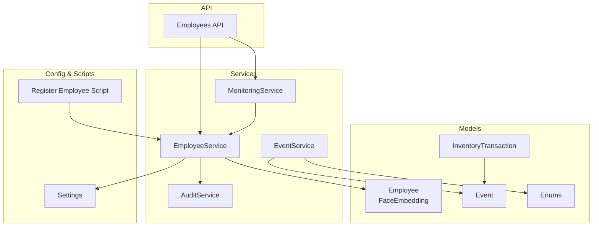
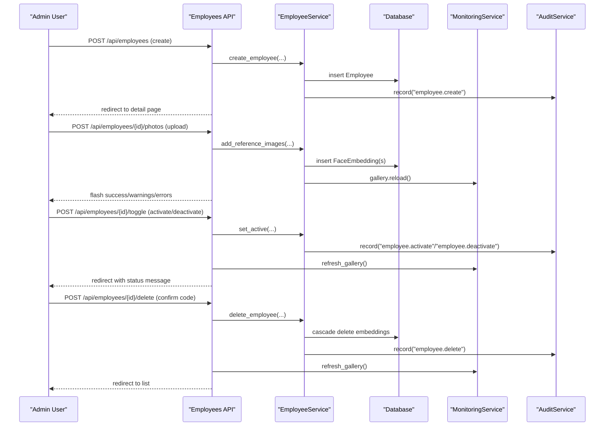
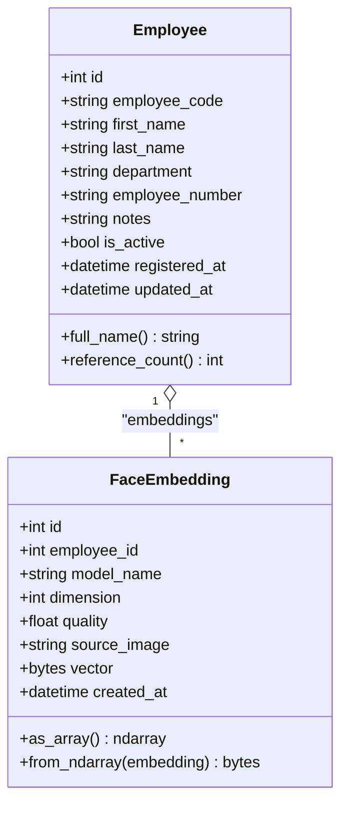
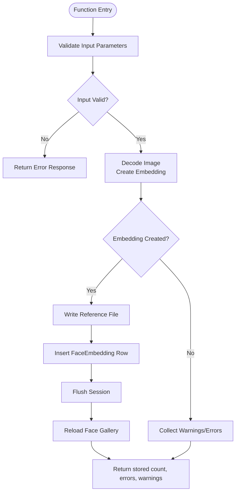
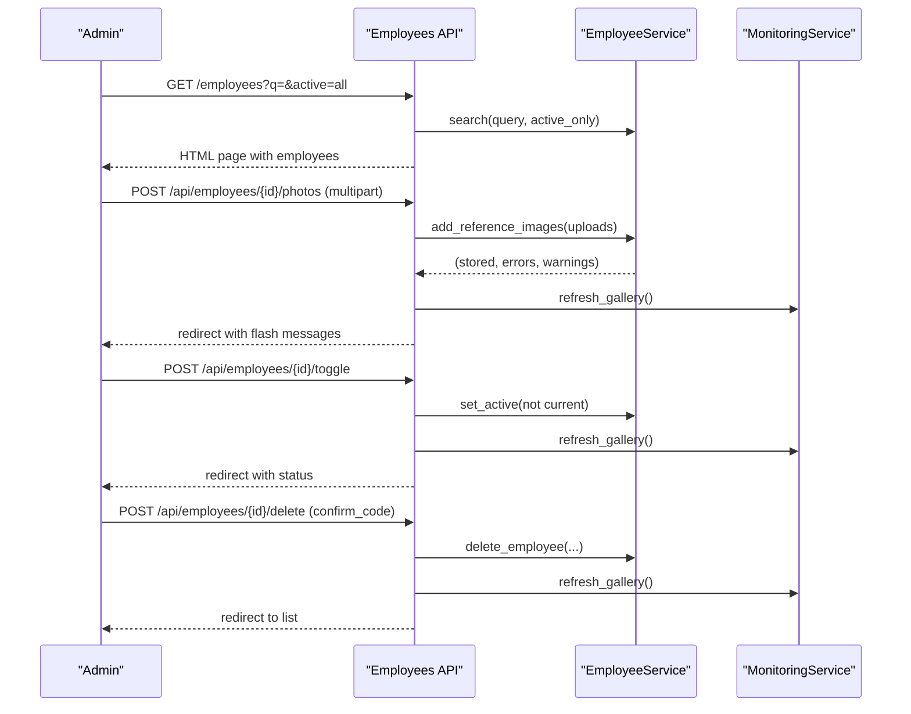
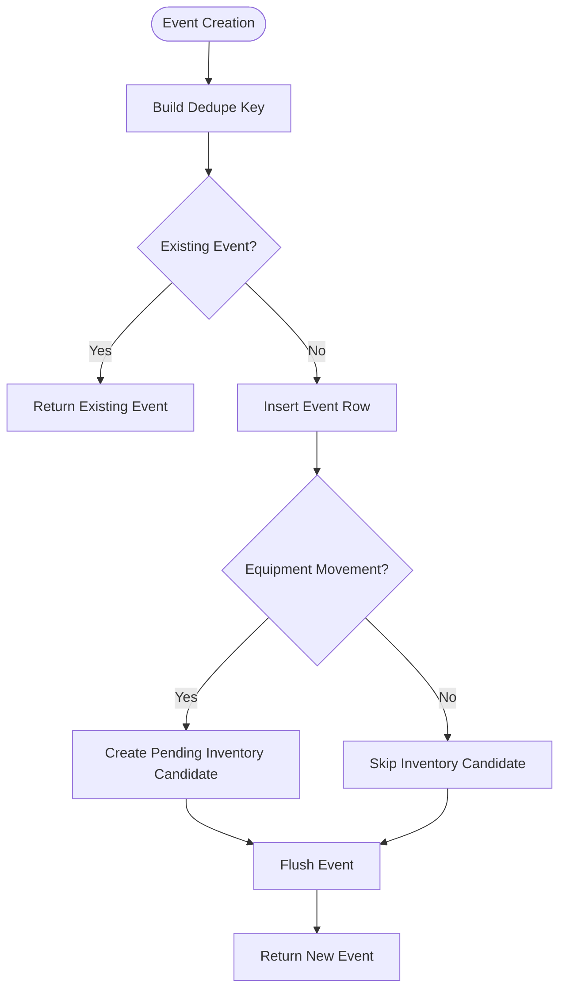
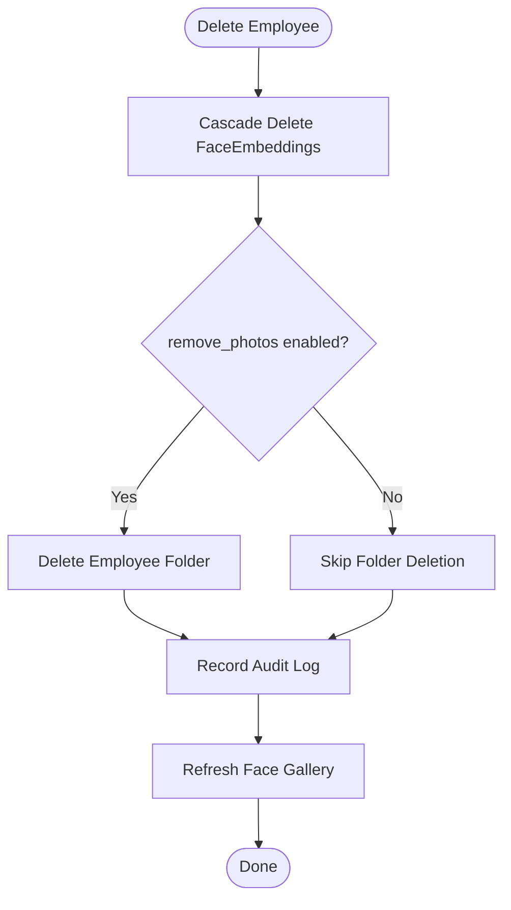
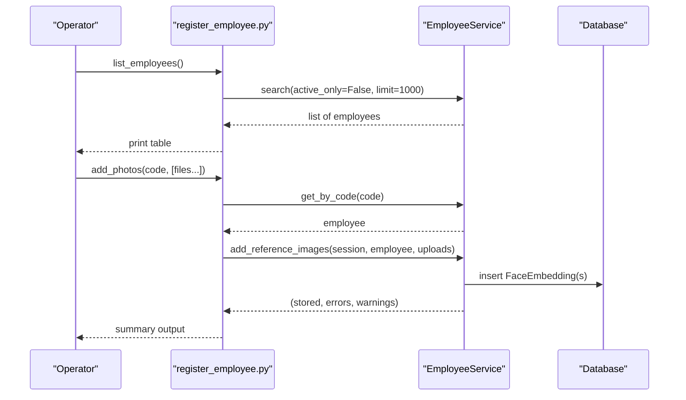
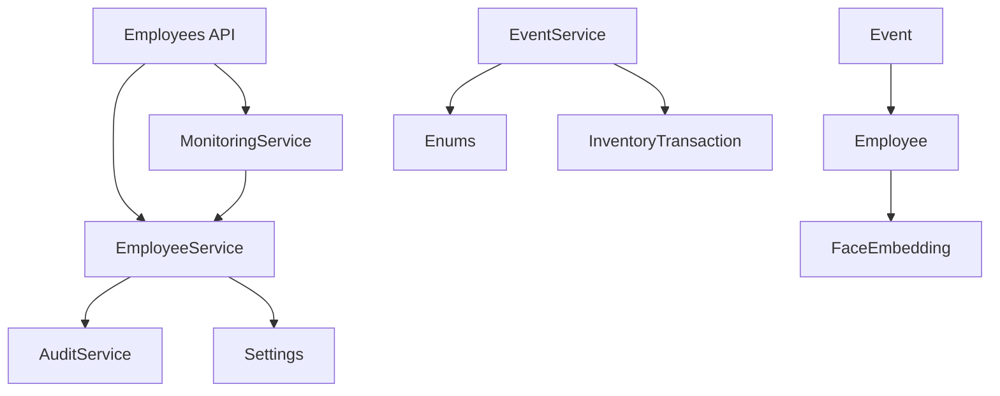

# Employee Lifecycle Management

<cite>
**Referenced Files in This Document**
- [employee.py](file://app/models/employee.py)
- [enums.py](file://app/models/enums.py)
- [ledger.py](file://app/models/ledger.py)
- [employees.py](file://app/api/employees.py)
- [employee_service.py](file://app/services/employee_service.py)
- [audit_service.py](file://app/services/audit_service.py)
- [event_service.py](file://app/services/event_service.py)
- [monitoring_service.py](file://app/services/monitoring_service.py)
- [config.py](file://app/config.py)
- [register_employee.py](file://scripts/register_employee.py)
</cite>

## Table of Contents
1. [Introduction](#introduction)
2. [Project Structure](#project-structure)
3. [Core Components](#core-components)
4. [Architecture Overview](#architecture-overview)
5. [Detailed Component Analysis](#detailed-component-analysis)
6. [Dependency Analysis](#dependency-analysis)
7. [Performance Considerations](#performance-considerations)
8. [Troubleshooting Guide](#troubleshooting-guide)
9. [Conclusion](#conclusion)
10. [Appendices](#appendices)

## Introduction
This document explains the complete employee lifecycle management in the system, including activation and deactivation workflows, adding and removing reference photos, handling historical events, and ensuring data integrity when employees are deleted or deactivated. It also covers bulk operations available through scripts, status updates, mass photo management, onboarding and offboarding procedures, audit trail maintenance, and compliance considerations for personnel data retention.

The system separates concerns into models (data schema), services (business logic), API endpoints (user-facing operations), monitoring (runtime refresh of face recognition galleries), and configuration (paths, retention policies).

## Project Structure
Employee lifecycle functionality spans several modules:
- Data models define employees, biometric embeddings, events, and related entities.
- Services implement CRUD, photo processing, event creation, audit logging, and runtime gallery refresh.
- API endpoints expose HTTP routes for admin and operator actions.
- Monitoring service reloads face recognition galleries after changes.
- Configuration defines storage paths and retention settings.
- Scripts provide batch utilities for registration and listing.

**Diagram sources**
- [employee.py:20-82](file://app/models/employee.py#L20-L82)
- [ledger.py:21-173](file://app/models/ledger.py#L21-L173)
- [enums.py:27-183](file://app/models/enums.py#L27-L183)
- [employee_service.py:34-287](file://app/services/employee_service.py#L34-L287)
- [audit_service.py:13-46](file://app/services/audit_service.py#L13-L46)
- [event_service.py:59-329](file://app/services/event_service.py#L59-L329)
- [monitoring_service.py:68-92](file://app/services/monitoring_service.py#L68-L92)
- [employees.py:25-262](file://app/api/employees.py#L25-L262)
- [config.py:62-118](file://app/config.py#L62-L118)
- [register_employee.py:42-72](file://scripts/register_employee.py#L42-L72)

**Section sources**
- [employee.py:20-82](file://app/models/employee.py#L20-L82)
- [employee_service.py:34-287](file://app/services/employee_service.py#L34-L287)
- [employees.py:25-262](file://app/api/employees.py#L25-L262)
- [monitoring_service.py:68-92](file://app/services/monitoring_service.py#L68-L92)
- [config.py:62-118](file://app/config.py#L62-L118)
- [register_employee.py:42-72](file://scripts/register_employee.py#L42-L72)

## Core Components
- Employee model with active flag and biometric embeddings.
- Face embedding model storing normalized vectors and source image references.
- Event model linking to employees and equipment, with verification workflow.
- Employee service providing create/update/toggle/delete and photo management.
- Audit service recording administrative actions.
- Event service creating deduplicated events and managing review states.
- Monitoring service refreshing face recognition galleries after changes.
- Settings defining directories and evidence retention days.

Key responsibilities:
- Employee lifecycle: create, update, toggle active/inactive, delete.
- Photo lifecycle: add reference images, generate embeddings, remove specific photos.
- Historical integrity: events retain employee links; deletion cascades embeddings but leaves event records intact via foreign key constraints.
- Audit trails: every significant action is recorded with actor and details.
- Runtime consistency: gallery reload ensures recognition engine sees updated templates.

**Section sources**
- [employee.py:20-82](file://app/models/employee.py#L20-L82)
- [employee_service.py:34-287](file://app/services/employee_service.py#L34-L287)
- [audit_service.py:13-46](file://app/services/audit_service.py#L13-L46)
- [event_service.py:59-329](file://app/services/event_service.py#L59-L329)
- [monitoring_service.py:68-92](file://app/services/monitoring_service.py#L68-L92)
- [config.py:62-118](file://app/config.py#L62-L118)

## Architecture Overview
The employee lifecycle flows through API endpoints that validate requests, call service functions, persist changes, and notify the monitoring service to refresh the face recognition gallery. Events created during camera pipeline processing link to employees and remain immutable for historical analysis.

**Diagram sources**
- [employees.py:61-233](file://app/api/employees.py#L61-L233)
- [employee_service.py:34-287](file://app/services/employee_service.py#L34-L287)
- [audit_service.py:13-46](file://app/services/audit_service.py#L13-L46)
- [monitoring_service.py:68-92](file://app/services/monitoring_service.py#L68-L92)

## Detailed Component Analysis

### Employee Model and Biometric Embeddings
- Employee stores identity fields, department, notes, and an active flag.
- FaceEmbedding stores normalized vector blobs, quality score, source image path, and timestamps.
- Relationship between Employee and FaceEmbedding uses ORM cascade and database-level ON DELETE CASCADE to ensure biometric data removal when an employee is deleted.

**Diagram sources**
- [employee.py:20-82](file://app/models/employee.py#L20-L82)

**Section sources**
- [employee.py:20-82](file://app/models/employee.py#L20-L82)

### Employee Service Operations
- Create employee: validates names, generates unique code, persists record, records audit entry.
- Update employee: sanitizes fields, updates timestamp, records audit entry.
- Toggle active: flips is_active, updates timestamp, records activate/deactivate audit entry.
- Add reference images: validates uploads, decodes images, creates embeddings, stores files, flushes session, reloads gallery.
- Delete reference: removes file and embedding row, handles OS errors gracefully.
- Delete employee: cascades embeddings, optionally deletes folder, records audit entry.
- Search/count helpers: support filtering by query and active status.

**Diagram sources**
- [employee_service.py:112-180](file://app/services/employee_service.py#L112-L180)

**Section sources**
- [employee_service.py:34-287](file://app/services/employee_service.py#L34-L287)

### API Endpoints for Employee Lifecycle
- List employees with filters (query, active-only).
- View employee detail with embedded photos and controls.
- Create employee via form submission with CSRF protection.
- Update employee information via form submission.
- Toggle employee active/inactive state.
- Upload multiple reference photos per employee.
- Delete a specific reference photo.
- Delete an employee with confirmation code validation.
- Restricted access endpoint to serve known reference photos only to operators.

**Diagram sources**
- [employees.py:25-262](file://app/api/employees.py#L25-L262)
- [employee_service.py:112-287](file://app/services/employee_service.py#L112-L287)
- [monitoring_service.py:68-92](file://app/services/monitoring_service.py#L68-L92)

**Section sources**
- [employees.py:25-262](file://app/api/employees.py#L25-L262)

### Historical Event Impact Handling
- Events link to employees via a nullable foreign key with SET NULL on delete, preserving historical records even if the employee is removed.
- Event creation includes deduplication keys based on camera, type, track IDs, and cooldown buckets.
- Review workflow allows confirming or rejecting pending events; confirmed events may affect inventory ledger entries.
- Association quality and confidence scores help identify ambiguous cases requiring human review.

**Diagram sources**
- [event_service.py:36-147](file://app/services/event_service.py#L36-L147)
- [ledger.py:21-173](file://app/models/ledger.py#L21-L173)

**Section sources**
- [event_service.py:59-329](file://app/services/event_service.py#L59-L329)
- [ledger.py:21-173](file://app/models/ledger.py#L21-L173)

### Cascade Operations When Employees Are Deleted or Deactivated
- Deletion:
  - Database-level cascade removes all FaceEmbedding rows linked to the employee.
  - Optional filesystem cleanup removes the employee’s reference photo folder.
  - Audit log records deletion with biometric deletion flag.
- Deactivation:
  - Sets is_active to false and updates timestamp.
  - Audit log records deactivation action.
  - Recognition engine does not match inactive employees due to gallery reload and active-only queries where applicable.

**Diagram sources**
- [employee_service.py:199-229](file://app/services/employee_service.py#L199-L229)
- [monitoring_service.py:68-92](file://app/services/monitoring_service.py#L68-L92)

**Section sources**
- [employee_service.py:199-229](file://app/services/employee_service.py#L199-L229)
- [monitoring_service.py:68-92](file://app/services/monitoring_service.py#L68-L92)

### Bulk Operations for Managing Multiple Employees
- Listing employees: script enumerates all employees with status and reference counts.
- Adding photos in bulk: script reads multiple image files and calls the same service used by the API to store and embed them.
- Status updates: while no dedicated bulk toggle exists in the API, administrators can use the toggle endpoint repeatedly or extend scripts to iterate over selected employees.

**Diagram sources**
- [register_employee.py:42-72](file://scripts/register_employee.py#L42-L72)
- [employee_service.py:247-287](file://app/services/employee_service.py#L247-L287)

**Section sources**
- [register_employee.py:42-72](file://scripts/register_employee.py#L42-L72)
- [employee_service.py:247-287](file://app/services/employee_service.py#L247-L287)

### Common Lifecycle Operations Examples
- Onboarding new employees:
  - Create employee record via API.
  - Upload at least two clear reference photos to generate embeddings.
  - Verify gallery reload and recognition availability.
- Offboarding departing staff:
  - Toggle employee to inactive to prevent future recognition matches.
  - Optionally delete employee record and biometric data according to policy.
  - Ensure audit logs capture the action.
- Updating employee information:
  - Use update endpoint to modify name, department, number, notes.
  - Confirm audit entry reflects changes.

**Section sources**
- [employees.py:61-147](file://app/api/employees.py#L61-L147)
- [employee_service.py:34-95](file://app/services/employee_service.py#L34-L95)

## Dependency Analysis
- API depends on EmployeeService for business logic and MonitoringService for gallery refresh.
- EmployeeService depends on AuditService for logging and Settings for paths.
- EventService depends on Enums and InventoryService for movement candidates.
- Models define relationships and constraints that enforce data integrity across deletions and updates.

**Diagram sources**
- [employees.py:25-262](file://app/api/employees.py#L25-L262)
- [employee_service.py:34-287](file://app/services/employee_service.py#L34-L287)
- [audit_service.py:13-46](file://app/services/audit_service.py#L13-L46)
- [event_service.py:59-329](file://app/services/event_service.py#L59-L329)
- [employee.py:20-82](file://app/models/employee.py#L20-L82)
- [ledger.py:21-173](file://app/models/ledger.py#L21-L173)

**Section sources**
- [employees.py:25-262](file://app/api/employees.py#L25-L262)
- [employee_service.py:34-287](file://app/services/employee_service.py#L34-L287)
- [event_service.py:59-329](file://app/services/event_service.py#L59-L329)
- [employee.py:20-82](file://app/models/employee.py#L20-L82)
- [ledger.py:21-173](file://app/models/ledger.py#L21-L173)

## Performance Considerations
- Embedding generation and image decoding are CPU-intensive; batching uploads helps amortize overhead.
- Gallery reload should be triggered after any change to embeddings to keep recognition engine consistent.
- Evidence purging runs periodically via the janitor thread to manage storage growth.
- Event deduplication prevents duplicate logging under high-frequency detection scenarios.

[No sources needed since this section provides general guidance]

## Troubleshooting Guide
- Face model unavailable:
  - Uploading photos returns an error indicating the face model is not available; check service initialization and configuration.
- Permission errors deleting files:
  - Deleting references or folders may raise OS errors; logs warn about failures without aborting the operation.
- Missing employee or embedding:
  - API endpoints return user-friendly flash messages when resources are not found.
- Audit log gaps:
  - Ensure sessions are flushed and committed; audit entries are recorded within service functions.

**Section sources**
- [employee_service.py:132-148](file://app/services/employee_service.py#L132-L148)
- [employee_service.py:183-196](file://app/services/employee_service.py#L183-L196)
- [employee_service.py:215-229](file://app/services/employee_service.py#L215-L229)
- [employees.py:111-127](file://app/api/employees.py#L111-L127)
- [employees.py:198-208](file://app/api/employees.py#L198-L208)

## Conclusion
The employee lifecycle management system provides robust tools for onboarding, updating, activating/deactivating, and offboarding employees while maintaining strict data integrity and auditability. Biometric embeddings are tightly coupled to employee records with cascading deletion, and historical events remain intact for analysis. Operators can perform common tasks via the API, and scripts support bulk operations. Compliance is supported through configurable retention policies and comprehensive audit trails.

[No sources needed since this section summarizes without analyzing specific files]

## Appendices

### Data Retention Policies and Compliance
- Evidence retention days are configurable; the janitor thread purges expired evidence automatically.
- Employee deletion removes biometric data and optionally the reference photo folder, aligning with privacy requirements.
- Audit logs capture administrative actions with actor identity and details for accountability.

**Section sources**
- [config.py:100-118](file://app/config.py#L100-L118)
- [monitoring_service.py:218-232](file://app/services/monitoring_service.py#L218-L232)
- [audit_service.py:13-46](file://app/services/audit_service.py#L13-L46)