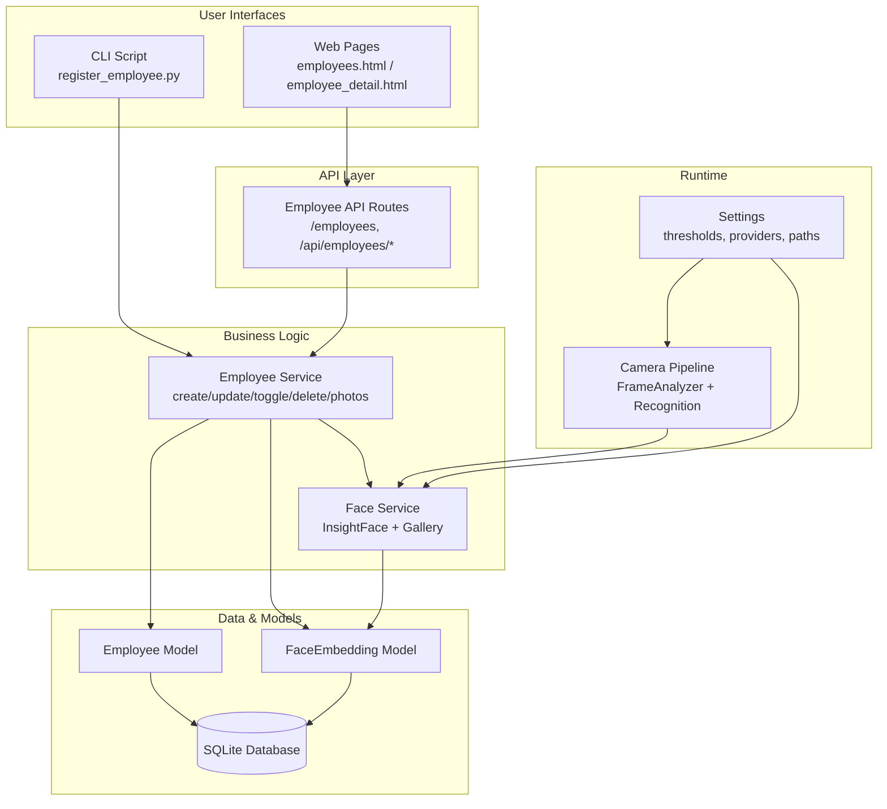
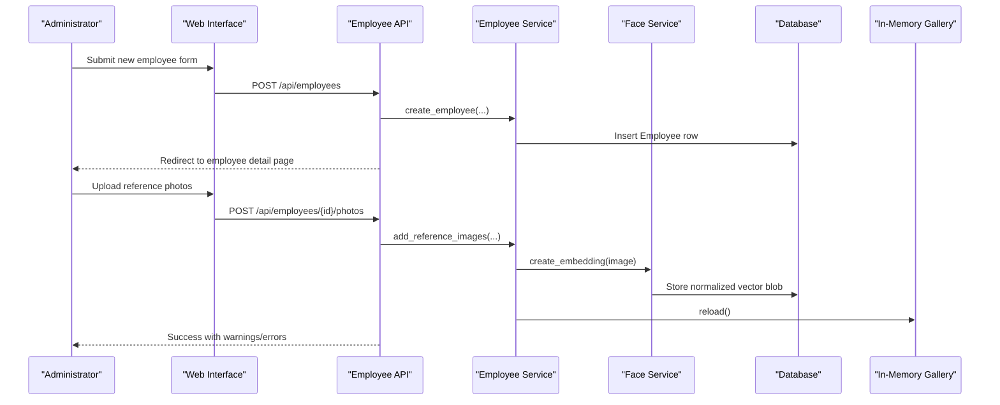
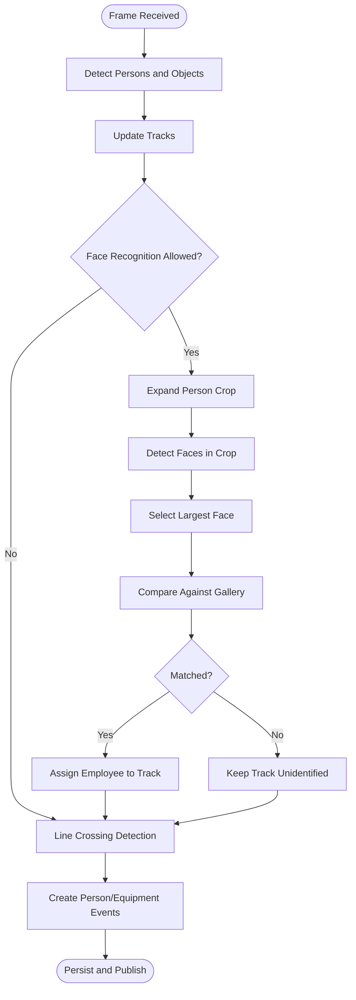
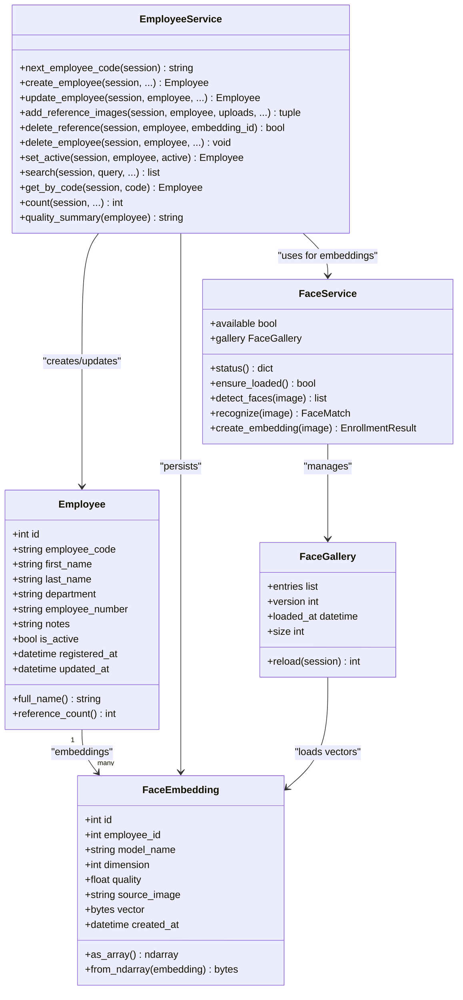

# Employee Management

<cite>
**Referenced Files in This Document**
- [README.md](file://README.md)
- [register_employee.py](file://scripts/register_employee.py)
- [employee.py](file://app/models/employee.py)
- [employee_service.py](file://app/services/employee_service.py)
- [employees.py](file://app/api/employees.py)
- [face_service.py](file://app/services/face_service.py)
- [pipeline_service.py](file://app/services/pipeline_service.py)
- [config.py](file://app/config.py)
- [employees.html](file://app/ui/templates/employees.html)
- [employee_detail.html](file://app/ui/templates/employee_detail.html)
</cite>

## Table of Contents
1. [Introduction](#introduction)
2. [Project Structure](#project-structure)
3. [Core Components](#core-components)
4. [Architecture Overview](#architecture-overview)
5. [Detailed Component Analysis](#detailed-component-analysis)
6. [Dependency Analysis](#dependency-analysis)
7. [Performance Considerations](#performance-considerations)
8. [Troubleshooting Guide](#troubleshooting-guide)
9. [Conclusion](#conclusion)
10. [Appendices](#appendices)

## Introduction
This document explains the employee management and face recognition subsystem. It covers:
- How employees are registered through the web interface and CLI batch registration.
- How reference photos become InsightFace embeddings stored securely in the database.
- How the gallery is built, refreshed, and used for recognition.
- How similarity thresholds, match margins, and unknown-person handling work.
- How employee lifecycle changes affect recognition and historical events.
- Security, privacy, and photo quality best practices.

The system stores biometric templates as normalized float32 vectors inside the database rather than in public directories, and it never returns raw embeddings over HTTP APIs.

**Section sources**
- [README.md:245-283](file://README.md#L245-L283)
- [employee.py:1-5](file://app/models/employee.py#L1-L5)

## Project Structure
Employee-related functionality spans models, services, API routes, UI templates, CLI scripts, and configuration:

**Diagram sources**
- [employees.html:75-111](file://app/ui/templates/employees.html#L75-L111)
- [employee_detail.html:122-136](file://app/ui/templates/employee_detail.html#L122-L136)
- [register_employee.py:104-127](file://scripts/register_employee.py#L104-L127)
- [employees.py:61-94](file://app/api/employees.py#L61-L94)
- [employee_service.py:34-75](file://app/services/employee_service.py#L34-L75)
- [face_service.py:173-204](file://app/services/face_service.py#L173-L204)
- [pipeline_service.py:156-180](file://app/services/pipeline_service.py#L156-L180)
- [config.py:194-200](file://app/config.py#L194-L200)

**Section sources**
- [README.md:597-621](file://README.md#L597-L621)

## Core Components
- **Employee model**: Stores identity fields, active status, timestamps, and a one-to-many relationship to `FaceEmbedding`.
- **FaceEmbedding model**: Stores normalized InsightFace vector blobs, source image path, quality score, and metadata.
- **Employee service**: Handles CRUD, activation toggling, reference photo storage, embedding creation, deletion, search, and audit logging.
- **Face service**: Wraps InsightFace, builds an in-memory gallery from active employees, performs detection, embedding enrollment, and matching with threshold and margin logic.
- **Employee API**: Provides admin-only pages and endpoints for creating employees, uploading photos, toggling activation, deleting references, and safely serving reference images.
- **Pipeline integration**: Uses the face service during live camera processing to assign identities to tracked persons and generate person/equipment movement events.
- **Configuration**: Supplies face model name, similarity threshold, match margin, provider list, detection size, and recognition interval.

**Section sources**
- [employee.py:20-47](file://app/models/employee.py#L20-L47)
- [employee.py:50-82](file://app/models/employee.py#L50-L82)
- [employee_service.py:34-95](file://app/services/employee_service.py#L34-L95)
- [employee_service.py:112-180](file://app/services/employee_service.py#L112-L180)
- [face_service.py:86-129](file://app/services/face_service.py#L86-L129)
- [face_service.py:132-166](file://app/services/face_service.py#L132-L166)
- [face_service.py:173-204](file://app/services/face_service.py#L173-L204)
- [employees.py:61-94](file://app/api/employees.py#L61-L94)
- [employees.py:150-185](file://app/api/employees.py#L150-L185)
- [pipeline_service.py:156-180](file://app/services/pipeline_service.py#L156-L180)
- [config.py:194-200](file://app/config.py#L194-L200)

## Architecture Overview
The employee and face recognition architecture combines enrollment, gallery management, and runtime recognition:

**Diagram sources**
- [employees.html:75-111](file://app/ui/templates/employees.html#L75-L111)
- [employees.py:61-94](file://app/api/employees.py#L61-L94)
- [employee_service.py:34-75](file://app/services/employee_service.py#L34-L75)
- [employee_service.py:112-180](file://app/services/employee_service.py#L112-L180)
- [face_service.py:276-294](file://app/services/face_service.py#L276-L294)
- [face_service.py:140-166](file://app/services/face_service.py#L140-L166)

## Detailed Component Analysis

### Employee Registration Workflow

#### Web Interface Registration
- The `/employees` page shows existing employees, filters by active status, and provides a form to create a new employee.
- Creating an employee calls the `/api/employees` endpoint, which validates CSRF, creates the employee via the service, commits the transaction, and redirects to the employee detail page.
- After creation, administrators upload 2–5 reference photos per employee on the detail page. Each uploaded image is validated, decoded, processed by the face service, saved under the employee’s directory, and its normalized embedding is persisted.

Key behaviors:
- Employee code can be auto-generated or supplied manually.
- Name validation requires at least two characters for first and last names.
- Reference photos trigger embedding creation; if the face model is unavailable, uploads report that biometric templates cannot be created.
- Uploaded images are served only through a restricted endpoint that checks operator role, path safety, and whether the file is referenced by an embedding.

**Section sources**
- [employees.html:75-111](file://app/ui/templates/employees.html#L75-L111)
- [employees.py:25-42](file://app/api/employees.py#L25-L42)
- [employees.py:61-94](file://app/api/employees.py#L61-L94)
- [employees.py:150-185](file://app/api/employees.py#L150-L185)
- [employee_detail.html:122-136](file://app/ui/templates/employee_detail.html#L122-L136)
- [employee_service.py:34-75](file://app/services/employee_service.py#L34-L75)
- [employee_service.py:112-180](file://app/services/employee_service.py#L112-L180)
- [employees.py:239-261](file://app/api/employees.py#L239-L261)

#### CLI Batch Registration
The CLI script supports:
- Listing employees.
- Registering a new employee with optional department, employee number, code, notes, and multiple photos.
- Adding photos to an existing employee using their code.

Important details:
- The script uses the same services as the dashboard, so CLI-created data appears immediately in the UI.
- If the face model is unavailable, the script warns that biometric templates will not be added.
- Photo files are read into memory, validated, and passed to the employee service for embedding creation.
- Errors and warnings are printed per photo, and the final template count is shown.

Example usage patterns:
- List employees.
- Create employee with multiple photos.
- Add photos to an existing employee by code.

**Section sources**
- [register_employee.py:1-12](file://scripts/register_employee.py#L1-L12)
- [register_employee.py:42-55](file://scripts/register_employee.py#L42-L55)
- [register_employee.py:58-75](file://scripts/register_employee.py#L58-L75)
- [register_employee.py:78-101](file://scripts/register_employee.py#L78-L101)
- [register_employee.py:104-127](file://scripts/register_employee.py#L104-L127)

### Face Template Management

#### Multiple Reference Images Per Employee
Each reference photograph produces one `FaceEmbedding`:
- The image is validated and decoded.
- The face service extracts the largest detected face and generates a normalized embedding.
- Warnings are collected for issues such as no face found, multiple faces, low detection confidence, or small face size.
- The original image is saved under `data/employees/<employee_code>/reference_NN.ext`.
- The embedding vector is stored as normalized float32 bytes in the database.
- When embeddings are added, the in-memory gallery is reloaded so recognition sees the new templates immediately.

**Section sources**
- [employee_service.py:112-180](file://app/services/employee_service.py#L112-L180)
- [face_service.py:276-294](file://app/services/face_service.py#L276-L294)
- [employee.py:50-82](file://app/models/employee.py#L50-L82)

#### Gallery Operations
The gallery is an in-memory snapshot of active employees’ embeddings:
- It loads only active employees.
- It converts stored byte blobs back to NumPy arrays.
- It tracks version and load timestamp.
- It is reloaded after adding or removing references, or when an employee’s active state changes.

**Section sources**
- [face_service.py:132-166](file://app/services/face_service.py#L132-L166)
- [employee_service.py:168-180](file://app/services/employee_service.py#L168-L180)
- [employees.py:143-147](file://app/api/employees.py#L143-L147)
- [employees.py:202-208](file://app/api/employees.py#L202-L208)

#### Biometric Data Handling
- Embeddings are stored as `LargeBinary` columns containing normalized float32 vectors.
- Helper methods normalize vectors before saving and when converting to arrays.
- Raw embeddings are never returned by HTTP APIs.
- Reference images are accessed through a protected endpoint that enforces operator role, path traversal protection, and embedding existence checks.

**Section sources**
- [employee.py:1-5](file://app/models/employee.py#L1-L5)
- [employee.py:68-82](file://app/models/employee.py#L68-L82)
- [employees.py:239-261](file://app/api/employees.py#L239-L261)

### Face Recognition Process

#### Similarity Threshold and Match Margin
Recognition compares the query embedding against the gallery using cosine similarity:
- For each employee, the best reference photo determines the representative score.
- If the best score is below the configured similarity threshold, the result is unknown.
- If the gap between the best and second-best scores is smaller than the configured margin, the result is uncertain and treated as unknown.
- Only when both conditions pass is the employee matched.

These values come from settings:
- `FACE_SIMILARITY_THRESHOLD` defaults around 0.45.
- `FACE_MATCH_MARGIN` defaults around 0.05.

**Section sources**
- [face_service.py:86-129](file://app/services/face_service.py#L86-L129)
- [config.py:194-197](file://app/config.py#L194-L197)
- [README.md:154-156](file://README.md#L154-L156)

#### Unknown Person Handling
- If no face is detected, recognition returns no match.
- If detection confidence is very low, recognition returns an unknown result.
- In the pipeline, unknown person crossings create events with pending verification status and notes indicating that face recognition was not reliable.
- Equipment movements without confident employee identification also require review.

**Section sources**
- [face_service.py:261-274](file://app/services/face_service.py#L261-L274)
- [pipeline_service.py:508-530](file://app/services/pipeline_service.py#L508-L530)
- [pipeline_service.py:370-387](file://app/services/pipeline_service.py#L370-L387)

#### Recognition Flow During Live Processing

**Diagram sources**
- [pipeline_service.py:156-180](file://app/services/pipeline_service.py#L156-L180)
- [pipeline_service.py:218-321](file://app/services/pipeline_service.py#L218-L321)
- [face_service.py:261-274](file://app/services/face_service.py#L261-L274)

### Employee Lifecycle Management

#### Activation and Deactivation
- Toggling `is_active` removes the employee from the recognition gallery but keeps historical events intact.
- The UI displays active/inactive status and warns that blocked employees are recognized as unknown persons.
- Toggling refreshes the gallery.

**Section sources**
- [employee_service.py:232-244](file://app/services/employee_service.py#L232-L244)
- [employees.py:130-147](file://app/api/employees.py#L130-L147)
- [employee_detail.html:72-85](file://app/ui/templates/employee_detail.html#L72-L85)
- [README.md:279-283](file://README.md#L279-L283)

#### Photo Addition and Removal
- Adding photos persists the image and embedding, then reloads the gallery.
- Deleting a reference removes the physical image file and the corresponding embedding row.
- The UI allows inline deletion of individual reference photos.

**Section sources**
- [employee_service.py:112-180](file://app/services/employee_service.py#L112-L180)
- [employee_service.py:183-196](file://app/services/employee_service.py#L183-L196)
- [employees.py:150-185](file://app/api/employees.py#L150-L185)
- [employees.py:188-208](file://app/api/employees.py#L188-L208)
- [employee_detail.html:100-136](file://app/ui/templates/employee_detail.html#L100-L136)

#### Impact on Historical Events
- Deactivating an employee does not delete historical events; they remain recorded.
- Deleting an employee removes the employee record, all embeddings, and optionally the photo folder.
- Historical events may lose the foreign key link depending on cascade behavior, causing them to appear as unknown persons in reports.

**Section sources**
- [employee_service.py:199-229](file://app/services/employee_service.py#L199-L229)
- [employee.py:55-58](file://app/models/employee.py#L55-L58)
- [README.md:279-283](file://README.md#L279-L283)

### API Endpoints Summary

| Endpoint | Method | Purpose | Access | Notes |
|---|---:|---|---|---|
| `/employees` | GET | Render employee list with filters and face status | Admin | Shows next code and active filter |
| `/employees/{code}` | GET | Render employee detail with embeddings and actions | Admin | Includes toggle, photos, delete forms |
| `/api/employees` | POST | Create employee | Admin | CSRF required; redirects to detail |
| `/api/employees/{employee_id}/update` | POST | Update employee fields | Admin | CSRF required |
| `/api/employees/{employee_id}/toggle` | POST | Activate/deactivate employee | Admin | Refreshes gallery |
| `/api/employees/{employee_id}/photos` | POST | Upload reference photos | Admin | Creates embeddings; refreshes gallery |
| `/api/employees/{employee_id}/photos/{embedding_id}/delete` | POST | Delete one reference photo | Admin | Deletes image and embedding |
| `/api/employees/{employee_id}/delete` | POST | Delete employee and biometric data | Admin | Requires confirmation code |
| `/api/employees/{code}/photos/{filename}` | GET | Serve reference photo safely | Operator+ | Validates path and embedding reference |

**Section sources**
- [employees.py:25-42](file://app/api/employees.py#L25-L42)
- [employees.py:45-58](file://app/api/employees.py#L45-L58)
- [employees.py:61-94](file://app/api/employees.py#L61-L94)
- [employees.py:97-127](file://app/api/employees.py#L97-L127)
- [employees.py:130-147](file://app/api/employees.py#L130-L147)
- [employees.py:150-185](file://app/api/employees.py#L150-L185)
- [employees.py:188-208](file://app/api/employees.py#L188-L208)
- [employees.py:211-233](file://app/api/employees.py#L211-L233)
- [employees.py:239-261](file://app/api/employees.py#L239-L261)

## Dependency Analysis
The following diagram maps core dependencies among employee and face components:

**Diagram sources**
- [employee.py:20-47](file://app/models/employee.py#L20-L47)
- [employee.py:50-82](file://app/models/employee.py#L50-L82)
- [employee_service.py:23-31](file://app/services/employee_service.py#L23-L31)
- [employee_service.py:34-75](file://app/services/employee_service.py#L34-L75)
- [employee_service.py:112-180](file://app/services/employee_service.py#L112-L180)
- [employee_service.py:183-229](file://app/services/employee_service.py#L183-L229)
- [employee_service.py:232-287](file://app/services/employee_service.py#L232-L287)
- [face_service.py:132-166](file://app/services/face_service.py#L132-L166)
- [face_service.py:173-204](file://app/services/face_service.py#L173-L204)
- [face_service.py:237-294](file://app/services/face_service.py#L237-L294)

**Section sources**
- [employee.py:20-82](file://app/models/employee.py#L20-L82)
- [employee_service.py:23-287](file://app/services/employee_service.py#L23-L287)
- [face_service.py:86-166](file://app/services/face_service.py#L86-L166)
- [face_service.py:173-294](file://app/services/face_service.py#L173-L294)

## Performance Considerations
- InsightFace is loaded once and reused; loading per frame would be unusable on CPU.
- Recognition is throttled per track using `FACE_RECOGNITION_INTERVAL`, reducing repeated expensive operations.
- The gallery is rebuilt only when needed (after adding/removing references or toggling activation).
- Evidence JPEG retention and processing FPS settings influence disk usage and throughput.
- GPU providers can improve performance when available.

**Section sources**
- [face_service.py:1-11](file://app/services/face_service.py#L1-L11)
- [face_service.py:206-234](file://app/services/face_service.py#L206-L234)
- [pipeline_service.py:156-163](file://app/services/pipeline_service.py#L156-L163)
- [config.py:194-200](file://app/config.py#L194-L200)
- [README.md:154-157](file://README.md#L154-L157)

## Troubleshooting Guide
Common issues and resolutions:
- **Face recognition unavailable**: Install AI requirements, ensure InsightFace and ONNX Runtime are installed, and reload the gallery from settings.
- **Low recognition accuracy**: Calibrate `FACE_SIMILARITY_THRESHOLD` and `FACE_MATCH_MARGIN`; test with real frames.
- **No faces in reference photos**: Ensure clear frontal faces, adequate lighting, single person per image, and minimum resolution.
- **Gallery not updating**: After adding or removing photos, refresh the gallery or toggle employee activation to force reload.
- **Historical events show unknown after deletion**: Deleting an employee removes biometric data; old events may lose the employee link and appear as unknown.

**Section sources**
- [README.md:516-530](file://README.md#L516-L530)
- [README.md:270-283](file://README.md#L270-L283)
- [face_service.py:184-204](file://app/services/face_service.py#L184-L204)
- [employee_service.py:199-229](file://app/services/employee_service.py#L199-L229)

## Conclusion
The employee management subsystem provides secure, auditable registration of employees and their biometric templates, while the face recognition layer integrates cleanly with the camera pipeline. Administrators can register employees via the web interface or CLI, manage reference photos, control recognition parameters, and handle employee lifecycle changes. Unknown-person handling ensures that uncertain matches do not automatically alter inventory or event records, requiring human review when necessary. Proper photo collection, threshold calibration, and security practices are essential for reliable and responsible operation.

## Appendices

### Configuration Keys Relevant to Face Recognition
| Key | Default | Meaning |
|---|---:|---|
| `FACE_MODEL_NAME` | `buffalo_l` | InsightFace model name |
| `FACE_SIMILARITY_THRESHOLD` | `0.45` | Minimum cosine similarity for a match |
| `FACE_MATCH_MARGIN` | `0.05` | Minimum gap between best and second-best scores |
| `FACE_PROVIDERS` | `CPUExecutionProvider` | ONNX Runtime providers |
| `FACE_DETECTION_SIZE` | `640x640` | Face detection input size |
| `FACE_RECOGNITION_INTERVAL` | `10` | Frames between recognition attempts per track |

**Section sources**
- [config.py:194-200](file://app/config.py#L194-L200)
- [README.md:154-157](file://README.md#L154-L157)

### Security and Privacy Best Practices
- Store biometric vectors only in the database; avoid exposing raw embeddings.
- Restrict access to reference photos through authenticated endpoints with path validation.
- Use strong secrets, HTTPS in production, and role-based access control.
- Back up sensitive directories (`data`, `secrets`, `.env`) and exclude them from version control.
- Collect high-quality reference photos from consistent camera angles and lighting.
- Review and calibrate thresholds regularly based on real-world performance.

**Section sources**
- [employee.py:1-5](file://app/models/employee.py#L1-L5)
- [employees.py:239-261](file://app/api/employees.py#L239-L261)
- [README.md:625-637](file://README.md#L625-L637)