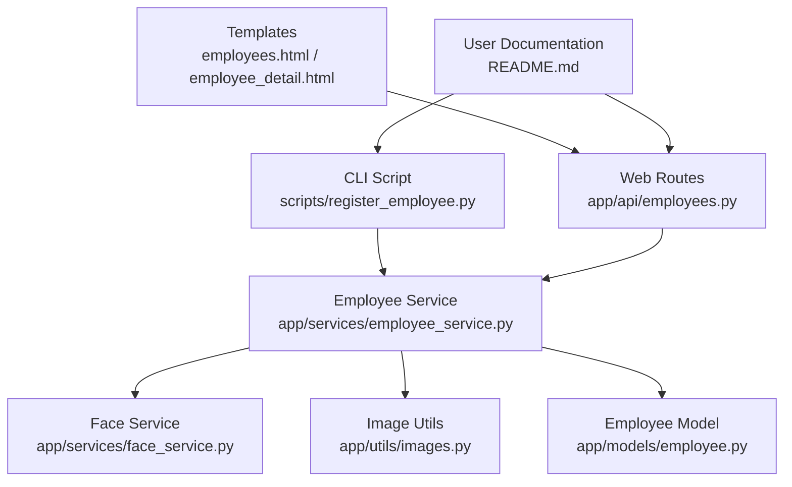
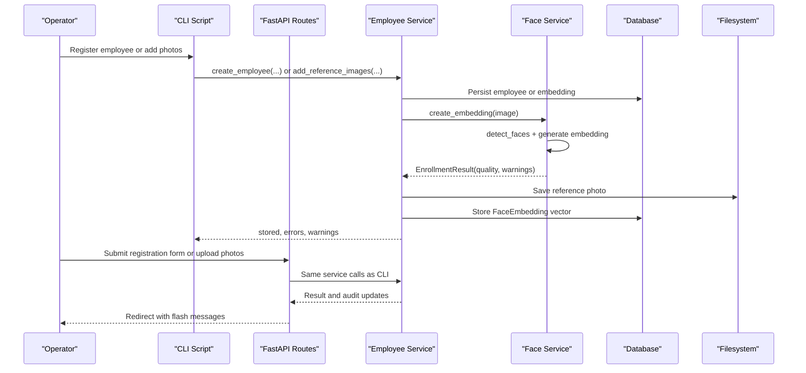
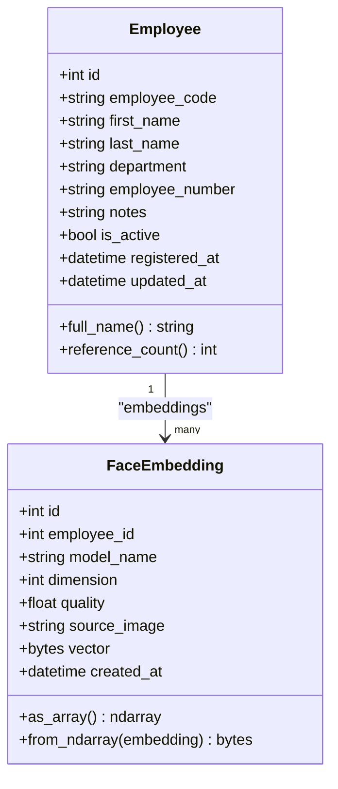
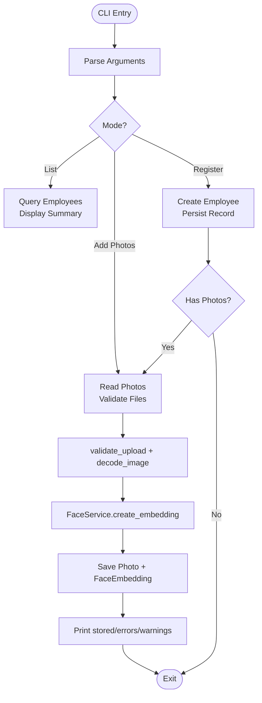
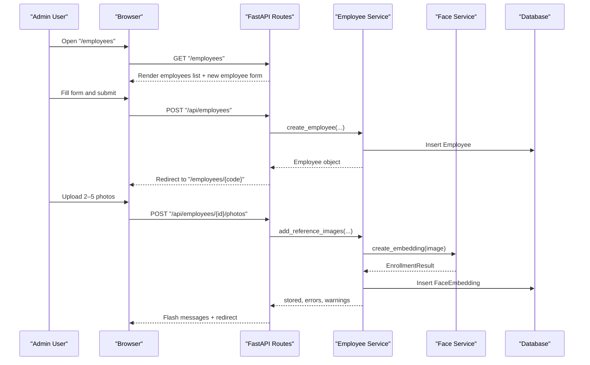
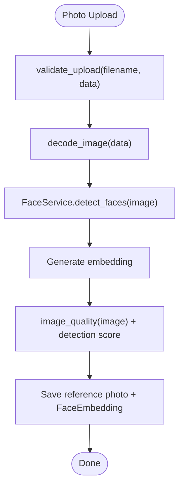
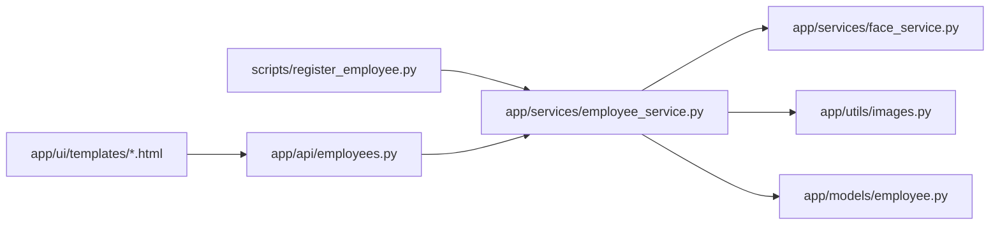

# Employee Registration

<cite>
**Referenced Files in This Document**
- [register_employee.py](file://scripts/register_employee.py)
- [employee.py](file://app/models/employee.py)
- [employees.py](file://app/api/employees.py)
- [employee_service.py](file://app/services/employee_service.py)
- [face_service.py](file://app/services/face_service.py)
- [images.py](file://app/utils/images.py)
- [employees.html](file://app/ui/templates/employees.html)
- [employee_detail.html](file://app/ui/templates/employee_detail.html)
- [README.md](file://README.md)
</cite>

## Table of Contents
1. [Introduction](#introduction)
2. [Project Structure](#project-structure)
3. [Core Components](#core-components)
4. [Architecture Overview](#architecture-overview)
5. [Detailed Component Analysis](#detailed-component-analysis)
6. [Dependency Analysis](#dependency-analysis)
7. [Performance Considerations](#performance-considerations)
8. [Troubleshooting Guide](#troubleshooting-guide)
9. [Conclusion](#conclusion)
10. [Appendices](#appendices)

## Introduction
This document explains the employee registration system, covering both the web interface and the CLI-based registration workflow implemented by `scripts/register_employee.py`. It describes the employee data model, department assignment, activation status, face image upload process, quality validation, and support for multiple reference photos per employee. It also provides step-by-step examples for CLI commands, web form submissions, and programmatic API usage, along with error handling guidance and best practices for photo collection.

The system stores biometric face embeddings in the database as normalized float vectors and keeps reference photographs under a per-employee directory. The same service layer is used by the web dashboard and the CLI script, so registrations created through either path are immediately visible in the UI.

## Project Structure
Employee registration spans several layers:
- CLI entry point: `scripts/register_employee.py`
- Web routes and templates: `app/api/employees.py`, `app/ui/templates/employees.html`, `app/ui/templates/employee_detail.html`
- Business logic: `app/services/employee_service.py`
- Face recognition and embedding creation: `app/services/face_service.py`
- Image utilities and validation: `app/utils/images.py`
- Data model: `app/models/employee.py`
- User-facing documentation and examples: `README.md`

**Diagram sources**
- [register_employee.py:1-132](file://scripts/register_employee.py#L1-L132)
- [employees.py:25-261](file://app/api/employees.py#L25-L261)
- [employees.html:75-111](file://app/ui/templates/employees.html#L75-L111)
- [employee_detail.html:88-136](file://app/ui/templates/employee_detail.html#L88-L136)
- [employee_service.py:34-180](file://app/services/employee_service.py#L34-L180)
- [face_service.py:276-294](file://app/services/face_service.py#L276-L294)
- [images.py:37-81](file://app/utils/images.py#L37-L81)
- [employee.py:20-47](file://app/models/employee.py#L20-L47)
- [README.md:245-283](file://README.md#L245-L283)

**Section sources**
- [register_employee.py:1-132](file://scripts/register_employee.py#L1-L132)
- [employees.py:25-261](file://app/api/employees.py#L25-L261)
- [employees.html:75-111](file://app/ui/templates/employees.html#L75-L111)
- [employee_detail.html:88-136](file://app/ui/templates/employee_detail.html#L88-L136)
- [employee_service.py:34-180](file://app/services/employee_service.py#L34-L180)
- [face_service.py:276-294](file://app/services/face_service.py#L276-L294)
- [images.py:37-81](file://app/utils/images.py#L37-L81)
- [employee.py:20-47](file://app/models/employee.py#L20-L47)
- [README.md:245-283](file://README.md#L245-L283)

## Core Components
- CLI registration script: supports listing employees, creating an employee with optional photos, and adding photos to an existing employee.
- Web registration form: allows admin users to create employees and upload multiple reference photos.
- Employee service: validates inputs, enforces unique codes, persists employee records, stores reference images, creates biometric embeddings, and manages deletion and activation.
- Face service: loads InsightFace, detects faces, generates embeddings, computes quality scores, and maintains an in-memory gallery of active employee embeddings.
- Image utilities: validate file type and size, decode images, compute heuristic quality metrics, and protect against path traversal.
- Data model: defines employee fields, activation status, timestamps, and one-to-many relationship to face embeddings.

Key responsibilities:
- Input validation and normalization (names, department, notes).
- Unique employee code enforcement.
- Reference photo storage and embedding persistence.
- Quality scoring and warnings for enrollment photos.
- Audit logging for create/update/delete operations.

**Section sources**
- [register_employee.py:42-101](file://scripts/register_employee.py#L42-L101)
- [employees.py:61-94](file://app/api/employees.py#L61-L94)
- [employee_service.py:34-75](file://app/services/employee_service.py#L34-L75)
- [face_service.py:173-294](file://app/services/face_service.py#L173-L294)
- [images.py:37-81](file://app/utils/images.py#L37-L81)
- [employee.py:20-47](file://app/models/employee.py#L20-L47)

## Architecture Overview
The registration flow shares a common service layer across CLI and web endpoints.

**Diagram sources**
- [register_employee.py:78-101](file://scripts/register_employee.py#L78-L101)
- [employees.py:61-94](file://app/api/employees.py#L61-L94)
- [employee_service.py:112-180](file://app/services/employee_service.py#L112-L180)
- [face_service.py:276-294](file://app/services/face_service.py#L276-L294)

## Detailed Component Analysis

### Employee Data Model
The employee record includes:
- `employee_code`: unique identifier, indexed, required.
- Personal information: `first_name`, `last_name`.
- Department: `department`.
- Optional fields: `employee_number`, `notes`.
- Activation status: `is_active`.
- Timestamps: `registered_at`, `updated_at`.
- Relationship: one-to-many `embeddings` to `FaceEmbedding`.

Each `FaceEmbedding` stores:
- `employee_id` foreign key.
- `model_name`, `dimension`, `quality`, `source_image`.
- Normalized binary vector representation.
- Creation timestamp.

**Diagram sources**
- [employee.py:20-47](file://app/models/employee.py#L20-L47)
- [employee.py:50-82](file://app/models/employee.py#L50-L82)

**Section sources**
- [employee.py:20-82](file://app/models/employee.py#L20-L82)

### CLI Registration Workflow
The CLI script supports:
- Listing employees.
- Creating an employee with optional reference photos.
- Adding photos to an existing employee using `--add-photos <code> --photos ...`.

Example commands:
- List employees:
  - `python scripts/register_employee.py --list`
- Create employee with photos:
  - `python scripts/register_employee.py --first-name Ali --last-name Valiyev --department "IT bo‘limi" --photos C:\rasm\ali1.jpg C:\rasm\ali2.jpg`
- Add photos later:
  - `python scripts/register_employee.py --add-photos EMP001 --photos yangi.jpg`

Behavior:
- If face model is unavailable, the employee is still created but no biometric template is added.
- Photo files are validated; missing files are skipped.
- Errors and warnings are printed per photo.

**Diagram sources**
- [register_employee.py:42-101](file://scripts/register_employee.py#L42-L101)
- [employee_service.py:112-180](file://app/services/employee_service.py#L112-L180)
- [images.py:37-81](file://app/utils/images.py#L37-L81)
- [face_service.py:276-294](file://app/services/face_service.py#L276-L294)

**Section sources**
- [register_employee.py:1-132](file://scripts/register_employee.py#L1-L132)
- [README.md:245-283](file://README.md#L245-L283)

### Web Registration Workflow
Admin users can register employees via the web interface:
- Navigate to `/employees`.
- Fill out the “New employee” form: first name, last name, department, employee number, optional employee code, and notes.
- Submit to POST `/api/employees`.
- After successful creation, redirect to the employee detail page where multiple reference photos can be uploaded.

Reference photo upload:
- Navigate to `/employees/{code}`.
- Use the “Yuz shablonlari” section to upload 2–5 photos.
- Each accepted photo triggers embedding creation and is stored under the employee’s directory.

**Diagram sources**
- [employees.py:25-94](file://app/api/employees.py#L25-L94)
- [employees.py:150-185](file://app/api/employees.py#L150-L185)
- [employee_service.py:112-180](file://app/services/employee_service.py#L112-L180)
- [face_service.py:276-294](file://app/services/face_service.py#L276-L294)
- [employees.html:75-111](file://app/ui/templates/employees.html#L75-L111)
- [employee_detail.html:100-136](file://app/ui/templates/employee_detail.html#L100-L136)

**Section sources**
- [employees.py:25-94](file://app/api/employees.py#L25-L94)
- [employees.py:150-185](file://app/api/employees.py#L150-L185)
- [employees.html:75-111](file://app/ui/templates/employees.html#L75-L111)
- [employee_detail.html:100-136](file://app/ui/templates/employee_detail.html#L100-L136)

### Programmatic Registration via API
For automation, use HTTP requests to the FastAPI endpoints:
- Create employee:
  - Method: `POST`
  - URL: `/api/employees`
  - Content-Type: `multipart/form-data`
  - Fields: `first_name`, `last_name`, `department`, `employee_number`, `employee_code`, `notes`, `csrf_token`
- Upload reference photos:
  - Method: `POST`
  - URL: `/api/employees/{employee_id}/photos`
  - Content-Type: `multipart/form-data`
  - Fields: `photos[]` (multiple), `csrf_token`

Notes:
- CSRF token is required for all mutating endpoints.
- Successful creation redirects to the employee detail page; automated clients should handle redirects and inspect flash messages or response status.
- For pure JSON workflows, consider building a client that parses HTML responses or extends the API to return structured JSON.

**Section sources**
- [employees.py:61-94](file://app/api/employees.py#L61-L94)
- [employees.py:150-185](file://app/api/employees.py#L150-L185)

### Face Image Upload Process and Quality Validation
Upload pipeline:
1. File validation: allowed formats (`jpg`, `jpeg`, `png`, `webp`), non-empty, max 8 MB.
2. Decode image into BGR array.
3. Face detection and embedding generation via FaceService.
4. Heuristic quality scoring combining sharpness, exposure, and size.
5. Store original reference photo under `settings.employees_dir/<employee_code>/reference_XX.ext`.
6. Persist normalized embedding vector with metadata (model name, dimension, quality, source image path).

Quality checks include:
- Minimum resolution guidance (warnings for small images).
- Sharpness assessment using Laplacian variance.
- Exposure range checks (too dark or too bright).
- Face detection confidence and bounding box size warnings.

**Diagram sources**
- [images.py:37-81](file://app/utils/images.py#L37-L81)
- [face_service.py:276-294](file://app/services/face_service.py#L276-L294)
- [employee_service.py:112-180](file://app/services/employee_service.py#L112-L180)

**Section sources**
- [images.py:37-81](file://app/utils/images.py#L37-L81)
- [face_service.py:276-294](file://app/services/face_service.py#L276-L294)
- [employee_service.py:112-180](file://app/services/employee_service.py#L112-L180)

### Multiple Reference Photos Per Employee
- The system supports multiple reference photos per employee.
- Each accepted photo produces a separate `FaceEmbedding` row.
- The UI shows the count of reference photos and allows deletion of individual embeddings.
- Best practice is to enroll 3–5 photos capturing different angles and lighting conditions.

**Section sources**
- [employee_detail.html:100-136](file://app/ui/templates/employee_detail.html#L100-L136)
- [README.md:261-268](file://README.md#L261-L268)

### Error Handling
Common error scenarios:
- Duplicate employee code:
  - Service raises `ValueError` when the code already exists.
  - Web route catches `ValueError`, flashes an error message, and redirects to the employees list.
- Invalid images:
  - File type not allowed, empty file, or exceeding 8 MB results in validation error.
  - Unreadable image returns a decoding error.
  - No face detected or low-quality face yields warnings and may skip embedding creation while still reporting the issue.
- Database constraints:
  - Unique constraint on `employee_code` enforced at the model level.
  - Foreign key relationships ensure embeddings cascade with employee deletion.
- Face model unavailable:
  - CLI prints a warning and proceeds without biometric template.
  - Web UI displays a notice indicating face recognition is unavailable.

Operational guidance:
- Always provide valid names (minimum length validation).
- Ensure sufficient lighting and clear facial features.
- Capture multiple angles to improve matching robustness.
- Monitor logs for detailed tracebacks if unexpected errors occur.

**Section sources**
- [employee_service.py:34-75](file://app/services/employee_service.py#L34-L75)
- [employees.py:75-94](file://app/api/employees.py#L75-L94)
- [images.py:37-48](file://app/utils/images.py#L37-L48)
- [face_service.py:276-294](file://app/services/face_service.py#L276-L294)
- [register_employee.py:78-101](file://scripts/register_employee.py#L78-L101)

### Best Practices for Photo Collection
Recommended guidelines:
- Capture 3–5 reference photos per employee.
- Include front-facing view and slight left/right turns.
- Vary lighting conditions to improve robustness.
- Include glasses or hats if commonly worn.
- Ensure single face per image, minimum ~120×120 pixels, and avoid blur.
- Prefer photos taken from the same camera setup used for recognition to match angle and lighting.

These recommendations align with the system’s quality heuristics and the documented guidance.

**Section sources**
- [README.md:261-268](file://README.md#L261-L268)
- [images.py:51-81](file://app/utils/images.py#L51-L81)

## Dependency Analysis
The following diagram maps dependencies among core components involved in registration:

**Diagram sources**
- [register_employee.py:24-28](file://scripts/register_employee.py#L24-L28)
- [employees.py:13-19](file://app/api/employees.py#L13-L19)
- [employee_service.py:13-18](file://app/services/employee_service.py#L13-L18)
- [face_service.py:23-25](file://app/services/face_service.py#L23-L25)
- [images.py:1-10](file://app/utils/images.py#L1-L10)
- [employee.py:12-17](file://app/models/employee.py#L12-L17)

**Section sources**
- [register_employee.py:24-28](file://scripts/register_employee.py#L24-L28)
- [employees.py:13-19](file://app/api/employees.py#L13-L19)
- [employee_service.py:13-18](file://app/services/employee_service.py#L13-L18)
- [face_service.py:23-25](file://app/services/face_service.py#L23-L25)
- [images.py:1-10](file://app/utils/images.py#L1-L10)
- [employee.py:12-17](file://app/models/employee.py#L12-L17)

## Performance Considerations
- Face model loading is cached; repeated inference avoids reloading InsightFace.
- Gallery reload occurs after storing new embeddings to keep recognition up to date.
- Large images (>8 MB) are rejected early to reduce memory pressure.
- Heuristic quality scoring is lightweight but helps operators capture better photos.
- On CPU systems, consider adjusting processing parameters (FPS, image size, recognition interval) to balance performance and accuracy.

[No sources needed since this section provides general guidance]

## Troubleshooting Guide
Common issues and resolutions:
- Face recognition unavailable:
  - Install AI requirements and ensure InsightFace model downloads successfully.
  - Refresh the gallery from settings if needed.
- Duplicate employee code:
  - Choose a different code or leave it blank to auto-generate.
- Invalid image uploads:
  - Check file format, size, and content; ensure the image contains a clear face.
- Low-quality embeddings:
  - Re-capture photos with better lighting, focus, and angle diversity.
- Database locked:
  - Avoid running multiple servers on the same SQLite database; CLI uses short transactions.

**Section sources**
- [README.md:516-530](file://README.md#L516-L530)
- [employee_service.py:34-75](file://app/services/employee_service.py#L34-L75)
- [images.py:37-48](file://app/utils/images.py#L37-L48)
- [face_service.py:276-294](file://app/services/face_service.py#L276-L294)

## Conclusion
The employee registration system provides consistent workflows across CLI and web interfaces, backed by a shared service layer. It enforces data integrity, supports multiple reference photos, and integrates face recognition to produce biometric templates. Proper photo collection and adherence to validation rules significantly improve recognition reliability. Operators should monitor system status, follow best practices for image capture, and use the provided tools to manage employees and their biometric data effectively.

[No sources needed since this section summarizes without analyzing specific files]

## Appendices

### API Endpoints Summary
- Create employee:
  - `POST /api/employees`
  - Form fields: `first_name`, `last_name`, `department`, `employee_number`, `employee_code`, `notes`, `csrf_token`
- Update employee:
  - `POST /api/employees/{employee_id}/update`
  - Form fields: `first_name`, `last_name`, `department`, `employee_number`, `notes`, `csrf_token`
- Toggle activation:
  - `POST /api/employees/{employee_id}/toggle`
  - Form fields: `csrf_token`
- Upload reference photos:
  - `POST /api/employees/{employee_id}/photos`
  - Form fields: `photos[]`, `csrf_token`
- Delete reference photo:
  - `POST /api/employees/{employee_id}/photos/{embedding_id}/delete`
  - Form fields: `csrf_token`
- Delete employee:
  - `POST /api/employees/{employee_id}/delete`
  - Form fields: `confirm_code`, `csrf_token`

**Section sources**
- [employees.py:61-233](file://app/api/employees.py#L61-L233)