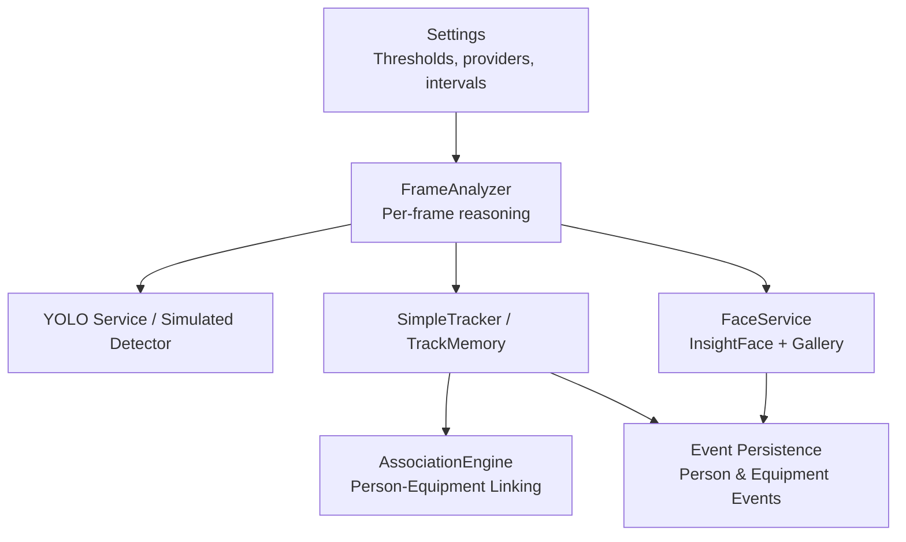
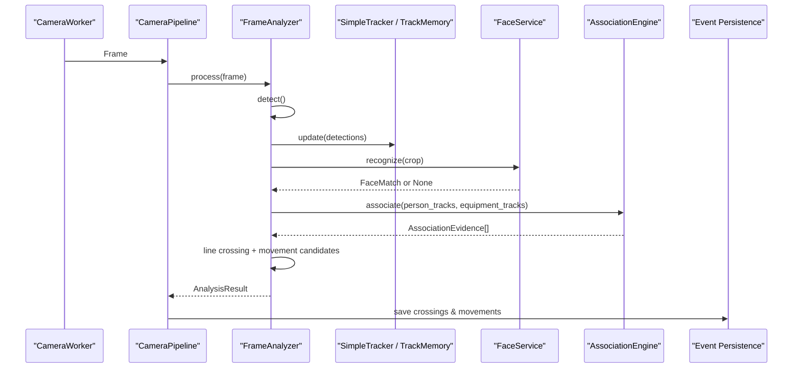
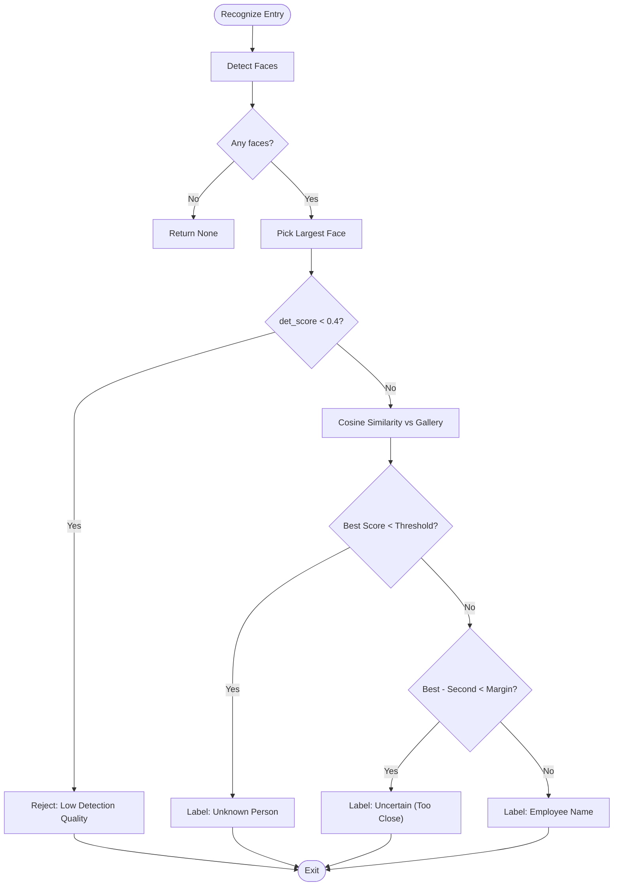
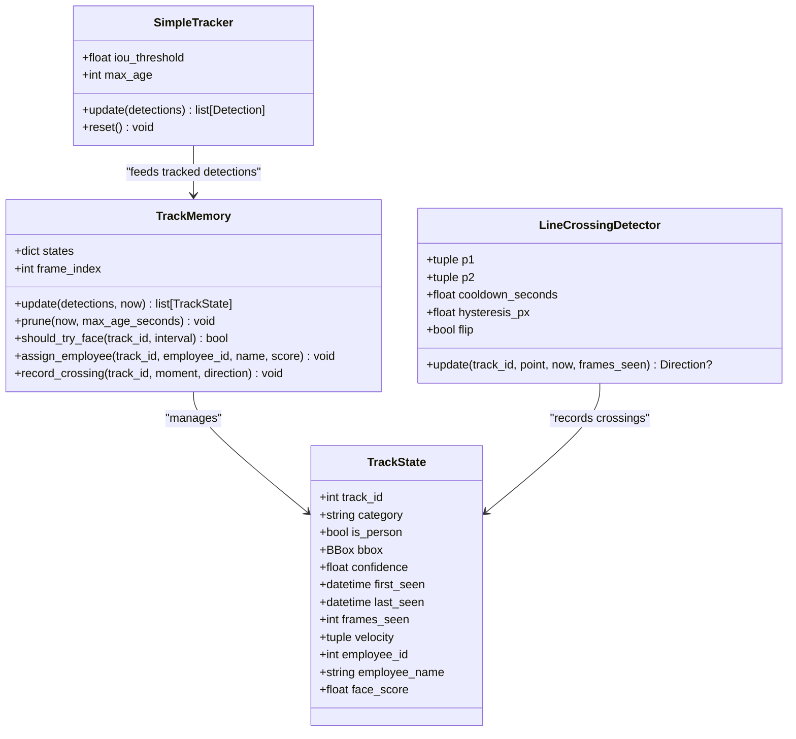
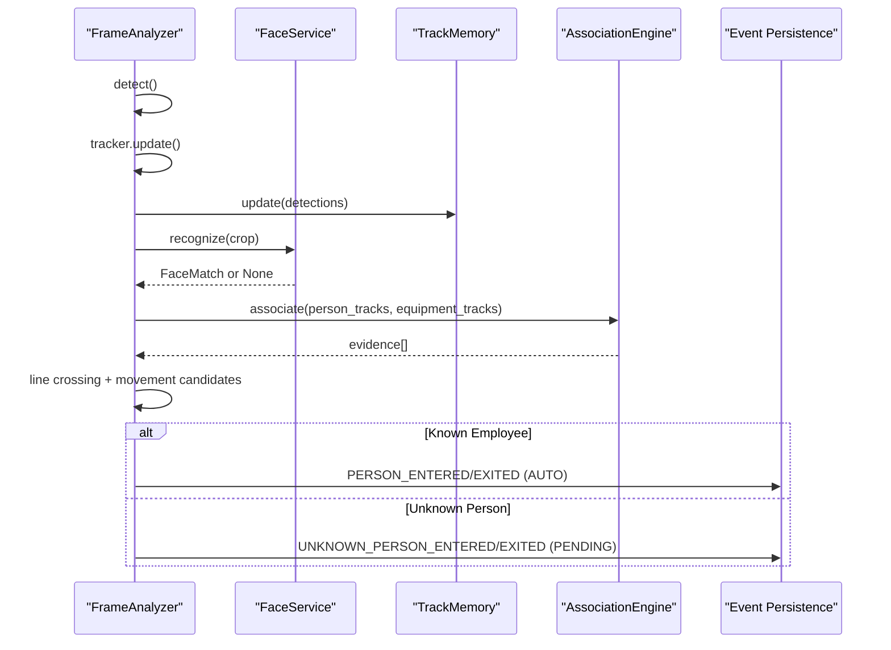
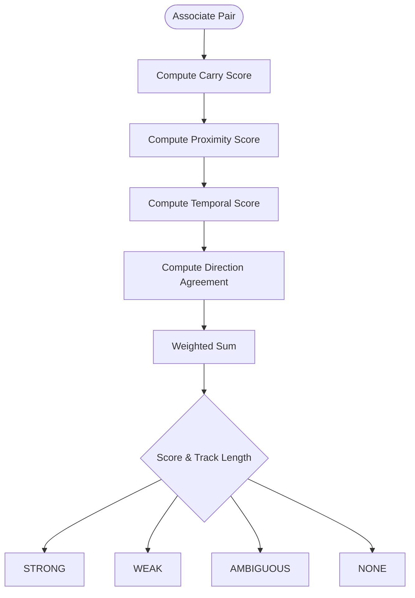
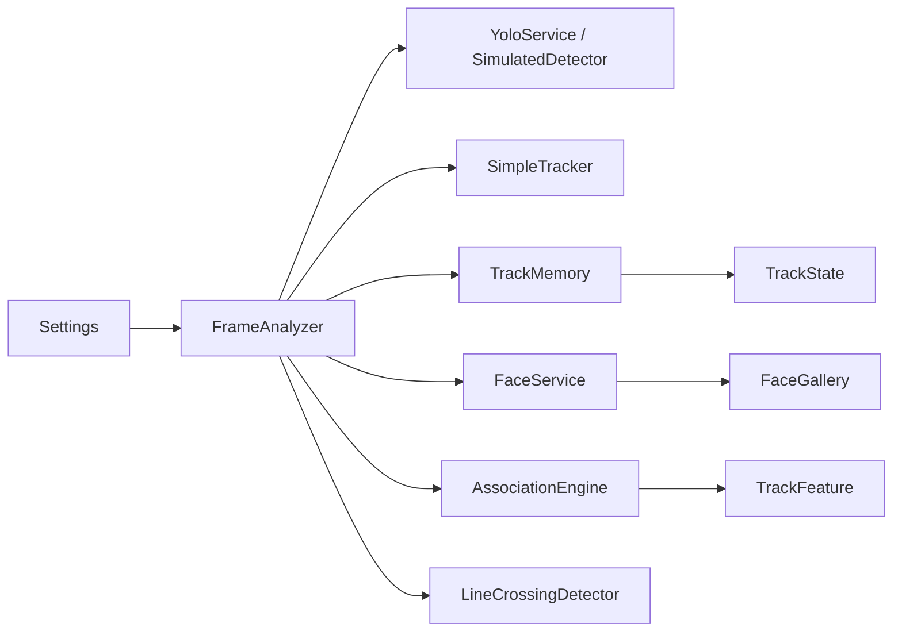

# Face Recognition Algorithms

<cite>
**Referenced Files in This Document**
- [README.md](file://README.md)
- [config.py](file://app/config.py)
- [face_service.py](file://app/services/face_service.py)
- [tracking_service.py](file://app/services/tracking_service.py)
- [pipeline_service.py](file://app/services/pipeline_service.py)
- [association_service.py](file://app/services/association_service.py)
- [test_face_matching.py](file://tests/test_face_matching.py)
- [test_tracking.py](file://tests/test_tracking.py)
</cite>

## Table of Contents
1. [Introduction](#introduction)
2. [Project Structure](#project-structure)
3. [Core Components](#core-components)
4. [Architecture Overview](#architecture-overview)
5. [Detailed Component Analysis](#detailed-component-analysis)
6. [Dependency Analysis](#dependency-analysis)
7. [Performance Considerations](#performance-considerations)
8. [Troubleshooting Guide](#troubleshooting-guide)
9. [Conclusion](#conclusion)
10. [Appendices](#appendices)

## Introduction
This document explains the face recognition algorithms, similarity thresholds, match margins, confidence scoring, unknown-person handling, and multi-frame tracking integration used by the system. It focuses on how InsightFace embeddings are compared against enrolled employee templates, how matches are accepted or rejected, and how recognized identities flow through the detection pipeline into movement events. It also provides tuning guidance for balancing false positives and false negatives, interpretation of confidence scores, and performance strategies for real-time video processing.

The system uses:
- InsightFace with ONNX Runtime for face detection and embedding extraction.
- Cosine similarity matching with a configurable threshold and margin.
- A per-camera tracking layer that supports ByteTrack when available and falls back to a simple IoU tracker otherwise.
- An association engine that combines carrying, proximity, temporal, and direction signals to link people with equipment.
- A pipeline that converts frame-level detections into person crossings and equipment movements, marking uncertain results as pending for operator review.

## Project Structure
The face recognition and tracking logic is primarily implemented under `app/services`, with configuration in `app/config.py` and end-to-end behavior documented in `README.md`. Tests validate matching, tracking, and association behavior without requiring live models.

**Diagram sources**
- [config.py:62-222](file://app/config.py#L62-L222)
- [pipeline_service.py:103-149](file://app/services/pipeline_service.py#L103-L149)
- [tracking_service.py:29-85](file://app/services/tracking_service.py#L29-L85)
- [face_service.py:173-274](file://app/services/face_service.py#L173-L274)
- [association_service.py:106-148](file://app/services/association_service.py#L106-L148)

**Section sources**
- [README.md:20-33](file://README.md#L20-L33)
- [README.md:245-283](file://README.md#L245-L283)
- [config.py:62-222](file://app/config.py#L62-L222)

## Core Components
- FaceService: Wraps InsightFace, loads models once, detects faces, extracts embeddings, and compares them against an in-memory gallery of enrolled employees.
- FaceGallery: Loads active employee embeddings from the database into memory; supports reload operations.
- match_embeddings: Pure cosine-similarity matcher that enforces both a minimum similarity threshold and a margin between the best and second-best candidate.
- SimpleTracker and TrackMemory: Provide temporary track IDs, velocity estimation, frame counts, and per-track identity binding.
- LineCrossingDetector: Detects IN/OUT crossings with hysteresis, cooldown, and optional flip.
- FrameAnalyzer: Orchestrates detection, tracking, recognition, association, line crossing, and movement candidate creation.
- CameraPipeline: Runs the analyzer per camera, persists events, and publishes annotated frames.

Key configuration parameters:
- FACE_SIMILARITY_THRESHOLD: Controls acceptance of face matches (default 0.45).
- FACE_MATCH_MARGIN: Minimum gap between best and runner-up to avoid ambiguous matches (default 0.05).
- FACE_RECOGNITION_INTERVAL: How often to attempt face recognition per track (default 10 frames).
- FACE_PROVIDERS and FACE_DETECTION_SIZE: Control ONNX execution providers and model input size.

**Section sources**
- [face_service.py:41-129](file://app/services/face_service.py#L41-L129)
- [face_service.py:132-166](file://app/services/face_service.py#L132-L166)
- [face_service.py:173-274](file://app/services/face_service.py#L173-L274)
- [tracking_service.py:29-85](file://app/services/tracking_service.py#L29-L85)
- [tracking_service.py:91-205](file://app/services/tracking_service.py#L91-L205)
- [tracking_service.py:210-279](file://app/services/tracking_service.py#L210-L279)
- [pipeline_service.py:103-149](file://app/services/pipeline_service.py#L103-L149)
- [config.py:194-200](file://app/config.py#L194-L200)

## Architecture Overview
The recognition and tracking architecture integrates detection, embedding comparison, tracking, and event generation.

**Diagram sources**
- [pipeline_service.py:218-321](file://app/services/pipeline_service.py#L218-L321)
- [pipeline_service.py:461-487](file://app/services/pipeline_service.py#L461-L487)
- [face_service.py:261-274](file://app/services/face_service.py#L261-L274)
- [association_service.py:131-148](file://app/services/association_service.py#L131-L148)

## Detailed Component Analysis

### Face Recognition and Matching
FaceService performs:
- Model loading via InsightFace with provider selection and detection size configuration.
- Face detection and embedding extraction.
- Selection of the largest detected face for recognition.
- Rejection of very low-confidence detections before matching.
- Cosine similarity matching against the gallery with threshold and margin checks.

match_embeddings:
- Normalizes query and gallery vectors.
- Computes cosine similarity per employee.
- Selects the best candidate and checks if its score meets the threshold.
- Rejects matches where the top two candidates are too close (margin check).
- Returns FaceMatch with matched flag, score, reason, and label.

Unknown person handling:
- If no match passes threshold or margin, the result is labeled as “Noma'lum shaxs”.
- Unknown persons are never auto-enrolled.
- In the pipeline, unknown crossings create UNKNOWN_PERSON_* events with PENDING status.

**Diagram sources**
- [face_service.py:261-274](file://app/services/face_service.py#L261-L274)
- [face_service.py:86-129](file://app/services/face_service.py#L86-L129)

**Section sources**
- [face_service.py:29-36](file://app/services/face_service.py#L29-L36)
- [face_service.py:41-79](file://app/services/face_service.py#L41-L79)
- [face_service.py:81-129](file://app/services/face_service.py#L81-L129)
- [face_service.py:173-274](file://app/services/face_service.py#L173-L274)
- [test_face_matching.py:16-45](file://tests/test_face_matching.py#L16-L45)

### Multi-Frame Tracking Integration
Tracking has two layers:
- SimpleTracker: Greedy IoU-based tracker used when ByteTrack is unavailable. It assigns temporary track IDs, separates people and equipment, and prunes old tracks.
- TrackMemory: Maintains per-track state including bounding boxes, velocities, frame counts, timestamps, and identity bindings. It also manages face recognition retry intervals and records crossings.

ByteTrack usage:
- The README documents Ultralytics YOLO with ByteTrack tracking IDs.
- The codebase includes a fallback SimpleTracker for environments where Ultralytics/ByteTrack is not installed.
- Track ids are temporary and only support proximity/temporal reasoning; they do not become permanent identities.

Line crossing:
- LineCrossingDetector computes signed distance to a virtual line, applies hysteresis and cooldown, and reports Direction.IN or Direction.OUT.
- It respects minimum track age and can flip directions based on camera configuration.

**Diagram sources**
- [tracking_service.py:29-85](file://app/services/tracking_service.py#L29-L85)
- [tracking_service.py:91-205](file://app/services/tracking_service.py#L91-L205)
- [tracking_service.py:210-279](file://app/services/tracking_service.py#L210-L279)

**Section sources**
- [tracking_service.py:1-13](file://app/services/tracking_service.py#L1-L13)
- [tracking_service.py:29-85](file://app/services/tracking_service.py#L29-L85)
- [tracking_service.py:91-205](file://app/services/tracking_service.py#L91-L205)
- [tracking_service.py:210-279](file://app/services/tracking_service.py#L210-L279)
- [test_tracking.py:26-47](file://tests/test_tracking.py#L26-L47)
- [test_tracking.py:49-74](file://tests/test_tracking.py#L49-L74)
- [test_tracking.py:81-113](file://tests/test_tracking.py#L81-L113)

### Pipeline Processing and Unknown Person Workflow
FrameAnalyzer orchestrates:
- Detection (YOLO or simulated ground truth).
- Tracking assignment and memory updates.
- Identity recognition via FaceService on person crops.
- Association of people with equipment using AssociationEngine.
- Line crossing detection for people and equipment.
- Movement candidate construction with reasons, quality, and review flags.

Unknown person workflow:
- If recognition fails or returns unknown, the track remains unassigned.
- Person crossings without an identified employee generate UNKNOWN_PERSON_ENTERED/EXITED events with PENDING verification status.
- Evidence JPEGs are saved for these events.
- Operators later review and bind employees to pending events.

**Diagram sources**
- [pipeline_service.py:218-321](file://app/services/pipeline_service.py#L218-L321)
- [pipeline_service.py:508-542](file://app/services/pipeline_service.py#L508-L542)

**Section sources**
- [pipeline_service.py:103-149](file://app/services/pipeline_service.py#L103-L149)
- [pipeline_service.py:156-180](file://app/services/pipeline_service.py#L156-L180)
- [pipeline_service.py:218-321](file://app/services/pipeline_service.py#L218-L321)
- [pipeline_service.py:508-542](file://app/services/pipeline_service.py#L508-L542)
- [README.md:347-364](file://README.md#L347-L364)

### Confidence Scoring and Association Quality
AssociationEngine scores each (person, object) pair using:
- Carrying score (object within expanded person box).
- Proximity score (distance normalized by person box diagonal).
- Temporal score (based on frames seen).
- Direction agreement (dot product of normalized velocities).

Scores are combined with weights:
- 0.50 × carry
- 0.25 × proximity
- 0.15 × temporal
- 0.10 × direction

Quality levels:
- STRONG: High score and sufficient track length.
- WEAK: Lower score or short track.
- AMBIGUOUS: Top two candidates too close.
- NONE: No meaningful association.

Review requirements:
- Weak/Ambiguous associations, short tracks, or uncertain face recognition trigger requires_review.
- Movement candidates include reasons and association quality metadata.

**Diagram sources**
- [association_service.py:59-104](file://app/services/association_service.py#L59-L104)
- [association_service.py:112-148](file://app/services/association_service.py#L112-L148)

**Section sources**
- [association_service.py:36-57](file://app/services/association_service.py#L36-L57)
- [association_service.py:59-104](file://app/services/association_service.py#L59-L104)
- [association_service.py:106-148](file://app/services/association_service.py#L106-L148)
- [README.md:316-343](file://README.md#L316-L343)

## Dependency Analysis
The components interact as follows:
- Settings provide thresholds, providers, and intervals.
- FrameAnalyzer depends on detector, face service, tracker, memory, association engine, and line crossing detectors.
- FaceService depends on InsightFace and the gallery loaded from the database.
- Tracking services feed features to the association engine.
- Pipeline persistence writes events and saves evidence.

**Diagram sources**
- [config.py:62-222](file://app/config.py#L62-L222)
- [pipeline_service.py:103-149](file://app/services/pipeline_service.py#L103-L149)
- [face_service.py:132-166](file://app/services/face_service.py#L132-L166)
- [tracking_service.py:91-205](file://app/services/tracking_service.py#L91-L205)
- [association_service.py:106-148](file://app/services/association_service.py#L106-L148)

**Section sources**
- [pipeline_service.py:103-149](file://app/services/pipeline_service.py#L103-L149)
- [face_service.py:132-166](file://app/services/face_service.py#L132-L166)
- [tracking_service.py:91-205](file://app/services/tracking_service.py#L91-L205)
- [association_service.py:106-148](file://app/services/association_service.py#L106-L148)

## Performance Considerations
- InsightFace model loading is cached per process; reuse avoids per-frame overhead.
- GPU acceleration is supported via ONNX Runtime providers; configure FACE_PROVIDERS accordingly.
- Reduce processing load by adjusting PROCESSING_FPS, YOLO_IMAGE_SIZE, and FACE_RECOGNITION_INTERVAL.
- Use simulation mode for smoke tests without heavy AI dependencies.
- Prune stale tracks in TrackMemory to limit memory growth.
- Avoid unnecessary face recognition attempts by respecting the recognition interval.

Practical tips:
- For CPU-only environments, lower FPS and increase recognition intervals to maintain responsiveness.
- For high-light variability, improve reference photos and consider adjusting FACE_SIMILARITY_THRESHOLD within the recommended range.
- Monitor pipeline health metrics (frames processed, detection errors, tracks) to detect bottlenecks.

**Section sources**
- [face_service.py:206-234](file://app/services/face_service.py#L206-L234)
- [config.py:194-200](file://app/config.py#L194-L200)
- [README.md:528-530](file://README.md#L528-L530)
- [tracking_service.py:167-171](file://app/services/tracking_service.py#L167-L171)

## Troubleshooting Guide
Common issues and resolutions:
- Face recognition unavailable: Ensure InsightFace and ONNX Runtime are installed; verify model download and providers.
- Low-confidence matches: Adjust FACE_SIMILARITY_THRESHOLD and FACE_MATCH_MARGIN; review reference photo quality.
- Unknown person events: Check gallery reload and employee enrollment; confirm recognition interval and crop quality.
- Tracking instability: Verify ByteTrack availability; fall back to SimpleTracker for testing; tune IoU thresholds and max age.
- False associations: Review association quality and reasons; adjust min_track_frames and cooldown settings.

Operational checks:
- Inspect logs for model loading errors and pipeline exceptions.
- Validate camera connectivity and stream quality.
- Confirm evidence retention and JPEG quality settings.
- Use test scripts to validate camera feeds and detection pipelines.

**Section sources**
- [README.md:516-530](file://README.md#L516-L530)
- [face_service.py:296-318](file://app/services/face_service.py#L296-L318)
- [pipeline_service.py:461-487](file://app/services/pipeline_service.py#L461-L487)

## Conclusion
The system implements robust face recognition and tracking with clear separation between detection, embedding comparison, tracking, and event generation. Thresholds and margins allow fine-tuning for different environments, while unknown-person handling ensures uncertainty is preserved for operator review. Multi-frame tracking provides consistent identity association across frames, and the association engine offers transparent scoring and quality labels. Proper configuration and monitoring enable reliable real-time operation.

## Appendices

### Configuration Reference for Face Recognition
- FACE_SIMILARITY_THRESHOLD: Default 0.45; lower increases false positives, higher increases unknown persons.
- FACE_MATCH_MARGIN: Default 0.05; larger values reject more ambiguous matches.
- FACE_RECOGNITION_INTERVAL: Default 10 frames; controls recognition frequency per track.
- FACE_PROVIDERS: Execution providers (e.g., CUDAExecutionProvider for GPU).
- FACE_DETECTION_SIZE: Input resolution for InsightFace (e.g., 640x640).

**Section sources**
- [config.py:194-200](file://app/config.py#L194-L200)
- [README.md:154-157](file://README.md#L154-L157)

### Practical Interpretation of Recognition Results
- Confident match: High score above threshold and clear margin; employee name assigned.
- Unknown person: Score below threshold or insufficient gallery; event marked PENDING.
- Uncertain match: Best and second-best candidates too close; flagged for review.
- Low detection quality: Very low det_score; recognition skipped or rejected.

**Section sources**
- [face_service.py:86-129](file://app/services/face_service.py#L86-L129)
- [test_face_matching.py:16-45](file://tests/test_face_matching.py#L16-L45)