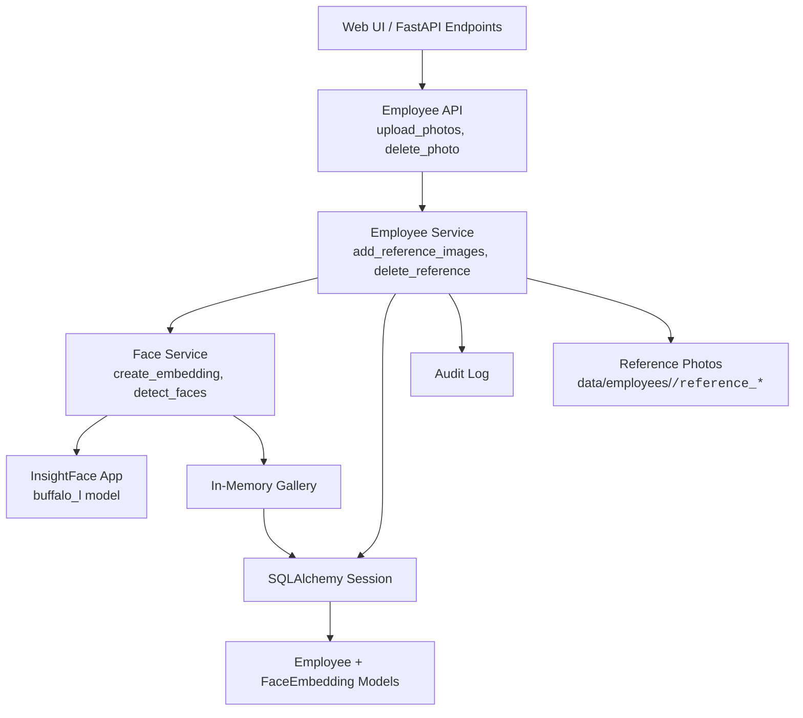
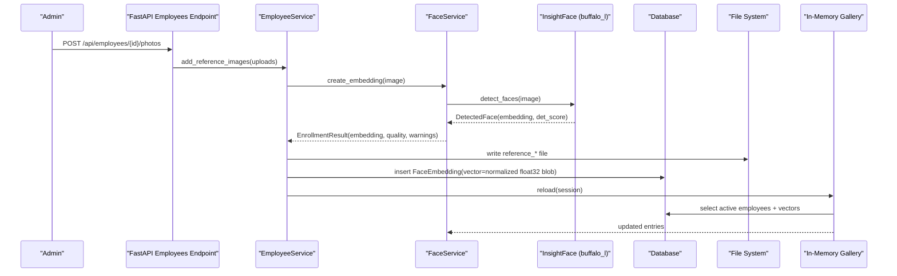
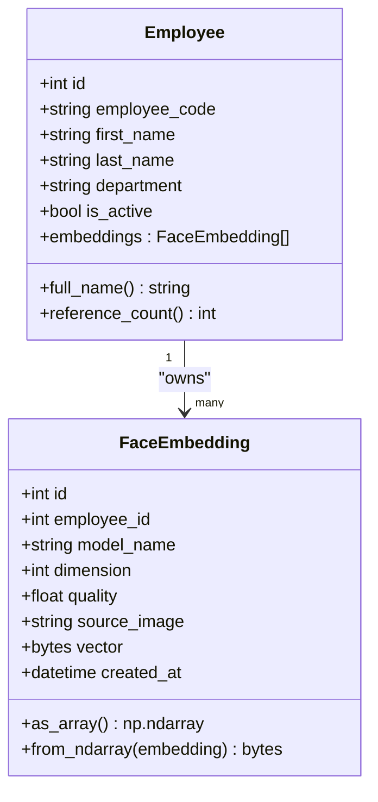
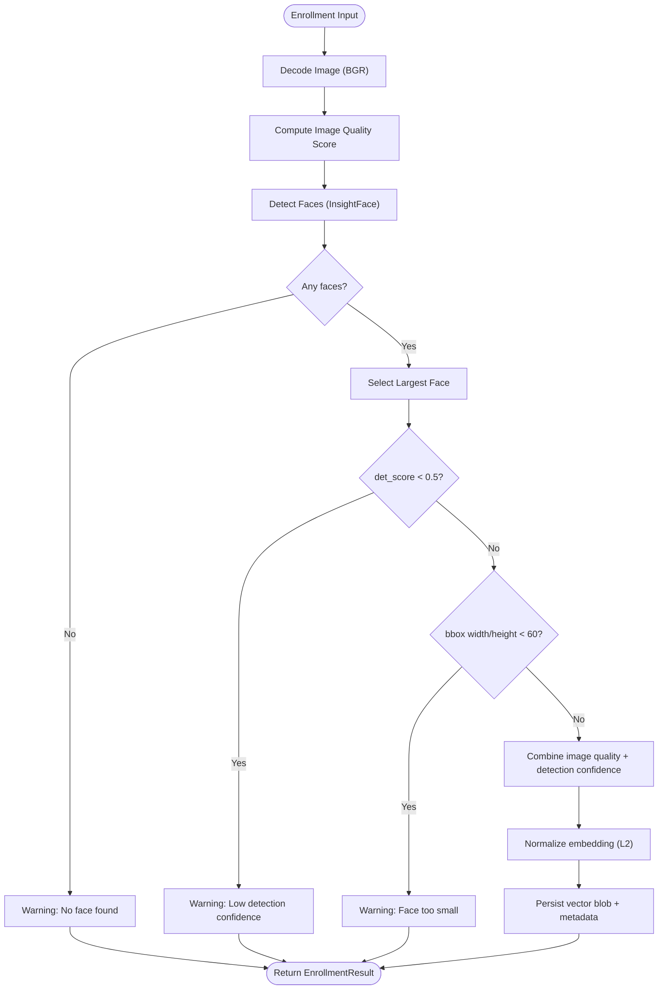
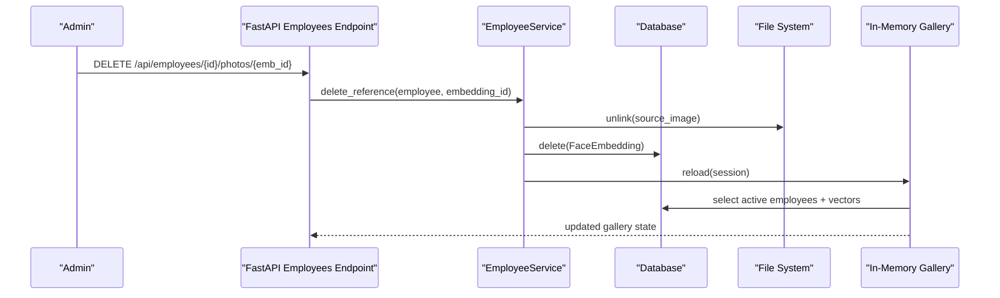
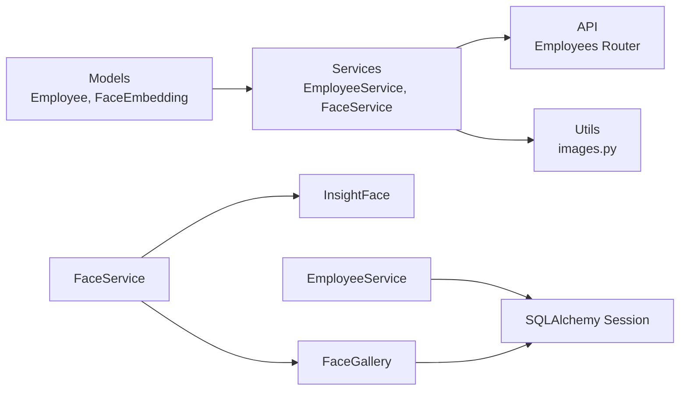

# Face Template Management

<cite>
**Referenced Files in This Document**
- [employee.py](file://app/models/employee.py)
- [face_service.py](file://app/services/face_service.py)
- [employee_service.py](file://app/services/employee_service.py)
- [employees.py](file://app/api/employees.py)
- [images.py](file://app/utils/images.py)
- [README.md](file://README.md)
</cite>

## Table of Contents
1. [Introduction](#introduction)
2. [Project Structure](#project-structure)
3. [Core Components](#core-components)
4. [Architecture Overview](#architecture-overview)
5. [Detailed Component Analysis](#detailed-component-analysis)
6. [Dependency Analysis](#dependency-analysis)
7. [Performance Considerations](#performance-considerations)
8. [Troubleshooting Guide](#troubleshooting-guide)
9. [Conclusion](#conclusion)

## Introduction
This document explains how face templates and embeddings are managed in the system. It covers the `FaceEmbedding` model, vector storage as `float32` blobs, quality scoring, source image tracking, model versioning with `buffalo_l`, gallery operations for multiple embeddings per employee, InsightFace integration, preprocessing and normalization, compression and memory considerations, and performance optimization for large galleries and batch processing.

The face recognition pipeline uses InsightFace with the `buffalo_l` model. Embeddings are generated from reference photos, normalized to unit length, stored as compact binary vectors, and compared against an in-memory gallery using cosine similarity.

## Project Structure
The face template management spans models, services, API endpoints, and utilities:

**Diagram sources**
- [employees.py:150-208](file://app/api/employees.py#L150-L208)
- [employee_service.py:112-196](file://app/services/employee_service.py#L112-L196)
- [face_service.py:173-294](file://app/services/face_service.py#L173-L294)
- [employee.py:20-81](file://app/models/employee.py#L20-L81)

**Section sources**
- [employees.py:150-208](file://app/api/employees.py#L150-L208)
- [employee_service.py:112-196](file://app/services/employee_service.py#L112-L196)
- [face_service.py:173-294](file://app/services/face_service.py#L173-L294)
- [employee.py:20-81](file://app/models/employee.py#L20-L81)

## Core Components
- `Employee`: Person record with a one-to-many relationship to `FaceEmbedding`.
- `FaceEmbedding`: One embedding per reference photo; stores model name, dimension, quality score, source image path, and a normalized `float32` vector blob.
- `FaceService`: InsightFace wrapper that loads the model once, detects faces, generates embeddings, and exposes matching logic.
- `FaceGallery`: In-memory snapshot of active employees’ embeddings used for fast matching.
- `EmployeeService`: Orchestrates enrollment: validates uploads, decodes images, calls `FaceService`, persists reference photos and embeddings, and refreshes the gallery.
- `images.py`: Image decoding, validation, JPEG encoding, and heuristic quality scoring.

Key responsibilities:
- Enrollment: validate → decode → detect → embed → score → persist.
- Matching: normalize query vs gallery vectors → cosine similarity → threshold + margin checks.
- Storage: `LargeBinary` column storing raw `float32` bytes; no additional compression.
- Versioning: `model_name` defaults to `buffalo_l`; dimension is recorded per embedding.

**Section sources**
- [employee.py:20-81](file://app/models/employee.py#L20-L81)
- [face_service.py:173-294](file://app/services/face_service.py#L173-L294)
- [employee_service.py:112-196](file://app/services/employee_service.py#L112-L196)
- [images.py:51-81](file://app/utils/images.py#L51-L81)

## Architecture Overview
End-to-end flow for adding reference photos and generating templates:

**Diagram sources**
- [employees.py:150-185](file://app/api/employees.py#L150-L185)
- [employee_service.py:112-180](file://app/services/employee_service.py#L112-L180)
- [face_service.py:276-294](file://app/services/face_service.py#L276-L294)
- [face_service.py:140-166](file://app/services/face_service.py#L140-L166)

## Detailed Component Analysis

### FaceEmbedding Model Structure
`FaceEmbedding` represents one biometric template derived from a single reference photograph. Important fields:
- `employee_id`: Foreign key linking to the person.
- `model_name`: Model identifier; defaults to `buffalo_l`.
- `dimension`: Vector dimension; typically 512 for `buffalo_l`.
- `quality`: Heuristic quality score in [0, 1].
- `source_image`: Relative path under the employee’s folder (e.g., `EMP001/reference_01.jpg`).
- `vector`: Raw `float32` bytes representing a normalized embedding.

Normalization:
- On write: `from_ndarray` converts to `float32`, flattens, normalizes to unit L2 norm if non-zero, then serializes to bytes.
- On read: `as_array` deserializes to `float32` and re-normalizes before use.

Model versioning:
- The default model name is `buffalo_l`, persisted per embedding.
- The service reads the configured model name from settings and uses it when loading InsightFace.

Complexity:
- Serialization/deserialization is O(d) where d is vector dimension (typically 512).
- Normalization is O(d).

Error handling:
- If norm is zero, the vector is returned unchanged to avoid division by zero.

**Section sources**
- [employee.py:50-81](file://app/models/employee.py#L50-L81)
- [face_service.py:194-227](file://app/services/face_service.py#L194-L227)

#### Class Diagram

**Diagram sources**
- [employee.py:20-81](file://app/models/employee.py#L20-L81)

### InsightFace Integration and Preprocessing
InsightFace is loaded lazily and reused across requests. Key behaviors:
- Lazy loading via `ensure_loaded`: initializes `FaceAnalysis` with configured model name (`buffalo_l`) and providers (CPU or CUDA).
- Detection: `detect_faces` returns a list of `DetectedFace` with bounding boxes, embeddings, and detection scores.
- Recognition: `recognize` selects the largest face, filters very low confidence detections, and matches against the gallery.
- Enrollment: `create_embedding` computes image quality, runs detection, picks the largest face, and combines image quality with detection confidence into a final quality score.

Preprocessing steps:
- Image decoding: BGR numpy array via OpenCV.
- Quality scoring: sharpness (Laplacian variance), exposure (mean brightness), size (minimum dimension).
- Face selection: largest bounding box area wins; multi-face warning issued.
- Normalization: embeddings are normalized to unit L2 norm before comparison and storage.

**Diagram sources**
- [face_service.py:276-294](file://app/services/face_service.py#L276-L294)
- [images.py:51-81](file://app/utils/images.py#L51-L81)

**Section sources**
- [face_service.py:206-294](file://app/services/face_service.py#L206-L294)
- [images.py:15-81](file://app/utils/images.py#L15-L81)

### Vector Storage Format, Compression, and Memory Management
Storage format:
- `vector` column is `LargeBinary`, storing raw `float32` bytes without compression.
- Each embedding is a flattened 1D array of `float32` values, normalized to unit L2 norm.

Memory considerations:
- The in-memory gallery holds all active embeddings as NumPy arrays. For N embeddings of dimension D, approximate memory usage is N × D × 4 bytes plus Python object overhead.
- Gallery reload replaces the entire list, which can cause temporary spikes during transition.

Compression strategies:
- No explicit compression is applied; raw `float32` bytes are stored.
- Normalization reduces dynamic range but does not compress data.

Optimization opportunities:
- Use memory-mapped arrays for very large galleries.
- Consider quantization (e.g., float16) if precision loss is acceptable.
- Batched SQL queries and indexing on `employee_id` and `is_active` help reduce I/O latency.

**Section sources**
- [employee.py:50-81](file://app/models/employee.py#L50-L81)
- [face_service.py:132-170](file://app/services/face_service.py#L132-L170)

### Gallery Operations: Add, Remove, Manage Multiple Embeddings Per Employee
Adding embeddings:
- API endpoint `/api/employees/{employee_id}/photos` accepts multiple files.
- `EmployeeService.add_reference_images` iterates uploads, validates, decodes, creates embeddings, saves reference photos, inserts `FaceEmbedding` rows, audits the action, and reloads the gallery.

Removing embeddings:
- API endpoint `/api/employees/{employee_id}/photos/{embedding_id}/delete` deletes a specific embedding and its referenced photo file.
- `EmployeeService.delete_reference` removes the file and the row, then flushes the session.

Managing multiple embeddings:
- Each employee can have many `FaceEmbedding` records.
- During matching, the best match per employee is selected based on highest similarity across their references.

Active status:
- Only active employees are included in the gallery. Deactivating an employee excludes them from matching without deleting historical data.

**Diagram sources**
- [employees.py:188-208](file://app/api/employees.py#L188-L208)
- [employee_service.py:183-196](file://app/services/employee_service.py#L183-L196)
- [face_service.py:140-166](file://app/services/face_service.py#L140-L166)

**Section sources**
- [employees.py:150-208](file://app/api/employees.py#L150-L208)
- [employee_service.py:112-196](file://app/services/employee_service.py#L112-L196)

### Example Operations
- Create embedding: Upload reference photos via the employee detail page or CLI; the system generates embeddings and updates the gallery.
- Retrieve embeddings: The gallery is rebuilt from the database on demand; embeddings are not exposed via HTTP APIs.
- Delete embedding: Remove a specific reference photo and its embedding; the gallery is refreshed.

Operational notes:
- Reference photos are stored under `data/employees/<employee_code>/reference_*.jpg`.
- Access to reference photos is restricted and validated against known embeddings.

**Section sources**
- [employees.py:239-261](file://app/api/employees.py#L239-L261)
- [employee_service.py:98-109](file://app/services/employee_service.py#L98-L109)

## Dependency Analysis
Component relationships:

**Diagram sources**
- [employee.py:20-81](file://app/models/employee.py#L20-L81)
- [employee_service.py:112-196](file://app/services/employee_service.py#L112-L196)
- [face_service.py:132-294](file://app/services/face_service.py#L132-L294)
- [images.py:15-81](file://app/utils/images.py#L15-L81)

Coupling and cohesion:
- `EmployeeService` depends on `FaceService` for embedding generation and on `audit_service` for logging.
- `FaceService` encapsulates InsightFace lifecycle and matching logic, keeping model-specific code isolated.
- `FaceGallery` is tightly coupled to SQLAlchemy queries and NumPy arrays.

Potential circular dependencies:
- None detected; imports are layered (models → services → api).

External dependencies:
- InsightFace and ONNX Runtime for face detection and embedding extraction.
- OpenCV for image decoding and quality metrics.

**Section sources**
- [face_service.py:29-35](file://app/services/face_service.py#L29-L35)
- [face_service.py:206-294](file://app/services/face_service.py#L206-L294)
- [employee_service.py:112-196](file://app/services/employee_service.py#L112-L196)

## Performance Considerations
- Model loading: InsightFace is loaded once and reused; GPU providers can be configured for faster inference.
- Matching algorithm: Cosine similarity computed over normalized vectors; complexity O(N×D) per query where N is number of active embeddings and D is vector dimension.
- Gallery reload: Rebuilds in-memory gallery from DB; should be triggered after bulk changes rather than per request.
- Batch processing: `add_reference_images` processes uploads sequentially; consider batching for large enrollments.
- Memory usage: Large galleries increase RAM consumption; monitor `gallery.size` and `gallery.loaded_at`.
- Threshold tuning: Adjust `FACE_SIMILARITY_THRESHOLD` and `FACE_MATCH_MARGIN` to balance false positives and unknown classifications.

Recommendations:
- Use GPU providers when available.
- Limit concurrent enrollment operations to avoid excessive memory pressure.
- Periodically rebuild the gallery after significant changes.
- Monitor detection confidence and image quality to improve enrollment success rates.

[No sources needed since this section provides general guidance]

## Troubleshooting Guide
Common issues and resolutions:
- InsightFace unavailable: Check installation of AI requirements and model download; verify provider configuration.
- No face detected: Ensure reference photos are clear, well-lit, and at least ~120×120 pixels; check detection confidence thresholds.
- Past FPS or CPU load: Reduce processing FPS, image size, or recognition interval; enable GPU if possible.
- Database locked: Ensure single server instance; keep transactions short.
- Unknown person classification: Calibrate similarity threshold and margin; ensure sufficient diverse reference photos per employee.

Operational tips:
- Use the “Refresh gallery” option in settings to update the in-memory index.
- Review audit logs for enrollment actions.
- Validate reference photo access paths and permissions.

**Section sources**
- [README.md:516-530](file://README.md#L516-L530)
- [face_service.py:183-204](file://app/services/face_service.py#L183-L204)

## Conclusion
The face template management system provides robust enrollment, storage, and matching capabilities. Embeddings are stored as normalized `float32` blobs, enabling efficient cosine similarity comparisons. The system supports multiple embeddings per employee, integrates InsightFace with the `buffalo_l` model, and offers configurable thresholds and margins for reliable recognition. Proper image quality, model configuration, and gallery maintenance are essential for optimal performance and accuracy.

[No sources needed since this section summarizes without analyzing specific files]