# Equipment Management

<cite>
**Referenced Files in This Document**
- [equipment.py](file://app/models/equipment.py)
- [enums.py](file://app/models/enums.py)
- [equipment_api.py](file://app/api/equipment.py)
- [equipment_service.py](file://app/services/equipment_service.py)
- [inventory_service.py](file://app/services/inventory_service.py)
- [yolo_service.py](file://app/services/yolo_service.py)
- [train_yolo.py](file://scripts/train_yolo.py)
- [yolo_training.md](file://docs/yolo_training.md)
- [README.md](file://README.md)
</cite>

## Table of Contents
1. [Introduction](#introduction)
2. [Project Structure](#project-structure)
3. [Core Components](#core-components)
4. [Architecture Overview](#architecture-overview)
5. [Detailed Component Analysis](#detailed-component-analysis)
6. [Dependency Analysis](#dependency-analysis)
7. [Performance Considerations](#performance-considerations)
8. [Troubleshooting Guide](#troubleshooting-guide)
9. [Conclusion](#conclusion)
10. [Appendices](#appendices)

## Introduction
This document explains the equipment asset management system: how equipment categories and physical assets are registered, tracked, searched, and integrated with inventory transactions and an AI detection pipeline. It also documents the mapping between YOLO model labels and business categories, including how custom-trained models are adopted without code changes. The goal is to help administrators, operators, and developers keep physical assets consistent with digital records while supporting automated detection, manual review, and append-only inventory accounting.

Key principles:
- Categories define business types and map one or more YOLO label names to a category code.
- Assets are individual physical units linked to a category, with location and status tracking.
- Inventory transactions are append-only; vision-based movement candidates remain pending until confirmed by an operator.
- Custom YOLO models can be trained and deployed; category label mappings allow adapting to new model outputs.

**Section sources**
- [README.md:1-34](file://README.md#L1-L34)
- [README.md:286-313](file://README.md#L286-L313)
- [README.md:533-550](file://README.md#L533-L550)

## Project Structure
The equipment subsystem spans models, API endpoints, services, and documentation:

- Models define equipment categories and assets.
- API endpoints expose pages and forms for registration, categorization, and inventory operations.
- Services implement search, validation, audit logging, inventory ledger logic, and YOLO integration.
- Documentation describes custom YOLO training and deployment.

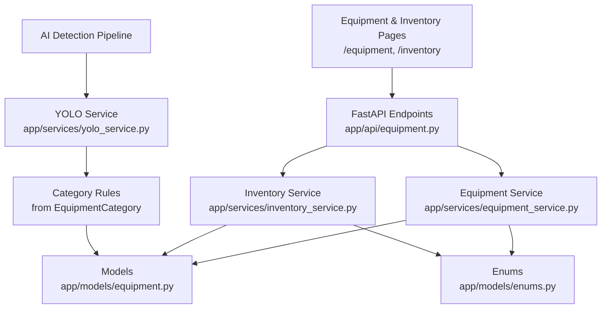

**Diagram sources**
- [equipment_api.py:25-55](file://app/api/equipment.py#L25-L55)
- [equipment_api.py:208-260](file://app/api/equipment.py#L208-L260)
- [equipment_service.py:35-168](file://app/services/equipment_service.py#L35-L168)
- [inventory_service.py:66-112](file://app/services/inventory_service.py#L66-L112)
- [yolo_service.py:40-52](file://app/services/yolo_service.py#L40-L52)
- [equipment.py:16-39](file://app/models/equipment.py#L16-L39)

**Section sources**
- [equipment_api.py:1-261](file://app/api/equipment.py#L1-L261)
- [equipment_service.py:1-349](file://app/services/equipment_service.py#L1-L349)
- [inventory_service.py:1-347](file://app/services/inventory_service.py#L1-L347)
- [yolo_service.py:1-272](file://app/services/yolo_service.py#L1-L272)
- [equipment.py:1-74](file://app/models/equipment.py#L1-L74)

## Core Components
This section summarizes the core data structures and processing logic relevant to equipment management.

- EquipmentCategory: maps business category codes to YOLO label names and supports per-category confidence thresholds.
- EquipmentAsset: represents a specific physical unit with attributes like brand, model, serial number, asset tag, location, and status.
- EquipmentStatus: defines lifecycle states such as IN_STOCK, IN_USE, MAINTENANCE, LOST, RETIRED.
- TransactionType: defines inventory actions (INITIAL, RECEIVED, REMOVED, RETURNED, TRANSFER, CORRECTION).
- EventType: includes equipment movement events (EQUIPMENT_BROUGHT_IN, EQUIPMENT_TAKEN_OUT, EQUIPMENT_RETURNED).

These components enable:
- Category-driven detection mapping.
- Asset registration and updates.
- Search and filtering by query, category, and status.
- Append-only inventory accounting with pending confirmation.

**Section sources**
- [equipment.py:16-74](file://app/models/equipment.py#L16-L74)
- [enums.py:113-148](file://app/models/enums.py#L113-L148)
- [enums.py:27-73](file://app/models/enums.py#L27-L73)

## Architecture Overview
The system integrates three main flows:
1. Registration and categorization via web forms.
2. Manual inventory operations and balances.
3. AI detection pipeline producing movement events that create pending inventory candidates.

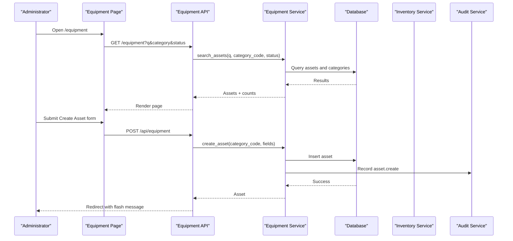

**Diagram sources**
- [equipment_api.py:25-55](file://app/api/equipment.py#L25-L55)
- [equipment_api.py:58-94](file://app/api/equipment.py#L58-L94)
- [equipment_service.py:59-111](file://app/services/equipment_service.py#L59-L111)

## Detailed Component Analysis

### Equipment Data Model
The data model separates categories from assets:
- EquipmentCategory stores a unique code, display label, YOLO label list, person flag, active flag, minimum confidence, sort order, and notes. It provides a method to match incoming YOLO labels.
- EquipmentAsset stores a unique asset code, foreign key to category, brand/model/serial/tag/location/status/photo/notes, timestamps, and relationship back to category.

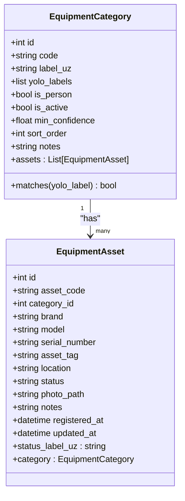

**Diagram sources**
- [equipment.py:16-39](file://app/models/equipment.py#L16-L39)
- [equipment.py:42-74](file://app/models/equipment.py#L42-L74)

**Section sources**
- [equipment.py:16-74](file://app/models/equipment.py#L16-L74)

### Category Management and YOLO Label Mapping
Categories act as the bridge between business concepts and model outputs:
- Each category has one or more YOLO label names configured in `yolo_labels`.
- The service builds a rule map from labels to category rules, enabling flexible mapping even if model class names change.
- Per-category `min_confidence` can override global confidence thresholds.
- Updating category labels triggers a refresh of detection rules.

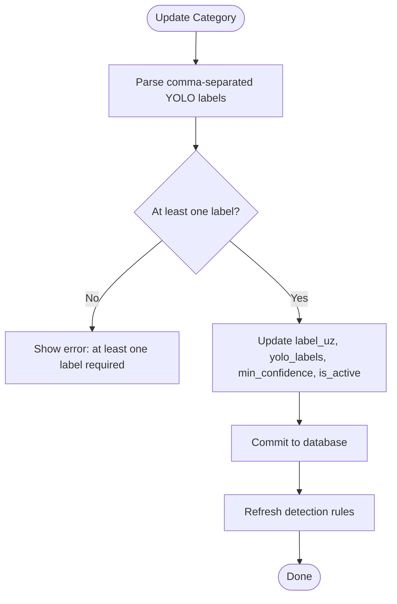

**Diagram sources**
- [equipment_api.py:140-169](file://app/api/equipment.py#L140-L169)
- [yolo_service.py:40-52](file://app/services/yolo_service.py#L40-L52)

**Section sources**
- [equipment_api.py:140-169](file://app/api/equipment.py#L140-L169)
- [yolo_service.py:40-52](file://app/services/yolo_service.py#L40-L52)

### Asset Registration and Search/Filtering
Asset registration validates category existence, prevents duplicate asset codes and serial numbers, generates default codes per category, and records audit entries. Search supports:
- Text queries across asset_code, brand, model, serial_number, location.
- Filtering by category code and status.
- Limiting results for performance.

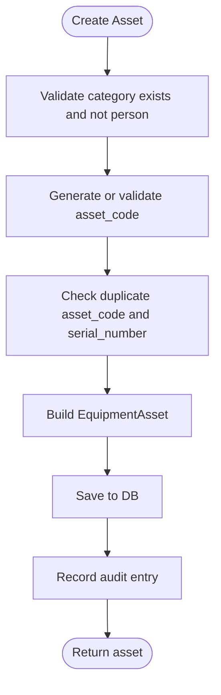

**Diagram sources**
- [equipment_service.py:59-111](file://app/services/equipment_service.py#L59-L111)

Search flow:

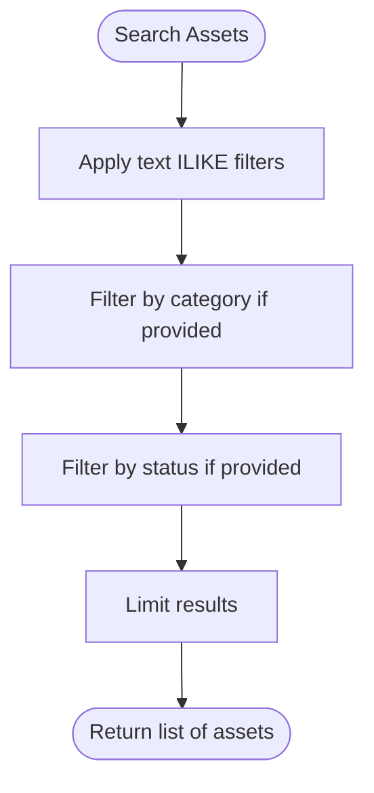

**Diagram sources**
- [equipment_service.py:142-168](file://app/services/equipment_service.py#L142-L168)

**Section sources**
- [equipment_service.py:59-111](file://app/services/equipment_service.py#L59-L111)
- [equipment_service.py:142-168](file://app/services/equipment_service.py#L142-L168)

### Inventory Transactions and Lifecycle Integration
Inventory operations are implemented through an append-only ledger:
- Types include INITIAL, RECEIVED, REMOVED, RETURNED, TRANSFER, CORRECTION.
- Vision-based movement events create pending transactions that do not affect balances until confirmed.
- Confirming or rejecting events updates transaction flags and optionally applies asset side effects (status and location).

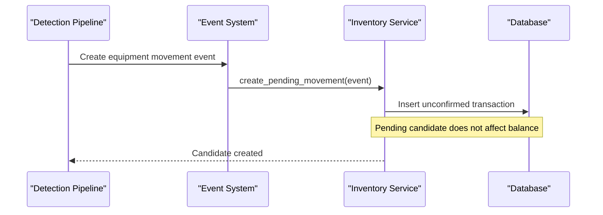

**Diagram sources**
- [inventory_service.py:132-156](file://app/services/inventory_service.py#L132-L156)

Confirmation flow:

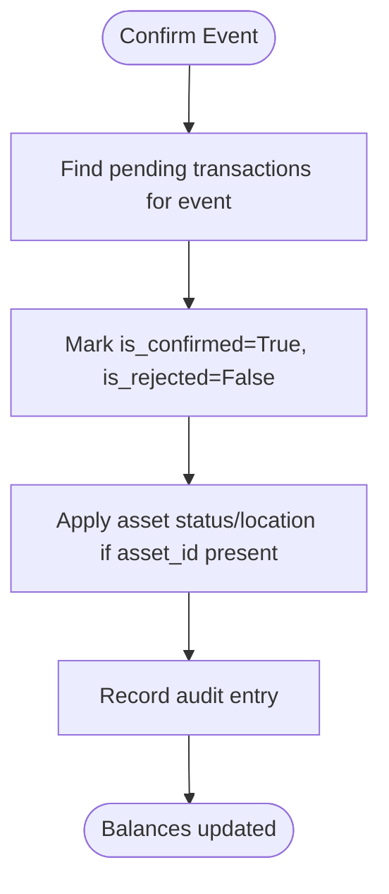

**Diagram sources**
- [inventory_service.py:165-185](file://app/services/inventory_service.py#L165-L185)

Manual operations:
- Receive, remove, return, transfer, initial stock, correction are exposed via API and delegate to inventory service.

**Section sources**
- [inventory_service.py:66-112](file://app/services/inventory_service.py#L66-L112)
- [inventory_service.py:132-185](file://app/services/inventory_service.py#L132-L185)
- [equipment_api.py:208-260](file://app/api/equipment.py#L208-L260)

### API Endpoints for CRUD Operations
The equipment API exposes:
- GET /equipment: Renders the equipment page with search, categories, counts, statuses, and next asset codes.
- POST /api/equipment: Creates an asset with CSRF protection and admin authorization.
- POST /api/equipment/{asset_id}/update: Updates asset fields with validation and audit logging.
- POST /api/categories/{category_id}/update: Updates category labels and detection rules.
- GET /inventory: Renders inventory page with balances and ledger.
- POST /api/inventory/operation: Handles receive/remove/return/transfer/initial/correct operations.

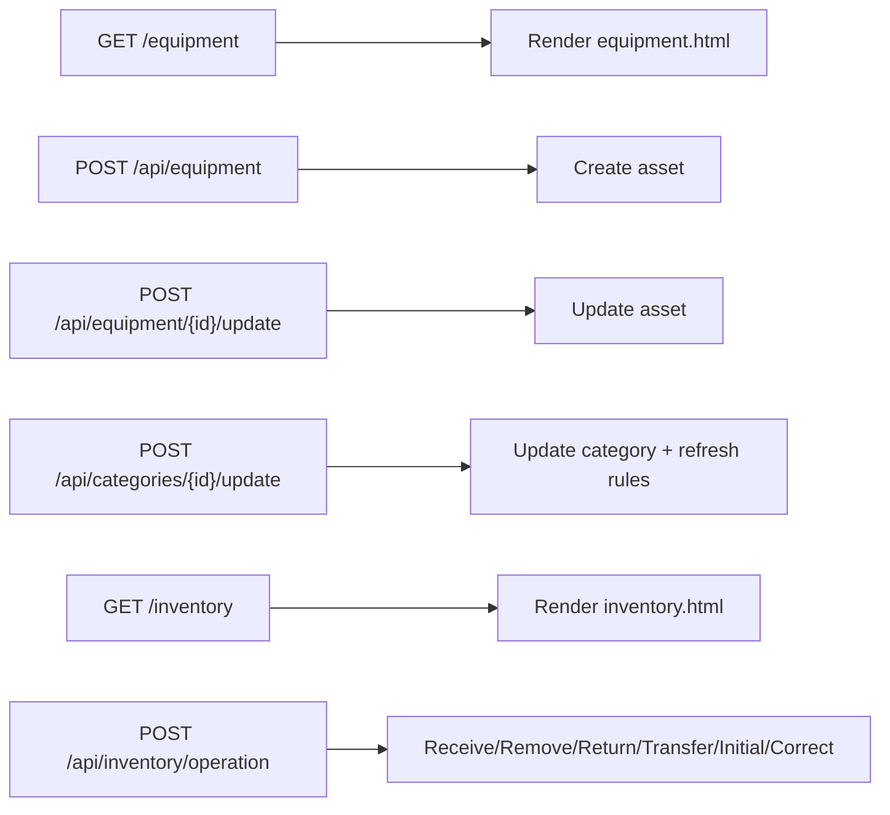

**Diagram sources**
- [equipment_api.py:25-55](file://app/api/equipment.py#L25-L55)
- [equipment_api.py:58-94](file://app/api/equipment.py#L58-L94)
- [equipment_api.py:97-137](file://app/api/equipment.py#L97-L137)
- [equipment_api.py:140-169](file://app/api/equipment.py#L140-L169)
- [equipment_api.py:175-205](file://app/api/equipment.py#L175-L205)
- [equipment_api.py:208-260](file://app/api/equipment.py#L208-L260)

**Section sources**
- [equipment_api.py:25-55](file://app/api/equipment.py#L25-L55)
- [equipment_api.py:58-94](file://app/api/equipment.py#L58-L94)
- [equipment_api.py:97-137](file://app/api/equipment.py#L97-L137)
- [equipment_api.py:140-169](file://app/api/equipment.py#L140-L169)
- [equipment_api.py:175-205](file://app/api/equipment.py#L175-L205)
- [equipment_api.py:208-260](file://app/api/equipment.py#L208-L260)

### Integration with AI Detection Pipeline
YOLO service loads a model once per process and maps detected labels to category rules:
- Rules are built from all categories’ YOLO labels.
- Detection resolves model output labels to category codes and applies per-category minimum confidence.
- If no model is available, inference raises an error rather than fabricating detections.

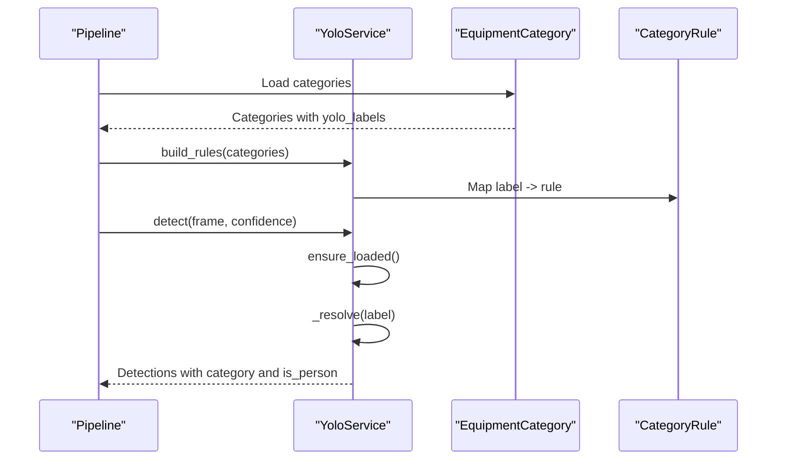

**Diagram sources**
- [yolo_service.py:40-52](file://app/services/yolo_service.py#L40-L52)
- [yolo_service.py:115-154](file://app/services/yolo_service.py#L115-L154)
- [yolo_service.py:166-236](file://app/services/yolo_service.py#L166-L236)

**Section sources**
- [yolo_service.py:40-52](file://app/services/yolo_service.py#L40-L52)
- [yolo_service.py:115-154](file://app/services/yolo_service.py#L115-L154)
- [yolo_service.py:166-236](file://app/services/yolo_service.py#L166-L236)

### Best Practices for Categorization and Label Mapping
- Keep category codes stable and meaningful; they drive reporting and inventory grouping.
- Maintain `yolo_labels` aligned with model class names; update mappings when retraining instead of changing code.
- Use `is_person=true` only for the person category; it affects tracking and crossing-line calculations.
- Set per-category `min_confidence` to reduce false positives for noisy classes.
- Avoid marking categories as persons for equipment registration.

**Section sources**
- [yolo_training.md:14-43](file://docs/yolo_training.md#L14-L43)
- [equipment_service.py:73-77](file://app/services/equipment_service.py#L73-L77)

### Maintaining Consistency Between Physical Assets and Digital Records
- Register each physical unit with a unique asset code and optional serial number.
- Track location and status changes through updates and inventory operations.
- Use manual inventory operations for corrections and transfers; rely on pending candidates for vision-based movements until confirmed.
- Monitor discrepancy metrics: expected vs registered assets; investigate mismatches promptly.

**Section sources**
- [inventory_service.py:215-273](file://app/services/inventory_service.py#L215-L273)
- [equipment_service.py:114-139](file://app/services/equipment_service.py#L114-L139)

## Dependency Analysis
The equipment subsystem depends on:
- Models for data persistence and relationships.
- Enums for shared state values.
- Services for business logic, audit logging, and inventory accounting.
- YOLO service for detection-to-category mapping.
- Training script and documentation for custom model workflows.

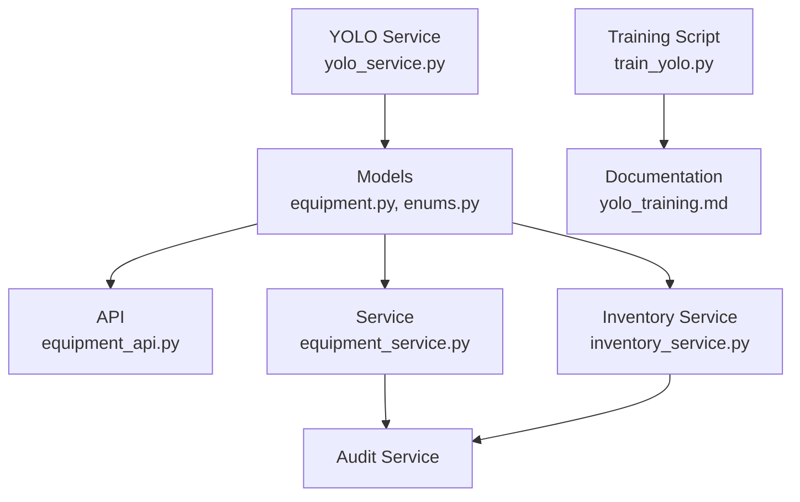

**Diagram sources**
- [equipment.py:1-74](file://app/models/equipment.py#L1-L74)
- [enums.py:1-183](file://app/models/enums.py#L1-L183)
- [equipment_api.py:1-261](file://app/api/equipment.py#L1-L261)
- [equipment_service.py:1-349](file://app/services/equipment_service.py#L1-L349)
- [inventory_service.py:1-347](file://app/services/inventory_service.py#L1-L347)
- [yolo_service.py:1-272](file://app/services/yolo_service.py#L1-L272)
- [train_yolo.py:1-274](file://scripts/train_yolo.py#L1-L274)
- [yolo_training.md:1-270](file://docs/yolo_training.md#L1-L270)

**Section sources**
- [equipment.py:1-74](file://app/models/equipment.py#L1-L74)
- [enums.py:1-183](file://app/models/enums.py#L1-L183)
- [equipment_api.py:1-261](file://app/api/equipment.py#L1-L261)
- [equipment_service.py:1-349](file://app/services/equipment_service.py#L1-L349)
- [inventory_service.py:1-347](file://app/services/inventory_service.py#L1-L347)
- [yolo_service.py:1-272](file://app/services/yolo_service.py#L1-L272)
- [train_yolo.py:1-274](file://scripts/train_yolo.py#L1-L274)
- [yolo_training.md:1-270](file://docs/yolo_training.md#L1-L270)

## Performance Considerations
- Limit search results to avoid large queries; the search function uses a limit parameter.
- Use per-category minimum confidence to reduce unnecessary detections and downstream processing.
- Prefer GPU inference where possible; configure image size and batch appropriately during training and runtime.
- Avoid frequent model reloads; the YOLO service loads once per process and caches the model.

[No sources needed since this section provides general guidance]

## Troubleshooting Guide
Common issues and resolutions:
- Missing YOLO model: system falls back to a generic model and shows a warning; deploy a custom model and refresh detection rules.
- Incorrect category labels: ensure `yolo_labels` matches model class names; update via category update endpoint.
- Duplicate asset codes or serial numbers: validation prevents duplicates; choose unique identifiers.
- Pending inventory discrepancies: review pending candidates and confirm or reject them to stabilize balances.
- Low FPS or memory errors: adjust processing parameters and model size; use smaller images or CPU/GPU settings.

**Section sources**
- [yolo_training.md:205-227](file://docs/yolo_training.md#L205-L227)
- [yolo_training.md:243-255](file://docs/yolo_training.md#L243-L255)
- [equipment_service.py:73-87](file://app/services/equipment_service.py#L73-L87)
- [inventory_service.py:215-273](file://app/services/inventory_service.py#L215-L273)

## Conclusion
The equipment management system provides a robust framework for registering and categorizing assets, tracking their lifecycle, and integrating with an AI detection pipeline. By maintaining clear mappings between YOLO labels and business categories, enforcing append-only inventory accounting, and requiring operator confirmation for vision-based movements, the system ensures consistency between physical assets and digital records. Administrators should focus on accurate category configuration, disciplined asset registration, and timely review of pending inventory candidates to maintain reliable operations.

[No sources needed since this section summarizes without analyzing specific files]

## Appendices

### Equipment Data Models Summary
- EquipmentCategory: code, label_uz, yolo_labels, is_person, is_active, min_confidence, sort_order, notes.
- EquipmentAsset: asset_code, category_id, brand, model, serial_number, asset_tag, location, status, photo_path, notes, timestamps.

**Section sources**
- [equipment.py:16-74](file://app/models/equipment.py#L16-L74)

### API Endpoints Summary
- GET /equipment: render equipment page with search and filters.
- POST /api/equipment: create asset.
- POST /api/equipment/{asset_id}/update: update asset.
- POST /api/categories/{category_id}/update: update category labels and rules.
- GET /inventory: render inventory page with balances and ledger.
- POST /api/inventory/operation: perform receive/remove/return/transfer/initial/correct operations.

**Section sources**
- [equipment_api.py:25-55](file://app/api/equipment.py#L25-L55)
- [equipment_api.py:58-94](file://app/api/equipment.py#L58-L94)
- [equipment_api.py:97-137](file://app/api/equipment.py#L97-L137)
- [equipment_api.py:140-169](file://app/api/equipment.py#L140-L169)
- [equipment_api.py:175-205](file://app/api/equipment.py#L175-L205)
- [equipment_api.py:208-260](file://app/api/equipment.py#L208-L260)

### Custom YOLO Model Workflow Summary
- Prepare dataset structure and labels aligned with CLASS_NAMES.
- Validate dataset with check command.
- Train model and copy best weights to data/models/equipment_best.pt.
- Configure YOLO_MODEL_PATH and refresh detection rules.
- Align category yolo_labels with model class names.

**Section sources**
- [train_yolo.py:27-42](file://scripts/train_yolo.py#L27-L42)
- [train_yolo.py:111-127](file://scripts/train_yolo.py#L111-L127)
- [train_yolo.py:130-180](file://scripts/train_yolo.py#L130-L180)
- [train_yolo.py:202-269](file://scripts/train_yolo.py#L202-L269)
- [yolo_training.md:14-43](file://docs/yolo_training.md#L14-L43)
- [yolo_training.md:205-227](file://docs/yolo_training.md#L205-L227)