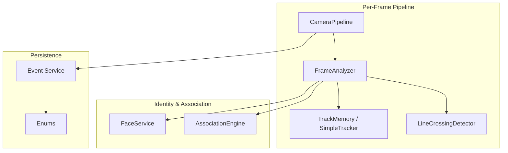
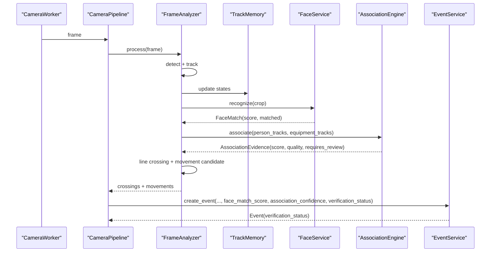
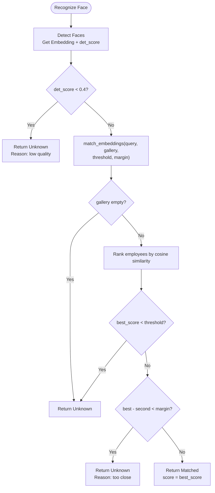
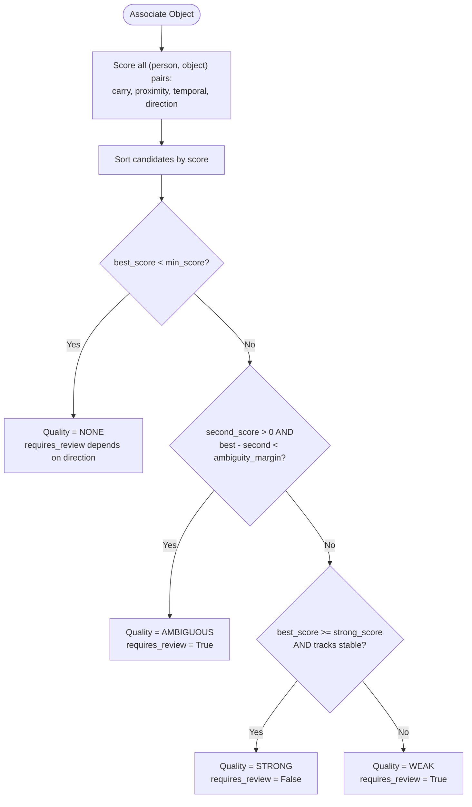
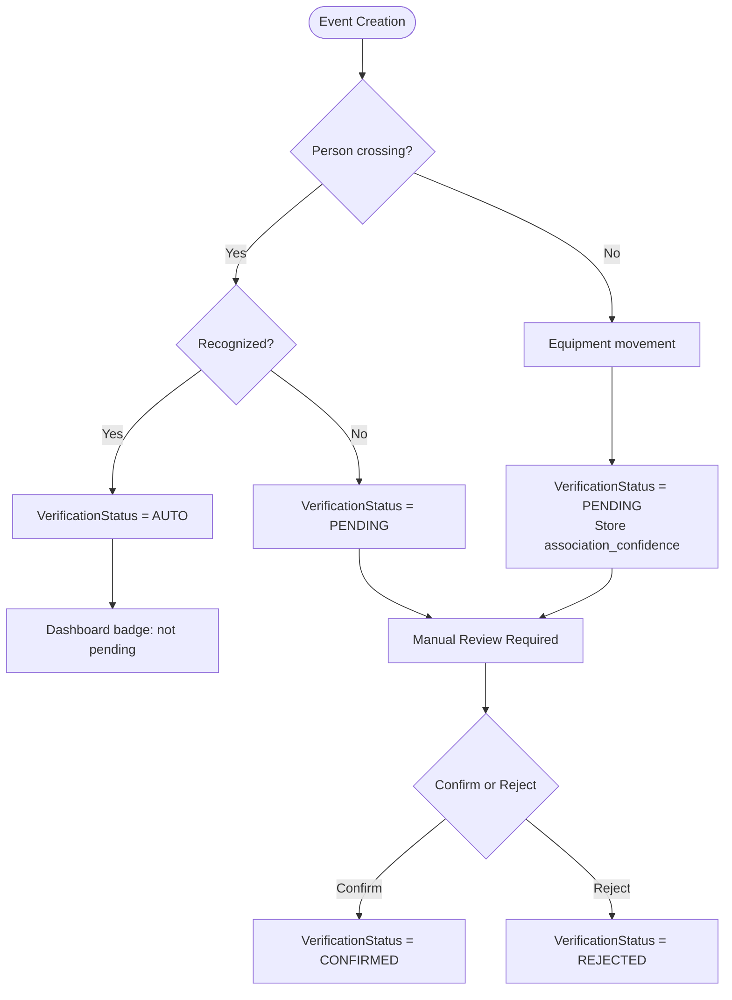
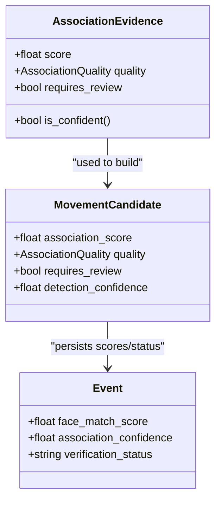
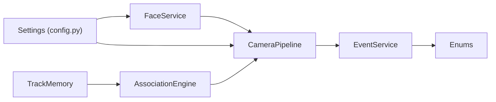

# Confidence Scoring and Quality Assessment

<cite>
**Referenced Files in This Document**
- [face_service.py](file://app/services/face_service.py)
- [association_service.py](file://app/services/association_service.py)
- [event_service.py](file://app/services/event_service.py)
- [pipeline_service.py](file://app/services/pipeline_service.py)
- [tracking_service.py](file://app/services/tracking_service.py)
- [enums.py](file://app/models/enums.py)
- [config.py](file://app/config.py)
- [test_face_matching.py](file://tests/test_face_matching.py)
- [test_association.py](file://tests/test_association.py)
</cite>

## Table of Contents
1. [Introduction](#introduction)
2. [Project Structure](#project-structure)
3. [Core Components](#core-components)
4. [Architecture Overview](#architecture-overview)
5. [Detailed Component Analysis](#detailed-component-analysis)
6. [Dependency Analysis](#dependency-analysis)
7. [Performance Considerations](#performance-considerations)
8. [Troubleshooting Guide](#troubleshooting-guide)
9. [Conclusion](#conclusion)

## Introduction
This document explains how the system evaluates confidence for person recognition and object association, and how those scores determine event reliability and review requirements. It covers:
- InsightFace-based person recognition confidence scoring.
- Association quality assessment levels STRONG, WEAK, AMBIGUOUS, NONE for linking a person to an object.
- Threshold configuration for automatic confirmation versus manual review.
- Examples of score calculations and algorithm behavior.
- How confidence affects event creation, verification status, and the review queue.

The goal is to make the scoring logic transparent so operators can understand why some events are auto-trusted while others require human review.

## Project Structure
The confidence and quality systems span several modules:
- Face recognition and embedding matching live in the face service.
- Person-object association uses a multi-signal scoring engine.
- The pipeline combines detection, tracking, identity, line crossing, and association into per-camera processing.
- Events store confidence values and verification status.
- Enums define shared quality and status types.
- Configuration provides thresholds for face similarity and match margin.

**Diagram sources**
- [pipeline_service.py:103-321](file://app/services/pipeline_service.py#L103-L321)
- [tracking_service.py:29-205](file://app/services/tracking_service.py#L29-L205)
- [association_service.py:106-198](file://app/services/association_service.py#L106-L198)
- [face_service.py:173-274](file://app/services/face_service.py#L173-L274)
- [event_service.py:59-147](file://app/services/event_service.py#L59-L147)
- [enums.py:76-183](file://app/models/enums.py#L76-L183)

**Section sources**
- [pipeline_service.py:1-14](file://app/services/pipeline_service.py#L1-L14)
- [tracking_service.py:1-13](file://app/services/tracking_service.py#L1-L13)

## Core Components
- FaceService: Detects faces, extracts embeddings, matches against enrolled gallery, and returns a FaceMatch with cosine similarity score and threshold/margin checks.
- AssociationEngine: Scores person-object pairs using carry overlap, proximity, temporal stability, and direction agreement; assigns quality level and requires_review flag.
- FrameAnalyzer/CameraPipeline: Runs detection, tracking, identity recognition, line crossing, and association; creates MovementCandidate objects carrying association_score, quality, and requires_review.
- EventService: Persists events with detection_confidence, face_match_score, association_confidence, and verification_status; supports review workflow.
- Enums: Define AssociationQuality (STRONG/WEAK/AMBIGUOUS/NONE), VerificationStatus (AUTO/PENDING/CONFIRMED/REJECTED), Direction, EventType, etc.
- Config: Provides environment-driven thresholds such as face_similarity_threshold and face_match_margin.

Key responsibilities:
- FaceService determines whether a detected face is recognized and how confident the match is.
- AssociationEngine determines whether an object is reliably carried by a person.
- Pipeline decides whether to create person or equipment movement events and what verification status to assign.
- EventService stores evidence and controls the review flow.

**Section sources**
- [face_service.py:41-129](file://app/services/face_service.py#L41-L129)
- [association_service.py:29-57](file://app/services/association_service.py#L29-L57)
- [pipeline_service.py:47-78](file://app/services/pipeline_service.py#L47-L78)
- [event_service.py:59-147](file://app/services/event_service.py#L59-L147)
- [enums.py:76-183](file://app/models/enums.py#L76-L183)
- [config.py:85-90](file://app/config.py#L85-L90)

## Architecture Overview
The system processes frames per camera through a pipeline that integrates multiple subsystems. Confidence flows from detection and recognition into association and finally into event persistence.

**Diagram sources**
- [pipeline_service.py:218-321](file://app/services/pipeline_service.py#L218-L321)
- [pipeline_service.py:490-585](file://app/services/pipeline_service.py#L490-L585)
- [face_service.py:261-274](file://app/services/face_service.py#L261-L274)
- [association_service.py:131-198](file://app/services/association_service.py#L131-L198)
- [event_service.py:59-147](file://app/services/event_service.py#L59-L147)

## Detailed Component Analysis

### Person Recognition Confidence (InsightFace)
Person recognition relies on InsightFace embeddings compared against enrolled employee templates. The core matching function computes cosine similarity between normalized vectors and applies two constraints:
- A minimum similarity threshold.
- A margin gap between the best and second-best match to avoid ambiguous identifications.

Important behaviors:
- If no gallery exists or dimensions mismatch, the result is unknown.
- If the best score is below the configured threshold, the label becomes unknown.
- If the top two candidates are too close (within margin), the result is marked uncertain even if above threshold.
- Detection quality also matters: very low detection confidence leads to rejection before matching.

Threshold configuration:
- face_similarity_threshold defaults to 0.45.
- face_match_margin defaults to 0.05.
These are loaded from environment variables and used by FaceService.

Example calculation outline:
- Normalize query and gallery vectors.
- Compute cosine similarity per employee.
- Select best match and compare to second-best.
- Apply threshold and margin rules to decide matched vs unknown.

Impact on events:
- When a person crosses the line and is recognized, the event is created with AUTO verification status.
- When unrecognized, the event is PENDING and flagged for review.
- face_match_score is stored alongside detection_confidence.

**Diagram sources**
- [face_service.py:86-129](file://app/services/face_service.py#L86-L129)
- [face_service.py:261-274](file://app/services/face_service.py#L261-L274)

**Section sources**
- [face_service.py:41-129](file://app/services/face_service.py#L41-L129)
- [face_service.py:173-274](file://app/services/face_service.py#L173-L274)
- [config.py:194-196](file://app/config.py#L194-L196)
- [test_face_matching.py:16-45](file://tests/test_face_matching.py#L16-L45)

### Association Quality Assessment (Person-Object Linking)
The association engine evaluates four signals for each (person, object) pair:
- Carry overlap: Whether the object center falls inside an expanded person box or overlaps significantly.
- Proximity: Distance relative to person size.
- Temporal stability: Both tracks must be stable for a minimum number of frames.
- Direction agreement: Similar velocity direction increases confidence.

Scores are combined with weights:
- carry: 0.50
- proximity: 0.25
- temporal: 0.15
- direction: 0.10

Quality levels:
- STRONG: Score meets strong threshold and tracks are sufficiently stable; requires_review is False.
- WEAK: Score below strong threshold or short tracks; requires_review is True.
- AMBIGUOUS: Multiple people explain the object nearly equally well; requires_review is True.
- NONE: No person explains the object well enough; no person attached.

Configuration parameters:
- min_score: 0.45
- strong_score: 0.65
- ambiguity_margin: 0.12
- proximity_ratio: 1.10
- carry_ratio: 0.22
- min_track_frames: 4
- max_track_age_seconds: 12.0

Algorithm outline:
- For each object, score all persons.
- Sort candidates by score.
- If best score below min_score, return NONE.
- Check ambiguity via difference between best and second scores.
- Determine weak vs strong based on strong_score and track stability.
- Set requires_review accordingly.

**Diagram sources**
- [association_service.py:76-129](file://app/services/association_service.py#L76-L129)
- [association_service.py:131-198](file://app/services/association_service.py#L131-L198)

**Section sources**
- [association_service.py:29-57](file://app/services/association_service.py#L29-L57)
- [association_service.py:106-198](file://app/services/association_service.py#L106-L198)
- [test_association.py:36-80](file://tests/test_association.py#L36-L80)

### Thresholds: Automatic Confirmation vs Manual Review
Verification status decisions:
- Person crossing events:
  - Recognized person → VerificationStatus.AUTO.
  - Unrecognized person → VerificationStatus.PENDING.
- Equipment movement events:
  - Always created with VerificationStatus.PENDING regardless of association quality.
  - association_confidence and association_quality are stored for dashboard and review prioritization.

Dashboard needs-review heuristic:
- Pending events always need review.
- Events with association_confidence below 0.5 also need review.

Review workflow:
- Operators confirm or reject pending events.
- Confirming updates inventory and sets CONFIRMED.
- Rejecting records reason and sets REJECTED.

**Diagram sources**
- [pipeline_service.py:508-530](file://app/services/pipeline_service.py#L508-L530)
- [pipeline_service.py:544-585](file://app/services/pipeline_service.py#L544-L585)
- [event_service.py:150-211](file://app/services/event_service.py#L150-L211)
- [event_service.py:292-298](file://app/services/event_service.py#L292-L298)

**Section sources**
- [pipeline_service.py:508-585](file://app/services/pipeline_service.py#L508-L585)
- [event_service.py:150-211](file://app/services/event_service.py#L150-L211)
- [event_service.py:292-298](file://app/services/event_service.py#L292-L298)
- [enums.py:76-90](file://app/models/enums.py#L76-L90)

### Examples of Confidence Score Calculations
- Face recognition example:
  - Query vector similar to employee template yields high cosine similarity.
  - If similarity exceeds threshold and margin gap is sufficient, matched = True with score ≈ best cosine similarity.
  - If similarity below threshold or margin gap insufficient, matched = False and label = unknown.
- Association example:
  - Object center inside expanded person box → carry score near 1.0.
  - Close proximity and same direction increase overall score.
  - Short tracks reduce temporal score; may downgrade to WEAK.
  - Two nearby people with similar scores → AMBIGUOUS due to small margin between best and second.

These examples align with unit tests validating confident matches, unknown persons, ambiguous cases, and direction effects.

**Section sources**
- [test_face_matching.py:16-45](file://tests/test_face_matching.py#L16-L45)
- [test_association.py:36-80](file://tests/test_association.py#L36-L80)

### Relationship Between Confidence Scores and Review Queue Prioritization
- Association quality directly influences requires_review:
  - STRONG without weak tracks → requires_review = False.
  - WEAK or AMBIGUOUS → requires_review = True.
- Pipeline sets MovementCandidate.requires_review based on association evidence and additional context (e.g., when the crossing person differs from the closest person).
- EventService’s needs_review_flag marks events needing attention if pending or if association_confidence < 0.5.
- Dashboard stats include pending_reviews count, helping operators prioritize low-confidence associations.

**Diagram sources**
- [association_service.py:29-46](file://app/services/association_service.py#L29-L46)
- [pipeline_service.py:57-70](file://app/services/pipeline_service.py#L57-L70)
- [event_service.py:59-147](file://app/services/event_service.py#L59-L147)

**Section sources**
- [association_service.py:131-198](file://app/services/association_service.py#L131-L198)
- [pipeline_service.py:328-387](file://app/services/pipeline_service.py#L328-L387)
- [event_service.py:292-298](file://app/services/event_service.py#L292-L298)

## Dependency Analysis
Confidence and quality systems depend on:
- Settings for thresholds (face similarity and margin).
- Tracking state for temporal and directional features.
- Enums for shared quality and status types.
- Event persistence for auditability and review workflows.

**Diagram sources**
- [config.py:177-222](file://app/config.py#L177-L222)
- [face_service.py:173-274](file://app/services/face_service.py#L173-L274)
- [association_service.py:106-198](file://app/services/association_service.py#L106-L198)
- [pipeline_service.py:103-321](file://app/services/pipeline_service.py#L103-L321)
- [event_service.py:59-147](file://app/services/event_service.py#L59-L147)
- [enums.py:76-183](file://app/models/enums.py#L76-L183)

**Section sources**
- [config.py:177-222](file://app/config.py#L177-L222)
- [pipeline_service.py:103-321](file://app/services/pipeline_service.py#L103-L321)

## Performance Considerations
- Face model loading is cached and reused to avoid per-frame overhead.
- Recognition attempts are throttled per track using an interval setting.
- Association scoring is lightweight and operates on tracked features.
- Line crossing detection includes hysteresis and cooldown to reduce false positives.
- Evidence saving occurs after event creation; ensure storage performance is considered at scale.

[No sources needed since this section provides general guidance]

## Troubleshooting Guide
Common issues and diagnostics:
- Face recognition unavailable:
  - Check model availability and provider configuration.
  - Inspect FaceService.status for reasons_unavailable and threshold/margin settings.
- Low detection confidence:
  - Very low det_score causes recognition to reject automatically.
  - Adjust YOLO confidence and image preprocessing if necessary.
- Ambiguous associations:
  - Multiple people near an object cause AMBIGUOUS quality.
  - Increase min_track_frames or adjust proximity/carry ratios if false positives occur.
- High pending reviews:
  - Verify association_confidence thresholds and association_quality distribution.
  - Use dashboard stats to monitor pending_reviews and adjust thresholds.

Operational checks:
- Validate environment variables for FACE_SIMILARITY_THRESHOLD and FACE_MATCH_MARGIN.
- Ensure gallery contains active employees with valid embeddings.
- Monitor pipeline health metrics (frames_processed, detection_errors, events_created).

**Section sources**
- [face_service.py:194-204](file://app/services/face_service.py#L194-L204)
- [face_service.py:261-274](file://app/services/face_service.py#L261-L274)
- [association_service.py:131-198](file://app/services/association_service.py#L131-L198)
- [pipeline_service.py:450-459](file://app/services/pipeline_service.py#L450-L459)
- [event_service.py:292-298](file://app/services/event_service.py#L292-L298)

## Conclusion
The confidence scoring and quality assessment system combines robust face recognition with a multi-signal association engine to produce reliable event data. Key takeaways:
- InsightFace cosine similarity with threshold and margin ensures trustworthy person identification.
- Association quality levels (STRONG/WEAK/AMBIGUOUS/NONE) explicitly communicate uncertainty.
- Thresholds are configurable via environment variables, enabling tuning for different environments.
- Events capture detection_confidence, face_match_score, and association_confidence to support review prioritization.
- The review workflow ensures that only high-confidence person events are auto-confirmed, while equipment movements always require operator confirmation, with association quality guiding dashboard attention.

[No sources needed since this section summarizes without analyzing specific files]