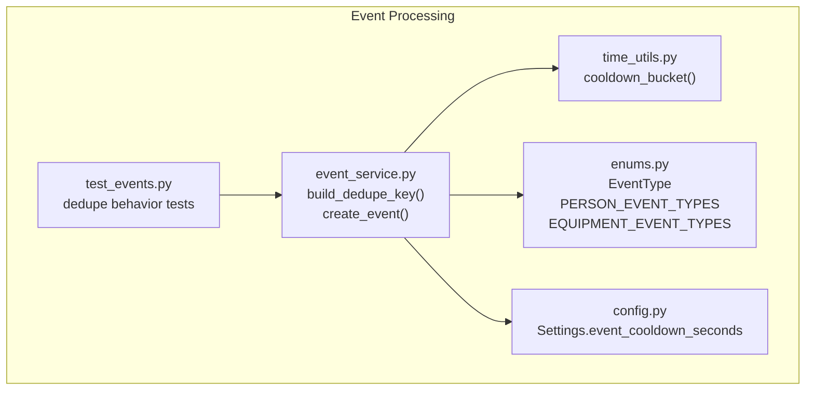
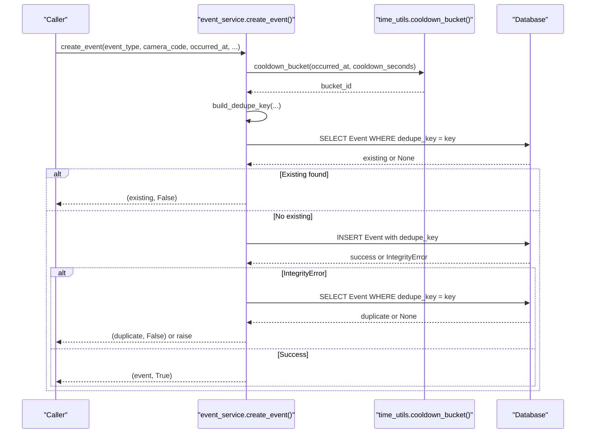
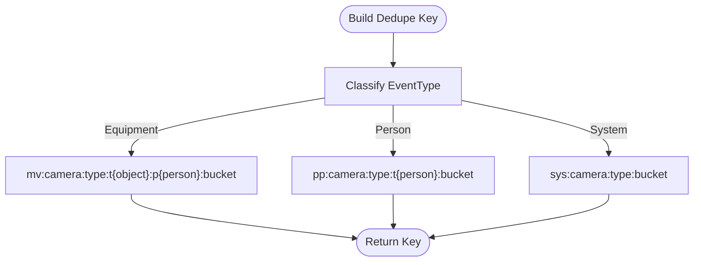
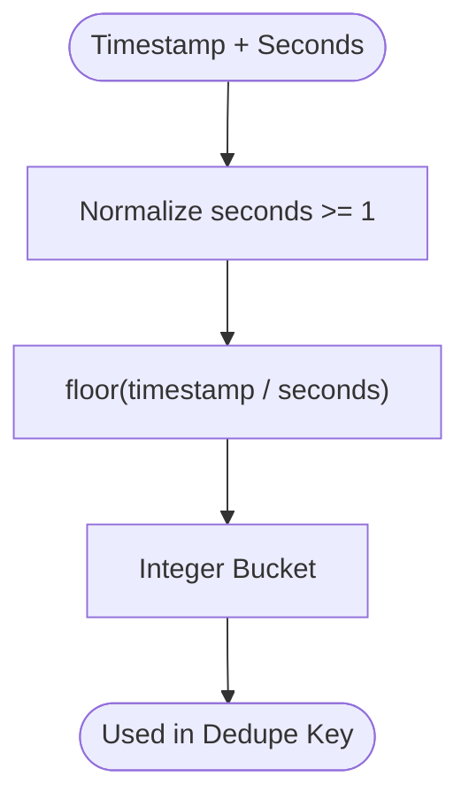
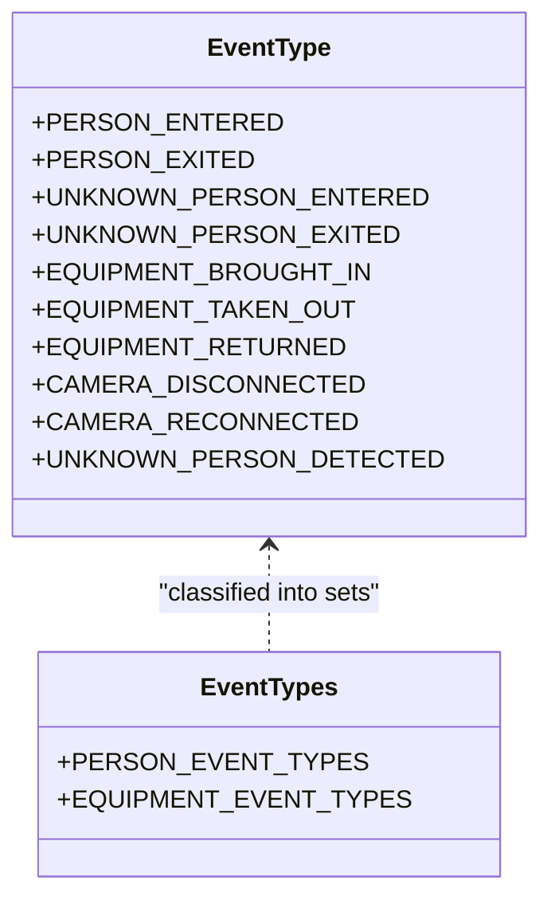
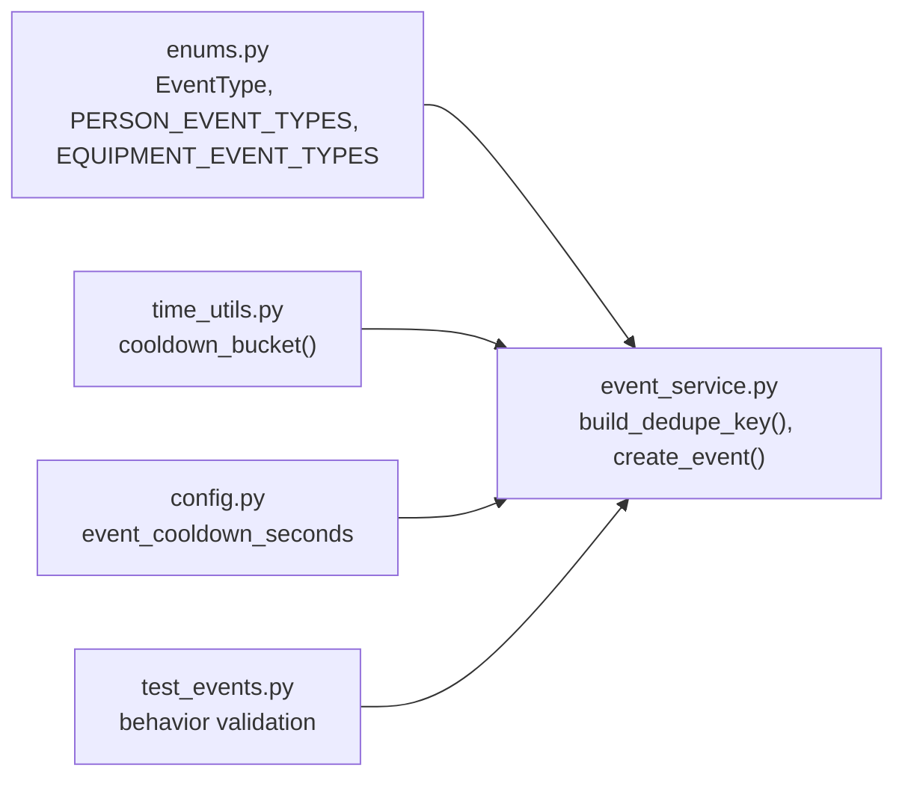

# Deduplication and Cooldown Mechanisms

<cite>
**Referenced Files in This Document**
- [event_service.py](file://app/services/event_service.py)
- [time_utils.py](file://app/utils/time_utils.py)
- [enums.py](file://app/models/enums.py)
- [config.py](file://app/config.py)
- [test_events.py](file://tests/test_events.py)
</cite>

## Table of Contents
1. [Introduction](#introduction)
2. [Project Structure](#project-structure)
3. [Core Components](#core-components)
4. [Architecture Overview](#architecture-overview)
5. [Detailed Component Analysis](#detailed-component-analysis)
6. [Dependency Analysis](#dependency-analysis)
7. [Performance Considerations](#performance-considerations)
8. [Troubleshooting Guide](#troubleshooting-guide)
9. [Conclusion](#conclusion)

## Introduction
This document explains the event deduplication and cooldown mechanisms used by the system to prevent duplicate event recording during rapid successive detections. It focuses on:

- The composite key strategy using `mv:` for movement events, `pp:` for person events, and `sys:` for system events.
- The cooldown window implementation that groups events into time buckets.
- How different event types are handled differently.
- Configuration parameters controlling cooldown duration.
- Real scenarios where deduplication applies and the trade-offs between accuracy and performance.

The goal is to make these mechanisms understandable for both technical and non-technical readers while providing precise references to the source code.

## Project Structure
The deduplication logic lives primarily in the event service layer, with supporting utilities for time bucketing and configuration. Event type classification is defined in shared enums, and tests validate behavior under realistic conditions.

**Diagram sources**
- [event_service.py:36-56](file://app/services/event_service.py#L36-L56)
- [time_utils.py:77-80](file://app/utils/time_utils.py#L77-L80)
- [enums.py:27-73](file://app/models/enums.py#L27-L73)
- [config.py:100-100](file://app/config.py#L100-L100)
- [test_events.py:15-68](file://tests/test_events.py#L15-L68)

**Section sources**
- [event_service.py:1-329](file://app/services/event_service.py#L1-L329)
- [time_utils.py:1-81](file://app/utils/time_utils.py#L1-L81)
- [enums.py:1-183](file://app/models/enums.py#L1-L183)
- [config.py:1-244](file://app/config.py#L1-L244)
- [test_events.py:1-236](file://tests/test_events.py#L1-L236)

## Core Components
- Composite dedupe key builder: constructs a stable string key based on event category, camera, track identifiers, and cooldown bucket.
- Cooldown bucket function: maps timestamps into integer buckets so events within the same window share a bucket identifier.
- Event creation flow: performs pre-checks against existing records and uses database constraints as a final guard against duplicates.
- Event type classification: distinguishes movement (equipment), person, and system events to apply appropriate key components.
- Configuration: exposes a configurable cooldown window via environment variables.

Key responsibilities:
- Prevent duplicate logging of the same physical movement or detection.
- Allow new events after the cooldown window expires.
- Keep person and equipment events separate from system events.
- Provide deterministic behavior through fixed-time tests.

**Section sources**
- [event_service.py:36-56](file://app/services/event_service.py#L36-L56)
- [event_service.py:59-147](file://app/services/event_service.py#L59-L147)
- [time_utils.py:77-80](file://app/utils/time_utils.py#L77-L80)
- [enums.py:27-73](file://app/models/enums.py#L27-L73)
- [config.py:100-100](file://app/config.py#L100-L100)

## Architecture Overview
The deduplication pipeline integrates three layers:

1. Key construction: categorizes the event and builds a composite key including camera, event type, relevant track IDs, and a cooldown bucket.
2. Pre-check: queries the database for an existing record with the same key.
3. Insertion with safety: inserts the event and handles concurrent duplicates via integrity error handling.

**Diagram sources**
- [event_service.py:59-147](file://app/services/event_service.py#L59-L147)
- [time_utils.py:77-80](file://app/utils/time_utils.py#L77-L80)

## Detailed Component Analysis

### Composite Key Strategy
The system uses three prefixes to distinguish event categories:

- `mv:` Movement events (equipment). Includes camera, event type, object track ID, person track ID, and cooldown bucket.
- `pp:` Person events. Includes camera, event type, person track ID, and cooldown bucket.
- `sys:` System events. Includes camera, event type, and cooldown bucket.

This design ensures that:
- Equipment movements are deduplicated per object and person tracks.
- Person entries/exits are deduplicated per person track.
- System events like camera disconnect/reconnect are deduplicated without track IDs.

**Diagram sources**
- [event_service.py:36-56](file://app/services/event_service.py#L36-L56)
- [enums.py:27-73](file://app/models/enums.py#L27-L73)

**Section sources**
- [event_service.py:36-56](file://app/services/event_service.py#L36-L56)
- [enums.py:27-73](file://app/models/enums.py#L27-L73)

### Cooldown Window Implementation
The cooldown window prevents duplicate events within a specified time period by grouping timestamps into integer buckets. The bucket is computed as the floor division of the Unix timestamp by the cooldown seconds.

Behavior:
- Events occurring within the same bucket produce the same key and are treated as duplicates.
- Events crossing bucket boundaries are considered distinct and allowed.
- The minimum bucket size is one second to avoid division issues.

**Diagram sources**
- [time_utils.py:77-80](file://app/utils/time_utils.py#L77-L80)

**Section sources**
- [time_utils.py:77-80](file://app/utils/time_utils.py#L77-L80)

### Deduplication Logic for Different Event Types
- Movement events (`mv:`):
  - Include both object and person track IDs.
  - Suitable for equipment taken out/brought in/returned.
  - Ensures the same physical movement is not recorded multiple times.
- Person events (`pp:`):
  - Include only person track ID.
  - Suitable for person entered/exited and unknown person detected.
  - Prevents repeated person detection logs within the cooldown window.
- System events (`sys:`):
  - Do not include track IDs.
  - Suitable for camera disconnect/reconnect and other system-level notifications.
  - Prevents repeated system alerts within the cooldown window.

**Diagram sources**
- [enums.py:27-73](file://app/models/enums.py#L27-L73)

**Section sources**
- [enums.py:27-73](file://app/models/enums.py#L27-L73)
- [event_service.py:36-56](file://app/services/event_service.py#L36-L56)

### Edge Cases and Rapid Successive Detections
- Same bucket suppression:
  - Two identical movement events on the same camera within the same cooldown bucket are suppressed; only the first is recorded.
- Cross-bucket allowance:
  - If the second event occurs in a later bucket, it is accepted as a new event.
- Camera isolation:
  - Events on different cameras do not collide even if all other fields match.
- Track stability:
  - Track IDs are temporary, so combining them with the cooldown bucket avoids false positives across unrelated detections.

Test coverage demonstrates:
- Duplicate suppression within a 30-second bucket.
- New event creation after a 5-second bucket boundary.
- Non-collision across different cameras.

**Section sources**
- [test_events.py:15-68](file://tests/test_events.py#L15-L68)
- [test_events.py:71-92](file://tests/test_events.py#L71-L92)

### Configuration Parameters
- Cooldown duration:
  - Controlled by `EVENT_COOLDOWN_SECONDS` environment variable.
  - Default value is 20 seconds.
  - Minimum enforced at 1 second.
- Usage:
  - Passed to `cooldown_bucket()` when building keys.
  - Can be overridden per call via `cooldown_seconds`.

Configuration mapping:
- Environment variable: `EVENT_COOLDOWN_SECONDS`
- Settings field: `event_cooldown_seconds`
- Default: 20 seconds
- Validation: minimum 1 second

**Section sources**
- [config.py:100-100](file://app/config.py#L100-L100)
- [config.py:207-207](file://app/config.py#L207-L207)
- [event_service.py:87-98](file://app/services/event_service.py#L87-L98)

### Example Scenarios
- Rapid equipment detection:
  - A monitor is detected being taken out twice within 3 seconds on the same camera with the same object and person track IDs.
  - Only the first event is recorded; the second is ignored due to the same cooldown bucket.
- Person entry after cooldown:
  - A person enters the facility, then again after 30 seconds with a 5-second cooldown.
  - Both events are recorded because they fall into different buckets.
- Multi-camera scenario:
  - The same equipment is detected on two different cameras simultaneously.
  - Both events are recorded because camera codes differ.

These scenarios are validated by tests and reflect real-world edge cases.

**Section sources**
- [test_events.py:15-68](file://tests/test_events.py#L15-L68)
- [test_events.py:71-92](file://tests/test_events.py#L71-L92)

## Dependency Analysis
The deduplication mechanism depends on:
- Event type classification from enums.
- Time bucket computation from time utilities.
- Configuration settings for cooldown duration.
- Database constraints for concurrency safety.

**Diagram sources**
- [enums.py:27-73](file://app/models/enums.py#L27-L73)
- [time_utils.py:77-80](file://app/utils/time_utils.py#L77-L80)
- [config.py:100-100](file://app/config.py#L100-L100)
- [event_service.py:36-56](file://app/services/event_service.py#L36-L56)
- [test_events.py:15-68](file://tests/test_events.py#L15-L68)

**Section sources**
- [event_service.py:36-56](file://app/services/event_service.py#L36-L56)
- [time_utils.py:77-80](file://app/utils/time_utils.py#L77-L80)
- [config.py:100-100](file://app/config.py#L100-L100)
- [test_events.py:15-68](file://tests/test_events.py#L15-L68)

## Performance Considerations
- Pre-check reduces unnecessary writes:
  - A simple lookup by `dedupe_key` avoids inserting duplicates.
- Database constraint provides safety:
  - Even if two workers insert concurrently, the unique constraint catches collisions.
- Bucket granularity affects throughput:
  - Smaller cooldown windows allow more events but increase risk of duplicates.
  - Larger cooldown windows reduce duplicates but may suppress legitimate rapid events.
- Indexing considerations:
  - Efficient lookups depend on indexing `dedupe_key` in the database schema.
- Memory and CPU overhead:
  - Key construction is lightweight; main cost is database access.

Recommendations:
- Tune `EVENT_COOLDOWN_SECONDS` based on camera FPS and detection reliability.
- Monitor duplicate suppression rates to balance accuracy and performance.
- Ensure database indexes exist for `dedupe_key` to maintain query performance.

[No sources needed since this section provides general guidance]

## Troubleshooting Guide
Common issues and resolutions:

- Too many suppressed events:
  - Increase `EVENT_COOLDOWN_SECONDS` to reduce false suppression.
  - Verify track IDs are stable and correctly associated with detections.
- Missing expected events:
  - Check if events cross bucket boundaries; consider adjusting cooldown.
  - Confirm camera codes are unique per physical camera.
- Concurrent duplicate warnings:
  - Expected under high load; the system safely returns the existing record.
- Incorrect event categorization:
  - Ensure event types are classified correctly into movement, person, or system sets.

Validation steps:
- Use tests to simulate rapid successive detections and verify behavior.
- Inspect logs for duplicate suppression messages.
- Query events by camera and time range to confirm deduplication boundaries.

**Section sources**
- [event_service.py:100-103](file://app/services/event_service.py#L100-L103)
- [event_service.py:133-138](file://app/services/event_service.py#L133-L138)
- [test_events.py:15-68](file://tests/test_events.py#L15-L68)

## Conclusion
The deduplication and cooldown mechanisms provide robust protection against duplicate event recording while allowing legitimate events after cooldown windows. The composite key strategy using `mv:`, `pp:`, and `sys:` prefixes ensures accurate categorization and isolation of event types. Configuration via `EVENT_COOLDOWN_SECONDS` allows operators to tune the balance between accuracy and performance. Tests validate critical behaviors such as bucket suppression, cross-bucket allowance, and camera isolation. Proper tuning and monitoring ensure reliable operation under varying detection conditions.

[No sources needed since this section summarizes without analyzing specific files]