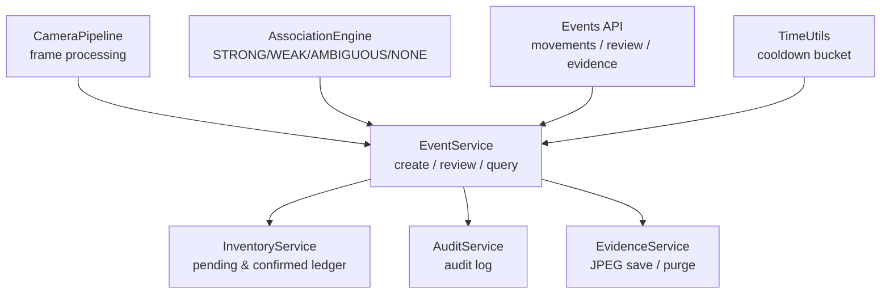
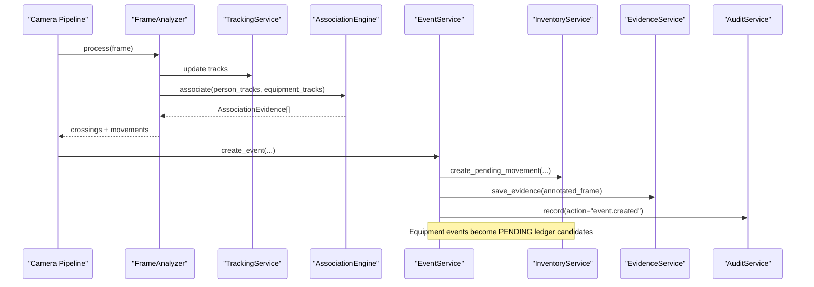
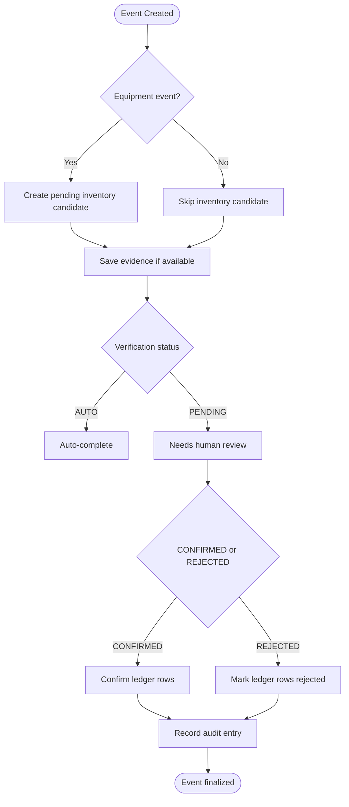
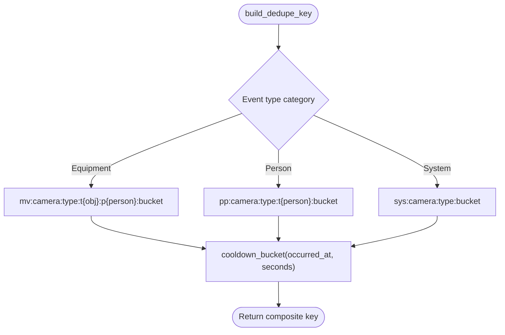
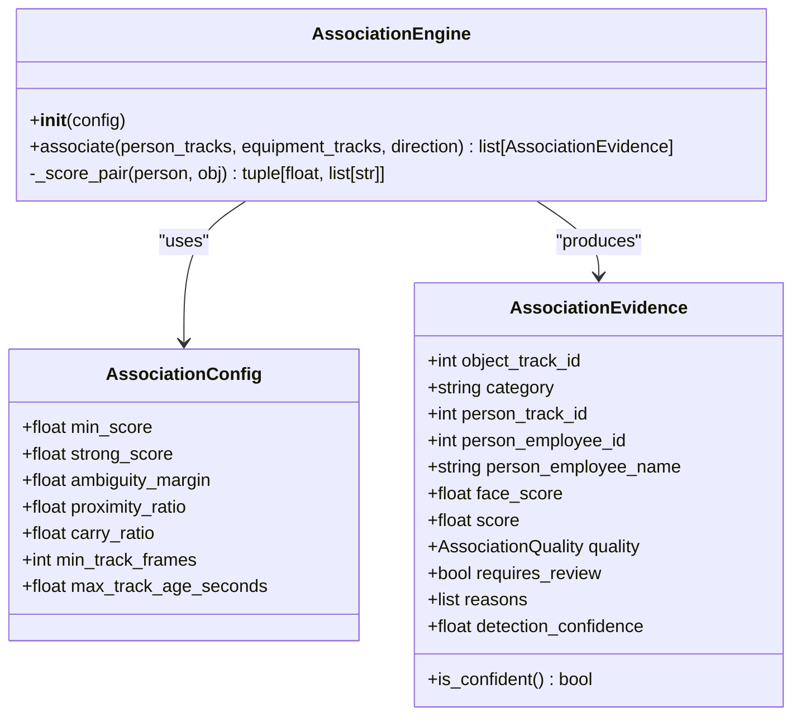
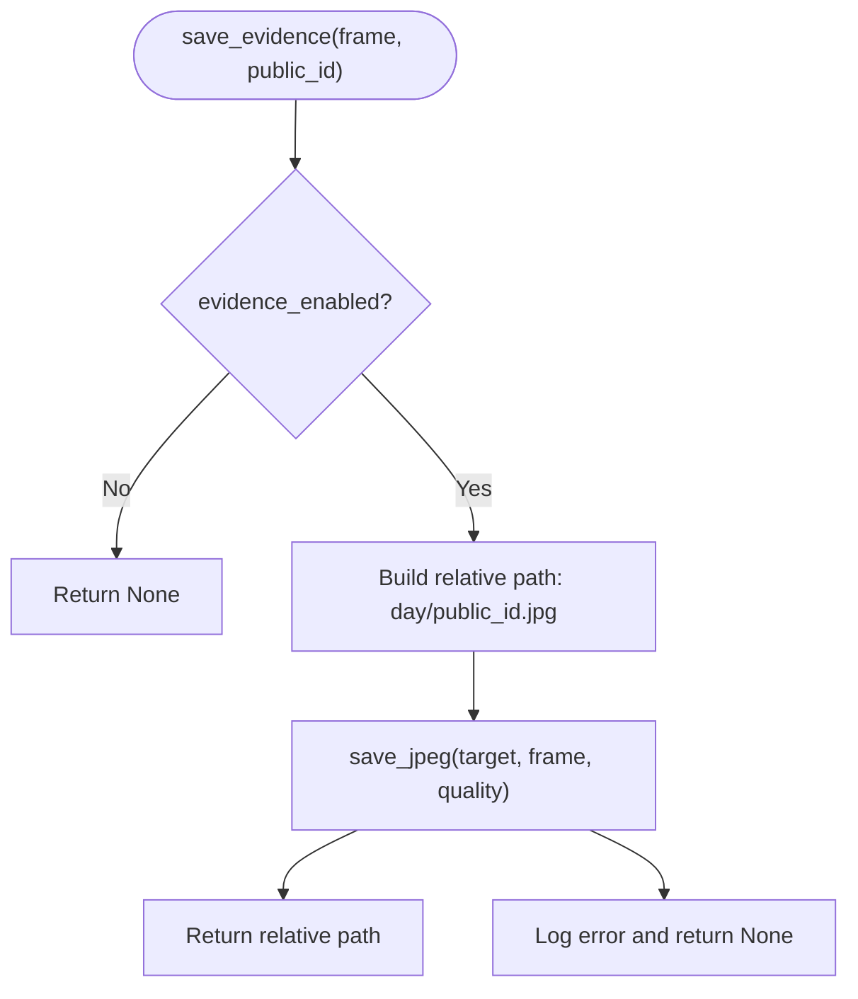
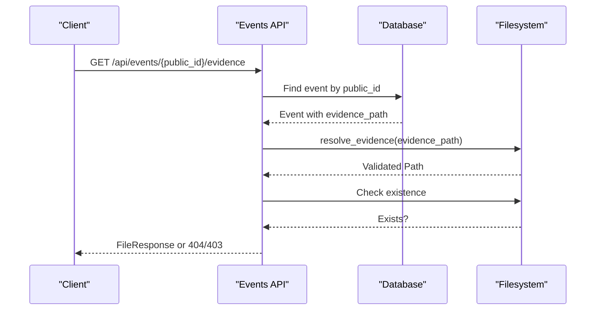
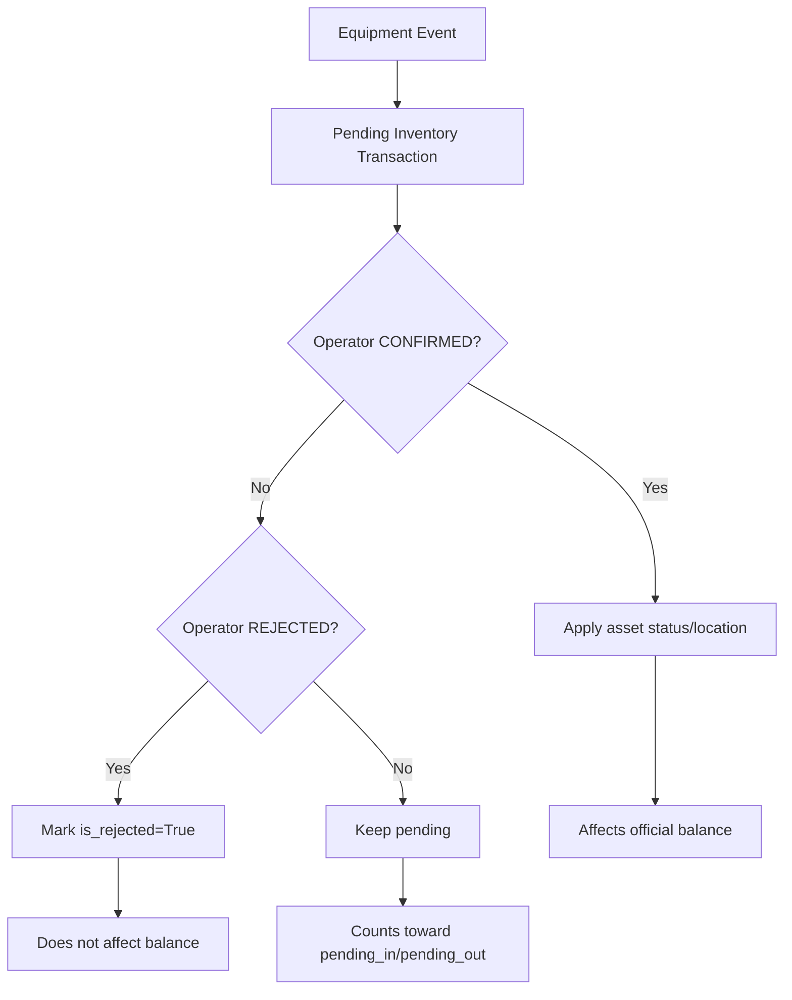
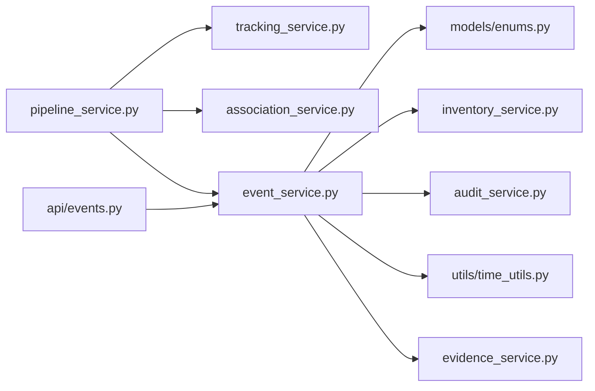

# Event Management System

<cite>
**Referenced Files in This Document**
- [event_service.py](file://app/services/event_service.py)
- [enums.py](file://app/models/enums.py)
- [events_api.py](file://app/api/events.py)
- [evidence_service.py](file://app/services/evidence_service.py)
- [association_service.py](file://app/services/association_service.py)
- [inventory_service.py](file://app/services/inventory_service.py)
- [audit_service.py](file://app/services/audit_service.py)
- [pipeline_service.py](file://app/services/pipeline_service.py)
- [time_utils.py](file://app/utils/time_utils.py)
- [test_events.py](file://tests/test_events.py)
</cite>

## Table of Contents
1. [Introduction](#introduction)
2. [Project Structure](#project-structure)
3. [Core Components](#core-components)
4. [Architecture Overview](#architecture-overview)
5. [Detailed Component Analysis](#detailed-component-analysis)
6. [Dependency Analysis](#dependency-analysis)
7. [Performance Considerations](#performance-considerations)
8. [Troubleshooting Guide](#troubleshooting-guide)
9. [Conclusion](#conclusion)

## Introduction
This document explains the event management system that turns camera detections into auditable, reviewable movement and person events. It covers:
- Event types for people, equipment, and camera state changes.
- The full lifecycle from creation through confirmation or rejection.
- Deduplication using composite keys and cooldown windows.
- Confidence scoring and association quality assessment.
- Evidence handling with JPEG capture, secure storage, retention, and access control.
- The relationship between events and inventory transactions.
- Pending state management and audit trail maintenance.

The goal is to make the system understandable for both technical developers and operational users who review events.

## Project Structure
The event system spans services, models, API endpoints, and tests:
- Services implement event creation, evidence handling, association scoring, inventory ledgering, auditing, and pipeline processing.
- Enums define event types, verification states, association quality, and related business values.
- The API exposes movement history, review workflows, evidence retrieval, and JSON queries.
- Tests validate deduplication and pending behavior.

**Diagram sources**
- [pipeline_service.py:490-585](file://app/services/pipeline_service.py#L490-L585)
- [event_service.py:59-147](file://app/services/event_service.py#L59-L147)
- [inventory_service.py:132-205](file://app/services/inventory_service.py#L132-L205)
- [audit_service.py:13-37](file://app/services/audit_service.py#L13-L37)
- [evidence_service.py:19-65](file://app/services/evidence_service.py#L19-L65)
- [association_service.py:106-198](file://app/services/association_service.py#L106-L198)
- [events_api.py:40-144](file://app/api/events.py#L40-L144)
- [time_utils.py:77-80](file://app/utils/time_utils.py#L77-L80)

**Section sources**
- [event_service.py:1-329](file://app/services/event_service.py#L1-L329)
- [enums.py:27-73](file://app/models/enums.py#L27-L73)
- [events_api.py:40-144](file://app/api/events.py#L40-L144)
- [evidence_service.py:19-65](file://app/services/evidence_service.py#L19-L65)
- [association_service.py:106-198](file://app/services/association_service.py#L106-L198)
- [inventory_service.py:132-205](file://app/services/inventory_service.py#L132-L205)
- [audit_service.py:13-37](file://app/services/audit_service.py#L13-L37)
- [pipeline_service.py:490-585](file://app/services/pipeline_service.py#L490-L585)
- [time_utils.py:77-80](file://app/utils/time_utils.py#L77-L80)

## Core Components
- Event service: creates events, enforces deduplication, manages review workflow, and provides queries and dashboard stats.
- Enums: define event types (person, equipment, camera), verification status, direction, sync status, transaction type, and association quality.
- Association engine: scores person-to-equipment associations and returns STRONG/WEAK/AMBIGUOUS/NONE with reasons.
- Evidence service: saves JPEG stills, resolves paths securely, and purges expired files based on retention policy.
- Inventory service: converts equipment events into pending ledger entries; confirms or rejects them; computes balances.
- Audit service: records operator actions and system decisions.
- Pipeline service: orchestrates frame analysis, crossing detection, movement candidate generation, and event persistence.
- Time utilities: provide UTC normalization, local day bounds, and cooldown bucket calculation.

Key responsibilities:
- Creation: pipeline produces crossings and movements; event service persists events and optional inventory candidates.
- Review: operators confirm or reject pending events; confirmation updates ledger; rejection marks candidates as rejected.
- Evidence: annotated frames are saved per event with date-based directory structure and configurable quality.
- Access: evidence retrieval requires operator role and path validation.

**Section sources**
- [event_service.py:32-147](file://app/services/event_service.py#L32-L147)
- [enums.py:27-183](file://app/models/enums.py#L27-L183)
- [association_service.py:29-198](file://app/services/association_service.py#L29-L198)
- [evidence_service.py:19-65](file://app/services/evidence_service.py#L19-L65)
- [inventory_service.py:132-205](file://app/services/inventory_service.py#L132-L205)
- [audit_service.py:13-37](file://app/services/audit_service.py#L13-L37)
- [pipeline_service.py:508-585](file://app/services/pipeline_service.py#L508-L585)
- [time_utils.py:77-80](file://app/utils/time_utils.py#L77-L80)

## Architecture Overview
The event system integrates vision processing, database persistence, human review, and inventory accounting.

**Diagram sources**
- [pipeline_service.py:490-585](file://app/services/pipeline_service.py#L490-L585)
- [association_service.py:131-198](file://app/services/association_service.py#L131-L198)
- [event_service.py:59-147](file://app/services/event_service.py#L59-L147)
- [inventory_service.py:132-156](file://app/services/inventory_service.py#L132-L156)
- [evidence_service.py:19-38](file://app/services/evidence_service.py#L19-L38)
- [audit_service.py:13-37](file://app/services/audit_service.py#L13-L37)

## Detailed Component Analysis

### Event Types and Lifecycle
Event types include:
- Person events: PERSON_ENTERED, PERSON_EXITED, UNKNOWN_PERSON_ENTERED, UNKNOWN_PERSON_EXITED, UNKNOWN_PERSON_DETECTED.
- Equipment events: EQUIPMENT_BROUGHT_IN, EQUIPMENT_TAKEN_OUT, EQUIPMENT_RETURNED.
- System events: CAMERA_DISCONNECTED, CAMERA_RECONNECTED.
- Operational flags: REQUIRES_REVIEW.

Lifecycle:
- Creation: pipeline detects crossings and movements; event service inserts an event with a stable dedupe key and optional evidence path.
- Verification status: known persons get AUTO; unknown persons and many equipment movements start as PENDING.
- Review: operators confirm or reject; confirmation activates inventory effects; rejection keeps candidates but marks them rejected.
- Sync: reviewed events reset sync status to PENDING for downstream synchronization.

**Diagram sources**
- [event_service.py:59-147](file://app/services/event_service.py#L59-L147)
- [event_service.py:150-211](file://app/services/event_service.py#L150-L211)
- [inventory_service.py:132-205](file://app/services/inventory_service.py#L132-L205)
- [pipeline_service.py:508-585](file://app/services/pipeline_service.py#L508-L585)

**Section sources**
- [enums.py:27-73](file://app/models/enums.py#L27-L73)
- [event_service.py:59-211](file://app/services/event_service.py#L59-L211)
- [pipeline_service.py:508-585](file://app/services/pipeline_service.py#L508-L585)

### Deduplication Mechanism: Composite Keys and Cooldown Windows
Deduplication prevents duplicate recording of the same physical movement by combining:
- Prefixes: mv:/pp:/sys:
  - mv: for equipment movement events.
  - pp: for person events.
  - sys: for system events like camera disconnect/reconnect.
- Context fields: camera_code, event_type, track identifiers (object_track_id/person_track_id).
- Cooldown bucket: integer bucket derived from occurred_at and configured cooldown_seconds.

Behavior:
- Pre-check: event service checks existing events by dedupe_key before insertion.
- Database constraint: unique constraint catches concurrent duplicates.
- Result: only one event per key within the cooldown window; subsequent attempts return the existing event without creating a new row.

**Diagram sources**
- [event_service.py:36-56](file://app/services/event_service.py#L36-L56)
- [time_utils.py:77-80](file://app/utils/time_utils.py#L77-L80)

Concrete examples:
- Duplicate suppression within a 30-second bucket results in a single event and a single ledger candidate.
- After the cooldown window expires, a new event can be created for the same track/camera/type.

**Section sources**
- [event_service.py:36-103](file://app/services/event_service.py#L36-L103)
- [time_utils.py:77-80](file://app/utils/time_utils.py#L77-L80)
- [test_events.py:15-45](file://tests/test_events.py#L15-L45)
- [test_events.py:48-68](file://tests/test_events.py#L48-L68)

### Confidence Scoring and Association Quality
Association quality assesses whether a detected object is being carried by a person:
- Signals combined: carry overlap, proximity, temporal stability, direction agreement.
- Weights: carry 0.50, proximity 0.25, temporal 0.15, direction 0.10.
- Thresholds: min_score, strong_score, ambiguity_margin, proximity_ratio, carry_ratio, min_track_frames, max_track_age_seconds.
- Output: AssociationQuality enum values STRONG, WEAK, AMBIGUOUS, NONE, plus reasons and requires_review flag.

Rules:
- STRONG: high score and sufficient track stability; not ambiguous.
- WEAK: lower score or short tracks; flagged for review.
- AMBIGUOUS: multiple people explain the object similarly; flagged for review.
- NONE: no confident association found.

**Diagram sources**
- [association_service.py:29-57](file://app/services/association_service.py#L29-L57)
- [association_service.py:106-198](file://app/services/association_service.py#L106-L198)

Practical implications:
- Pipeline sets notes and extra metadata when requires_review is true.
- Dashboard highlights events needing attention based on PENDING status or low association confidence.

**Section sources**
- [association_service.py:29-198](file://app/services/association_service.py#L29-L198)
- [pipeline_service.py:350-387](file://app/services/pipeline_service.py#L350-L387)
- [event_service.py:292-298](file://app/services/event_service.py#L292-L298)

### Evidence Handling: JPEG Capture, Secure Storage, Retention, Access Controls
Evidence handling ensures that visual proof is captured safely and retained according to policy:
- Capture: annotated frames are saved as JPEGs under a date-based directory inside the evidence directory.
- Path resolution: resolve_evidence validates that requested paths remain within the evidence directory to prevent traversal attacks.
- Retention: purge_expired removes JPEGs older than the configured retention period.
- Access controls: evidence retrieval endpoint requires operator role and returns 404 if no evidence exists or file is missing; returns 403 if path is unauthorized.

**Diagram sources**
- [evidence_service.py:19-38](file://app/services/evidence_service.py#L19-L38)

Access flow:
- Operator requests evidence via public_id.
- System resolves path securely.
- If file exists, returns file response with private cache headers.

**Diagram sources**
- [events_api.py:132-144](file://app/api/events.py#L132-L144)
- [evidence_service.py:41-43](file://app/services/evidence_service.py#L41-L43)

**Section sources**
- [evidence_service.py:19-65](file://app/services/evidence_service.py#L19-L65)
- [events_api.py:132-144](file://app/api/events.py#L132-L144)

### Event Creation Examples from Codebase
- Person crossing:
  - Known person: PERSON_ENTERED or PERSON_EXITED with AUTO verification.
  - Unknown person: UNKNOWN_PERSON_ENTERED or UNKNOWN_PERSON_EXITED with PENDING verification.
- Equipment movement:
  - EQUIPMENT_BROUGHT_IN or EQUIPMENT_TAKEN_OUT with PENDING verification and pending inventory candidate.

Relevant code paths:
- Crossing persistence: [pipeline_service.py:508-542](file://app/services/pipeline_service.py#L508-L542)
- Movement persistence: [pipeline_service.py:544-585](file://app/services/pipeline_service.py#L544-L585)
- Event creation: [event_service.py:59-147](file://app/services/event_service.py#L59-L147)

**Section sources**
- [pipeline_service.py:508-585](file://app/services/pipeline_service.py#L508-L585)
- [event_service.py:59-147](file://app/services/event_service.py#L59-L147)

### Review Workflow Examples from Codebase
- Review page lists pending events and balances with issues.
- Operator submits decision (CONFIRMED or REJECTED), reason, and optional employee/asset/category.
- Service validates decision and pending status, updates event fields, triggers inventory confirm/reject, records audit, and resets sync status.

Relevant code paths:
- Review page: [events_api.py:72-88](file://app/api/events.py#L72-L88)
- Review action: [events_api.py:91-129](file://app/api/events.py#L91-L129)
- Review service: [event_service.py:150-211](file://app/services/event_service.py#L150-L211)
- Inventory confirm/reject: [inventory_service.py:165-205](file://app/services/inventory_service.py#L165-L205)

**Section sources**
- [events_api.py:72-129](file://app/api/events.py#L72-L129)
- [event_service.py:150-211](file://app/services/event_service.py#L150-L211)
- [inventory_service.py:165-205](file://app/services/inventory_service.py#L165-L205)

### Evidence Retrieval Examples from Codebase
- Endpoint requires operator role.
- Returns HTML 404 if event or evidence_path is missing or file does not exist.
- Returns HTML 403 if path resolution fails due to security check.

Relevant code paths:
- Evidence endpoint: [events_api.py:132-144](file://app/api/events.py#L132-L144)
- Path resolution: [evidence_service.py:41-43](file://app/services/evidence_service.py#L41-L43)

**Section sources**
- [events_api.py:132-144](file://app/api/events.py#L132-L144)
- [evidence_service.py:41-43](file://app/services/evidence_service.py#L41-L43)

### Relationship Between Events and Inventory Transactions
- Equipment events create pending inventory candidates automatically.
- Candidates are marked is_confirmed=False and source="vision".
- Confirmation flips is_confirmed=True and applies asset side effects (status/location).
- Rejection marks is_rejected=True and preserves audit trail without affecting balance.

**Diagram sources**
- [inventory_service.py:132-156](file://app/services/inventory_service.py#L132-L156)
- [inventory_service.py:165-205](file://app/services/inventory_service.py#L165-L205)
- [inventory_service.py:215-273](file://app/services/inventory_service.py#L215-L273)

**Section sources**
- [inventory_service.py:132-205](file://app/services/inventory_service.py#L132-L205)
- [inventory_service.py:215-273](file://app/services/inventory_service.py#L215-L273)

### Pending State Management
- Pending reviews: query_events filters by VerificationStatus.PENDING; count_pending returns totals.
- Dashboard badge: needs_review_flag returns True for PENDING or low association_confidence.
- Sync pending: pending_sync_events retrieves events needing Sheets synchronization.

**Section sources**
- [event_service.py:253-298](file://app/services/event_service.py#L253-L298)
- [event_service.py:282-289](file://app/services/event_service.py#L282-L289)

### Audit Trail Maintenance
- Audit service records actions such as event.confirm, event.reject, and inventory.confirm/reject.
- Entries include timestamp, user info, entity type/id, details, and optional reason.
- Recent audit entries can be queried.

**Section sources**
- [audit_service.py:13-37](file://app/services/audit_service.py#L13-L37)
- [event_service.py:196-210](file://app/services/event_service.py#L196-L210)
- [inventory_service.py:176-205](file://app/services/inventory_service.py#L176-L205)

## Dependency Analysis
The event system has clear separation of concerns:
- Pipeline depends on tracking and association services to produce candidates.
- Event service depends on enums, time utilities, inventory service, and audit service.
- Evidence service depends on image utilities and settings.
- API layer depends on services and dependency injection for sessions and users.

**Diagram sources**
- [pipeline_service.py:490-585](file://app/services/pipeline_service.py#L490-L585)
- [event_service.py:1-329](file://app/services/event_service.py#L1-L329)
- [events_api.py:1-191](file://app/api/events.py#L1-L191)

**Section sources**
- [pipeline_service.py:490-585](file://app/services/pipeline_service.py#L490-L585)
- [event_service.py:1-329](file://app/services/event_service.py#L1-L329)
- [events_api.py:1-191](file://app/api/events.py#L1-L191)

## Performance Considerations
- Deduplication reduces redundant writes and ledger churn by grouping events into cooldown buckets.
- Association scoring uses lightweight geometric and temporal heuristics; thresholds can be tuned to reduce false positives.
- Evidence saving is disk-bound; quality and retention policies should balance storage usage and forensic value.
- Query pagination and filtering limit memory and CPU usage for large event histories.

[No sources needed since this section provides general guidance]

## Troubleshooting Guide
Common issues and diagnostics:
- Duplicate events: verify cooldown_seconds and dedupe_key construction; ensure camera_code and track IDs are consistent.
- Missing evidence: check evidence_enabled setting, disk permissions, and path resolution; inspect 403/404 responses.
- Pending backlog: use pending_reviews and count_pending to identify unreviewed events; check association_confidence and requires_review flags.
- Ledger discrepancies: confirm that equipment events have correct equipment_category and asset_id; review confirm/reject actions and audit logs.

Actionable references:
- Deduplication tests: [test_events.py:15-45](file://tests/test_events.py#L15-L45), [test_events.py:48-68](file://tests/test_events.py#L48-L68)
- Evidence retrieval errors: [events_api.py:132-144](file://app/api/events.py#L132-L144)
- Review validation errors: [event_service.py:150-167](file://app/services/event_service.py#L150-L167)

**Section sources**
- [test_events.py:15-68](file://tests/test_events.py#L15-L68)
- [events_api.py:132-144](file://app/api/events.py#L132-L144)
- [event_service.py:150-167](file://app/services/event_service.py#L150-L167)

## Conclusion
The event management system transforms camera detections into reliable, auditable records while preserving uncertainty through association quality and human review. Deduplication via composite keys and cooldown windows ensures data integrity. Evidence capture and secure access protect sensitive imagery. Inventory integration maintains append-only ledgers with pending states until operators confirm or reject. Together, these components provide a robust foundation for security monitoring and asset accountability.

[No sources needed since this section summarizes without analyzing specific files]