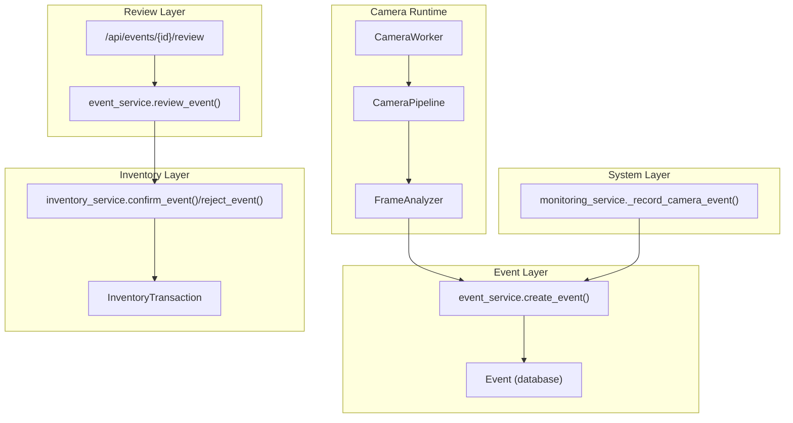
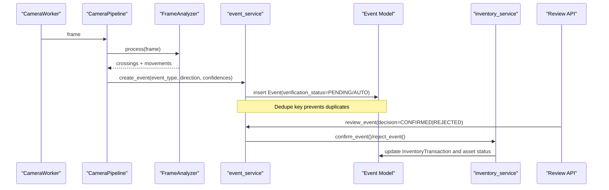
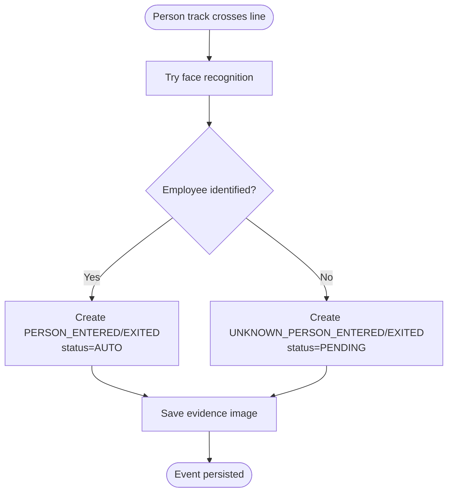
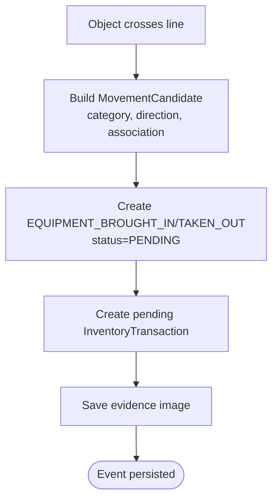
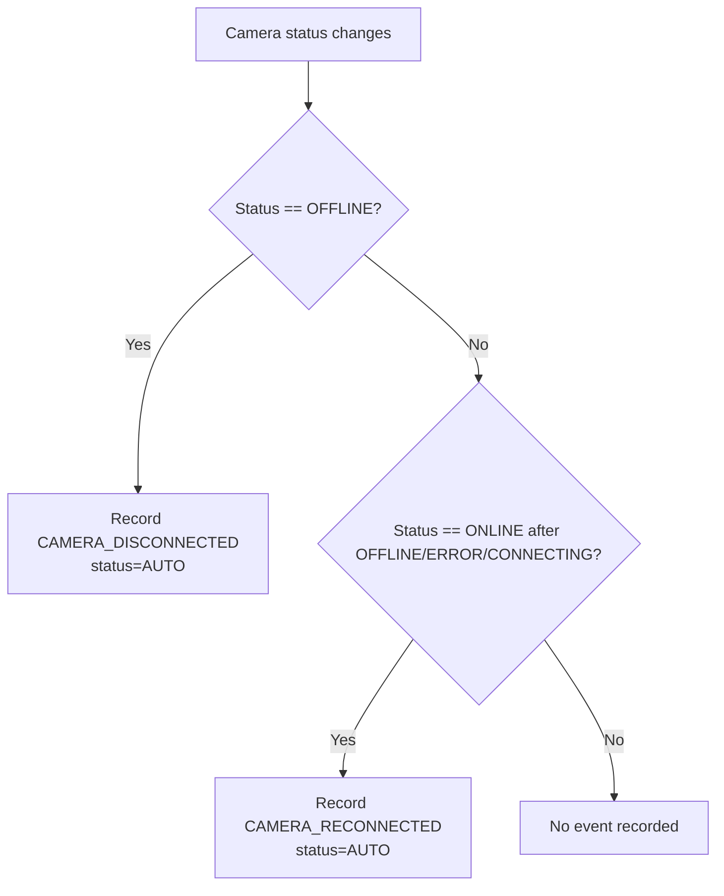
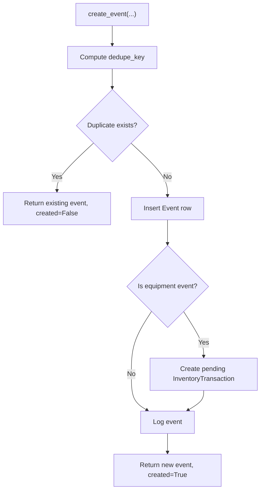
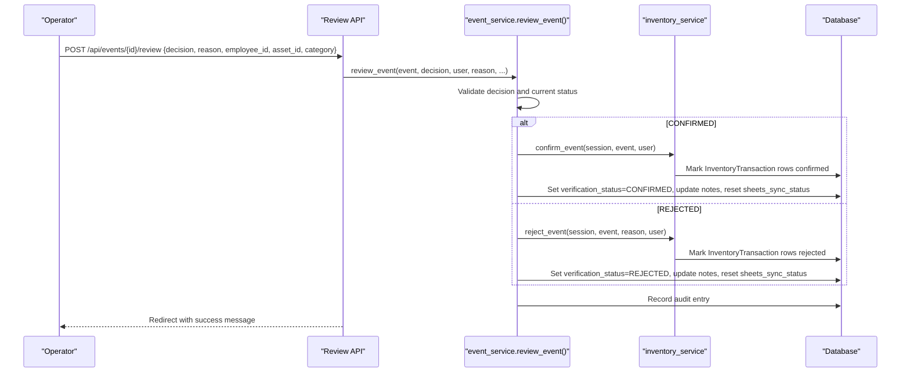
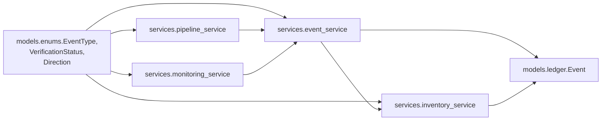

# Event Types and Lifecycle

<cite>
**Referenced Files in This Document**
- [enums.py](file://app/models/enums.py)
- [ledger.py](file://app/models/ledger.py)
- [event_service.py](file://app/services/event_service.py)
- [pipeline_service.py](file://app/services/pipeline_service.py)
- [monitoring_service.py](file://app/services/monitoring_service.py)
- [inventory_service.py](file://app/services/inventory_service.py)
- [events_api.py](file://app/api/events.py)
- [test_events.py](file://tests/test_events.py)
</cite>

## Table of Contents
1. [Introduction](#introduction)
2. [Project Structure](#project-structure)
3. [Core Components](#core-components)
4. [Architecture Overview](#architecture-overview)
5. [Detailed Component Analysis](#detailed-component-analysis)
6. [Dependency Analysis](#dependency-analysis)
7. [Performance Considerations](#performance-considerations)
8. [Troubleshooting Guide](#troubleshooting-guide)
9. [Conclusion](#conclusion)

## Introduction
This document explains the event types and their lifecycle in the face-date system. It covers how events are created by camera pipelines and monitoring, how they enter a pending state, how operators confirm or reject them, and how confirmed events update inventory and downstream systems. The focus is on:
- Person movement events: PERSON_ENTERED, PERSON_EXITED, UNKNOWN_PERSON_ENTERED, UNKNOWN_PERSON_EXITED
- Equipment movement events: EQUIPMENT_BROUGHT_IN, EQUIPMENT_TAKEN_OUT
- System events: CAMERA_DISCONNECTED, CAMERA_RECONNECTED
- Verification states: PENDING, CONFIRMED, REJECTED (and AUTO for trusted system events)

The goal is to make the event model clear for both developers and operators who review events.

## Project Structure
Events flow through several layers:
- Camera capture and inference run in per-camera workers and pipelines.
- The pipeline converts detections into candidate events with confidence scores.
- Events are persisted as candidates, usually in PENDING state.
- Operators review and confirm or reject events via the UI/API.
- Confirmed equipment events update the inventory ledger and asset status.
- System events like camera disconnect/reconnect are automatically recorded.

**Diagram sources**
- [pipeline_service.py:490-585](file://app/services/pipeline_service.py#L490-L585)
- [event_service.py:59-147](file://app/services/event_service.py#L59-L147)
- [monitoring_service.py:203-216](file://app/services/monitoring_service.py#L203-L216)
- [inventory_service.py:165-205](file://app/services/inventory_service.py#L165-L205)
- [events_api.py:91-129](file://app/api/events.py#L91-L129)

**Section sources**
- [pipeline_service.py:1-14](file://app/services/pipeline_service.py#L1-L14)
- [event_service.py:1-26](file://app/services/event_service.py#L1-L26)
- [monitoring_service.py:1-26](file://app/services/monitoring_service.py#L1-L26)

## Core Components
- EventType defines all supported event categories, including person, equipment, and camera system events.
- Event is the database model representing a single observable fact with confidence fields and verification_status.
- event_service provides creation, deduplication, querying, and review functions.
- pipeline_service transforms frames into candidate events and persists them.
- monitoring_service records camera connectivity events.
- inventory_service turns confirmed equipment events into ledger transactions and updates asset status.
- events_api exposes pages and endpoints for reviewing and listing events.

Key enums and groups:
- EventType includes PERSON_ENTERED, PERSON_EXITED, UNKNOWN_PERSON_ENTERED, UNKNOWN_PERSON_EXITED, EQUIPMENT_BROUGHT_IN, EQUIPMENT_TAKEN_OUT, EQUIPMENT_RETURNED, INVENTORY_DISCREPANCY, CAMERA_DISCONNECTED, CAMERA_RECONNECTED, UNKNOWN_PERSON_DETECTED, REQUIRES_REVIEW.
- VerificationStatus includes AUTO, PENDING, CONFIRMED, REJECTED.
- Direction includes IN, OUT, NONE.
- PERSON_EVENT_TYPES and EQUIPMENT_EVENT_TYPES group related event categories.

**Section sources**
- [enums.py:27-73](file://app/models/enums.py#L27-L73)
- [ledger.py:21-111](file://app/models/ledger.py#L21-L111)
- [event_service.py:16-29](file://app/services/event_service.py#L16-L29)

## Architecture Overview
The event architecture separates detection from confirmation:
- Detection produces candidates with confidences; these are not trusted until reviewed.
- Known person crossings can be marked AUTO when identity is strong; unknown persons remain PENDING.
- Equipment movements are always PENDING because association between person and object may be ambiguous.
- System events like camera disconnect/reconnect are AUTO and do not affect inventory.

**Diagram sources**
- [pipeline_service.py:490-585](file://app/services/pipeline_service.py#L490-L585)
- [event_service.py:59-147](file://app/services/event_service.py#L59-L147)
- [inventory_service.py:165-205](file://app/services/inventory_service.py#L165-L205)
- [events_api.py:91-129](file://app/api/events.py#L91-L129)

## Detailed Component Analysis

### Event Types
EventType enumerates all event categories. Important subsets:
- PERSON_EVENT_TYPES: PERSON_ENTERED, PERSON_EXITED, UNKNOWN_PERSON_ENTERED, UNKNOWN_PERSON_EXITED, UNKNOWN_PERSON_DETECTED
- EQUIPMENT_EVENT_TYPES: EQUIPMENT_BROUGHT_IN, EQUIPMENT_TAKEN_OUT, EQUIPMENT_RETURNED
- System events: CAMERA_DISCONNECTED, CAMERA_RECONNECTED

These groups drive deduplication keys and downstream behavior.

Business rules:
- Person crossing events use direction IN/OUT to determine ENTERED vs EXITED.
- Unknown person events default to PENDING to require review.
- Equipment movement events are always PENDING and create pending inventory candidates.
- Camera disconnect/reconnect events are AUTO and do not touch inventory.

**Section sources**
- [enums.py:27-73](file://app/models/enums.py#L27-L73)
- [event_service.py:36-56](file://app/services/event_service.py#L36-L56)

### Event Model and Statuses
Event stores:
- Public identifiers, timestamps, camera code, employee and asset references
- Confidence fields: detection_confidence, face_match_score, association_confidence
- verification_status: PENDING, CONFIRMED, REJECTED, AUTO
- Evidence path and notes
- Dedupe key for duplicate suppression
- Review metadata: reviewed_by_user_id, reviewed_at, review_reason

VerificationStatus values:
- AUTO: trusted system-generated events (e.g., known person entry/exit, camera connect/disconnect)
- PENDING: AI-produced candidates requiring human review
- CONFIRMED: operator-approved; affects inventory and reporting
- REJECTED: operator-declined; kept for audit but excluded from balances

Direction values:
- IN: entering the monitored area
- OUT: leaving the monitored area
- NONE: unspecified direction

**Section sources**
- [ledger.py:21-111](file://app/models/ledger.py#L21-L111)
- [enums.py:76-103](file://app/models/enums.py#L76-L103)

### Event Creation Patterns

#### Person Entry/Exit
- FrameAnalyzer detects person tracks crossing the line.
- If an employee is recognized, the event type is PERSON_ENTERED or PERSON_EXITED with VerificationStatus.AUTO.
- If no employee is recognized, UNKNOWN_PERSON_ENTERED or UNKNOWN_PERSON_EXITED with VerificationStatus.PENDING.
- Evidence images are saved and attached to the event.

**Diagram sources**
- [pipeline_service.py:508-542](file://app/services/pipeline_service.py#L508-L542)

**Section sources**
- [pipeline_service.py:218-321](file://app/services/pipeline_service.py#L218-L321)
- [pipeline_service.py:508-542](file://app/services/pipeline_service.py#L508-L542)

#### Equipment Movement
- When an object crosses the line, the pipeline builds a MovementCandidate with category, direction, and association quality.
- An event of type EQUIPMENT_BROUGHT_IN or EQUIPMENT_TAKEN_OUT is created with VerificationStatus.PENDING.
- A pending inventory transaction is created immediately if the event has an equipment_category.

**Diagram sources**
- [pipeline_service.py:328-387](file://app/services/pipeline_service.py#L328-L387)
- [pipeline_service.py:544-585](file://app/services/pipeline_service.py#L544-L585)
- [inventory_service.py:132-156](file://app/services/inventory_service.py#L132-L156)

**Section sources**
- [pipeline_service.py:328-387](file://app/services/pipeline_service.py#L328-L387)
- [pipeline_service.py:544-585](file://app/services/pipeline_service.py#L544-L585)
- [inventory_service.py:132-156](file://app/services/inventory_service.py#L132-L156)

#### Camera Disconnect/Reconnect
- monitoring_service observes camera status transitions.
- On OFFLINE transition, it records CAMERA_DISCONNECTED with VerificationStatus.AUTO.
- On ONLINE transition after OFFLINE/ERROR/CONNECTING, it records CAMERA_RECONNECTED with VerificationStatus.AUTO.
- These events do not create inventory transactions.

**Diagram sources**
- [monitoring_service.py:171-182](file://app/services/monitoring_service.py#L171-L182)
- [monitoring_service.py:203-216](file://app/services/monitoring_service.py#L203-L216)

**Section sources**
- [monitoring_service.py:171-182](file://app/services/monitoring_service.py#L171-L182)
- [monitoring_service.py:203-216](file://app/services/monitoring_service.py#L203-L216)

### Event Lifecycle and State Transitions

#### Creation and Deduplication
- event_service.create_event computes a stable dedupe_key based on event_type, camera_code, cooldown bucket, and track IDs.
- If a duplicate key exists, the existing event is returned without creating a new row.
- For equipment events, a pending inventory transaction is created immediately.

**Diagram sources**
- [event_service.py:36-56](file://app/services/event_service.py#L36-L56)
- [event_service.py:59-147](file://app/services/event_service.py#L59-L147)
- [inventory_service.py:132-156](file://app/services/inventory_service.py#L132-L156)

**Section sources**
- [event_service.py:36-56](file://app/services/event_service.py#L36-L56)
- [event_service.py:59-147](file://app/services/event_service.py#L59-L147)

#### Review Workflow
- Operators access the review page and submit decisions via /api/events/{event_id}/review.
- review_event validates that the decision is CONFIRMED or REJECTED and that the event is still PENDING.
- On CONFIRMED:
  - inventory_service.confirm_event marks pending transactions as confirmed and applies asset side effects.
  - Event status becomes CONFIRMED; notes updated; sheets_sync_status reset to PENDING.
- On REJECTED:
  - inventory_service.reject_event marks transactions as rejected.
  - Event status becomes REJECTED; reason required; notes updated; sheets_sync_status reset to PENDING.
- Audit entries are recorded for both confirm and reject actions.

**Diagram sources**
- [events_api.py:91-129](file://app/api/events.py#L91-L129)
- [event_service.py:150-211](file://app/services/event_service.py#L150-L211)
- [inventory_service.py:165-205](file://app/services/inventory_service.py#L165-L205)

**Section sources**
- [events_api.py:91-129](file://app/api/events.py#L91-L129)
- [event_service.py:150-211](file://app/services/event_service.py#L150-L211)
- [inventory_service.py:165-205](file://app/services/inventory_service.py#L165-L205)

### Business Rules by Event Type

- PERSON_ENTERED / PERSON_EXITED:
  - Created when a person track crosses the line.
  - If employee recognized: status=AUTO; otherwise UNKNOWN_* with status=PENDING.
  - Do not create inventory transactions.
  - Evidence images are attached when available.

- UNKNOWN_PERSON_ENTERED / UNKNOWN_PERSON_EXITED:
  - Require review; status=PENDING.
  - Dashboard flags low association confidence or PENDING status as needing review.

- EQUIPMENT_BROUGHT_IN / EQUIPMENT_TAKEN_OUT:
  - Always status=PENDING.
  - Immediately create pending InventoryTransaction rows.
  - Only confirmed transactions affect balances and asset status.

- CAMERA_DISCONNECTED / CAMERA_RECONNECTED:
  - Automatically recorded with status=AUTO.
  - Used for monitoring and dashboard statistics; no inventory impact.

- UNKNOWN_PERSON_DETECTED:
  - Counted in dashboard stats; used for security awareness.

- REQUIRES_REVIEW:
  - Heuristic flag indicating events needing attention (PENDING or low association confidence).

**Section sources**
- [pipeline_service.py:508-585](file://app/services/pipeline_service.py#L508-L585)
- [event_service.py:292-298](file://app/services/event_service.py#L292-L298)
- [event_service.py:304-324](file://app/services/event_service.py#L304-L324)
- [inventory_service.py:132-156](file://app/services/inventory_service.py#L132-L156)

## Dependency Analysis
The following diagram shows how components depend on each other during event processing:

**Diagram sources**
- [enums.py:27-103](file://app/models/enums.py#L27-L103)
- [event_service.py:16-29](file://app/services/event_service.py#L16-L29)
- [pipeline_service.py:29-41](file://app/services/pipeline_service.py#L29-L41)
- [monitoring_service.py:17-25](file://app/services/monitoring_service.py#L17-L25)
- [inventory_service.py:25-28](file://app/services/inventory_service.py#L25-L28)
- [ledger.py:21-111](file://app/models/ledger.py#L21-L111)

**Section sources**
- [enums.py:27-103](file://app/models/enums.py#L27-L103)
- [event_service.py:16-29](file://app/services/event_service.py#L16-L29)
- [pipeline_service.py:29-41](file://app/services/pipeline_service.py#L29-L41)
- [monitoring_service.py:17-25](file://app/services/monitoring_service.py#L17-L25)
- [inventory_service.py:25-28](file://app/services/inventory_service.py#L25-L28)
- [ledger.py:21-111](file://app/models/ledger.py#L21-L111)

## Performance Considerations
- Deduplication uses cooldown buckets to prevent rapid duplicate events from the same track on the same camera.
- Pipeline processes frames in a dedicated thread; errors are caught to keep the camera alive.
- Evidence saving is optional and does not block event persistence.
- Inventory transactions are append-only; corrections are new rows rather than edits.
- Google Sheets sync runs asynchronously and marks events as PENDING/FAILED/SYNCED.

[No sources needed since this section provides general guidance]

## Troubleshooting Guide
Common issues and resolutions:
- Duplicate events: Check cooldown_seconds and dedupe_key generation; ensure track IDs are consistent.
- Missing inventory updates: Confirm that equipment events have equipment_category and are CONFIRMED.
- Rejected events require a reason: Ensure review submissions include non-empty reasons for REJECTED decisions.
- Low association confidence: Use the needs_review_flag heuristic to prioritize events for review.
- Camera events not recorded: Verify monitoring service status transitions and logs for _record_camera_event.

Validation examples from tests:
- Person events do not create inventory candidates.
- Equipment events create pending movements.
- Public IDs are unique and follow the EVT- prefix format.
- Review resets sheets_sync_status to PENDING.

**Section sources**
- [test_events.py:95-101](file://tests/test_events.py#L95-L101)
- [test_events.py:103-108](file://tests/test_events.py#L103-L108)
- [test_events.py:198-202](file://tests/test_events.py#L198-L202)
- [event_service.py:292-298](file://app/services/event_service.py#L292-L298)

## Conclusion
The face-date system treats AI-generated observations as candidates until reviewed. Person and equipment events are created with appropriate statuses based on confidence and identity. Equipment movements create pending inventory transactions that only affect balances upon confirmation. System events like camera disconnect/reconnect are automatic and do not alter inventory. The review workflow ensures data integrity while maintaining operational visibility through dashboards and reports.

[No sources needed since this section summarizes without analyzing specific files]