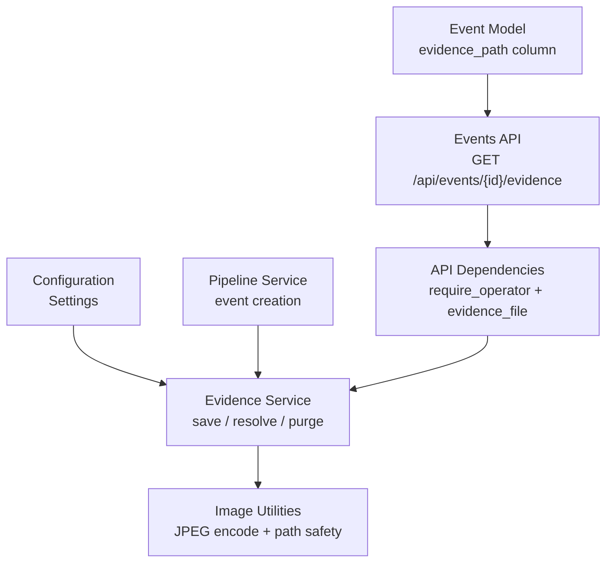
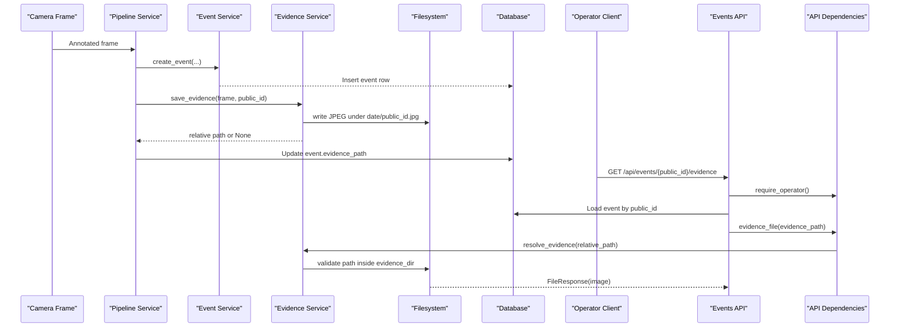
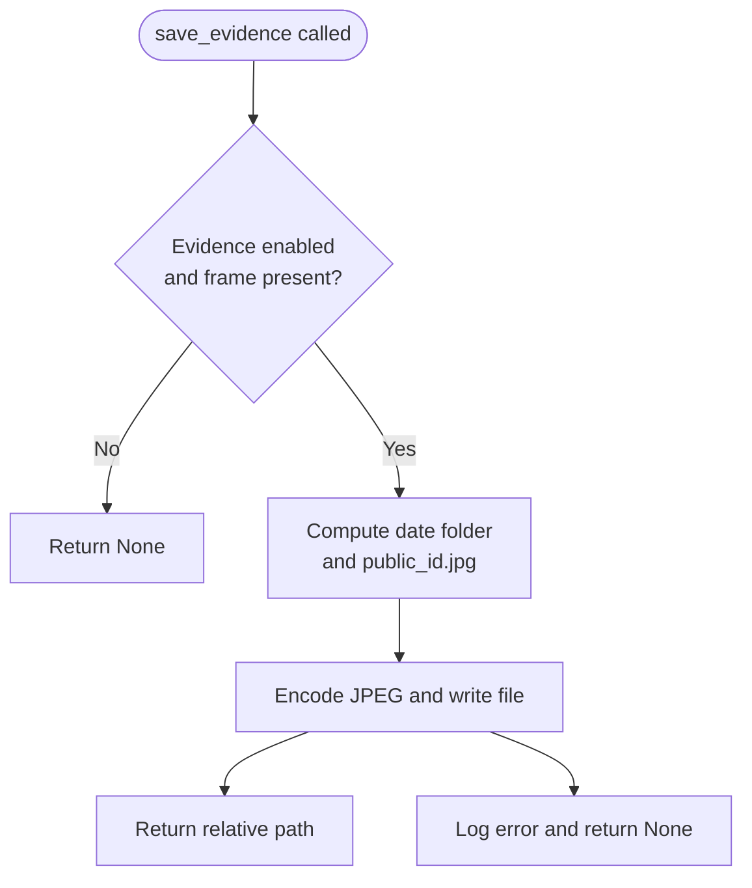
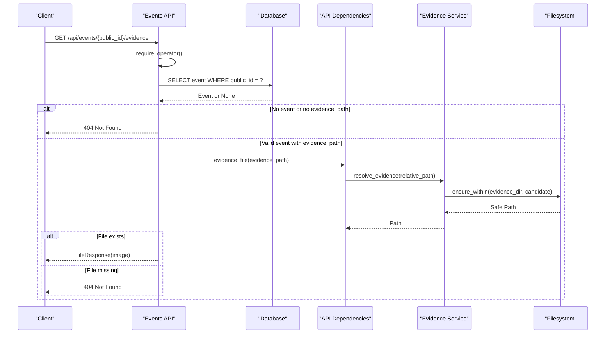
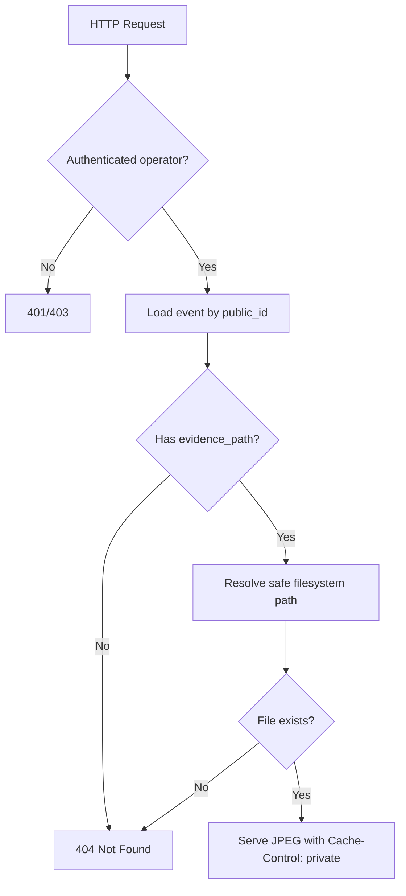
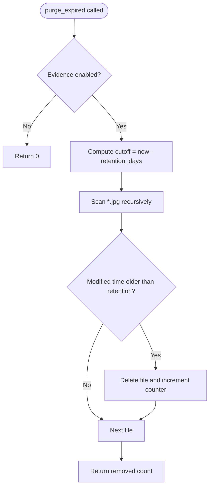
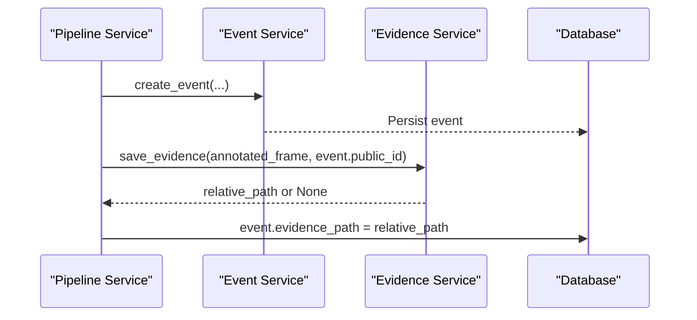
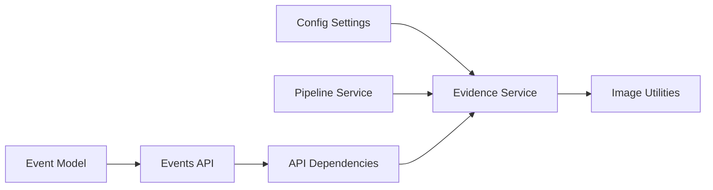

# Evidence Management System

<cite>
**Referenced Files in This Document**
- [evidence_service.py](file://app/services/evidence_service.py)
- [events.py](file://app/api/events.py)
- [deps.py](file://app/api/deps.py)
- [config.py](file://app/config.py)
- [images.py](file://app/utils/images.py)
- [event_service.py](file://app/services/event_service.py)
- [pipeline_service.py](file://app/services/pipeline_service.py)
- [ledger.py](file://app/models/ledger.py)
- [.gitignore](file://.gitignore)
</cite>

## Table of Contents
1. [Introduction](#introduction)
2. [Project Structure](#project-structure)
3. [Core Components](#core-components)
4. [Architecture Overview](#architecture-overview)
5. [Detailed Component Analysis](#detailed-component-analysis)
6. [Dependency Analysis](#dependency-analysis)
7. [Performance Considerations](#performance-considerations)
8. [Troubleshooting Guide](#troubleshooting-guide)
9. [Conclusion](#conclusion)
10. [Appendices](#appendices)

## Introduction
This document explains the evidence handling system that captures JPEG stills from camera frames, stores them securely on disk, and exposes controlled access through API endpoints. It covers file naming conventions, directory layout, retention policies, access controls, cleanup procedures, integration with the event pipeline, backup strategies, and compliance considerations for biometric images.

The system is designed so that:
- Evidence files are only written when explicitly enabled by configuration.
- File paths are validated to prevent directory traversal.
- Only authenticated operators can retrieve evidence images.
- Retention is enforced automatically based on a configurable number of days.
- The public JSON events API intentionally excludes sensitive biometric data.

## Project Structure
Evidence-related functionality spans several modules:
- Configuration defines where evidence is stored and how long it is retained.
- The evidence service writes and purges JPEG files.
- The image utilities provide safe path resolution and JPEG encoding.
- The event pipeline saves evidence after creating an event.
- The events API exposes a protected endpoint for viewing evidence.
- The database model stores the relative evidence path alongside each event.



**Diagram sources**
- [config.py:62-118](file://app/config.py#L62-L118)
- [evidence_service.py:19-65](file://app/services/evidence_service.py#L19-L65)
- [images.py:31-34](file://app/utils/images.py#L31-L34)
- [images.py:84-90](file://app/utils/images.py#L84-L90)
- [pipeline_service.py:533-536](file://app/services/pipeline_service.py#L533-L536)
- [events.py:134-146](file://app/api/events.py#L134-L146)
- [deps.py:210-213](file://app/api/deps.py#L210-L213)
- [ledger.py:55](file://app/models/ledger.py#L55)

**Section sources**
- [config.py:62-118](file://app/config.py#L62-L118)
- [evidence_service.py:19-65](file://app/services/evidence_service.py#L19-L65)
- [images.py:31-34](file://app/utils/images.py#L31-L34)
- [images.py:84-90](file://app/utils/images.py#L84-L90)
- [pipeline_service.py:533-536](file://app/services/pipeline_service.py#L533-L536)
- [events.py:134-146](file://app/api/events.py#L134-L146)
- [deps.py:210-213](file://app/api/deps.py#L210-L213)
- [ledger.py:55](file://app/models/ledger.py#L55)

## Core Components
- Settings object holds evidence storage location, retention period, JPEG quality, and whether evidence capture is enabled.
- Evidence service provides functions to save a still, resolve a safe file path, and purge expired files.
- Image utilities handle JPEG encoding and enforce that resolved paths stay inside the configured evidence directory.
- Event pipeline integrates evidence saving into the normal event creation flow.
- Events API exposes a protected endpoint for retrieving evidence images.
- Event model stores the relative evidence path as a nullable string.

Key responsibilities:
- **Configuration**: Provide `evidence_dir`, `evidence_enabled`, `evidence_retention_days`, and `evidence_jpeg_quality`.
- **Storage**: Write one JPEG per event under a date-based subdirectory.
- **Security**: Validate paths and require operator authentication.
- **Retention**: Delete files older than the configured retention window.
- **Integration**: Attach the saved relative path to the created event.

**Section sources**
- [config.py:100-118](file://app/config.py#L100-L118)
- [evidence_service.py:19-65](file://app/services/evidence_service.py#L19-L65)
- [images.py:31-34](file://app/utils/images.py#L31-L34)
- [images.py:84-90](file://app/utils/images.py#L84-L90)
- [event_service.py:59-147](file://app/services/event_service.py#L59-L147)
- [pipeline_service.py:533-536](file://app/services/pipeline_service.py#L533-L536)
- [events.py:134-146](file://app/api/events.py#L134-L146)
- [ledger.py:55](file://app/models/ledger.py#L55)

## Architecture Overview
The evidence lifecycle has three main phases: capture, storage, and retrieval.



**Diagram sources**
- [pipeline_service.py:533-536](file://app/services/pipeline_service.py#L533-L536)
- [event_service.py:59-147](file://app/services/event_service.py#L59-L147)
- [evidence_service.py:19-43](file://app/services/evidence_service.py#L19-L43)
- [events.py:134-146](file://app/api/events.py#L134-L146)
- [deps.py:210-213](file://app/api/deps.py#L210-L213)

## Detailed Component Analysis

### Evidence Capture and Storage
The evidence capture flow starts when the pipeline creates an event and then attempts to save a JPEG still. If evidence is disabled or the frame is missing, no file is written. When enabled, the service computes a date-based subdirectory and uses the event’s public identifier as the filename. The resulting relative path is returned and later attached to the event record.

Important behaviors:
- Writing is skipped when `EVIDENCE_ENABLED` is false.
- Each still is stored as a JPEG using the configured quality.
- The parent directory is created automatically if needed.
- Errors during writing are logged and result in `None`.



**Diagram sources**
- [evidence_service.py:19-38](file://app/services/evidence_service.py#L19-L38)
- [images.py:31-34](file://app/utils/images.py#L31-L34)

**Section sources**
- [evidence_service.py:19-38](file://app/services/evidence_service.py#L19-L38)
- [images.py:31-34](file://app/utils/images.py#L31-L34)

### Evidence File Naming Conventions and Directory Structure
Evidence files follow a predictable structure:
- Root directory: configured via `data_dir` plus `evidence_dir`, defaulting to `data/evidence`.
- Date subdirectory: ISO date string such as `YYYY-MM-DD`.
- Filename: `<public_id>.jpg`, where `public_id` is generated per event.

Example layout:
```
data/evidence/
  2024-01-15/
    EVT-ABCDEF1234.jpg
  2024-01-16/
    EVT-XYZ9876543.jpg
```

The event model stores only the relative path, for example `2024-01-15/EVT-ABCDEF1234.jpg`.

**Section sources**
- [config.py:114-118](file://app/config.py#L114-L118)
- [evidence_service.py:30-35](file://app/services/evidence_service.py#L30-L35)
- [event_service.py:105-125](file://app/services/event_service.py#L105-L125)
- [ledger.py:55](file://app/models/ledger.py#L55)

### Secure Path Resolution and Access Controls
Access to evidence files is protected at two levels:
1. Authentication and authorization: the evidence endpoint requires an authenticated operator.
2. Path validation: resolved paths must remain inside the configured evidence directory; otherwise, a value error is raised.

The API endpoint:
- Requires operator role.
- Loads the event by `public_id`.
- Rejects requests when the event has no evidence path.
- Resolves the file safely.
- Returns a 404 when the file does not exist.
- Serves the file with private caching headers.



**Diagram sources**
- [events.py:134-146](file://app/api/events.py#L134-L146)
- [deps.py:210-213](file://app/api/deps.py#L210-L213)
- [evidence_service.py:41-43](file://app/services/evidence_service.py#L41-L43)
- [images.py:84-90](file://app/utils/images.py#L84-L90)

**Section sources**
- [events.py:134-146](file://app/api/events.py#L134-L146)
- [deps.py:210-213](file://app/api/deps.py#L210-L213)
- [evidence_service.py:41-43](file://app/services/evidence_service.py#L41-L43)
- [images.py:84-90](file://app/utils/images.py#L84-L90)

### Evidence Retrieval API Endpoints
Primary endpoint:
- `GET /api/events/{public_id}/evidence`
- Purpose: Retrieve the evidence JPEG for a specific event.
- Authorization: Operator or admin role required.
- Response: JPEG image with private cache headers, or HTML 404 when unavailable.

Public events JSON endpoint:
- `GET /api/events`
- Purpose: Read-only summary of events for integrations.
- Security: Requires user authentication but intentionally excludes biometric data and does not expose evidence images.



**Diagram sources**
- [events.py:134-146](file://app/api/events.py#L134-L146)
- [events.py:149-174](file://app/api/events.py#L149-L174)

**Section sources**
- [events.py:134-146](file://app/api/events.py#L134-L146)
- [events.py:149-174](file://app/api/events.py#L149-L174)

### Retention Policy and Cleanup Procedures
Retention is governed by `EVIDENCE_RETENTION_DAYS`. The purge function:
- Skips execution when evidence is disabled.
- Computes a cutoff time based on current UTC time minus the retention period.
- Recursively scans all `.jpg` files under the evidence directory.
- Deletes files older than the retention window.
- Logs warnings when deletion fails due to permissions.
- Returns the count of removed files.

Recommended operational usage:
- Run the purge function periodically, for example through a scheduled task or background worker.
- Monitor logs for permission errors and missing directories.
- Ensure the process running cleanup has read/write access to the evidence directory.



**Diagram sources**
- [evidence_service.py:46-65](file://app/services/evidence_service.py#L46-L65)

**Section sources**
- [evidence_service.py:46-65](file://app/services/evidence_service.py#L46-L65)

### Integration with the Event System
Evidence is tightly coupled to event creation:
- The pipeline service creates an event and then calls the evidence service with the annotated frame and the event’s public ID.
- If saving succeeds, the relative path is assigned to `event.evidence_path`.
- The event model persists this path alongside other metadata.
- The review workflow and movement pages can reference the presence of evidence.



**Diagram sources**
- [pipeline_service.py:533-536](file://app/services/pipeline_service.py#L533-L536)
- [event_service.py:59-147](file://app/services/event_service.py#L59-L147)
- [ledger.py:55](file://app/models/ledger.py#L55)

**Section sources**
- [pipeline_service.py:533-536](file://app/services/pipeline_service.py#L533-L536)
- [event_service.py:59-147](file://app/services/event_service.py#L59-L147)
- [ledger.py:55](file://app/models/ledger.py#L55)

### Security Measures Protecting Biometric Data
Biometric images are considered sensitive. The system applies multiple safeguards:
- **Directory isolation**: Evidence is stored under a dedicated directory configured by `evidence_dir`.
- **Path validation**: All evidence paths are resolved through a helper that rejects escapes outside the base directory.
- **Role-based access**: Only operators or admins can retrieve evidence images.
- **Private caching**: Evidence responses use private cache headers to reduce accidental browser caching.
- **Exclusion from public APIs**: The general events JSON endpoint does not include evidence images or raw biometric payloads.
- **Repository exclusion**: The `data/` directory containing evidence is ignored by version control.

Compliance recommendations:
- Restrict filesystem permissions so only the application runtime and backup systems can access the evidence directory.
- Encrypt evidence at rest where supported by your deployment environment.
- Limit network exposure to the evidence endpoint behind authentication and optional IP allowlists.
- Audit access to evidence retrieval operations.
- Define and enforce retention periods aligned with organizational policy and applicable regulations.

**Section sources**
- [images.py:84-90](file://app/utils/images.py#L84-L90)
- [events.py:134-146](file://app/api/events.py#L134-L146)
- [events.py:149-174](file://app/api/events.py#L149-L174)
- [.gitignore:14-16](file://.gitignore#L14-L16)

### Examples of Evidence File Management Operations
Typical operations include:
- Saving evidence: Triggered automatically when the pipeline creates an event.
- Retrieving evidence: Use the protected API endpoint with operator credentials.
- Cleaning up old evidence: Run the purge function according to your retention policy.
- Inspecting configuration: Verify `EVIDENCE_ENABLED`, `EVIDENCE_RETENTION_DAYS`, and `EVIDENCE_JPEG_QUALITY`.

Operational notes:
- If evidence is disabled, the save function returns `None` and no file is created.
- If the file is deleted externally or expired, the evidence endpoint returns 404.
- If the stored path is invalid or points outside the evidence directory, path resolution raises a value error and the API responds with a forbidden-style response.

**Section sources**
- [evidence_service.py:19-38](file://app/services/evidence_service.py#L19-L38)
- [evidence_service.py:46-65](file://app/services/evidence_service.py#L46-L65)
- [events.py:134-146](file://app/api/events.py#L134-L146)

### Backup Strategies for Evidence Files
Because evidence may contain biometric images, backups should be treated as sensitive data:
- Include the configured evidence directory in encrypted backups.
- Exclude temporary files and logs from backups unless required.
- Rotate backups according to retention policy.
- Test restoration procedures regularly.
- Separate backup encryption keys from evidence data.
- Restrict backup storage access to authorized personnel and automated systems.

[No sources needed since this section provides general guidance]

### Compliance Considerations for Storing Biometric Images
When storing biometric images:
- Apply least-privilege access controls to both filesystem and API layers.
- Enforce retention limits and document disposal procedures.
- Avoid committing evidence or employee photos to source repositories.
- Log access and administrative actions where appropriate.
- Align retention and storage practices with local privacy laws and organizational policies.
- Consider additional protections such as encryption at rest and in transit.

[No sources needed since this section provides general guidance]

## Dependency Analysis
The evidence subsystem depends on configuration, image utilities, the event model, and the API dependency layer.



**Diagram sources**
- [config.py:100-118](file://app/config.py#L100-L118)
- [evidence_service.py:19-43](file://app/services/evidence_service.py#L19-L43)
- [images.py:31-34](file://app/utils/images.py#L31-L34)
- [pipeline_service.py:533-536](file://app/services/pipeline_service.py#L533-L536)
- [events.py:134-146](file://app/api/events.py#L134-L146)
- [deps.py:210-213](file://app/api/deps.py#L210-L213)
- [ledger.py:55](file://app/models/ledger.py#L55)

**Section sources**
- [config.py:100-118](file://app/config.py#L100-L118)
- [evidence_service.py:19-43](file://app/services/evidence_service.py#L19-L43)
- [images.py:31-34](file://app/utils/images.py#L31-L34)
- [pipeline_service.py:533-536](file://app/services/pipeline_service.py#L533-L536)
- [events.py:134-146](file://app/api/events.py#L134-L146)
- [deps.py:210-213](file://app/api/deps.py#L210-L213)
- [ledger.py:55](file://app/models/ledger.py#L55)

## Performance Considerations
- JPEG quality affects file size and I/O load. Adjust `EVIDENCE_JPEG_QUALITY` based on storage capacity and image clarity needs.
- Retention scanning walks all `.jpg` files recursively; large evidence directories benefit from periodic cleanup rather than ad-hoc manual deletion.
- Evidence saving occurs during event processing; failures are logged and do not break event creation.
- Evidence retrieval serves files directly; consider reverse proxy caching policies carefully because the response is marked private.

[No sources needed since this section provides general guidance]

## Troubleshooting Guide
Common issues and resolutions:
- **Evidence not saved**: Check whether evidence is enabled and whether the frame is available before saving.
- **Permission denied when deleting old files**: Ensure the cleanup process has write access to the evidence directory.
- **Evidence endpoint returns 404**: The event may have no evidence path, or the file may have been purged or deleted.
- **Forbidden response when resolving evidence**: The stored path may be malformed or point outside the evidence directory.
- **Large disk usage**: Review retention settings and run the purge function.

Relevant implementation references:
- Save function skips writing when disabled or frame is missing.
- Purge function logs warnings on permission errors and counts removed files.
- Evidence endpoint validates operator role and file existence.
- Path resolver enforces containment within the evidence directory.

**Section sources**
- [evidence_service.py:19-38](file://app/services/evidence_service.py#L19-L38)
- [evidence_service.py:46-65](file://app/services/evidence_service.py#L46-L65)
- [events.py:134-146](file://app/api/events.py#L134-L146)
- [images.py:84-90](file://app/utils/images.py#L84-L90)

## Conclusion
The evidence management system provides secure, configurable, and auditable handling of biometric stills. It integrates cleanly with the event pipeline, protects sensitive files through path validation and role-based access, and supports retention-driven cleanup. Operators should configure retention and storage locations carefully, restrict filesystem and API access, and implement encrypted backups aligned with compliance requirements.

[No sources needed since this section summarizes without analyzing specific files]

## Appendices

### Configuration Options Relevant to Evidence
- `EVIDENCE_ENABLED`: Enables or disables evidence capture.
- `EVIDENCE_RETENTION_DAYS`: Number of days to retain evidence files.
- `EVIDENCE_JPEG_QUALITY`: JPEG quality used when saving evidence stills.
- `DATA_DIR` and `EVIDENCE_DIR`: Control where evidence files are stored.

**Section sources**
- [config.py:100-118](file://app/config.py#L100-L118)
- [config.py:208-220](file://app/config.py#L208-L220)