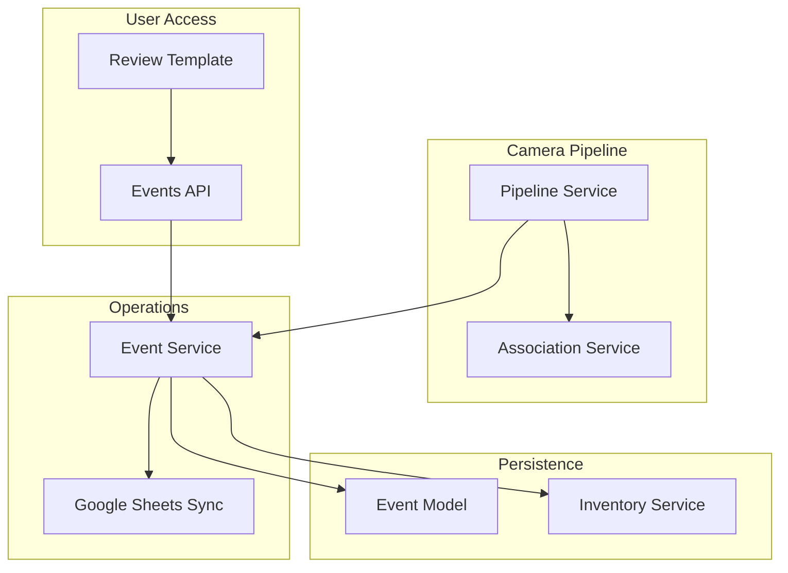
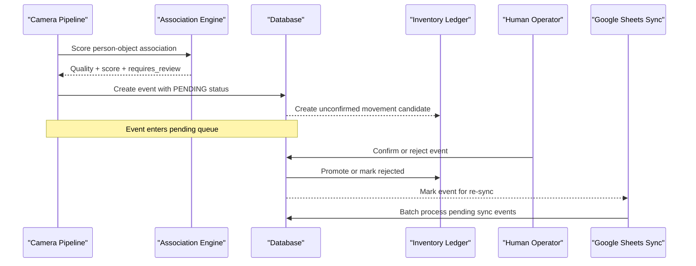
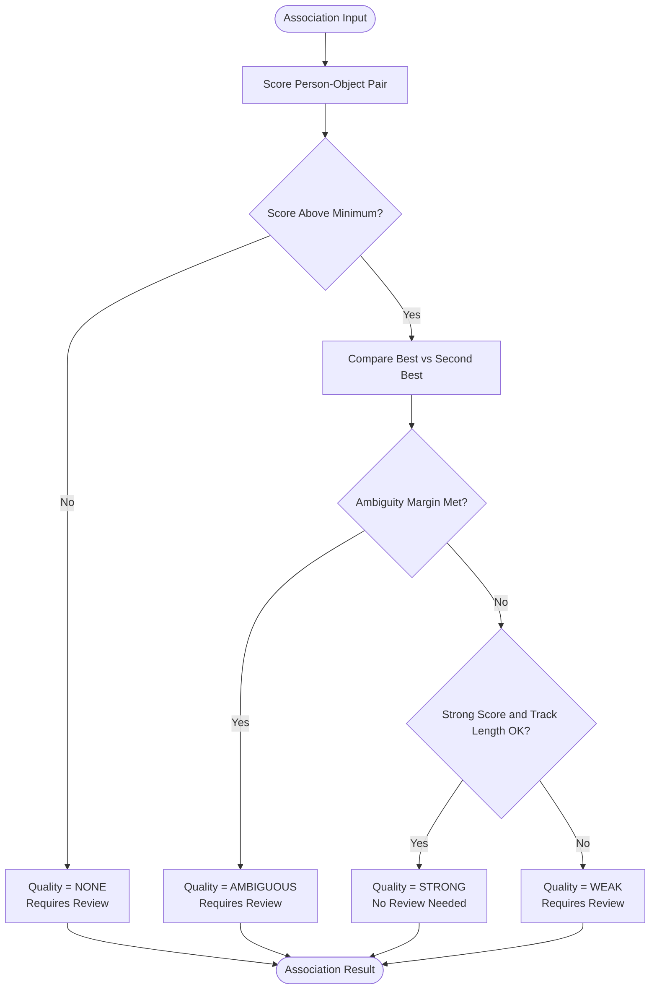
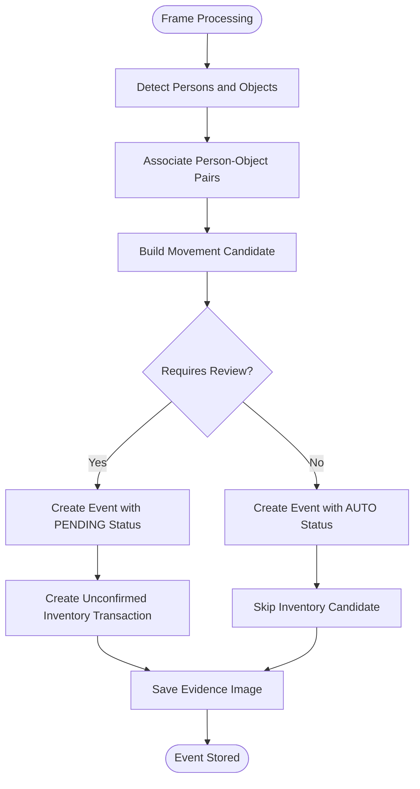
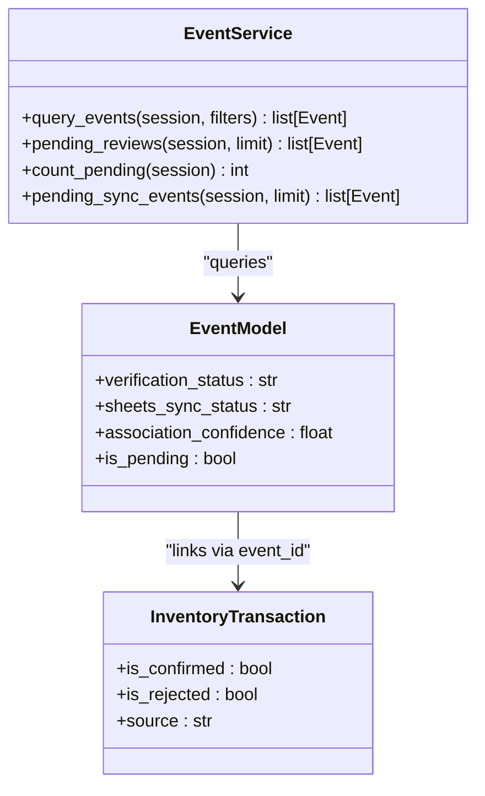
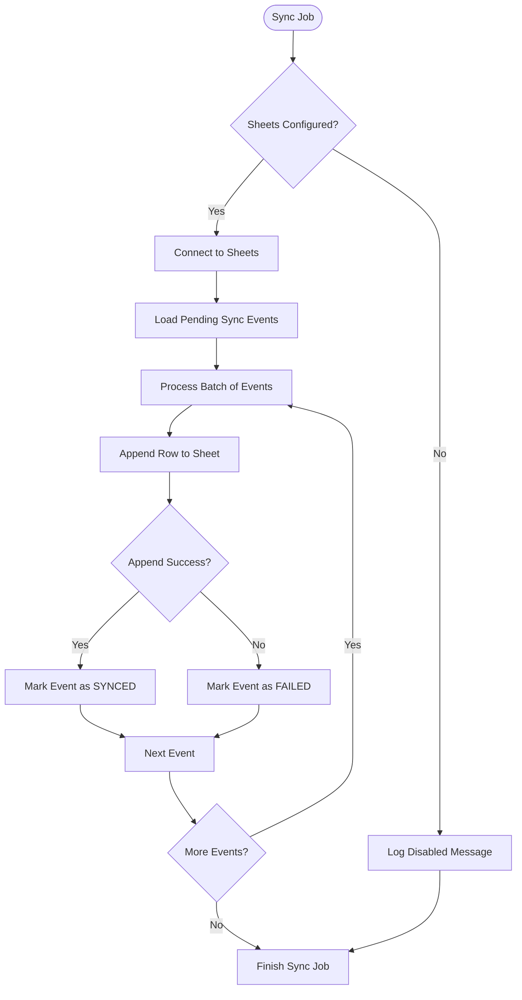
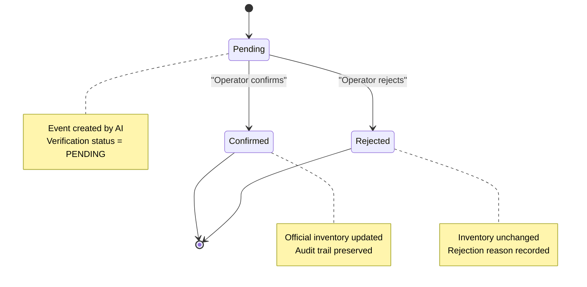
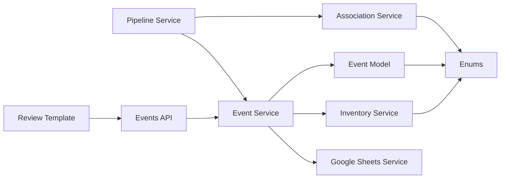

# Pending State Management

<cite>
**Referenced Files in This Document**
- [enums.py](file://app/models/enums.py)
- [ledger.py](file://app/models/ledger.py)
- [event_service.py](file://app/services/event_service.py)
- [association_service.py](file://app/services/association_service.py)
- [pipeline_service.py](file://app/services/pipeline_service.py)
- [inventory_service.py](file://app/services/inventory_service.py)
- [google_sheets_service.py](file://app/services/google_sheets_service.py)
- [events.py](file://app/api/events.py)
- [review.html](file://app/ui/templates/review.html)
</cite>

## Table of Contents
1. [Introduction](#introduction)
2. [Project Structure](#project-structure)
3. [Core Components](#core-components)
4. [Architecture Overview](#architecture-overview)
5. [Detailed Component Analysis](#detailed-component-analysis)
6. [Dependency Analysis](#dependency-analysis)
7. [Performance Considerations](#performance-considerations)
8. [Troubleshooting Guide](#troubleshooting-guide)
9. [Conclusion](#conclusion)

## Introduction
This document explains the pending state management system used by the application to handle AI-generated events safely. Events produced by camera processing are not trusted automatically; they enter a pending verification state until a human operator confirms or rejects them. The system tracks confidence and association quality, prevents duplicate events, integrates with an inventory ledger, and exposes APIs for querying, filtering, and reviewing pending events.

The key idea is separation between observation and confirmation:
- Observation produces candidate events with confidence scores.
- Confirmation updates official records and inventory balances.
- Rejection preserves audit history without changing official state.

## Project Structure
The pending state system spans models, services, API endpoints, and UI templates:

**Diagram sources**
- [pipeline_service.py:490-586](file://app/services/pipeline_service.py#L490-L586)
- [association_service.py:106-198](file://app/services/association_service.py#L106-L198)
- [event_service.py:59-147](file://app/services/event_service.py#L59-L147)
- [inventory_service.py:132-156](file://app/services/inventory_service.py#L132-L156)
- [google_sheets_service.py:234-359](file://app/services/google_sheets_service.py#L234-L359)
- [events.py:91-131](file://app/api/events.py#L91-L131)
- [review.html:62-106](file://app/ui/templates/review.html#L62-L106)

**Section sources**
- [pipeline_service.py:1-14](file://app/services/pipeline_service.py#L1-L14)
- [event_service.py:1-2](file://app/services/event_service.py#L1-L2)

## Core Components
The pending state system is built around these core components:

| Component | Responsibility | Key Behavior |
|---|---|---|
| Event model | Stores observable facts | Default verification status is pending; stores confidence and sync status |
| Event service | Creates, queries, reviews events | De-duplicates, creates inventory candidates, enforces review workflow |
| Association service | Scores person-object relationships | Produces strong, weak, ambiguous, or none quality levels |
| Pipeline service | Processes frames and emits movement candidates | Writes events as pending when identity or association is uncertain |
| Inventory service | Maintains append-only ledger | Keeps vision candidates unconfirmed until human approval |
| Google Sheets service | Reports pending and synced events | Batches unsynchronized events with retry logic |
| Events API | Exposes query and review endpoints | Supports filtering by status, type, camera, employee, category, and time range |
| Review template | Human-in-the-loop interface | Displays evidence, confidence, and allows confirm or reject decisions |

**Section sources**
- [ledger.py:21-111](file://app/models/ledger.py#L21-L111)
- [event_service.py:59-211](file://app/services/event_service.py#L59-L211)
- [association_service.py:29-57](file://app/services/association_service.py#L29-L57)
- [pipeline_service.py:328-387](file://app/services/pipeline_service.py#L328-L387)
- [inventory_service.py:132-205](file://app/services/inventory_service.py#L132-L205)
- [google_sheets_service.py:362-396](file://app/services/google_sheets_service.py#L362-L396)
- [events.py:149-174](file://app/api/events.py#L149-L174)
- [review.html:17-109](file://app/ui/templates/review.html#L17-L109)

## Architecture Overview
The pending state lifecycle follows this flow:

**Diagram sources**
- [pipeline_service.py:508-586](file://app/services/pipeline_service.py#L508-L586)
- [association_service.py:131-198](file://app/services/association_service.py#L131-L198)
- [event_service.py:59-147](file://app/services/event_service.py#L59-L147)
- [inventory_service.py:132-156](file://app/services/inventory_service.py#L132-L156)
- [google_sheets_service.py:340-359](file://app/services/google_sheets_service.py#L340-L359)

## Detailed Component Analysis

### Confidence Thresholds and Association Quality
The association engine evaluates four signals: carry overlap, proximity, temporal stability, and direction agreement. It returns a quality level rather than a binary decision:

- **STRONG**: High confidence association, no review required
- **WEAK**: Low confidence or short track duration
- **AMBIGUOUS**: Multiple people explain the object similarly
- **NONE**: No meaningful association found

The configuration uses thresholds such as minimum score, strong score, ambiguity margin, and minimum track frames. These thresholds determine whether an event requires human review.

**Diagram sources**
- [association_service.py:112-198](file://app/services/association_service.py#L112-L198)
- [association_service.py:48-57](file://app/services/association_service.py#L48-L57)

**Section sources**
- [association_service.py:1-15](file://app/services/association_service.py#L1-L15)
- [association_service.py:48-57](file://app/services/association_service.py#L48-L57)
- [association_service.py:112-198](file://app/services/association_service.py#L112-L198)

### Event Creation and Pending State Entry
Events enter the pending state through two main paths:

1. **Person crossing events**: Unknown persons create pending events; known persons create auto-verified events
2. **Equipment movement events**: All equipment movements are created as pending due to association uncertainty

The pipeline service writes movement candidates with detection confidence, face match score, and association confidence. Equipment movements always use pending verification status because the system does not trust automated associations.

**Diagram sources**
- [pipeline_service.py:218-321](file://app/services/pipeline_service.py#L218-L321)
- [pipeline_service.py:508-586](file://app/services/pipeline_service.py#L508-L586)
- [event_service.py:59-147](file://app/services/event_service.py#L59-L147)

**Section sources**
- [pipeline_service.py:508-586](file://app/services/pipeline_service.py#L508-L586)
- [event_service.py:59-147](file://app/services/event_service.py#L59-L147)

### Pending Event Queue Management
The pending event queue is managed through database queries rather than an in-memory queue. Key operations include:

- **pending_reviews**: Returns events with verification status pending
- **count_pending**: Counts total pending events
- **pending_sync_events**: Returns events needing Google Sheets synchronization

The system uses pagination with limits to prevent memory issues when processing large numbers of pending events.

**Diagram sources**
- [event_service.py:253-289](file://app/services/event_service.py#L253-L289)
- [ledger.py:21-111](file://app/models/ledger.py#L21-L111)
- [inventory_service.py:114-156](file://app/services/inventory_service.py#L114-L156)

**Section sources**
- [event_service.py:253-289](file://app/services/event_service.py#L253-L289)

### Prioritization Algorithms
The current implementation uses simple prioritization strategies:

1. **Time-based ordering**: Events are ordered by occurrence time (newest first for queries, oldest first for sync)
2. **Status-based filtering**: Pending events are filtered by verification status
3. **Confidence-based flags**: Events with low association confidence (< 0.5) are flagged for review

There is no complex priority scoring system; instead, the system relies on database indexes and simple filters for efficient querying.

**Section sources**
- [event_service.py:253-262](file://app/services/event_service.py#L253-L262)
- [event_service.py:282-289](file://app/services/event_service.py#L282-L289)
- [event_service.py:292-298](file://app/services/event_service.py#L292-L298)

### Batch Processing Capabilities
Batch processing is implemented primarily for Google Sheets synchronization:

- **Batch size limits**: Sync operations process up to 300 events per batch
- **Retry mechanism**: Failed sync attempts are marked as failed and retried with exponential backoff
- **Idempotency**: Events are identified by public ID to prevent duplicates
- **Background scheduling**: A separate thread runs periodic sync jobs

**Diagram sources**
- [google_sheets_service.py:234-359](file://app/services/google_sheets_service.py#L234-L359)
- [google_sheets_service.py:362-396](file://app/services/google_sheets_service.py#L362-L396)

**Section sources**
- [google_sheets_service.py:234-359](file://app/services/google_sheets_service.py#L234-L359)
- [google_sheets_service.py:362-396](file://app/services/google_sheets_service.py#L362-L396)

### API Endpoints for Pending Events
The API provides several endpoints for working with pending events:

| Endpoint | Method | Purpose | Parameters | Response |
|---|---|---|---|---|
| `/api/events` | GET | Query events with filters | `limit`, `status`, `type`, `camera`, `employee_id`, `category`, `start`, `end`, `q` | JSON array of events |
| `/review` | GET | Display review page | None | HTML with pending events |
| `/api/events/{event_id}/review` | POST | Confirm or reject event | `decision`, `reason`, `employee_id`, `asset_id`, `category_code` | Redirect with flash message |
| `/api/events/{public_id}/evidence` | GET | Download evidence image | `public_id` | Image file or error |

Filtering supports multiple criteria including verification status, event types, camera codes, employee IDs, categories, and time ranges. The search parameter performs text matching across public IDs, camera codes, and notes.

**Section sources**
- [events.py:24-37](file://app/api/events.py#L24-L37)
- [events.py:149-174](file://app/api/events.py#L149-L174)
- [events.py:91-131](file://app/api/events.py#L91-L131)
- [events.py:134-146](file://app/api/events.py#L134-L146)

### Human-in-the-Loop Review Process
The review interface provides operators with tools to examine and decide on pending events:

1. **Evidence viewing**: Operators can view annotated images showing detections and associations
2. **Confidence inspection**: Detection confidence, face match score, and association confidence are displayed
3. **Manual correction**: Operators can assign employees, categories, and asset IDs
4. **Decision making**: Confirm adds to official inventory; reject preserves audit trail without changes

The review template shows pending event counts, evidence images, and forms for manual intervention.

**Diagram sources**
- [review.html:17-109](file://app/ui/templates/review.html#L17-L109)
- [event_service.py:150-211](file://app/services/event_service.py#L150-L211)
- [inventory_service.py:165-205](file://app/services/inventory_service.py#L165-L205)

**Section sources**
- [review.html:17-109](file://app/ui/templates/review.html#L17-L109)
- [event_service.py:150-211](file://app/services/event_service.py#L150-L211)
- [inventory_service.py:165-205](file://app/services/inventory_service.py#L165-L205)

### Timeout Handling and Escalation Procedures
The current implementation does not include explicit timeout handling for pending events. However, several mechanisms provide implicit escalation:

1. **Dashboard badges**: Events with low association confidence are flagged for attention
2. **Sync failure tracking**: Failed Google Sheets syncs are logged and retried
3. **Audit trail**: All decisions are recorded with timestamps and user information
4. **Balance discrepancies**: Pending movements affect projected inventory balances

For timeout-based escalation, the system would need additional fields like `created_at` timestamps and scheduled job logic to automatically escalate stale pending events.

**Section sources**
- [event_service.py:292-298](file://app/services/event_service.py#L292-L298)
- [google_sheets_service.py:147-161](file://app/services/google_sheets_service.py#L147-L161)
- [ledger.py:61-67](file://app/models/ledger.py#L61-L67)

## Dependency Analysis
The pending state system has clear dependency relationships:

**Diagram sources**
- [pipeline_service.py:28-42](file://app/services/pipeline_service.py#L28-L42)
- [event_service.py:14-25](file://app/services/event_service.py#L14-L25)
- [association_service.py:23-24](file://app/services/association_service.py#L23-L24)
- [inventory_service.py:25-28](file://app/services/inventory_service.py#L25-L28)

**Section sources**
- [pipeline_service.py:28-42](file://app/services/pipeline_service.py#L28-L42)
- [event_service.py:14-25](file://app/services/event_service.py#L14-L25)

## Performance Considerations
Several performance considerations apply to the pending state system:

1. **Database indexing**: Verification status, event type, and occurrence time are indexed for efficient querying
2. **Pagination**: All bulk operations use limits to prevent memory exhaustion
3. **De-duplication**: Cooldown buckets prevent duplicate events from the same source
4. **Background processing**: Google Sheets sync runs in a separate thread to avoid blocking camera processing
5. **Connection pooling**: Database sessions are scoped to individual operations

The system avoids real-time processing bottlenecks by separating camera processing from persistence and reporting operations.

**Section sources**
- [ledger.py:30-60](file://app/models/ledger.py#L30-L60)
- [event_service.py:36-56](file://app/services/event_service.py#L36-L56)
- [google_sheets_service.py:362-396](file://app/services/google_sheets_service.py#L362-L396)

## Troubleshooting Guide
Common issues and their resolution approaches:

### Pending Events Not Appearing
- Check verification status filter in queries
- Verify event creation was successful
- Ensure database connection is working

### Low Association Confidence
- Review association threshold configuration
- Check person-object proximity and temporal overlap
- Consider adjusting minimum track frame requirements

### Sync Failures
- Verify Google Sheets credentials and configuration
- Check network connectivity to Google Sheets API
- Review sync logs for specific error messages

### Inventory Discrepancies
- Confirm pending movements are reviewed
- Check for rejected transactions affecting balance calculations
- Verify asset registration matches expected quantities

**Section sources**
- [event_service.py:253-289](file://app/services/event_service.py#L253-L289)
- [google_sheets_service.py:234-296](file://app/services/google_sheets_service.py#L234-L296)
- [inventory_service.py:215-280](file://app/services/inventory_service.py#L215-L280)

## Conclusion
The pending state management system provides a robust framework for handling AI-generated events safely. By requiring human confirmation for uncertain associations and maintaining separate audit trails for confirmed and rejected events, the system ensures data integrity while allowing flexible manual intervention. The architecture separates concerns between camera processing, event persistence, inventory management, and reporting, enabling scalable operation with clear boundaries between components.

Key strengths include:
- Clear separation between observation and confirmation
- Comprehensive audit trail for all decisions
- Flexible filtering and querying capabilities
- Background processing for non-critical operations
- Integration with external reporting systems

Areas for potential enhancement include explicit timeout handling, more sophisticated prioritization algorithms, and automated escalation procedures for stale pending events.