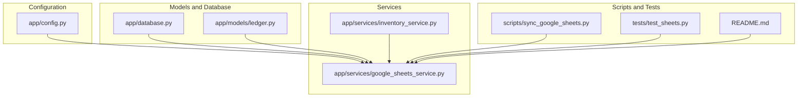
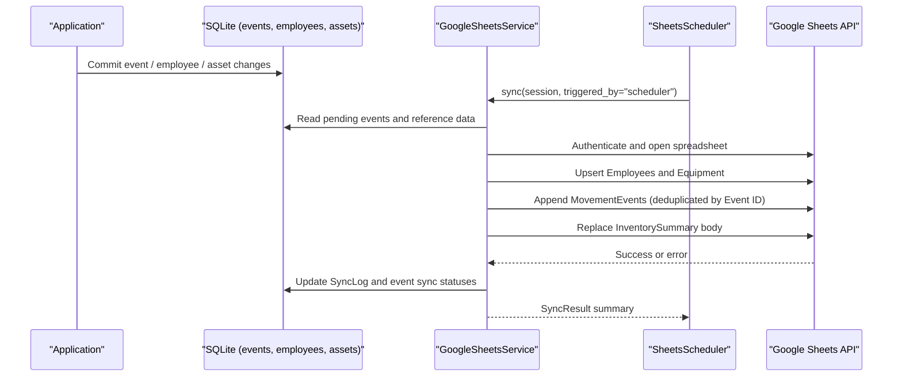
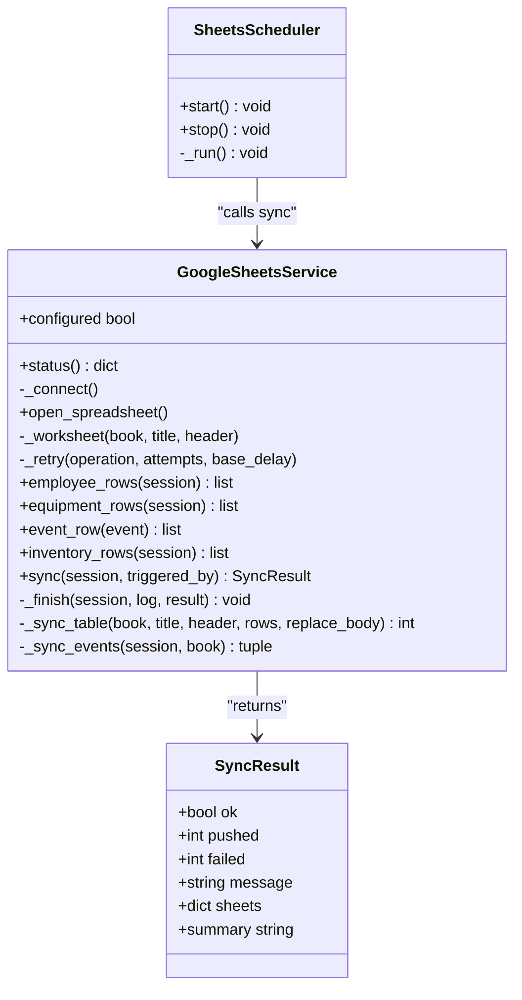
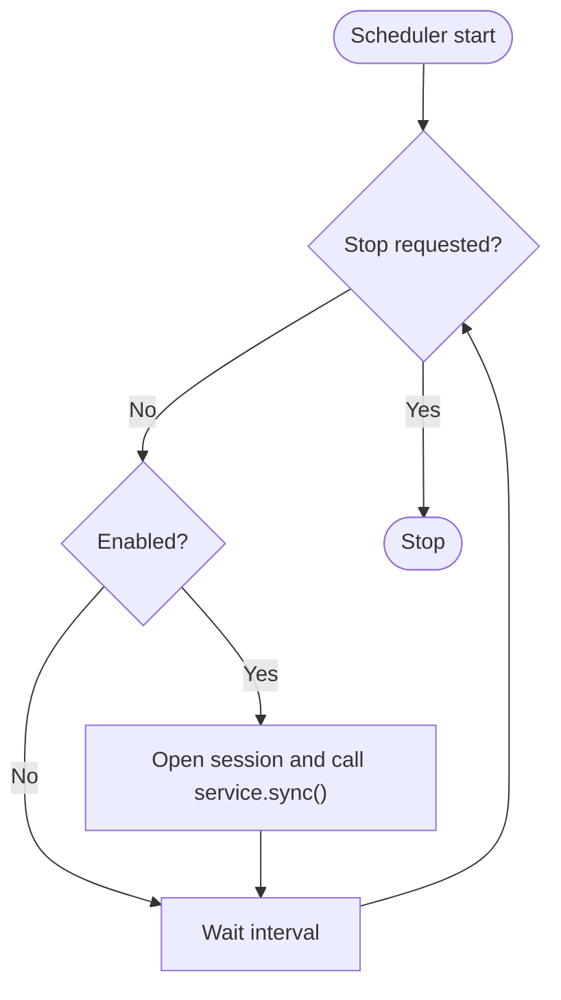
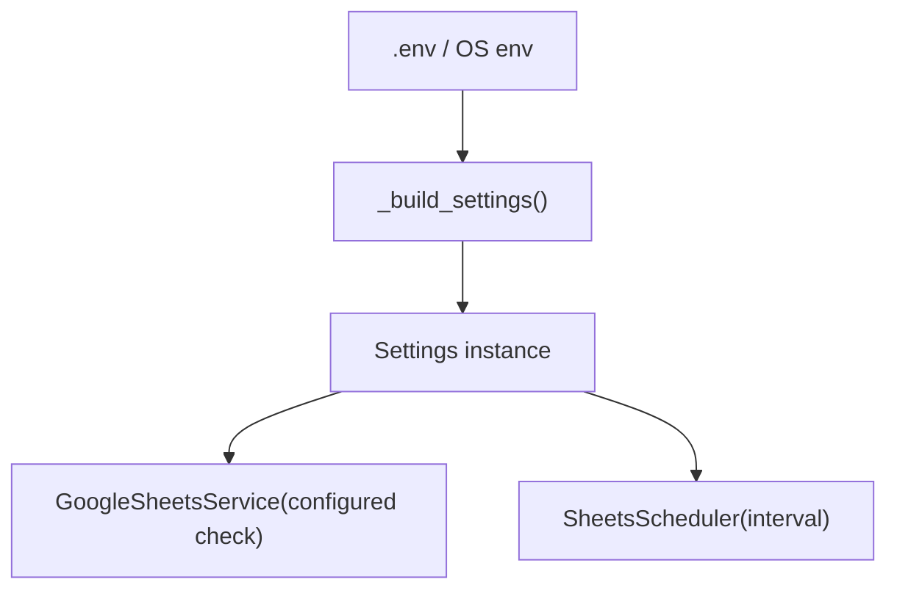
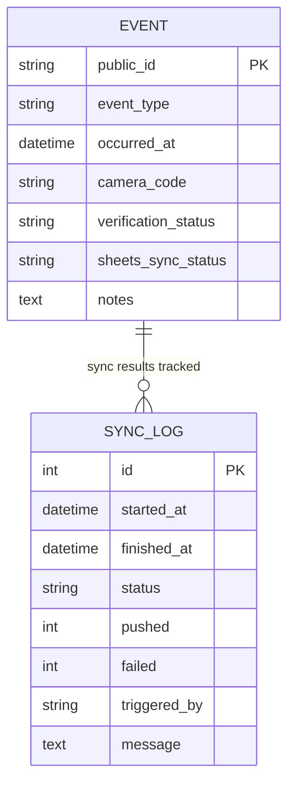
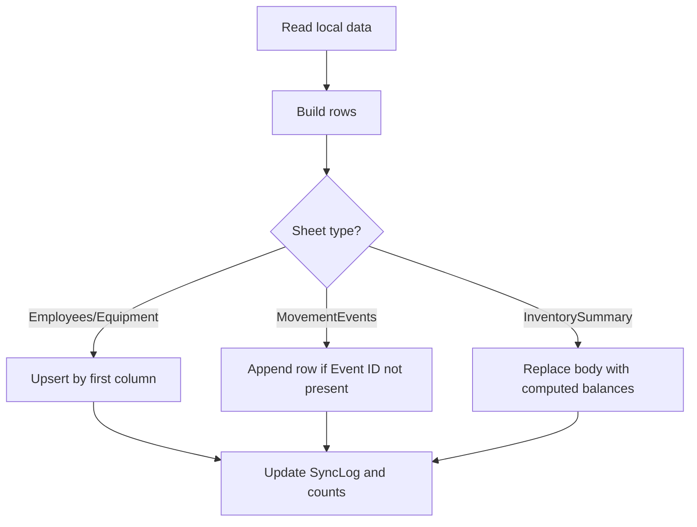
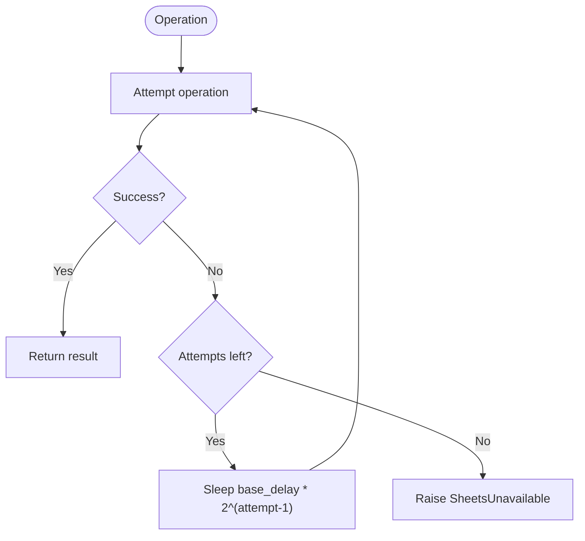
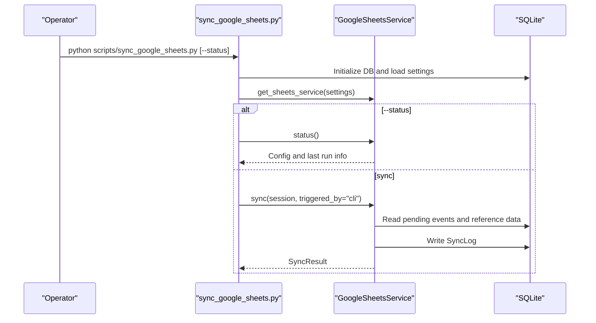
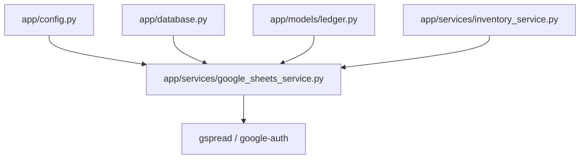

# External Integrations

<cite>
**Referenced Files in This Document**
- [google_sheets_service.py](file://app/services/google_sheets_service.py)
- [sync_google_sheets.py](file://scripts/sync_google_sheets.py)
- [test_sheets.py](file://tests/test_sheets.py)
- [config.py](file://app/config.py)
- [ledger.py](file://app/models/ledger.py)
- [inventory_service.py](file://app/services/inventory_service.py)
- [database.py](file://app/database.py)
- [README.md](file://README.md)
</cite>

## Table of Contents
1. [Introduction](#introduction)
2. [Project Structure](#project-structure)
3. [Core Components](#core-components)
4. [Architecture Overview](#architecture-overview)
5. [Detailed Component Analysis](#detailed-component-analysis)
6. [Dependency Analysis](#dependency-analysis)
7. [Performance Considerations](#performance-considerations)
8. [Troubleshooting Guide](#troubleshooting-guide)
9. [Security Considerations](#security-considerations)
10. [Conclusion](#conclusion)

## Introduction
This document explains the external system integration that synchronizes the local SQLite database with Google Sheets. The local database is the primary system of record; Google Sheets is a reporting mirror. Events are always committed to SQLite first, and then background synchronization pushes changes to Google Sheets. If Google Sheets is unavailable, pending events remain marked as pending and are retried later.

The integration supports:
- Bidirectional awareness: local writes are authoritative; Sheets reflects them.
- Scheduled background sync via a daemon thread.
- Manual CLI sync for operators.
- Exponential backoff retry on transient failures.
- Deduplication by Event ID for movement events.
- Separate sheets for Employees, Equipment, MovementEvents, and InventorySummary.
- Configuration through environment variables and an optional `.env` file.

## Project Structure
The Google Sheets integration spans configuration, service logic, models, scripts, and tests:

**Diagram sources**
- [config.py:105-115](file://app/config.py#L105-L115)
- [database.py:112-128](file://app/database.py#L112-L128)
- [ledger.py:160-173](file://app/models/ledger.py#L160-L173)
- [google_sheets_service.py:82-130](file://app/services/google_sheets_service.py#L82-L130)
- [inventory_service.py:215-273](file://app/services/inventory_service.py#L215-L273)
- [sync_google_sheets.py:30-87](file://scripts/sync_google_sheets.py#L30-L87)
- [test_sheets.py:83-218](file://tests/test_sheets.py#L83-L218)
- [README.md:368-413](file://README.md#L368-L413)

**Section sources**
- [config.py:105-115](file://app/config.py#L105-L115)
- [database.py:112-128](file://app/database.py#L112-L128)
- [ledger.py:160-173](file://app/models/ledger.py#L160-L173)
- [google_sheets_service.py:82-130](file://app/services/google_sheets_service.py#L82-L130)
- [inventory_service.py:215-273](file://app/services/inventory_service.py#L215-L273)
- [sync_google_sheets.py:30-87](file://scripts/sync_google_sheets.py#L30-L87)
- [test_sheets.py:83-218](file://tests/test_sheets.py#L83-L218)
- [README.md:368-413](file://README.md#L368-L413)

## Core Components
- GoogleSheetsService: Thin wrapper around gspread, responsible for connecting to Google Sheets, building payloads from the local database, upserting reference data, appending movement events idempotently, and computing inventory summaries.
- SheetsScheduler: Background thread that periodically calls GoogleSheetsService.sync when enabled.
- Settings: Environment-driven configuration including Google Sheets enablement, spreadsheet ID, service account path, sync interval, and max retries.
- SyncLog model: Records each sync attempt, including status, counts, trigger source, and messages.
- Inventory balances: Used to generate the InventorySummary sheet reflecting expected vs confirmed quantities and discrepancies.

Key responsibilities:
- Authentication using a Google service account JSON file.
- Spreadsheet access via the configured spreadsheet ID.
- Upsert behavior for Employees and Equipment based on the first column (Employee ID or Asset ID).
- Deduplication for MovementEvents by Event ID.
- Retry with exponential backoff for transient API/network errors.
- Error handling that marks failed events and logs sync outcomes.

**Section sources**
- [google_sheets_service.py:82-130](file://app/services/google_sheets_service.py#L82-L130)
- [google_sheets_service.py:147-161](file://app/services/google_sheets_service.py#L147-L161)
- [google_sheets_service.py:234-296](file://app/services/google_sheets_service.py#L234-L296)
- [google_sheets_service.py:307-359](file://app/services/google_sheets_service.py#L307-L359)
- [google_sheets_service.py:362-395](file://app/services/google_sheets_service.py#L362-L395)
- [config.py:105-115](file://app/config.py#L105-L115)
- [config.py:170-215](file://app/config.py#L170-L215)
- [ledger.py:160-173](file://app/models/ledger.py#L160-L173)
- [inventory_service.py:215-273](file://app/services/inventory_service.py#L215-L273)

## Architecture Overview
The integration follows a clear separation between the primary store (SQLite) and the reporting mirror (Google Sheets):

**Diagram sources**
- [google_sheets_service.py:234-296](file://app/services/google_sheets_service.py#L234-L296)
- [google_sheets_service.py:307-359](file://app/services/google_sheets_service.py#L307-L359)
- [google_sheets_service.py:362-395](file://app/services/google_sheets_service.py#L362-L395)
- [database.py:89-100](file://app/database.py#L89-L100)
- [ledger.py:160-173](file://app/models/ledger.py#L160-L173)

## Detailed Component Analysis

### GoogleSheetsService
Responsibilities:
- Connection management using a service account JSON file and spreadsheet ID.
- Worksheet creation and header initialization if missing.
- Payload builders for Employees, Equipment, MovementEvents, and InventorySummary.
- Upsert logic for reference tables based on the first column.
- Idempotent append for MovementEvents using Event ID deduplication.
- Retry with exponential backoff for transient failures.
- Sync orchestration and result aggregation.

Important behaviors:
- `_connect` lazily initializes the gspread client and raises `SheetsUnavailable` if not configured or imports fail.
- `_retry` implements exponential backoff using base delay multiplied by powers of two.
- `_sync_table` either replaces the body (InventorySummary) or performs upsert by matching the first column.
- `_sync_events` reads pending events, checks existing Event IDs in the worksheet, appends new rows, and updates event sync statuses accordingly.

**Diagram sources**
- [google_sheets_service.py:82-130](file://app/services/google_sheets_service.py#L82-L130)
- [google_sheets_service.py:147-161](file://app/services/google_sheets_service.py#L147-L161)
- [google_sheets_service.py:164-231](file://app/services/google_sheets_service.py#L164-L231)
- [google_sheets_service.py:234-296](file://app/services/google_sheets_service.py#L234-L296)
- [google_sheets_service.py:307-359](file://app/services/google_sheets_service.py#L307-L359)
- [google_sheets_service.py:362-395](file://app/services/google_sheets_service.py#L362-L395)

**Section sources**
- [google_sheets_service.py:82-130](file://app/services/google_sheets_service.py#L82-L130)
- [google_sheets_service.py:147-161](file://app/services/google_sheets_service.py#L147-L161)
- [google_sheets_service.py:164-231](file://app/services/google_sheets_service.py#L164-L231)
- [google_sheets_service.py:234-296](file://app/services/google_sheets_service.py#L234-L296)
- [google_sheets_service.py:307-359](file://app/services/google_sheets_service.py#L307-L359)
- [google_sheets_service.py:362-395](file://app/services/google_sheets_service.py#L362-L395)

### SheetsScheduler
Responsibilities:
- Start and stop a daemon thread that runs periodic syncs.
- Respect the configured interval and enabled flag.
- Wrap sync calls in session scopes and catch exceptions to keep the scheduler alive.

**Diagram sources**
- [google_sheets_service.py:362-395](file://app/services/google_sheets_service.py#L362-L395)

**Section sources**
- [google_sheets_service.py:362-395](file://app/services/google_sheets_service.py#L362-L395)

### Configuration and Settings
Environment variables control the integration:
- GOOGLE_SHEETS_ENABLED: Enable/disable sync.
- GOOGLE_SPREADSHEET_ID: Target spreadsheet identifier.
- GOOGLE_SERVICE_ACCOUNT_FILE: Path to service account JSON.
- GOOGLE_SHEETS_SYNC_INTERVAL_SECONDS: Interval between scheduled syncs.
- GOOGLE_SHEETS_MAX_RETRIES: Maximum number of retry attempts per operation.

Settings validation warns when Google Sheets is enabled but required fields are missing or invalid.

**Diagram sources**
- [config.py:170-215](file://app/config.py#L170-L215)
- [config.py:140-156](file://app/config.py#L140-L156)
- [google_sheets_service.py:94-111](file://app/services/google_sheets_service.py#L94-L111)

**Section sources**
- [config.py:105-115](file://app/config.py#L105-L115)
- [config.py:140-156](file://app/config.py#L140-L156)
- [config.py:170-215](file://app/config.py#L170-L215)

### Data Models and Sync Logging
- Event model includes a public_id used as the dedup key for MovementEvents in Sheets.
- SyncLog records each sync attempt with timestamps, status, counts, trigger source, and message.

**Diagram sources**
- [ledger.py:21-71](file://app/models/ledger.py#L21-L71)
- [ledger.py:160-173](file://app/models/ledger.py#L160-L173)

**Section sources**
- [ledger.py:21-71](file://app/models/ledger.py#L21-L71)
- [ledger.py:160-173](file://app/models/ledger.py#L160-L173)

### Spreadsheet Structure
The integration uses four sheets:
- Employees: Employee ID, First Name, Last Name, Department, Status.
- Equipment: Asset ID, Category, Brand, Model, Serial Number, Location, Status.
- MovementEvents: Event ID, Timestamp, Employee ID, Employee Name, Event Type, Equipment Category, Asset ID, Direction, Camera ID, Verification Status, Notes.
- InventorySummary: Equipment Category, Expected Quantity, Confirmed Quantity, Pending Movements, Discrepancy, Last Updated.

Behavior:
- Reference sheets (Employees, Equipment) use upsert by the first column.
- MovementEvents uses append with deduplication by Event ID.
- InventorySummary replaces the body on each sync.

**Diagram sources**
- [google_sheets_service.py:34-61](file://app/services/google_sheets_service.py#L34-L61)
- [google_sheets_service.py:307-359](file://app/services/google_sheets_service.py#L307-L359)
- [inventory_service.py:215-273](file://app/services/inventory_service.py#L215-L273)

**Section sources**
- [google_sheets_service.py:34-61](file://app/services/google_sheets_service.py#L34-L61)
- [google_sheets_service.py:307-359](file://app/services/google_sheets_service.py#L307-L359)
- [inventory_service.py:215-273](file://app/services/inventory_service.py#L215-L273)

### Retry Mechanism and Exponential Backoff
The retry helper wraps operations and applies exponential backoff:
- Attempts are bounded by settings.
- Delay increases exponentially: base_delay * 2^(attempt-1).
- On final failure, it raises `SheetsUnavailable`.

**Diagram sources**
- [google_sheets_service.py:147-161](file://app/services/google_sheets_service.py#L147-L161)

**Section sources**
- [google_sheets_service.py:147-161](file://app/services/google_sheets_service.py#L147-L161)

### Manual CLI Synchronization
The CLI script provides:
- Status display showing enabled state, configuration completeness, spreadsheet ID, service account file, interval, pending events, and last sync log.
- Manual sync execution with printed results and per-sheet counts.

**Diagram sources**
- [sync_google_sheets.py:30-87](file://scripts/sync_google_sheets.py#L30-L87)
- [google_sheets_service.py:234-296](file://app/services/google_sheets_service.py#L234-L296)

**Section sources**
- [sync_google_sheets.py:30-87](file://scripts/sync_google_sheets.py#L30-L87)

### Test Coverage Highlights
Tests validate:
- Retry repeats until success and raises after last attempt.
- Sync is skipped when disabled and logs a failed status.
- Employee rows are upserted without duplication.
- MovementEvents are deduplicated by Event ID.
- Already-present events are marked synced.
- Failed uploads mark events as failed while keeping the overall sync result usable.

**Section sources**
- [test_sheets.py:83-218](file://tests/test_sheets.py#L83-L218)

## Dependency Analysis
The integration depends on:
- Configuration module for environment-driven settings.
- Database module for session management and schema initialization.
- Models for events and sync logs.
- Inventory service for balance computation.
- gspread and google-auth for Sheets access.

**Diagram sources**
- [config.py:170-215](file://app/config.py#L170-L215)
- [database.py:89-100](file://app/database.py#L89-L100)
- [ledger.py:160-173](file://app/models/ledger.py#L160-L173)
- [inventory_service.py:215-273](file://app/services/inventory_service.py#L215-L273)
- [google_sheets_service.py:113-129](file://app/services/google_sheets_service.py#L113-L129)

**Section sources**
- [config.py:170-215](file://app/config.py#L170-L215)
- [database.py:89-100](file://app/database.py#L89-L100)
- [ledger.py:160-173](file://app/models/ledger.py#L160-L173)
- [inventory_service.py:215-273](file://app/services/inventory_service.py#L215-L273)
- [google_sheets_service.py:113-129](file://app/services/google_sheets_service.py#L113-L129)

## Performance Considerations
- Background scheduling avoids blocking camera processing and API calls.
- Exponential backoff reduces pressure on Google Sheets during transient outages.
- Upsert logic minimizes unnecessary writes by comparing existing rows.
- InventorySummary replacement ensures consistent reporting snapshots.
- Session scope ensures transactional consistency for sync logs and event status updates.

[No sources needed since this section provides general guidance]

## Troubleshooting Guide
Common issues and resolutions:
- Google Sheets disabled: Ensure GOOGLE_SHEETS_ENABLED=true.
- Missing configuration: Provide GOOGLE_SPREADSHEET_ID and GOOGLE_SERVICE_ACCOUNT_FILE.
- Service account JSON not found: Verify path and permissions.
- Spreadsheet sharing: Share the spreadsheet with the service account email as Editor.
- Quota exceeded or network errors: Increase GOOGLE_SHEETS_MAX_RETRIES and review logs; the system retries with exponential backoff.
- Duplicate rows: Confirm that reference sheets use the correct first-column keys (Employee ID, Asset ID).
- Event duplicates: Ensure Event IDs are unique; the system deduplicates by Event ID.
- Failed events: Check event.sheets_sync_status and SyncLog.message for details.

Operational commands:
- CLI status: python scripts/sync_google_sheets.py --status
- CLI sync: python scripts/sync_google_sheets.py

**Section sources**
- [google_sheets_service.py:94-111](file://app/services/google_sheets_service.py#L94-L111)
- [google_sheets_service.py:147-161](file://app/services/google_sheets_service.py#L147-L161)
- [google_sheets_service.py:234-296](file://app/services/google_sheets_service.py#L234-L296)
- [sync_google_sheets.py:30-87](file://scripts/sync_google_sheets.py#L30-L87)
- [README.md:516-530](file://README.md#L516-L530)

## Security Considerations
- Service account credentials: Store the JSON file securely (e.g., secrets/service_account.json) and restrict filesystem permissions.
- Spreadsheet access: Grant only necessary permissions to the service account (Editor for writing reports).
- Environment variables: Avoid committing .env or secrets to version control; back them up separately.
- Production hardening: Use HTTPS and restrict server exposure; rotate secrets regularly.

**Section sources**
- [config.py:140-156](file://app/config.py#L140-L156)
- [README.md:625-637](file://README.md#L625-L637)

## Conclusion
The Google Sheets integration provides a robust reporting mirror over the local SQLite database. It emphasizes reliability through background scheduling, exponential backoff retries, and idempotent writes. Operators can monitor and manually trigger synchronization, while the system maintains auditability via SyncLog entries and event-level sync statuses. Proper configuration and security practices ensure safe and dependable operation.

[No sources needed since this section summarizes without analyzing specific files]