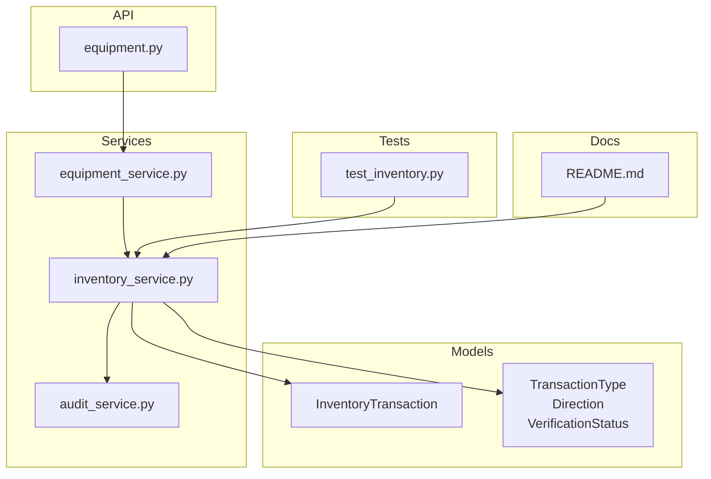
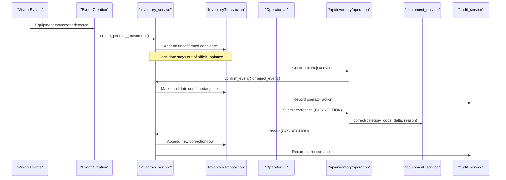
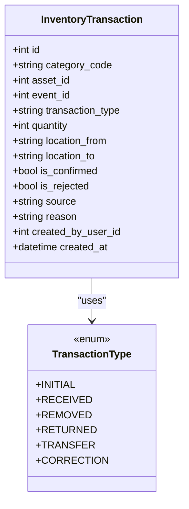
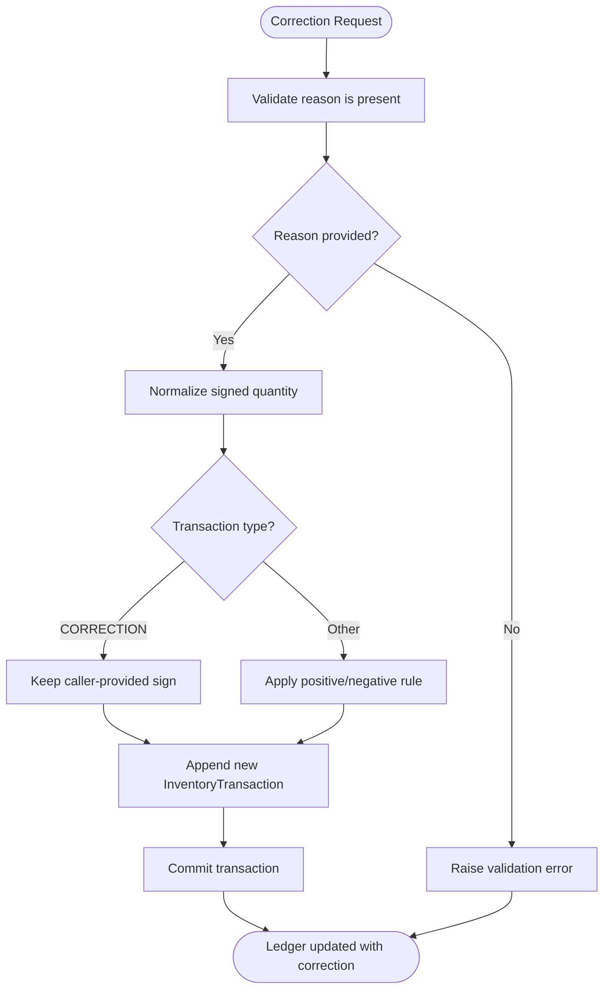
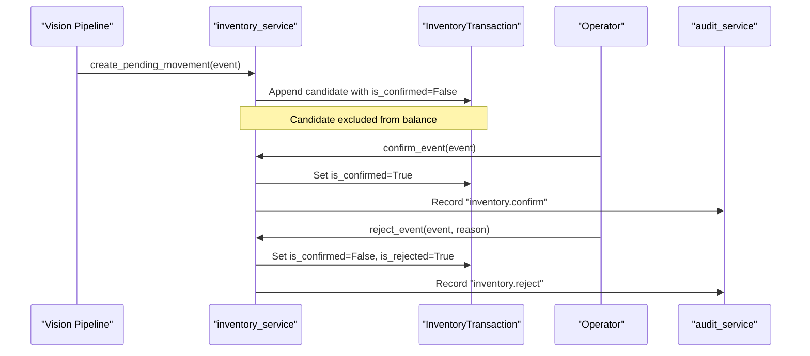
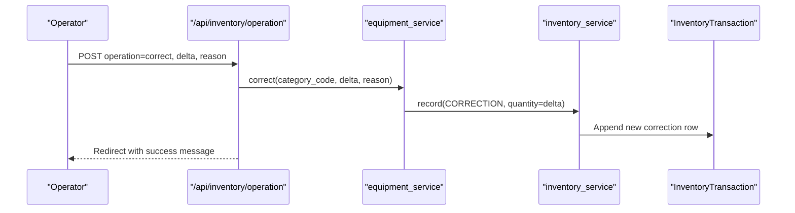
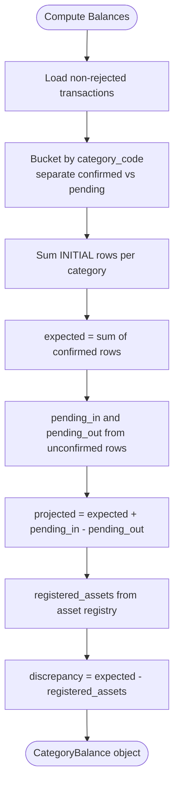
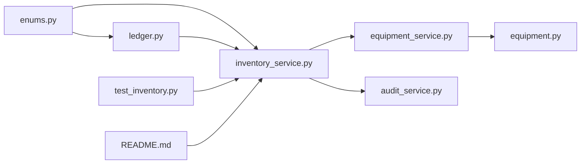

# Append-Only Journal Design

<cite>
**Referenced Files in This Document**
- [inventory_service.py](file://app/services/inventory_service.py)
- [ledger.py](file://app/models/ledger.py)
- [enums.py](file://app/models/enums.py)
- [equipment_service.py](file://app/services/equipment_service.py)
- [equipment.py](file://app/api/equipment.py)
- [audit_service.py](file://app/services/audit_service.py)
- [test_inventory.py](file://tests/test_inventory.py)
- [README.md](file://README.md)
</cite>

## Table of Contents
1. [Introduction](#introduction)
2. [Project Structure](#project-structure)
3. [Core Components](#core-components)
4. [Architecture Overview](#architecture-overview)
5. [Detailed Component Analysis](#detailed-component-analysis)
6. [Dependency Analysis](#dependency-analysis)
7. [Performance Considerations](#performance-considerations)
8. [Troubleshooting Guide](#troubleshooting-guide)
9. [Conclusion](#conclusion)

## Introduction
This document explains the append-only inventory journal design used by the system. The core principle is simple: inventory transactions are immutable once written. They are never edited or deleted. If a mistake is discovered, the system records a new correction entry instead of changing history. This approach preserves an audit trail, guarantees data integrity, and aligns with financial auditing standards that require a complete, tamper-evident record of every change.

The design supports both manual operations and automated vision-based movement candidates. Vision candidates are stored as unconfirmed entries until an operator confirms them. Rejected candidates remain in the ledger for audit purposes but do not affect balances. Corrections use a dedicated transaction type so auditors can distinguish intentional adjustments from normal receipts, removals, returns, or transfers.

## Project Structure
The append-only journal spans models, services, API endpoints, tests, and documentation:

- Models define the immutable ledger row and related types.
- Services enforce business rules such as sign normalization, confirmation workflows, and balance calculation.
- API endpoints expose manual operations including corrections.
- Tests assert that corrections create new rows and do not edit existing ones.
- Documentation describes the expected behavior for users and auditors.

**Diagram sources**
- [ledger.py:114-157](file://app/models/ledger.py#L114-L157)
- [enums.py:113-130](file://app/models/enums.py#L113-L130)
- [inventory_service.py:1-13](file://app/services/inventory_service.py#L1-L13)
- [equipment_service.py:279-298](file://app/services/equipment_service.py#L279-L298)
- [equipment.py:208-260](file://app/api/equipment.py#L208-L260)
- [audit_service.py:13-37](file://app/services/audit_service.py#L13-L37)
- [test_inventory.py:118-125](file://tests/test_inventory.py#L118-L125)
- [README.md:286-313](file://README.md#L286-L313)

**Section sources**
- [inventory_service.py:1-13](file://app/services/inventory_service.py#L1-L13)
- [ledger.py:114-157](file://app/models/ledger.py#L114-L157)
- [enums.py:113-130](file://app/models/enums.py#L113-L130)
- [equipment_service.py:279-298](file://app/services/equipment_service.py#L279-L298)
- [equipment.py:208-260](file://app/api/equipment.py#L208-L260)
- [audit_service.py:13-37](file://app/services/audit_service.py#L13-L37)
- [test_inventory.py:118-125](file://tests/test_inventory.py#L118-L125)
- [README.md:286-313](file://README.md#L286-L313)

## Core Components
The append-only journal is implemented through these key components:

- InventoryTransaction model: Represents each ledger entry. Rows are never deleted; rejected candidates stay marked rather than removed.
- TransactionType enum: Includes INITIAL, RECEIVED, REMOVED, RETURNED, TRANSFER, and CORRECTION. CORRECTION allows signed deltas chosen by the caller.
- inventory_service.record: Creates new ledger entries and normalizes their signed quantity based on transaction type.
- inventory_service.confirm_event and reject_event: Promote or mark vision candidates without editing original rows.
- equipment_service.correct: Enforces a required reason and writes a new CORRECTION entry.
- API endpoint /api/inventory/operation: Exposes manual operations including corrections to operators.
- audit_service.record: Appends administrator actions to the audit log.

These components together ensure that historical accuracy is preserved while still allowing corrections through explicit new entries.

**Section sources**
- [ledger.py:114-157](file://app/models/ledger.py#L114-L157)
- [enums.py:113-130](file://app/models/enums.py#L113-L130)
- [inventory_service.py:53-112](file://app/services/inventory_service.py#L53-L112)
- [inventory_service.py:165-205](file://app/services/inventory_service.py#L165-L205)
- [equipment_service.py:279-298](file://app/services/equipment_service.py#L279-L298)
- [equipment.py:208-260](file://app/api/equipment.py#L208-L260)
- [audit_service.py:13-37](file://app/services/audit_service.py#L13-L37)

## Architecture Overview
The append-only journal integrates event detection, operator review, manual operations, and reporting.

**Diagram sources**
- [inventory_service.py:132-156](file://app/services/inventory_service.py#L132-L156)
- [inventory_service.py:165-205](file://app/services/inventory_service.py#L165-L205)
- [equipment.py:208-260](file://app/api/equipment.py#L208-L260)
- [equipment_service.py:279-298](file://app/services/equipment_service.py#L279-L298)
- [audit_service.py:13-37](file://app/services/audit_service.py#L13-L37)

## Detailed Component Analysis

### Append-Only Ledger Model
The ledger model enforces immutability at the data layer:

- Each transaction is a separate row with a timestamp and source metadata.
- Rejection does not delete rows; it marks them as rejected so they stop counting but remain visible for audit.
- Only confirmed rows contribute to the official balance.

**Diagram sources**
- [ledger.py:114-157](file://app/models/ledger.py#L114-L157)
- [enums.py:113-130](file://app/models/enums.py#L113-L130)

**Section sources**
- [ledger.py:114-157](file://app/models/ledger.py#L114-L157)
- [enums.py:113-130](file://app/models/enums.py#L113-L130)

### Correction Workflow
Corrections are new entries, not edits. The service normalizes signs so that most transaction types have predictable directionality, while CORRECTION lets the caller choose the sign explicitly.

**Diagram sources**
- [equipment_service.py:279-298](file://app/services/equipment_service.py#L279-L298)
- [inventory_service.py:53-112](file://app/services/inventory_service.py#L53-L112)

**Section sources**
- [equipment_service.py:279-298](file://app/services/equipment_service.py#L279-L298)
- [inventory_service.py:53-112](file://app/services/inventory_service.py#L53-L112)

### Vision Candidates and Confirmation
Vision-based movements are recorded as pending candidates. They do not move the official balance until an operator confirms them. Rejections keep the candidate row for audit but exclude it from pending totals.

**Diagram sources**
- [inventory_service.py:132-156](file://app/services/inventory_service.py#L132-L156)
- [inventory_service.py:165-205](file://app/services/inventory_service.py#L165-L205)
- [audit_service.py:13-37](file://app/services/audit_service.py#L13-L37)

**Section sources**
- [inventory_service.py:132-156](file://app/services/inventory_service.py#L132-L156)
- [inventory_service.py:165-205](file://app/services/inventory_service.py#L165-L205)
- [audit_service.py:13-37](file://app/services/audit_service.py#L13-L37)

### Manual Operations API
The API exposes manual inventory operations, including corrections. Operators submit operation forms, which are validated and routed to the appropriate service method.

**Diagram sources**
- [equipment.py:208-260](file://app/api/equipment.py#L208-L260)
- [equipment_service.py:279-298](file://app/services/equipment_service.py#L279-L298)
- [inventory_service.py:66-112](file://app/services/inventory_service.py#L66-L112)

**Section sources**
- [equipment.py:208-260](file://app/api/equipment.py#L208-L260)
- [equipment_service.py:279-298](file://app/services/equipment_service.py#L279-L298)
- [inventory_service.py:66-112](file://app/services/inventory_service.py#L66-L112)

### Balance Calculation and Pending Totals
Balances are computed from confirmed transactions only. Pending candidates are tracked separately so operators can see incoming and outgoing movements awaiting confirmation.

**Diagram sources**
- [inventory_service.py:215-273](file://app/services/inventory_service.py#L215-L273)
- [inventory_service.py:290-305](file://app/services/inventory_service.py#L290-L305)

**Section sources**
- [inventory_service.py:215-273](file://app/services/inventory_service.py#L215-L273)
- [inventory_service.py:290-305](file://app/services/inventory_service.py#L290-L305)

## Dependency Analysis
The following diagram shows how the append-only journal depends on models, services, and APIs:

**Diagram sources**
- [enums.py:113-130](file://app/models/enums.py#L113-L130)
- [ledger.py:114-157](file://app/models/ledger.py#L114-L157)
- [inventory_service.py:1-13](file://app/services/inventory_service.py#L1-L13)
- [equipment_service.py:279-298](file://app/services/equipment_service.py#L279-L298)
- [equipment.py:208-260](file://app/api/equipment.py#L208-L260)
- [audit_service.py:13-37](file://app/services/audit_service.py#L13-L37)
- [test_inventory.py:118-125](file://tests/test_inventory.py#L118-L125)
- [README.md:286-313](file://README.md#L286-L313)

**Section sources**
- [enums.py:113-130](file://app/models/enums.py#L113-L130)
- [ledger.py:114-157](file://app/models/ledger.py#L114-L157)
- [inventory_service.py:1-13](file://app/services/inventory_service.py#L1-L13)
- [equipment_service.py:279-298](file://app/services/equipment_service.py#L279-L298)
- [equipment.py:208-260](file://app/api/equipment.py#L208-L260)
- [audit_service.py:13-37](file://app/services/audit_service.py#L13-L37)
- [test_inventory.py:118-125](file://tests/test_inventory.py#L118-L125)
- [README.md:286-313](file://README.md#L286-L313)

## Performance Considerations
- Append-only growth: Because rows are never deleted, the ledger grows monotonically. Queries should filter by category and confirmation status where possible.
- Indexing: The model indexes category_code, created_at, is_confirmed, and is_rejected to support efficient balance and listing queries.
- Batch operations: When creating many corrections or initial stock entries, batch commits reduce overhead.
- Reporting: Balance computation aggregates confirmed rows; avoid unnecessary joins when only counts are needed.

[No sources needed since this section provides general guidance]

## Troubleshooting Guide
Common issues and how the system handles them:

- Missing correction reason: The correction service requires a reason. If omitted, a validation error is raised before any row is appended.
- Vision candidate not affecting balance: Unconfirmed candidates are intentionally excluded from the official balance. Confirm them to include them.
- Rejected candidate still visible: Rejected rows remain in the ledger for audit purposes but do not affect balances or pending totals.
- Discrepancy alert: A discrepancy indicates that the expected count differs from the number of registered assets. Investigate missing registrations or incorrect transactions.

Operational checks:
- Verify that corrections are logged as new rows, not edits.
- Confirm that audit logs capture operator actions for confirmations and rejections.
- Review pending movement totals to identify outstanding approvals.

**Section sources**
- [equipment_service.py:279-298](file://app/services/equipment_service.py#L279-L298)
- [inventory_service.py:165-205](file://app/services/inventory_service.py#L165-L205)
- [inventory_service.py:215-273](file://app/services/inventory_service.py#L215-L273)
- [audit_service.py:13-37](file://app/services/audit_service.py#L13-L37)

## Conclusion
The append-only inventory journal ensures that every change is recorded as a new, immutable row. Corrections are explicit, traceable, and auditable. Vision candidates are safely isolated from official balances until human confirmation. Rejections preserve context without altering history. Together, these mechanisms provide strong data integrity, a clear audit trail, and compliance-friendly behavior aligned with financial auditing standards.

[No sources needed since this section summarizes without analyzing specific files]