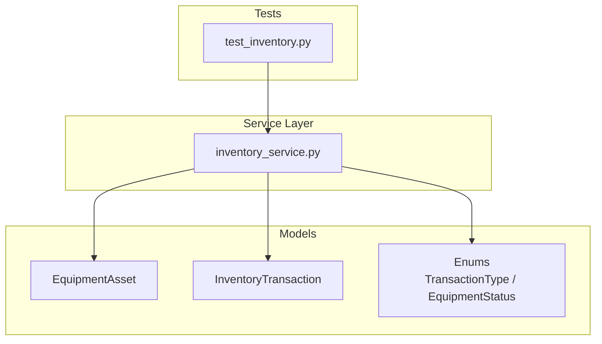
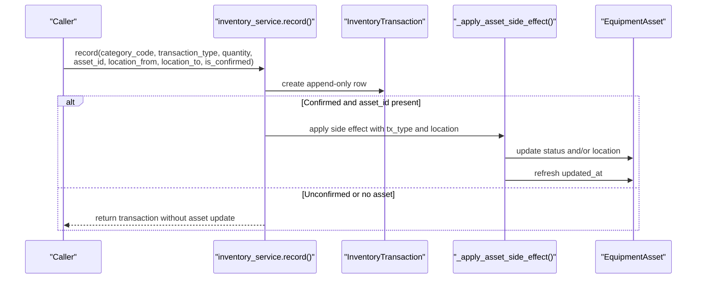
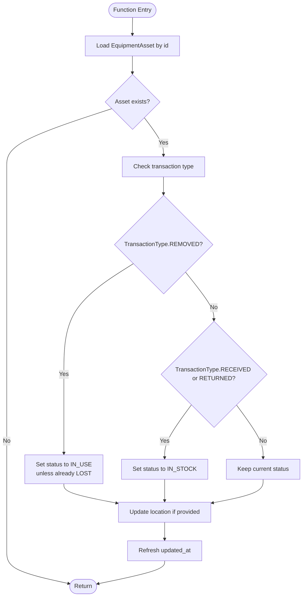
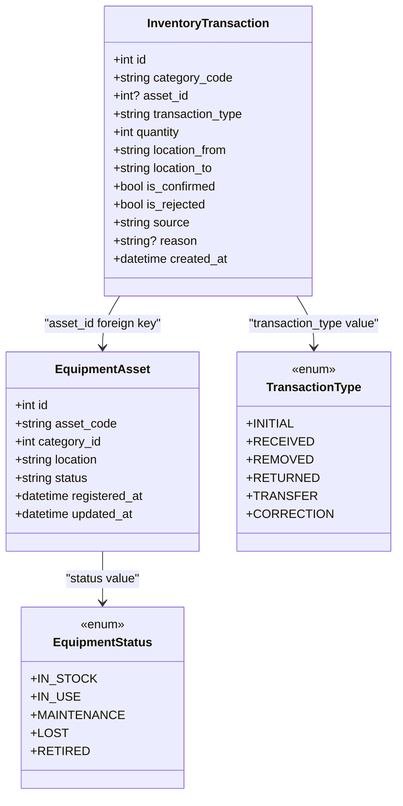
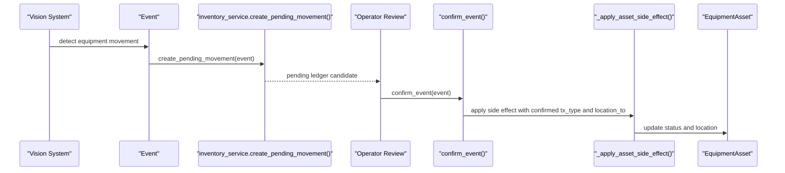
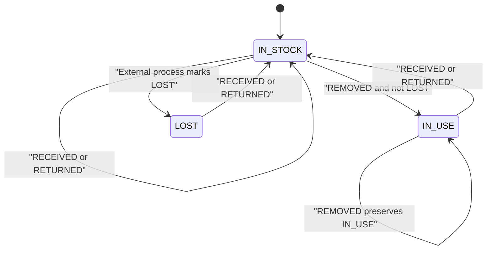
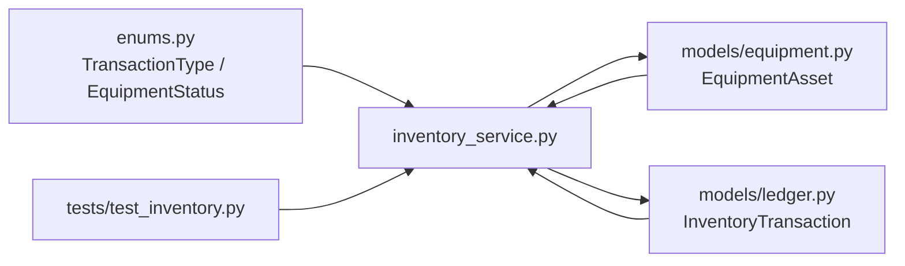

# Asset Status & Location Management

<cite>
**Referenced Files in This Document**
- [inventory_service.py](file://app/services/inventory_service.py)
- [equipment.py](file://app/models/equipment.py)
- [enums.py](file://app/models/enums.py)
- [ledger.py](file://app/models/ledger.py)
- [test_inventory.py](file://tests/test_inventory.py)
</cite>

## Table of Contents
1. [Introduction](#introduction)
2. [Project Structure](#project-structure)
3. [Core Components](#core-components)
4. [Architecture Overview](#architecture-overview)
5. [Detailed Component Analysis](#detailed-component-analysis)
6. [Dependency Analysis](#dependency-analysis)
7. [Performance Considerations](#performance-considerations)
8. [Troubleshooting Guide](#troubleshooting-guide)
9. [Conclusion](#conclusion)

## Introduction
This document explains how inventory transactions automatically update the status and location of physical equipment assets. The central behavior is implemented by `_apply_asset_side_effect()`, which reacts to confirmed inventory transactions and changes an asset’s `status` and `location` fields, while also updating its timestamp.

The system supports two main flows:
- Manual or automated ledger entries created through the inventory service.
- Vision-based movement events that create pending ledger candidates, later confirmed or rejected by an operator.

The goal is to keep the EquipmentAsset model synchronized with the inventory ledger so that business reports, dashboards, and audits reflect the current state of each physical unit.

## Project Structure
The relevant code for this topic lives in three layers:
- Models define the data structures: `EquipmentAsset`, `InventoryTransaction`, and shared enums such as `TransactionType` and `EquipmentStatus`.
- The inventory service implements ledger recording, vision candidate handling, confirmation logic, and the automatic side effects applied to assets.
- Tests demonstrate expected behavior for transfers, pending movements, and category balances.

**Diagram sources**
- [equipment.py:42-74](file://app/models/equipment.py#L42-L74)
- [ledger.py:114-157](file://app/models/ledger.py#L114-L157)
- [enums.py:113-148](file://app/models/enums.py#L113-L148)
- [inventory_service.py:66-127](file://app/services/inventory_service.py#L66-L127)
- [test_inventory.py:138-151](file://tests/test_inventory.py#L138-L151)

**Section sources**
- [equipment.py:42-74](file://app/models/equipment.py#L42-L74)
- [ledger.py:114-157](file://app/models/ledger.py#L114-L157)
- [enums.py:113-148](file://app/models/enums.py#L113-L148)
- [inventory_service.py:66-127](file://app/services/inventory_service.py#L66-L127)
- [test_inventory.py:138-151](file://tests/test_inventory.py#L138-L151)

## Core Components
- **EquipmentAsset**: Represents a specific physical unit. It stores `asset_code`, `category_id`, `location`, `status`, and timestamps `registered_at` and `updated_at`. Its default status is `IN_STOCK`.
- **InventoryTransaction**: An append-only ledger entry. It records `category_code`, `transaction_type`, signed `quantity`, `location_from`, `location_to`, confirmation flags, source, reason, user reference, and creation time.
- **TransactionType**: Enumerates ledger operations including `INITIAL`, `RECEIVED`, `REMOVED`, `RETURNED`, `TRANSFER`, and `CORRECTION`.
- **EquipmentStatus**: Enumerates asset states including `IN_STOCK`, `IN_USE`, `MAINTENANCE`, `LOST`, and `RETIRED`.
- **inventory_service.record()**: Creates a ledger entry and applies asset side effects when the transaction is confirmed and associated with an asset.
- **_apply_asset_side_effect()**: Updates asset status and location based on the transaction type and provided location parameters.

Key behaviors:
- `REMOVED` sets asset status to `IN_USE`, unless the asset is already marked `LOST`.
- `RECEIVED` and `RETURNED` set asset status to `IN_STOCK`.
- If a non-empty location is provided, the asset’s `location` field is updated.
- The asset’s `updated_at` timestamp is refreshed whenever the side effect runs.

**Section sources**
- [equipment.py:42-74](file://app/models/equipment.py#L42-L74)
- [ledger.py:114-157](file://app/models/ledger.py#L114-L157)
- [enums.py:113-148](file://app/models/enums.py#L113-L148)
- [inventory_service.py:66-127](file://app/services/inventory_service.py#L66-L127)

## Architecture Overview
The automatic asset management flow connects inventory transactions to EquipmentAsset updates through a small but important side-effect mechanism.

**Diagram sources**
- [inventory_service.py:66-103](file://app/services/inventory_service.py#L66-L103)
- [inventory_service.py:115-127](file://app/services/inventory_service.py#L115-L127)
- [ledger.py:114-157](file://app/models/ledger.py#L114-L157)
- [equipment.py:42-74](file://app/models/equipment.py#L42-L74)

## Detailed Component Analysis

### _apply_asset_side_effect() Behavior
This function is the core of automatic asset state management. It receives a database session, an asset identifier, a normalized transaction type, and a location string derived from the transaction.

Behavior summary:
- If the asset does not exist, it returns immediately without error.
- For `REMOVED`:
  - Sets the asset status to `IN_USE`.
  - Preserves `LOST` status: if the asset is already `LOST`, it remains `LOST`.
- For `RECEIVED` and `RETURNED`:
  - Sets the asset status to `IN_STOCK`.
- For any other transaction type:
  - Does not change the asset status.
- Location update:
  - If the location string is non-empty, the asset’s `location` field is updated.
  - Empty locations do not overwrite existing location values.
- Timestamp update:
  - The asset’s `updated_at` timestamp is always refreshed when the function executes.

**Diagram sources**
- [inventory_service.py:115-127](file://app/services/inventory_service.py#L115-L127)
- [enums.py:113-148](file://app/models/enums.py#L113-L148)

**Section sources**
- [inventory_service.py:115-127](file://app/services/inventory_service.py#L115-L127)
- [enums.py:113-148](file://app/models/enums.py#L113-L148)

### Relationship Between Inventory Transactions and EquipmentAsset Updates
The relationship is indirect but deterministic:
- `inventory_service.record()` creates an `InventoryTransaction`.
- If the transaction is confirmed and has an `asset_id`, it calls `_apply_asset_side_effect()`.
- `_apply_asset_side_effect()` mutates the related `EquipmentAsset`.
- Vision-based events create pending transactions that are not confirmed; they do not trigger asset updates until an operator confirms them.

**Diagram sources**
- [equipment.py:42-74](file://app/models/equipment.py#L42-L74)
- [ledger.py:114-157](file://app/models/ledger.py#L114-L157)
- [enums.py:113-148](file://app/models/enums.py#L113-L148)

**Section sources**
- [equipment.py:42-74](file://app/models/equipment.py#L42-L74)
- [ledger.py:114-157](file://app/models/ledger.py#L114-L157)
- [enums.py:113-148](file://app/models/enums.py#L113-L148)
- [inventory_service.py:66-103](file://app/services/inventory_service.py#L66-L103)

### Manual vs Automated Transactions and Their Effects

#### Manual Transactions
Manual transactions are typically created directly through the inventory service with `is_confirmed=True`. When an `asset_id` is provided, the asset is updated immediately.

Example lifecycle scenarios:
- Initial registration:
  - Create an asset with default `IN_STOCK` status.
  - Record an `INITIAL` transaction for the category.
  - No automatic status change occurs because `INITIAL` is not handled by `_apply_asset_side_effect()`.
- Transfer within the facility:
  - Record a `TRANSFER` transaction with `location_from` and `location_to`.
  - The test shows that the asset’s `location` is updated to the destination location.
  - Status is not changed by `_apply_asset_side_effect()` for `TRANSFER`.

**Section sources**
- [test_inventory.py:138-151](file://tests/test_inventory.py#L138-L151)
- [inventory_service.py:66-103](file://app/services/inventory_service.py#L66-L103)
- [inventory_service.py:115-127](file://app/services/inventory_service.py#L115-L127)

#### Automated Vision-Based Transactions
Vision-based movement events produce pending ledger candidates:
- `EQUIPMENT_BROUGHT_IN` maps to `RECEIVED`.
- `EQUIPMENT_TAKEN_OUT` maps to `REMOVED`.
- `EQUIPMENT_RETURNED` maps to `RETURNED`.

These candidates are created with `is_confirmed=False`, so they do not immediately update the asset. They appear in pending movement totals and can be reviewed.

When an operator confirms the event:
- The pending transaction becomes confirmed.
- `_apply_asset_side_effect()` is invoked with the transaction’s type and `location_to`.
- The asset status and location are updated accordingly.

**Diagram sources**
- [inventory_service.py:132-156](file://app/services/inventory_service.py#L132-L156)
- [inventory_service.py:165-185](file://app/services/inventory_service.py#L165-L185)
- [inventory_service.py:115-127](file://app/services/inventory_service.py#L115-L127)

**Section sources**
- [inventory_service.py:132-156](file://app/services/inventory_service.py#L132-L156)
- [inventory_service.py:165-185](file://app/services/inventory_service.py#L165-L185)

### Status Transitions and Edge Cases
- Default asset status is `IN_STOCK`.
- `REMOVED` transitions to `IN_USE`, except when the asset is already `LOST`.
- `RECEIVED` and `RETURNED` transition to `IN_STOCK`.
- Other transaction types (`INITIAL`, `TRANSFER`, `CORRECTION`) do not change status through `_apply_asset_side_effect()`.
- Location updates depend on whether a non-empty location is provided.
- `updated_at` is refreshed whenever the side effect runs, providing a reliable audit timestamp for asset changes.

**Diagram sources**
- [inventory_service.py:115-127](file://app/services/inventory_service.py#L115-L127)
- [enums.py:133-148](file://app/models/enums.py#L133-L148)

**Section sources**
- [inventory_service.py:115-127](file://app/services/inventory_service.py#L115-L127)
- [enums.py:133-148](file://app/models/enums.py#L133-L148)

### Timestamp Management
- `EquipmentAsset.registered_at` is set when the asset is created.
- `EquipmentAsset.updated_at` is set initially and refreshed on subsequent updates.
- `_apply_asset_side_effect()` explicitly assigns `updated_at` using the current UTC time, ensuring every confirmed asset-affecting transaction leaves a timestamp trail.
- `InventoryTransaction.created_at` records when the ledger entry was written, separate from the asset’s last update time.

**Section sources**
- [equipment.py:60-61](file://app/models/equipment.py#L60-L61)
- [inventory_service.py:124-126](file://app/services/inventory_service.py#L124-L126)
- [ledger.py:148-148](file://app/models/ledger.py#L148-L148)

## Dependency Analysis
The automatic asset management depends on several components working together:

**Diagram sources**
- [enums.py:113-148](file://app/models/enums.py#L113-L148)
- [equipment.py:42-74](file://app/models/equipment.py#L42-L74)
- [ledger.py:114-157](file://app/models/ledger.py#L114-L157)
- [inventory_service.py:66-127](file://app/services/inventory_service.py#L66-L127)
- [test_inventory.py:138-151](file://tests/test_inventory.py#L138-L151)

**Section sources**
- [enums.py:113-148](file://app/models/enums.py#L113-L148)
- [equipment.py:42-74](file://app/models/equipment.py#L42-L74)
- [ledger.py:114-157](file://app/models/ledger.py#L114-L157)
- [inventory_service.py:66-127](file://app/services/inventory_service.py#L66-L127)
- [test_inventory.py:138-151](file://tests/test_inventory.py#L138-L151)

## Performance Considerations
- `_apply_asset_side_effect()` performs a single asset lookup and optional updates, making it lightweight.
- The side effect only runs for confirmed transactions with an `asset_id`, reducing unnecessary writes.
- Vision-based candidates avoid immediate asset mutations, preventing premature state changes before human review.
- Using `utc_now()` ensures consistent timezone-aware timestamps without external dependencies.

[No sources needed since this section provides general guidance]

## Troubleshooting Guide
Common issues and checks:
- Asset status not changing after a manual transaction:
  - Verify that the transaction is confirmed.
  - Ensure an `asset_id` is provided.
  - Confirm that the transaction type is one handled by `_apply_asset_side_effect()`.
- Location not updated:
  - Check whether `location_to` or `location_from` is empty.
  - Remember that only non-empty locations are applied.
- Vision-based movement not reflected in asset state:
  - Pending candidates do not update assets until confirmed.
  - Use the confirmation flow to finalize the movement.
- Lost asset remains lost after removal:
  - This is expected: `REMOVED` does not override `LOST`.
  - To move a lost asset back into stock, use `RECEIVED` or `RETURNED`.

**Section sources**
- [inventory_service.py:102-103](file://app/services/inventory_service.py#L102-L103)
- [inventory_service.py:115-127](file://app/services/inventory_service.py#L115-L127)
- [inventory_service.py:132-156](file://app/services/inventory_service.py#L132-L156)
- [inventory_service.py:165-185](file://app/services/inventory_service.py#L165-L185)

## Conclusion
Automatic asset status and location management is driven by confirmed inventory transactions. `_apply_asset_side_effect()` enforces clear rules:
- `REMOVED` marks an asset as `IN_USE`, preserving `LOST`.
- `RECEIVED` and `RETURNED` mark an asset as `IN_STOCK`.
- Non-empty locations update the asset’s location.
- Every side effect refreshes the asset’s `updated_at` timestamp.

Manual transactions update assets immediately when confirmed, while vision-based movements remain pending until an operator reviews them. This design keeps the ledger append-only, auditable, and safe from premature automated state changes.

[No sources needed since this section summarizes without analyzing specific files]