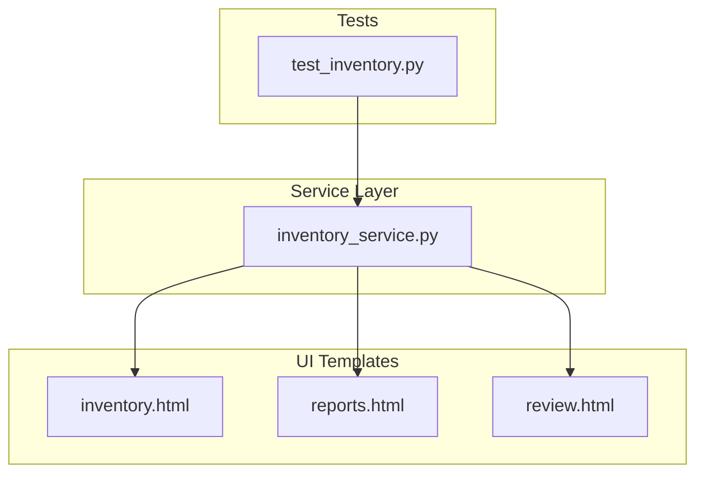
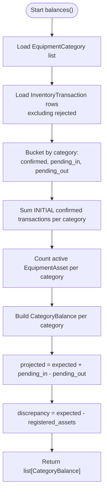
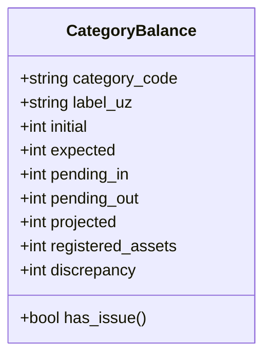
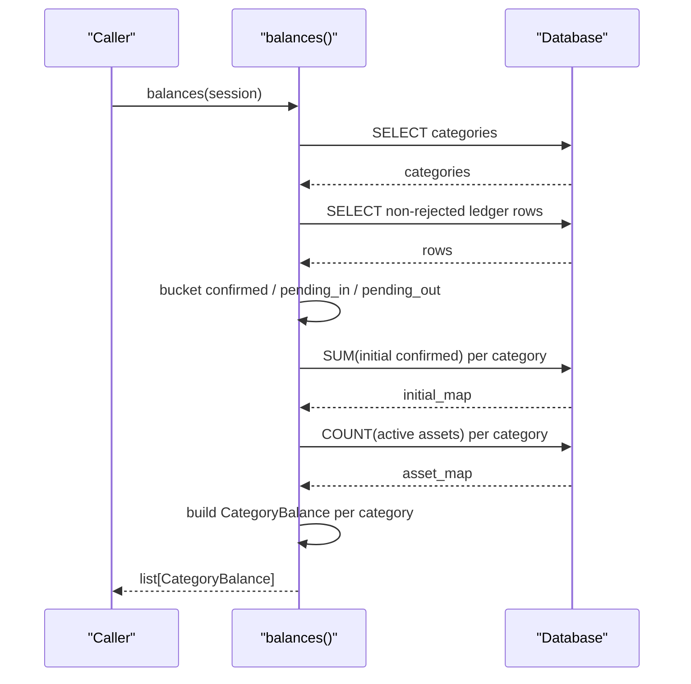
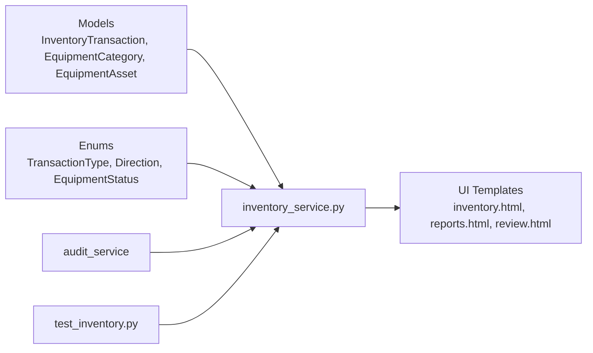

# Balance Calculations & Formulas

<cite>
**Referenced Files in This Document**
- [inventory_service.py](file://app/services/inventory_service.py)
- [test_inventory.py](file://tests/test_inventory.py)
- [inventory.html](file://app/ui/templates/inventory.html)
- [reports.html](file://app/ui/templates/reports.html)
- [review.html](file://app/ui/templates/review.html)
</cite>

## Table of Contents
1. [Introduction](#introduction)
2. [Project Structure](#project-structure)
3. [Core Components](#core-components)
4. [Architecture Overview](#architecture-overview)
5. [Detailed Component Analysis](#detailed-component-analysis)
6. [Dependency Analysis](#dependency-analysis)
7. [Performance Considerations](#performance-considerations)
8. [Troubleshooting Guide](#troubleshooting-guide)
9. [Conclusion](#conclusion)

## Introduction
This document explains the inventory balance calculation logic used by the application. It focuses on:
- Expected balance as the sum of confirmed ledger transactions.
- Pending transactions as unconfirmed entries that should not yet affect official balances.
- Projected balances combining expected and pending movements.
- Discrepancy detection comparing expected ledger counts with registered physical assets.
- The `CategoryBalance` dataclass, including its `has_issue` flag.
- The `balance_for()` function for single-category queries and the `balances()` function for all categories.
- Mathematical formulas, examples, and performance considerations for large datasets.

The implementation is append-only: corrections are new ledger entries rather than edits to existing rows. Vision-derived movement candidates are written as unconfirmed until a human confirms them.

## Project Structure
The balance calculations live in the inventory service layer and are consumed by UI templates and tests.

**Diagram sources**
- [inventory_service.py:215-280](file://app/services/inventory_service.py#L215-L280)
- [inventory.html:51-70](file://app/ui/templates/inventory.html#L51-L70)
- [reports.html:170-179](file://app/ui/templates/reports.html#L170-L179)
- [review.html:127-137](file://app/ui/templates/review.html#L127-L137)
- [test_inventory.py:24-27](file://tests/test_inventory.py#L24-L27)

**Section sources**
- [inventory_service.py:1-347](file://app/services/inventory_service.py#L1-L347)
- [inventory.html:35-70](file://app/ui/templates/inventory.html#L35-L70)
- [reports.html:150-179](file://app/ui/templates/reports.html#L150-L179)
- [review.html:112-143](file://app/ui/templates/review.html#L112-L143)
- [test_inventory.py:1-27](file://tests/test_inventory.py#L1-L27)

## Core Components
The core of the balance system is the `CategoryBalance` dataclass and two main functions:
- `balances(session)` computes balances across all equipment categories.
- `balance_for(session, category_code)` returns the balance for one category.

Key concepts:
- Confirmed transactions contribute to the expected balance.
- Unconfirmed positive quantities are pending inflows; unconfirmed negative quantities are pending outflows.
- Projected balance adds pending inflows and subtracts pending outflows from the expected balance.
- Discrepancy compares expected ledger count with registered asset count.

**Section sources**
- [inventory_service.py:36-50](file://app/services/inventory_service.py#L36-L50)
- [inventory_service.py:215-280](file://app/services/inventory_service.py#L215-L280)

## Architecture Overview
The balance pipeline reads three data sources per category:
1. All non-rejected ledger transactions (to compute confirmed totals and pending buckets).
2. Initial confirmed transactions per category (for the initial baseline).
3. Registered active assets per category (for discrepancy detection).

**Diagram sources**
- [inventory_service.py:215-273](file://app/services/inventory_service.py#L215-L273)

**Section sources**
- [inventory_service.py:215-273](file://app/services/inventory_service.py#L215-L273)

## Detailed Component Analysis

### CategoryBalance Dataclass
`CategoryBalance` represents the computed state for one equipment category.

| Field | Meaning |
|---|---|
| `category_code` | Stable identifier for the category. |
| `label_uz` | Human-readable label for display. |
| `initial` | Sum of confirmed INITIAL transactions for this category. |
| `expected` | Sum of all confirmed transactions (including INITIAL), representing the official ledger balance. |
| `pending_in` | Sum of unconfirmed positive quantities. |
| `pending_out` | Sum of unconfirmed negative quantities, stored as a positive number. |
| `projected` | Expected balance adjusted for pending movements. |
| `registered_assets` | Count of active assets linked to the category. |
| `discrepancy` | Difference between expected ledger count and registered asset count. |
| `has_issue` | Boolean flag indicating whether there are pending outflows or any discrepancy. |

Important behaviors:
- `has_issue` is true when there are pending outflows or any non-zero discrepancy.
- `pending_out` is always represented as a positive magnitude even though underlying ledger quantities may be negative.

**Diagram sources**
- [inventory_service.py:36-50](file://app/services/inventory_service.py#L36-L50)

**Section sources**
- [inventory_service.py:36-50](file://app/services/inventory_service.py#L36-L50)

### Expected Balance Calculation
Expected balance is the sum of all confirmed, non-rejected ledger transactions for a category. This includes INITIAL, RECEIVED, RETURNED, REMOVED, and CORRECTION entries, depending on their signed quantity.

Formulas:
- Let T_c be the set of confirmed, non-rejected transactions for category c.
- Let q(t) be the signed quantity of transaction t.
- Expected(c) = Σ_{t ∈ T_c} q(t).

Notes:
- POSITIVE_TYPES increase the balance: INITIAL, RECEIVED, RETURNED.
- NEGATIVE_TYPES decrease the balance: REMOVED.
- TRANSFER does not change the overall count.
- CORRECTION preserves the caller-provided sign.

Example:
- Initial: 10
- Received: 2
- Removed: 3
- Expected = 10 + 2 − 3 = 9.

**Section sources**
- [inventory_service.py:32-33](file://app/services/inventory_service.py#L32-L33)
- [inventory_service.py:53-63](file://app/services/inventory_service.py#L53-L63)
- [inventory_service.py:218-233](file://app/services/inventory_service.py#L218-L233)
- [test_inventory.py:13-21](file://tests/test_inventory.py#L13-L21)

### Pending Transactions
Pending transactions are unconfirmed ledger entries that have not yet been accepted into the official balance.

Definitions:
- PendingIn(c) = Σ of unconfirmed, non-rejected positive quantities for category c.
- PendingOut(c) = Σ of absolute values of unconfirmed, non-rejected negative quantities for category c.

Behavior:
- Pending inflows increase the projected balance but do not change expected.
- Pending outflows reduce the projected balance but do not change expected.
- Rejected transactions are excluded from both expected and pending calculations.

Example:
- Unconfirmed received: 1
- Unconfirmed removed: 2
- PendingIn = 1
- PendingOut = 2

**Section sources**
- [inventory_service.py:218-233](file://app/services/inventory_service.py#L218-L233)

### Projected Balance Calculation
Projected balance estimates what the balance will be after pending movements are processed.

Formula:
- Projected(c) = Expected(c) + PendingIn(c) − PendingOut(c).

Example:
- Expected = 9
- PendingIn = 1
- PendingOut = 2
- Projected = 9 + 1 − 2 = 8.

**Section sources**
- [inventory_service.py:268](file://app/services/inventory_service.py#L268)

### Discrepancy Detection
Discrepancy compares the expected ledger balance with the count of registered active assets.

Formula:
- Discrepancy(c) = Expected(c) − RegisteredAssets(c).

Interpretation:
- Positive discrepancy means the ledger expects more items than registered assets.
- Negative discrepancy means fewer items are expected than registered assets.
- Zero discrepancy indicates alignment between ledger and registered assets.

Example:
- Expected = 9
- RegisteredAssets = 7
- Discrepancy = 9 − 7 = 2.

**Section sources**
- [inventory_service.py:246-252](file://app/services/inventory_service.py#L246-L252)
- [inventory_service.py:270](file://app/services/inventory_service.py#L270)

### has_issue Flag Logic
The `has_issue` property flags categories that need attention.

Rule:
- has_issue = True if PendingOut > 0 OR Discrepancy ≠ 0.
- Otherwise, has_issue = False.

Implications:
- A category with only pending inflows and no discrepancy is considered healthy.
- Any pending outflow triggers an issue flag regardless of discrepancy.
- Any mismatch between expected and registered assets triggers an issue flag.

Example:
- PendingOut = 0, Discrepancy = 0 → has_issue = False.
- PendingOut = 2, Discrepancy = 0 → has_issue = True.
- PendingOut = 0, Discrepancy = 2 → has_issue = True.

**Section sources**
- [inventory_service.py:48-50](file://app/services/inventory_service.py#L48-L50)

### balance_for() Function
`balance_for(session, category_code)` returns the `CategoryBalance` for a specific category.

Behavior:
- It iterates over the full result of `balances(session)`.
- If the category exists, it returns that item.
- If not found, it returns a default `CategoryBalance` with zeros.

Complexity:
- Time: O(C) where C is the number of categories, because it scans the full balance list.
- Space: O(1) additional beyond the list returned by `balances()`.

Optimization note:
- For repeated single-category lookups, consider caching or filtering at the database level to avoid recomputing all categories.

**Section sources**
- [inventory_service.py:276-280](file://app/services/inventory_service.py#L276-L280)

### balances() Function
`balances(session)` computes balances for all categories.

Steps:
1. Load all equipment categories.
2. Load all non-rejected ledger transactions and bucket them by category:
   - Confirmed sum.
   - Pending inflow sum.
   - Pending outflow sum.
3. Load initial confirmed sums per category.
4. Load registered active asset counts per category.
5. Build `CategoryBalance` objects:
   - initial = initial map value.
   - expected = confirmed sum.
   - pending_in, pending_out from buckets.
   - projected = expected + pending_in − pending_out.
   - registered_assets = asset map value.
   - discrepancy = expected − registered_assets.

Complexity:
- Time: O(T + I + A + C), where T is ledger rows scanned, I is initial aggregation, A is asset aggregation, and C is categories iteration.
- Space: O(C + U), where U is unique categories present in ledger rows.

**Diagram sources**
- [inventory_service.py:215-273](file://app/services/inventory_service.py#L215-L273)

**Section sources**
- [inventory_service.py:215-273](file://app/services/inventory_service.py#L215-L273)

### End-to-End Example
Suppose category “monitor” has:
- Initial confirmed: 10
- Received confirmed: 2
- Removed confirmed: 3
- Unconfirmed received: 1
- Unconfirmed removed: 2
- Registered active assets: 7

Calculations:
- Expected = 10 + 2 − 3 = 9
- PendingIn = 1
- PendingOut = 2
- Projected = 9 + 1 − 2 = 8
- RegisteredAssets = 7
- Discrepancy = 9 − 7 = 2
- has_issue = True (because PendingOut > 0 and Discrepancy ≠ 0)

**Section sources**
- [inventory_service.py:254-273](file://app/services/inventory_service.py#L254-L273)

## Dependency Analysis
The balance module depends on:
- SQLAlchemy models for inventory transactions, equipment categories, and equipment assets.
- Enums for transaction types, directions, and equipment status.
- Audit service for audit trail recording during confirm/reject flows.
- UI templates render balance results for operators.

**Diagram sources**
- [inventory_service.py:25-28](file://app/services/inventory_service.py#L25-L28)
- [inventory_service.py:165-205](file://app/services/inventory_service.py#L165-L205)
- [inventory.html:51-70](file://app/ui/templates/inventory.html#L51-L70)
- [reports.html:170-179](file://app/ui/templates/reports.html#L170-L179)
- [review.html:127-137](file://app/ui/templates/review.html#L127-L137)
- [test_inventory.py:1-27](file://tests/test_inventory.py#L1-L27)

**Section sources**
- [inventory_service.py:25-28](file://app/services/inventory_service.py#L25-L28)
- [inventory_service.py:165-205](file://app/services/inventory_service.py#L165-L205)
- [inventory.html:51-70](file://app/ui/templates/inventory.html#L51-L70)
- [reports.html:170-179](file://app/ui/templates/reports.html#L170-L179)
- [review.html:127-137](file://app/ui/templates/review.html#L127-L137)
- [test_inventory.py:1-27](file://tests/test_inventory.py#L1-L27)

## Performance Considerations
For large datasets:
- Ledger scanning: `balances()` scans all non-rejected ledger rows. Ensure indexes on `category_code`, `is_confirmed`, and `is_rejected` to speed up filtering and grouping.
- Aggregations: Initial sums and asset counts use SQL aggregation. Keep these grouped by category code and filter retired assets at the database level.
- Memory usage: The function builds dictionaries for buckets, initial maps, and asset maps. For very large category sets, consider streaming or incremental computation.
- Single-category queries: `balance_for()` recomputes all categories. If many single-category calls occur, cache results or add a filtered query path.
- Concurrency: Use database transactions with appropriate isolation levels to ensure consistent snapshots during balance computation.

Recommendations:
- Add composite indexes such as `(category_code, is_confirmed, is_rejected)` and `(category_code, transaction_type)`.
- Precompute or materialize frequently accessed aggregates if read patterns are heavy.
- Avoid unnecessary Python-side loops by pushing more aggregation into SQL where possible.

**Section sources**
- [inventory_service.py:215-273](file://app/services/inventory_service.py#L215-L273)
- [inventory_service.py:276-280](file://app/services/inventory_service.py#L276-L280)

## Troubleshooting Guide
Common issues and checks:
- Unexpected expected balance:
  - Verify that only confirmed, non-rejected transactions are included.
  - Confirm that corrections preserve intended signs.
- Pending outflows causing issues:
  - Check unconfirmed removed transactions.
  - Review reject/confirm flows to ensure proper state transitions.
- Discrepancy mismatches:
  - Compare expected ledger count with registered active assets.
  - Ensure retired assets are excluded from registered counts.
- UI indicators:
  - The inventory and reports templates highlight discrepancies and pending movements.
  - The review template surfaces categories with discrepancies and pending outflows for operator action.

Operational tips:
- Use the test suite’s assertions about signed quantities and confirmed-only counting to validate behavior.
- Inspect ledger rows for events to understand pending vs confirmed states.

**Section sources**
- [inventory_service.py:53-63](file://app/services/inventory_service.py#L53-L63)
- [inventory_service.py:165-205](file://app/services/inventory_service.py#L165-L205)
- [inventory_service.py:218-273](file://app/services/inventory_service.py#L218-L273)
- [inventory.html:51-70](file://app/ui/templates/inventory.html#L51-L70)
- [reports.html:170-179](file://app/ui/templates/reports.html#L170-L179)
- [review.html:127-137](file://app/ui/templates/review.html#L127-L137)
- [test_inventory.py:13-27](file://tests/test_inventory.py#L13-L27)

## Conclusion
The inventory balance system provides a clear separation between official expected balances and pending movements, while also detecting discrepancies against registered assets. The `CategoryBalance` model encapsulates all relevant fields and exposes a simple `has_issue` flag to guide operator attention. The `balances()` function computes comprehensive results across categories, and `balance_for()` offers convenient single-category access. With careful indexing and potential caching strategies, the system can scale effectively to large datasets while maintaining clarity and correctness.