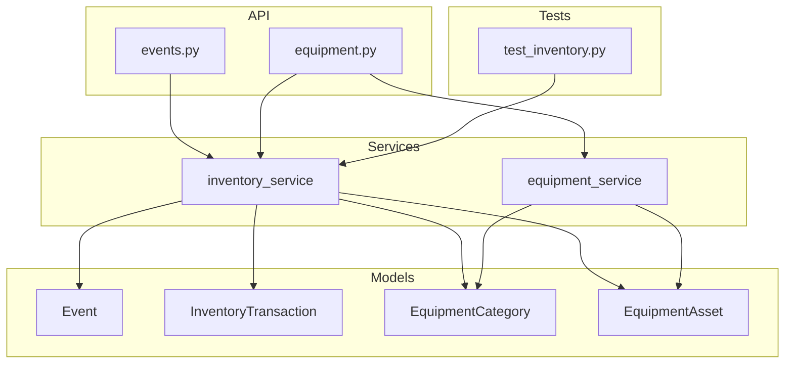
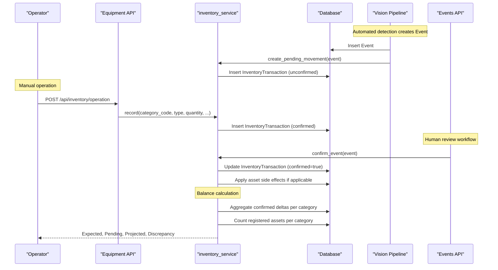
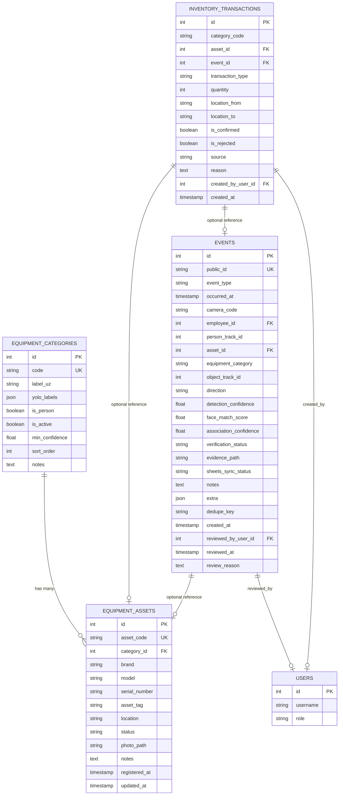
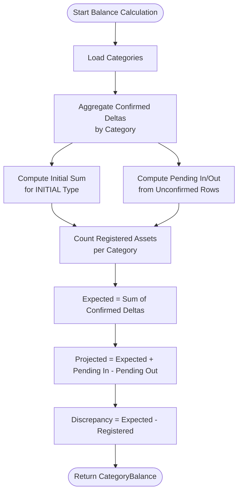
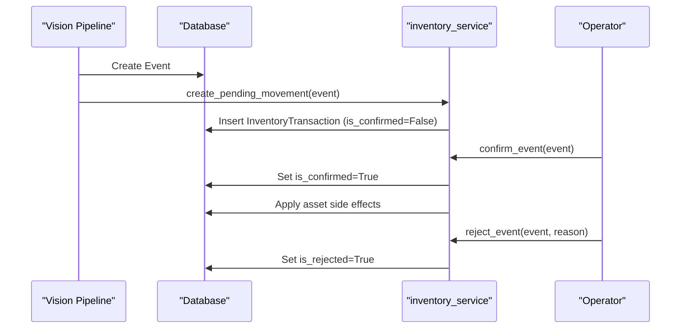
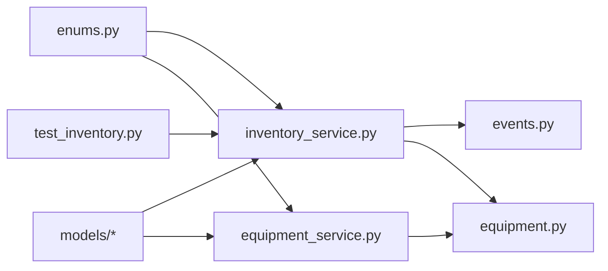

# Inventory Management

<cite>
**Referenced Files in This Document**
- [ledger.py](file://app/models/ledger.py)
- [equipment.py](file://app/models/equipment.py)
- [enums.py](file://app/models/enums.py)
- [inventory_service.py](file://app/services/inventory_service.py)
- [equipment_service.py](file://app/services/equipment_service.py)
- [events.py](file://app/api/events.py)
- [equipment.py](file://app/api/equipment.py)
- [database.py](file://app/database.py)
- [test_inventory.py](file://tests/test_inventory.py)
</cite>

## Table of Contents
1. [Introduction](#introduction)
2. [Project Structure](#project-structure)
3. [Core Components](#core-components)
4. [Architecture Overview](#architecture-overview)
5. [Detailed Component Analysis](#detailed-component-analysis)
6. [Dependency Analysis](#dependency-analysis)
7. [Performance Considerations](#performance-considerations)
8. [Troubleshooting Guide](#troubleshooting-guide)
9. [Conclusion](#conclusion)

## Introduction
This document describes the append-only inventory journal system used to track equipment movement, manual adjustments, and automated vision-driven candidates. The system stores immutable ledger entries rather than mutable balances. Current category balances are calculated as running totals over confirmed transactions, while pending (unconfirmed) movements are tracked separately for projection and discrepancy detection.

Key design principles:
- Transactions are never edited or deleted; corrections are new correction rows.
- Only confirmed, non-rejected transactions affect official balances.
- Automated events create unconfirmed candidate transactions that require human review before affecting balances.
- Category-level counts are separate from registered physical assets; discrepancy is computed by comparing expected balance with registered asset count.

## Project Structure
The inventory journal spans models, services, API endpoints, and tests:
- Models define the database schema for events, inventory transactions, equipment categories, and assets.
- Services implement business logic for recording transactions, confirming/rejecting vision candidates, computing balances, and managing equipment.
- API endpoints expose manual inventory operations, event review workflows, and equipment management.
- Tests validate signed quantity normalization, append-only semantics, pending behavior, and discrepancy calculation.

**Diagram sources**
- [ledger.py:21-157](file://app/models/ledger.py#L21-L157)
- [equipment.py:16-74](file://app/models/equipment.py#L16-L74)
- [inventory_service.py:32-347](file://app/services/inventory_service.py#L32-L347)
- [equipment_service.py:18-349](file://app/services/equipment_service.py#L18-L349)
- [events.py:91-129](file://app/api/events.py#L91-L129)
- [equipment.py:175-260](file://app/api/equipment.py#L175-L260)
- [test_inventory.py:13-199](file://tests/test_inventory.py#L13-L199)

**Section sources**
- [ledger.py:21-157](file://app/models/ledger.py#L21-L157)
- [equipment.py:16-74](file://app/models/equipment.py#L16-L74)
- [inventory_service.py:32-347](file://app/services/inventory_service.py#L32-L347)
- [equipment_service.py:18-349](file://app/services/equipment_service.py#L18-L349)
- [events.py:91-129](file://app/api/events.py#L91-L129)
- [equipment.py:175-260](file://app/api/equipment.py#L175-L260)
- [test_inventory.py:13-199](file://tests/test_inventory.py#L13-L199)

## Core Components
- Event: Represents an observable fact such as person entry/exit, equipment movement, camera status changes, or inventory discrepancies. It carries metadata like confidence scores, verification status, evidence path, and optional associations to employees and equipment assets.
- InventoryTransaction: Append-only ledger row representing a signed delta applied to a category balance. It includes transaction type, quantity sign, confirmation state, rejection flag, source, and audit fields.
- EquipmentCategory: Maps model output labels to business categories and controls detection rules such as minimum confidence and sorting order.
- EquipmentAsset: Represents a specific physical unit linked to a category, with attributes like brand, model, serial number, location, and lifecycle status.

These components together form the foundation for tracking inventory movements, reconciling automated detections with manual operations, and computing reliable category balances.

**Section sources**
- [ledger.py:21-157](file://app/models/ledger.py#L21-L157)
- [equipment.py:16-74](file://app/models/equipment.py#L16-L74)
- [enums.py:113-130](file://app/models/enums.py#L113-L130)

## Architecture Overview
The inventory system integrates three primary flows:
1. Manual inventory operations write confirmed transactions directly to the ledger.
2. Automated vision events create unconfirmed candidate transactions requiring operator review.
3. Balance computation aggregates confirmed deltas per category, tracks pending movements, and compares against registered assets to detect discrepancies.

**Diagram sources**
- [inventory_service.py:66-112](file://app/services/inventory_service.py#L66-L112)
- [inventory_service.py:132-156](file://app/services/inventory_service.py#L132-L156)
- [inventory_service.py:165-205](file://app/services/inventory_service.py#L165-L205)
- [inventory_service.py:215-273](file://app/services/inventory_service.py#L215-L273)
- [events.py:91-129](file://app/api/events.py#L91-L129)
- [equipment.py:208-260](file://app/api/equipment.py#L208-L260)

## Detailed Component Analysis

### Entity Relationships
The core entities and their relationships are:
- EquipmentCategory has many EquipmentAssets.
- EquipmentAsset belongs to one EquipmentCategory.
- Event optionally references Employee, EquipmentAsset, and User.
- InventoryTransaction references EquipmentAsset and Event, and is grouped by category_code.
- Users can create or review events and transactions.

**Diagram sources**
- [equipment.py:16-74](file://app/models/equipment.py#L16-L74)
- [ledger.py:21-157](file://app/models/ledger.py#L21-L157)

**Section sources**
- [equipment.py:16-74](file://app/models/equipment.py#L16-L74)
- [ledger.py:21-157](file://app/models/ledger.py#L21-L157)

### Transaction Types and Semantic Meaning
Transaction types define how signed quantities impact category balances:
- INITIAL: Sets or updates the starting balance for a category. Positive impact.
- RECEIVED: Adds items into inventory. Positive impact.
- REMOVED: Removes items from inventory. Negative impact.
- RETURNED: Returns items back into inventory. Positive impact.
- TRANSFER: Moves items between locations without changing category count. Zero impact on balance.
- CORRECTION: Applies an arbitrary signed adjustment decided by the caller. Can be positive or negative.

Signed quantity normalization ensures consistent accounting:
- Positive types increase balance.
- Negative types decrease balance.
- Transfers produce zero delta.
- Corrections preserve the caller’s sign.

**Section sources**
- [enums.py:113-130](file://app/models/enums.py#L113-L130)
- [inventory_service.py:32-63](file://app/services/inventory_service.py#L32-L63)
- [test_inventory.py:13-22](file://tests/test_inventory.py#L13-L22)

### Append-Only Design Principle
The ledger enforces immutability:
- Rows are never edited or deleted.
- Corrections are recorded as new rows with type CORRECTION.
- Rejected candidates remain in the ledger but are flagged is_rejected=True so they do not influence pending calculations.
- Only confirmed, non-rejected rows contribute to official balances.

This approach preserves a complete audit trail and supports reconciliation between automated detections and manual operations.

**Section sources**
- [ledger.py:114-157](file://app/models/ledger.py#L114-L157)
- [inventory_service.py:188-205](file://app/services/inventory_service.py#L188-L205)
- [test_inventory.py:118-126](file://tests/test_inventory.py#L118-L126)

### Balance Calculation Formulas
Balances are computed per category using confirmed transactions and pending candidates:
- Initial: Sum of confirmed INITIAL rows for the category.
- Expected: Sum of all confirmed, non-rejected deltas (including INITIAL).
- Pending In: Sum of positive, unconfirmed, non-rejected deltas.
- Pending Out: Sum of absolute values of negative, unconfirmed, non-rejected deltas.
- Projected: Expected + Pending In - Pending Out.
- Registered Assets: Count of active assets belonging to the category (excluding retired).
- Discrepancy: Expected - Registered Assets (zero when no registered assets exist).

**Diagram sources**
- [inventory_service.py:215-273](file://app/services/inventory_service.py#L215-L273)

**Section sources**
- [inventory_service.py:215-273](file://app/services/inventory_service.py#L215-L273)
- [test_inventory.py:24-50](file://tests/test_inventory.py#L24-L50)
- [test_inventory.py:167-177](file://tests/test_inventory.py#L167-L177)

### Data Validation Rules and Business Constraints
Validation and constraints include:
- Transaction types are validated via enum conversion.
- Signed quantity normalization prevents accidental double-sign errors.
- Manual operations enforce CSRF protection and role checks.
- Initial stock entries require admin privileges.
- Correction operations require a non-empty reason and explicit delta value.
- Transfer operations require a destination location.
- Asset creation validates category existence, uniqueness of asset codes and serial numbers, and disallows “person” categories.
- Vision candidates are always written as unconfirmed and must be reviewed before affecting balances.

**Section sources**
- [equipment.py:208-260](file://app/api/equipment.py#L208-L260)
- [equipment_service.py:59-111](file://app/services/equipment_service.py#L59-L111)
- [equipment_service.py:253-318](file://app/services/equipment_service.py#L253-L318)
- [inventory_service.py:53-63](file://app/services/inventory_service.py#L53-L63)

### Relationship Between Automated Events and Manual Operations
Automated events originate from the vision pipeline and create unconfirmed candidate transactions:
- Equipment brought in maps to RECEIVED.
- Equipment taken out maps to REMOVED.
- Equipment returned maps to RETURNED.
Candidates are stored with source="vision" and is_confirmed=False.

Manual operations explicitly create confirmed transactions:
- Receive, remove, return, transfer, initial stock, and correction operations all call inventory_service.record with appropriate types and signs.
- Confirming an event promotes its candidate(s) to confirmed and applies asset side effects (e.g., updating status and location).
- Rejecting an event keeps the candidate rows for audit purposes but marks them rejected so they do not influence pending totals.

**Diagram sources**
- [inventory_service.py:132-156](file://app/services/inventory_service.py#L132-L156)
- [inventory_service.py:165-205](file://app/services/inventory_service.py#L165-L205)
- [test_inventory.py:52-116](file://tests/test_inventory.py#L52-L116)

**Section sources**
- [inventory_service.py:132-205](file://app/services/inventory_service.py#L132-L205)
- [test_inventory.py:52-116](file://tests/test_inventory.py#L52-L116)

### Database Schema Diagrams and Indexing Strategy
Tables and key columns:
- equipment_categories: code (unique), label_uz, yolo_labels (JSON), is_person, is_active, min_confidence, sort_order, notes.
- equipment_assets: asset_code (unique), category_id (FK), brand, model, serial_number (indexed), asset_tag, location, status, photo_path, notes, registered_at, updated_at.
- events: public_id (unique), event_type (indexed), occurred_at (indexed), camera_code (indexed), employee_id (FK), person_track_id, asset_id (FK), equipment_category (indexed), object_track_id, direction, detection_confidence, face_match_score, association_confidence, verification_status (indexed), evidence_path, sheets_sync_status (indexed), notes, extra (JSON), dedupe_key (unique), created_at, reviewed_by_user_id (FK), reviewed_at, review_reason.
- inventory_transactions: category_code (indexed), asset_id (FK), event_id (FK), transaction_type, quantity, location_from, location_to, is_confirmed (indexed), is_rejected (indexed), source, reason, created_by_user_id (FK), created_at (indexed).

Indexing strategy for efficient balance calculations:
- category_code indexed for fast grouping by category.
- is_confirmed and is_rejected indexed to filter confirmed/non-rejected rows efficiently.
- created_at indexed for chronological ordering and recent ledger queries.
- event_type, verification_status, equipment_category indexed to support event filtering and candidate selection.
- asset_id and event_id foreign keys indexed to optimize joins and lookups during side effects and reporting.

Foreign key relationships:
- inventory_transactions.asset_id -> equipment_assets.id (SET NULL on delete).
- inventory_transactions.event_id -> events.id (SET NULL on delete).
- events.employee_id -> employees.id (SET NULL on delete).
- events.asset_id -> equipment_assets.id (SET NULL on delete).
- events.reviewed_by_user_id -> users.id (SET NULL on delete).
- equipment_assets.category_id -> equipment_categories.id (RESTRICT on delete).

SQLite-specific settings:
- Foreign keys enabled via PRAGMA.
- WAL mode and synchronous settings configured for performance and reliability.

**Section sources**
- [ledger.py:21-157](file://app/models/ledger.py#L21-L157)
- [equipment.py:16-74](file://app/models/equipment.py#L16-L74)
- [database.py:41-60](file://app/database.py#L41-L60)

## Dependency Analysis
Component dependencies:
- inventory_service depends on models (Event, InventoryTransaction, EquipmentCategory, EquipmentAsset, User) and enums (Direction, EquipmentStatus, EventType, TransactionType, VerificationStatus).
- equipment_service depends on models and enums, and uses inventory_service for recording manual operations.
- API layers depend on services for business logic and on database sessions for persistence.
- Tests assert service behavior and ledger semantics.

**Diagram sources**
- [inventory_service.py:25-28](file://app/services/inventory_service.py#L25-L28)
- [equipment_service.py:11-14](file://app/services/equipment_service.py#L11-L14)
- [events.py:13-18](file://app/api/events.py#L13-L18)
- [equipment.py:13-19](file://app/api/equipment.py#L13-L19)
- [test_inventory.py:8-10](file://tests/test_inventory.py#L8-L10)

**Section sources**
- [inventory_service.py:25-28](file://app/services/inventory_service.py#L25-L28)
- [equipment_service.py:11-14](file://app/services/equipment_service.py#L11-L14)
- [events.py:13-18](file://app/api/events.py#L13-L18)
- [equipment.py:13-19](file://app/api/equipment.py#L13-L19)
- [test_inventory.py:8-10](file://tests/test_inventory.py#L8-L10)

## Performance Considerations
- Use indexes on frequently filtered columns (category_code, is_confirmed, is_rejected, created_at, event_type, verification_status, equipment_category) to speed up balance aggregation and event filtering.
- Avoid scanning entire ledgers; prefer scoped queries by category and confirmation state.
- Batch operations where possible to reduce round trips.
- For large datasets, consider partitioning or archiving old transactions while retaining audit integrity.
- SQLite WAL mode improves concurrent read performance; ensure proper connection handling.

[No sources needed since this section provides general guidance]

## Troubleshooting Guide
Common issues and resolutions:
- Unexpected balance changes: Verify that only confirmed, non-rejected rows are included in calculations. Check is_confirmed and is_rejected flags.
- Pending movements not reflected: Ensure candidates are unconfirmed and non-rejected; pending totals sum positive/negative deltas accordingly.
- Discrepancy mismatch: Compare expected balance with registered asset count; verify asset status excludes retired items.
- Vision candidates not affecting balance: Confirm that candidates are unconfirmed; operator must review and confirm them.
- Manual operation failures: Validate required fields (reason for corrections, destination for transfers) and user roles (admin for initial stock).

Useful diagnostic functions:
- pending_movement_totals: Returns pending_in and pending_out sums for unconfirmed, non-rejected rows.
- list_transactions/count_transactions: Filter ledger entries by category and confirmation state.
- balance_for/balances: Compute per-category metrics including discrepancy.

**Section sources**
- [inventory_service.py:290-330](file://app/services/inventory_service.py#L290-L330)
- [test_inventory.py:154-177](file://tests/test_inventory.py#L154-L177)

## Conclusion
The append-only inventory journal provides a robust, auditable mechanism for tracking equipment movements. By separating automated candidates from manual operations and computing balances as running totals, the system maintains data integrity while supporting flexible reconciliation. Clear validation rules, well-defined transaction semantics, and comprehensive indexing enable accurate and efficient reporting. Operators can confidently manage inventory through a transparent workflow that bridges automated detection and human oversight.

[No sources needed since this section summarizes without analyzing specific files]