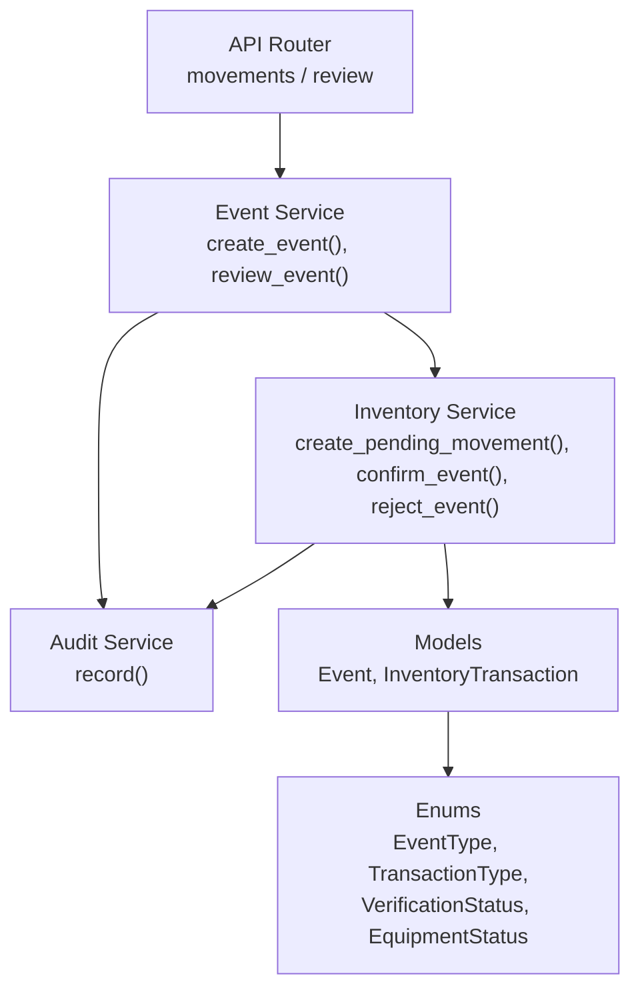
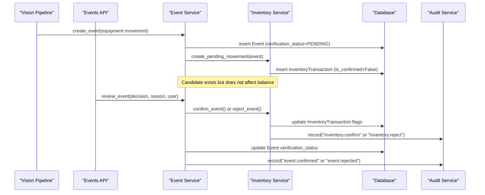
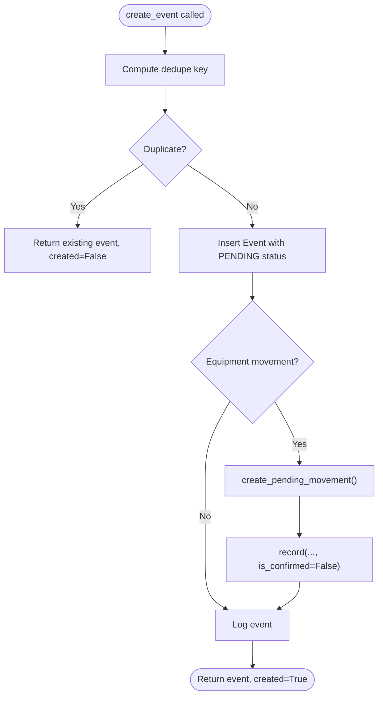
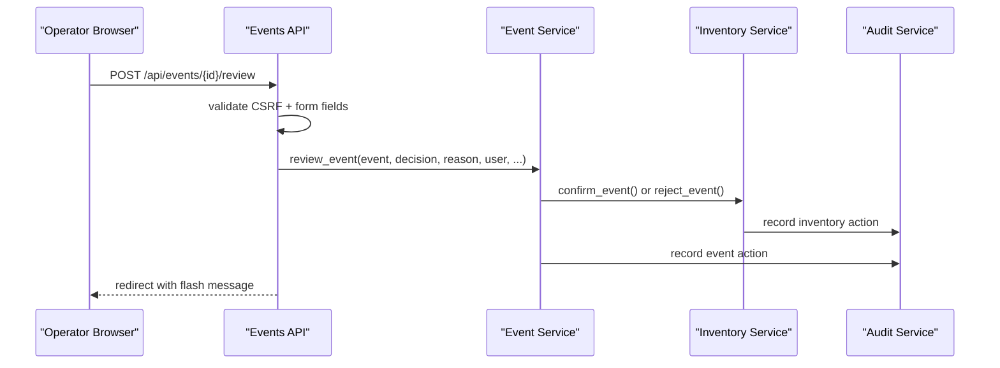
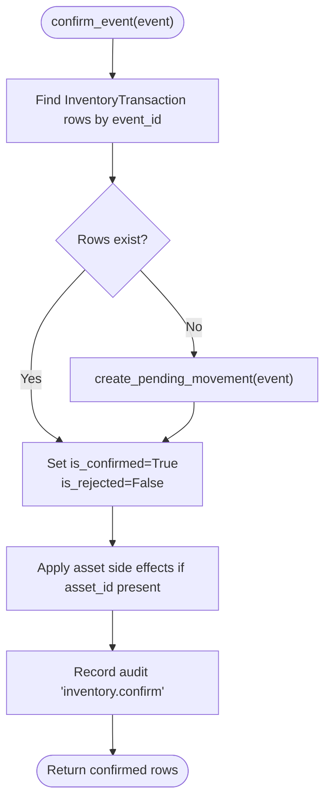
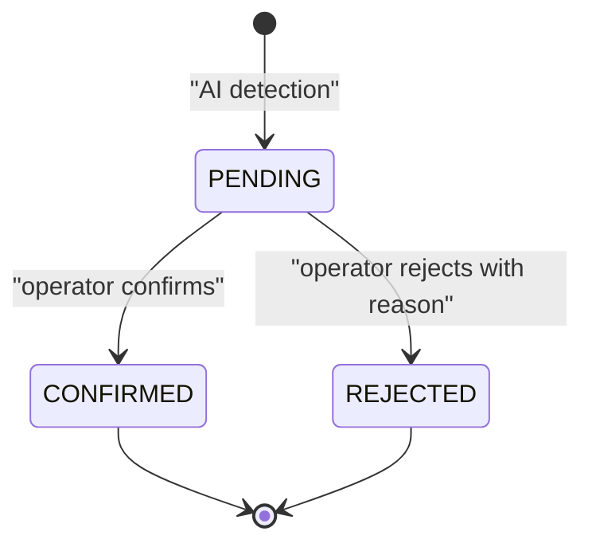
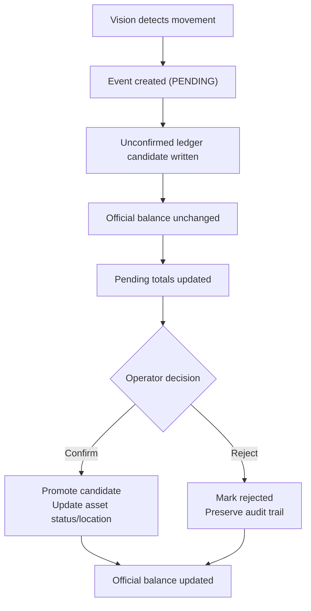
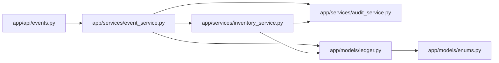

# Pending Verification Workflow

<cite>
**Referenced Files in This Document**
- [event_service.py](file://app/services/event_service.py)
- [inventory_service.py](file://app/services/inventory_service.py)
- [ledger.py](file://app/models/ledger.py)
- [enums.py](file://app/models/enums.py)
- [events.py](file://app/api/events.py)
- [audit_service.py](file://app/services/audit_service.py)
- [test_events.py](file://tests/test_events.py)
- [test_inventory.py](file://tests/test_inventory.py)
</cite>

## Table of Contents
1. [Introduction](#introduction)
2. [Project Structure](#project-structure)
3. [Core Components](#core-components)
4. [Architecture Overview](#architecture-overview)
5. [Detailed Component Analysis](#detailed-component-analysis)
6. [Dependency Analysis](#dependency-analysis)
7. [Performance Considerations](#performance-considerations)
8. [Troubleshooting Guide](#troubleshooting-guide)
9. [Conclusion](#conclusion)

## Introduction
This document explains the human-in-the-loop verification workflow for AI-detected inventory movements. The system captures vision events, writes unconfirmed ledger candidates, and requires an operator to confirm or reject them before official inventory balances change.

Key responsibilities:
- Event service creates deduplicated observation events with a pending verification status.
- Inventory service converts equipment movement events into append-only ledger candidates marked as unconfirmed.
- Operator review transitions event verification status and either confirms or rejects the associated ledger rows.
- Audit trail records every operator decision and ledger state change.

## Project Structure
The workflow spans three main layers:
- API layer exposes the review page and confirmation endpoint.
- Service layer implements event creation, review, inventory candidate creation, confirmation, rejection, and audit logging.
- Model layer defines the event, inventory transaction, and shared enums such as verification status and transaction type.

**Diagram sources**
- [events.py:40-131](file://app/api/events.py#L40-L131)
- [event_service.py:59-211](file://app/services/event_service.py#L59-L211)
- [inventory_service.py:66-205](file://app/services/inventory_service.py#L66-L205)
- [ledger.py:21-157](file://app/models/ledger.py#L21-L157)
- [enums.py:27-148](file://app/models/enums.py#L27-L148)

**Section sources**
- [events.py:40-131](file://app/api/events.py#L40-L131)
- [event_service.py:59-211](file://app/services/event_service.py#L59-L211)
- [inventory_service.py:66-205](file://app/services/inventory_service.py#L66-L205)
- [ledger.py:21-157](file://app/models/ledger.py#L21-L157)
- [enums.py:27-148](file://app/models/enums.py#L27-L148)

## Core Components
- **Event model**: Stores observation facts, including event type, camera code, confidence scores, evidence path, and verification status. It defaults to pending verification so AI detections are not trusted automatically.
- **InventoryTransaction model**: Append-only ledger row with `is_confirmed` and `is_rejected` flags. Only confirmed, non-rejected rows contribute to official category balances.
- **Event service**: Creates events, de-duplicates them using cooldown buckets, and routes equipment events to inventory candidates. It also coordinates operator review.
- **Inventory service**: Writes ledger rows, maps event types to transaction types, applies asset side effects only on confirmed entries, and maintains pending movement reporting.
- **Audit service**: Records operator actions with timestamps, user context, entity identifiers, and reasons.

**Section sources**
- [ledger.py:21-157](file://app/models/ledger.py#L21-L157)
- [event_service.py:59-211](file://app/services/event_service.py#L59-L211)
- [inventory_service.py:66-205](file://app/services/inventory_service.py#L66-L205)
- [audit_service.py:13-37](file://app/services/audit_service.py#L13-L37)

## Architecture Overview
The end-to-end flow starts when a vision pipeline emits an equipment movement event. The event is persisted as pending, a ledger candidate is created, and an operator reviews it through the UI. Confirmation promotes the candidate; rejection marks it without changing balances.

**Diagram sources**
- [event_service.py:59-147](file://app/services/event_service.py#L59-L147)
- [event_service.py:150-211](file://app/services/event_service.py#L150-L211)
- [inventory_service.py:132-205](file://app/services/inventory_service.py#L132-L205)
- [audit_service.py:13-37](file://app/services/audit_service.py#L13-L37)

## Detailed Component Analysis

### Event Creation and Pending Ledger Candidate
When `create_event()` receives an equipment movement event:
- It computes a dedupe key based on event type, camera, timestamp bucket, and track identifiers.
- It inserts the event with `verification_status=PENDING`.
- For equipment events, it calls `inventory_service.create_pending_movement()`, which writes an `InventoryTransaction` with `is_confirmed=False`.
- Unconfirmed candidates do not move the official category balance.

**Diagram sources**
- [event_service.py:59-147](file://app/services/event_service.py#L59-L147)
- [inventory_service.py:132-156](file://app/services/inventory_service.py#L132-L156)

**Section sources**
- [event_service.py:59-147](file://app/services/event_service.py#L59-L147)
- [inventory_service.py:132-156](file://app/services/inventory_service.py#L132-L156)
- [test_events.py:15-45](file://tests/test_events.py#L15-L45)
- [test_inventory.py:52-70](file://tests/test_inventory.py#L52-L70)

### `create_pending_movement()` Behavior
`create_pending_movement()` translates an equipment event into a ledger candidate:
- It returns `None` if the event has no equipment category.
- It maps:
  - `EQUIPMENT_BROUGHT_IN` → `RECEIVED` (+1)
  - `EQUIPMENT_TAKEN_OUT` → `REMOVED` (-1)
  - `EQUIPMENT_RETURNED` → `RETURNED` (+1)
- It always writes `is_confirmed=False` and sets source to `"vision"`.
- It links the transaction to the original event via `event_id`.

Important consequence: because `is_confirmed=False`, the candidate is excluded from official balances and only appears in pending movement totals.

**Section sources**
- [inventory_service.py:132-156](file://app/services/inventory_service.py#L132-L156)
- [enums.py:113-130](file://app/models/enums.py#L113-L130)
- [test_inventory.py:52-70](file://tests/test_inventory.py#L52-L70)
- [test_inventory.py:187-199](file://tests/test_inventory.py#L187-L199)

### Human Review Entry Point
The `/review` page loads pending events and categories with issues. The `/api/events/{event_id}/review` POST endpoint validates CSRF, resolves optional employee/asset/category inputs, and delegates to `event_service.review_event()`.

**Diagram sources**
- [events.py:91-131](file://app/api/events.py#L91-L131)
- [event_service.py:150-211](file://app/services/event_service.py#L150-L211)
- [audit_service.py:13-37](file://app/services/audit_service.py#L13-L37)

**Section sources**
- [events.py:72-131](file://app/api/events.py#L72-L131)
- [event_service.py:150-211](file://app/services/event_service.py#L150-L211)

### `confirm_event()` Side Effects
`confirm_event()` performs these steps:
- Finds all ledger rows linked to the event.
- If none exist, it creates a pending movement candidate first.
- Sets each row’s `is_confirmed=True` and `is_rejected=False`.
- Appends confirmation text to the row’s reason field.
- Applies asset side effects for linked assets:
  - `REMOVED` changes asset status to `IN_USE` unless already `LOST`.
  - `RECEIVED` and `RETURNED` set asset status to `IN_STOCK`.
  - Updates asset location when available.
- Records an audit entry with the affected ledger row IDs.

**Diagram sources**
- [inventory_service.py:165-185](file://app/services/inventory_service.py#L165-L185)
- [inventory_service.py:115-127](file://app/services/inventory_service.py#L115-L127)

**Section sources**
- [inventory_service.py:165-185](file://app/services/inventory_service.py#L165-L185)
- [inventory_service.py:115-127](file://app/services/inventory_service.py#L115-L127)
- [test_inventory.py:73-92](file://tests/test_inventory.py#L73-L92)

### `reject_event()` Side Effects
`reject_event()` preserves the candidate rows for auditability while removing their pending impact:
- Marks each row `is_confirmed=False` and `is_rejected=True`.
- Appends rejection text to the row’s reason field.
- Does not apply asset side effects.
- Records an audit entry with the rejected row IDs and the provided reason.

Because rejected rows are excluded from pending movement totals, they stop influencing projected balances.

**Section sources**
- [inventory_service.py:188-205](file://app/services/inventory_service.py#L188-L205)
- [test_inventory.py:95-115](file://tests/test_inventory.py#L95-L115)

### Verification Status Transitions
The event verification lifecycle is intentionally simple:
- New AI events start as `PENDING`.
- An operator can transition to `CONFIRMED` or `REJECTED`.
- Once reviewed, the event cannot be reviewed again.
- Rejection requires a non-empty reason.
- Both decisions mark the event for re-synchronization with external systems.

**Diagram sources**
- [enums.py:76-90](file://app/models/enums.py#L76-L90)
- [event_service.py:150-211](file://app/services/event_service.py#L150-L211)
- [test_events.py:165-183](file://tests/test_events.py#L165-L183)

**Section sources**
- [enums.py:76-90](file://app/models/enums.py#L76-L90)
- [event_service.py:150-211](file://app/services/event_service.py#L150-L211)
- [test_events.py:111-122](file://tests/test_events.py#L111-L122)
- [test_events.py:165-202](file://tests/test_events.py#L165-L202)

### Integration Between Event Service and Inventory Service
The integration point is `create_event()`:
- After inserting the event, it checks whether the event type belongs to equipment movement.
- If yes, it calls `inventory_service.create_pending_movement()`.
- On confirmation, `event_service.review_event()` calls `inventory_service.confirm_event()`.
- On rejection, it calls `inventory_service.reject_event()`.

This design keeps event persistence separate from inventory accounting while ensuring that every equipment movement has a corresponding ledger candidate.

**Section sources**
- [event_service.py:127-147](file://app/services/event_service.py#L127-L147)
- [event_service.py:178-187](file://app/services/event_service.py#L178-L187)
- [inventory_service.py:132-156](file://app/services/inventory_service.py#L132-L156)

### Operator Workflow Patterns
Typical operator patterns include:
- Opening the review page to see pending events and categories with discrepancies.
- Confirming valid movements to update official balances and asset status/location.
- Rejecting false positives with a required reason.
- Using evidence access endpoints to inspect captured images when needed.

The API enforces operator role requirements and CSRF validation for review submissions.

**Section sources**
- [events.py:72-88](file://app/api/events.py#L72-L88)
- [events.py:91-131](file://app/api/events.py#L91-L131)
- [events.py:134-146](file://app/api/events.py#L134-L146)

### Pending Movement Lifecycle Example
A concrete lifecycle from detection to resolution:
1. Vision detects an equipment movement and calls `create_event()`.
2. Event is stored with `verification_status=PENDING`.
3. `create_pending_movement()` writes an unconfirmed ledger row.
4. Official balance remains unchanged; pending totals increase.
5. Operator opens `/review`, inspects evidence, and chooses CONFIRMED or REJECTED.
6. Confirmation updates ledger rows, applies asset side effects, and adjusts official balance.
7. Rejection marks rows rejected, preserves audit trail, and removes pending impact.

**Diagram sources**
- [event_service.py:59-147](file://app/services/event_service.py#L59-L147)
- [inventory_service.py:132-156](file://app/services/inventory_service.py#L132-L156)
- [inventory_service.py:165-205](file://app/services/inventory_service.py#L165-L205)

**Section sources**
- [test_events.py:125-147](file://tests/test_events.py#L125-L147)
- [test_inventory.py:73-115](file://tests/test_inventory.py#L73-L115)

## Dependency Analysis
The following diagram shows how services and models depend on each other during the verification workflow.

**Diagram sources**
- [events.py:1-193](file://app/api/events.py#L1-L193)
- [event_service.py:1-329](file://app/services/event_service.py#L1-L329)
- [inventory_service.py:1-347](file://app/services/inventory_service.py#L1-L347)
- [ledger.py:1-173](file://app/models/ledger.py#L1-L173)
- [enums.py:1-183](file://app/models/enums.py#L1-L183)

**Section sources**
- [events.py:1-193](file://app/api/events.py#L1-L193)
- [event_service.py:1-329](file://app/services/event_service.py#L1-L329)
- [inventory_service.py:1-347](file://app/services/inventory_service.py#L1-L347)
- [ledger.py:1-173](file://app/models/ledger.py#L1-L173)
- [enums.py:1-183](file://app/models/enums.py#L1-L183)

## Performance Considerations
- De-duplication prevents duplicate events and duplicate ledger candidates within cooldown buckets, reducing unnecessary database writes and operator workload.
- Ledger queries filter out rejected rows and rely on indexes on `is_confirmed`, `is_rejected`, `category_code`, and `created_at`.
- Asset side effects run only for confirmed transactions with an asset reference, avoiding unnecessary updates.
- Pending movement totals use aggregated queries rather than loading full transaction histories.

[No sources needed since this section provides general guidance]

## Troubleshooting Guide
Common issues and their indicators:
- Duplicate event ignored: check cooldown bucket parameters and track identifiers.
- No ledger candidate created: verify the event has an equipment category and a supported equipment event type.
- Balance not updating after confirmation: ensure the transaction is confirmed and not rejected, and that the event was reviewed exactly once.
- Rejection fails: provide a non-empty reason string.
- Evidence not accessible: check evidence path permissions and file existence.

Operational checks:
- Use pending review counts and dashboard stats to identify backlog.
- Inspect audit logs for operator actions and reasons.
- Compare expected balance with registered assets to detect discrepancies.

**Section sources**
- [test_events.py:15-45](file://tests/test_events.py#L15-L45)
- [test_events.py:150-202](file://tests/test_events.py#L150-L202)
- [test_inventory.py:38-70](file://tests/test_inventory.py#L38-L70)
- [test_inventory.py:95-115](file://tests/test_inventory.py#L95-L115)
- [events.py:134-146](file://app/api/events.py#L134-L146)

## Conclusion
The pending verification workflow separates AI-generated observations from authoritative inventory data. Vision events become unconfirmed ledger candidates, preserving auditability while preventing automatic balance changes. Operators resolve uncertainty through confirmation or rejection, with clear side effects on asset status, location tracking, and official balances. The design emphasizes safety, traceability, and a straightforward human-in-the-loop process.

[No sources needed since this section summarizes without analyzing specific files]