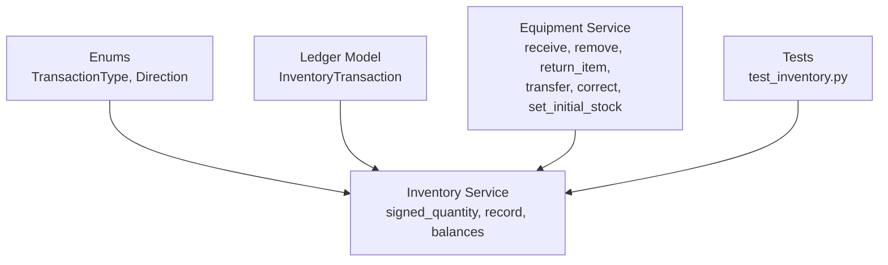
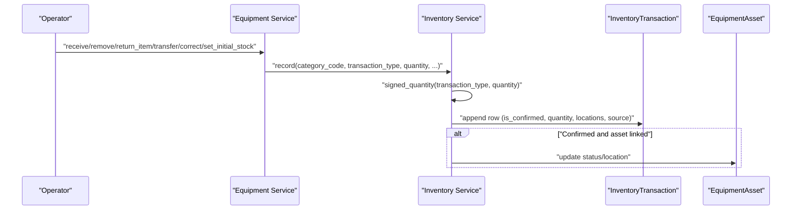
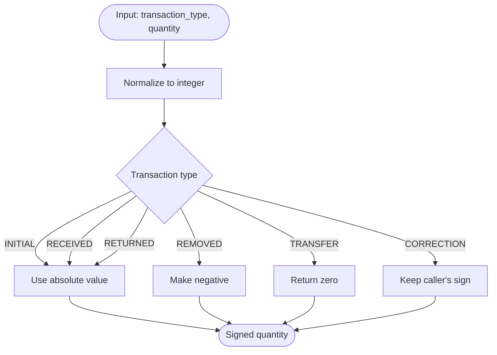
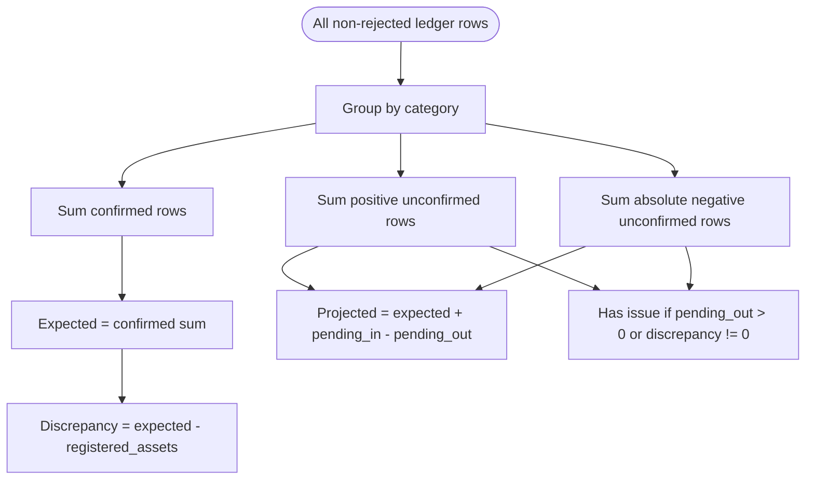
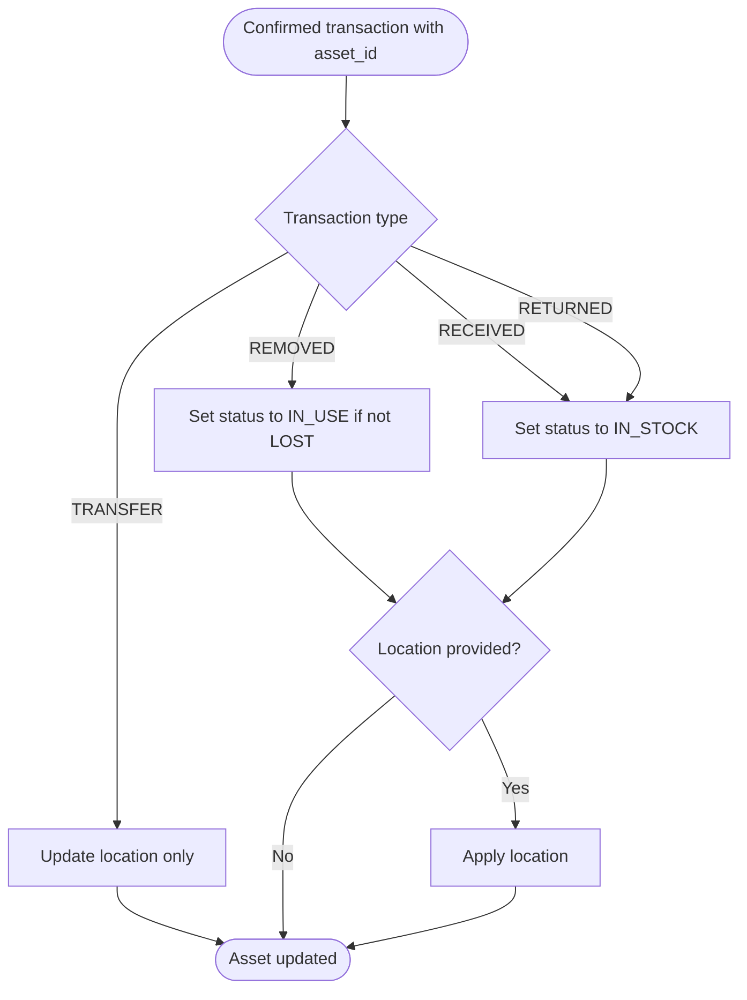
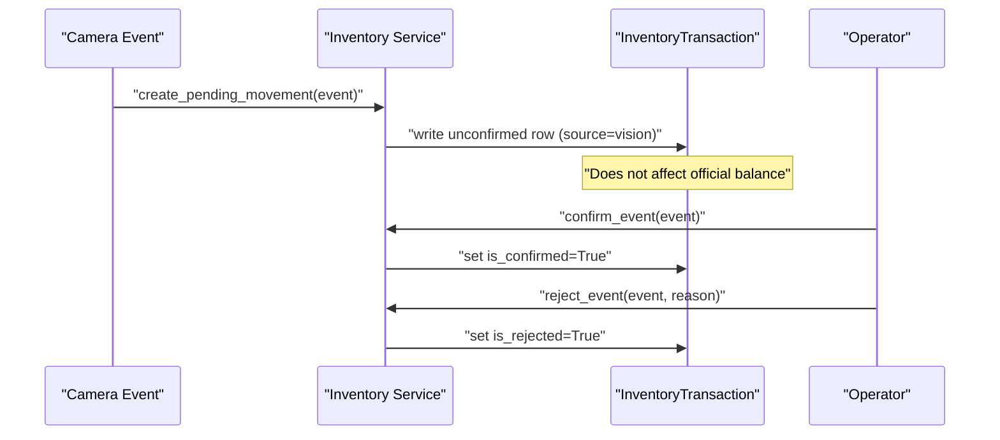
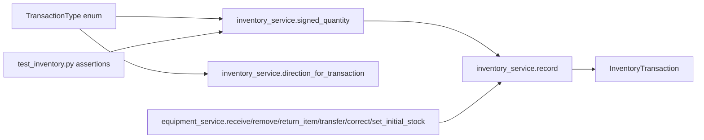

# Transaction Types & Semantics

<cite>
**Referenced Files in This Document**
- [enums.py](file://app/models/enums.py)
- [ledger.py](file://app/models/ledger.py)
- [inventory_service.py](file://app/services/inventory_service.py)
- [equipment_service.py](file://app/services/equipment_service.py)
- [test_inventory.py](file://tests/test_inventory.py)
</cite>

## Table of Contents
1. [Introduction](#introduction)
2. [Project Structure](#project-structure)
3. [Core Components](#core-components)
4. [Architecture Overview](#architecture-overview)
5. [Detailed Component Analysis](#detailed-component-analysis)
6. [Dependency Analysis](#dependency-analysis)
7. [Performance Considerations](#performance-considerations)
8. [Troubleshooting Guide](#troubleshooting-guide)
9. [Conclusion](#conclusion)

## Introduction
This document explains the inventory transaction types and their semantic meaning in the system. It covers how each type affects category balances, how signed quantities are calculated, what validation rules apply, which direction mapping is used, and how transactions interact with asset records. The goal is to make it clear whether a transaction increases, decreases, or leaves unchanged the inventory count for a category, and when it also changes an asset’s location or status.

## Project Structure
The inventory logic lives primarily in the inventory service, with shared enums and the ledger model. Manual operations such as receiving, removing, returning, transferring, correcting, and setting initial stock are exposed through the equipment service, which delegates to the inventory service. Tests validate the expected behavior of signed quantities, pending candidates, confirm/reject flows, transfers, corrections, and balance calculations.

**Diagram sources**
- [enums.py:113-130](file://app/models/enums.py#L113-L130)
- [ledger.py:114-157](file://app/models/ledger.py#L114-L157)
- [inventory_service.py:32-63](file://app/services/inventory_service.py#L32-L63)
- [equipment_service.py:181-318](file://app/services/equipment_service.py#L181-L318)
- [test_inventory.py:13-21](file://tests/test_inventory.py#L13-L21)

**Section sources**
- [enums.py:113-130](file://app/models/enums.py#L113-L130)
- [ledger.py:114-157](file://app/models/ledger.py#L114-L157)
- [inventory_service.py:1-13](file://app/services/inventory_service.py#L1-L13)
- [equipment_service.py:181-318](file://app/services/equipment_service.py#L181-L318)
- [test_inventory.py:1-21](file://tests/test_inventory.py#L1-L21)

## Core Components
- Transaction types are defined as string enums and include INITIAL, RECEIVED, REMOVED, RETURNED, TRANSFER, and CORRECTION.
- The ledger stores append-only rows with fields such as category_code, transaction_type, quantity, location_from, location_to, is_confirmed, is_rejected, source, reason, and timestamps.
- The inventory service normalizes input quantities into signed deltas, writes ledger rows, applies asset side effects, computes category balances, and maps transaction types to IN/OUT/NONE directions.
- The equipment service provides user-facing helpers that call the inventory service with appropriate defaults and validations.

Key responsibilities:
- `TransactionType`: declares all supported transaction types and labels.
- `InventoryTransaction`: persistent ledger row; never edited or deleted.
- `signed_quantity`: converts a raw quantity into a signed delta based on transaction type.
- `record`: creates a ledger row and optionally updates asset status/location.
- `balances` / `balance_for`: compute confirmed totals, pending movements, projected counts, registered assets, and discrepancies.
- `direction_for_transaction`: maps a transaction type to Direction.IN, Direction.OUT, or Direction.NONE.

**Section sources**
- [enums.py:113-130](file://app/models/enums.py#L113-L130)
- [ledger.py:114-157](file://app/models/ledger.py#L114-L157)
- [inventory_service.py:32-63](file://app/services/inventory_service.py#L32-L63)
- [inventory_service.py:66-127](file://app/services/inventory_service.py#L66-L127)
- [inventory_service.py:215-280](file://app/services/inventory_service.py#L215-L280)
- [inventory_service.py:333-342](file://app/services/inventory_service.py#L333-L342)
- [equipment_service.py:181-318](file://app/services/equipment_service.py#L181-L318)

## Architecture Overview
The inventory flow has two main paths:

1. Manual path:
   - An operator calls equipment service methods like receive, remove, return_item, transfer, correct, or set_initial_stock.
   - These methods call inventory_service.record with a specific transaction type and validated inputs.
   - The inventory service computes signed_quantity, writes an InventoryTransaction, and may update the related asset’s status and location.

2. Vision candidate path:
   - A camera event produces an unconfirmed inventory movement candidate.
   - The candidate is stored with is_confirmed=False so it does not affect the official balance until an operator confirms it.
   - Confirming promotes the candidate to a confirmed ledger row; rejecting marks it rejected but keeps it for audit.

**Diagram sources**
- [equipment_service.py:181-318](file://app/services/equipment_service.py#L181-L318)
- [inventory_service.py:53-127](file://app/services/inventory_service.py#L53-L127)
- [ledger.py:114-157](file://app/models/ledger.py#L114-L157)

## Detailed Component Analysis

### Transaction Type Reference

| Transaction Type | Semantic Meaning | Positive vs Negative Quantity Impact | Signed Quantity Calculation | Category Balance Effect | Direction Mapping | Validation Rules & Business Constraints | Practical Example |
|---|---|---|---|---|---|---|---|
| INITIAL | Starting balance for a category. Used to establish the baseline before any received or removed items. | Always positive. | Absolute value of the provided quantity. | Adds to the confirmed total. Also tracked separately as the initial amount. | IN | Must be non-negative after normalization. Typically used once per category to set the opening count. | Initial stock 10 monitors. After this row, the category baseline is 10. |
| RECEIVED | Items entering inventory from outside. | Always positive. | Absolute value of the provided quantity. | Increases the confirmed total. | IN | Confirmed by default in manual flow. Can be linked to an asset to mark it IN_STOCK and set its location. | Receive 2 keyboards. Expected balance increases by 2. |
| REMOVED | Items leaving inventory. | Always negative. | Absolute value made negative. | Decreases the confirmed total. | OUT | Confirmed by default in manual flow. Can be linked to an asset to mark it IN_USE and optionally set its location. | Remove 1 laptop. Expected balance decreases by 1. |
| RETURNED | Items coming back into inventory. | Always positive. | Absolute value of the provided quantity. | Increases the confirmed total. | IN | Confirmed by default in manual flow. Can be linked to an asset to mark it IN_STOCK and set its location. | Return 1 mouse. Expected balance increases by 1. |
| TRANSFER | Internal movement between locations within the same category. | Zero impact on category count. | Always zero, regardless of input quantity. | No change to the confirmed total. | NONE | Requires a destination location. Updates asset location if an asset is linked. Does not change asset status unless combined with other business rules elsewhere. | Transfer monitor from warehouse to room 201. Count stays the same; location becomes room 201. |
| CORRECTION | Manual adjustment to fix past errors or reconcile differences. | Caller decides sign. Positive adds, negative subtracts. | Exact integer passed by the caller. | Adds or subtracts from the confirmed total depending on the sign. | NONE | Requires a reason. Never edits an existing row; it appends a new correction row. | Correct printer count down by 1. Expected balance decreases by 1. |

**Section sources**
- [enums.py:113-130](file://app/models/enums.py#L113-L130)
- [inventory_service.py:32-63](file://app/services/inventory_service.py#L32-L63)
- [inventory_service.py:333-342](file://app/services/inventory_service.py#L333-L342)
- [equipment_service.py:181-318](file://app/services/equipment_service.py#L181-L318)
- [test_inventory.py:13-21](file://tests/test_inventory.py#L13-L21)

### Signed Quantity Logic
The signed quantity function normalizes the raw quantity into a signed delta applied to the category balance:

- For INITIAL, RECEIVED, and RETURNED, the result is always positive.
- For REMOVED, the result is always negative.
- For TRANSFER, the result is always zero because internal moves do not change the category count.
- For CORRECTION, the original sign is preserved so operators can add or subtract as needed.

**Diagram sources**
- [inventory_service.py:53-63](file://app/services/inventory_service.py#L53-L63)

**Section sources**
- [inventory_service.py:53-63](file://app/services/inventory_service.py#L53-L63)
- [test_inventory.py:13-21](file://tests/test_inventory.py#L13-L21)

### Category Balances and Pending Movements
Category balances are computed from confirmed ledger rows only. Rejected rows are excluded. Pending rows are those that are not confirmed and not rejected.

- Confirmed total (`expected`) sums all confirmed, non-rejected rows.
- Pending incoming (`pending_in`) sums positive quantities from unconfirmed, non-rejected rows.
- Pending outgoing (`pending_out`) sums the absolute values of negative quantities from unconfirmed, non-rejected rows.
- Projected balance equals expected plus pending incoming minus pending outgoing.
- Discrepancy compares the expected balance with the number of registered assets for the category.

**Diagram sources**
- [inventory_service.py:215-280](file://app/services/inventory_service.py#L215-L280)

**Section sources**
- [inventory_service.py:215-280](file://app/services/inventory_service.py#L215-L280)
- [test_inventory.py:24-49](file://tests/test_inventory.py#L24-L49)
- [test_inventory.py:154-164](file://tests/test_inventory.py#L154-L164)
- [test_inventory.py:167-176](file://tests/test_inventory.py#L167-L176)

### Asset Side Effects
When a confirmed transaction is linked to an asset, the inventory service updates the asset:

- REMOVED sets the asset status to IN_USE unless it is already LOST.
- RECEIVED and RETURNED set the asset status to IN_STOCK.
- If a location is present, the asset’s location is updated.
- TRANSFER updates the asset location without changing the category count.

**Diagram sources**
- [inventory_service.py:115-127](file://app/services/inventory_service.py#L115-L127)
- [equipment_service.py:253-276](file://app/services/equipment_service.py#L253-L276)

**Section sources**
- [inventory_service.py:115-127](file://app/services/inventory_service.py#L115-L127)
- [test_inventory.py:128-151](file://tests/test_inventory.py#L128-L151)

### Direction Mapping
Each transaction type maps to a directional label used across the system:

- INITIAL → IN
- RECEIVED → IN
- REMOVED → OUT
- RETURNED → IN
- TRANSFER → NONE
- CORRECTION → NONE

If the transaction type is unknown, the mapping returns NONE.

**Section sources**
- [inventory_service.py:333-342](file://app/services/inventory_service.py#L333-L342)
- [enums.py:92-103](file://app/models/enums.py#L92-L103)

### Manual Operation Contracts

#### INITIAL
- Purpose: Establish the starting balance for a category.
- Input: category_code, quantity, optional reason and user.
- Behavior: Normalizes quantity to a positive value and writes a confirmed INITIAL row.
- Validation: Quantity is converted to an absolute integer.
- Example: Setting initial stock to 10 means the category baseline becomes 10.

**Section sources**
- [equipment_service.py:301-318](file://app/services/equipment_service.py#L301-L318)
- [inventory_service.py:53-63](file://app/services/inventory_service.py#L53-L63)

#### RECEIVED
- Purpose: Record items entering inventory.
- Input: category_code, quantity, optional asset_id, location, reason, user.
- Behavior: Writes a confirmed RECEIVED row with a positive signed quantity.
- Validation: None beyond standard integer conversion.
- Example: Receiving 2 keyboards increases the expected balance by 2.

**Section sources**
- [equipment_service.py:181-202](file://app/services/equipment_service.py#L181-L202)
- [inventory_service.py:53-63](file://app/services/inventory_service.py#L53-L63)

#### REMOVED
- Purpose: Record items leaving inventory.
- Input: category_code, quantity, optional asset_id, location, reason, user.
- Behavior: Writes a confirmed REMOVED row with a negative signed quantity.
- Validation: None beyond standard integer conversion.
- Example: Removing 1 laptop decreases the expected balance by 1.

**Section sources**
- [equipment_service.py:205-226](file://app/services/equipment_service.py#L205-L226)
- [inventory_service.py:53-63](file://app/services/inventory_service.py#L53-L63)

#### RETURNED
- Purpose: Record items returned to inventory.
- Input: category_code, quantity, optional asset_id, location, reason, user.
- Behavior: Writes a confirmed RETURNED row with a positive signed quantity.
- Validation: None beyond standard integer conversion.
- Example: Returning 1 mouse increases the expected balance by 1.

**Section sources**
- [equipment_service.py:229-250](file://app/services/equipment_service.py#L229-L250)
- [inventory_service.py:53-63](file://app/services/inventory_service.py#L53-L63)

#### TRANSFER
- Purpose: Move items internally between locations without changing the category count.
- Input: category_code, location_from, location_to, optional asset_id, user.
- Behavior: Writes a confirmed TRANSFER row with quantity zero.
- Validation: Requires a destination location; otherwise raises a validation error.
- Example: Transferring a monitor from warehouse to room 201 updates the asset location but leaves the category balance unchanged.

**Section sources**
- [equipment_service.py:253-276](file://app/services/equipment_service.py#L253-L276)
- [inventory_service.py:53-63](file://app/services/inventory_service.py#L53-L63)
- [test_inventory.py:128-151](file://tests/test_inventory.py#L128-L151)

#### CORRECTION
- Purpose: Manually adjust the ledger to fix errors or reconcile differences.
- Input: category_code, delta (signed), reason, optional user.
- Behavior: Writes a confirmed CORRECTION row using the exact sign of delta.
- Validation: Requires a non-empty reason; otherwise raises a validation error.
- Example: Applying a correction of -1 reduces the expected balance by 1.

**Section sources**
- [equipment_service.py:279-298](file://app/services/equipment_service.py#L279-L298)
- [inventory_service.py:53-63](file://app/services/inventory_service.py#L53-L63)
- [test_inventory.py:118-125](file://tests/test_inventory.py#L118-L125)

### Vision Candidate Flow
Vision events create unconfirmed inventory movement candidates:

- EQUIPMENT_BROUGHT_IN maps to RECEIVED with quantity +1.
- EQUIPMENT_TAKEN_OUT maps to REMOVED with quantity -1.
- EQUIPMENT_RETURNED maps to RETURNED with quantity +1.
- Candidates are stored with is_confirmed=False and source="vision".
- Confirming promotes the candidate to confirmed and applies asset side effects.
- Rejecting marks the candidate rejected but keeps it for audit.

**Diagram sources**
- [inventory_service.py:132-156](file://app/services/inventory_service.py#L132-L156)
- [inventory_service.py:165-205](file://app/services/inventory_service.py#L165-L205)
- [test_inventory.py:52-115](file://tests/test_inventory.py#L52-L115)

**Section sources**
- [inventory_service.py:132-156](file://app/services/inventory_service.py#L132-L156)
- [inventory_service.py:165-205](file://app/services/inventory_service.py#L165-L205)
- [test_inventory.py:52-115](file://tests/test_inventory.py#L52-L115)

## Dependency Analysis
The following diagram shows how transaction types flow from enums through services into the ledger and tests.

**Diagram sources**
- [enums.py:113-130](file://app/models/enums.py#L113-L130)
- [inventory_service.py:53-63](file://app/services/inventory_service.py#L53-L63)
- [inventory_service.py:66-127](file://app/services/inventory_service.py#L66-L127)
- [equipment_service.py:181-318](file://app/services/equipment_service.py#L181-L318)
- [test_inventory.py:13-21](file://tests/test_inventory.py#L13-L21)

**Section sources**
- [enums.py:113-130](file://app/models/enums.py#L113-L130)
- [inventory_service.py:53-63](file://app/services/inventory_service.py#L53-L63)
- [equipment_service.py:181-318](file://app/services/equipment_service.py#L181-L318)
- [test_inventory.py:13-21](file://tests/test_inventory.py#L13-L21)

## Performance Considerations
- The ledger is append-only, so balances are recomputed from confirmed rows rather than mutating previous rows. This preserves auditability but means balance queries aggregate historical data.
- Pending movements are separated from confirmed totals, allowing the system to show projected balances while keeping official counts stable until confirmation.
- Using indexes on category_code, is_confirmed, and is_rejected helps balance queries filter efficiently.

[No sources needed since this section provides general guidance]

## Troubleshooting Guide
Common issues and how to diagnose them:

- Unexpected balance change after a transfer:
  - Verify the transaction type is TRANSFER. TRANSFER should have a signed quantity of zero and should not change the category balance.
  - Check that the destination location was provided; missing destination locations are rejected by the transfer helper.

- Vision candidate affecting the balance unexpectedly:
  - Ensure the candidate remains unconfirmed. Only confirmed rows contribute to the official balance.
  - Use confirm_event to promote the candidate or reject_event to exclude it from pending totals.

- Correction not adjusting the balance as expected:
  - Confirm the sign of the correction delta. Positive adds, negative subtracts.
  - Ensure a reason was provided; corrections require a reason.

- Discrepancy mismatch:
  - Compare expected balance with registered assets for the category.
  - Remember that retired assets are excluded from the registered asset count.

**Section sources**
- [equipment_service.py:253-276](file://app/services/equipment_service.py#L253-L276)
- [equipment_service.py:279-298](file://app/services/equipment_service.py#L279-L298)
- [inventory_service.py:132-205](file://app/services/inventory_service.py#L132-L205)
- [inventory_service.py:215-280](file://app/services/inventory_service.py#L215-L280)
- [test_inventory.py:118-176](file://tests/test_inventory.py#L118-L176)

## Conclusion
The inventory system uses six transaction types with clear semantics:

- INITIAL establishes the starting balance.
- RECEIVED and RETURNED increase the category balance.
- REMOVED decreases the category balance.
- TRANSFER moves items between locations without changing the category balance.
- CORRECTION allows manual adjustments with a caller-controlled sign.

Signed quantities are normalized consistently, pending candidates remain separate from official balances until confirmed, and direction mapping provides a consistent IN/OUT/NONE view across the application. Together, these rules ensure transparent, auditable, and predictable inventory accounting.

[No sources needed since this section summarizes without analyzing specific files]