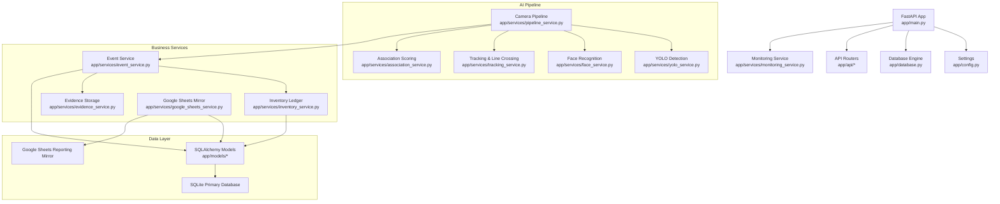
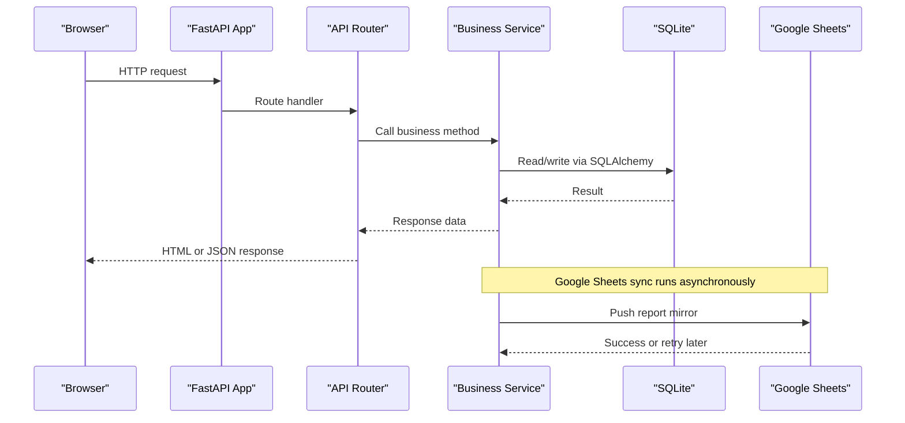
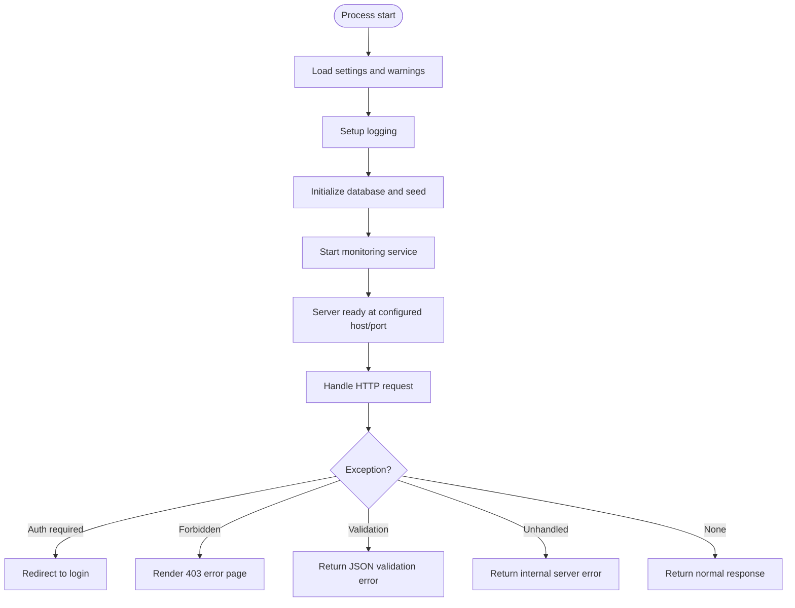
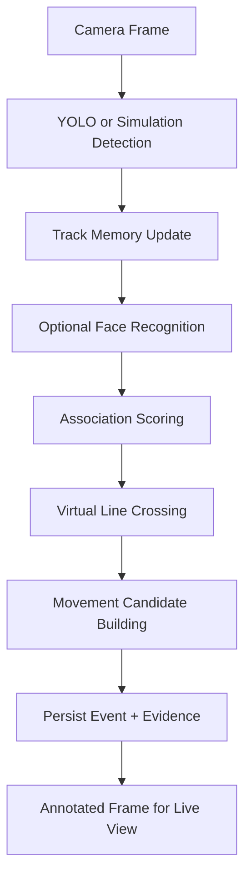
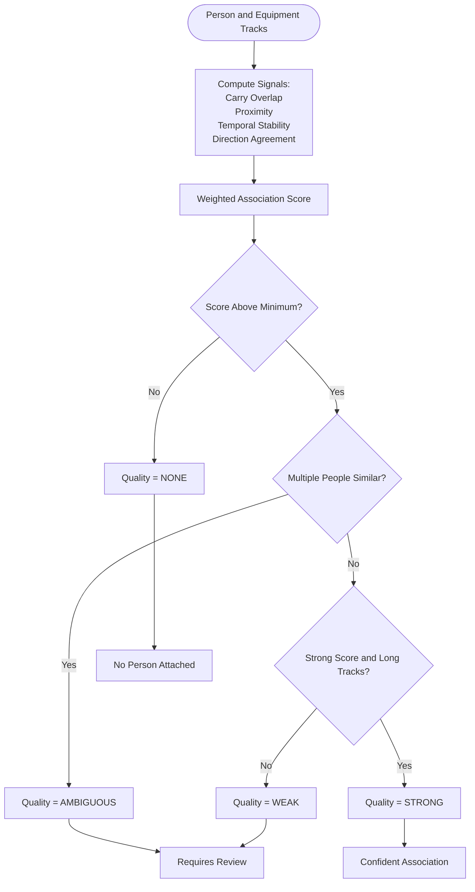
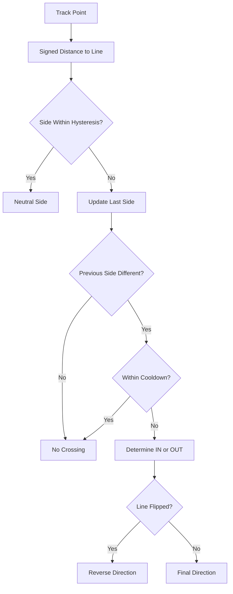
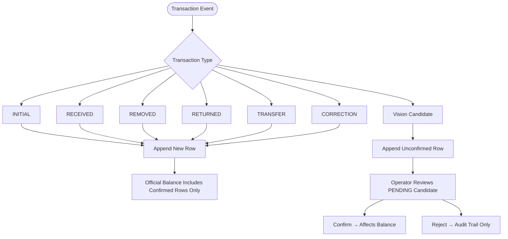
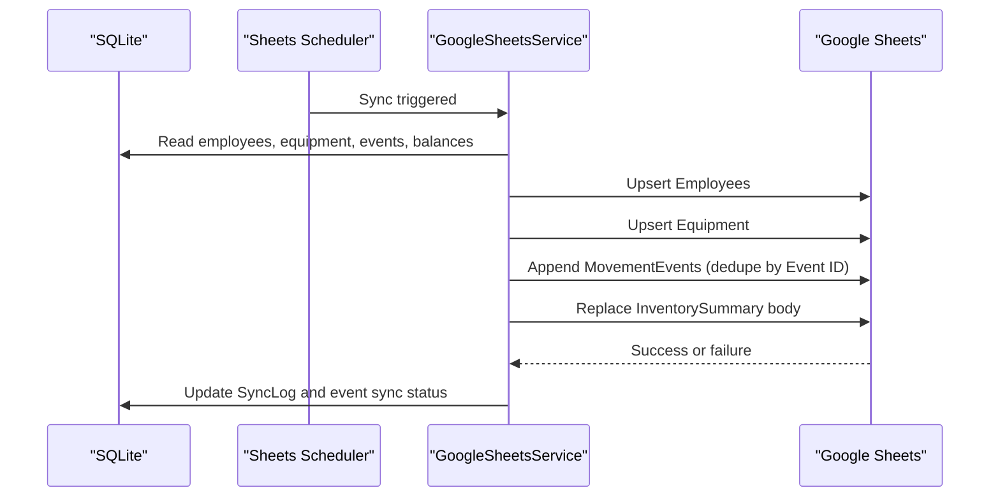
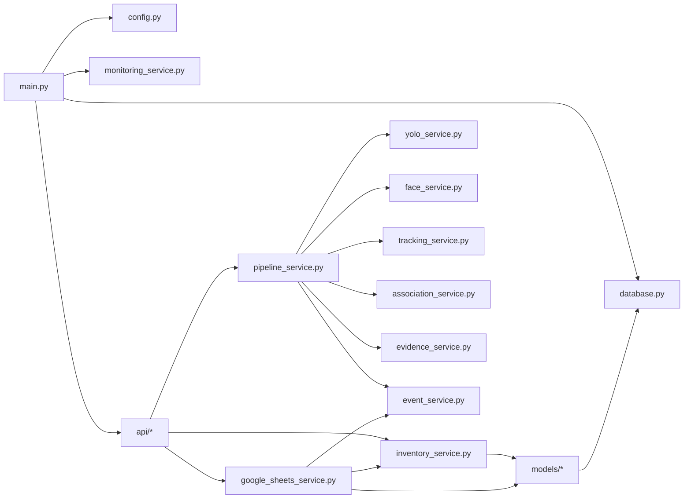

# Project Overview

<cite>
**Referenced Files in This Document**   
- [README.md](file://README.md)
- [main.py](file://app/main.py)
- [config.py](file://app/config.py)
- [database.py](file://app/database.py)
- [pipeline_service.py](file://app/services/pipeline_service.py)
- [association_service.py](file://app/services/association_service.py)
- [tracking_service.py](file://app/services/tracking_service.py)
- [inventory_service.py](file://app/services/inventory_service.py)
- [google_sheets_service.py](file://app/services/google_sheets_service.py)
- [ledger.py](file://app/models/ledger.py)
</cite>

## Table of Contents
1. [Introduction](#introduction)
2. [Project Structure](#project-structure)
3. [Core Components](#core-components)
4. [Architecture Overview](#architecture-overview)
5. [Detailed Component Analysis](#detailed-component-analysis)
6. [Dependency Analysis](#dependency-analysis)
7. [Performance Considerations](#performance-considerations)
8. [Troubleshooting Guide](#troubleshooting-guide)
9. [Conclusion](#conclusion)
10. [Appendices](#appendices)

## Introduction
This project is a local, on-premise AI CCTV and inventory management system. It captures video from IP or USB cameras, identifies employees by face, detects equipment with YOLO, tracks movement across a virtual line, and records who carried what into an append-only inventory journal. The system is designed so that automation proposes events while a human operator confirms uncertain cases before they affect inventory balances.

At its core, the system follows four principles:

- **Local data storage:** SQLite is the primary database; evidence images, logs, models, and employee templates stay on the same machine. Google Sheets is only a reporting mirror.
- **Human-in-the-loop verification:** Uncertain detections are marked `PENDING`. They do not change inventory until an operator confirms them.
- **Append-only journaling:** Inventory movements are never edited or deleted. Corrections are new rows, and rejected candidates remain in the audit trail without affecting balances.
- **Primary database vs mirror:** All authoritative state lives in SQLite. Google Sheets is updated asynchronously and can fail without losing data.

For beginners, this means the system watches camera footage, guesses what it sees, and asks a person to confirm anything it is unsure about. For experienced developers, it is a FastAPI application with a service-oriented architecture, per-camera processing threads, computer vision services, and a transactional ledger.

**Section sources**
- [README.md:1-15](file://README.md#L1-L15)
- [README.md:286-313](file://README.md#L286-L313)
- [README.md:368-414](file://README.md#L368-L414)

## Project Structure
The repository is organized around a FastAPI application, domain services, SQLAlchemy models, UI templates, scripts, and tests.

**Diagram sources**
- [main.py:44-68](file://app/main.py#L44-L68)
- [config.py:62-118](file://app/config.py#L62-L118)
- [database.py:41-72](file://app/database.py#L41-L72)
- [pipeline_service.py:103-149](file://app/services/pipeline_service.py#L103-L149)
- [association_service.py:106-119](file://app/services/association_service.py#L106-L119)
- [tracking_service.py:210-274](file://app/services/tracking_service.py#L210-L274)
- [inventory_service.py:132-156](file://app/services/inventory_service.py#L132-L156)
- [google_sheets_service.py:82-133](file://app/services/google_sheets_service.py#L82-L133)

**Section sources**
- [README.md:597-621](file://README.md#L597-L621)
- [main.py:44-68](file://app/main.py#L44-L68)

## Core Components
The system is built around several cooperating components:

| Component | Responsibility | Key Behavior |
|---|---|---|
| FastAPI application | HTTP entry point, middleware, routers, health endpoint | Starts logging, initializes the database, starts monitoring, mounts static files, registers API pages and endpoints. |
| Settings | Centralized configuration | Reads `.env`, validates defaults, creates required directories, and exposes warnings for missing models or secrets. |
| Database layer | Engine, session factory, schema bootstrap | Uses portable SQLAlchemy types, enables SQLite WAL mode, foreign keys, and provides a test reset helper. |
| Camera pipeline | Per-camera frame processing | Runs detection, tracking, face recognition, association scoring, virtual line crossing, event creation, and evidence saving. |
| Association engine | Links people to equipment | Combines carry overlap, proximity, temporal stability, and direction into an association score with quality levels. |
| Tracking service | Object tracking and geometry | Maintains track memory, velocity, crossings, and implements hysteresis-based virtual line crossing. |
| Inventory service | Append-only ledger | Records manual and vision transactions, computes expected/pending/projected balances, and supports confirmation/rejection. |
| Google Sheets service | Reporting mirror | Syncs employees, equipment, movement events, and inventory summaries with retry and idempotency. |
| Models | Persistent schema | Defines events, inventory transactions, sync logs, and relationships between employees, assets, and users. |

**Section sources**
- [main.py:25-41](file://app/main.py#L25-L41)
- [config.py:159-222](file://app/config.py#L159-L222)
- [database.py:41-72](file://app/database.py#L41-L72)
- [pipeline_service.py:390-426](file://app/services/pipeline_service.py#L390-L426)
- [association_service.py:106-119](file://app/services/association_service.py#L106-L119)
- [tracking_service.py:125-177](file://app/services/tracking_service.py#L125-L177)
- [inventory_service.py:132-156](file://app/services/inventory_service.py#L132-L156)
- [google_sheets_service.py:82-133](file://app/services/google_sheets_service.py#L82-L133)
- [ledger.py:21-71](file://app/models/ledger.py#L21-L71)

## Architecture Overview
The runtime architecture separates concerns cleanly:

- **Presentation layer:** HTML templates and static assets served through FastAPI.
- **API layer:** Page routers and JSON endpoints for authentication, cameras, employees, equipment, events, reports, and settings.
- **Service layer:** Business logic for camera capture, AI inference, tracking, association, events, evidence, inventory, and Google Sheets synchronization.
- **Data layer:** SQLAlchemy models backed by SQLite, with optional external sync to Google Sheets.

**Diagram sources**
- [main.py:44-68](file://app/main.py#L44-L68)
- [database.py:103-110](file://app/database.py#L103-L110)
- [google_sheets_service.py:362-395](file://app/services/google_sheets_service.py#L362-L395)

## Detailed Component Analysis

### FastAPI Application and Lifecycle
The application entry point creates the FastAPI instance, configures session middleware, mounts static files, includes routers, defines exception handlers, and exposes a `/healthz` endpoint. During startup, it sets up logging, loads settings, initializes the database, and starts the monitoring service.

Key responsibilities:
- Session cookie configuration with secret key and production HTTPS behavior.
- Centralized error handling for authentication, forbidden access, HTTP exceptions, validation errors, and unhandled exceptions.
- Health check returning monitor status and running camera count.

**Diagram sources**
- [main.py:25-41](file://app/main.py#L25-L41)
- [main.py:55-68](file://app/main.py#L55-L68)
- [main.py:70-123](file://app/main.py#L70-L123)

**Section sources**
- [main.py:25-41](file://app/main.py#L25-L41)
- [main.py:44-68](file://app/main.py#L44-L68)
- [main.py:70-123](file://app/main.py#L70-L123)

### Configuration System
Configuration is loaded from environment variables and optionally a `.env` file. The `Settings` dataclass holds immutable values for server behavior, AI model paths, face recognition thresholds, camera parameters, evidence retention, Google Sheets integration, and logging. It also provides directory creation and configuration warnings.

Important behaviors:
- Defaults are safe but configurable.
- Secret keys and bootstrap passwords are validated.
- Missing YOLO models and Google Sheets credentials produce warnings instead of hard failures.
- Paths resolve relative to the project root when needed.

**Section sources**
- [config.py:18-59](file://app/config.py#L18-L59)
- [config.py:62-118](file://app/config.py#L62-L118)
- [config.py:140-156](file://app/config.py#L140-L156)
- [config.py:159-222](file://app/config.py#L159-L222)

### Database Layer
The database module builds a SQLAlchemy engine, configures SQLite-specific pragmas, manages process-wide engine and session factory state, and provides a transactional session scope. On initialization, it imports models to register mappers, creates tables, and seeds reference data.

Design highlights:
- Portable SQLAlchemy types allow migration to PostgreSQL by changing `DATABASE_URL`.
- SQLite uses WAL mode, foreign keys, synchronous safety, and busy timeout.
- Test helpers drop and recreate the schema in an isolated database URL.

**Section sources**
- [database.py:41-72](file://app/database.py#L41-L72)
- [database.py:89-110](file://app/database.py#L89-L110)
- [database.py:112-128](file://app/database.py#L112-L128)
- [database.py:131-141](file://app/database.py#L131-L141)

### AI Pipeline: Detection, Tracking, Identity, and Movement
The camera pipeline is the central AI workflow. Each camera has a worker thread that drains frames, runs analysis, publishes annotated frames for live viewing, and persists events.

Processing steps:
1. Detect objects using YOLO or simulation ground truth.
2. Assign temporary track IDs if not already present.
3. Update track memory with bounding boxes, velocity, and frame counts.
4. Optionally recognize faces for tracked persons.
5. Associate persons with equipment using weighted signals.
6. Detect virtual line crossings for people and equipment.
7. Build movement candidates linking equipment to the person crossing the line.
8. Persist person events and equipment movement events as `PENDING`.

**Diagram sources**
- [pipeline_service.py:103-149](file://app/services/pipeline_service.py#L103-L149)
- [pipeline_service.py:218-321](file://app/services/pipeline_service.py#L218-L321)
- [pipeline_service.py:461-487](file://app/services/pipeline_service.py#L461-L487)
- [pipeline_service.py:489-586](file://app/services/pipeline_service.py#L489-L586)

**Section sources**
- [pipeline_service.py:1-14](file://app/services/pipeline_service.py#L1-L14)
- [pipeline_service.py:103-149](file://app/services/pipeline_service.py#L103-L149)
- [pipeline_service.py:218-321](file://app/services/pipeline_service.py#L218-L321)
- [pipeline_service.py:390-426](file://app/services/pipeline_service.py#L390-L426)
- [pipeline_service.py:461-487](file://app/services/pipeline_service.py#L461-L487)
- [pipeline_service.py:489-586](file://app/services/pipeline_service.py#L489-L586)

### Association Scoring: Who Carried What
The association engine avoids relying on proximity alone. It scores each person-object pair using:

- Carry overlap: object center inside expanded person box.
- Proximity: distance relative to person size.
- Temporal overlap: both tracks stable for multiple frames.
- Direction agreement: similar movement vectors.

The final score combines these signals with fixed weights and assigns a quality level:

| Quality | Meaning |
|---|---|
| `STRONG` | High confidence and sufficiently long tracks. |
| `WEAK` | Lower confidence or short tracks. |
| `AMBIGUOUS` | Multiple people explain the object similarly. |
| `NONE` | No confident association found. |

Uncertain results set `requires_review`, ensuring operators see ambiguous or weak matches.

**Diagram sources**
- [association_service.py:1-15](file://app/services/association_service.py#L1-L15)
- [association_service.py:112-129](file://app/services/association_service.py#L112-L129)
- [association_service.py:131-198](file://app/services/association_service.py#L131-L198)

**Section sources**
- [association_service.py:1-15](file://app/services/association_service.py#L1-L15)
- [association_service.py:106-119](file://app/services/association_service.py#L106-L119)
- [association_service.py:112-129](file://app/services/association_service.py#L112-L129)
- [association_service.py:131-198](file://app/services/association_service.py#L131-L198)

### Tracking and Virtual Line Crossing
Tracking maintains temporary track identities per camera. These IDs support proximity and temporal reasoning but are not permanent employee or asset identities. The system also implements a virtual line crossing detector with hysteresis and cooldown to reduce false crossings near the entrance or exit.

Key concepts:
- **Temporary track IDs:** Short-lived identifiers used only for tracking.
- **Track memory:** Stores bounding boxes, velocity, frame counts, face bindings, and crossings.
- **Virtual line crossing:** Uses signed distance, hysteresis margin, minimum track frames, cooldown window, and optional line flip.

**Diagram sources**
- [tracking_service.py:29-85](file://app/services/tracking_service.py#L29-L85)
- [tracking_service.py:125-177](file://app/services/tracking_service.py#L125-L177)
- [tracking_service.py:210-274](file://app/services/tracking_service.py#L210-L274)

**Section sources**
- [tracking_service.py:1-13](file://app/services/tracking_service.py#L1-L13)
- [tracking_service.py:29-85](file://app/services/tracking_service.py#L29-L85)
- [tracking_service.py:125-177](file://app/services/tracking_service.py#L125-L177)
- [tracking_service.py:210-274](file://app/services/tracking_service.py#L210-L274)

### Inventory Journal: Append-Only Ledger
The inventory system enforces an append-only journal. Every movement becomes a new row in `inventory_transactions`. Official balances include only confirmed rows. Vision candidates are written unconfirmed and do not affect balances until an operator confirms them.

Supported operations:
- `INITIAL`: Starting balance.
- `RECEIVED`: Incoming equipment.
- `REMOVED`: Outgoing equipment.
- `RETURNED`: Returned equipment.
- `TRANSFER`: Internal move without changing quantity.
- `CORRECTION`: Manual correction with a reason.
- Vision candidate: Automatically created as `PENDING`.

Balance metrics:
- **Expected:** Sum of confirmed transactions.
- **Pending incoming/outgoing:** Unconfirmed candidates.
- **Projected:** Expected plus pending incoming minus pending outgoing.
- **Registered assets:** Count of physical assets in the system.
- **Discrepancy:** Difference between expected and registered assets.

**Diagram sources**
- [inventory_service.py:1-13](file://app/services/inventory_service.py#L1-L13)
- [inventory_service.py:66-112](file://app/services/inventory_service.py#L66-L112)
- [inventory_service.py:132-156](file://app/services/inventory_service.py#L132-L156)
- [inventory_service.py:165-205](file://app/services/inventory_service.py#L165-L205)
- [inventory_service.py:215-273](file://app/services/inventory_service.py#L215-L273)
- [ledger.py:114-157](file://app/models/ledger.py#L114-L157)

**Section sources**
- [inventory_service.py:1-13](file://app/services/inventory_service.py#L1-L13)
- [inventory_service.py:66-112](file://app/services/inventory_service.py#L66-L112)
- [inventory_service.py:132-156](file://app/services/inventory_service.py#L132-L156)
- [inventory_service.py:165-205](file://app/services/inventory_service.py#L165-L205)
- [inventory_service.py:215-273](file://app/services/inventory_service.py#L215-L273)
- [ledger.py:114-157](file://app/models/ledger.py#L114-L157)

### Google Sheets Mirror: Reporting, Not Primary Storage
Google Sheets is explicitly a reporting mirror. Data is first committed to SQLite, then copied to Sheets in a background thread. If Sheets is unavailable, events remain pending and are retried with exponential backoff. Deduplication uses the event ID so one event is never appended twice.

Sync sheets:
- Employees
- Equipment
- MovementEvents
- InventorySummary

**Diagram sources**
- [google_sheets_service.py:1-12](file://app/services/google_sheets_service.py#L1-L12)
- [google_sheets_service.py:82-133](file://app/services/google_sheets_service.py#L82-L133)
- [google_sheets_service.py:234-296](file://app/services/google_sheets_service.py#L234-L296)
- [google_sheets_service.py:340-359](file://app/services/google_sheets_service.py#L340-L359)
- [google_sheets_service.py:362-395](file://app/services/google_sheets_service.py#L362-L395)

**Section sources**
- [google_sheets_service.py:1-12](file://app/services/google_sheets_service.py#L1-L12)
- [google_sheets_service.py:82-133](file://app/services/google_sheets_service.py#L82-L133)
- [google_sheets_service.py:234-296](file://app/services/google_sheets_service.py#L234-L296)
- [google_sheets_service.py:340-359](file://app/services/google_sheets_service.py#L340-L359)
- [google_sheets_service.py:362-395](file://app/services/google_sheets_service.py#L362-L395)

## Dependency Analysis
The codebase follows a service-oriented design with clear boundaries:

- **Entry points** depend on configuration, database, and monitoring.
- **API routers** depend on services and shared dependencies like templates and security.
- **Pipeline service** depends on YOLO, face recognition, tracking, association, evidence, and event services.
- **Inventory service** depends on models and audit service.
- **Google Sheets service** depends on models, event service, inventory service, and external gspread client.
- **Models** depend on the database base and enums.

**Diagram sources**
- [main.py:15-20](file://app/main.py#L15-L20)
- [pipeline_service.py:35-41](file://app/services/pipeline_service.py#L35-L41)
- [inventory_service.py:22-28](file://app/services/inventory_service.py#L22-L28)
- [google_sheets_service.py:23-30](file://app/services/google_sheets_service.py#L23-L30)
- [ledger.py:11-18](file://app/models/ledger.py#L11-L18)

**Section sources**
- [main.py:15-20](file://app/main.py#L15-L20)
- [pipeline_service.py:35-41](file://app/services/pipeline_service.py#L35-L41)
- [inventory_service.py:22-28](file://app/services/inventory_service.py#L22-L28)
- [google_sheets_service.py:23-30](file://app/services/google_sheets_service.py#L23-L30)
- [ledger.py:11-18](file://app/models/ledger.py#L11-L18)

## Performance Considerations
The system is designed to run locally on CPU hardware with optional GPU acceleration for AI inference. Important performance knobs include:

- `PROCESSING_FPS`: Controls how many frames per second are analyzed.
- `YOLO_IMAGE_SIZE`: Smaller image size reduces inference time.
- `FACE_RECOGNITION_INTERVAL`: Reduces face recognition frequency to save CPU.
- `YOLO_DEVICE`: Can be set to `cpu` or CUDA device.
- `SIMULATION_MODE`: Enables synthetic camera input for testing without real cameras.
- `EVIDENCE_ENABLED` and `EVIDENCE_RETENTION_DAYS`: Control disk usage from saved JPEGs.

Recommended practices:
- Use lower FPS and smaller image sizes when CPU-bound.
- Enable GPU only if `onnxruntime-gpu` and CUDA are installed.
- Keep evidence retention reasonable to avoid disk growth.
- Avoid running multiple servers against the same SQLite database.

[No sources needed since this section provides general guidance]

## Troubleshooting Guide
Common operational issues and their causes:

| Symptom | Cause | Resolution |
|---|---|---|
| YOLO model warning | Custom model path missing | Use fallback model or train and place custom model. |
| Face recognition unavailable | InsightFace or ONNX Runtime not installed | Install AI requirements and refresh gallery. |
| Camera offline | RTSP URL, credentials, network, or codec issue | Test camera source and adjust stream settings. |
| Port already in use | Another process bound to the port | Change port or stop conflicting process. |
| Database locked | Multiple servers writing to same SQLite | Run one server; keep CLI scripts short. |
| Google Sheets failed | Missing credentials or spreadsheet permissions | Verify service account and spreadsheet sharing. |
| Login fails in production | HTTPS-only session cookie | Use HTTPS or development mode. |
| Low FPS or high CPU | CPU inference load | Reduce FPS, image size, or enable GPU. |

**Section sources**
- [README.md:516-530](file://README.md#L516-L530)

## Conclusion
This project provides a practical, local AI CCTV and inventory system that balances automation with human oversight. It uses computer vision to detect people and equipment, tracks movement across a virtual line, and records decisions in an append-only journal. Operators review uncertain events before they affect inventory, and Google Sheets serves only as a reporting mirror. The FastAPI architecture, service-oriented design, and SQLite-first data model make it suitable for on-premise deployment where reliability, auditability, and local control matter more than cloud dependency.

[No sources needed since this section summarizes without analyzing specific files]

## Appendices

### Practical Examples

#### Camera Setup
- Add a camera through the admin interface.
- Choose source type: RTSP, USB, file, or simulation.
- Set the virtual line coordinates in pixels based on the processing frame size.
- Use the camera test script to capture frames and verify line placement.

**Section sources**
- [README.md:202-242](file://README.md#L202-L242)
- [README.md:459-470](file://README.md#L459-L470)

#### Employee Registration
- Register employees via the web interface or CLI.
- Upload 3–5 reference photos per employee.
- Refresh the face gallery after uploading.
- Tune similarity threshold and match margin if too many unknowns or false matches occur.

**Section sources**
- [README.md:245-283](file://README.md#L245-L283)

#### Inventory Tracking
- Configure equipment categories and assets.
- Let the system create `PENDING` movement candidates from camera events.
- Review uncertain associations and confirm or reject them.
- Check expected, pending, projected, and discrepancy balances.

**Section sources**
- [README.md:286-343](file://README.md#L286-L343)
- [inventory_service.py:132-156](file://app/services/inventory_service.py#L132-L156)
- [inventory_service.py:165-205](file://app/services/inventory_service.py#L165-L205)
- [inventory_service.py:215-273](file://app/services/inventory_service.py#L215-L273)