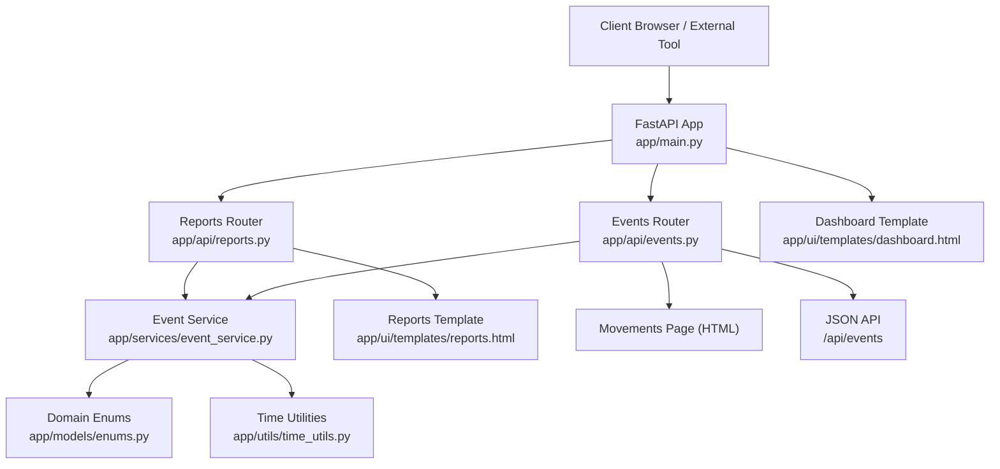
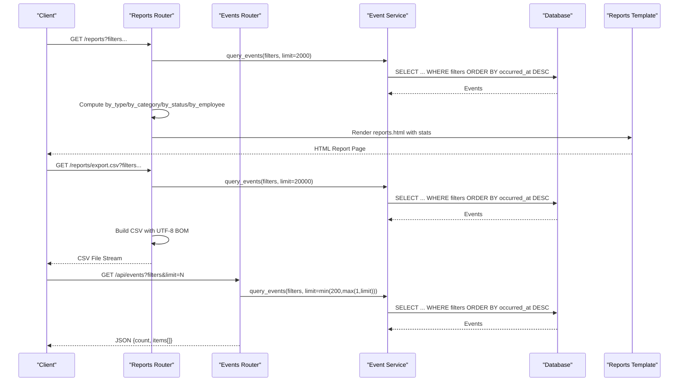
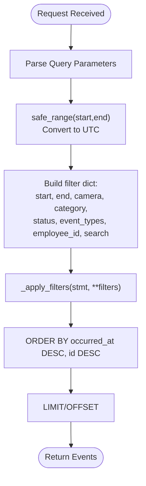
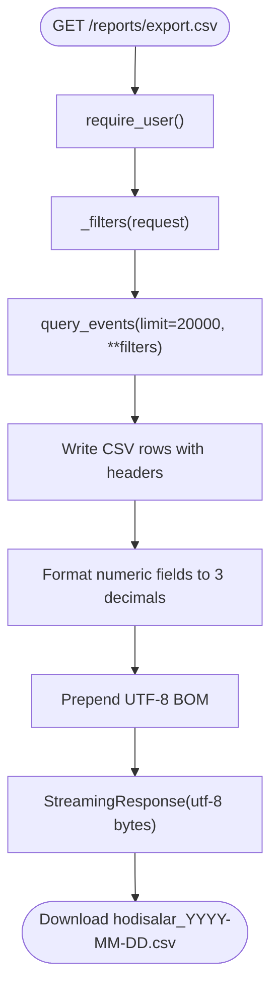
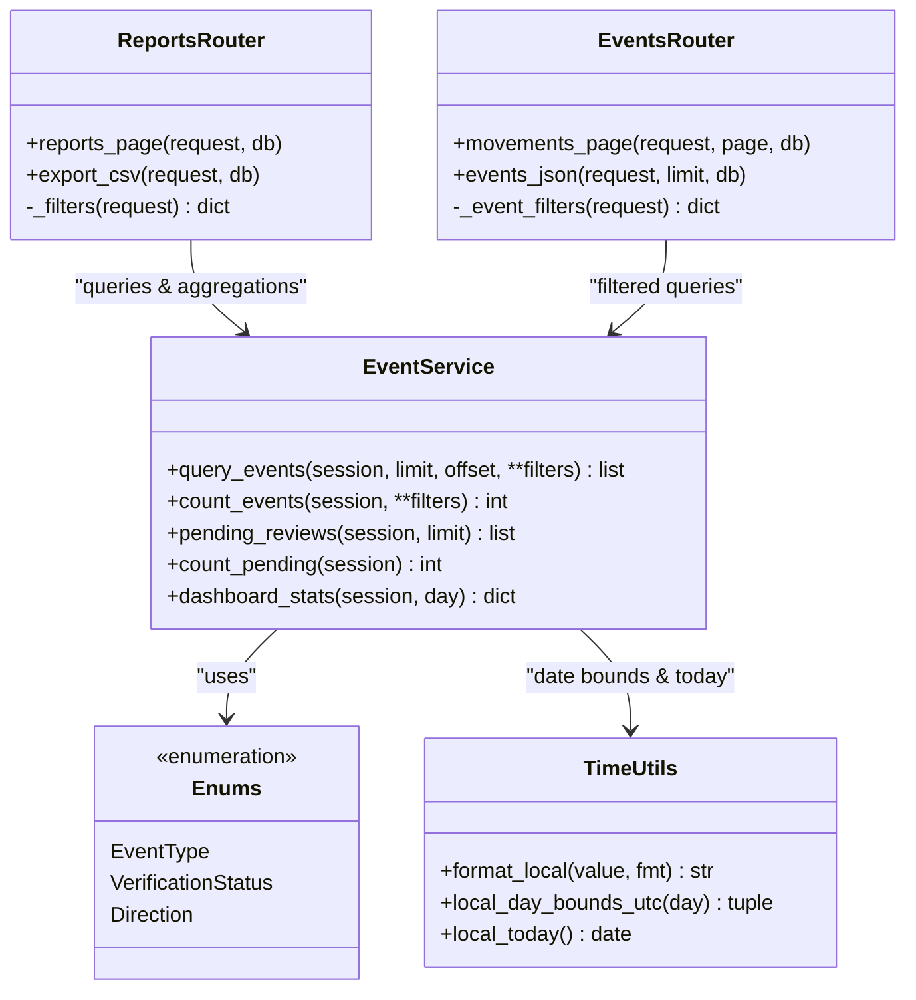
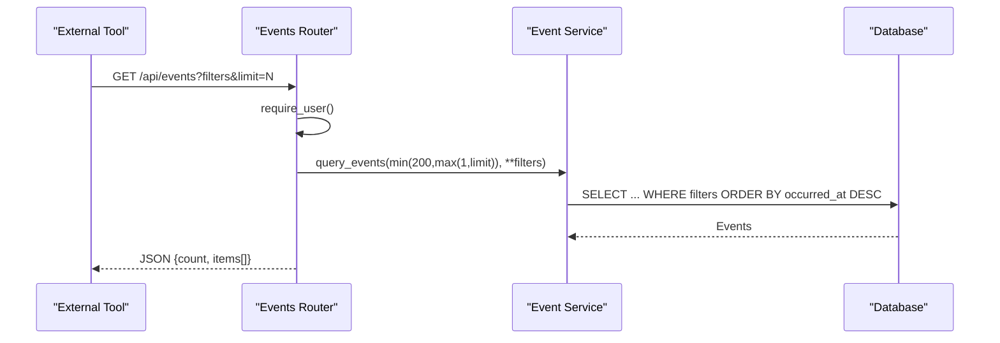
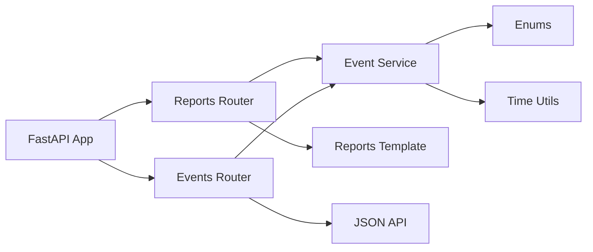

# Reporting & Analytics

<cite>
**Referenced Files in This Document**
- [main.py](file://app/main.py)
- [deps.py](file://app/api/deps.py)
- [reports.py](file://app/api/reports.py)
- [events.py](file://app/api/events.py)
- [event_service.py](file://app/services/event_service.py)
- [enums.py](file://app/models/enums.py)
- [time_utils.py](file://app/utils/time_utils.py)
- [reports.html](file://app/ui/templates/reports.html)
- [dashboard.html](file://app/ui/templates/dashboard.html)
</cite>

## Table of Contents
1. [Introduction](#introduction)
2. [Project Structure](#project-structure)
3. [Core Components](#core-components)
4. [Architecture Overview](#architecture-overview)
5. [Detailed Component Analysis](#detailed-component-analysis)
6. [Dependency Analysis](#dependency-analysis)
7. [Performance Considerations](#performance-considerations)
8. [Troubleshooting Guide](#troubleshooting-guide)
9. [Conclusion](#conclusion)
10. [Appendices](#appendices)

## Introduction
This document explains the reporting and analytics system for event monitoring, CSV export, dashboard metrics, statistical summaries, and the JSON API used by external tools. It focuses on:
- Filtered event queries supporting date ranges, camera filters, category filters, event type filters, status filters, and employee filters.
- CSV export with UTF-8 BOM encoding for Excel compatibility, including column definitions and data formatting rules.
- Dashboard metrics and summary reports by type, category, employee, and verification status.
- The read-only JSON API for programmatic access to event data, excluding biometric information.
- Examples of report generation, filter combinations, and integration patterns.
- Performance considerations and query optimization strategies for large datasets.

## Project Structure
The reporting and analytics features are implemented across FastAPI routers, a shared event service, enums, time utilities, and UI templates:
- API layer exposes HTML pages and endpoints for reports, movements, and JSON data.
- Service layer implements filtering, aggregation, and dashboard statistics.
- Enums define event types, statuses, directions, and other domain values.
- Time utilities provide UTC-first storage and local timezone conversion.
- Templates render the Reports page and Dashboard with KPIs and charts.

**Diagram sources**
- [main.py:44-68](file://app/main.py#L44-L68)
- [reports.py:43-91](file://app/api/reports.py#L43-L91)
- [events.py:147-172](file://app/api/events.py#L147-L172)
- [event_service.py:217-267](file://app/services/event_service.py#L217-L267)
- [enums.py:27-73](file://app/models/enums.py#L27-L73)
- [time_utils.py:51-69](file://app/utils/time_utils.py#L51-L69)
- [reports.html:1-74](file://app/ui/templates/reports.html#L1-L74)
- [dashboard.html:5-26](file://app/ui/templates/dashboard.html#L5-L26)

**Section sources**
- [main.py:44-68](file://app/main.py#L44-L68)
- [reports.py:43-91](file://app/api/reports.py#L43-L91)
- [events.py:147-172](file://app/api/events.py#L147-L172)
- [event_service.py:217-267](file://app/services/event_service.py#L217-L267)
- [enums.py:27-73](file://app/models/enums.py#L27-L73)
- [time_utils.py:51-69](file://app/utils/time_utils.py#L51-L69)
- [reports.html:1-74](file://app/ui/templates/reports.html#L1-L74)
- [dashboard.html:5-26](file://app/ui/templates/dashboard.html#L5-L26)

## Core Components
- Reports router: Provides the Reports HTML page and CSV export endpoint. Parses filters, queries events, computes summary counts by type/category/status/employee, and renders inventory balances and Google Sheets sync status.
- Events router: Provides movement history pagination, review workflow endpoints, evidence access, and a minimal JSON API for integrations that excludes biometric details.
- Event service: Implements filtered queries, counting, pending reviews, pending sync events, dashboard statistics, and deduplication logic.
- Enums: Define event types, verification statuses, directions, and other domain constants used throughout the system.
- Time utilities: Provide UTC-first timestamps, local timezone conversion, day bounds, and cooldown bucketing for deduplication.
- Templates: Render the Reports page with filters, summary bars, inventory table, and recent events; Dashboard shows daily KPIs and system status.

Key responsibilities:
- Filtering: Date range, camera code, category, event type, verification status, employee ID, and free-text search.
- Aggregation: Counts by type, category, status, and top employees.
- Export: CSV with UTF-8 BOM and formatted numeric fields.
- JSON API: Read-only event list without biometric data.
- Dashboard: Daily entries/exits, unknown persons, equipment movement, pending reviews, camera connectivity.

**Section sources**
- [reports.py:28-91](file://app/api/reports.py#L28-L91)
- [events.py:24-69](file://app/api/events.py#L24-L69)
- [event_service.py:217-329](file://app/services/event_service.py#L217-L329)
- [enums.py:27-103](file://app/models/enums.py#L27-L103)
- [time_utils.py:51-81](file://app/utils/time_utils.py#L51-L81)
- [reports.html:1-298](file://app/ui/templates/reports.html#L1-L298)
- [dashboard.html:5-188](file://app/ui/templates/dashboard.html#L5-L188)

## Architecture Overview
The reporting pipeline starts at the FastAPI application, which mounts routers for reports and events. The Reports router parses request parameters into structured filters, delegates to the event service for querying and aggregation, and renders the Reports template. The CSV export endpoint streams a UTF-8 BOM-encoded CSV file. The Events router provides a JSON API endpoint that returns a minimal set of event fields suitable for external analytics tools.

**Diagram sources**
- [reports.py:43-146](file://app/api/reports.py#L43-L146)
- [events.py:147-172](file://app/api/events.py#L147-L172)
- [event_service.py:253-267](file://app/services/event_service.py#L253-L267)
- [reports.html:1-74](file://app/ui/templates/reports.html#L1-L74)

## Detailed Component Analysis

### Filtered Event Queries
Filters are parsed from request query parameters and applied to SQL statements via the event service. Supported filters include:
- Date range: start/end dates converted to UTC using workplace timezone.
- Camera code: exact match on camera_code.
- Category: exact match on equipment_category.
- Event type: single value wrapped into a list.
- Status: exact match on verification_status.
- Employee ID: integer validation and match on employee_id.
- Search: free-text matching against public_id, camera_code, and notes.

**Diagram sources**
- [reports.py:28-40](file://app/api/reports.py#L28-L40)
- [events.py:24-37](file://app/api/events.py#L24-L37)
- [event_service.py:217-267](file://app/services/event_service.py#L217-L267)
- [deps.py:163-177](file://app/api/deps.py#L163-L177)
- [time_utils.py:51-69](file://app/utils/time_utils.py#L51-L69)

**Section sources**
- [reports.py:28-40](file://app/api/reports.py#L28-L40)
- [events.py:24-37](file://app/api/events.py#L24-L37)
- [event_service.py:217-267](file://app/services/event_service.py#L217-L267)
- [deps.py:163-177](file://app/api/deps.py#L163-L177)
- [time_utils.py:51-69](file://app/utils/time_utils.py#L51-L69)

### CSV Export Functionality
The CSV export endpoint streams a UTF-8 BOM-encoded CSV file for Excel compatibility. Columns include:
- Event ID
- Local time (formatted per workplace timezone)
- Event type
- Camera code
- Employee code
- Employee label
- Equipment category
- Asset code
- Direction
- Verification status
- Detection confidence (formatted to three decimals)
- Face match score (formatted to three decimals)
- Association confidence (formatted to three decimals)
- Notes (newlines replaced with spaces)

The payload is prefixed with a UTF-8 BOM character to ensure Excel displays Uzbek text correctly.

**Diagram sources**
- [reports.py:94-146](file://app/api/reports.py#L94-L146)

**Section sources**
- [reports.py:94-146](file://app/api/reports.py#L94-L146)

### Dashboard Metrics and Summary Reports
The Reports page computes summary counts over the filtered dataset:
- By type: counts grouped by event_type.
- By category: counts grouped by equipment_category.
- By status: counts grouped by verification_status.
- By employee: top 15 employees by event count.

The Dashboard page shows daily KPIs computed via the event service:
- Entries and exits (person events).
- Unknown persons detected.
- Equipment brought in/out.
- Pending reviews.
- Camera disconnect/reconnect events.

**Diagram sources**
- [reports.py:43-91](file://app/api/reports.py#L43-L91)
- [events.py:147-172](file://app/api/events.py#L147-L172)
- [event_service.py:304-329](file://app/services/event_service.py#L304-L329)
- [enums.py:27-103](file://app/models/enums.py#L27-L103)
- [time_utils.py:51-69](file://app/utils/time_utils.py#L51-L69)

**Section sources**
- [reports.py:43-91](file://app/api/reports.py#L43-L91)
- [event_service.py:304-329](file://app/services/event_service.py#L304-L329)
- [dashboard.html:5-26](file://app/ui/templates/dashboard.html#L5-L26)

### JSON API for Programmatic Access
The JSON API endpoint provides a minimal read-only view of events suitable for external analytics tools. It excludes biometric information such as face embeddings or gallery references. Returned fields include:
- event_id
- type
- occurred_at_utc (ISO format)
- camera
- employee_code
- equipment_category
- asset_code
- direction
- verification_status
- detection_confidence
- face_match_score
- association_confidence

The endpoint enforces user authentication and limits results to a maximum of 200 items per request.

**Diagram sources**
- [events.py:147-172](file://app/api/events.py#L147-L172)
- [event_service.py:253-267](file://app/services/event_service.py#L253-L267)

**Section sources**
- [events.py:147-172](file://app/api/events.py#L147-L172)

### Examples of Report Generation and Filter Combinations
- Generate a report for a specific camera and date range:
  - GET /reports?camera=CAM01&start=2024-01-01&end=2024-01-31
- Export CSV for a specific event type and verification status:
  - GET /reports/export.csv?type=EQUIPMENT_BROUGHT_IN&status=PENDING
- Filter by employee and category:
  - GET /reports?employee_id=123&category=TOOLS
- Combine multiple filters:
  - GET /reports?camera=CAM02&type=UNKNOWN_PERSON_DETECTED&status=CONFIRMED&start=2024-06-01&end=2024-06-30&employee_id=456

These examples demonstrate how filters combine to narrow down event sets for both the HTML report and CSV export.

**Section sources**
- [reports.py:28-40](file://app/api/reports.py#L28-L40)
- [events.py:24-37](file://app/api/events.py#L24-L37)

### Integration Patterns for External Analytics Tools
- Poll the JSON API periodically:
  - GET /api/events?limit=200&type=PERSON_ENTERED&status=CONFIRMED
- Use the returned ISO timestamp to paginate or track new events:
  - Compare occurred_at_utc between requests.
- Aggregate externally:
  - Count events by type, camera, and status.
  - Compute daily entries/exits and equipment movement trends.
- Avoid sensitive data:
  - Do not request or store biometric fields; the API does not expose them.

**Section sources**
- [events.py:147-172](file://app/api/events.py#L147-L172)

## Dependency Analysis
The reporting system depends on:
- FastAPI routers for HTTP endpoints.
- Event service for database queries and aggregations.
- Enums for consistent domain values.
- Time utilities for UTC-first storage and local display.
- Templates for rendering HTML reports and dashboards.

**Diagram sources**
- [main.py:44-68](file://app/main.py#L44-L68)
- [reports.py:43-91](file://app/api/reports.py#L43-L91)
- [events.py:147-172](file://app/api/events.py#L147-L172)
- [event_service.py:217-329](file://app/services/event_service.py#L217-L329)
- [enums.py:27-103](file://app/models/enums.py#L27-L103)
- [time_utils.py:51-81](file://app/utils/time_utils.py#L51-L81)

**Section sources**
- [main.py:44-68](file://app/main.py#L44-L68)
- [reports.py:43-91](file://app/api/reports.py#L43-L91)
- [events.py:147-172](file://app/api/events.py#L147-L172)
- [event_service.py:217-329](file://app/services/event_service.py#L217-L329)
- [enums.py:27-103](file://app/models/enums.py#L27-L103)
- [time_utils.py:51-81](file://app/utils/time_utils.py#L51-L81)

## Performance Considerations
- Query limits:
  - Reports page uses a limit of 2000 events for in-memory aggregation.
  - CSV export uses a higher limit of 20000 events.
  - JSON API caps results at 200 per request.
- Pagination:
  - Movements page supports pagination with configurable per-page size.
- Database indexing:
  - Ensure indexes on frequently filtered columns: occurred_at, camera_code, equipment_category, verification_status, employee_id.
- Aggregation cost:
  - In-memory Counter computations are efficient but scale with result set size; prefer narrower filters to reduce memory usage.
- Streaming CSV:
  - CSV export streams bytes to avoid loading entire payloads into memory unnecessarily.
- Timezone handling:
  - UTC-first storage avoids DST issues; local conversions occur only for display.

Recommendations:
- Use date range filters to constrain queries.
- Prefer specific camera and category filters to reduce result sets.
- For large datasets, implement server-side aggregation where possible.
- Monitor query execution times and adjust limits based on workload.

[No sources needed since this section provides general guidance]

## Troubleshooting Guide
Common issues and resolutions:
- Authentication required:
  - Ensure a valid session exists before accessing protected endpoints.
- CSRF token errors:
  - Verify CSRF tokens are present for POST requests.
- Invalid date ranges:
  - Check that start/end parameters are valid ISO dates; invalid inputs are ignored.
- Empty results:
  - Adjust filters to broaden the query scope.
- CSV encoding issues:
  - Confirm Excel opens the file with UTF-8 BOM; the system includes BOM automatically.

Operational checks:
- Health endpoint:
  - GET /healthz to verify system status and camera monitoring.
- Google Sheets sync:
  - Use the Reports page to check sync logs and pending events.

**Section sources**
- [main.py:70-114](file://app/main.py#L70-L114)
- [deps.py:87-90](file://app/api/deps.py#L87-L90)
- [deps.py:163-177](file://app/api/deps.py#L163-L177)
- [reports.py:149-177](file://app/api/reports.py#L149-L177)

## Conclusion
The reporting and analytics system provides robust filtered queries, CSV export with Excel-compatible encoding, dashboard metrics, and a secure JSON API for external integration. It emphasizes performance through query limits, streaming responses, and UTC-first time handling. Users can generate comprehensive reports and integrate with external analytics tools while avoiding exposure of sensitive biometric data.

[No sources needed since this section summarizes without analyzing specific files]

## Appendices

### Column Definitions for CSV Export
- Event ID: Public identifier for the event.
- Local time: Formatted occurrence time in workplace timezone.
- Event type: Enumerated event type string.
- Camera code: Identifier of the camera capturing the event.
- Employee code: Employee identifier if associated.
- Employee label: Display name or label for the employee.
- Equipment category: Category code for equipment-related events.
- Asset code: Asset identifier if associated.
- Direction: IN, OUT, or NONE.
- Verification status: AUTO, PENDING, CONFIRMED, or REJECTED.
- Detection confidence: Numeric confidence score formatted to three decimals.
- Face match score: Numeric match score formatted to three decimals.
- Association confidence: Numeric association confidence formatted to three decimals.
- Notes: Free-text field with newline characters replaced by spaces.

**Section sources**
- [reports.py:102-146](file://app/api/reports.py#L102-L146)

### Dashboard KPIs
- Today’s entries and exits: Sum of person entry and exit events.
- Unknown persons detected: Count of unknown person detection events.
- Equipment movement: Counts of equipment brought in and taken out.
- Pending reviews: Number of events awaiting operator review.
- Camera connectivity: Counts of camera disconnect/reconnect events.

**Section sources**
- [event_service.py:304-329](file://app/services/event_service.py#L304-L329)
- [dashboard.html:5-26](file://app/ui/templates/dashboard.html#L5-L26)