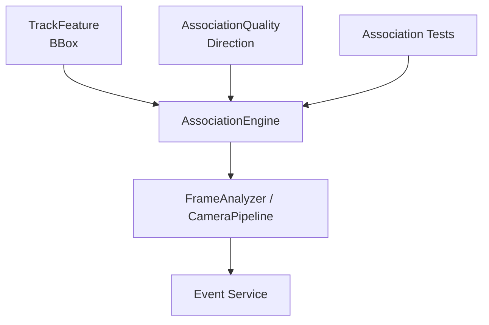
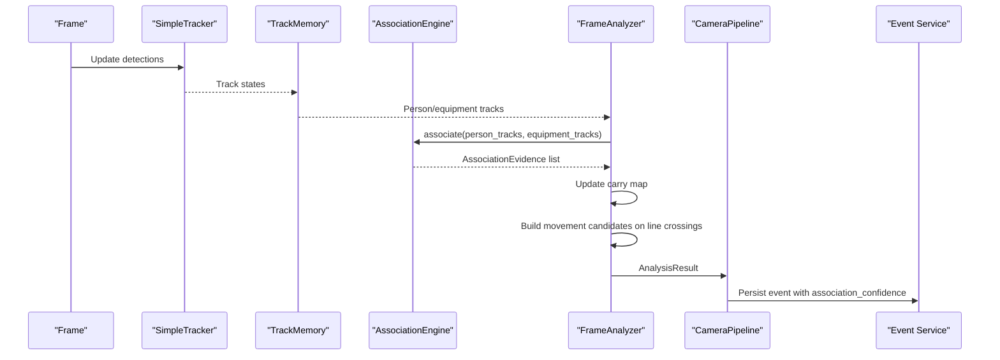
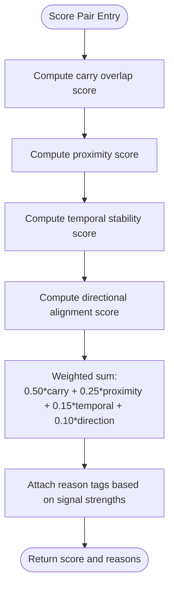
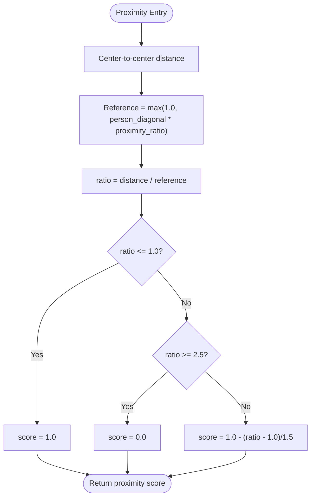
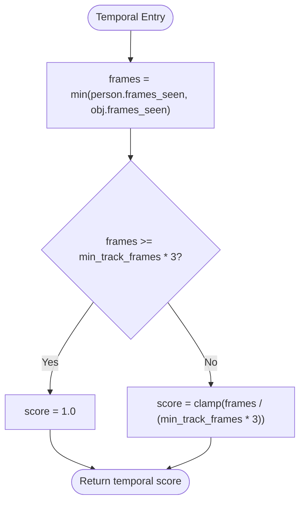
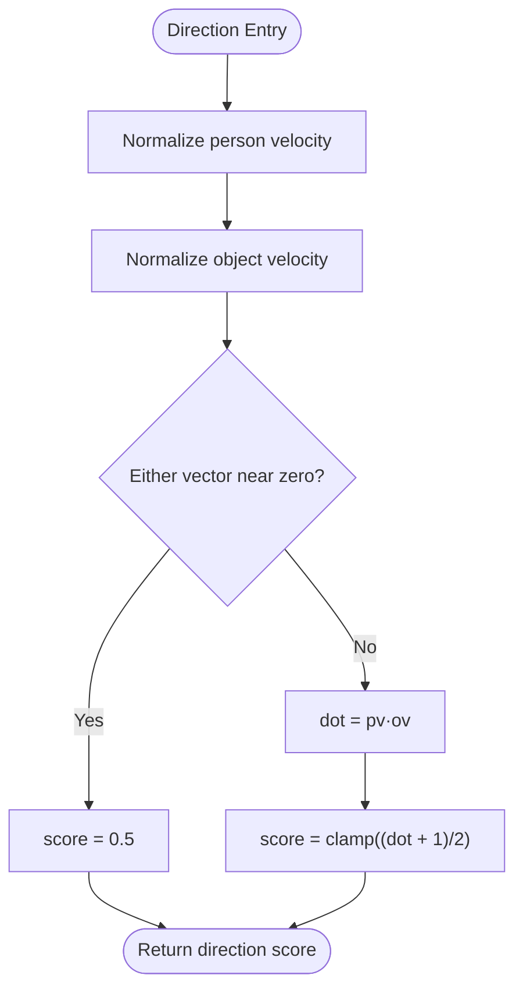
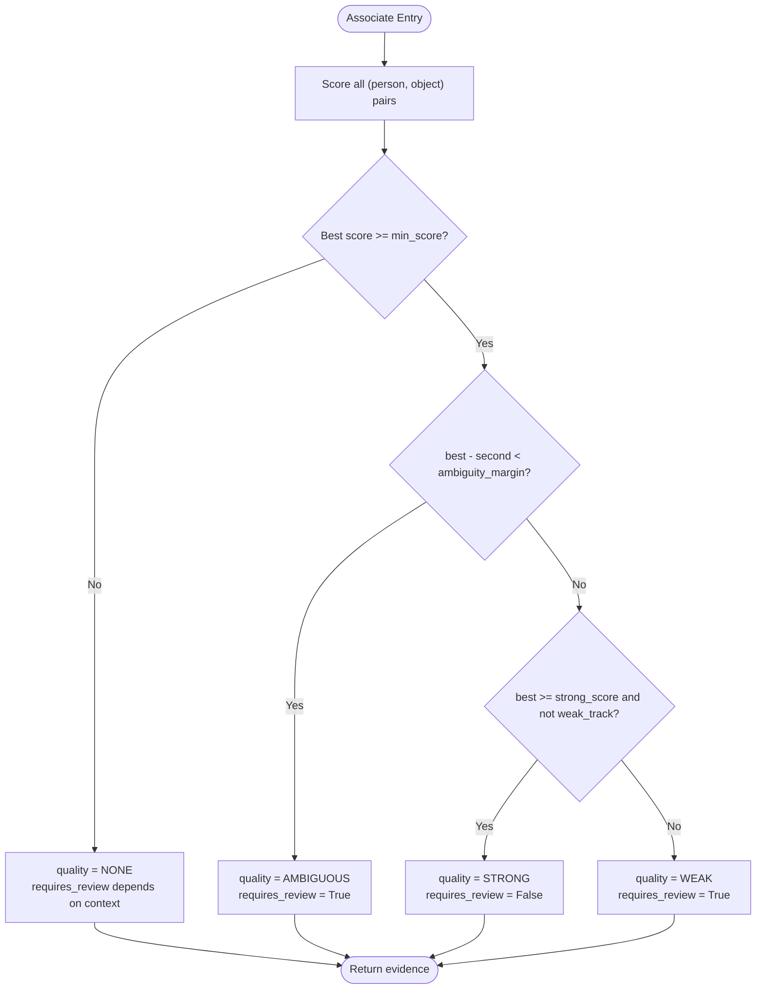
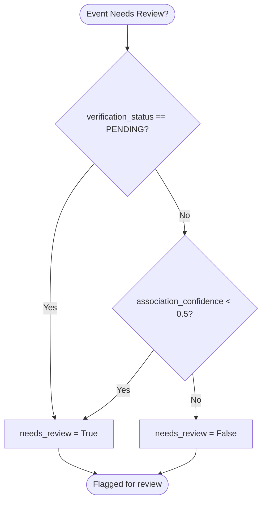
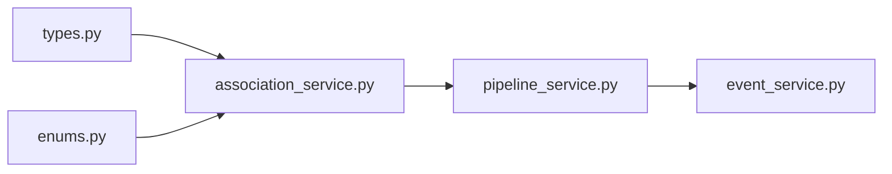

# Association Scoring System

<cite>
**Referenced Files in This Document**
- [association_service.py](file://app/services/association_service.py)
- [types.py](file://app/services/types.py)
- [enums.py](file://app/models/enums.py)
- [pipeline_service.py](file://app/services/pipeline_service.py)
- [event_service.py](file://app/services/event_service.py)
- [test_association.py](file://tests/test_association.py)
</cite>

## Table of Contents
1. [Introduction](#introduction)
2. [Project Structure](#project-structure)
3. [Core Components](#core-components)
4. [Architecture Overview](#architecture-overview)
5. [Detailed Component Analysis](#detailed-component-analysis)
6. [Dependency Analysis](#dependency-analysis)
7. [Performance Considerations](#performance-considerations)
8. [Troubleshooting Guide](#troubleshooting-guide)
9. [Conclusion](#conclusion)
10. [Appendices](#appendices)

## Introduction
This document explains the association scoring system that determines “who carried what” by correlating person and object movements. It covers:
- The walking correlation algorithm used to score candidate associations.
- Proximity analysis, temporal matching, and directional alignment components.
- The weighted scoring formula producing `association_confidence`.
- Confidence threshold logic that routes low-confidence events into review.
- Concrete association scenarios with STRONG, WEAK, AMBIGUOUS, and NONE quality levels.
- How association quality affects inventory calculations and operator workflows.
- Guidance for tuning association parameters and interpreting quality metrics.

The system intentionally avoids relying on proximity alone. Instead, it combines multiple weak signals and exposes uncertainty so human reviewers can focus on ambiguous or weak cases rather than trusting every automatic association.

## Project Structure
The association scoring system spans several modules:
- `AssociationEngine` and scoring helpers live in the association service.
- Track geometry and motion data are represented by shared types.
- Quality labels and direction enums are defined centrally.
- The camera pipeline consumes association results to build movement candidates.
- Event persistence stores `association_confidence` and drives review logic.

**Diagram sources**
- [association_service.py:29-104](file://app/services/association_service.py#L29-L104)
- [types.py:10-128](file://app/services/types.py#L10-L128)
- [enums.py:178-183](file://app/models/enums.py#L178-L183)
- [pipeline_service.py:103-149](file://app/services/pipeline_service.py#L103-L149)
- [event_service.py:59-147](file://app/services/event_service.py#L59-L147)
- [test_association.py:1-104](file://tests/test_association.py#L1-L104)

**Section sources**
- [association_service.py:1-219](file://app/services/association_service.py#L1-L219)
- [types.py:1-138](file://app/services/types.py#L1-L138)
- [enums.py:178-183](file://app/models/enums.py#L178-L183)
- [pipeline_service.py:103-387](file://app/services/pipeline_service.py#L103-L387)
- [event_service.py:59-147](file://app/services/event_service.py#L59-L147)
- [test_association.py:1-104](file://tests/test_association.py#L1-L104)

## Core Components
- **AssociationEvidence**: Represents one scored association between an object track and a best-matching person track, including confidence, quality label, review flag, and human-readable reasons.
- **AssociationConfig**: Tunable thresholds controlling minimum score, strong threshold, ambiguity margin, spatial ratios, and temporal stability requirements.
- **AssociationEngine**: Scores every (person, object) pair using four sub-scores and classifies the result as STRONG, WEAK, AMBIGUOUS, or NONE.
- **TrackFeature and BBox**: Provide bounding box geometry, velocity, frame counts, and identity metadata consumed by the engine.
- **AssociationQuality and Direction**: Enumerations used across services to represent association quality and crossing direction.

Key responsibilities:
- Compute carry overlap, proximity, temporal stability, and directional agreement.
- Combine these signals into a single weighted score.
- Decide whether the association is confident enough to be accepted automatically or should require review.

**Section sources**
- [association_service.py:29-57](file://app/services/association_service.py#L29-L57)
- [association_service.py:106-198](file://app/services/association_service.py#L106-L198)
- [types.py:10-128](file://app/services/types.py#L10-L128)
- [enums.py:178-183](file://app/models/enums.py#L178-L183)

## Architecture Overview
The association scoring system integrates into the per-camera processing pipeline. For each frame:
1. Detections are tracked and enriched with identity information.
2. Person and equipment tracks are extracted.
3. `AssociationEngine.associate` scores all (person, object) pairs.
4. Results update a short-term carry map and feed movement candidate generation when a line crossing occurs.
5. Movement candidates become events with `association_confidence`, which later influence review queues and inventory updates.

**Diagram sources**
- [pipeline_service.py:218-321](file://app/services/pipeline_service.py#L218-L321)
- [pipeline_service.py:328-387](file://app/services/pipeline_service.py#L328-L387)
- [pipeline_service.py:490-585](file://app/services/pipeline_service.py#L490-L585)
- [association_service.py:131-198](file://app/services/association_service.py#L131-L198)
- [event_service.py:59-147](file://app/services/event_service.py#L59-L147)

## Detailed Component Analysis

### Walking Correlation Algorithm
The walking correlation algorithm evaluates how likely a person is carrying an object by combining four independent signals:
- Carry overlap: Whether the object’s center falls inside an expanded person bounding box, or partial overlap indicates side-carry.
- Proximity: Distance between centers normalized by person size; closer objects receive higher scores.
- Temporal stability: Both tracks must have been observed for a minimum number of frames; longer stable tracks increase confidence.
- Directional alignment: Velocity vectors are normalized and compared; similar directions increase confidence, opposite directions reduce it.

These signals are combined using fixed weights:
- Carry overlap: 0.50
- Proximity: 0.25
- Temporal stability: 0.15
- Directional alignment: 0.10

The resulting value is rounded to three decimal places and stored as `association_confidence` in movement events.

**Diagram sources**
- [association_service.py:76-129](file://app/services/association_service.py#L76-L129)

**Section sources**
- [association_service.py:59-129](file://app/services/association_service.py#L59-L129)

### Proximity Analysis
Proximity is computed relative to the person’s bounding box diagonal:
- If the normalized distance ratio is ≤ 1.0, the proximity score is maximum.
- If the ratio ≥ 2.5, the proximity score drops to zero.
- Between those bounds, the score decreases linearly.

This normalization makes proximity robust to different person sizes and camera scales.

**Diagram sources**
- [association_service.py:88-96](file://app/services/association_service.py#L88-L96)
- [types.py:42-68](file://app/services/types.py#L42-L68)

**Section sources**
- [association_service.py:88-96](file://app/services/association_service.py#L88-L96)
- [types.py:42-68](file://app/services/types.py#L42-L68)

### Temporal Matching
Temporal matching rewards tracks that have been stable over multiple frames:
- Frames seen are taken from both person and object tracks.
- If the minimum frames exceed a threshold (three times `min_track_frames`), the temporal score is maximum.
- Otherwise, the score scales linearly with frames seen.

Short-lived tracks reduce confidence and often trigger review.

**Diagram sources**
- [association_service.py:99-103](file://app/services/association_service.py#L99-L103)

**Section sources**
- [association_service.py:99-103](file://app/services/association_service.py#L99-L103)

### Directional Alignment
Directional alignment compares normalized velocity vectors:
- If either vector is near-zero, the score is neutral (0.5).
- Otherwise, the dot product is mapped to [0, 1], where same direction yields high scores and opposite direction yields low scores.

This component helps distinguish people walking together versus objects moving independently.

**Diagram sources**
- [association_service.py:59-73](file://app/services/association_service.py#L59-L73)

**Section sources**
- [association_service.py:59-73](file://app/services/association_service.py#L59-L73)

### Weighted Scoring Formula and Classification
The final association score is a weighted sum:
- `score = 0.50 * carry + 0.25 * proximity + 0.15 * temporal + 0.10 * direction`

Classification rules:
- NONE: No person meets the minimum score threshold (`min_score`).
- AMBIGUOUS: Best score and second-best score are too close (difference < `ambiguity_margin`).
- STRONG: Best score ≥ `strong_score` and tracks are not short-lived.
- WEAK: Everything else, especially short-lived tracks or lower scores.

Review flags:
- `requires_review` is true for AMBIGUOUS or WEAK quality, or if tracks are short-lived.
- `is_confident` is true only for STRONG quality without review requirement.

**Diagram sources**
- [association_service.py:131-198](file://app/services/association_service.py#L131-L198)

**Section sources**
- [association_service.py:106-198](file://app/services/association_service.py#L106-L198)

### Confidence Threshold Logic and Review Queue
Movement events store `association_confidence` derived from the association score. The event service uses this field to flag items needing review:
- Any event with `verification_status == PENDING` is flagged.
- Additionally, if `association_confidence` is present and less than 0.5, the event is flagged for review.

This means low-confidence associations automatically enter the review queue even if they were otherwise accepted by the pipeline.

**Diagram sources**
- [event_service.py:292-298](file://app/services/event_service.py#L292-L298)

**Section sources**
- [event_service.py:292-298](file://app/services/event_service.py#L292-L298)

### Association Scenarios and Inventory Impact
Examples of association outcomes:
- STRONG: Object center inside expanded person box, stable tracks, good proximity and direction. Automatically accepted unless other factors force review.
- WEAK: Some signals present but tracks are short-lived or score below strong threshold. Requires review.
- AMBIGUOUS: Two people explain the object almost equally well. Requires review.
- NONE: No person meets minimum score. No person attached; may still be reviewed depending on context.

Inventory impact:
- Movement candidates are created when equipment crosses a line, using the best association evidence.
- The pipeline sets `association_confidence` and `requires_review` on the event.
- Low-confidence events are marked pending and appear in review dashboards.
- When confirmed, inventory adjustments are applied; when rejected, corrections or logs are recorded.

Concrete scenario references:
- Object inside body → STRONG association.
- Two equally close people → AMBIGUOUS association.
- Far-away object → NONE association.
- Short tracks → requires review.
- Direction disagreement → reduced score and negative reason tag.

**Section sources**
- [test_association.py:36-80](file://tests/test_association.py#L36-L80)
- [pipeline_service.py:328-387](file://app/services/pipeline_service.py#L328-L387)
- [pipeline_service.py:544-585](file://app/services/pipeline_service.py#L544-L585)
- [event_service.py:59-147](file://app/services/event_service.py#L59-L147)

## Dependency Analysis
The association scoring system depends on:
- Geometry and tracking primitives (`BBox`, `TrackFeature`) for spatial and temporal features.
- Enumerations (`AssociationQuality`, `Direction`) for classification and flow control.
- The camera pipeline for consuming association results and generating movement events.
- Event persistence for storing confidence values and driving review workflows.

**Diagram sources**
- [types.py:10-128](file://app/services/types.py#L10-L128)
- [enums.py:178-183](file://app/models/enums.py#L178-L183)
- [association_service.py:23-24](file://app/services/association_service.py#L23-L24)
- [pipeline_service.py:36-40](file://app/services/pipeline_service.py#L36-L40)
- [event_service.py:14-25](file://app/services/event_service.py#L14-L25)

**Section sources**
- [association_service.py:23-24](file://app/services/association_service.py#L23-L24)
- [pipeline_service.py:36-40](file://app/services/pipeline_service.py#L36-L40)
- [event_service.py:14-25](file://app/services/event_service.py#L14-L25)

## Performance Considerations
- The association engine computes pairwise scores between persons and objects. Complexity grows quadratically with the number of person tracks per frame.
- Spatial operations (bounding box expansion, IoU, center distance) are lightweight but frequent; ensure bounding boxes are accurate to avoid unnecessary computations.
- Temporal scoring relies on frame counts; very short tracks will consistently produce lower scores and more review work.
- Directional alignment normalizes velocities; noisy velocity estimates can degrade performance. Smoothing or filtering velocities upstream can improve stability.
- The pipeline includes cooldowns and stale-object cleanup to prevent repeated events and old associations from triggering future movements.

[No sources needed since this section provides general guidance]

## Troubleshooting Guide
Common issues and diagnostics:
- Too many AMBIGUOUS associations:
  - Reduce `ambiguity_margin` to make classification stricter.
  - Improve detection accuracy so fewer people are detected at the same location.
- Too many WEAK associations:
  - Increase `min_track_frames` to require longer stable tracks before accepting associations.
  - Tune `carry_ratio` and `proximity_ratio` to better match camera scale and typical carrying postures.
- Low directional alignment scores:
  - Check velocity estimation; noisy or inconsistent velocities reduce directional agreement.
  - Consider smoothing velocity vectors or increasing the weight of other signals if direction is unreliable.
- Review queue overload:
  - Adjust `min_score` and `strong_score` thresholds to accept more confident associations automatically.
  - Inspect `reasons` fields in association evidence to understand why cases are flagged.

Operational checks:
- Verify that `association_confidence` is populated on movement events.
- Confirm that events with `association_confidence < 0.5` appear in the review dashboard.
- Validate that STRONG associations do not require review unless overridden by pipeline logic.

**Section sources**
- [association_service.py:49-56](file://app/services/association_service.py#L49-L56)
- [association_service.py:112-129](file://app/services/association_service.py#L112-L129)
- [event_service.py:292-298](file://app/services/event_service.py#L292-L298)

## Conclusion
The association scoring system provides a transparent, multi-signal approach to determining who carries what. By combining carry overlap, proximity, temporal stability, and directional alignment, it produces a calibrated `association_confidence` and explicit quality labels. Low-confidence associations are routed to review, ensuring operators focus on uncertain cases while maintaining reliable inventory accounting. Tuning the configuration allows teams to balance automation and manual verification according to their environment and operational needs.

[No sources needed since this section summarizes without analyzing specific files]

## Appendices

### Configuration Reference
- `min_score`: Minimum score to consider any person as a candidate.
- `strong_score`: Threshold above which associations are classified as STRONG.
- `ambiguity_margin`: Margin below which two-person explanations are considered AMBIGUOUS.
- `proximity_ratio`: Scales proximity evaluation relative to person size.
- `carry_ratio`: Expands person bounding box to detect carry overlap.
- `min_track_frames`: Minimum frames required for temporal stability.
- `max_track_age_seconds`: Maximum allowed age for tracks (used elsewhere in tracking).

**Section sources**
- [association_service.py:49-56](file://app/services/association_service.py#L49-L56)

### Quality Labels and Review Behavior
- STRONG: High confidence; typically does not require review.
- WEAK: Lower confidence or short tracks; requires review.
- AMBIGUOUS: Multiple plausible persons; requires review.
- NONE: No suitable person found; no person attached.

**Section sources**
- [association_service.py:131-198](file://app/services/association_service.py#L131-L198)
- [enums.py:178-183](file://app/models/enums.py#L178-L183)