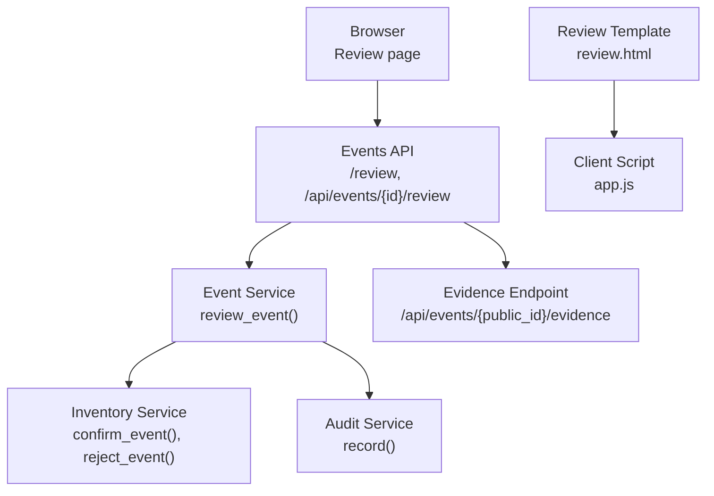
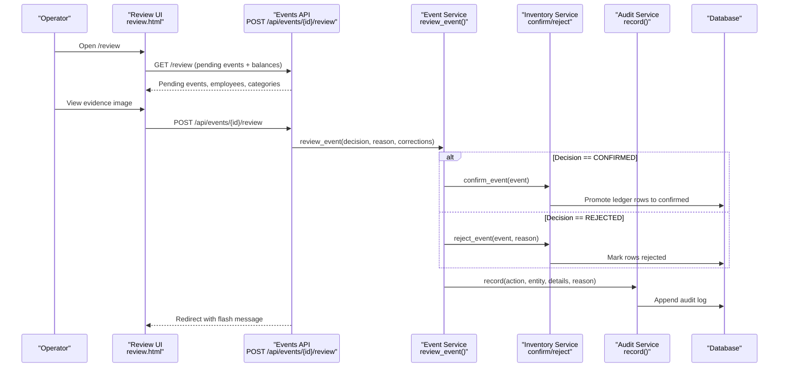
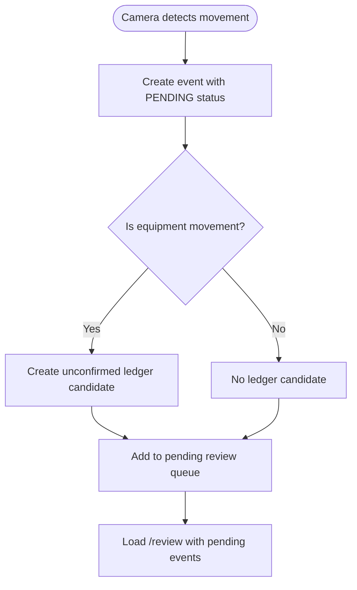
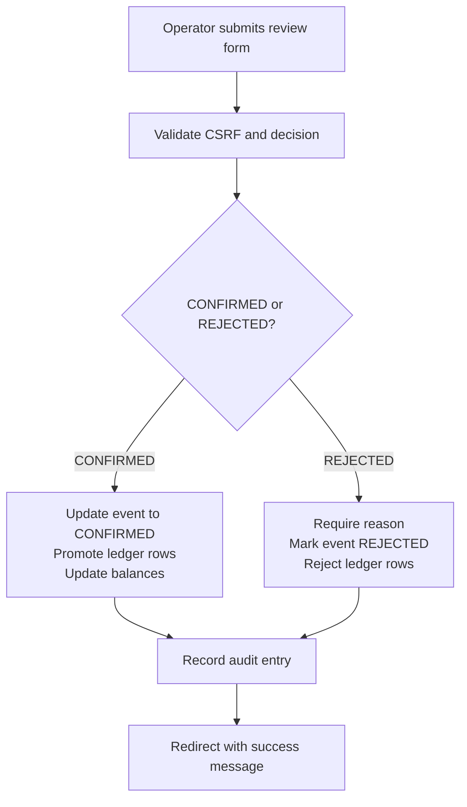
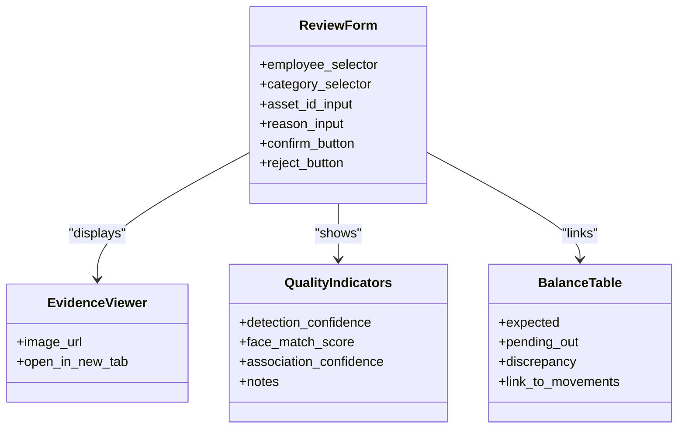
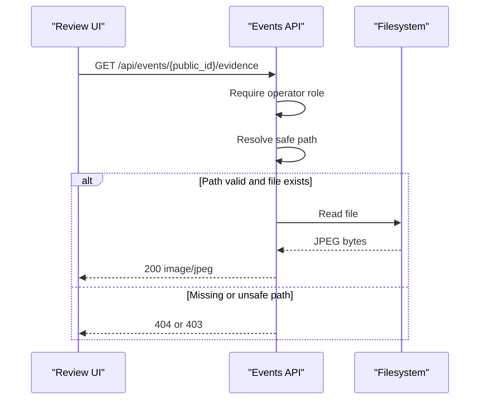
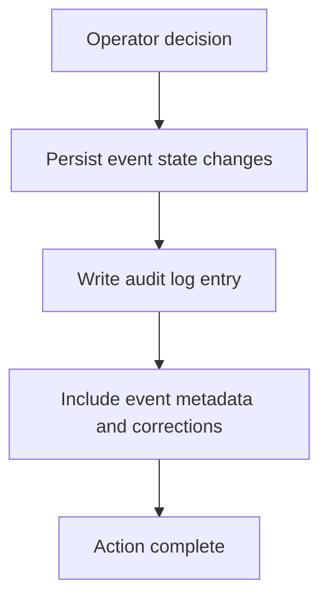
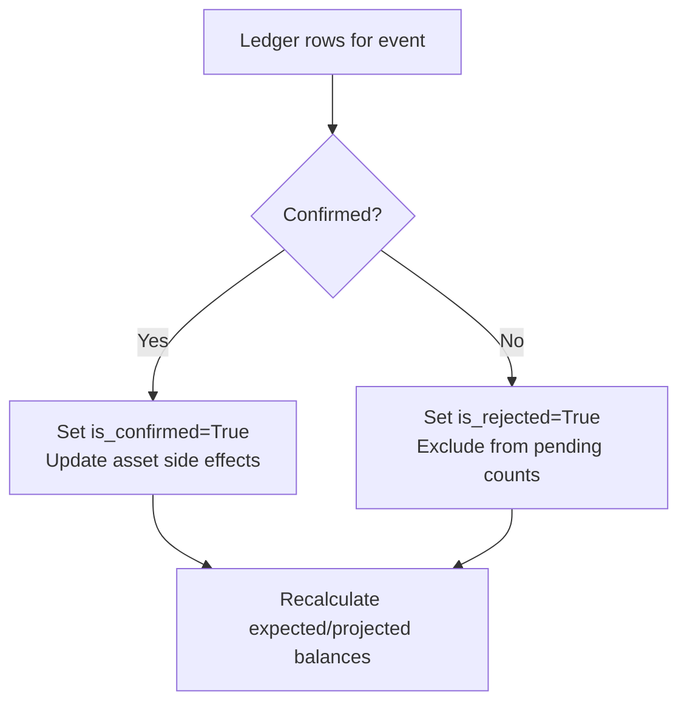
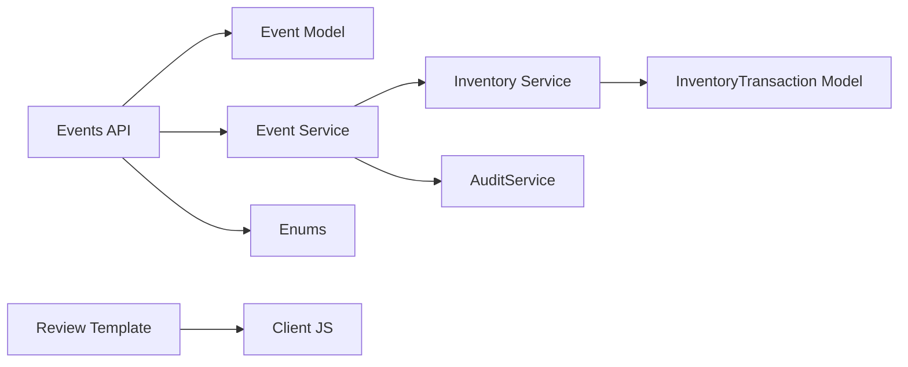

# Operator Review Interface

<cite>
**Referenced Files in This Document**
- [README.md](file://README.md)
- [events.py](file://app/api/events.py)
- [event_service.py](file://app/services/event_service.py)
- [inventory_service.py](file://app/services/inventory_service.py)
- [audit_service.py](file://app/services/audit_service.py)
- [enums.py](file://app/models/enums.py)
- [ledger.py](file://app/models/ledger.py)
- [review.html](file://app/ui/templates/review.html)
- [app.js](file://app/ui/static/app.js)
- [test_events.py](file://tests/test_events.py)
- [test_inventory.py](file://tests/test_inventory.py)
</cite>

## Table of Contents
1. [Introduction](#introduction)
2. [Project Structure](#project-structure)
3. [Core Components](#core-components)
4. [Architecture Overview](#architecture-overview)
5. [Detailed Component Analysis](#detailed-component-analysis)
6. [Dependency Analysis](#dependency-analysis)
7. [Performance Considerations](#performance-considerations)
8. [Troubleshooting Guide](#troubleshooting-guide)
9. [Conclusion](#conclusion)

## Introduction
This document explains the operator review interface and workflow used to manage uncertain movement events before they affect inventory balances. The system records camera-based detections as pending candidates, requires manual confirmation or rejection, and only updates official inventory counts after an operator confirms an event. Rejections are preserved for audit purposes but do not change balances.

Key principles:
- Uncertain events remain `PENDING` until reviewed.
- Confirmations promote unconfirmed ledger candidates to confirmed transactions and update category balances.
- Rejections mark candidate rows as rejected; they stay in the ledger for audit but stop counting toward pending movements.
- Operators can correct employee associations, equipment categories, and asset IDs during review.

**Section sources**
- [README.md:11-14](file://README.md#L11-L14)
- [README.md:286-313](file://README.md#L286-L313)
- [README.md:316-343](file://README.md#L316-L343)

## Project Structure
The operator review feature spans API routes, services, models, templates, and client-side helpers:

**Diagram sources**
- [events.py:40-88](file://app/api/events.py#L40-L88)
- [events.py:91-144](file://app/api/events.py#L91-L144)
- [event_service.py:150-211](file://app/services/event_service.py#L150-L211)
- [inventory_service.py:165-205](file://app/services/inventory_service.py#L165-L205)
- [audit_service.py:13-37](file://app/services/audit_service.py#L13-L37)
- [review.html:62-106](file://app/ui/templates/review.html#L62-L106)
- [app.js:117-132](file://app/ui/static/app.js#L117-L132)

**Section sources**
- [events.py:40-144](file://app/api/events.py#L40-L144)
- [review.html:1-144](file://app/ui/templates/review.html#L1-144)

## Core Components
- **Pending event queue**: Events created by camera detection are stored with `verification_status = PENDING`. The review page lists these events and shows balance issues.
- **Operator actions**:
  - Confirm an event: marks it `CONFIRMED`, promotes associated ledger rows to confirmed, and updates inventory balances.
  - Reject an event: requires a reason, marks it `REJECTED`, keeps ledger rows but excludes them from pending calculations.
  - Correct associations: assign an employee, equipment category, or specific asset ID.
- **Evidence viewing**: Each event may include a JPEG evidence image served through a protected endpoint.
- **Association quality assessment**: Detection confidence, face match score, association confidence, and notes help operators decide.
- **Decision recording**: Decisions are persisted on the event row and recorded in the audit log.

**Section sources**
- [event_service.py:59-147](file://app/services/event_service.py#L59-L147)
- [event_service.py:150-211](file://app/services/event_service.py#L150-L211)
- [inventory_service.py:132-205](file://app/services/inventory_service.py#L132-L205)
- [review.html:27-106](file://app/ui/templates/review.html#L27-L106)
- [events.py:132-144](file://app/api/events.py#L132-L144)

## Architecture Overview
The review workflow is a controlled pipeline from UI to database:

**Diagram sources**
- [events.py:72-88](file://app/api/events.py#L72-L88)
- [events.py:91-129](file://app/api/events.py#L91-L129)
- [event_service.py:150-211](file://app/services/event_service.py#L150-L211)
- [inventory_service.py:165-205](file://app/services/inventory_service.py#L165-L205)
- [audit_service.py:13-37](file://app/services/audit_service.py#L13-L37)

## Detailed Component Analysis

### Pending Event Queue Management
- Movement events for equipment create one unconfirmed ledger candidate per event.
- Person-only events do not create ledger candidates.
- Deduplication prevents duplicate events within cooldown buckets using track identifiers and camera context.
- The review page loads pending events and highlights categories with pending outflows or discrepancies.

**Diagram sources**
- [event_service.py:59-147](file://app/services/event_service.py#L59-L147)
- [inventory_service.py:132-156](file://app/services/inventory_service.py#L132-L156)
- [events.py:72-88](file://app/api/events.py#L72-L88)

**Section sources**
- [event_service.py:36-57](file://app/services/event_service.py#L36-L57)
- [event_service.py:59-147](file://app/services/event_service.py#L59-L147)
- [inventory_service.py:132-156](file://app/services/inventory_service.py#L132-L156)
- [events.py:72-88](file://app/api/events.py#L72-L88)

### Operator Actions
Operators can perform the following actions from the review form:
- Confirm an event:
  - Sets verification status to `CONFIRMED`.
  - Promotes associated ledger rows to confirmed.
  - Updates category balances.
- Reject an event:
  - Requires a non-empty reason.
  - Marks ledger rows as rejected.
  - Does not change balances.
- Correct associations:
  - Assign an employee to resolve unknown persons.
  - Assign an equipment category if missing or incorrect.
  - Assign a specific asset ID when known.

**Diagram sources**
- [events.py:91-129](file://app/api/events.py#L91-L129)
- [event_service.py:150-211](file://app/services/event_service.py#L150-L211)
- [inventory_service.py:165-205](file://app/services/inventory_service.py#L165-L205)

**Section sources**
- [events.py:91-129](file://app/api/events.py#L91-L129)
- [event_service.py:150-211](file://app/services/event_service.py#L150-L211)
- [inventory_service.py:165-205](file://app/services/inventory_service.py#L165-L205)

### User Interface Elements
The review page provides:
- A list of pending events with type labels, public IDs, timestamps, camera codes, and status badges.
- Evidence image display via a secure endpoint.
- Association quality indicators: detection confidence, face match score, association confidence, and notes.
- Correction fields: employee selector, category selector, optional asset ID.
- Reason input for rejections.
- Buttons for confirming or rejecting events.
- An inventory discrepancy table showing expected counts, pending outflows, and differences.

**Diagram sources**
- [review.html:27-106](file://app/ui/templates/review.html#L27-L106)
- [review.html:112-142](file://app/ui/templates/review.html#L112-L142)

**Section sources**
- [review.html:1-144](file://app/ui/templates/review.html#L1-144)
- [app.js:117-132](file://app/ui/static/app.js#L117-L132)

### Evidence Image Viewing
- Evidence images are served through `/api/events/{public_id}/evidence`.
- Access is restricted to operators/admins.
- If no evidence exists or the file is missing, the endpoint returns a 404 response.
- The review template embeds the evidence image URL and opens it in a new tab.

**Diagram sources**
- [events.py:132-144](file://app/api/events.py#L132-L144)
- [review.html:29-38](file://app/ui/templates/review.html#L29-L38)

**Section sources**
- [events.py:132-144](file://app/api/events.py#L132-L144)
- [review.html:29-38](file://app/ui/templates/review.html#L29-L38)

### Association Quality Assessment Tools
- Detection confidence indicates how strongly the object was detected.
- Face match score reflects similarity between detected face and registered employee templates.
- Association confidence combines walking correlation, proximity, temporal alignment, and direction matching.
- Notes may indicate “requires review” when association quality is weak or ambiguous.

These metrics guide operators to confirm low-confidence associations only after visual inspection of evidence and correction of associations.

**Section sources**
- [README.md:316-343](file://README.md#L316-L343)
- [review.html:41-59](file://app/ui/templates/review.html#L41-L59)

### Decision Recording and Audit Trail
Every operator action creates an audit log entry:
- Action names include event confirmation and rejection.
- Details capture event type, corrected employee, category, and asset ID.
- Reasons are recorded for rejections.
- The event row stores reviewer identity, timestamp, and reason.

**Diagram sources**
- [event_service.py:196-210](file://app/services/event_service.py#L196-L210)
- [audit_service.py:13-37](file://app/services/audit_service.py#L13-L37)

**Section sources**
- [event_service.py:196-210](file://app/services/event_service.py#L196-L210)
- [audit_service.py:13-37](file://app/services/audit_service.py#L13-L37)

### Impact of Confirmations and Rejections on Inventory Calculations
- Confirmed events promote unconfirmed ledger rows to confirmed, updating category balances.
- Rejected events keep ledger rows but mark them as rejected; they do not count toward pending movements or balances.
- Balances distinguish between expected (confirmed), pending inflows/outflows, projected totals, and discrepancies against registered assets.

**Diagram sources**
- [inventory_service.py:165-205](file://app/services/inventory_service.py#L165-L205)
- [inventory_service.py:215-273](file://app/services/inventory_service.py#L215-L273)

**Section sources**
- [inventory_service.py:165-205](file://app/services/inventory_service.py#L165-L205)
- [inventory_service.py:215-273](file://app/services/inventory_service.py#L215-L273)

### Step-by-Step Workflows

#### Low-Confidence Associations
1. Open `/review` and locate the event with low association confidence or weak/ambiguous quality.
2. Inspect the evidence image to verify whether the person actually carried the equipment.
3. If needed, correct the employee, category, or asset ID.
4. Confirm the event if the association is valid; otherwise reject with a reason.
5. Observe the updated balance and pending counts.

**Section sources**
- [review.html:41-59](file://app/ui/templates/review.html#L41-L59)
- [event_service.py:150-211](file://app/services/event_service.py#L150-L211)
- [inventory_service.py:165-205](file://app/services/inventory_service.py#L165-L205)

#### Unknown Persons
1. Find the event labeled as unknown person or with no employee assigned.
2. Use the employee selector to associate the person with a registered employee.
3. Optionally set the equipment category and asset ID.
4. Confirm the event to apply the movement; reject if the association is incorrect.

**Section sources**
- [review.html:67-89](file://app/ui/templates/review.html#L67-L89)
- [event_service.py:168-176](file://app/services/event_service.py#L168-L176)

#### Equipment Movement Verification
1. Identify the equipment movement event (brought in/taken out).
2. Check detection confidence, face match score, and association confidence.
3. Verify the evidence image shows the correct equipment crossing the virtual line.
4. Correct category or asset ID if necessary.
5. Confirm to update inventory; reject if the movement did not occur or was misidentified.

**Section sources**
- [review.html:41-59](file://app/ui/templates/review.html#L41-L59)
- [inventory_service.py:132-156](file://app/services/inventory_service.py#L132-L156)
- [event_service.py:150-211](file://app/services/event_service.py#L150-L211)

## Dependency Analysis
The review workflow depends on several components:

**Diagram sources**
- [events.py:1-21](file://app/api/events.py#L1-L21)
- [event_service.py:1-26](file://app/services/event_service.py#L1-L26)
- [inventory_service.py:1-30](file://app/services/inventory_service.py#L1-L30)
- [ledger.py:21-157](file://app/models/ledger.py#L21-L157)
- [enums.py:1-183](file://app/models/enums.py#L1-L183)
- [review.html:1-144](file://app/ui/templates/review.html#L1-L144)
- [app.js:1-134](file://app/ui/static/app.js#L1-L134)

**Section sources**
- [events.py:1-191](file://app/api/events.py#L1-L191)
- [event_service.py:1-329](file://app/services/event_service.py#L1-L329)
- [inventory_service.py:1-347](file://app/services/inventory_service.py#L1-L347)
- [ledger.py:21-157](file://app/models/ledger.py#L21-L157)
- [enums.py:1-183](file://app/models/enums.py#L1-L183)

## Performance Considerations
- The review page limits pending events loaded to reduce load.
- Evidence images are cached briefly at the browser level.
- Deduplication and cooldown prevent excessive event creation.
- Balances are computed from ledger rows; large datasets benefit from indexes on status and timestamps.

[No sources needed since this section provides general guidance]

## Troubleshooting Guide
Common issues and resolutions:
- Missing evidence image:
  - Ensure evidence is enabled and retention policy has not removed the file.
  - Check that the event has an evidence path and the file exists.
- Cannot submit rejection without reason:
  - The UI enforces a reason field for rejections; fill it before submitting.
- Event already reviewed:
  - Only pending events can be reviewed; confirmed or rejected events cannot be changed.
- Balance not updating after confirmation:
  - Confirm that the event had associated ledger rows and that the transaction type affects the category balance.

**Section sources**
- [events.py:132-144](file://app/api/events.py#L132-L144)
- [app.js:117-132](file://app/ui/static/app.js#L117-L132)
- [event_service.py:162-166](file://app/services/event_service.py#L162-L166)
- [inventory_service.py:165-205](file://app/services/inventory_service.py#L165-L205)

## Conclusion
The operator review interface ensures that uncertain camera-based movements do not automatically alter inventory balances. Operators inspect evidence, assess association quality, correct associations, and make informed decisions to confirm or reject events. Confirmations update the ledger and balances; rejections preserve audit trails without affecting counts. This design maintains data integrity while allowing flexible human oversight.

[No sources needed since this section summarizes without analyzing specific files]