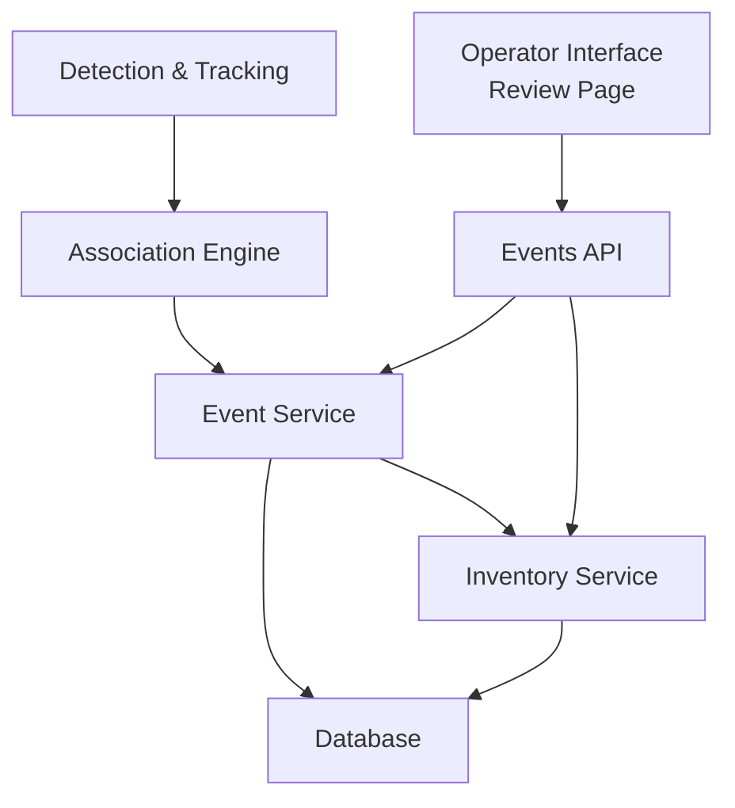
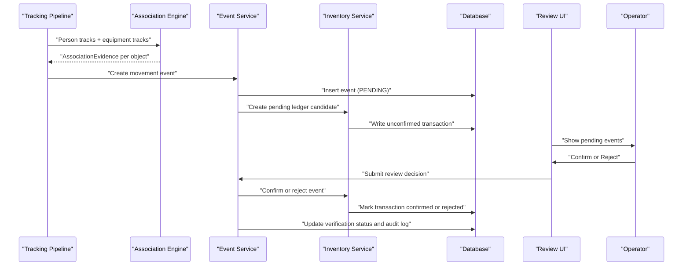
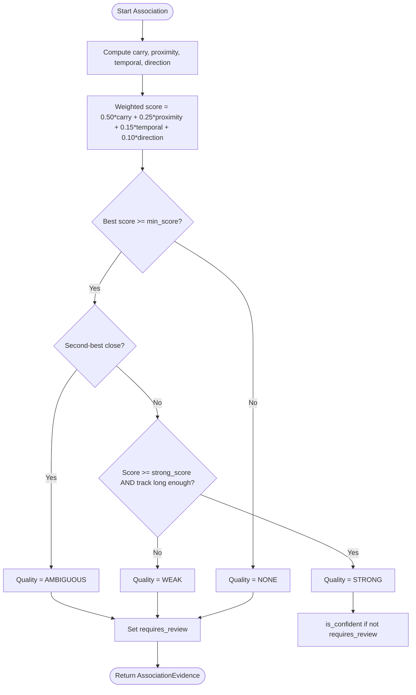
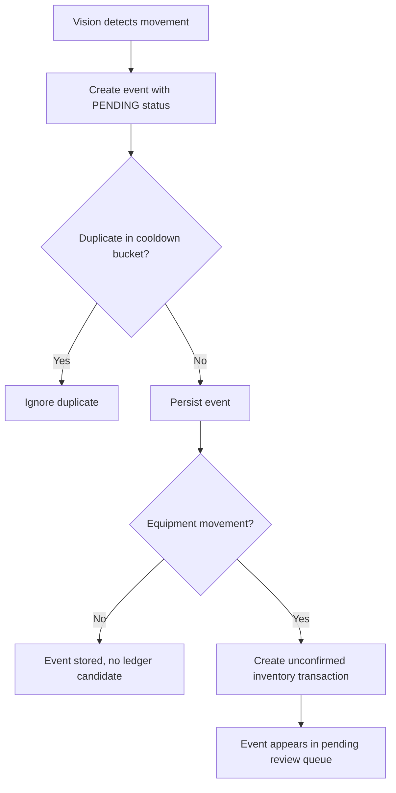
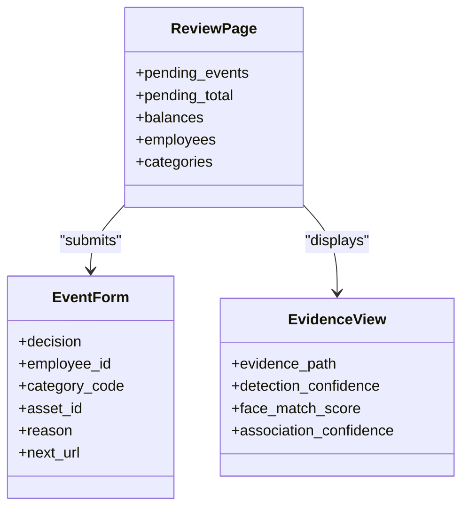
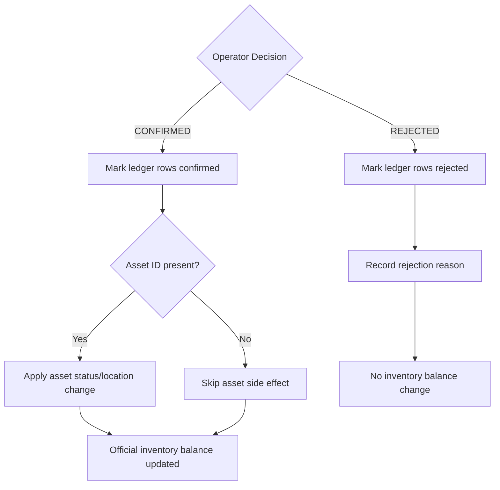
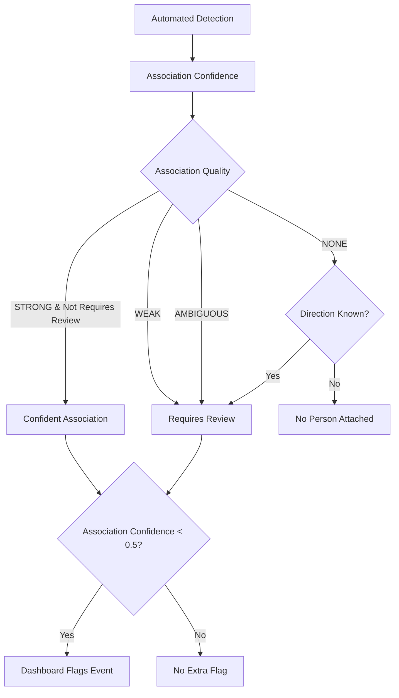
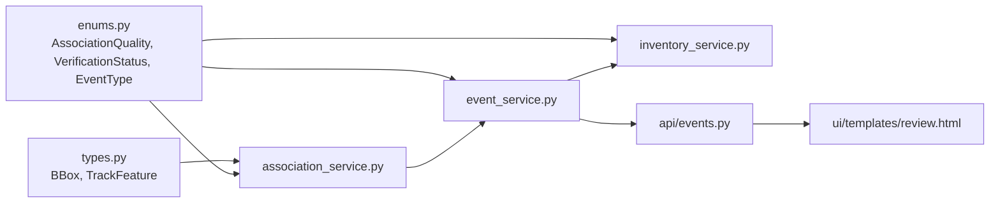

# Review & Verification Workflow

<cite>
**Referenced Files in This Document**
- [association_service.py](file://app/services/association_service.py)
- [event_service.py](file://app/services/event_service.py)
- [inventory_service.py](file://app/services/inventory_service.py)
- [enums.py](file://app/models/enums.py)
- [events.py](file://app/api/events.py)
- [review.html](file://app/ui/templates/review.html)
- [types.py](file://app/services/types.py)
- [test_association.py](file://tests/test_association.py)
- [test_events.py](file://tests/test_events.py)
</cite>

## Table of Contents
1. [Introduction](#introduction)
2. [Project Structure](#project-structure)
3. [Core Components](#core-components)
4. [Architecture Overview](#architecture-overview)
5. [Detailed Component Analysis](#detailed-component-analysis)
6. [Dependency Analysis](#dependency-analysis)
7. [Performance Considerations](#performance-considerations)
8. [Troubleshooting Guide](#troubleshooting-guide)
9. [Conclusion](#conclusion)

## Introduction
This document explains the human-in-the-loop review and verification workflow used to protect inventory balances from automated detection errors. The system detects people and equipment, associates them using a weighted scoring model, creates pending movement candidates, and requires an operator to confirm or reject each uncertain event before it affects official inventory counts.

The key design principle is that vision-based movement events are never trusted automatically: they enter a pending state, create unconfirmed ledger candidates, and only become part of the official balance after manual confirmation. Rejections remain auditable but do not change inventory.

## Project Structure
The review workflow spans several layers:

- Association engine computes who carried what.
- Event service persists movement events and manages verification status.
- Inventory service writes append-only ledger entries and calculates balances.
- API endpoints expose the review page and review actions.
- Templates render the operator interface.
- Enums define shared states such as association quality and verification status.

**Diagram sources**
- [association_service.py:106-198](file://app/services/association_service.py#L106-L198)
- [event_service.py:59-147](file://app/services/event_service.py#L59-L147)
- [inventory_service.py:132-205](file://app/services/inventory_service.py#L132-L205)
- [events.py:72-129](file://app/api/events.py#L72-L129)
- [review.html:62-106](file://app/ui/templates/review.html#L62-L106)

**Section sources**
- [association_service.py:1-219](file://app/services/association_service.py#L1-L219)
- [event_service.py:1-329](file://app/services/event_service.py#L1-L329)
- [inventory_service.py:1-347](file://app/services/inventory_service.py#L1-L347)
- [events.py:1-191](file://app/api/events.py#L1-L191)
- [review.html:1-144](file://app/ui/templates/review.html#L1-L144)
- [enums.py:1-183](file://app/models/enums.py#L1-L183)
- [types.py:1-138](file://app/services/types.py#L1-L138)

## Core Components
The workflow has four main responsibilities:

| Component | Responsibility | Key Behavior |
|---|---|---|
| Association Engine | Scores person-to-equipment pairs | Uses carry overlap, proximity, temporal stability, and direction alignment; returns STRONG, WEAK, AMBIGUOUS, or NONE |
| Event Service | Creates and reviews events | De-duplicates movements, sets PENDING verification, updates audit logs |
| Inventory Service | Manages append-only ledger | Writes unconfirmed candidates, confirms or rejects them, computes category balances |
| Review UI | Presents pending events | Lets operators confirm, reject, assign employees, categories, and asset IDs |

**Section sources**
- [association_service.py:29-57](file://app/services/association_service.py#L29-L57)
- [event_service.py:59-147](file://app/services/event_service.py#L59-L147)
- [inventory_service.py:36-63](file://app/services/inventory_service.py#L36-L63)
- [review.html:17-106](file://app/ui/templates/review.html#L17-L106)

## Architecture Overview
The end-to-end flow starts with tracking data and ends with either a confirmed inventory change or a rejected candidate.

**Diagram sources**
- [association_service.py:131-198](file://app/services/association_service.py#L131-L198)
- [event_service.py:59-147](file://app/services/event_service.py#L59-L147)
- [inventory_service.py:132-205](file://app/services/inventory_service.py#L132-L205)
- [events.py:91-129](file://app/api/events.py#L91-L129)
- [review.html:62-106](file://app/ui/templates/review.html#L62-L106)

## Detailed Component Analysis

### Association Scoring System
The association engine evaluates every person-object pair using four signals:

| Signal | Meaning | Weight | How It Is Computed |
|---|---|---:|---|
| Carry overlap | Object center inside expanded person box | 0.50 | Expanded bounding box contains object center or partial overlap |
| Proximity | Distance relative to person size | 0.25 | Normalized by person diagonal and proximity ratio |
| Temporal overlap | Both tracks stable for multiple frames | 0.15 | Based on minimum frames seen across person and object |
| Direction alignment | Same general heading | 0.10 | Dot product of normalized velocities mapped to 0–1 |

The final score is a weighted sum. Quality levels are then assigned:

| Quality | Condition | Requires Review? |
|---|---|---:|
| STRONG | Score meets strong threshold and track is not too short | No |
| WEAK | Score below strong threshold or track is short | Yes |
| AMBIGUOUS | Another person explains the object almost equally well | Yes |
| NONE | No person meets minimum score | Yes when direction is known |

**Diagram sources**
- [association_service.py:59-129](file://app/services/association_service.py#L59-L129)
- [association_service.py:131-198](file://app/services/association_service.py#L131-L198)
- [association_service.py:43-46](file://app/services/association_service.py#L43-L46)

#### Association Evidence Model
Each result includes:

| Field | Purpose |
|---|---|
| `object_track_id` | Equipment track being explained |
| `person_track_id` | Best person track |
| `person_employee_id` | Linked employee if available |
| `face_score` | Face match confidence if available |
| `score` | Final weighted score |
| `quality` | STRONG / WEAK / AMBIGUOUS / NONE |
| `requires_review` | Whether the event should be reviewed |
| `reasons` | Human-readable explanation of signal strengths |
| `detection_confidence` | Original object detection confidence |

**Section sources**
- [association_service.py:29-46](file://app/services/association_service.py#L29-L46)
- [association_service.py:106-198](file://app/services/association_service.py#L106-L198)
- [types.py:100-128](file://app/services/types.py#L100-L128)

#### Association Quality Thresholds
The default configuration defines the thresholds used by the engine:

| Parameter | Default | Meaning |
|---|---:|---|
| `min_score` | 0.45 | Minimum score to attach any person |
| `strong_score` | 0.65 | Score required for STRONG quality |
| `ambiguity_margin` | 0.12 | Difference between best and second-best scores that still triggers AMBIGUOUS |
| `proximity_ratio` | 1.10 | Person-size multiplier for proximity normalization |
| `carry_ratio` | 0.22 | Bounding-box expansion factor for carry detection |
| `min_track_frames` | 4 | Frames needed to consider a track stable |
| `max_track_age_seconds` | 12.0 | Maximum allowed track age |

These values are tested through scenarios such as object inside body, two equally close people, distant objects, short tracks, and directional agreement.

**Section sources**
- [association_service.py:48-57](file://app/services/association_service.py#L48-L57)
- [test_association.py:36-91](file://tests/test_association.py#L36-L91)

### Pending Event Queue Management
Movement events are created with `VerificationStatus.PENDING`. For equipment movements, this also creates an unconfirmed inventory candidate.

Key behaviors:

- Events are de-duplicated using a cooldown bucket so repeated detections within a time window do not produce duplicate ledger candidates.
- Equipment movement events create pending inventory transactions marked as unconfirmed.
- Only CONFIRMED transactions affect official balances.
- REJECTED transactions remain in the ledger for audit purposes but are excluded from balance calculations.

**Diagram sources**
- [event_service.py:36-56](file://app/services/event_service.py#L36-L56)
- [event_service.py:59-147](file://app/services/event_service.py#L59-L147)
- [inventory_service.py:132-156](file://app/services/inventory_service.py#L132-L156)

**Section sources**
- [event_service.py:36-147](file://app/services/event_service.py#L36-L147)
- [inventory_service.py:132-156](file://app/services/inventory_service.py#L132-L156)
- [test_events.py:15-45](file://tests/test_events.py#L15-L45)

### Operator Interface for Review
The review page shows pending events, evidence images, detection and association confidence, and controls for confirming or rejecting events. Operators can:

- Confirm an event to make its ledger candidate official.
- Reject an event to keep it out of inventory while preserving audit information.
- Assign or correct the employee linked to the event.
- Assign or correct the equipment category.
- Optionally assign a specific asset ID.
- Provide a reason, which is mandatory for rejections.

**Diagram sources**
- [review.html:17-106](file://app/ui/templates/review.html#L17-L106)
- [events.py:72-88](file://app/api/events.py#L72-L88)

**Section sources**
- [review.html:1-144](file://app/ui/templates/review.html#L1-L144)
- [events.py:72-129](file://app/api/events.py#L72-L129)

### Manual Association and Quality Assessment
Although the association engine produces STRONG, WEAK, AMBIGUOUS, and NONE results, the operator interface focuses on event-level decisions rather than directly editing raw association scores. However, the operator can influence outcomes indirectly:

- Selecting a different employee changes the person link attached to the event.
- Selecting a different equipment category changes how the movement affects inventory.
- Assigning a specific asset ID allows precise asset-side effects when confirmed.
- The dashboard highlights events where association confidence is low, guiding attention to ambiguous cases.

The association quality enum and helper functions provide clear semantics:

| Enum Value | Meaning |
|---|---|
| STRONG | High-confidence carry association |
| WEAK | Possible association but weak evidence or short track |
| AMBIGUOUS | Multiple plausible people explain the object similarly |
| NONE | No person sufficiently explains the object |

**Section sources**
- [enums.py:178-183](file://app/models/enums.py#L178-L183)
- [association_service.py:201-214](file://app/services/association_service.py#L201-L214)
- [event_service.py:292-298](file://app/services/event_service.py#L292-L298)

### Impact of Confirmations and Rejections on Inventory
When an event is confirmed:

- Existing unconfirmed ledger rows are marked confirmed.
- If no row exists, a new pending movement is created and immediately confirmed.
- Asset side effects are applied, such as changing asset status to IN_USE or IN_STOCK.
- Official category balances increase or decrease accordingly.

When an event is rejected:

- Ledger rows remain in the database.
- They are marked rejected and excluded from balance calculations.
- A rejection reason is appended to the audit trail.
- The event’s sync status is reset so downstream synchronization can retry later.

**Diagram sources**
- [inventory_service.py:165-205](file://app/services/inventory_service.py#L165-L205)
- [inventory_service.py:115-127](file://app/services/inventory_service.py#L115-L127)
- [event_service.py:150-211](file://app/services/event_service.py#L150-L211)

**Section sources**
- [inventory_service.py:165-205](file://app/services/inventory_service.py#L165-L205)
- [event_service.py:150-211](file://app/services/event_service.py#L150-L211)
- [test_events.py:125-147](file://tests/test_events.py#L125-L147)

### Automated Detection Confidence and Manual Review Requirements
Automated detection confidence and association confidence interact with the review queue as follows:

- All equipment movement events start as PENDING.
- Association quality determines whether the association itself is trustworthy.
- The dashboard flags events with association confidence below 0.5 as needing review.
- STRONG associations without review requirements are considered confident by the association engine.
- WEAK and AMBIGUOUS associations always require review.
- NONE associations may still require review when direction information is present.

**Diagram sources**
- [association_service.py:43-46](file://app/services/association_service.py#L43-L46)
- [association_service.py:168-181](file://app/services/association_service.py#L168-L181)
- [event_service.py:292-298](file://app/services/event_service.py#L292-L298)

**Section sources**
- [association_service.py:43-46](file://app/services/association_service.py#L43-L46)
- [association_service.py:168-181](file://app/services/association_service.py#L168-L181)
- [event_service.py:292-298](file://app/services/event_service.py#L292-L298)

### Concrete Review Scenarios

| Scenario | Detection Signals | Association Result | Operator Action | Inventory Impact |
|---|---|---|---|---|
| Laptop clearly held by one person | High carry overlap, good proximity, stable tracks, same direction | STRONG | Confirm | Category count decreases by one |
| Two people near laptop moving together | Similar proximity and direction | AMBIGUOUS | Confirm with corrected employee/category | Category count decreases; employee link corrected |
| Laptop far from all people | Low proximity, no carry overlap | NONE | Reject | No inventory change |
| Short-lived detection | Few frames, unstable track | WEAK | Confirm only if operator verifies visually | Category count decreases if confirmed |
| Opposite-direction movement | Poor direction alignment | Lower score, possibly WEAK | Reject unless operator knows context | No inventory change |

These scenarios are validated by tests covering object-inside-body associations, ambiguous multi-person cases, distant objects, short tracks, and directional differences.

**Section sources**
- [test_association.py:36-91](file://tests/test_association.py#L36-L91)
- [test_events.py:125-147](file://tests/test_events.py#L125-L147)

## Dependency Analysis
The review workflow depends on shared enums and type definitions.

**Diagram sources**
- [types.py:10-128](file://app/services/types.py#L10-L128)
- [enums.py:27-183](file://app/models/enums.py#L27-L183)
- [association_service.py:23-24](file://app/services/association_service.py#L23-L24)
- [event_service.py:14-25](file://app/services/event_service.py#L14-L25)
- [inventory_service.py:25-28](file://app/services/inventory_service.py#L25-L28)
- [events.py:13-18](file://app/api/events.py#L13-L18)

**Section sources**
- [types.py:1-138](file://app/services/types.py#L1-L138)
- [enums.py:1-183](file://app/models/enums.py#L1-L183)
- [association_service.py:1-219](file://app/services/association_service.py#L1-L219)
- [event_service.py:1-329](file://app/services/event_service.py#L1-L329)
- [inventory_service.py:1-347](file://app/services/inventory_service.py#L1-L347)
- [events.py:1-191](file://app/api/events.py#L1-L191)

## Performance Considerations
- Association scoring is O(P × E), where P is the number of person tracks and E is the number of equipment tracks.
- The engine sorts candidates per object, adding sorting overhead proportional to the number of persons.
- Short-track filtering reduces unnecessary review work by marking very brief tracks as requiring review early.
- De-duplication prevents duplicate ledger candidates from accumulating under high-frequency detection.
- Balances are computed by aggregating confirmed and pending transactions, so large histories benefit from indexed queries and bounded reporting windows.

[No sources needed since this section provides general guidance]

## Troubleshooting Guide

| Symptom | Likely Cause | Resolution |
|---|---|---|
| Pending queue grows rapidly | Many WEAK or AMBIGUOUS associations | Improve tracking stability, adjust association thresholds, prioritize ambiguous cases |
| Inventory drops unexpectedly | Vision candidate was confirmed incorrectly | Review event notes, check association confidence, use rejection with reason |
| No inventory change after confirmation | Event had no equipment category or no ledger candidate | Ensure event includes equipment category; confirm_event creates a candidate if missing |
| Rejection fails validation | Missing rejection reason | Provide a non-empty reason |
| Event cannot be reviewed twice | Already CONFIRMED or REJECTED | Do not resubmit; investigate existing audit log |
| Evidence image not found | Evidence file expired or path invalid | Check evidence storage and access permissions |

**Section sources**
- [event_service.py:150-211](file://app/services/event_service.py#L150-L211)
- [inventory_service.py:165-205](file://app/services/inventory_service.py#L165-L205)
- [events.py:132-144](file://app/api/events.py#L132-L144)
- [test_events.py:150-203](file://tests/test_events.py#L150-L203)

## Conclusion
The review and verification workflow separates automated detection from authoritative inventory accounting. The association engine quantifies uncertainty using spatial, temporal, and motion signals, while the event and inventory services ensure that only manually confirmed movements affect official balances. The operator interface provides a focused review experience with evidence, confidence metrics, and corrective fields. This design protects inventory integrity while keeping automation visible, auditable, and reversible.