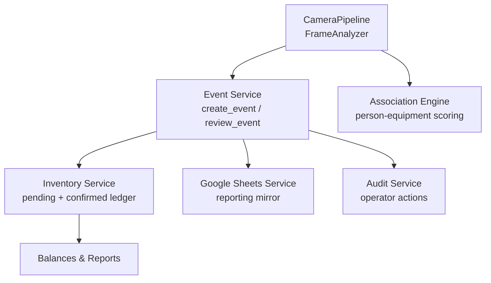
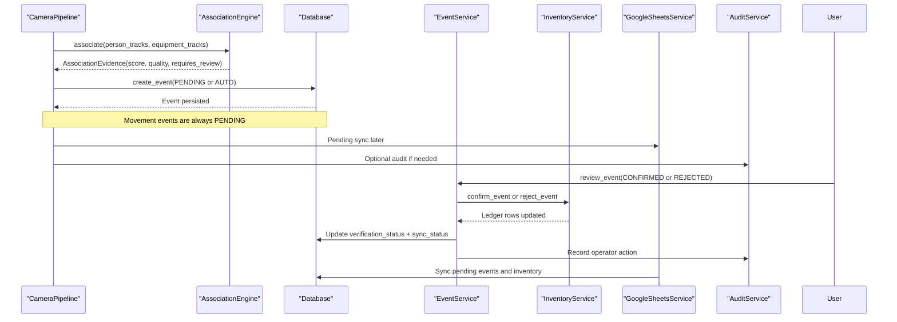
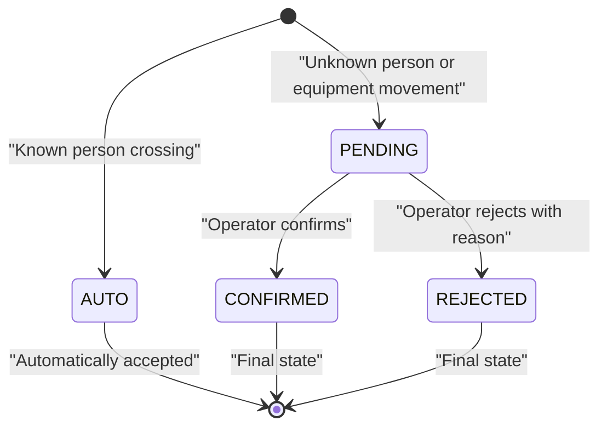
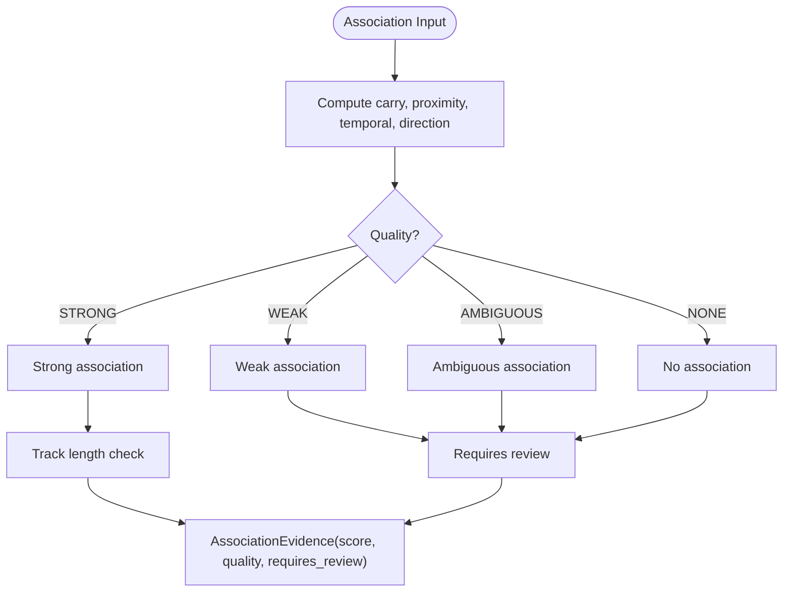
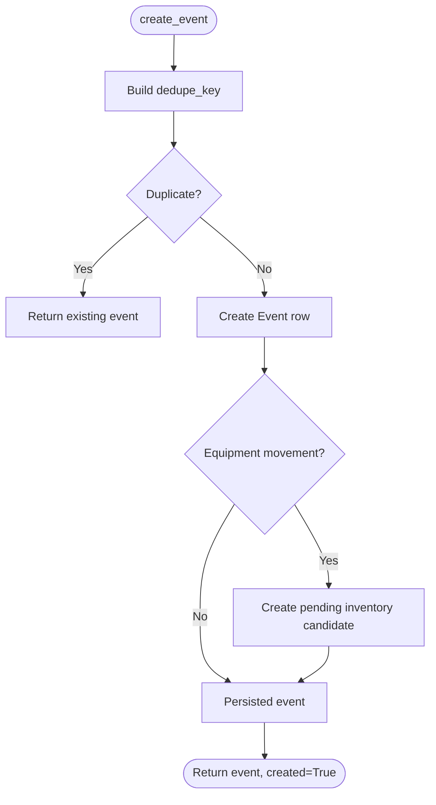
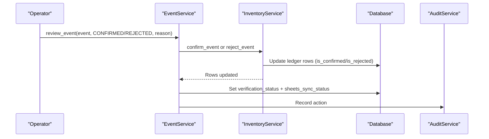
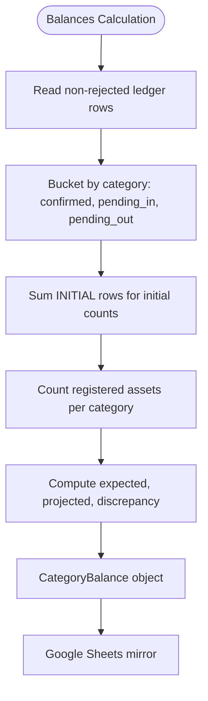
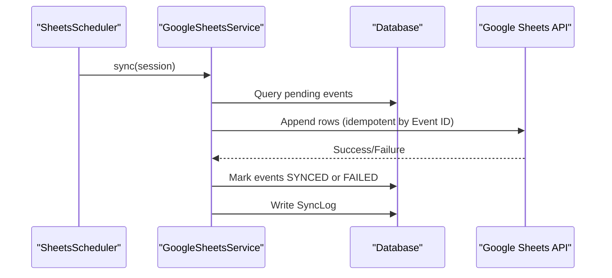
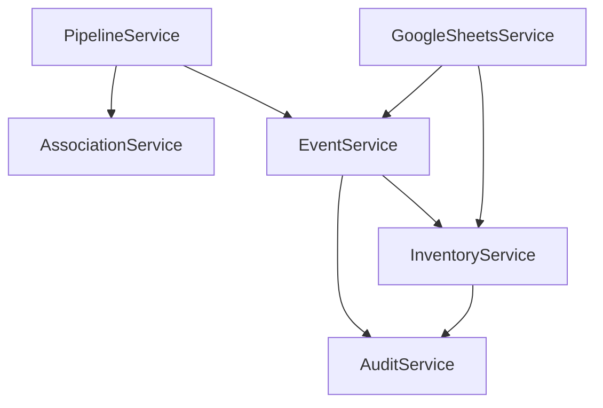

# Verification Status Flow

<cite>
**Referenced Files in This Document**
- [enums.py](file://app/models/enums.py)
- [ledger.py](file://app/models/ledger.py)
- [event_service.py](file://app/services/event_service.py)
- [association_service.py](file://app/services/association_service.py)
- [pipeline_service.py](file://app/services/pipeline_service.py)
- [inventory_service.py](file://app/services/inventory_service.py)
- [google_sheets_service.py](file://app/services/google_sheets_service.py)
- [audit_service.py](file://app/services/audit_service.py)
- [README.md](file://README.md)
</cite>

## Table of Contents
1. [Introduction](#introduction)
2. [Project Structure](#project-structure)
3. [Core Components](#core-components)
4. [Architecture Overview](#architecture-overview)
5. [Detailed Component Analysis](#detailed-component-analysis)
6. [Dependency Analysis](#dependency-analysis)
7. [Performance Considerations](#performance-considerations)
8. [Troubleshooting Guide](#troubleshooting-guide)
9. [Conclusion](#conclusion)

## Introduction
This document explains the verification status lifecycle and flow control for events in the system. It focuses on how events move between PENDING, CONFIRMED, and REJECTED statuses, when automatic review is required versus automated processing, and how verification affects inventory calculations, Google Sheets synchronization, reporting, and the append-only journal.

The system intentionally treats AI-generated movement detections as candidates: they are persisted with a pending verification state and only affect official balances after human confirmation. Known person entries and exits can be marked as automatically verified when identity confidence is sufficient; equipment movements remain pending to prevent incorrect inventory changes.

## Project Structure
The verification workflow spans several layers:

- Models define event types, verification states, and the append-only ledger.
- The camera pipeline detects crossings and equipment movements, computes association quality, and persists events.
- Event service handles creation, deduplication, review decisions, and queries.
- Association engine scores person-to-equipment relationships and flags ambiguous or weak associations.
- Inventory service converts confirmed events into permanent ledger entries and calculates category balances.
- Google Sheets service mirrors events and inventory summaries for external reporting.
- Audit service records operator actions such as confirm and reject.

**Diagram sources**
- [pipeline_service.py:490-586](file://app/services/pipeline_service.py#L490-L586)
- [event_service.py:59-211](file://app/services/event_service.py#L59-L211)
- [association_service.py:106-198](file://app/services/association_service.py#L106-L198)
- [inventory_service.py:132-205](file://app/services/inventory_service.py#L132-L205)
- [google_sheets_service.py:234-359](file://app/services/google_sheets_service.py#L234-L359)
- [audit_service.py:13-37](file://app/services/audit_service.py#L13-L37)

**Section sources**
- [enums.py:27-90](file://app/models/enums.py#L27-L90)
- [ledger.py:21-125](file://app/models/ledger.py#L21-L125)
- [pipeline_service.py:103-387](file://app/services/pipeline_service.py#L103-L387)
- [event_service.py:59-211](file://app/services/event_service.py#L59-L211)
- [association_service.py:106-198](file://app/services/association_service.py#L106-L198)
- [inventory_service.py:132-205](file://app/services/inventory_service.py#L132-L205)
- [google_sheets_service.py:234-359](file://app/services/google_sheets_service.py#L234-L359)
- [audit_service.py:13-37](file://app/services/audit_service.py#L13-L37)

## Core Components
- VerificationStatus enum defines AUTO, PENDING, CONFIRMED, REJECTED.
- EventType distinguishes person entry/exit from equipment movement and other system events.
- Event model stores detection_confidence, face_match_score, association_confidence, verification_status, and sync status.
- InventoryTransaction is an append-only ledger row that only contributes to official balances when confirmed and not rejected.
- AssociationEngine produces evidence with quality (STRONG, WEAK, AMBIGUOUS, NONE) and requires_review flags.
- CameraPipeline writes events based on line crossings and equipment movement analysis.
- EventService provides create_event and review_event functions.
- InventoryService creates pending movement candidates and applies confirm/reject transitions.
- GoogleSheetsService mirrors events and inventory summaries.
- AuditService records operator actions.

Key behaviors:
- Person crossing events with known employee identity are created as AUTO.
- Unknown person crossing events are created as PENDING.
- Equipment movement events are always created as PENDING.
- Review transitions from PENDING to CONFIRMED or REJECTED.
- CONFIRMED updates the ledger and asset side effects; REJECTED marks ledger rows as rejected without changing balances.
- Rejected or reviewed events are re-scheduled for Google Sheets sync.

**Section sources**
- [enums.py:76-90](file://app/models/enums.py#L76-L90)
- [ledger.py:21-125](file://app/models/ledger.py#L21-L125)
- [pipeline_service.py:508-586](file://app/services/pipeline_service.py#L508-L586)
- [event_service.py:59-211](file://app/services/event_service.py#L59-L211)
- [association_service.py:106-198](file://app/services/association_service.py#L106-L198)
- [inventory_service.py:132-205](file://app/services/inventory_service.py#L132-L205)
- [google_sheets_service.py:199-231](file://app/services/google_sheets_service.py#L199-L231)
- [audit_service.py:13-37](file://app/services/audit_service.py#L13-L37)

## Architecture Overview
The verification lifecycle begins at the camera pipeline, which analyzes frames, detects people and equipment, associates them, and decides whether to persist an event. Events are then managed by the event service, which enforces deduplication and supports manual review. Confirmed events update the append-only inventory ledger; rejected events are logged but do not change balances. Google Sheets receives mirrored data for reporting.

**Diagram sources**
- [pipeline_service.py:508-586](file://app/services/pipeline_service.py#L508-L586)
- [association_service.py:131-198](file://app/services/association_service.py#L131-L198)
- [event_service.py:59-211](file://app/services/event_service.py#L59-L211)
- [inventory_service.py:132-205](file://app/services/inventory_service.py#L132-L205)
- [google_sheets_service.py:234-359](file://app/services/google_sheets_service.py#L234-L359)
- [audit_service.py:13-37](file://app/services/audit_service.py#L13-L37)

## Detailed Component Analysis

### Verification Status Lifecycle
States:
- AUTO: Automatically verified, used for known person crossings.
- PENDING: Requires review; default for unknown persons and all equipment movements.
- CONFIRMED: Human-approved; affects inventory and asset state.
- REJECTED: Human-declined; does not affect inventory but remains in audit trail.

Transitions:
- From PENDING to CONFIRMED: Operator confirms; ledger rows become confirmed; asset side effects apply; notes updated; sync status reset to pending.
- From PENDING to REJECTED: Operator rejects with reason; ledger rows marked rejected; balance unaffected; notes updated; sync status reset to pending.
- No direct transition from AUTO to CONFIRMED/REJECTED; AUTO indicates automatic acceptance for known person crossings.

Automatic vs Manual Review:
- Known person crossing events are AUTO.
- Unknown person crossing events are PENDING.
- All equipment movement events are PENDING regardless of association strength.
- Association quality influences dashboard “needs review” flags but does not auto-confirm equipment movements.

**Diagram sources**
- [pipeline_service.py:508-586](file://app/services/pipeline_service.py#L508-L586)
- [event_service.py:150-211](file://app/services/event_service.py#L150-L211)
- [enums.py:76-90](file://app/models/enums.py#L76-L90)

**Section sources**
- [pipeline_service.py:508-586](file://app/services/pipeline_service.py#L508-L586)
- [event_service.py:150-211](file://app/services/event_service.py#L150-L211)
- [enums.py:76-90](file://app/models/enums.py#L76-L90)

### Association Scoring and Review Requirements
AssociationEngine evaluates four signals:
- Carry overlap
- Proximity
- Temporal stability
- Direction agreement

It returns:
- STRONG: High confidence, no review required.
- WEAK: Lower confidence or short tracks; requires review.
- AMBIGUOUS: Multiple plausible persons; requires review.
- NONE: No meaningful association.

requires_review is true for WEAK or AMBIGUOUS qualities, or when tracks are too short. Even STRONG associations do not auto-confirm equipment movements; they remain PENDING.

**Diagram sources**
- [association_service.py:106-198](file://app/services/association_service.py#L106-L198)

**Section sources**
- [association_service.py:106-198](file://app/services/association_service.py#L106-L198)

### Event Creation and Deduplication
EventService.create_event:
- Builds a stable dedupe key using event type, camera code, timestamp bucket, and track IDs.
- Prevents duplicate events within cooldown buckets.
- Persists Event with verification_status and sheets_sync_status.
- For equipment movement events, creates a pending inventory candidate.

**Diagram sources**
- [event_service.py:36-147](file://app/services/event_service.py#L36-L147)
- [inventory_service.py:132-156](file://app/services/inventory_service.py#L132-L156)

**Section sources**
- [event_service.py:36-147](file://app/services/event_service.py#L36-L147)
- [inventory_service.py:132-156](file://app/services/inventory_service.py#L132-L156)

### Review Workflow and Ledger Impact
EventService.review_event:
- Validates decision is CONFIRMED or REJECTED.
- Ensures event is currently PENDING.
- On CONFIRMED: calls inventory_service.confirm_event, sets verification_status to CONFIRMED, appends confirmation note, resets sync status.
- On REJECTED: validates reason, calls inventory_service.reject_event, sets verification_status to REJECTED, appends rejection note, resets sync status.
- Records audit action.

InventoryService.confirm_event:
- Finds ledger rows linked to the event.
- Marks them confirmed and not rejected.
- Applies asset side effects (status/location).
- Records audit action.

InventoryService.reject_event:
- Marks ledger rows as rejected without confirming.
- Keeps rows for audit trail.
- Does not change official balances.

**Diagram sources**
- [event_service.py:150-211](file://app/services/event_service.py#L150-L211)
- [inventory_service.py:165-205](file://app/services/inventory_service.py#L165-L205)
- [audit_service.py:13-37](file://app/services/audit_service.py#L13-L37)

**Section sources**
- [event_service.py:150-211](file://app/services/event_service.py#L150-L211)
- [inventory_service.py:165-205](file://app/services/inventory_service.py#L165-L205)
- [audit_service.py:13-37](file://app/services/audit_service.py#L13-L37)

### Inventory Calculations and Reporting
InventoryService.balances:
- Computes expected quantity from confirmed transactions.
- Tracks pending_in and pending_out from unconfirmed, non-rejected transactions.
- Calculates projected = expected + pending_in - pending_out.
- Compares expected with registered assets to compute discrepancy.
- Flags categories with issues when pending_out > 0 or discrepancy != 0.

GoogleSheetsService.inventory_rows:
- Mirrors expected, confirmed, pending movements, and discrepancy per category.
- Uses inventory_service.balances to build report rows.

Append-only Journal Rules:
- Ledger rows are never edited or deleted.
- Corrections are new CORRECTION entries.
- Vision candidates are stored unconfirmed until confirmed.
- Rejected rows stay in the journal but do not count toward balances or pending totals.

**Diagram sources**
- [inventory_service.py:215-273](file://app/services/inventory_service.py#L215-L273)
- [google_sheets_service.py:214-231](file://app/services/google_sheets_service.py#L214-L231)

**Section sources**
- [inventory_service.py:215-273](file://app/services/inventory_service.py#L215-L273)
- [google_sheets_service.py:214-231](file://app/services/google_sheets_service.py#L214-L231)
- [README.md:286-312](file://README.md#L286-L312)

### Google Sheets Synchronization
GoogleSheetsService.sync:
- Runs in background thread with retry logic.
- Pushes employees, equipment, events, and inventory summary.
- Uses Event ID column for idempotency.
- Marks events as SYNCED or FAILED; failed events are retried.
- Resets sync status to PENDING after event review.

EventSyncQuery:
- pending_sync_events selects events with PENDING or FAILED sync status.

**Diagram sources**
- [google_sheets_service.py:234-359](file://app/services/google_sheets_service.py#L234-L359)
- [event_service.py:282-289](file://app/services/event_service.py#L282-L289)

**Section sources**
- [google_sheets_service.py:234-359](file://app/services/google_sheets_service.py#L234-L359)
- [event_service.py:282-289](file://app/services/event_service.py#L282-L289)

## Dependency Analysis
The verification flow depends on clear separation of concerns:

- PipelineService orchestrates frame analysis and event persistence.
- AssociationService provides scoring and review flags.
- EventService manages event lifecycle and review decisions.
- InventoryService enforces append-only ledger rules and balance calculations.
- GoogleSheetsService provides external reporting mirroring.
- AuditService logs operator actions.

Coupling:
- PipelineService depends on AssociationService and EventService.
- EventService depends on InventoryService and AuditService.
- InventoryService depends on AuditService.
- GoogleSheetsService depends on EventService and InventoryService.

Potential circular dependencies:
- None detected; services are layered and call downward.

External integrations:
- Google Sheets API via gspread.
- Database via SQLAlchemy.

**Diagram sources**
- [pipeline_service.py:28-42](file://app/services/pipeline_service.py#L28-L42)
- [event_service.py:14-25](file://app/services/event_service.py#L14-L25)
- [inventory_service.py:22-28](file://app/services/inventory_service.py#L22-L28)
- [google_sheets_service.py:23-30](file://app/services/google_sheets_service.py#L23-L30)

**Section sources**
- [pipeline_service.py:28-42](file://app/services/pipeline_service.py#L28-L42)
- [event_service.py:14-25](file://app/services/event_service.py#L14-L25)
- [inventory_service.py:22-28](file://app/services/inventory_service.py#L22-L28)
- [google_sheets_service.py:23-30](file://app/services/google_sheets_service.py#L23-L30)

## Performance Considerations
- Deduplication uses cooldown buckets to avoid redundant events during rapid detections.
- Association scoring is computed per frame but cached in memory for carry tracking.
- Google Sheets sync runs asynchronously to avoid blocking camera processing.
- Retry logic with exponential backoff reduces transient API failures.
- Ledger calculations aggregate non-rejected rows; rejected rows are excluded from balance impact.

[No sources needed since this section provides general guidance]

## Troubleshooting Guide
Common issues and resolutions:

- Event stuck in PENDING:
  - Cause: Unknown person or equipment movement requiring manual review.
  - Action: Use review_event to confirm or reject; ensure rejection includes a reason.
  - Reference: [event_service.py:150-211](file://app/services/event_service.py#L150-L211)

- Inventory not updating after confirmation:
  - Cause: Event not confirmed or ledger rows not linked.
  - Action: Verify event.verification_status is CONFIRMED; check inventory_transactions for is_confirmed=True.
  - Reference: [inventory_service.py:165-185](file://app/services/inventory_service.py#L165-L185)

- Rejection not affecting balances:
  - Expected behavior: Rejected events do not change balances; they are marked is_rejected=True.
  - Reference: [inventory_service.py:188-205](file://app/services/inventory_service.py#L188-L205)

- Google Sheets not syncing:
  - Cause: Configuration missing or API failure.
  - Action: Check settings.google_sheets_enabled and credentials; inspect SyncLog for errors.
  - Reference: [google_sheets_service.py:94-129](file://app/services/google_sheets_service.py#L94-L129), [google_sheets_service.py:281-296](file://app/services/google_sheets_service.py#L281-L296)

- Duplicate events appearing:
  - Cause: Cooldown bucket misconfiguration or concurrent workers.
  - Action: Verify event_cooldown_seconds and dedupe_key generation.
  - Reference: [event_service.py:36-57](file://app/services/event_service.py#L36-L57), [event_service.py:100-138](file://app/services/event_service.py#L100-L138)

- Association quality causing excessive reviews:
  - Cause: Weak or ambiguous associations due to short tracks or poor visibility.
  - Action: Adjust AssociationConfig thresholds; improve camera framing or lighting.
  - Reference: [association_service.py:48-56](file://app/services/association_service.py#L48-L56), [association_service.py:166-198](file://app/services/association_service.py#L166-L198)

**Section sources**
- [event_service.py:150-211](file://app/services/event_service.py#L150-L211)
- [inventory_service.py:165-205](file://app/services/inventory_service.py#L165-L205)
- [google_sheets_service.py:94-129](file://app/services/google_sheets_service.py#L94-L129)
- [google_sheets_service.py:281-296](file://app/services/google_sheets_service.py#L281-L296)
- [event_service.py:36-57](file://app/services/event_service.py#L36-L57)
- [association_service.py:48-56](file://app/services/association_service.py#L48-L56)
- [association_service.py:166-198](file://app/services/association_service.py#L166-L198)

## Conclusion
The verification status lifecycle ensures that AI-generated events are treated cautiously. Known person crossings can be automatically accepted, while equipment movements require human review before impacting inventory. The append-only ledger preserves a complete audit trail, and Google Sheets provides a reliable reporting mirror. Operators play a critical role in confirming or rejecting events, ensuring accurate inventory and accountability.

[No sources needed since this section summarizes without analyzing specific files]