# Testing Strategy

<cite>
**Referenced Files in This Document**
- [conftest.py](file://tests/conftest.py)
- [pytest.ini](file://pytest.ini)
- [README.md](file://README.md)
- [test_inventory.py](file://tests/test_inventory.py)
- [test_events.py](file://tests/test_events.py)
- [test_association.py](file://tests/test_association.py)
- [test_tracking.py](file://tests/test_tracking.py)
- [test_face_matching.py](file://tests/test_face_matching.py)
- [test_api.py](file://tests/test_api.py)
- [test_camera.py](file://tests/test_camera.py)
- [test_sheets.py](file://tests/test_sheets.py)
</cite>

## Table of Contents
1. [Introduction](#introduction)
2. [Project Structure](#project-structure)
3. [Core Components](#core-components)
4. [Architecture Overview](#architecture-overview)
5. [Detailed Component Analysis](#detailed-component-analysis)
6. [Dependency Analysis](#dependency-analysis)
7. [Performance Considerations](#performance-considerations)
8. [Troubleshooting Guide](#troubleshooting-guide)
9. [Conclusion](#conclusion)
10. [Appendices](#appendices)

## Introduction
This document explains the testing strategy and test suite architecture for the AI CCTV application. The project uses pytest with 104 tests covering unit tests, integration tests, and mock-based tests for external dependencies such as Google Sheets and camera services. Tests are organized by feature area: inventory operations, event lifecycle, association scoring, tracking algorithms, face recognition, HTTP endpoints, camera behavior, and Sheets synchronization.

The test environment is fully isolated from production data. Every test runs against a temporary SQLite database created under a temporary directory, with configuration values forced into test mode before the application modules are imported. External services are either disabled through environment variables or replaced with lightweight mocks.

## Project Structure
The test suite lives under `tests/`. Each major subsystem has its own test file:

| Test File | Purpose |
|---|---|
| `tests/conftest.py` | Shared fixtures, test database setup, settings, session, admin user, client |
| `tests/test_inventory.py` | Append-only ledger, pending candidates, confirm/reject, balance formulas |
| `tests/test_events.py` | Deduplication, cooldown, review workflow, dashboard stats, sync queries |
| `tests/test_association.py` | Person-equipment association scoring and uncertainty handling |
| `tests/test_tracking.py` | Tracker identity, track memory, line crossing, polygon checks |
| `tests/test_face_matching.py` | Embedding similarity, threshold/margin logic, unknown person handling |
| `tests/test_api.py` | FastAPI HTTP smoke tests, roles, CSRF, CSV export, evidence endpoint |
| `tests/test_camera.py` | Camera worker, simulation source, JPEG snapshots, offline recovery |
| `tests/test_sheets.py` | Google Sheets retry, upsert/dedupe, failed upload bookkeeping |

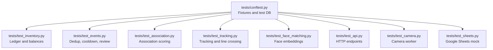

**Diagram sources**
- [conftest.py:1-99](file://tests/conftest.py#L1-L99)
- [test_inventory.py:1-199](file://tests/test_inventory.py#L1-L199)
- [test_events.py:1-236](file://tests/test_events.py#L1-L236)
- [test_association.py:1-104](file://tests/test_association.py#L1-L104)
- [test_tracking.py:1-127](file://tests/test_tracking.py#L1-L127)
- [test_face_matching.py:1-86](file://tests/test_face_matching.py#L1-L86)
- [test_api.py:1-242](file://tests/test_api.py#L1-L242)
- [test_camera.py:1-140](file://tests/test_camera.py#L1-L140)
- [test_sheets.py:1-219](file://tests/test_sheets.py#L1-L219)

**Section sources**
- [pytest.ini:1-6](file://pytest.ini#L1-L6)
- [README.md:474-494](file://README.md#L474-L494)

## Core Components
The core of the test framework is `tests/conftest.py`. It prepares the environment before any application code is loaded, ensuring deterministic behavior across all tests.

Key responsibilities:
- Create a temporary root directory for test data and logs.
- Force `APP_ENV=test`, disable Google Sheets, enable evidence, set bootstrap credentials, and configure processing parameters.
- Set `DATABASE_URL` to a SQLite file inside the temporary directory.
- Reload application settings so they read from the test environment.
- Reset the database schema and seed reference data before each test.
- Provide a SQLAlchemy session fixture that commits on success and rolls back afterward.
- Provide an admin user fixture and a factory for creating additional users.
- Provide a FastAPI `TestClient` without starting the full lifespan, avoiding background camera threads in unit tests.

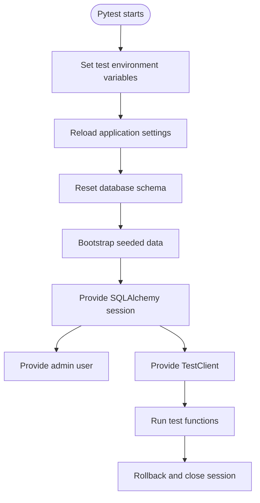

**Diagram sources**
- [conftest.py:17-37](file://tests/conftest.py#L17-L37)
- [conftest.py:40-99](file://tests/conftest.py#L40-L99)

**Section sources**
- [conftest.py:1-99](file://tests/conftest.py#L1-L99)

## Architecture Overview
The test architecture separates concerns between shared infrastructure and feature-specific tests:

- **Infrastructure layer**: `conftest.py` manages environment, database isolation, sessions, and HTTP client.
- **Service layer tests**: Unit-style tests call business services directly (`event_service`, `inventory_service`, `association_service`, `tracking_service`, `face_service`).
- **Integration layer tests**: HTTP tests use `FastAPI.testclient.TestClient` to exercise routes, authentication, authorization, CSRF, CSV export, and JSON APIs.
- **External dependency layer**: Google Sheets is mocked using fake worksheet/book objects; camera behavior is tested with a simulation source instead of real hardware.

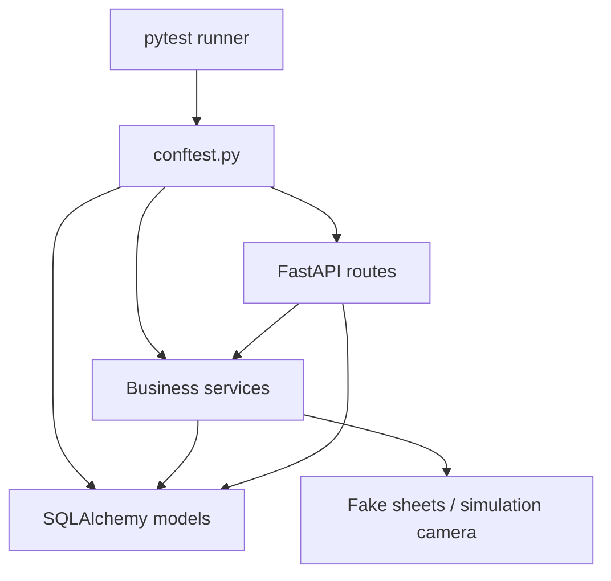

**Diagram sources**
- [conftest.py:1-99](file://tests/conftest.py#L1-L99)
- [test_api.py:1-242](file://tests/test_api.py#L1-L242)
- [test_sheets.py:1-219](file://tests/test_sheets.py#L1-L219)
- [test_camera.py:1-140](file://tests/test_camera.py#L1-L140)

## Detailed Component Analysis

### Test Database Isolation and Fixtures
The test database is isolated per test run. A fresh SQLite database is created under a temporary directory, and every test receives a clean schema plus seeded reference data. The `session` fixture wraps each test in a transaction-like boundary: it commits successful changes and rolls back afterwards, preventing state leakage between tests.

Important fixtures:
- `settings`: reloads application settings and ensures required directories exist.
- `fresh_database`: resets the database and bootstraps reference data automatically for every test.
- `session`: provides a scoped SQLAlchemy session.
- `admin_user`: returns the seeded admin user.
- `other_user_factory`: creates operator/viewer users for role-based tests.
- `client`: returns a FastAPI `TestClient` without starting camera lifespan threads.

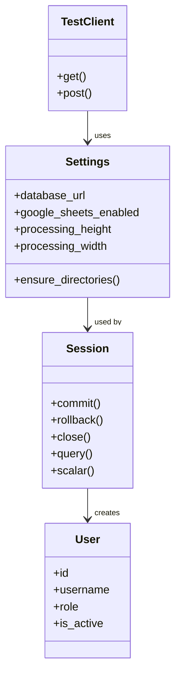

**Diagram sources**
- [conftest.py:40-99](file://tests/conftest.py#L40-L99)

**Section sources**
- [conftest.py:17-99](file://tests/conftest.py#L17-L99)

### Inventory Operations Testing
Inventory tests verify append-only ledger semantics, signed quantity normalization, pending candidates, confirmation and rejection flows, transfers, corrections, and discrepancy calculations.

Patterns used:
- Direct service calls to `inventory_service.record`, `confirm_event`, `reject_event`, and `balance_for`.
- Assertions on both database rows and computed balance fields.
- Parameterized tests for multiple event types and expected quantities.
- Cross-service interaction between `event_service` and `inventory_service`.

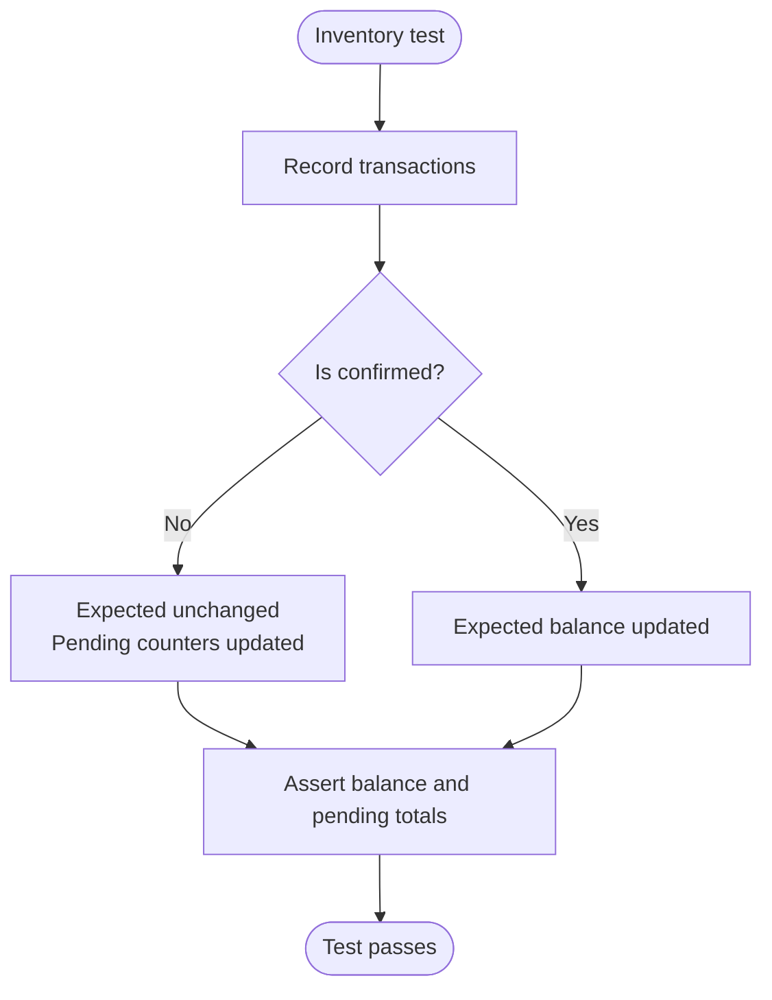

**Diagram sources**
- [test_inventory.py:13-199](file://tests/test_inventory.py#L13-L199)

**Section sources**
- [test_inventory.py:1-199](file://tests/test_inventory.py#L1-L199)

### Event Lifecycle Testing
Event tests cover deduplication within cooldown buckets, cooldown boundaries, camera-scoped uniqueness, public ID generation, initial verification status, review confirmation, rejection validation, one-time review enforcement, resync marking after rejection, counting queries, and pending sync events.

Key behaviors validated:
- Duplicate events with the same key and time bucket are ignored.
- Events outside the cooldown window create new records.
- Different cameras do not collide.
- Person events do not create inventory candidates.
- Review requires a non-empty reason for rejection.
- Rejection marks events for resynchronization.

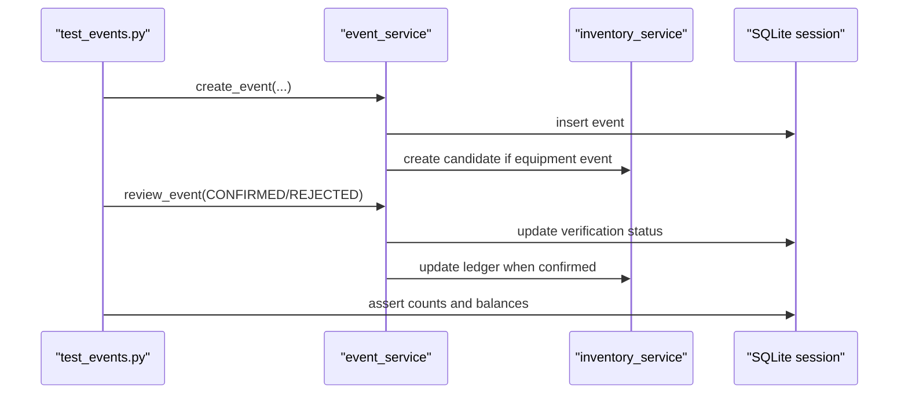

**Diagram sources**
- [test_events.py:15-236](file://tests/test_events.py#L15-L236)

**Section sources**
- [test_events.py:1-236](file://tests/test_events.py#L1-L236)

### Association Scoring Testing
Association tests validate how the system associates people with equipment while expressing uncertainty rather than guessing. They test strong associations, ambiguous cases, distant objects, short tracks, direction agreement, independent results for multiple objects, helper functions, and empty inputs.

Design patterns:
- Lightweight `TrackFeature` helpers for person and equipment.
- `AssociationEngine` produces association results with quality levels and reasons.
- Parametrized tests for thresholds and ratios.
- Explicit assertions on `AssociationQuality`, scores, and review flags.

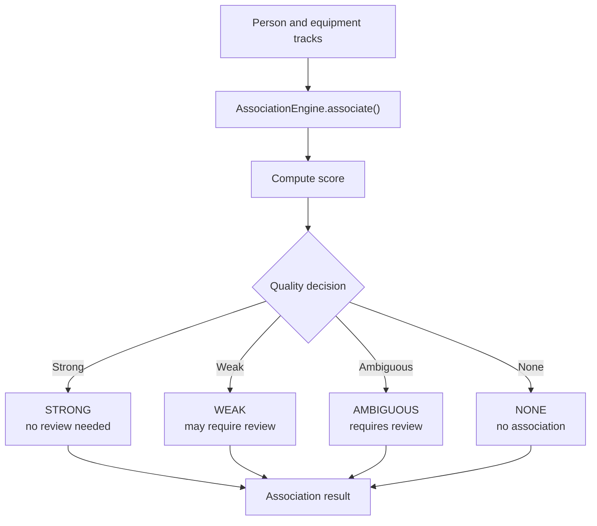

**Diagram sources**
- [test_association.py:12-104](file://tests/test_association.py#L12-L104)

**Section sources**
- [test_association.py:1-104](file://tests/test_association.py#L1-L104)

### Tracking Algorithms Testing
Tracking tests cover fallback tracker identity stability, track memory accumulation and pruning, face retry intervals, line crossing detection with cooldown and hysteresis, direction flipping, minimum track age, and point-in-polygon geometry.

Highlights:
- `SimpleTracker` maintains stable IDs for moving objects and assigns new IDs after disappearance.
- `TrackMemory` accumulates frames, velocity, and supports face recognition retry control.
- `LineCrossingDetector` implements IN/OUT detection with cooldown, hysteresis, flip support, and minimum track age.
- Geometry utilities are tested independently.

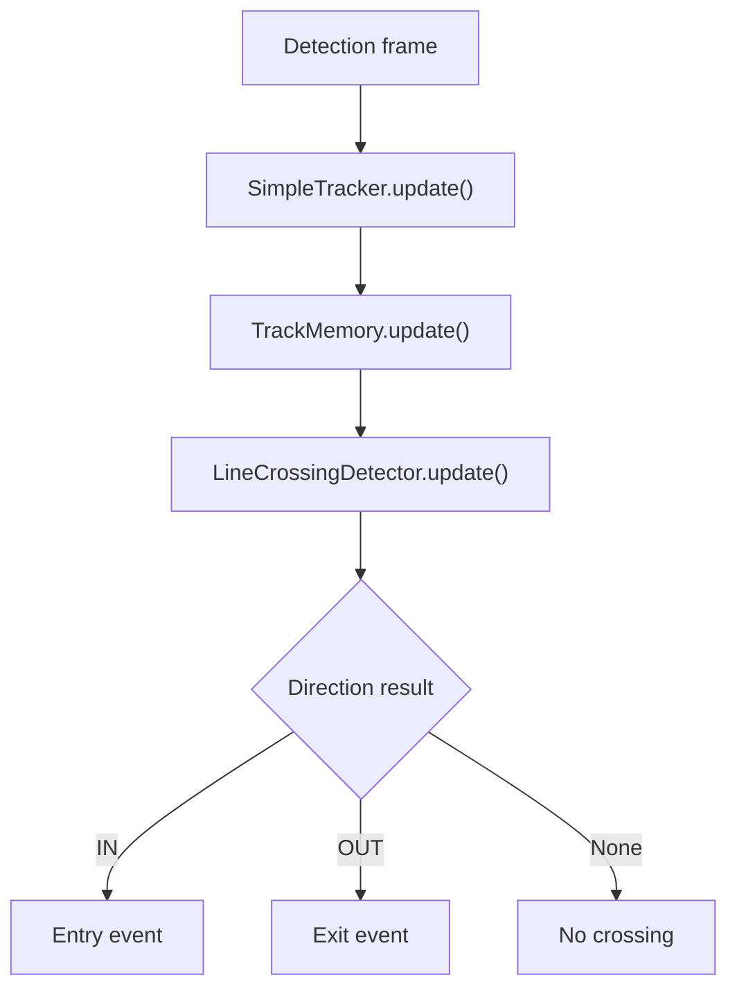

**Diagram sources**
- [test_tracking.py:26-127](file://tests/test_tracking.py#L26-L127)

**Section sources**
- [test_tracking.py:1-127](file://tests/test_tracking.py#L1-L127)

### Face Recognition Testing
Face matching tests verify embedding similarity logic without requiring model downloads. They test confident matches, unknown persons below threshold, uncertain matches due to small margins, best reference selection, empty galleries, dimension mismatches, and crop expansion behavior.

Patterns:
- NumPy vectors simulate embeddings.
- `match_embeddings` returns matched employee, label, score, and reason.
- `expand_person_crop` validates geometric cropping behavior.
- Assertions focus on boolean match decisions, labels, and numeric thresholds.

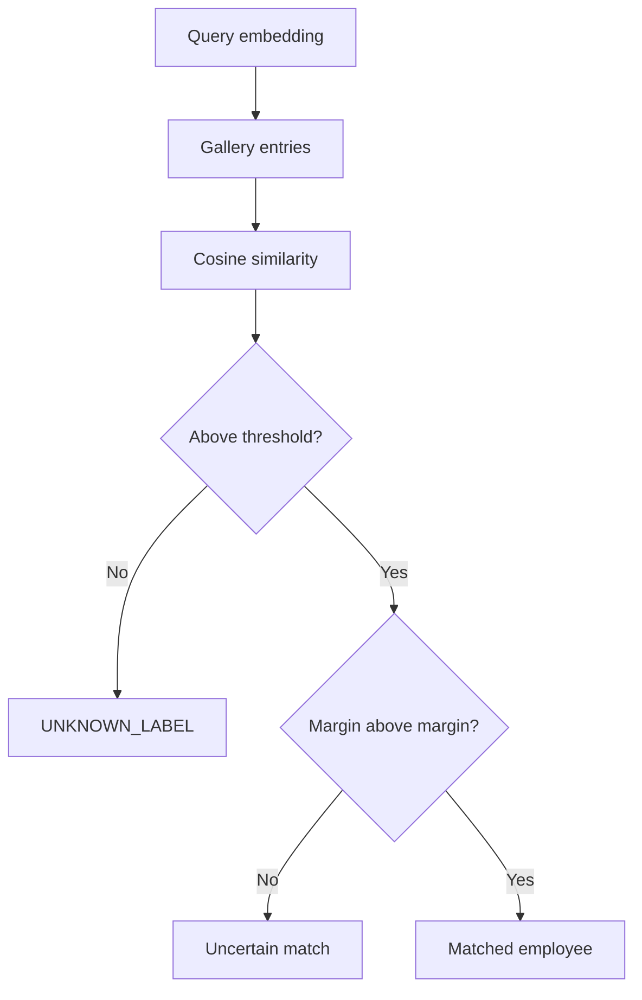

**Diagram sources**
- [test_face_matching.py:16-86](file://tests/test_face_matching.py#L16-L86)

**Section sources**
- [test_face_matching.py:1-86](file://tests/test_face_matching.py#L1-L86)

### HTTP Endpoint Testing
HTTP tests use FastAPI’s `TestClient` to validate pages, authentication, authorization, CSRF protection, inventory operations, review flow, JSON API output, CSV export encoding, error pages, evidence endpoint behavior, and dashboard rendering without cameras.

Key patterns:
- Helper functions extract CSRF tokens and perform login.
- Parameterized tests iterate over all dashboard pages.
- Role-based access is verified by creating operator users.
- CSV export is checked for UTF-8 BOM and column headers.
- Evidence endpoint rejects missing files with 404.

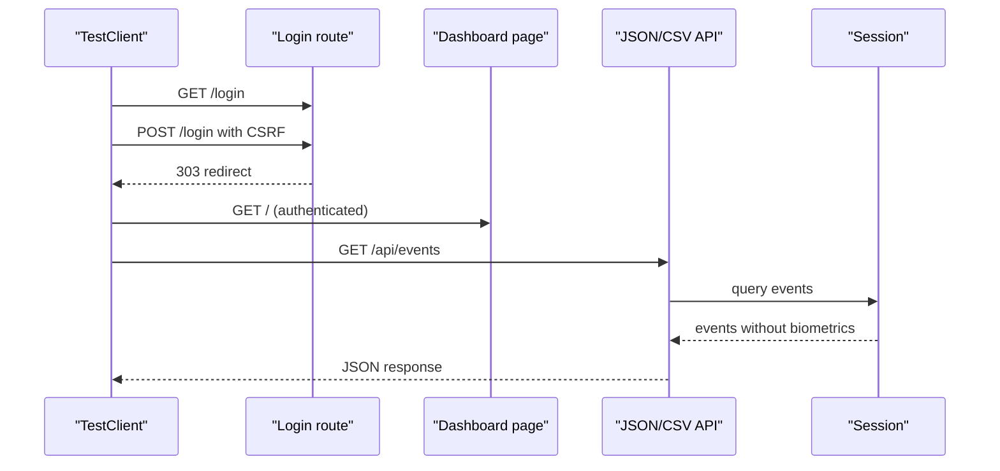

**Diagram sources**
- [test_api.py:18-242](file://tests/test_api.py#L18-L242)

**Section sources**
- [test_api.py:1-242](file://tests/test_api.py#L1-L242)

### Camera Service Testing
Camera tests validate missing source handling, offline status transitions, simulation frame generation, snapshot JPEG output, resizing behavior, and source parsing.

Approach:
- Use `SimulationSource` to avoid real cameras.
- Assert camera worker status transitions and frame metadata.
- Validate JPEG markers and shape constraints.
- Parametrize source type parsing.

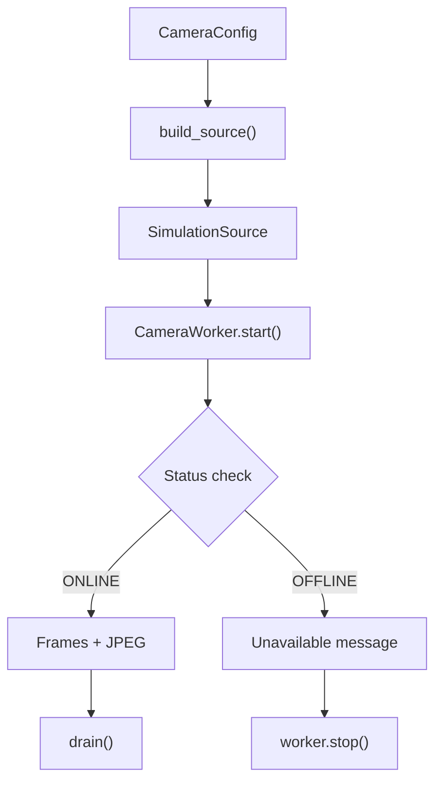

**Diagram sources**
- [test_camera.py:47-140](file://tests/test_camera.py#L47-L140)

**Section sources**
- [test_camera.py:1-140](file://tests/test_camera.py#L1-L140)

### Google Sheets Mocking Strategy
Google Sheets tests replace the real gspread client with fake worksheet and book objects. They verify retry policy, idempotent upserts, event deduplication by public ID, already-present row handling, failed upload bookkeeping, and status reporting.

Mock design:
- `FakeWorksheet` tracks appended rows, updates, and stored values.
- `FakeBook` simulates spreadsheet worksheets.
- `enabled_service` configures the service to believe Sheets is enabled but writes to in-memory structures.
- Failures are injected by overriding `_worksheet` and `_retry`.

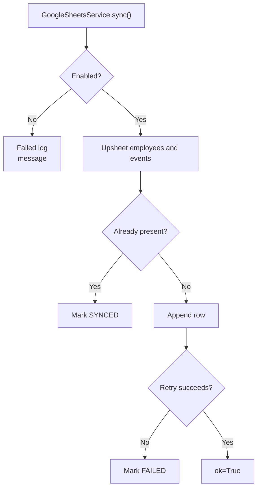

**Diagram sources**
- [test_sheets.py:22-219](file://tests/test_sheets.py#L22-L219)

**Section sources**
- [test_sheets.py:1-219](file://tests/test_sheets.py#L1-L219)

## Dependency Analysis
The test suite depends on:
- `pytest` for test discovery and execution.
- `sqlalchemy` for database interactions.
- `fastapi.testclient.TestClient` for HTTP testing.
- `numpy` for face embedding and image-related tests.
- Application modules under `app/` for services, models, enums, and configuration.

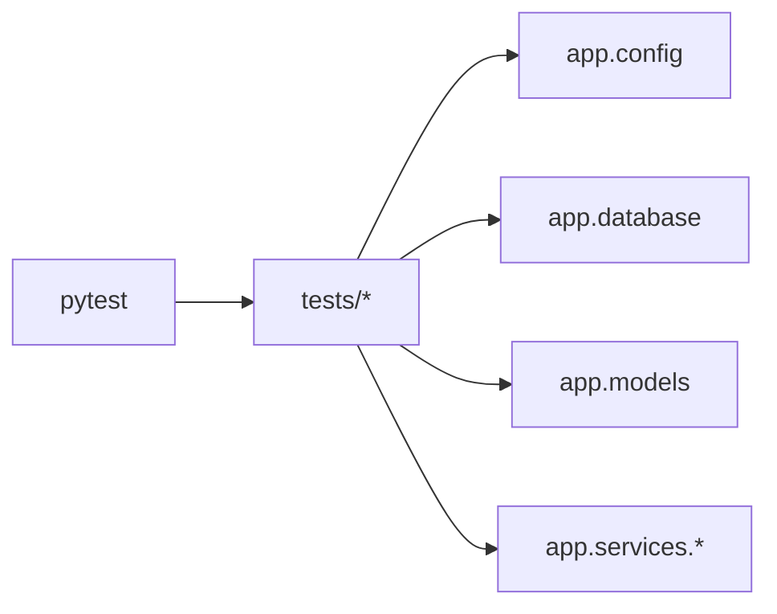

**Diagram sources**
- [pytest.ini:1-6](file://pytest.ini#L1-L6)
- [conftest.py:33-37](file://tests/conftest.py#L33-L37)
- [test_api.py:1-242](file://tests/test_api.py#L1-L242)

**Section sources**
- [pytest.ini:1-6](file://pytest.ini#L1-L6)
- [conftest.py:33-37](file://tests/conftest.py#L33-L37)

## Performance Considerations
- Tests avoid heavy AI inference by using simulation sources and pure math tests for face matching.
- Temporary SQLite databases prevent disk contention with production data.
- Background camera threads are intentionally avoided in unit tests by not entering the FastAPI lifespan context.
- Simulation mode reduces reliance on external hardware and network resources.
- Retry tests use zero-delay retries where appropriate to keep tests fast.

[No sources needed since this section provides general guidance]

## Troubleshooting Guide
Common issues and resolutions based on the test suite and documentation:

- **Tests touch production database**: Ensure `APP_ENV=test` and `DATABASE_URL` point to the temporary path configured in `conftest.py`.
- **CSRF failures in HTTP tests**: Always extract the token from the page before posting.
- **Role-based access errors**: Use `other_user_factory` to create operator/viewer users and log in with their credentials.
- **Google Sheets tests failing**: Confirm the fake book/worksheet setup and that `_retry` overrides behave as expected.
- **Camera tests timing out**: Use `wait_for` helper and ensure simulation source is configured correctly.
- **Face matching dimension mismatch**: Ensure embedding vectors have consistent dimensions in tests.

**Section sources**
- [conftest.py:17-37](file://tests/conftest.py#L17-L37)
- [test_api.py:18-108](file://tests/test_api.py#L18-L108)
- [test_sheets.py:83-104](file://tests/test_sheets.py#L83-L104)
- [test_camera.py:38-44](file://tests/test_camera.py#L38-L44)
- [test_face_matching.py:66-69](file://tests/test_face_matching.py#L66-L69)

## Conclusion
The test suite provides comprehensive coverage of the application’s core logic, integration points, and external integrations. It emphasizes isolation, determinism, and clear separation between unit, integration, and mock-based tests. The fixture layer centralizes environment setup, database reset, and HTTP client creation, making new tests straightforward to write and maintain.

[No sources needed since this section summarizes without analyzing specific files]

## Appendices

### Test Execution Commands
Run the full test suite with pytest:

```bat
python -m pytest
```

Configuration:
- Test path: `tests`
- Pattern: `test_*.py`
- Default options: `-ra`

**Section sources**
- [pytest.ini:1-6](file://pytest.ini#L1-L6)
- [README.md:474-494](file://README.md#L474-L494)

### Coverage Reporting Approaches
Although coverage configuration is not defined in the repository, common approaches include:
- Running `pytest --cov=app --cov-report=term-missing` for terminal output.
- Generating HTML reports with `--cov-report=html`.
- Integrating coverage gates in CI pipelines.

[No sources needed since this section provides general guidance]

### Best Practices for Writing New Tests
- Use `conftest.py` fixtures for database, session, admin user, and client.
- Prefer direct service calls for unit tests and `TestClient` for HTTP tests.
- Mock external dependencies like Google Sheets and camera hardware.
- Keep tests deterministic by using fixed timestamps, temporary directories, and controlled configurations.
- Assert both side effects and return values.
- Use parameterization for repeated scenarios.
- Avoid starting background processes unless explicitly testing asynchronous behavior.

[No sources needed since this section provides general guidance]